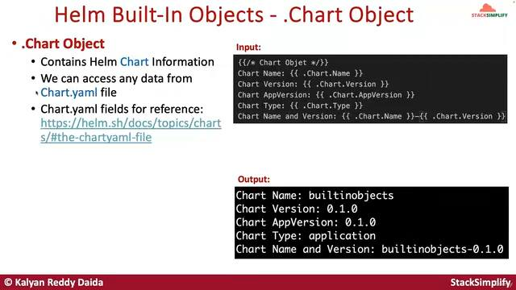
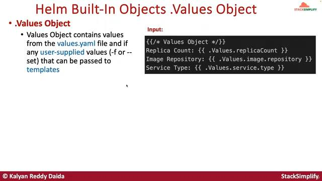
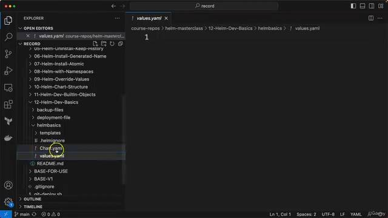
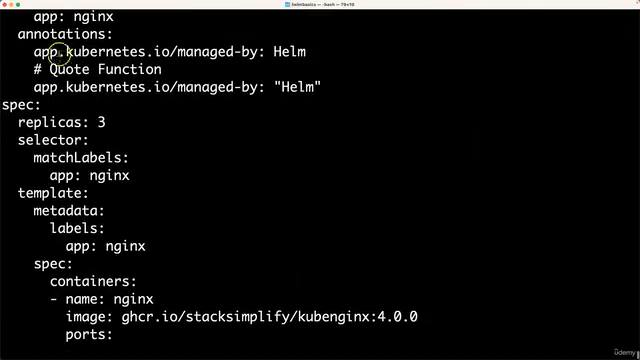
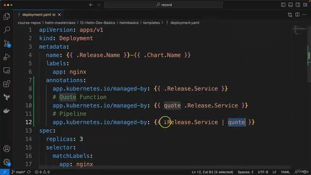
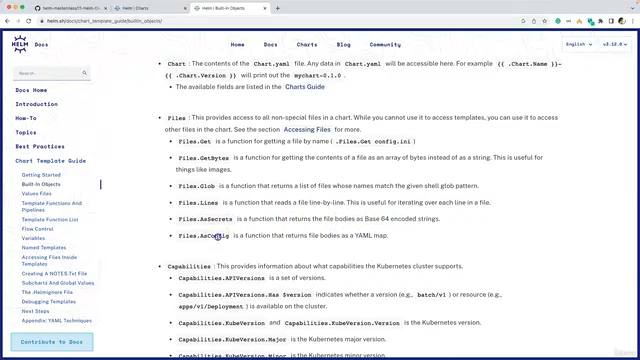
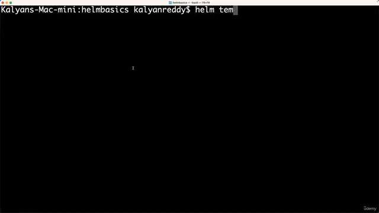

## 1. 这一节做什么

这一节覆盖 Helm Masterclass 的 P39–P44，目标不是泛泛介绍 Helm，而是把 Helm 模板里最常用的内置对象和模板函数跑通：`.Values`、`.Release`、`.Chart`、`.Capabilities`、`.Template`、`.Files`，以及模板动作、非法模板动作的报错、`quote`/`squote` 函数和 pipeline。

复现完成后你会得到两个可运行的最小 chart：

- `built-in-objects`：用 `templates/NOTES.txt` 打印内置对象和 `.Files` 的各种输出。
- `helm-basics`：把普通 Kubernetes Deployment 改造成 Helm 模板，演示 `.Release.Name`、`.Chart.Name`、`quote`、pipeline、非法 action element 报错。

课程输出里出现的 Kubernetes 版本是 `v1.27.2`，Helm 版本是 `3.12.1`。你的环境版本不同没关系，`Capabilities` 输出以实际为准。本节没有环境变量，不需要配置 env。

从学习路径上看，这一节的重点不是让你死记某个字段，而是建立“模板在渲染时能拿到哪些上下文”的概念。Helm 在渲染模板时，会把 release 信息、chart 元数据、values 配置、集群能力、当前模板路径、chart 内文件等内容组织成对象，再交给 Go template 引擎做字符串替换。你看到的 YAML 不是手写死的，而是由模板、对象和函数共同生成的结果。

如果把 Helm 模板和前端开发做对照，可以这样理解：`.Values` 很像组件的 `props` 或应用配置；`.Release` 很像一次请求或一次部署实例的上下文；`.Chart` 很像 `package.json` 里的包名、版本、应用版本；`.Capabilities` 很像运行时能力检测；`.Template` 很像当前正在渲染的组件文件路径；`.Files` 很像打包进产物里的静态资源读取接口。模板动作 `{{ ... }}` 则类似 JSX、Handlebars、Mustache 里的插值语法，只不过 Helm 使用的是 Go template 语法，字段名大小写敏感，函数调用和 pipeline 的写法也和 JavaScript 不一样。

本节实际操作时主要会用到 `helm template` 和 `helm install --dry-run` 两类命令。前者偏向“只渲染模板、输出清单”，后者偏向“模拟安装并显示 NOTES”。这两个命令的职责不同，看到的内容也不完全一样，后面复现时要特别区分。





## 2. 讲师原话

P39 先补讲了上一节漏掉的 `.Values`，然后进入 `.Release` 和 `.Chart`：

> "这是 release 对象。它包含 Helm 发布的信息。"
> —— p039 [00:56]

> "每当你运行 Helm install my app 101 时，my app 101 就是发布名称……我们可以通过 .release.name 获取它。"
> —— p039 [01:23]

这里讲师强调的 `myapp101` 不是镜像名，也不是容器名，而是 `helm install` 命令里传入的 release 名。模板中写 `.Release.Name` 时，取到的就是这次安装的 release 名称。前端对照一下，这很像一个页面实例或请求上下文里的 `requestId`、`deploymentId`：它不是业务数据本身，但它标识“这一次运行/这一次部署”。因此资源名里拼上 `.Release.Name` 后，同一个 chart 可以用不同 release 名安装多次，生成不同名称的 Kubernetes 资源。

P40 讲 `.Values`、`.Capabilities`、`.Template`：

> "values 对象包含来自 values.yml 文件的值。除此之外，它还包含用户提供的值……"
> —— p040 [00:00]

> "该对象提供 Kubernetes 集群支持哪些能力的信息。除此之外，它还提供我们的 Helm 版本……"
> —— p040 [01:23]

> "template 对象包含当前正在执行的模板的信息。"
> —— p040 [02:47]

这三句话分别对应三类上下文。`.Values` 是配置合并后的结果，既包含 `values.yaml` 里的默认值，也包含用户通过命令行或额外 values 文件传入的覆盖值；`.Capabilities` 描述集群和 Helm 自身能力，常用于判断 Kubernetes 版本或 Helm 版本；`.Template` 描述当前正在渲染的模板文件本身，例如模板路径和基础目录。前端对照来看，`.Values` 类似默认配置对象和用户传入配置的合并，`.Capabilities` 类似运行时 feature detection，`.Template` 类似当前组件文件的 `__filename` 或模块路径信息。

P41 讲 `.Files`：

> "files 对象提供对图表中所有非特殊文件的访问。因此，我们不能用它访问模板文件……"
> —— p041 [00:00]

> "files.get……提取该配置文件的内容……files.glob……返回文件列表……作为 Secret 时使用 base64 编码……作为配置时使用 YAML 映射。"
> —— p041 [01:23]–[04:12]

`.Files` 的关键限制是“非特殊文件”。也就是说，`templates/` 下的模板文件不是给你用 `.Files.Get` 随便读的；配置文件、静态文本这类 chart 内普通文件才适合通过 `.Files` 读取。`Get` 取单个文件内容，`Glob` 按模式选一组文件，`AsConfig` 把选中的内容组织成 YAML map，`AsSecrets` 把内容组织成 base64 编码结果。前端对照可以理解为：`Get` 像读取单个静态资源，`Glob` 像按 glob 批量匹配资源，`AsConfig`/`AsSecrets` 像把资源打包成不同输出格式。

P42 讲 template action / action element：

> "模板动作不过就是我们所看到的这些花括号……模板动作中间的任何内容都称为动作元素。"
> —— p042 [00:29]

这句话把术语说清楚了：`{{ ... }}` 整体是 template action，花括号中间的内容是 action element。你写在 action element 里的内容必须是 Helm/Go template 能识别的东西，比如对象字段、函数、变量、控制结构等。前端对照就是模板插值表达式：`{{ ... }}` 类似 JSX 的 `{...}` 或 Handlebars 的 `{{...}}`，但 Helm 的表达式不能随便写一个未定义的词，否则渲染阶段直接报错。

P43 故意写非法 action element：

> "第 4 行的 deployment.ml 出现解析错误。某个函数未定义。"
> —— p043 [00:28]–[00:54]

这个报错说明模板解析阶段就会检查函数是否存在。`something` 既不是内置函数，也不是已定义对象字段，所以 Helm 报 `function "something" is not defined`。这类错误和前端里调用未定义函数、引用未导入变量很像：不是运行时逻辑错，而是模板编译/解析阶段就失败。

P44 讲 `quote` 和 pipeline：

> "quote……把字符串用双引号包起来……管道是按顺序完成多项操作的高效方式……从左到右依次传递内容。"
> —— p044 [00:29]–[03:48]

`quote` 的作用是给字符串加双引号；pipeline 的作用是把多个处理步骤串起来。普通函数写法是“函数在左、参数在右”，例如 `quote .Release.Service`；pipeline 写法是“值在左、函数在右”，例如 `.Release.Service | quote`。前端对照很像函数组合：`quote(value)` 等价于 `value | quote`，再加 `upper` 就是 `value | quote | upper`，按从左到右的顺序依次处理。



## 3. 从零复现

### 3.1 准备目录

在任意工作目录执行：

```bash
mkdir -p helm-masterclass/built-in-objects/templates
mkdir -p helm-masterclass/built-in-objects/config-files
mkdir -p helm-masterclass/helm-basics/templates
cd helm-masterclass
```

这几条命令的完整解释如下。`mkdir -p` 的 `-p` 表示父目录不存在时一并创建，并且目标目录已存在时不报错，因此适合反复执行。前三条命令分别创建两个 chart 的基础目录：`built-in-objects/templates`、`built-in-objects/config-files`、`helm-basics/templates`；最后 `cd helm-masterclass` 进入工作根目录。常见错误是路径拼错、当前目录没有写权限，或者复制命令时把多行命令拆坏。排查时可以先执行 `pwd` 看当前目录，再用 `ls -la` 看目录是否真的创建出来。前端对照可以把它理解成项目脚手架初始化目录：先把组件目录、资源目录、模板目录摆好，再往里放文件。

最终目录结构：

```text
helm-masterclass/
├── built-in-objects/
│   ├── Chart.yaml
│   ├── values.yaml
│   ├── .helmignore
│   ├── myconfig1.toml
│   ├── config-files/
│   │   ├── myconfig2.toml
│   │   └── myconfig3.toml
│   └── templates/
│       ├── deployment.yaml
│       └── NOTES.txt
└── helm-basics/
    ├── Chart.yaml
    ├── values.yaml
    ├── .helmignore
    └── templates/
        ├── deployment.yaml
        └── NOTES.txt
```

说明：逐字稿里 ASR 写成 `nodes.txt`，但 Helm 真正用于安装后提示的文件名是 `templates/NOTES.txt`。本节复现用大写 `NOTES.txt`，否则 `helm install --dry-run` 不一定按 Helm 的 NOTES 机制显示。这个点课里没有明确纠正，属于你实际会撞上的文件名约定。

目录结构里有几个容易踩的点。第一，`Chart.yaml` 必须在 chart 根目录，否则 Helm 无法识别这是一个 chart。第二，`templates/` 下的 YAML 才会被当作模板渲染，配置文件放到 `config-files/` 或 chart 根目录，才能用 `.Files` 读取。第三，`.helmignore` 控制打包时忽略哪些文件，写错规则可能导致你以为存在的文件在 chart 包里不存在。前端对照类似项目里的 `src/`、`public/`、`.gitignore`：目录位置决定构建工具如何解释文件，忽略规则决定哪些资源会进入最终产物。

### 3.2 先复现 `built-in-objects` chart

进入 chart：

```bash
cd built-in-objects
```

执行渲染命令，只看模板是否能解析：

```bash
helm template myapp101 .
```

这条命令的完整解释是：`helm template` 表示只渲染模板，不向集群安装资源；`myapp101` 是本次渲染使用的 release 名；最后的 `.` 表示当前目录就是 chart 目录。输出会打印渲染后的 Kubernetes 清单。常见错误包括：当前目录没有 `Chart.yaml`、模板语法写错、YAML 缩进错误、字段名大小写错误。排查时先确认 `pwd` 在 `built-in-objects` 下，再确认 `ls Chart.yaml` 存在，然后看报错行号定位模板。前端对照类似执行一次构建命令：它只生成产物，不真正发布；如果模板语法写错，构建阶段就会失败。

查看 NOTES 和对象输出，用课程同款 dry-run：

```bash
helm install myapp101 . --dry-run
```

这条命令的完整解释是：`helm install` 表示模拟安装；`myapp101` 是 release 名；`.` 是 chart 路径；`--dry-run` 表示不真正创建资源，只输出将要安装的清单和 NOTES。它比 `helm template` 更贴近一次安装流程，因此更容易看到 `templates/NOTES.txt` 的输出。常见错误是环境没有可用集群时，某些 capabilities 查询可能失败；排查时先用 `helm template` 验证模板解析，再检查 `kubectl cluster-info` 或 `helm version`。前端对照类似 dry-run 发布预览：不真正上线，但按发布流程生成预览结果。

课程里还演示了把 `replicaCount` 从 `1` 改成 `5`，再跑一次，确认 `.Values` 来自 `values.yaml`：

```bash
# 手动把 values.yaml 中 replicaCount 改为 5 后执行
helm install myapp101 . --dry-run
```

这里的重点是验证 `.Values` 的来源和优先级。你改的是 chart 自带的 `values.yaml`，模板里的 `{{ .Values.replicaCount }}` 就会跟着变。常见错误是改错文件、缩进层级不对、把数字写成了带冒号的字符串，或者改完后没有保存就执行命令。排查时可以直接搜索 `replicaCount`，确认它位于顶层，并用 `helm template` 看渲染结果。前端对照类似修改默认配置或默认 props 后再构建一次，观察产物是否变化。

### 3.3 再复现 `helm-basics` chart

```bash
cd ../helm-basics
helm template myapp101 .
```

正常情况下，Deployment 名称会渲染成：

```text
myapp101-helm-basics
```

课程 P42 里先用了小写 `n` 的 `.release.name`，结果 release name 没有按预期出现，只出现了 chart 名。修复为大写 `.Release.Name` 后正常输出 `myapp101-helm-basics`。这就是 Helm 对象字段大小写敏感的实际后果。

这里的排查思路是：看到资源名不符合预期，先检查 action element 里的字段大小写，再检查 release 名是否传对，最后检查 chart 名是否来自 `Chart.yaml` 的 `name`。前端对照类似对象属性访问大小写写错：`user.name` 和 `user.Name` 不是一回事，模板里写错字段名不会“自动纠正”，而是表现为空值、报错或输出不符合预期。复现时不要把 `.Release.Name`、`.Chart.Name`、`.Values.replicaCount` 这些字段名凭记忆乱写，最好从 `NOTES.txt` 或模板文件里复制。

### 3.4 复现非法 action element 报错

把 `helm-basics/templates/deployment.yaml` 第 4 行临时改成：

```yaml
  name: {{ something }}
```

然后执行：

```bash
helm template myapp101 .
```

课程里会看到类似：

```text
parse error at deployment.yaml and line 4
function "something" is not defined
```

行号以你的文件实际内容为准。看完报错后必须改回：

```yaml
  name: {{ .Release.Name }}-{{ .Chart.Name }}
```

这个实验的目的是理解“模板解析错误”长什么样。`something` 不是对象字段，也不是函数，所以 Helm 在解析模板时直接失败。常见错误是改错行、忘记保存、改完后没有还原就继续做后面的 quote/pipeline 实验。排查时看报错里的文件名和行号，回到 `deployment.yaml` 对应行确认花括号内容；如果行号和你的文件对不上，可能是文件前面有增删行。前端对照类似编译期报 `something is not defined`：不是运行到那一行才错，而是模板/代码在编译阶段就被拒绝。

### 3.5 复现 quote 和 pipeline

在 `helm-basics/templates/deployment.yaml` 的 `metadata.annotations` 下保留这些 annotation：

```yaml
    app.kubernetes.io/managed-by: {{ .Release.Service }}
    app.kubernetes.io/managed-by-quoted: {{ quote .Release.Service }}
    app.kubernetes.io/managed-by-pipeline: {{ .Release.Service | quote }}
    app.kubernetes.io/managed-by-pipeline-upper: {{ .Release.Service | quote | upper }}
```

执行：

```bash
helm template myapp101 .
```

你会看到普通写法的 `helm` 没有双引号，`quote` 和 pipeline 写法会给 `helm` 加上双引号；再加 `upper` 后变成大写。课程 P44 还临时演示了 `upper`、`squote`、`lower` 的串接，但这些是测试，不是最终必须保留的 annotation。

这一段的常见错误是混淆函数调用和 pipeline 的参数位置。`quote .Release.Service` 是函数在前、参数在后；`.Release.Service | quote` 是值在前、函数在后。两者结果都可以给字符串加双引号，但写法不同。另一个常见错误是 pipeline 顺序写反，例如先 `upper` 再 `quote`，结果仍然有引号但大小写处理顺序不同；大多数情况下最终可读，但你要知道每一步在做什么。前端对照类似 `quote(value)` 和 `value.pipe(quote)`，或者数组方法链式调用：处理顺序从左到右，前一步输出是后一步输入。排查时先只保留一个 annotation，逐个增加函数，观察每一步输出变化。





## 4. 完整代码

以下文件可直接保存运行。没有省略号。代码块保持原样，便于直接复制；每个文件的作用和逐行含义在第 5 节展开。复制时注意保留文件名、目录层级和 YAML 缩进，不要因为 Markdown 显示而把空格吃掉。

### 4.1 `built-in-objects/Chart.yaml`

```yaml
apiVersion: v2
name: built-in-objects
description: A Helm chart for learning Helm built-in objects
type: application
version: 0.1.0
appVersion: "1.16.0"
```

### 4.2 `built-in-objects/values.yaml`

```yaml
replicaCount: 1

image:
  repository: nginx
  tag: "1.16.0"
  pullPolicy: IfNotPresent

service:
  type: ClusterIP
  port: 80

autoscaling:
  enabled: false
  minReplicas: 1
  maxReplicas: 100

affinity: {}

serviceAccount:
  create: true
  annotations: {}
  name: ""

podAnnotations: {}
```

### 4.3 `built-in-objects/.helmignore`

```text
.DS_Store
.git/
.gitignore
*.swp
*.bak
*.tmp
*~
```

### 4.4 `built-in-objects/myconfig1.toml`

```toml
message1 = "hello from config 1 line 1"
message2 = "hello from config 1 line 2"
message3 = "hello from config 1 line 3"
```

### 4.5 `built-in-objects/config-files/myconfig2.toml`

```toml
appName = "my app two"
appType = "db"
appConfigEnabled = true
```

### 4.6 `built-in-objects/config-files/myconfig3.toml`

```toml
appName = "my app three"
appType = "cache"
appConfigEnabled = false
```

### 4.7 `built-in-objects/templates/deployment.yaml`

```yaml
apiVersion: apps/v1
kind: Deployment
metadata:
  name: {{ .Release.Name }}-{{ .Chart.Name }}
  labels:
    app: {{ .Release.Name }}-{{ .Chart.Name }}
  annotations:
    app.kubernetes.io/managed-by: {{ .Release.Service }}
    app.kubernetes.io/managed-by-quoted: {{ quote .Release.Service }}
    app.kubernetes.io/managed-by-pipeline: {{ .Release.Service | quote }}
    app.kubernetes.io/managed-by-pipeline-upper: {{ .Release.Service | quote | upper }}
spec:
  replicas: {{ .Values.replicaCount }}
  selector:
    matchLabels:
      app: {{ .Release.Name }}-{{ .Chart.Name }}
  template:
    metadata:
      labels:
        app: {{ .Release.Name }}-{{ .Chart.Name }}
    spec:
      containers:
        - name: {{ .Chart.Name }}
          image: "{{ .Values.image.repository }}:{{ .Values.image.tag }}"
          imagePullPolicy: {{ .Values.image.pullPolicy }}
          ports:
            - name: http
              containerPort: {{ .Values.service.port }}
              protocol: TCP
```

### 4.8 `built-in-objects/templates/NOTES.txt`

```text
ROOT VALUES OBJECT
------------------
replicaCount: {{ .Values.replicaCount }}
image.repository: {{ .Values.image.repository }}
image.tag: {{ .Values.image.tag }}
service.type: {{ .Values.service.type }}
service.port: {{ .Values.service.port }}

RELEASE OBJECT
--------------
release.name: {{ .Release.Name }}
release.namespace: {{ .Release.Namespace }}
release.isUpgrade: {{ .Release.IsUpgrade }}
release.isInstall: {{ .Release.IsInstall }}
release.revision: {{ .Release.Revision }}
release.service: {{ .Release.Service }}

CHART OBJECT
------------
chart.name: {{ .Chart.Name }}
chart.version: {{ .Chart.Version }}
chart.appVersion: {{ .Chart.AppVersion }}
chart.type: {{ .Chart.Type }}
chart.name-version: {{ .Chart.Name }}-{{ .Chart.Version }}

CAPABILITIES OBJECT
-------------------
kubeVersion.major: {{ .Capabilities.KubeVersion.Major }}
kubeVersion.minor: {{ .Capabilities.KubeVersion.Minor }}
kubeVersion.version: {{ .Capabilities.KubeVersion.Version }}
helmVersion.version: {{ .Capabilities.HelmVersion.Version }}

TEMPLATE OBJECT
---------------
template.name: {{ .Template.Name }}
template.basePath: {{ .Template.BasePath }}

FILES OBJECT
------------
files.get myconfig1.toml:
{{ .Files.Get "myconfig1.toml" }}

files.glob asConfig:
{{ (.Files.Glob "config-files/*").AsConfig }}

files.glob asSecrets:
{{ (.Files.Glob "config-files/*").AsSecrets }}

files.lines myconfig1.toml:
{{ range .Files.Lines "myconfig1.toml" }}line: {{ . }}
{{ end }}

files.glob default:
{{ .Files.Glob "config-files/*" }}
```

### 4.9 `helm-basics/Chart.yaml`

```yaml
apiVersion: v2
name: helm-basics
description: A Helm chart for learning Helm basics
type: application
version: 0.1.0
appVersion: "0.1.0"
```

### 4.10 `helm-basics/values.yaml`

```yaml
# 课程 P42 说该 chart 的 values.yaml 为空。
# 这里保留为空值文件，不放业务配置。
```

### 4.11 `helm-basics/.helmignore`

```text
.DS_Store
.git/
.gitignore
*.swp
*.bak
*.tmp
*~
```

### 4.12 `helm-basics/templates/deployment.yaml`

```yaml
apiVersion: apps/v1
kind: Deployment
metadata:
  name: {{ .Release.Name }}-{{ .Chart.Name }}
  annotations:
    app.kubernetes.io/managed-by: {{ .Release.Service }}
    app.kubernetes.io/managed-by-quoted: {{ quote .Release.Service }}
    app.kubernetes.io/managed-by-pipeline: {{ .Release.Service | quote }}
    app.kubernetes.io/managed-by-pipeline-upper: {{ .Release.Service | quote | upper }}
spec:
  replicas: 1
  selector:
    matchLabels:
      app: {{ .Release.Name }}-{{ .Chart.Name }}
  template:
    metadata:
      labels:
        app: {{ .Release.Name }}-{{ .Chart.Name }}
    spec:
      containers:
        - name: {{ .Chart.Name }}
          image: nginx:1.16.0
          ports:
            - name: http
              containerPort: 80
              protocol: TCP
```

### 4.13 `helm-basics/templates/NOTES.txt`

```text
# 本 chart 在 P42–P44 不使用 NOTES 输出。
# 该文件可以是空文件；这里保留一个注释，方便确认文件存在。
```

## 5. 逐行解释

### 5.1 `Chart.yaml`

`apiVersion: v2` 表示 Helm 3 的 chart API。`name` 是 chart 名，P42 渲染时 `{{ .Chart.Name }}` 就取这里。`description`、`type: application`、`version: 0.1.0`、`appVersion` 都是课程里明确展示的字段。`version` 参与 chart 包版本，`appVersion` 是应用版本，二者不要混用。

进一步说，`Chart.yaml` 是 chart 的元数据入口，Helm 先读它来识别 chart 名称、版本、类型。模板里的 `.Chart.Name`、`.Chart.Version`、`.Chart.AppVersion`、`.Chart.Type` 都来自这个文件。常见错误包括：`name` 和目录名不一致但你以为会取目录名；`version` 写成不合法格式；`appVersion` 没加引号导致 YAML 类型推断变化；`apiVersion` 写错导致 Helm 3 不按预期解析。排查时先用 `helm show chart .` 或直接检查 `Chart.yaml`，再对照 `NOTES.txt` 输出。前端对照类似 `package.json`：`name`、`version`、`description` 是包元数据，构建和发布时会被读取，但业务代码不应随意改它们的含义。

### 5.2 `values.yaml`

`replicaCount: 1` 对应 P40 的 `.Values.replicaCount`。讲师把值改成 `5` 后重新 dry-run，输出变成 5，证明 `.Values` 读取 `values.yaml`。`image.repository: nginx` 对应 `.Values.image.repository`；P40 口述里听起来像 “Ingenix”，实际就是 nginx 镜像名。`service.type: ClusterIP` 对应 `.Values.service.type`，课程输出里能看到 `ClusterIP`。`autoscaling`、`affinity`、`serviceAccount`、`podAnnotations` 是 P39 提到的 values map 里常见字段，本复现保留但不强制使用。

`.Values` 的本质是“默认值和用户覆盖值合并后的配置对象”。你在 `values.yaml` 里写的是默认值，用户执行 `helm install` 时还可以通过额外 values 文件或命令行参数覆盖。模板里访问嵌套字段用点号，例如 `.Values.image.repository`。常见错误是缩进层级错误：`repository` 如果和 `image` 平级，`.Values.image.repository` 就取不到；另一个错误是把数字和字符串混用，比如端口被引号包成字符串后又参与需要数字的字段。排查时先看 `values.yaml` 的缩进，再用 `helm template` 渲染 NOTES 或 Deployment，确认每个字段实际输出。前端对照类似组件的默认 props 与用户传入 props 合并：默认值负责兜底，用户值负责覆盖，模板只负责读取合并后的结果。

### 5.3 `templates/deployment.yaml`

`name: {{ .Release.Name }}-{{ .Chart.Name }}` 是 P39 的核心：release 名由 `helm install myapp101` 传入，chart 名来自 `Chart.yaml`，拼起来就是资源名。P42 里把普通 Deployment 改成 Helm 模板，就是在这个位置放 action element。`{{ .Release.Service }}` 输出 `helm`。`{{ quote .Release.Service }}` 是函数调用写法：参数在函数右边。`{{ .Release.Service | quote }}` 是 pipeline 写法：左边值传给右边函数。`{{ .Release.Service | quote | upper }}` 继续把 quote 的结果传给 upper，所以最终变成带引号的大写字符串。

`replicas: {{ .Values.replicaCount }}` 让副本数来自 values。`image: "{{ .Values.image.repository }}:{{ .Values.image.tag }}"` 把仓库和 tag 拼成镜像地址。`containerPort: {{ .Values.service.port }}` 让容器端口来自 values。注意 YAML 引号：镜像整体用双引号包住，避免冒号被 YAML 误解析。

这一段还可以从“模板替换后的 YAML 是否合法”角度理解。Helm 先把 `{{ ... }}` 替换成字符串，再把结果交给 YAML 解析器。因此如果替换结果里有冒号、引号、特殊字符，可能影响 YAML 结构。比如镜像地址 `nginx:1.16.0` 本身带冒号，外面用引号包住更稳。`quote` 的作用就是主动给字符串加双引号，避免某些 YAML 类型推断或特殊字符问题。常见错误包括：对象字段大小写写错、pipeline 顺序写反、YAML 缩进被模板输出破坏、把注释写在 action element 里导致解析错误。排查时先运行 `helm template` 看渲染后的完整 YAML，再对照报错行号。前端对照类似 JSX 插值后生成 HTML：插值表达式写错会导致编译失败，生成内容里的引号/特殊字符也可能破坏目标格式。

### 5.4 `templates/NOTES.txt`

`.Values.*` 打印 values 对象；`.Release.Name`、`.Release.Namespace`、`.Release.IsUpgrade`、`.Release.IsInstall`、`.Release.Revision`、`.Release.Service` 打印 release 信息。课程里 `helm install --dry-run` 看到 install 场景下 `IsUpgrade` 为 false、`IsInstall` 为 true、revision 为 1、service 为 helm，具体布尔输出以实际 Helm 版本为准。

`.Chart.Name`、`.Chart.Version`、`.Chart.AppVersion`、`.Chart.Type` 来自 `Chart.yaml`。`.Capabilities.KubeVersion.Major`、`.Minor`、`.Version` 和 `.Capabilities.HelmVersion.Version` 来自集群与 Helm 版本；课程输出是 major 1、minor 27、Kubernetes `v1.27.2`、Helm `3.12.1`。`.Template.Name` 是当前模板完整路径，`.Template.BasePath` 是模板所在目录。

`.Files.Get "myconfig1.toml"` 读取 chart 根目录文件。`.Files.Glob "config-files/*"` 按 glob 选文件。`(.Files.Glob "config-files/*").AsConfig` 输出 YAML map；`.AsSecrets` 输出 base64 编码。`.Files.Lines "myconfig1.toml"` 按行读取，配合 `range` 逐行输出。`.Files.Glob "config-files/*"` 直接打印时不是人类友好格式，课程里也明确说它“not a human readable format”，所以最终常用 `AsConfig` 或 `AsSecrets`。

NOTES 的常见错误首先是文件名大小写：必须是 `templates/NOTES.txt`，不是 `nodes.txt`，也不是随便一个文本文件。其次，`helm template` 和 `helm install --dry-run` 的输出侧重点不同，看不到 NOTES 时先确认命令。再次，`.Files.Get` 的路径以 chart 根目录为基准，写 `config-files/myconfig2.toml` 才能读到子目录文件；不要写宿主机绝对路径，也不要用 `.Files.Get` 读 `templates/` 下的模板。排查时可以先在 NOTES 里只保留一个字段，确认 NOTES 能显示，再逐步加对象。前端对照类似构建信息报告：把版本、环境、资源清单打印出来，便于确认构建时到底读到了什么。

### 5.5 非法 action element

`{{ something }}` 不是 Helm 内置对象，也不是已定义函数，所以模板引擎解析时报 `function "something" is not defined`。课程 P43 用它说明：花括号里不能随便写词，必须是对象字段或函数/命名模板。这个实验不要留在最终文件里。

更细地区分一下：如果是字段名写错，可能报“can't evaluate field”一类错误；如果是裸词 `something`，Helm 会先把它当函数名查找，所以报 `function "something" is not defined`。常见排查方法是看报错里的文件名和行号，回到模板对应行，确认花括号内是不是 `something`、`foo`、`bar` 这类未定义词；确认后改回 `.Release.Name` 等合法对象字段。前端对照类似模板里写了未定义变量或未导入函数，编译阶段直接失败，而不是等到运行时才报错。

### 5.6 `quote`、`squote`、pipeline

`quote` 给字符串加双引号，`squote` 加单引号。`pipeline` 从左到右传值，和普通函数“参数在右”相反。课程 P44 演示了 `.Release.Service | quote | upper`，再加 `lower` 会变回小写；这些是测试注释，不是生产必需。实际写 Helm 模板时，YAML 里字符串加引号可以避免特殊字符和类型推断问题。

`quote` 和 `squote` 的输出本身包含引号字符，所以你在渲染结果里会看到 `"helm"` 或 `'helm'`。pipeline 的每一步都把前一步的输出作为下一步的输入，因此 `.Release.Service | quote | upper` 的顺序是：先取 `helm`，再加双引号得到 `"helm"`，最后转大写得到 `"HELM"`。常见错误是重复加引号，例如模板外层已经有引号，里面又用 `quote`，最终可能出现多层引号；另一个错误是以为 pipeline 会改变原对象，其实它只是生成新的字符串结果。排查时逐个函数叠加，先 `.Release.Service`，再 `| quote`，再 `| upper`，观察每一步输出。前端对照类似工具函数组合：`quote`、`upper`、`lower` 都是纯转换函数，pipeline 只是把调用链写得更直观。





## 6. 复现检查清单

- [ ] `helm version` 正常，课程环境输出 Helm `3.12.1`；你的版本可以不同。验证方式：在终端执行 `helm version`，确认能打印版本号且没有命令不存在、配置损坏等错误。
- [ ] `kubectl version` 能看到 Kubernetes 版本；课程环境是 `v1.27.2`。验证方式：执行 `kubectl version`，客户端版本和服务端版本有一项能看到即可；没有集群时至少确认客户端版本可读。
- [ ] `helm-masterclass/built-in-objects` 目录结构完整，包含 `Chart.yaml`、`values.yaml`、`.helmignore`、`myconfig1.toml`、`config-files/`、`templates/`。验证方式：在该目录执行 `find . -maxdepth 2 -type f | sort` 或 `ls -la`，逐项对照目录树。
- [ ] `cd built-in-objects && helm template myapp101 .` 不报错，Deployment 名渲染为 `myapp101-built-in-objects`。验证方式：运行命令后搜索输出里的 `name:` 字段，确认 Deployment 的 `metadata.name` 是目标值。
- [ ] `helm install myapp101 . --dry-run` 能看到 NOTES 输出。验证方式：运行命令后观察输出中是否出现 `ROOT VALUES OBJECT`、`RELEASE OBJECT` 等 NOTES 标题；如果没有，先检查文件名是否为 `templates/NOTES.txt`。
- [ ] NOTES 中 `release.name` 为 `myapp101`，`release.namespace` 为 `default`。验证方式：在 dry-run 输出里搜索 `release.name:` 和 `release.namespace:`，确认值分别为 `myapp101` 和 `default`；namespace 以你的实际执行上下文为准。
- [ ] NOTES 中 `release.isInstall` 为 `true`，`release.isUpgrade` 为 `false`，`release.revision` 为 `1`。验证方式：在 NOTES 的 `RELEASE OBJECT` 区域逐行对照，确认 install 场景下布尔值和 revision 符合预期。
- [ ] `chart.name` 为 `built-in-objects`，`chart.version` 为 `0.1.0`，`chart.appVersion` 为 `1.16.0`，`chart.type` 为 `application`。验证方式：对照 `Chart.yaml` 和 NOTES 的 `CHART OBJECT` 区域，逐项核对字段值。
- [ ] `chart.name-version` 输出 `built-in-objects-0.1.0`。验证方式：在 NOTES 中搜索 `chart.name-version:`，确认拼接结果中间是一个短横线，没有多余空格。
- [ ] `kubeVersion.major`、`kubeVersion.minor`、`kubeVersion.version`、`helmVersion.version` 有输出；具体值以你的环境为准。验证方式：在 `CAPABILITIES OBJECT` 区域确认四项都不为空；如果为空，检查是否使用了没有集群信息的渲染方式。
- [ ] `template.name` 包含 `built-in-objects/templates/NOTES.txt`。验证方式：在 `TEMPLATE OBJECT` 区域查看 `template.name`，确认路径指向当前 NOTES 模板。
- [ ] `template.basePath` 包含 `built-in-objects/templates`。验证方式：查看 `template.basePath` 是否为模板所在目录，而不是单个文件路径。
- [ ] `files.get myconfig1.toml` 输出三行配置内容。验证方式：在 `FILES OBJECT` 区域搜索 `message1`、`message2`、`message3`，确认三行都在。
- [ ] `files.glob asConfig` 输出 YAML map，包含 `myconfig2.toml`、`myconfig3.toml` 的内容。验证方式：在 `files.glob asConfig:` 下方搜索 `myconfig2.toml:`、`myconfig3.toml:` 以及 `appName`、`appType` 等字段。
- [ ] `files.glob asSecrets` 输出 base64 字符串。验证方式：观察 `files.glob asSecrets:` 下方是否为 base64 形式文本；它不是明文，看到编码结果即可。
- [ ] `files.lines myconfig1.toml` 按行列出三行。验证方式：在 `files.lines myconfig1.toml:` 下方数 `line:` 前缀出现次数，确认三行都有输出。
- [ ] 把 `replicaCount` 改成 `5` 后 dry-run，NOTES 中 `replicaCount` 变成 `5`。验证方式：修改 `values.yaml` 后重新运行 `helm install myapp101 . --dry-run`，搜索 `replicaCount:` 确认值是 `5`。
- [ ] `helm-masterclass/helm-basics` 中 `helm template myapp101 .` 渲染 Deployment 名为 `myapp101-helm-basics`。验证方式：进入 `helm-basics` 执行命令，搜索 `metadata.name` 确认拼接结果。
- [ ] 把 `name` 改成 `{{ something }}` 后出现 `function "something" is not defined` 的 parse error；看完必须改回。验证方式：执行 `helm template myapp101 .` 观察报错文本和行号，确认后立刻恢复为 `{{ .Release.Name }}-{{ .Chart.Name }}` 并再次渲染确认无报错。
- [ ] annotation 中普通 `.Release.Service` 输出 `helm`，`quote` 和 pipeline 输出带双引号的 `helm`。验证方式：在渲染结果里搜索 `managed-by` 系列 annotation，逐项比较有无双引号。
- [ ] `upper` 后输出大写；`squote` 后是单引号；`lower` 后是小写。以实际渲染为准。验证方式：临时增加或替换 annotation，分别运行 `helm template`，观察对应输出的大小写和引号形式，看完恢复最终文件。

## 7. 课里没讲但你会撞上的

| 现象 | 原因 | 怎么办 |
| --- | --- | --- |
| `NOTES.txt` 不显示，或 dry-run 看不到安装提示 | 逐字稿 ASR 写成 `nodes.txt`，但 Helm 约定的安装提示文件是 `templates/NOTES.txt`；文件名大小写和路径不符合约定时不一定会按 NOTES 机制显示 | 检查文件名必须是 `NOTES.txt`，位置必须是 `templates/` 下；用 `helm install myapp101 . --dry-run` 验证，必要时加 `--debug` 看详细过程。前端对照：构建入口文件名写错，构建工具就不会按入口处理。 |
| `.release.name` 没有按预期输出，或资源名只出现 chart 名/报错 | Helm 对象字段大小写敏感，正确字段是 `.Release.Name`；`.release.name` 不是等价写法 | 改成 `.Release.Name`，同时检查 `.Chart.Name`、`.Values.replicaCount` 等字段大小写；用 `helm template` 看渲染结果。前端对照：对象属性大小写写错不会自动纠正。 |
| `helm template` 看不到 NOTES | `helm template` 主要渲染 Kubernetes 清单，NOTES 更常通过 install/upgrade 的 dry-run 流程显示；两个命令输出不完全一样 | 用课程同款 `helm install myapp101 . --dry-run` 看 NOTES；先用 `helm template` 验证模板解析。不要因为 `helm template` 没显示 NOTES 就认为 NOTES 写错了。 |
| `--dry-run` 仍可能访问集群或报 capabilities 相关错误 | dry-run 不真正部署，但渲染 `.Capabilities` 等对象时可能仍需要集群信息；没有集群时行为受环境影响 | 没有集群时先用 `helm template` 跑通模板解析；有集群时再执行 dry-run，并用 `kubectl cluster-info`、`helm version` 排查环境。 |
| 再次 `helm install myapp101` 报 release 已存在 | 同一个 namespace 里已经存在同名 release；release 名不是可以随意重复的临时变量 | 用 `helm list` 查看已有 release，执行 `helm uninstall myapp101` 清理，或换一个新的 release 名重新安装。前端对照：同一个部署实例 ID 不能重复占用。 |
| `.Files.Get` 读 `templates/` 下的模板文件读不到 | `files` 对象访问的是 chart 内非特殊文件，模板文件属于特殊处理范围；课程明确说不能用来访问 template files | 把需要读取的配置放到 chart 根目录或 `config-files/` 等普通目录；路径以 chart 根目录为基准，不要写宿主机绝对路径。 |
| `.Files.Glob` 匹配为空，`AsConfig`/`AsSecrets` 输出空内容 | glob 路径写错、文件不在预期目录，或被 `.helmignore` 排除；匹配为空不一定会报错 | 先确认 `config-files/` 下文件存在，检查 glob 是否写成 `config-files/*`，检查 `.helmignore` 是否误排除；用 `helm template` 看 NOTES 输出。 |
| 把 `AsSecrets` 当成加密安全机制 | `AsSecrets` 只是 base64 编码，不是加密；base64 可逆，不能提供保密性 | 不要把它当 Secret 安全方案；敏感信息应使用 Kubernetes Secret、外部密钥管理或其他安全机制。课程只演示编码行为。 |
| `quote`/`squote`/pipeline 输出引号或大小写不符合预期 | 普通函数是“函数在左、参数在右”，pipeline 是“值在左、函数在右”；处理顺序和重复加引号都会影响结果 | 用 `quote .Release.Service` 或 `.Release.Service \| quote` 对比结果；按 `.Release.Service \| quote \| upper` 的顺序逐步叠加，确认每一步输出。前端对照：函数组合顺序写错，结果就会不同。 |
| 以为本节已经完整讲了空白裁剪 | P42 提到 controlling white spaces，但本节没有展开演示 `{{-`/`-}}` 的完整方案 | 需要空白裁剪时另查 Helm/Go template 的 `{{-` 和 `-}}` 语法；不要在本节复现里假设已经覆盖所有空白处理场景。 |
| 把 Helm 模板渲染理解成有锁、事务、并发控制的运行时 | 本节不涉及锁、事务、并发控制；模板渲染更像一次性的字符串模板求值，真正安装时的并发和冲突由 Helm/Kubernetes 处理 | 不要按 Node/JS 运行时并发锁去类比；先专注模板渲染结果，安装冲突、资源竞争等问题另按 Helm/Kubernetes 机制排查。 |