# Helm Masterclass P45–P51 复现文档：default、空白控制、indent/nindent、toYaml 与 if/else

## 1. 这一节做什么

这一节覆盖 Helm Masterclass 的 P45–P51，目标不是“知道几个函数”，而是从零做一个能跑起来的 Helm Chart，把下面这些东西全部串进同一个 Deployment 里：

- `default`：当值为空时给默认值。课里明确说：字符串的空是 `""`，数字的空是 `0`，列表的空是 `[]`，字典的空是 `{}`，布尔值的空是 `false`，`null` 也按空处理。
- 空白控制：`{{-` 去掉左侧空白，`-}}` 去掉右侧空白，`{{- ... -}}` 两边都去掉。
- `indent` / `nindent`：给多行字符串做缩进；`nindent` 会先加换行再缩进。
- `toYaml`：把 values.yaml 里的对象转成 YAML，再配合 `nindent` 塞进 Kubernetes 模板。
- `if / else if / else` + `eq`：根据 `myapp.env` 是否等于 `prod`、`qa` 等决定 replicas。
- `and` + 布尔检查：当 `retail.enableFeature=true` 且 `myapp.env=prod` 时，replicas 变成 6。

最终你会得到一个可执行的 chart 目录：

```text
helm-basics/
├── Chart.yaml
├── values.yaml
└── templates/
    ├── deployment.yaml
    └── indent-demo.yaml
```

前置条件：

```bash
helm version
kubectl version --client
kubectl cluster-info
```

建议使用 Helm 3.x 和任意可用 Kubernetes 集群（minikube、kind、Docker Desktop Kubernetes 都可以）。课里没有展开讲集群安装，这里也不额外编造。

这一节的学习方式建议是：先不要急着安装到集群，而是反复执行 `helm template` 看渲染结果。因为 P45–P51 的核心是“模板如何被渲染成 YAML”，很多错误在 `helm template` 阶段就能暴露出来。等到 `helm template` 输出稳定、缩进正确，再用 `helm install` 做集群验证。这样可以把“模板语法问题”和“集群环境问题”分开排查，避免一上来就被 Pod、镜像、网络或资源问题干扰。

从结果上看，这一节最后要得到的不只是一个能跑的 chart，还要能解释清楚：哪个值来自 `values.yaml`，哪个值被 `default` 兜底，哪个空格被 `{{-` 或 `-}}` 去掉了，哪一段 YAML 是 `toYaml` 转出来的，哪个条件分支决定了 replicas。只要这五类问题都能在渲染结果里找到对应位置，这一节就算复现成功。

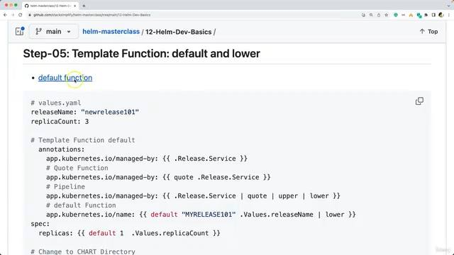

---

## 2. 讲师原话（带「—— pNNN [MM:SS]」）

下面只摘关键原话，方便对照。英文原话后面用中文解释。

> "`default` 带两个参数时……如果 `.bar` 的值为空，那么默认情况下，它会把 `foo` 作为值提供。"
> —— p045 [00:28]

`default` 接收两个参数：第一个是默认值，第二个是待检查的值；第二个为空时返回第一个。

> "对字符串而言，空值指的是……一对空双引号；对数值而言……是 0；对列表而言……是空列表；对字典而言……是花括号；对布尔值而言……是 `false`。"
> —— p045 [00:57]

字符串空是 `""`，数字空是 `0`，列表空是 `[]`，字典空是 `{}`，布尔空是 `false`；`null` 也按空处理。

> "前导空白……在 Helm 渲染期间会被忽略……尾随空白……也会被忽略。"
> —— p046 [01:24]

`{{-` 会忽略左侧空白，`-}}` 会忽略右侧空白。

> "`indent` 函数会把给定字符串中的每一行缩进到指定的缩进宽度。"
> —— p047 [00:00]

`indent` 把给定字符串的每一行缩进指定宽度。

> "`nindent` 函数与 `indent` 函数相同，区别在于它会在字符串开头添加一个换行……使用 `nindent` 时，它会在前面添加一个换行。"
> —— p047 [03:51]

讲师这里前后说法有点绕，但演示结果很清楚：`nindent` 会在缩进前先加一个换行。实际以演示为准：`indent` 不额外加换行，`nindent` 会先换行再缩进。

> "在 Helm 模板动作中使用 `toYaml` 函数，把对象转换为 YAML。"
> —— p048 [00:00]

`toYaml` 把对象、字典、列表等转成 YAML 文本，常配合 `nindent` 使用。

> "`if` 和 `else` 帮助我们在 Helm 模板中创建条件块。"
> —— p049 [00:00]

`if / else` 用来在模板里创建条件块。

> "`and` 函数返回两个或更多参数的布尔与结果。"
> —— p051 [00:29]

`and` 接收两个或更多参数，只有都为真时才为真；放在 `if` 里就是“同时满足”。

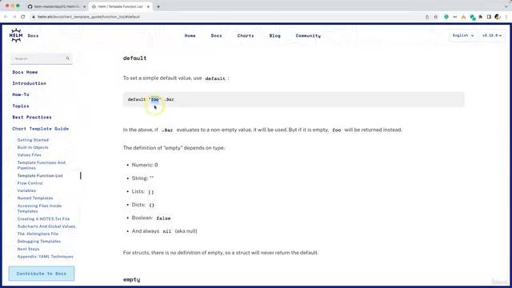

---

## 3. 从零复现

### 3.1 创建 chart 目录

```bash
mkdir -p helm-basics/templates
cd helm-basics
```

`mkdir -p` 会一次性创建父目录和子目录；这里创建 `helm-basics` 以及它下面的 `templates`。`cd helm-basics` 进入 chart 根目录。后面所有命令如果没有特别说明，都默认在这个 chart 根目录下执行。如果你在错误的目录执行 `helm template my-app-101 .`，最常见的结果是找不到 `Chart.yaml`，或者把上级目录当成 chart 根目录。

### 3.2 写入 Chart.yaml

```yaml
apiVersion: v2
name: helm-basics
description: Helm Masterclass P45-P51 demo chart
type: application
version: 0.1.0
appVersion: "1.0.0"
```

> 说明：逐字稿没有给 `Chart.yaml` 全文，这是 Helm 3 最小可用元数据，属于复现所需脚手架，不是讲师原话。

这里 `apiVersion: v2` 表示 Helm 3 的 chart API；`name` 是 chart 名称，模板里的 `.Chart.Name` 会读取它；`version` 是 chart 版本，`appVersion` 是应用版本。它们不是 Kubernetes 资源字段，而是 Helm 打包和渲染时使用的元数据。

### 3.3 写入 values.yaml

```yaml
releaseName: new-release-101

replicaCount: 4

resources:
  limits:
    cpu: 100m
    memory: 128Mi
  requests:
    cpu: 100m
    memory: 128Mi

myapp:
  env: prod
  retail:
    enableFeature: true
```

这份 `values.yaml` 是模板的输入数据。`releaseName` 用来演示 `default`；`replicaCount` 用来演示数字 `0` 被当成空值；`resources` 用来演示 `toYaml`；`myapp.env` 和 `myapp.retail.enableFeature` 用来演示 `if / else if / else` 和 `and`。

### 3.4 写入 templates/deployment.yaml

```yaml
apiVersion: apps/v1
kind: Deployment
metadata:
  name: {{ .Release.Name }}-{{ .Chart.Name }}
  labels:
    app: {{ .Chart.Name }}
  annotations:
    demo/default-release: {{ default "my-release-101" .Values.releaseName }}
    demo/default-replicas: {{ default 2 .Values.replicaCount }}
    demo/leading: "   {{- .Chart.Name }}   Kalyan"
    demo/trailing: "   {{ .Chart.Name -}}   Kalyan"
    demo/both: "   {{- .Chart.Name -}}   Kalyan"
spec:
{{- if and .Values.myapp.retail.enableFeature (eq .Values.myapp.env "prod") }}
  replicas: 6
{{- else if eq .Values.myapp.env "prod" }}
  replicas: 4
{{- else if eq .Values.myapp.env "qa" }}
  replicas: 2
{{- else }}
  replicas: 1
{{- end }}
  selector:
    matchLabels:
      app: {{ .Chart.Name }}
  template:
    metadata:
      labels:
        app: {{ .Chart.Name }}
    spec:
      containers:
        - name: {{ .Chart.Name }}
          image: nginx:1.25-alpine
          resources:
{{ toYaml .Values.resources | nindent 12 }}
```

这是本节的核心模板。它同时包含 `default`、空白控制、`if/else`、`and`、`eq`、`toYaml`、`nindent`。学习时不要把它当成一整块背下来，而是按 annotations、replicas 条件、resources 缩进三块分别看。

### 3.5 写入 templates/indent-demo.yaml

```yaml
apiVersion: v1
kind: ConfigMap
metadata:
  name: {{ .Release.Name }}-indent-demo
data:
  indent: "{{ .Chart.Name | indent 4 }}"
  nindent: |-
{{ .Chart.Name | nindent 4 }}
```

这个 ConfigMap 专门用来观察 `indent` 和 `nindent` 的差异。`indent` 的结果直接放进带引号的字符串里；`nindent` 配合 `|-` 块标量，方便看到“先换行、再缩进”的效果。

### 3.6 先渲染，不安装

```bash
helm template my-app-101 .
```

命令拆解：`helm template` 是 Helm 的渲染子命令；`my-app-101` 是本次渲染使用的 release 名称，模板里的 `.Release.Name` 会取到它；最后的 `.` 表示当前目录就是 chart 根目录。它会把渲染后的 Kubernetes YAML 输出到标准输出，不会像 `helm install` 那样创建 release。排查模板语法、缩进、默认值问题时，优先用这条命令。

你应该能看到一个 Deployment 和一个 ConfigMap。重点检查：

- `metadata.annotations` 里 `demo/default-release` 是否为 `new-release-101`。
- `demo/default-replicas` 是否为 `4`。
- `demo/leading`、`demo/trailing`、`demo/both` 的空格是否符合预期。
- `spec.replicas` 是否为 `6`，因为默认 `myapp.retail.enableFeature=true` 且 `myapp.env=prod`。
- `resources` 是否在容器下面正确缩进。

常见错误与排查：如果出现 `parse error`，先看报错行号，再检查 `{{-`、`-}}` 是否写成了 `{{ -` 或 `- }}`，以及 `if` 和 `end` 是否成对。如果出现 `mapping values are not allowed in this context`，通常不是“Kubernetes 不喜欢这个字段”，而是渲染后的 YAML 缩进或冒号附近结构不对。此时可以先把渲染结果重定向到文件：

```bash
helm template my-app-101 . > rendered.yaml
```

然后按报错行号查看 `rendered.yaml`。有时模板本身看起来没问题，但 `nindent` 宽度差一个空格，渲染后就会变成非法 YAML。

**与前端的对照：** 可以把 `values.yaml` 理解成前端应用里的配置对象，把 Helm 模板理解成“用配置对象生成文本”的模板函数。`if/else` 类似 JSX/Vue 模板里的条件渲染，`and` 类似 JavaScript 的 `&&`，空白控制类似对模板字符串做 `trim`。但要注意：YAML 的缩进不是排版，而是结构；前端代码缩进错了通常还能运行，YAML 缩进错了会直接解析失败。


> 如果出现 `parse error` 或 `mapping values are not allowed in this context`，先看报错行号，再检查 `{{-`、`-}}` 和 `nindent` 的缩进。课里 P45 就出现过“多了一个空格导致 parse error”的情况。

### 3.7 测试 default：字符串为空

```bash
helm template my-app-101 . --set releaseName=
```

看 `demo/default-release`，应该变成：

```yaml
demo/default-release: my-release-101
```

`--set releaseName=` 把 `releaseName` 覆盖成空字符串。`default "my-release-101" .Values.releaseName` 发现第二个参数为空字符串，于是返回第一个参数。验证时不要只看终端里有没有输出，建议用 `grep` 精确看这一行：

```bash
helm template my-app-101 . --set releaseName= | grep 'demo/default-release'
```

### 3.8 测试 default：数字为 0

```bash
helm template my-app-101 . --set replicaCount=0
```

看 `demo/default-replicas`，应该变成：

```yaml
demo/default-replicas: 2
```

因为 `default` 把 `0` 当作空值。这里要特别注意：如果你用 `--set-string replicaCount=0`，传入的是字符串 `"0"`，字符串 `"0"` 不是空字符串，因此 `default` 不一定会按“数字 0”处理。排查 `default` 不生效时，先确认你传的是空字符串、数字 0、布尔 false，还是非空字符串。

```bash
helm template my-app-101 . --set replicaCount=0 | grep 'demo/default-replicas'
```

### 3.9 测试空白控制

直接看渲染结果里的 annotations：

```yaml
demo/leading: "helm-basics   Kalyan"
demo/trailing: "   helm-basicsKalyan"
demo/both: "helm-basicsKalyan"
```

- `demo/leading` 用了 `{{-`，左侧三个空格被去掉，右侧空格保留。
- `demo/trailing` 用了 `-}}`，右侧空格被去掉，左侧空格保留。
- `demo/both` 两边都用，左右空格都被去掉。

验证时可以只看 annotations 区域：

```bash
helm template my-app-101 . | grep -E 'demo/(leading|trailing|both)'
```

如果输出里空格数量和你预期不一致，先检查减号是否紧贴大括号：`{{-` 是左裁剪，`-}}` 是右裁剪。写成 `{{ - .Chart.Name }}` 不是同一个意思，容易触发模板解析问题。

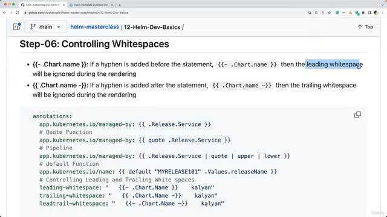

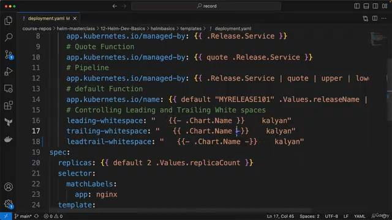

### 3.10 测试 indent / nindent

```bash
helm template my-app-101 . | grep -A 6 'indent-demo'
```

你会看到类似：

```yaml
data:
  indent: "    helm-basics"
  nindent: |-
    helm-basics
```

`indent` 在 `helm-basics` 前面加了 4 个空格；`nindent` 先换行，再缩进 4 个空格。

验证 `indent` 时重点看引号里的前导空格；验证 `nindent` 时重点看 `|-` 下面那一行的缩进。常见错误是把 `indent` 和 `nindent` 用反：在需要“先换行再接一段 YAML”的地方用了 `indent`，结果和上一行粘在一起；或者在已经有换行的位置又用 `nindent`，结果多出空行。多出空行不一定是错误，但必须确认层级仍然正确。

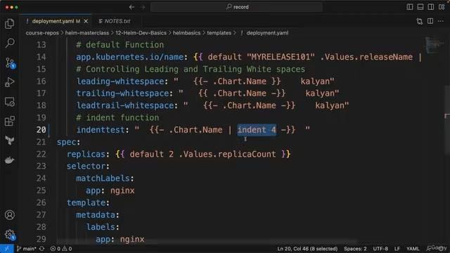

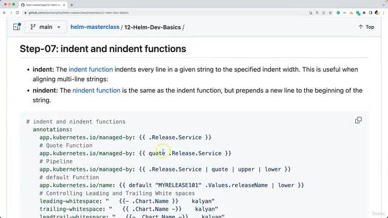

### 3.11 测试 toYaml 和 resources

看 Deployment 的容器部分，应该渲染成：

```yaml
          resources:
            limits:
              cpu: 100m
              memory: 128Mi
            requests:
              cpu: 100m
              memory: 128Mi
```

这里 `toYaml .Values.resources` 负责把对象转成 YAML，`nindent 12` 负责整体缩进 12 个空格，保证 `limits` 和 `requests` 在 `resources` 下面。

可以用下面的命令截取容器资源部分：

```bash
helm template my-app-101 . | grep -A 8 'resources:'
```

常见错误是 `toYaml` 后面忘记接 `| nindent 12`，或者宽度写错。宽度不是随便写的：要看 `resources:` 这一行在 Kubernetes 清单里的父级缩进。如果 `resources:` 在容器下缩进 10 个空格，那么它下面的 `limits`、`requests` 通常要在更深一层。`nindent 12` 不是魔法数字，而是为了和当前 Deployment 模板的层级匹配。

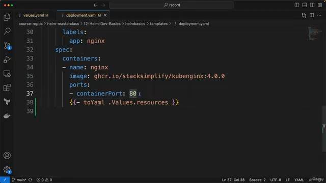

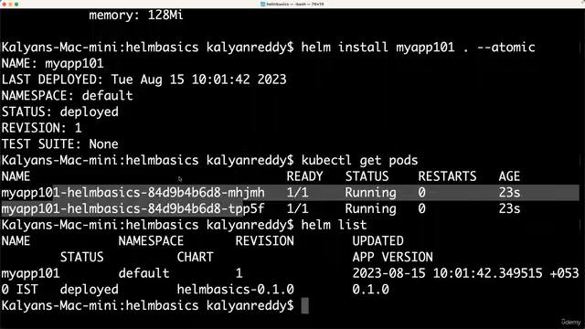

### 3.12 测试 if/else + eq

默认 `myapp.env=prod` 且 `retail.enableFeature=true`，所以：

```bash
helm template my-app-101 . | grep -A 2 'spec:'
```

应看到：

```yaml
spec:
  replicas: 6
```

关闭 retail 功能：

```bash
helm template my-app-101 . --set myapp.retail.enableFeature=false
```

应看到：

```yaml
spec:
  replicas: 4
```

切到 QA：

```bash
helm template my-app-101 . --set myapp.env=qa
```

应看到：

```yaml
spec:
  replicas: 2
```

切到其他环境：

```bash
helm template my-app-101 . --set myapp.env=uat
```

应看到：

```yaml
spec:
  replicas: 1
```

验证时建议四个场景分别执行并用 `grep` 看 `replicas`：

```bash
helm template my-app-101 . | grep 'replicas:'
helm template my-app-101 . --set myapp.retail.enableFeature=false | grep 'replicas:'
helm template my-app-101 . --set myapp.env=qa | grep 'replicas:'
helm template my-app-101 . --set myapp.env=uat | grep 'replicas:'
```

如果第一个场景没有输出 6，先检查 `myapp.retail.enableFeature` 是否真的是布尔 `true`，再检查 `myapp.env` 是否精确等于 `"prod"`。`eq` 是字符串相等比较，大小写和多余空格都会影响结果。

**与前端的对照：** 这段逻辑很像：

```js
const replicas =
  enableFeature && env === "prod" ? 6 :
  env === "prod" ? 4 :
  env === "qa" ? 2 :
  1;
```

Go template 的分支顺序也是从上到下匹配，第一个为真的分支生效，所以 `and` 的 6 副本条件必须放在 `else if eq .Values.myapp.env "prod"` 之前。

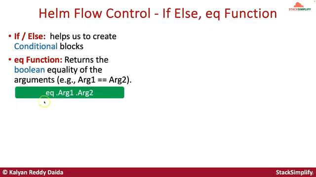

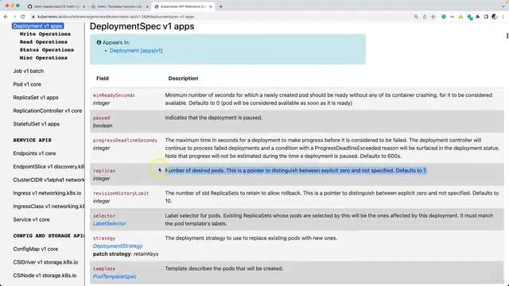

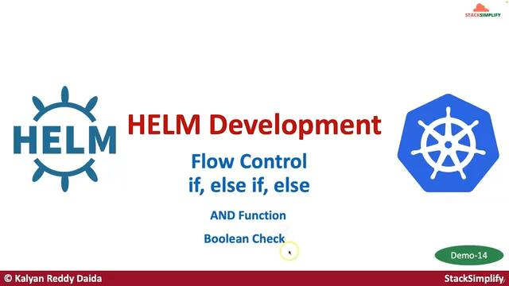

### 3.13 安装到集群并验证

```bash
helm install my-app-101 . --atomic
kubectl get pods
helm list
```

如果默认值下 `retail.enableFeature=true` 且 `myapp.env=prod`，应该创建 6 个 Pod。具体列名以你的 `kubectl` 版本为准。

命令解释：`helm install my-app-101 . --atomic` 中的 `my-app-101` 是 release 名称，`.` 是 chart 目录；`--atomic` 用于让安装在失败时不要留下半成品 release，具体行为以你使用的 Helm 版本文档和 `helm install --help` 为准。`kubectl get pods` 查看 Pod 是否被创建；`helm list` 查看 release 是否存在。若安装失败，先看 Helm 输出，再用 `kubectl get events` 或 `kubectl describe` 查看集群侧原因。

清理：

```bash
helm uninstall my-app-101
helm list
```

清理后 `helm list` 里不应再看到 `my-app-101`。如果安装前已经有同名 release，`helm install` 会报名称冲突，此时先 `helm list` 确认，再决定卸载旧 release 或换一个 release 名称。

---

## 4. 完整代码

### 4.1 `helm-basics/Chart.yaml`

```yaml
apiVersion: v2
name: helm-basics
description: Helm Masterclass P45-P51 demo chart
type: application
version: 0.1.0
appVersion: "1.0.0"
```

### 4.2 `helm-basics/values.yaml`

```yaml
releaseName: new-release-101

replicaCount: 4

resources:
  limits:
    cpu: 100m
    memory: 128Mi
  requests:
    cpu: 100m
    memory: 128Mi

myapp:
  env: prod
  retail:
    enableFeature: true
```

### 4.3 `helm-basics/templates/deployment.yaml`

```yaml
apiVersion: apps/v1
kind: Deployment
metadata:
  name: {{ .Release.Name }}-{{ .Chart.Name }}
  labels:
    app: {{ .Chart.Name }}
  annotations:
    demo/default-release: {{ default "my-release-101" .Values.releaseName }}
    demo/default-replicas: {{ default 2 .Values.replicaCount }}
    demo/leading: "   {{- .Chart.Name }}   Kalyan"
    demo/trailing: "   {{ .Chart.Name -}}   Kalyan"
    demo/both: "   {{- .Chart.Name -}}   Kalyan"
spec:
{{- if and .Values.myapp.retail.enableFeature (eq .Values.myapp.env "prod") }}
  replicas: 6
{{- else if eq .Values.myapp.env "prod" }}
  replicas: 4
{{- else if eq .Values.myapp.env "qa" }}
  replicas: 2
{{- else }}
  replicas: 1
{{- end }}
  selector:
    matchLabels:
      app: {{ .Chart.Name }}
  template:
    metadata:
      labels:
        app: {{ .Chart.Name }}
    spec:
      containers:
        - name: {{ .Chart.Name }}
          image: nginx:1.25-alpine
          resources:
{{ toYaml .Values.resources | nindent 12 }}
```

### 4.4 `helm-basics/templates/indent-demo.yaml`

```yaml
apiVersion: v1
kind: ConfigMap
metadata:
  name: {{ .Release.Name }}-indent-demo
data:
  indent: "{{ .Chart.Name | indent 4 }}"
  nindent: |-
{{ .Chart.Name | nindent 4 }}
```

### 4.5 渲染结果检查方式

在 chart 根目录执行：

```bash
helm template my-app-101 .
```

如果只想保存渲染结果用于逐行检查：

```bash
helm template my-app-101 . > rendered.yaml
```

然后查看 `rendered.yaml` 中的 annotations、replicas、resources、indent-demo 四个区域。这个文件不是最终要提交的源文件，只是排查用的中间产物。

---

## 5. 逐行解释

这一节把前面的模板拆开解释。读的时候建议一边打开 `templates/deployment.yaml`，一边执行 `helm template` 对照渲染结果。

1. `apiVersion: apps/v1` 和 `kind: Deployment` 是 Kubernetes 资源声明，表示要生成一个 Deployment。Helm 负责把模板渲染成 YAML，Kubernetes 负责解释这个 YAML。
2. `metadata.name: {{ .Release.Name }}-{{ .Chart.Name }}` 使用 Helm 内置对象。`.Release.Name` 来自 `helm template` 或 `helm install` 传入的 release 名称；`.Chart.Name` 来自 `Chart.yaml` 的 `name`。所以执行 `helm template my-app-101 .` 时，名称通常会渲染成 `my-app-101-helm-basics`。
3. `labels.app: {{ .Chart.Name }}` 给 Deployment 自身打标签。后面的 selector 和 Pod template labels 也会用到同一个值，保证选择器能匹配到 Pod。
4. `demo/default-release: {{ default "my-release-101" .Values.releaseName }}` 演示字符串默认值。`default` 的第一个参数是兜底值，第二个参数是实际值。当 `.Values.releaseName` 为空字符串时，结果是 `my-release-101`。
5. `demo/default-replicas: {{ default 2 .Values.replicaCount }}` 演示数字默认值。因为 `default` 把数字 `0` 当成空值，所以 `--set replicaCount=0` 时会得到 `2`。
6. `demo/leading: "   {{- .Chart.Name }}   Kalyan"` 演示左裁剪。`{{-` 会去掉 action 左侧的空白，因此 `"   ` 中的三个空格被裁掉，而 action 右侧的三个空格保留。
7. `demo/trailing: "   {{ .Chart.Name -}}   Kalyan"` 演示右裁剪。`-}}` 会去掉 action 右侧的空白，因此 `Kalyan` 前面的三个空格被裁掉，而 action 左侧的三个空格保留。
8. `demo/both: "   {{- .Chart.Name -}}   Kalyan"` 演示两边裁剪。左侧三个空格和右侧三个空格都被去掉，所以 `helm-basics` 和 `Kalyan` 直接相连。
9. `{{- if and .Values.myapp.retail.enableFeature (eq .Values.myapp.env "prod") }}` 是第一个条件分支。`and` 要求两个条件同时为真：`enableFeature` 为真，并且 `env` 等于 `prod`。满足时设置 `replicas: 6`。
10. `{{- else if eq .Values.myapp.env "prod" }}` 是第二个分支。如果 `enableFeature` 为假，但环境仍然是 `prod`，则设置 `replicas: 4`。
11. `{{- else if eq .Values.myapp.env "qa" }}` 是第三个分支。环境为 `qa` 时设置 `replicas: 2`。
12. `{{- else }}` 是兜底分支。其他环境设置 `replicas: 1`。最后必须有 `{{- end }}` 结束条件块。
13. `selector.matchLabels.app` 和 `template.metadata.labels.app` 必须一致。否则 Deployment 可能创建成功但无法正确管理 Pod。
14. `containers[].name: {{ .Chart.Name }}` 给容器命名；`image: nginx:1.25-alpine` 是示例镜像。这里不涉及镜像构建，只是用现成镜像验证 Deployment。
15. `resources:` 下面使用 `{{ toYaml .Values.resources | nindent 12 }}`。管道含义是：先把 `.Values.resources` 转成 YAML 文本，再把这段文本交给 `nindent 12`。`nindent` 会先加换行，再给每一行加 12 个空格缩进。
16. `indent-demo.yaml` 中 `indent: "{{ .Chart.Name | indent 4 }}"` 把 chart 名称缩进 4 个空格后放进字符串；`nindent: |-` 下面的 `{{ .Chart.Name | nindent 4 }}` 先换行再缩进 4 个空格，所以 `|-` 块里能看到缩进后的内容。
17. `helm template my-app-101 .` 是本地渲染检查的核心命令；`--set key=value` 是命令行覆盖 values 的方式；`helm install ... --atomic` 是安装到集群并带失败清理策略的方式；`helm uninstall` 是卸载 release。

常见错误与排查可以集中记成三句话：模板语法错误先看 `helm template` 的报错行号；YAML 解析错误先看渲染后的实际缩进；值不符合预期先看 `--set` 传进去的类型和路径。比如 `default` 不生效，不一定是函数写错，也可能是你传了非空字符串；`replicas` 不是 6，不一定是 `and` 写错，也可能是 `enableFeature` 不是布尔真值。

**与前端的对照：** Go template 的 `if/else if/else` 和前端条件渲染一样，都是“命中的第一个分支生效”；`and` 和 `&&` 一样，都是短路逻辑；`toYaml` 类似 `JSON.stringify` 后再格式化；`indent/nindent` 类似模板字符串的换行和缩进控制。但 Helm 模板最终产出的是 YAML，不是 HTML/JS，所以缩进和空行会直接影响解析结果。

---

## 6. 复现检查清单

- [ ] chart 目录存在，且包含 `Chart.yaml`、`values.yaml`、`templates/deployment.yaml`、`templates/indent-demo.yaml`。  
  验证：在 `helm-basics` 下执行 `find . -maxdepth 2 -type f`，确认四个文件都在。

- [ ] `Chart.yaml` 能被 Helm 识别。  
  验证：执行 `helm lint .`，至少不应出现 chart 元数据缺失导致的错误。

- [ ] 默认渲染能同时生成 Deployment 和 ConfigMap。  
  验证：执行 `helm template my-app-101 . | grep -E 'kind: (Deployment|ConfigMap)'`，应看到两种 kind。

- [ ] `default` 对字符串空值生效。  
  验证：执行 `helm template my-app-101 . --set releaseName= | grep 'demo/default-release'`，期望看到 `my-release-101`。

- [ ] `default` 对数字 0 生效。  
  验证：执行 `helm template my-app-101 . --set replicaCount=0 | grep 'demo/default-replicas'`，期望看到 `2`。

- [ ] 空白控制符合预期。  
  验证：执行 `helm template my-app-101 . | grep -E 'demo/(leading|trailing|both)'`，分别检查左侧空格、右侧空格、两侧空格是否被裁剪。

- [ ] `indent` 和 `nindent` 输出可区分。  
  验证：执行 `helm template my-app-101 . | grep -A 6 'indent-demo'`，确认 `indent` 的字符串有前导空格，`nindent` 的内容在 `|-` 下面换行并缩进。

- [ ] `toYaml` 生成的 resources 缩进正确。  
  验证：执行 `helm template my-app-101 . | grep -A 8 'resources:'`，确认 `limits`、`requests` 位于 `resources` 的下一层，且 `cpu`、`memory` 位于更深一层。

- [ ] 默认条件下 replicas 为 6。  
  验证：执行 `helm template my-app-101 . | grep 'replicas:'`，期望看到 `replicas: 6`。

- [ ] 关闭 feature 后 replicas 为 4。  
  验证：执行 `helm template my-app-101 . --set myapp.retail.enableFeature=false | grep 'replicas:'`，期望看到 `replicas: 4`。

- [ ] QA 环境 replicas 为 2。  
  验证：执行 `helm template my-app-101 . --set myapp.env=qa | grep 'replicas:'`，期望看到 `replicas: 2`。

- [ ] 其他环境 replicas 为 1。  
  验证：执行 `helm template my-app-101 . --set myapp.env=uat | grep 'replicas:'`，期望看到 `replicas: 1`。

- [ ] 能安装到集群并看到 release。  
  验证：执行 `helm install my-app-101 . --atomic`，再执行 `helm list`，确认 release 存在；执行 `kubectl get pods` 查看 Pod。

- [ ] 能清理 release。  
  验证：执行 `helm uninstall my-app-101`，再执行 `helm list`，确认 `my-app-101` 不再出现。

---

## 7. 课里没讲但你会撞上的（表格：现象 / 原因 / 怎么办）

| 现象 | 原因 | 怎么办 |
|---|---|---|
| `parse error`，提示模板附近有错误 | 常见于 `{{-`、`-}}` 写法不对，或 `if`/`end` 不配对 | 看报错行号；检查减号是否紧贴大括号；数一遍 `if` 和 `end` 是否成对 |
| `mapping values are not allowed in this context` | 渲染后的 YAML 缩进或冒号结构不合法，不一定是 Helm 函数本身错 | 执行 `helm template my-app-101 . > rendered.yaml`，按报错行号检查渲染后 YAML 的缩进 |
| `error converting YAML to JSON: yaml: line ... did not find expected key` | YAML 层级错乱，常见于 `nindent` 宽度不对或 `toYaml` 后没有正确缩进 | 对照 `resources:` 的父级缩进，检查 `nindent` 数字；不要凭视觉猜，保存渲染结果逐行看 |
| `default` 没有给默认值 | 传入的值不是空值，例如字符串 `"0"`、带空格字符串，或 values 路径写错 | 用 `--set` 时确认类型；检查 `.Values` 路径；用 `helm template` 对照实际渲染 |
| `replicaCount=0` 后仍然是 0，没有变成默认值 | 可能用了字符串 `"0"`，字符串 `"0"` 不是空字符串 | 用数字形式 `--set replicaCount=0`；排查时不要混用 `--set-string` |
| `replicas` 不是 6 | `myapp.retail.enableFeature` 不是布尔真值，或 `myapp.env` 不是精确的 `prod` | 执行 `--set myapp.env=prod --set myapp.retail.enableFeature=true` 再渲染；检查 values 层级 |
| `resources` 跑到了错误的层级 | `toYaml` 输出后缩进宽度不对，或忘记加 `nindent` | 看 `resources:` 当前缩进；用 `| nindent 12` 把转换结果整体缩进到容器下一层 |
| `indent` 和 `nindent` 结果不符合预期 | 把“加缩进”和“先换行再加缩进”混用了 | 记住 `indent` 不额外加换行，`nindent` 会先加换行；在需要接一段 YAML 时通常用 `nindent` |
| `helm install` 报 release 名称冲突 | 集群里已经存在同名 release | 先 `helm list` 查看；执行 `helm uninstall my-app-101`，或换一个 release 名称 |
| Pod 数量与 replicas 不一致 | Deployment 可能还没滚动完成，或 Pod 因镜像、资源、调度等原因未就绪 | 先 `kubectl get deploy` 看期望副本，再 `kubectl get pods`、`kubectl describe pod` 和 `kubectl get events` 排查 |
| `helm template` 能过，`helm install` 失败 | 模板渲染没问题，但集群侧资源、权限、命名空间或镜像拉取有问题 | 保留 Helm 报错；用 `kubectl get events`、`kubectl describe` 查集群侧原因 |