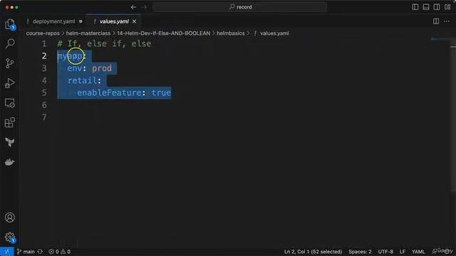
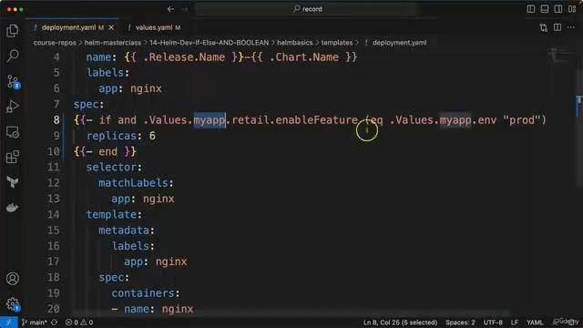
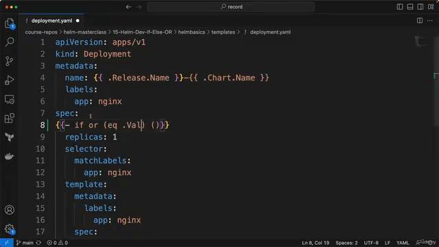
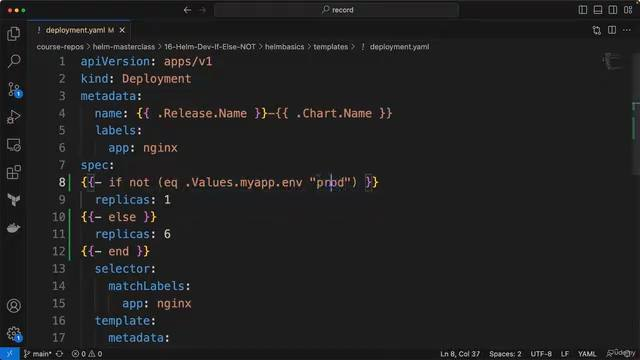
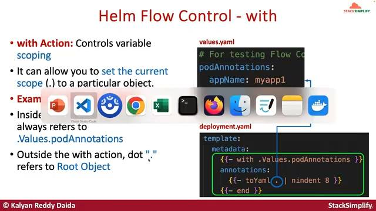
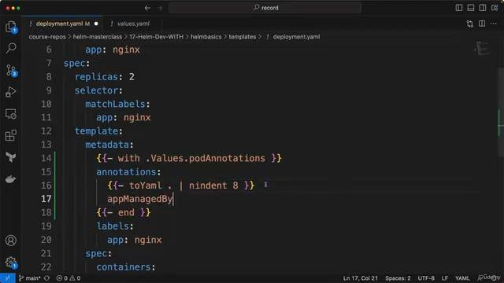
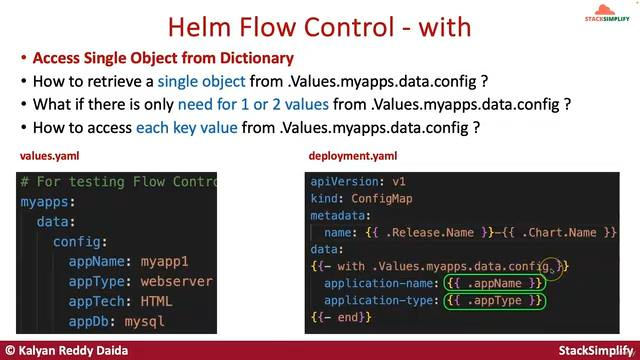
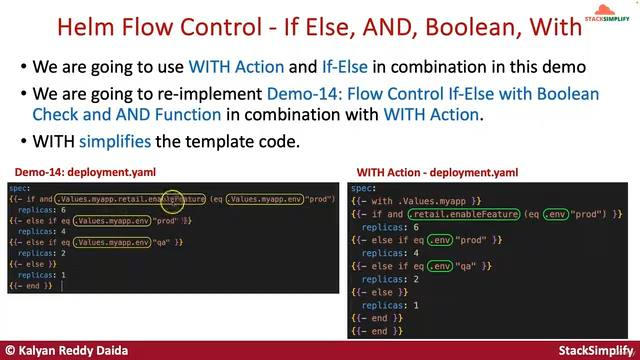
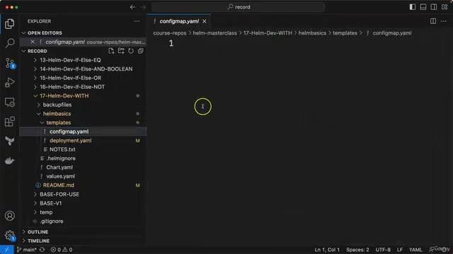
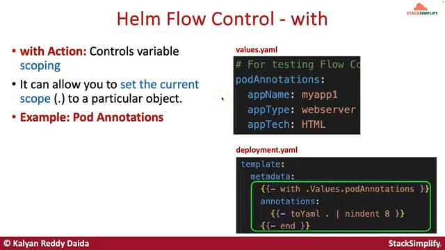

## 1. 这一节做什么

这一节覆盖 Helm Basics 的 P52–P58，核心不是讲 Helm 的安装，而是把 Helm 模板里的**流程控制与作用域**真正落到一个 chart 的 `templates/deployment.yaml` 里，并反复用 `helm template`、`helm install`、`kubectl get pods`、`helm get manifest`、`helm uninstall` 验证结果。

学完并照着做，你应该能得到一个可运行的 Helm chart，按功能分成几个可切换的 demo：

1. 用 `if / else if / else` + `and` + `eq` 控制 `replicas`：当 `myapp.retail.enablefeature` 为真且 `myapp.env` 为 `prod` 时给 6 个副本；否则按 `prod`、`qa`、其他环境分别给 4、2、1。  
2. 用 `or` 把条件改成：`prod` 或 `uat` 都走 6 副本；`qa` 走 2；其他走 1。  
3. 用 `not` 做布尔取反：不是 `prod` 就给 1，否则给 6。  
4. 用 `with` 把作用域切到 `.Values.podAnnotations`，再用 `toYaml . | nindent 8` 渲染 Pod annotations。  
5. 在 `with` 里面访问根对象：必须用 `$`，例如 `$.Release.Service`、`$.Chart.Name`。  
6. 用 `with` 从字典里只取单个 key，例如从 `.Values.myapps.data.config` 中取 `.appName`、`.appType`，生成 ConfigMap。  
7. 用 `with` + `if/else` 重写第 1 个 demo，把重复的 `.Values.myapp` 省掉，让模板更短。

课里用到的关键命令是：

```bash
helm template <release-name> .
helm template <release-name> . --set myapp.env=prod
helm install <release-name> . --atomic
kubectl get pods
helm get manifest <release-name>
helm list
helm uninstall <release-name>
```

依赖版本：逐字稿没有给出 Helm 或 Kubernetes 的具体版本，也没有要求锁版本。你需要在机器上确认：

```bash
helm version
kubectl version --client
kubectl cluster-info
```

能正常输出即可。镜像也不是本节重点，课里没讲用哪个镜像；下面为了让 Deployment 可运行，用 `nginx:1.25` 作为占位镜像，你本地如果没有网络拉取，可以换成本地已有镜像。

环境变量名：课里没讲，也不需要设置环境变量。所有可变值都走 `values.yaml` 或 `--set`。

---

## 2. 讲师原话

P52 讲 `if` 与 `and` 的组合时，讲师说：

> "我们会创建一个带前导空格的 Helm 模板动作：`if` 条件为 `.values.myapp.retail.enablefeature` 且 `eq .values.myapp.env prod`，两者都为真时就生成六个副本。"
> —— p052 [00:54]

随后他改成 `false` 观察默认行为：

> "我们把它改成 `false`……可以看到这里没有指定副本数，这意味着默认会创建一个副本。"
> —— p052 [03:19]

接着补上 `else if` 分支：

> "`if`、`else if`……如果只是在 `prod` 环境，副本数会是 4……如果切到 `QA`，则为 2……最后进入 `else`，副本数为 1。"
> —— p052 [04:15]

P53 讲 `or`：

> "`or` 函数返回两个或更多参数的布尔或值……只要其中任一参数为真，对应的 `if` 逻辑就会执行。"
> —— p053 [00:00]

P54 讲 `not`：

> "`not` 函数呢？它返回其参数的布尔取反值。"
> —— p054 [00:00]

P55 讲 `with`：

> "`with` 动作控制变量的范围。因此，它允许你把当前范围设置为某个特定对象。"
> —— p055 [00:00]

P56 讲 `with` 内访问根对象：

> "要在 `with` 动作内部访问根对象，我们需要用 `$` 给根对象加前缀。"
> —— p056 [00:00]

P57 讲从字典取单个对象：

> "使用 `with` 时，如何从字典中访问单个对象……即 `.app.name` 和 `.app.type`。"
> —— p057 [00:00]

P58 讲 `with` + `if/else`：

> "我们会把 `with` 动作和 `if else` 组合使用……`with` 能简化 Helm 模板代码。"
> —— p058 [00:00]



---

## 3. 从零复现

下面按“先能跑，再逐个 demo 替换 deployment”的方式做。课里没有给完整仓库压缩包，也没有讲 `Chart.yaml` 的写法；但 Helm chart 没有 `Chart.yaml` 不能运行，所以这里补一个最小 `Chart.yaml`，并明确标注：**`Chart.yaml` 和镜像名是课里没讲、为了复现补齐的**。

### 3.0 建目录

建议目录如下。每个 demo 一个独立 chart，避免不同 `deployment.yaml` 混在同一个 chart 里互相冲突：

```text
helm-basics-course/
├── 14-helm-dev-if-else-and/
│   └── helm-basics/
│       ├── Chart.yaml
│       ├── values.yaml
│       └── templates/
│           └── deployment.yaml
├── 15-helm-dev-if-else-or/
│   └── helm-basics/
│       ├── Chart.yaml
│       ├── values.yaml
│       └── templates/
│           └── deployment.yaml
├── 16-helm-dev-if-else-not/
│   └── helm-basics/
│       ├── Chart.yaml
│       ├── values.yaml
│       └── templates/
│           └── deployment.yaml
├── 17-helm-dev-with/
│   └── helm-basics/
│       ├── Chart.yaml
│       ├── values.yaml
│       └── templates/
│           ├── deployment.yaml
│           └── configmap.yaml
└── 18-helm-dev-with-if-else/
    └── helm-basics/
        ├── Chart.yaml
        ├── values.yaml
        └── templates/
            └── deployment.yaml
```

创建目录：

```bash
mkdir -p helm-basics-course/14-helm-dev-if-else-and/helm-basics/templates
mkdir -p helm-basics-course/15-helm-dev-if-else-or/helm-basics/templates
mkdir -p helm-basics-course/16-helm-dev-if-else-not/helm-basics/templates
mkdir -p helm-basics-course/17-helm-dev-with/helm-basics/templates
mkdir -p helm-basics-course/18-helm-dev-with-if-else/helm-basics/templates
```

每个 `helm-basics/` 下都放同一份 `Chart.yaml` 和同一份 `values.yaml`。如果你只想跑一个 demo，也可以只建一个目录，然后按下面代码替换 `templates/deployment.yaml`。

### 3.1 P52：boolean + and + if/else if/else

进入 P52 chart：

```bash
cd helm-basics-course/14-helm-dev-if-else-and/helm-basics
helm template myapp101 .
```

默认 `values.yaml` 里 `myapp.env=prod`、`myapp.retail.enablefeature=true`，期望输出里有：

```yaml
replicas: 6
```

然后测试：

```bash
helm template myapp101 . --set myapp.retail.enablefeature=false
helm template myapp101 . --set myapp.env=qa
helm template myapp101 . --set myapp.env=dev
helm template myapp101 . --set myapp.env=null
```

讲师的顺序是：先把 `enablefeature` 改 `false` 时，如果模板里只有第一个 `if`，渲染结果里没有 `replicas` 字段，Kubernetes 默认按 1 个副本处理；后面加上 `else if` 后，`prod + false` 会走到 4 副本。复现时建议你按这个顺序理解，不要一上来只盯最终代码。



### 3.2 P53：or

进入 P53 chart：

```bash
cd helm-basics-course/15-helm-dev-if-else-or/helm-basics
helm template myapp1 . --set myapp.env=prod
helm template myapp1 . --set myapp.env=uat
helm template myapp1 . --set myapp.env=qa
helm template myapp1 . --set myapp.env=dev
helm template myapp1 . --set myapp.env=null
```

期望：

- `prod`：`replicas: 6`
- `uat`：`replicas: 6`
- `qa`：`replicas: 2`
- `dev`：`replicas: 1`
- `null`：走 `else`，`replicas: 1`



### 3.3 P54：not

进入 P54 chart：

```bash
cd helm-basics-course/16-helm-dev-if-else-not/helm-basics
helm template myapp1 . --set myapp.env=prod
helm template myapp1 . --set myapp.env=qa
helm template myapp1 . --set myapp.env=null
```

期望：

- `prod`：`not (prod == prod)` 为 `false`，走 `else`，输出 `replicas: 6`
- `qa`：`qa == prod` 为 `false`，`not false` 为 `true`，输出 `replicas: 1`
- `null`：同样不是 `prod`，输出 `replicas: 1`



### 3.4 P55：with + toYaml + nindent

进入 P55 chart：

```bash
cd helm-basics-course/17-helm-dev-with/helm-basics
helm template myapp1 .
```

期望 Deployment 的 `spec.template.metadata.annotations` 下出现：

```yaml
appName: myapp1
appType: web server
appTechnology: HTML
```

注意：`toYaml . | nindent 8` 里的 `8` 是空格数，必须和你的缩进层级对齐。课里讲师数了 8 个空格。



### 3.5 P56：with 内用 `$` 访问根对象

仍然在 P56 对应的 deployment 里，在 annotations 下追加：

```yaml
appManagedBy: {{ $.Release.Service }}
chartName: {{ $.Chart.Name }}
```

然后运行：

```bash
helm template myapp1 .
```

期望 annotations 里出现：

```yaml
appManagedBy: Helm
chartName: helm-basics
```

如果你写成 `.Release.Service` 而不是 `$.Release.Service`，它会去当前 `with` 作用域 `.Values.podAnnotations` 里找 `Release.Service`，找不到就报类似：

```text
nil pointer evaluating interface {}.Service
```

讲师原话里出现的错误信息是：

> "Helm 在执行 helm basics 模板时，于 `.Release.Service` 处报错：对接口 `{}.Service` 求值时出现空指针。"
> —— p056 [02:24]



### 3.6 P57：with 从字典里取单个 key，生成 ConfigMap

同目录下增加 `templates/configmap.yaml`。然后运行：

```bash
helm template myapp1 .
```

期望输出 ConfigMap 的 `data` 下有：

```yaml
data:
  applicationName: myapp1
  applicationType: web server
```

讲师在这一段强调的是：`with .Values.myapps.data.config` 之后，`.` 已经是 `.Values.myapps.data.config`，所以里面直接写 `.appName`、`.appType`，不需要再写完整路径。



### 3.7 P58：with + if/else 重写副本数逻辑

进入 P58 chart：

```bash
cd helm-basics-course/18-helm-dev-with-if-else/helm-basics
helm template myapp1 . --set myapp.retail.enablefeature=true
helm template myapp1 . --set myapp.retail.enablefeature=false
helm template myapp1 . --set myapp.env=qa
```

期望：

- `enablefeature=true` 且默认 `env=prod`：`replicas: 6`
- `enablefeature=false` 且默认 `env=prod`：`replicas: 4`
- `env=qa`：`replicas: 2`

讲师在这一节的重点不是换逻辑，而是让你看代码变短：`with .Values.myapp` 之后，原来反复出现的 `.Values.myapp` 都可以省掉。



### 3.8 用 helm install 验证

`helm template` 只在本地渲染，不保证 Kubernetes API 一定接受。讲师在 P55 也明确说，`helm template` 不报错不代表 manifest 没问题，真正部署时才会做 API validation。因此至少跑一次：

```bash
helm install myapp101 . --atomic
kubectl get pods
helm list
helm get manifest myapp101
helm uninstall myapp101
```

P52 中还用了 `--atomic`，失败时 Helm 会回滚。讲师演示里还执行了：

```bash
kubectl get pods
helm uninstall myapp101
helm list
```

如果 `kubectl get pods` 看到 Pod 数量与 `replicas` 一致，就说明 chart 已经进入集群。

---

## 4. 完整代码

以下代码可直接保存运行。再次说明：`Chart.yaml` 和 `nginx:1.25` 镜像名是课里没讲、为了能跑通补的；`values.yaml` 的字段名按逐字稿口头描述整理，若你跟着讲师仓库，字段大小写以仓库为准。

### 4.1 每个 chart 通用的 `Chart.yaml`

路径示例：`14-helm-dev-if-else-and/helm-basics/Chart.yaml`

```yaml
apiVersion: v2
name: helm-basics
description: Helm basics flow control demos
type: application
version: 0.1.0
appVersion: "1.0.0"
```

### 4.2 每个 chart 通用的 `values.yaml`

路径示例：`14-helm-dev-if-else-and/helm-basics/values.yaml`

```yaml
myapp:
  env: prod
  retail:
    enablefeature: true

podAnnotations:
  appName: myapp1
  appType: web server
  appTechnology: HTML

myapps:
  data:
    config:
      appName: myapp1
      appType: web server
```

### 4.3 P52：`14-helm-dev-if-else-and/helm-basics/templates/deployment.yaml`

```yaml
apiVersion: apps/v1
kind: Deployment
metadata:
  name: {{ .Release.Name }}-myapp
  labels:
    app: {{ .Release.Name }}-myapp
spec:
{{- if and .Values.myapp.retail.enablefeature (eq .Values.myapp.env "prod") }}
  replicas: 6
{{- else if eq .Values.myapp.env "prod" }}
  replicas: 4
{{- else if eq .Values.myapp.env "qa" }}
  replicas: 2
{{- else }}
  replicas: 1
{{- end }}
  selector:
    matchLabels:
      app: {{ .Release.Name }}-myapp
  template:
    metadata:
      labels:
        app: {{ .Release.Name }}-myapp
    spec:
      containers:
        - name: myapp
          image: nginx:1.25
          ports:
            - containerPort: 80
```

### 4.4 P53：`15-helm-dev-if-else-or/helm-basics/templates/deployment.yaml`

```yaml
apiVersion: apps/v1
kind: Deployment
metadata:
  name: {{ .Release.Name }}-myapp
  labels:
    app: {{ .Release.Name }}-myapp
spec:
{{- if or (eq .Values.myapp.env "prod") (eq .Values.myapp.env "uat") }}
  replicas: 6
{{- else if eq .Values.myapp.env "qa" }}
  replicas: 2
{{- else }}
  replicas: 1
{{- end }}
  selector:
    matchLabels:
      app: {{ .Release.Name }}-myapp
  template:
    metadata:
      labels:
        app: {{ .Release.Name }}-myapp
    spec:
      containers:
        - name: myapp
          image: nginx:1.25
          ports:
            - containerPort: 80
```

### 4.5 P54：`16-helm-dev-if-else-not/helm-basics/templates/deployment.yaml`

```yaml
apiVersion: apps/v1
kind: Deployment
metadata:
  name: {{ .Release.Name }}-myapp
  labels:
    app: {{ .Release.Name }}-myapp
spec:
{{- if not (eq .Values.myapp.env "prod") }}
  replicas: 1
{{- else }}
  replicas: 6
{{- end }}
  selector:
    matchLabels:
      app: {{ .Release.Name }}-myapp
  template:
    metadata:
      labels:
        app: {{ .Release.Name }}-myapp
    spec:
      containers:
        - name: myapp
          image: nginx:1.25
          ports:
            - containerPort: 80
```

### 4.6 P55：`17-helm-dev-with/helm-basics/templates/deployment.yaml`

```yaml
apiVersion: apps/v1
kind: Deployment
metadata:
  name: {{ .Release.Name }}-myapp
  labels:
    app: {{ .Release.Name }}-myapp
spec:
  replicas: 2
  selector:
    matchLabels:
      app: {{ .Release.Name }}-myapp
  template:
    metadata:
      labels:
        app: {{ .Release.Name }}-myapp
      annotations:
{{- with .Values.podAnnotations }}
{{- toYaml . | nindent 8 }}
{{- end }}
    spec:
      containers:
        - name: myapp
          image: nginx:1.25
          ports:
            - containerPort: 80
```

### 4.7 P56：在 P55 基础上追加 `$` 根对象后的完整 `deployment.yaml`

路径：`17-helm-dev-with/helm-basics/templates/deployment.yaml`  
如果你要严格复现 P56，把 P55 的同一文件替换成下面这版：

```yaml
apiVersion: apps/v1
kind: Deployment
metadata:
  name: {{ .Release.Name }}-myapp
  labels:
    app: {{ .Release.Name }}-myapp
spec:
  replicas: 2
  selector:
    matchLabels:
      app: {{ .Release.Name }}-myapp
  template:
    metadata:
      labels:
        app: {{ .Release.Name }}-myapp
      annotations:
{{- with .Values.podAnnotations }}
{{- toYaml . | nindent 8 }}
{{- end }}
        appManagedBy: {{ $.Release.Service }}
        chartName: {{ $.Chart.Name }}
    spec:
      containers:
        - name: myapp
          image: nginx:1.25
          ports:
            - containerPort: 80
```

### 4.8 P57：`17-helm-dev-with/helm-basics/templates/configmap.yaml`

```yaml
apiVersion: v1
kind: ConfigMap
metadata:
  name: {{ .Release.Name }}-config
data:
{{- with .Values.myapps.data.config }}
  applicationName: {{ .appName }}
  applicationType: {{ .appType }}
{{- end }}
```

### 4.9 P58：`18-helm-dev-with-if-else/helm-basics/templates/deployment.yaml`

```yaml
apiVersion: apps/v1
kind: Deployment
metadata:
  name: {{ .Release.Name }}-myapp
  labels:
    app: {{ .Release.Name }}-myapp
spec:
{{- with .Values.myapp }}
{{- if and .retail.enablefeature (eq .env "prod") }}
  replicas: 6
{{- else if eq .env "prod" }}
  replicas: 4
{{- else if eq .env "qa" }}
  replicas: 2
{{- else }}
  replicas: 1
{{- end }}
{{- end }}
  selector:
    matchLabels:
      app: {{ .Release.Name }}-myapp
  template:
    metadata:
      labels:
        app: {{ .Release.Name }}-myapp
    spec:
      containers:
        - name: myapp
          image: nginx:1.25
          ports:
            - containerPort: 80
```

---

## 5. 逐行解释

### 5.1 `if and` 和 `eq`

P52 的核心表达式是：

```yaml
{{- if and .Values.myapp.retail.enablefeature (eq .Values.myapp.env "prod") }}
```

`and` 接受多个布尔参数，只有全为真才为真。`eq` 是相等比较。讲师一开始口头说成 `.values.myapp.env.retail.enablefeature`，随后自己纠正为 `.values.myapp.retail.enablefeature`，所以最终 values 路径是 `myapp.retail.enablefeature`，不是 `myapp.env.retail.enablefeature`。

在 JS/Node 里可以粗略理解成：

```js
if (values.myapp.retail.enablefeature && values.myapp.env === "prod") {
  replicas = 6;
}
```

Helm 模板不是 JS，但布尔组合的直觉一样。

### 5.2 为什么 `false` 时最初没有 `replicas`

P52 前半段只有第一个 `if`，没有 `else`。因此 `enablefeature=false` 时，整个 `if` 不输出任何内容，Deployment 里没有 `replicas` 字段。Kubernetes Deployment 的 `replicas` 不写时默认 1，所以讲师说“default it is going to create one replica”。

后面改成完整的 `if / else if / else` 后，`prod + false` 会命中第二个分支：

```yaml
{{- else if eq .Values.myapp.env "prod" }}
  replicas: 4
```

所以复现时最好分两步看：先复现“只有 if”的现象，再替换成最终四分支代码。

### 5.3 `or`

```yaml
{{- if or (eq .Values.myapp.env "prod") (eq .Values.myapp.env "uat") }}
```

只要 `prod` 或 `uat` 任一成立就输出 6。讲师用 `prod`、`uat`、`qa`、`dev`、`null` 分别验证，目的就是让你看到 `or` 的短路语义：左边为真时，右边真假已经不影响整个 `or` 的结果。

### 5.4 `not`

```yaml
{{- if not (eq .Values.myapp.env "prod") }}
```

如果 `env=prod`，`eq` 为真，`not true` 为假，走 `else` 输出 6。  
如果 `env=qa`，`eq` 为假，`not false` 为真，走 `if` 输出 1。

P54 讲师把这段逻辑解释得非常明确：`not` 返回参数的布尔取反。

### 5.5 `with` 改变 `.` 的含义

```yaml
{{- with .Values.podAnnotations }}
{{- toYaml . | nindent 8 }}
{{- end }}
```

在 `with` 外面，`.` 是根对象；进入 `with` 后，`.` 变成 `with` 指定的当前作用域。这里 `.` 就是 `.Values.podAnnotations`，所以 `toYaml .` 就是把整个 `podAnnotations` 字典转成 YAML。

`nindent 8` 表示“先换行，再缩进 8 个空格”。P55 里 annotations 的 key 需要位于 `annotations:` 下方 8 个空格，所以讲师数了 8 个空格。

### 5.6 `$` 是根对象

```yaml
appManagedBy: {{ $.Release.Service }}
chartName: {{ $.Chart.Name }}
```

在 `with` 内部，`.Release` 会优先在当前作用域里找，也就是去 `.Values.podAnnotations.Release` 找，找不到就报 nil pointer。`$` 强制从根对象取，所以 `$.Release.Service` 才能拿到 Helm release 的内置值。

P56 里讲师演示了错误写法，终端报 `nil pointer evaluating interface {}.Service`，然后加上 `$` 后输出 `appManagedBy: Helm`。

### 5.7 `with
从字典里取单个对象（P57）

P57 的模板是：

```yaml
data:
{{- with .Values.myapps.data.config }}
  applicationName: {{ .appName }}
  applicationType: {{ .appType }}
{{- end }}
```

这里的 `with .Values.myapps.data.config` 把 `.` 切到了 `myapps.data.config` 这个字典。进入块内以后，`.appName` 等价于完整路径 `.Values.myapps.data.config.appName`，`.appType` 同理。

讲师在 P57 反复强调的是：如果你的字典很大、但你只需要其中一两个值，就没必要像 P55 那样 `toYaml .` 把整个字典倒出来；用 `with` 进到字典里，只写 `.appName`、`.appType` 就够了。反过来说，如果从字典里取的值很多、而且要以 annotations 或 data 的形式整段输出，那 `toYaml` 更合适。这两种写法不冲突，选哪个取决于你要“整段铺开”还是“挑几个值”。

用 JS/Node 对照：`with` 相当于

```js
const config = values.myapps.data.config;
const applicationName = config.appName;
const applicationType = config.appType;
```

差别是：`with` 块外层的 `.` 不会变，块内 `.` 变了。



### 5.8 `with` + `if/else`（P58）

P58 的写法是：

```yaml
{{- with .Values.myapp }}
{{- if and .retail.enablefeature (eq .env "prod") }}
  replicas: 6
{{- else if eq .env "prod" }}
  replicas: 4
{{- else if eq .env "qa" }}
  replicas: 2
{{- else }}
  replicas: 1
{{- end }}
{{- end }}
```

对比 P52 的版本，每条 `eq` 的参数从 `.Values.myapp.env` 缩短成 `.env`，第一个条件从 `.Values.myapp.retail.enablefeature` 缩短成 `.retail.enablefeature`。`with .Values.myapp` 的意义就是“把接下来这一段的作用域切到 `myapp`”，于是块内所有 `.xxx` 都相对于 `myapp` 解析。

讲师在 P58 用了一个很直观的说法：如果把 P52 的代码想象成高亮圈起来的范围，用了 `with` 之后需要重复写 `.Values.myapp` 的那一大片就“缩小”了，代码可读性变高。他还补了一个更实际的场景：如果 `myapp` 下面嵌套很深（他举例说 `myapp.retail.a.b.c...` 一路下去），不用 `with` 的话每条路径都得从头写一遍，用了 `with` 之后块内只要写相对路径。

这里要注意一个容易忽略的点：P58 是**只改变写法、不改变逻辑**。`true` 时候 6、`false + prod` 时候 4、`qa` 时候 2、其他 1，与 P52 完全一致。讲师在 P58 末尾运行 `--set myapp.retail.enablefeature=true` 得到 6、`--set myapp.retail.enablefeature=false` 得到 4，就是证明逻辑没有变。

在 JS/Node 里可以类比：

```js
const { env, retail } = values.myapp;
if (retail.enablefeature && env === "prod") {
  replicas = 6;
} else if (env === "prod") {
  replicas = 4;
} else if (env === "qa") {
  replicas = 2;
} else {
  replicas = 1;
}
```

`with` 就是那个解构。

### 5.9 `{{-` 里的 `-` 是什么

P52 讲师原话是“we will create a helm template action with the leading spaces, we are going to ignore… the leading white spaces”，P55 也说过“white spaces are ignore the leading white spaces”。这句话说的就是 `{{-` 结尾处的 `-`：它会裁掉渲染输出里这块模板前后的空白字符。

逐字稿没有用一个专门的段落去定义“whitespace trimming”这个术语，所以这里只能按讲师的行为描述理解：

- `{{- if ... }}`：裁掉 `if` 之前那一行的空白和换行；
- `{{- end }}`：裁掉 `end` 之后一行多余的空白。

如果你少写或不写 `-`，渲染出来的 YAML 里会多出空行。多几个空行 YAML 通常仍然合法，但如果缩进不对，`helm template` 可能照样“成功”渲染出 YAML，等到 `helm install` 提交到 API server 时才报错。讲师在 P55 说 `helm template` 不会告诉你 Kubernetes 资源模板本身有没有错、要先 `helm install` 才会做 API validation，就是这个意思。

反过来，`nindent 8` 负责“换行 + 缩进 8 空格”，它和 `{{-` 的裁空白是两件事：前者控制渲染出的 YAML 文本的缩进层级，后者控制模板语法之间的空白。P55 的 annotations 能对齐到 `annotations:` 下面，两者缺一不可。

---

## 6. 复现检查清单

按顺序勾，全部打勾说明你已经把这一节的项目真正跑起来了。

**环境**

- [ ] `helm version` 有输出，`kubectl version --client` 有输出。
- [ ] `kubectl cluster-info` 能连上集群（如果只想跑 `helm template` 可以不连集群，但要跑 `helm install` 就必须连上）。
- [ ] 五个 demo 目录都建好，每个 `helm-basics/` 下都有 `Chart.yaml`、`values.yaml`、`templates/`。

**P52 boolean + and**

- [ ] `helm template myapp101 .` 输出里有 `replicas: 6`。
- [ ] `--set myapp.retail.enablefeature=false` 后输出 `replicas: 4`。
- [ ] `--set myapp.env=qa` 后输出 `replicas: 2`。
- [ ] `--set myapp.env=dev` 后输出 `replicas: 1`。
- [ ] 临时去掉 `else if / else`、只留第一个 `if` 再跑一次，确认 `enablefeature=false` 时输出里**没有** `replicas` 字段（这一步就是把 P52 前半段的现象单独复现一遍）。

**P53 or**

- [ ] `--set myapp.env=prod` 输出 6。
- [ ] `--set myapp.env=uat` 输出 6。
- [ ] `--set myapp.env=qa` 输出 2。
- [ ] `--set myapp.env=dev` 输出 1。

**P54 not**

- [ ] `--set myapp.env=prod` 输出 6。
- [ ] `--set myapp.env=qa` 输出 1。
- [ ] `--set myapp.env=null` 不报错，且输出 1。

**P55 with + toYaml**

- [ ] `helm template myapp1 .` 的 Deployment 输出里，`annotations:` 下方出现 `appName`、`appType`、`appTechnology` 三个 key。
- [ ] 这三个 key 的缩进与 `annotations:` 下面的其它子项对齐（讲师数的是 8 个空格）。

**P56 `$` 根对象**

- [ ] 把 `$.Release.Service` 临时改成 `.Release.Service`，`helm template` 应当报 `nil pointer` 之类的错误。
- [ ] 改回 `$.Release.Service` 后输出 `appManagedBy: Helm`。
- [ ] `$.Chart.Name` 输出 `helm-basics`。

**P57 with + ConfigMap**

- [ ] `templates/configmap.yaml` 存在，`helm template` 输出里有 ConfigMap。
- [ ] `data` 下有 `applicationName: myapp1`、`applicationType: web server`。
- [ ] 改 `values.yaml` 里 `myapps.data.config.appType` 的值，重新渲染，确认输出跟着变。

**P58 with + if/else**

- [ ] `--set myapp.retail.enablefeature=true`（且 `env=prod`）输出 6。
- [ ] `--set myapp.retail.enablefeature=false`（且 `env=prod`）输出 4。
- [ ] `--set myapp.env=qa` 输出 2。
- [ ] 模板里已经不再出现 `.Values.myapp.` 这种长路径（除了 `with` 那一行本身）。

**集群验证**

- [ ] `helm install myapp101 . --atomic` 成功。
- [ ] `kubectl get pods` 看到的 Pod 数量与渲染出的 `replicas` 一致（P52/P58 的 6 副本场景最容易看清）。
- [ ] `helm get manifest myapp101` 能看到 annotations 里写进了 `appName`、`appManagedBy`、`chartName` 等。
- [ ] `helm list` 能看到 release。
- [ ] `helm uninstall myapp101` 之后 `helm list` 里不再出现该 release，`kubectl get pods` 里也没有对应 Pod。

---

## 7. 课里没讲但你会撞上的

这一节列的是逐字稿没讲、但你按上面步骤实跑时很可能遇到的问题。每条都说明“为什么”“怎么处理”。

**1）`Chart.yaml` 课里没讲。**  
讲师在 demo 里直接进入 `helm basics` 文件夹就 `helm template`，默认这个 chart 目录已经存在。你从零建目录时，如果只放 `templates/` 和 `values.yaml`，`helm template` 会报 chart 缺少元数据。补一个最小 `Chart.yaml`（见 4.1）即可。字段用不用 `appVersion`、`version` 怎么填，课里没讲；上面给了能跑通的最小写法。

**2）镜像课里没讲。**  
逐字稿从没提过用哪个镜像，讲师演示 `kubectl get pods` 时也没有展开讲容器状态。为了让 Deployment 能真正在集群里跑起来，我用了 `nginx:1.25` 作为占位；如果你集群拉不到这个镜像，换成私有仓库里已有的镜像，或者先只跑 `helm template` 验证渲染结果。镜像拉取失败时 `kubectl get pods` 里看到的状态字段请以实际输出为准。

**3）`values.yaml` 的字段大小写课里没讲清。**  
讲师口头说的是 `enablefeature`（全小写），也在某一处口误成 `myapp.env.retail.enablefeature` 后自己纠正为 `myapp.retail.enablefeature`。但他的 GitHub 仓库里字段可能是驼峰写法。**一旦你 `values.yaml` 用 `enableFeature`，模板里写 `.Values.myapp.retail.enablefeature` 就会取到空值**，`and` 直接判假，6 副本永远出不来。处理办法：让 `values.yaml` 和模板里的 key 一字不差；如果你是从仓库拷的，先把 `values.yaml` 里实际的 key 看一眼再抄模板。

**4）`--set myapp.env=null` 不等于“把值设成 null”。**  
讲师在 P52、P53、P54 都用 `--set myapp.env=null` 测“非 prod/非 uat/非 qa”的默认分支。这里 `null` 在命令行里通常会被当成字符串 `null`，不会解析成 YAML 的 `null`。效果上它确实不等于 `prod`、`uat`、`qa`，所以能走到 `else` 分支、结果符合讲师演示（1 或 4 副本）。但如果你后续写了 `if eq .Values.myapp.env nil` 这类判断，`--set` 传进来的字符串 `null` 就不会命中。课里没讲这个区别；要真正传 YAML null，用 `--set` 之外的方式（比如改 `values.yaml` 或 `-f` 文件），具体行为以你本机 Helm 版本的输出为准。

**5）`replicas` 不写不等于 0。**  
P52 前半段渲染结果里“没有 `replicas`”，讲师说 Kubernetes 默认会按 1 个副本处理。这一点很容易和“模板里 `if` 没命中所以什么都不输出”混在一起。你在 `kubectl get deploy` 里看到的期望副本数，是 Kubernetes 补默认值之后的结果，不是模板渲染出的结果。排查“为什么副本数是 1”时，先 `helm template` 看渲染出的 YAML 里到底有没有 `replicas`，再去看集群里 Deployment 的实际 spec。

**6）`helm template` 成功 ≠ 能部署。**  
讲师在 P55 明确说，模板渲染阶段不会做 Kubernetes API 的 schema 校验，只有 `helm install` 提交到 API server 时才发现“这个字段不被这个资源类型接受”这类错误。所以最稳的复现顺序是：`helm template` 先看内容对不对 → `helm install --atomic` 看集群接不接受 → `kubectl get pods` 看 Pod → `helm get manifest` 看最终提交的 manifest → `helm uninstall` 清场。

**7）缩进错一位，`helm template` 可能照样“成功”。**  
P55 讲师专门数了 8 个空格，因为 `toYaml . | nindent 8` 里的 8 必须和 `annotations:` 下一层的缩进对齐。如果你把 8 改成 4 或 10，渲染出来的 YAML 可能在 `helm template` 阶段只是一段“看起来像 YAML”的文本，等 `helm install` 时才报解析错误；也可能渲染出语法合法的 YAML，但 annotations 挂错了层级。改缩进后一定重新 `helm template` 检查 `annotations:` 下面那几行的对齐。



**8）`with` 块里访问不到的值，不会自动回退到根对象。**  
P56 就是这个坑：块内写 `.Release.Service`，Helm 只在当前作用域 `.Values.podAnnotations` 里找，找不到直接 nil pointer。JS/Node 里可以用 `?.` 加回退兜底，Helm 模板里没有等价写法，唯一可靠的办法就是显式用 `$`。凡是 `with` / `range` 块里要用到 `.Release.*`、`.Chart.*`、`.Capabilities.*` 这类内置对象，一律加 `$`。

**9）`--atomic` 会等超时，不是立刻返回。**  
P52 用了 `helm install myapp101 . --atomic`，讲师演示时很快就结束了。但如果你集群拉镜像慢、Pod 没在超时时间内 Ready，`--atomic` 会把失败的 release 自动回滚，命令会一直等到超时。遇到 `helm install` 卡住先别 Ctrl-C，等它把回滚流程跑完；反复残留失败 release 的话先 `helm list --all` 看有没有 `failed`/`pending` 状态的 release，必要时 `helm uninstall` 清掉再重试。这个课里没讲。

**10）release 名会和已有 release 冲突。**  
讲师在不同 demo 里用了 `myapp101`、`myapp1` 等 release 名。如果你在同一个集群、同一个 namespace 里反复 `helm install` 同一个名字，会报 release 已存在。处理办法：要么先 `helm uninstall <名字>`，要么每次换一个 release 名，要么指定 `--namespace` 分到不同 namespace 里。课里没讲 namespace 相关的内容，默认都装在 `default` 里也能跑通。

**11）`helm get manifest` 要看的是“最终提交的版本”。**  
P55 讲师用 `helm get manifest myapp1` 回看 annotations，确认 `appName`、`appManagedBy` 等确实写进了集群里的 manifest。注意它取的是已经 `install` 成功的 release；还没 `install` 过或已经 `uninstall` 了的 release 取不到。想对比“本地渲染”和“集群实际”，就把 `helm template` 的输出和 `helm get manifest` 的输出并排看。

**12）改了 `templates/` 之后 `helm install` 不会自动重渲染。**  
`helm install` 只在安装那一刻渲染模板并提交，之后再改模板文件不会反映到已存在的 release 上。要更新得用 `helm upgrade`（这一节没讲 upgrade）。复现时的建议是：每个 demo 一套独立目录，测完就 `helm uninstall`，避免“我明明改了模板为什么集群里没变”的困惑。

**13）`or` 的短路语义和副作用的差别。**  
P53 的 `or (eq ... "prod") (eq ... "uat")` 里没有函数调用，不存在“左边为真时右边还有副作用”的问题。但如果你以后在 `or` 的参数里放 `required`、`fail` 这类函数，短路行为会影响它们是否执行。课里没讲这一点，这里只提一句“知道即可”，P53 范围内用 `eq` 比较、两个参数都是纯比较，放心写。