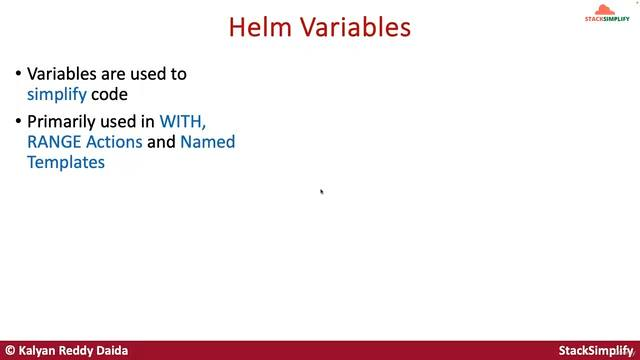
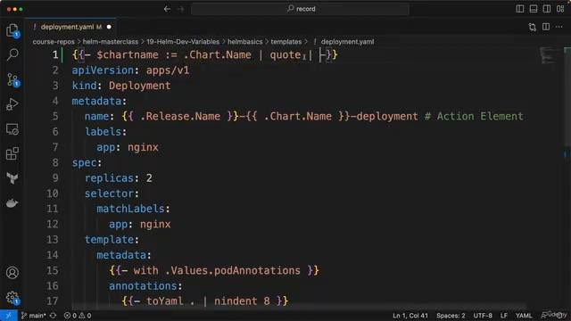
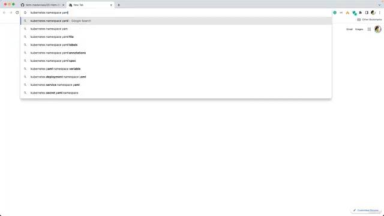
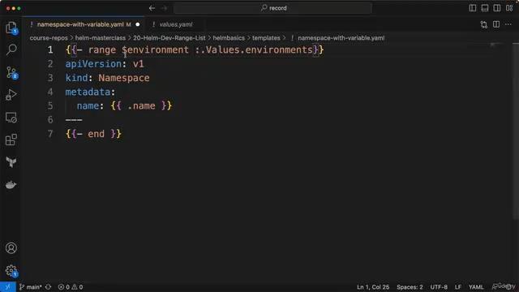
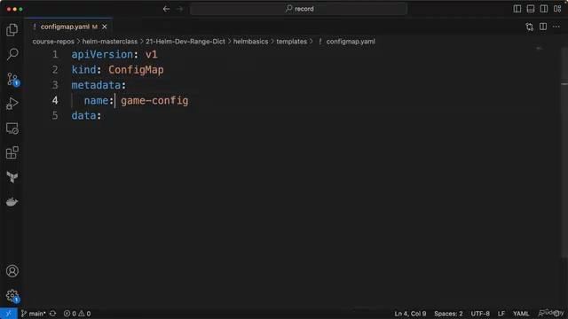
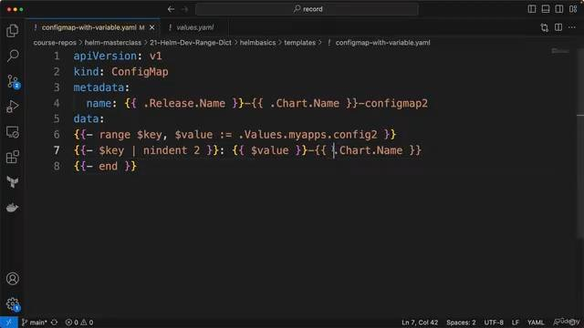
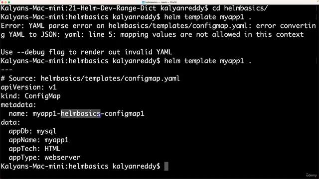
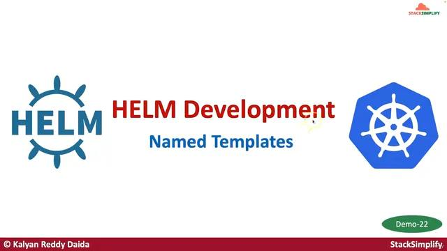

# Helm Masterclass P59–P67 复现文档：变量、range、字典与命名模板

> 覆盖课程：BV1WNas6ZESg 的 P59–P67。这一段的主题是 Helm 模板里最常被“卡住”的几件事：**如何定义变量**、**如何用 `range` 迭代 list / dict**、**在 `range` 里怎么访问顶层对象**、以及**命名模板（named template）的声明与调用规则**。本文按“从零跑通”的顺序重组，不按视频集数顺序流水账。

---

## 1. 这一节做什么

这一节最终会产出 **4 个可以独立 `helm install` 的最小 chart**：

| 目录 | 主题 | 你会得到什么 |
|---|---|---|
| `19-helm-dev-variables/` | Helm 变量 | 一个 Deployment，它的 annotation 里印出 chart 名，并演示 `quote`/`upper` 管道 |
| `20-helm-dev-range-list/` | `range` + list | 一次安装创建 3 个 namespace（myapp1~3）以及 4 个环境 namespace（dev/qa/uat/prod） |
| `21-helm-dev-range-dict/` | `range` + dict | 两个 ConfigMap：一个直接迭代字典，一个在迭代内部通过 Helm 变量访问 `.Chart.Name` |
| `22-helm-dev-named-templates/` | 命名模板概念 | 把 P67 的 Q&A 落成可运行的 `_helpers.tpl` + `deployment.yaml` 最小示例 |

学完这一节，你应该能在自己的 chart 里正确写出：

```yaml
{{- $chartName := .Chart.Name | quote | upper }}
{{- range $key, $value := .Values.myapps.config1 }}
  {{ $key }}: {{ $value }}
{{- end }}
```

并且在 `range` 内部知道为什么要写 `$.Chart.Name` 或提前定义 `$chartName`。

课里没有讲 Helm 的具体版本号；下面的步骤以 **Helm 3.x** 为准（`helm version` 能跑通即可）。如果你本地是 Helm 4 或更早的 2.x，命令行为可能有细微差异，但本文涉及的 `template`、`install`、`uninstall`、`range`、`include` 等核心语法在 3.x 范围内是稳定的。复现时建议先固定一个能跑通的版本，再逐项对照第 6 节检查清单，避免把环境问题误判成模板问题。

---

## 2. 讲师原话（带出处）

> “Variables are assigned with a special assignment operator which is caller and equal to… So, dollar and then whatever the variable name you want to provide… the special assignment operator is colon equal to.”

—— p059 [00:27]

（讲师口语里的 “caller and equal to” 指的就是 `:=`；很多转录工具会把它转成 “caller”。）

> “If you define a variable outside the with block which means you are accessing the root objects. And by any chance, if you have an option… there is a need for defining your variable inside the with action, then that means the scope becomes whatever you have defined there.”

—— p059 [01:53]

> “In Helm you need to have a document separator… you need to provide here three dashes… So, then in the single YAML file itself you can define multiple Kubernetes YAML manifest.”

—— p062 [03:37]

（这句是 P62 第一次 `helm template` 失败的原因：三个 Namespace 被当成一个 YAML 文档。）

> “The current context inside that is going to be anything under this config2 but if you want to access any root object or any object under the root like dot chart or dot release name or anything… for those things, you need to get and add the dollar here.”

—— p064 [02:24]

> “Template names are global, so across the Helm chart. So, if you declare two templates with the same name, whichever one is loaded last will be the one used.”

—— p067 [02:24]

> “This template doesn’t support pipelines so there is a special function present in Helm with whose name is include… when you use this special function include and call your template and pass the scope with dot and after that pipeline.”

—— p067 [06:13]

> “Any file that begins with underscore is not expected to output a Kubernetes manifest file… In short underscore helpers dot tpl file contains the reusable name templates required for our Helm charts.”

—— p067 [07:40]



---

## 3. 从零复现

### 3.0 前置环境

你需要：

- 一个能 `kubectl get nodes` 的 Kubernetes 集群（minikube / kind / 云集群都行；**课里没指定集群搭建方式**，只要 `kubectl` 能连上即可）。
- Helm 3.x：`helm version`。
- 本节会创建 namespace，所以执行账号需要有创建 namespace 的权限。

工作目录结构统一如下（下文每个 demo 都使用同一个 `helm-basics` chart 名）：

```text
helm-masterclass/
├── 19-helm-dev-variables/
│   └── helm-basics/
├── 20-helm-dev-range-list/
│   └── helm-basics/
├── 21-helm-dev-range-dict/
│   └── helm-basics/
└── 22-helm-dev-named-templates/
    └── helm-basics/
```

> 讲师在视频里是从 GitHub 仓库 `helm-masterclass` 进入 `section 19 / section 20 / section 21`，每节都有自己的 `helm-basics` chart。这里沿用同样的组织方式，四个目录互不干扰，方便你单独删掉重来。

在开始前，建议先执行一次环境自检：`helm version` 看客户端版本，`kubectl config current-context` 看当前上下文，`kubectl get ns` 看是否有权限列出 namespace。如果 `kubectl get ns` 都失败，后面的 `helm install` 一定会失败，此时不要先怀疑模板，而应先修 kubeconfig 或权限。另一个常见问题是 `helm template` 不连集群也能成功，所以它只能验证模板语法和渲染结果，不能验证 API Server 是否接受该资源；真正的安装验证仍要跑 `helm install`。

---

### 3.1 Demo 19：Helm 变量

**目标**：在 `templates/deployment.yaml` 顶部定义 `$chartName := .Chart.Name`，然后在 annotation 中引用它，并用 `quote` / `upper` 管道改变最终输出。

```bash
mkdir -p helm-masterclass/19-helm-dev-variables/helm-basics/templates
cd helm-masterclass/19-helm-dev-variables/helm-basics
```

把第 4 节里的 `Chart.yaml`、`values.yaml`、`templates/deployment.yaml` 复制进去，然后：

```bash
helm template myapp101 .
```

你应该看到渲染后的 Deployment，其中 annotation 里带 chart 名（被 `quote` + `upper` 处理过）。讲师当时先跑了一遍不带管道的版本，看到输出是小写的 `helm-basics`，再加管道变成 `"HELM-BASICS"`。

接着真正安装：

```bash
helm install myapp101 . --atomic
helm list
kubectl get pods
helm get manifest myapp101
helm uninstall myapp101
```

> 讲师 p060 [03:18] 的原话是 “helm install myapp 101 and then dot and hyphen hyphen atomic… if there is any issue with our overall template… it is going to let us know”。`--atomic` 的作用就是“安装失败自动回滚/删除”，后面 P62/P63/P65 反复用到。

这里把命令拆开解释一下：`helm install myapp101 .` 里的 `myapp101` 是 release 名，`.` 表示当前目录的 chart；`--atomic` 表示如果安装过程中任何资源失败，Helm 会回滚本次 release，而不是留下半成品。`helm list` 用来确认 release 是否处于 `deployed` 状态；`kubectl get pods` 用来确认 Deployment 是否真的拉起了 Pod；`helm get manifest myapp101` 用来回看 Helm 最终提交给集群的 YAML，它比 `helm template` 更接近真实安装结果；`helm uninstall myapp101` 用来清理。常见错误是 release 名重复，例如上一次没有卸载就再次 `helm install`，会报 `cannot re-use a name that is still in use`，此时先 `helm list -a` 找到旧 release，再 `helm uninstall` 或换一个 release 名。



---

### 3.2 Demo 20：range + list

这一节分两小步，两个模板文件放在同一个 chart 里：

1. `namespace.yaml`：纯 `range`，迭代 `.Values.namespaces`。
2. `namespace-with-variable.yaml`：`range` 配合 Helm 变量 `$environment := .Values.environments`。

**第一步：只写 `namespace.yaml`，先不加 `---`**

按第 4 节的代码写完 `namespace.yaml` 后：

```bash
cd helm-masterclass/20-helm-dev-range-list/helm-basics
helm template myapp1 .
```

第一次会失败（或者把三个 Namespace 拼成一个 YAML 文档）。原因是：`range` 三次迭代之间没有 YAML 文档分隔符。讲师 p062 [03:37] 明确指出要在每次迭代前加：

```yaml
---
```

加完之后再次执行 `helm template myapp1 .`，你应该看到输出被分成三段，每段一个 Namespace，并且 `# Source:` 注释会标出每个文档来自 `templates/namespace.yaml`。



成功渲染后：

```bash
helm install myapp1 . --atomic
helm status myapp1 --show-resources
kubectl get ns
```

`kubectl get ns` 里应该出现 `myapp1`、`myapp2`、`myapp3`（加上集群自带的 `default`、`kube-system` 等）。

**第二步：加上 `namespace-with-variable.yaml`**

把 `values.yaml` 里补上 `environments` 列表（见第 4 节），然后：

```bash
helm template myapp1 .
helm install myapp1 . --atomic
helm status myapp1 --show-resources
kubectl get ns
helm uninstall myapp1
```

此时应该会同时创建出 `dev`、`qa`、`uat`、`prod` 四个环境 namespace。讲师 p063 [02:52] 用 `helm status myapp1 --show-resources` 展示过这一步：输出里同时出现了两批 namespace。

> **注意**：两个模板文件会叠加生效。如果你只想验证其中一个，先把另一个文件临时移出 `templates/` 目录。

这里的 `helm status myapp1 --show-resources` 比单纯 `helm list` 更有用，因为它会把该 release 关联的资源列出来，适合确认“模板到底生成了哪些对象”。如果你看到 `helm template` 输出正确但 `kubectl get ns` 没有新 namespace，优先检查 release 是否安装到了另一个 kube context，或者 namespace 是否已经存在导致安装失败。`range` 本身不会去重，如果 `values.yaml` 里写了重复的 `name: dev`，Helm 仍会渲染出重复文档，最终由 Kubernetes 报已存在错误。



---

### 3.3 Demo 21：range + dict

同样两个步骤，两个 ConfigMap：

1. `configmap.yaml`：直接 `range` 迭代 `.Values.myapps.config1`，用 `$key: $value` 输出。
2. `configmap-with-variable.yaml`：在迭代内部访问顶层 `.Chart.Name`，先演示 `$.Chart.Name`，再改写成 `$chartName` 变量。

**第一步：只写 `configmap.yaml`**

```bash
cd helm-masterclass/21-helm-dev-range-dict/helm-basics
helm template myapp1 .
```

讲师 p065 [03:49] 特意演示了“先失败”的过程：如果 `data:` 下面直接写 `$key: $value` 不带缩进，会报 YAML 解析错误，提示位置在 `data` 那一行附近。修复方式是给 range 内部的输出加两格缩进（讲师口头叫 “indent 2”，本质就是 `  ` 两个空格；也可以用 `nindent 2`）。

成功之后的输出应该长这样：

```yaml
data:
  appName: myapp1
  appTier: webserver
  appTech: html
  appDB: mysql
```



**第二步：加上 `configmap-with-variable.yaml`**

先按讲师的方式“故意写错”：

```yaml
  {{ $key }}: {{ $value }}-{{ .Chart.Name }}
```

在 `range` 内部 `.` 已经指向 `config2` 这个字典，`.Chart` 不存在，因此 `helm template` 会报错。讲师 p066 [01:27] 的原话是 “can’t evaluate field chart field chart in the type interface”。

两种修法（讲师都演示了）：

```yaml
  {{ $key }}: {{ $value }}-{{ $.Chart.Name }}      # 方式 1：$ 回到根
```

```yaml
{{- $chartName := .Chart.Name }}                    # 方式 2：提前定义变量
...
  {{ $key }}: {{ $value }}-{{ $chartName }}
```



验证：

```bash
helm template myapp1 .
helm install myapp1 . --atomic
helm list
helm status myapp1 --show-resources
kubectl get cm
kubectl get cm <上一步输出的 ConfigMap 名> -o yaml
helm get manifest myapp1
helm uninstall myapp1
```

> 讲师 p065 [06:42] 用的是 `kubectl get cm` 和 `kubectl get cm <name> -o yaml`；`cm` 是 `configmaps` 的官方别名。

这里最容易混淆的是“模板里的 `.`”和“kubectl 输出里的 `.`”。模板里的 `.` 是当前上下文对象，`range` 会把它临时改成当前元素；`kubectl get cm -o yaml` 里的 `-o yaml` 只是让 kubectl 以 YAML 展示资源，与 Helm 模板语法无关。排查时建议先 `helm template` 看渲染结果，再 `helm get manifest` 看实际提交结果，最后 `kubectl get cm <name> -o yaml` 看集群中的最终对象。三层对照能快速定位是模板渲染错、Helm 提交错，还是 Kubernetes 侧被其他控制器改写。



---

### 3.4 Demo 22：命名模板（Q&A 推导复现）

P67 是纯讲解 + 少量截图，没有完整文件落下。但我们可以按讲师 p067 的推导顺序把它“复现”为可运行的 chart。推导链路：

```text
什么是命名模板？
  → 定义在文件里（典型 _helpers.tpl）、有名字的 template
怎么声明？
  → 用 define action：{{- define "helm-basics.labels" -}} ... {{- end -}}
命名约定？
  → 名字是全局的；同名后加载覆盖；用 <chart名>.<模板名> 保证唯一
怎么调用？
  → {{ template "helm-basics.labels" . }}，必须传 scope（末尾的 .）
为什么传 scope？
  → 不传 .，模板里 .Chart.Name 为空；传 . 就是把当前根对象递进去
想加管道怎么办？
  → template 不支持管道；改用 include：{{ include "helm-basics.labels" . | upper }}
_helpers.tpl 是什么？
  → templates/ 下以下划线开头的文件，不输出 K8s manifest，只放可复用模板
```

按这个推导，第 4 节给出最小可运行的 `_helpers.tpl` 和 `deployment.yaml`。执行：

```bash
cd helm-masterclass/22-helm-dev-named-templates/helm-basics
helm template myapp1 .
```

你应该看到 Deployment 的 `metadata.labels` 被 `include "helm-basics.labels" . | nindent 4` 展开成四个 `app.kubernetes.io/*` 标签；如果你把 `include` 换回 `template`，`upper` 管道会直接报错——这就是讲师反复强调 include 的原因。



---

## 4. 完整代码

> 下面每个文件都可直接保存。`Chart.yaml` 四个 chart 完全相同，只在第 1 个位置给出一次，后面不再重复。

### 4.0 公共 `Chart.yaml`

```yaml
# helm-basics/Chart.yaml
apiVersion: v2
name: helm-basics
description: Helm Masterclass demo chart
type: application
version: 0.1.0
appVersion: "1.0.0"
```

---

### 4.1 `19-helm-dev-variables/helm-basics/`

```yaml
# Chart.yaml
apiVersion: v2
name: helm-basics
description: Helm Masterclass demo chart
type: application
version: 0.1.0
appVersion: "1.0.0"
```

```yaml
# values.yaml
replicaCount: 1

image:
  repository: nginx
  tag: "1.25"
```

```yaml
# templates/deployment.yaml
{{- $chartName := .Chart.Name | quote | upper }}
apiVersion: apps/v1
kind: Deployment
metadata:
  name: {{ .Release.Name }}-{{ .Chart.Name }}
  annotations:
    appHelmChart: {{ $chartName }}
spec:
  replicas: {{ .Values.replicaCount }}
  selector:
    matchLabels:
      app: {{ .Release.Name }}
  template:
    metadata:
      labels:
        app: {{ .Release.Name }}
    spec:
      containers:
        - name: nginx
          image: "{{ .Values.image.repository }}:{{ .Values.image.tag }}"
          ports:
            - containerPort: 80
```

> 讲师没有明确说 `appHelmChart` 这个 key 放在 Deployment 的哪里；这里放在 `metadata.annotations`，你可以挪到 labels 或 pod template 中任何需要字符串的位置。
>
> 如果你想去掉管道先看原始输出，把第一行改成：
> `{{- $chartName := .Chart.Name }}`，渲染结果就是 `appHelmChart: helm-basics`。

---

### 4.2 `20-helm-dev-range-list/helm-basics/`

```yaml
# Chart.yaml
apiVersion: v2
name: helm-basics
description: Helm Masterclass demo chart
type: application
version: 0.1.0
appVersion: "1.0.0"
```

```yaml
# values.yaml
namespaces:
  - name: myapp1
  - name: myapp2
  - name: myapp3

environments:
  - name: dev
  - name: qa
  - name: uat
  - name: prod
```

```yaml
# templates/namespace.yaml
{{- range .Values.namespaces }}
---
apiVersion: v1
kind: Namespace
metadata:
  name: {{ .name }}
{{- end }}
```

```yaml
# templates/namespace-with-variable.yaml
{{- range $environment := .Values.environments }}
---
apiVersion: v1
kind: Namespace
metadata:
  name: {{ $environment.name }}
{{- end }}
```

---

### 4.3 `21-helm-dev-range-dict/helm-basics/`

```yaml
# Chart.yaml
apiVersion: v2
name: helm-basics
description: Helm Masterclass demo chart
type: application
version: 0.1.0
appVersion: "1.0.0"
```

```yaml
# values.yaml
myapps:
  config1:
    appName: myapp1
    appTier: webserver
    appTech: html
    appDB: mysql
  config2:
    appName: myapp2
    appTier: webserver
    appTech: html
    appDB: mysql
```

```yaml
# templates/configmap.yaml
apiVersion: v1
kind: ConfigMap
metadata:
  name: {{ .Release.Name }}-{{ .Chart.Name }}-configmap1
data:
  {{- range $key, $value := .Values.myapps.config1 }}
  {{ $key }}: {{ $value }}
  {{- end }}
```

```yaml
# templates/configmap-with-variable.yaml
{{- $chartName := .Chart.Name }}
apiVersion: v1
kind: ConfigMap
metadata:
  name: {{ .Release.Name }}-{{ .Chart.Name }}-configmap2
data:
  {{- range $key, $value := .Values.myapps.config2 }}
  {{ $key }}: {{ $value }}-{{ $chartName }}
  {{- end }}
```

> `configmap-with-variable.yaml` 里，讲师 p066 先演示的写法是 `{{ $value }}-{{ $.Chart.Name }}`，然后才改成 `{{ $chartName }}`。两种写法在本 chart 里都能跑通，可以注释掉其中一个对比。

---

### 4.4 `22-helm-dev-named-templates/helm-basics/`

```yaml
# Chart.yaml
apiVersion: v2
name: helm-basics
description: Helm Masterclass demo chart
type: application
version: 0.1.0
appVersion: "1.0.0"
```

```yaml
# values.yaml
replicaCount: 1

image:
  repository: nginx
  tag: "1.25"
```

```yaml
# templates/_helpers.tpl
{{/*
Common labels
*/}}
{{- define "helm-basics.labels" -}}
app.kubernetes.io/name: {{ .Chart.Name }}
app.kubernetes.io/instance: {{ .Release.Name }}
app.kubernetes.io/version: {{ .Chart.AppVersion | quote }}
app.kubernetes.io/managed-by: {{ .Release.Service }}
{{- end -}}
```

```yaml
# templates/deployment.yaml
apiVersion: apps/v1
kind: Deployment
metadata:
  name: {{ .Release.Name }}-{{ .Chart.Name }}
  labels:
    {{- include "helm-basics.labels" . | nindent 4 }}
spec:
  replicas: {{ .Values.replicaCount }}
  selector:
    matchLabels:
      app.kubernetes.io/name: {{ .Chart.Name }}
      app.kubernetes.io/instance: {{ .Release.Name }}
  template:
    metadata:
      labels:
        {{- include "helm-basics.labels" . | nindent 8 }}
    spec:
      containers:
        - name: nginx
          image: "{{ .Values.image.repository }}:{{ .Values.image.tag }}"
          ports:
            - containerPort: 80
```

> **课里没有给出完整文件**，上面的 `_helpers.tpl` 和 `deployment.yaml` 是按 p067 的 Q&A 规则补全的最小示意，用来验证“`define` + `include` + `nindent`”这一组写法。讲师强调的规则是：`template` 不支持管道，`include` 支持；调用时必须传 `.` 作为 scope。

---

## 5. 逐行解释

### 5.1 变量与作用域（对应 4.1 / 4.3 第二部分）

```yaml
{{- $chartName := .Chart.Name | quote | upper }}
```

- `{{-`：左花括号后带 `-`，会把该动作**左侧**的空白（包括换行）裁掉，避免渲染结果顶部多出空行。
- `$chartName`：Helm 变量，必须以 `$` 开头。赋值操作符是 `:=`（讲师口语读成 “caller and equal to”）。
- `.Chart.Name`：`Chart.yaml` 里 `name: helm-basics`，所以这里取到 `helm-basics`。
- `| quote`：包成字符串，输出 `"helm-basics"`。
- `| upper`：转成 `"HELM-BASICS"`。
- `}}`：右括号不带 `-`，所以后续换行保留。

```yaml
appHelmChart: {{ $chartName }}
```

这里引用变量，而不是重新写 `.Chart.Name`。**变量定义在模板顶部（`with`/`range` 外），作用域覆盖整个文件**；如果定义在 `range` 内部，出了 `end` 就失效。用 JS 类比：`{{- $chartName := ... }}` 相当于在函数顶部 `const chartName = ...`，`range` 内部则是块级作用域——出块就没了。前端同学可以把 `.` 理解成 `this` 或当前上下文对象，`$` 理解成“根上下文”的快捷引用；一旦进入 `range`，`this` 变了，但 `$` 仍指向根。

### 5.2 range + list（对应 4.2）

```yaml
{{- range .Values.namespaces }}
---
apiVersion: v1
kind: Namespace
metadata:
  name: {{ .name }}
{{- end }}
```

- `range .Values.namespaces`：遍历 list。每次迭代，**`.` 被重绑定到当前元素**，所以迭代内 `.name` 直接取到 `myapp1` / `myapp2` / `myapp3`。
- `---`：YAML 文档分隔符，必须放在每次迭代内部；否则 Helm 会把三个 Namespace 当成一个 YAML 文档去解析，这就是 p062 第一次失败的原因。
- `{{- end }}`：结束 `range`，左侧 `-` 防止多余空行。

```yaml
{{- range $environment := .Values.environments }}
---
apiVersion: v1
kind: Namespace
metadata:
  name: {{ $environment.name }}
{{- end }}
```

- 这一版把当前元素**显式赋给 `$environment`**。在简单 list 里，`{{ .name }}` 和 `{{ $environment.name }}` 等价。
- 讲师 p061 [02:22] 特别说明：**“most of the time the Helm variables will be using in range action only”**——变量最常见的场景就是把循环变量显式命名，尤其在嵌套迭代时能避免 `.` 指向漂移。

> 对照 JS：`{{- range $x := .Values.environments }}` 很像 `for (const x of environments) { ... }`；区别是 Helm 里还有 `.` 这个默认上下文变量。前端写 `items.map(item => ...)` 时，`item` 是显式变量；Helm 里 `range` 不写变量时，当前元素就藏在 `.` 里，写出来更利于排查。

### 5.3 range + dict（对应 4.3 第一部分）

```yaml
{{- range $key, $value := .Values.myapps.config1 }}
  {{ $key }}: {{ $value }}
{{- end }}
```

- 字典迭代需要**两个变量**：`$key` 和 `$value`。顺序是“键在前、值在后”。
- `{{ $key }}: {{ $value }}` 前面的**两个空格**不能省。`data:` 是 YAML 的 map 键，其下所有项必须缩进；讲师口头说的 “indent 2” 指的就是这两个空格。等价写法是 `{{ $key }}: {{ $value | nindent 2 }}`，但那种写法会把 key 换到独立行，通常用于 value 是块内容时。
- 讲师 p065 刻意先不加缩进跑一次，让你看到 YAML 解析错误落在 `data` 那一行；这是为了避免“复制粘贴能跑但不知道为什么”的情况。

### 5.4 range 内部的根对象访问（对应 4.3 第二部分）

```yaml
{{- range $key, $value := .Values.myapps.config2 }}
  {{ $key }}: {{ $value }}-{{ $.Chart.Name }}
{{- end }}
```

- `range` 里 `.` 指向 `config2` 这个 dict，所以 `.Chart.Name` 会报 “can’t evaluate field chart”。
- `$` 是**根上下文**的简写，`$.Chart.Name` 等价于在 `range` 外面写 `.Chart.Name`。这就是讲师 p064 [02:54] 说的“add the dollar here”。

另一种写法：

```yaml
{{- $chartName := .Chart.Name }}
...
  {{ $key }}: {{ $value }}-{{ $chartName }}
```

- 变量在 `range` 外面定义，天然就是对根对象的引用。相比 `$`，变量还能叠加管道（比如 `| quote | upper`，如 4.1 所示），所以复杂场景更推荐变量。

### 5.5 命名模板（对应 4.4）

```yaml
{{- define "helm-basics.labels" -}}
...
{{- end -}}
```

- `define "name"` 声明一个命名模板，`end` 结束。
- 名字必须是**全局唯一**的，讲师给出的约定是 `<chart名>.<模板名>`，这里就是 `helm-basics.labels`。同名模板后加载的会覆盖前者，所以“带上 chart 名”是为了避免和 dependency/子 chart 撞名。
- 两侧 `-` 用于裁掉模板首尾空白，避免 include 出来带一堆空行。

```yaml
{{- include "helm-basics.labels" . | nindent 4 }}
```

- `include` 是 Helm 提供的函数版调用，**支持管道**；`template` 是 action 版调用，**不支持管道**。讲师 p067 [06:13] 明确说过这一点。
- 末尾的 `.` 是传给模板的 scope；不传的话，模板内 `.Chart.Name` 取不到值。
- `nindent 4`：先换行，再缩进 4 个空格。用在 `labels:` 下面正好对上 YAML 缩进。

```yaml
{{- /* Common labels */ -}}
```

- 讲师 p067 [00:58] 提到 Helm 模板的注释写法是 `{{/* ... */}}`；用 `{{-` 和 `-}}` 是为了不让注释在渲染结果里留下空行。

> `_helpers.tpl` 以下划线开头，Helm 渲染时会**跳过**它，不会把它当成 K8s manifest 文件；它只用来“存放”可复用模板。

---

## 6. 复现检查清单

下面每条都给出验证动作，按顺序逐项打勾；任何一项不过，先回头查对应小节：

- [ ] `helm version` 能输出版本号；`kubectl get nodes` 至少有一个 Ready 节点。**验证方式**：两条命令都返回成功，且节点状态为 `Ready`。
- [ ] 19 目录：`helm template myapp101 .` 成功，输出里有 `appHelmChart: "HELM-BASICS"`（或去掉管道时为 `helm-basics`）。**验证方式**：把渲染结果重定向到文件，搜索 `appHelmChart` 看值是否符合预期。
- [ ] 19 目录：`helm install myapp101 . --atomic` 成功，`kubectl get pods` 能看到 Deployment 拉起的 nginx pod。**验证方式**：`kubectl get deploy,pod -l app=myapp101` 或直接看 `kubectl get pods` 的 Running 状态。
- [ ] 20 目录：只留 `namespace.yaml` 时，`helm template` 输出三段 `# Source: helm-basics/templates/namespace.yaml`。**验证方式**：`helm template myapp1 . | grep -c "# Source: helm-basics/templates/namespace.yaml"` 应输出 3。
- [ ] 20 目录：把 `namespace.yaml` 里的 `---` 删掉再 `helm template`，能复现 YAML 解析错误；加回后恢复。**验证方式**：删掉后命令应失败并提示 YAML 解析问题；恢复后命令成功。
- [ ] 20 目录：两个模板都在时，`helm install myapp1 . --atomic` 成功；`helm status myapp1 --show-resources`、`kubectl get ns` 能看到 `myapp1/2/3` 和 `dev/qa/uat/prod` 共 7 个 namespace。**验证方式**：`kubectl get ns | grep -E 'myapp[1-3]|dev|qa|uat|prod'` 逐项确认。
- [ ] 20 目录：`helm uninstall myapp1` 成功；`helm list` 不再显示 myapp1。**验证方式**：`helm list -a` 和 `kubectl get ns` 确认 release 与 namespace 已清理。
- [ ] 21 目录：`configmap.yaml` 不带缩进时失败、带两格缩进后成功；`helm template` 输出的 `data` 下四项键值正确。**验证方式**：先故意删掉两个空格复现错误，再加回并检查 `data:` 下的 `appName/appTier/appTech/appDB`。
- [ ] 21 目录：`configmap-with-variable.yaml` 里用 `.Chart.Name`（不带 `$`）时报错；改成 `$.Chart.Name` 或 `$chartName` 后成功。**验证方式**：分别渲染两种写法，确认错误信息与成功输出。
- [ ] 21 目录：`helm install myapp1 . --atomic` 成功；`kubectl get cm` 能看到两个 ConfigMap；`kubectl get cm <name> -o yaml` 里 `data` 内容正确。**验证方式**：用 `kubectl get cm` 找到名字，再 `-o yaml` 检查 `data` 字段。
- [ ] 22 目录：`helm template myapp1 .` 成功；Deployment 有两处 `app.kubernetes.io/*` 标签被正确展开。**验证方式**：搜索 `app.kubernetes.io/name` 和 `app.kubernetes.io/instance`，确认 metadata 与 pod template 两处都有。
- [ ] 22 目录：把 `include ... | nindent` 改成 `template`，会报错（验证讲师“template 不支持管道”的结论）。**验证方式**：改完后执行 `helm template`，确认报管道相关错误；改回 `include` 后恢复。
- [ ] 全部 demo 清理：`helm uninstall myapp1` / `myapp101`；`kubectl get ns | grep -E 'myapp|dev|qa|uat|prod'` 为空。**验证方式**：清理后再次执行 grep，应无输出；若有残留，用 `kubectl delete ns` 手动清理。

---

## 7. 课里没讲但你会撞上的

下表按“现象 / 原因 / 怎么办”整理，便于复现时快速定位：

| 现象 | 原因 | 怎么办 |
|---|---|---|
| `values.yaml` 里 list / dict 为空，`helm template` 成功但什么也不创建 | 讲师只演示了有元素的情况；`range` 对空集合会渲染出空内容 | 在 CI 里加一个 `helm template --set` 的空值冒烟测试；确认空集合是否符合预期 |
| 第二次 `helm install` 同一组 namespace 报 “already exists” | Namespace 已经存在；`helm uninstall` 是否会删除 Namespace 取决于资源本身，本课程场景里确实会把它们删掉，但手动建的 `dev` 会冲突 | 复现前先 `kubectl get ns` 确认；必要时手动清理同名资源 |
| `--atomic` 看起来“卡住” | 讲师没展开讲 `--atomic` 背后的 timeout；默认 5 分钟，镜像拉不下来会等到超时才回滚 | 用 `--timeout 2m` 缩短调试时间；先 `kubectl describe pod` 看拉镜像事件 |
| chart 名字母/大小写导致 lint 或安装失败 | `name: helm-basics` 才能被 `helm` 接受；写成 `HelmBasics` 某些 Helm 版本会在 lint 阶段报错 | 保持小写和连字符；执行 `helm lint .` 先检查 |
| `values.yaml` 里 key 大小写导致找不到 | `myapps.config1`、`config1`、`Config1` 是三个不同 key；`range` 找不到时不会报错，只会渲染空内容 | 用 `helm template --debug` 或 `helm get values` 对照 key 名；统一命名规范 |
| `helm template` 与 `helm install` 输出不同 | `helm template` 不连接集群，也不会生成 `.Release.Revision`、`.Release.Service` 这类需要服务端参与的字段 | 用 `helm get manifest` 看实际提交结果；依赖 `.Release.Service` 时以安装结果为准 |
| `_helpers.tpl` 被误当成 manifest | 如果文件不以 `_` 开头，Helm 会尝试把它当 YAML 渲染，语法不对就直接报错 | 命名模板文件一定放 `templates/_` 前缀；检查文件名 |
| 命名模板不传 scope，取到空值 | `{{ template "helm-basics.labels" }}` 末尾没有 `.` 不会报错，但模板内取不到根对象 | 统一写 `include ... .`；review 时重点检查末尾的 `.` |
| `include` 与 `template` 混用导致管道报错 | 需要叠加 `upper`/`lower`/`quote` 时，`template` 不支持管道 | 一律用 `include`；团队 lint 规则里禁掉 `template`，只允许 `include` |
| YAML 文档分隔符和 `{{-` 的交互导致 `---` 被吃掉 | `---` 是字符串输出，不受 `{{-` 影响；但写成 `--- {{- range ... }}` 会把 `---` 吃掉 | 本课程里 `---` 始终单独占一行，属于最安全的写法；不要和 `{{-` 写在同一行 |