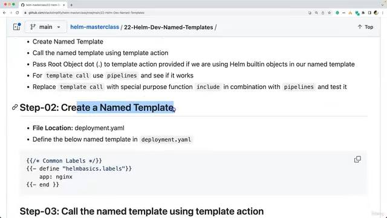
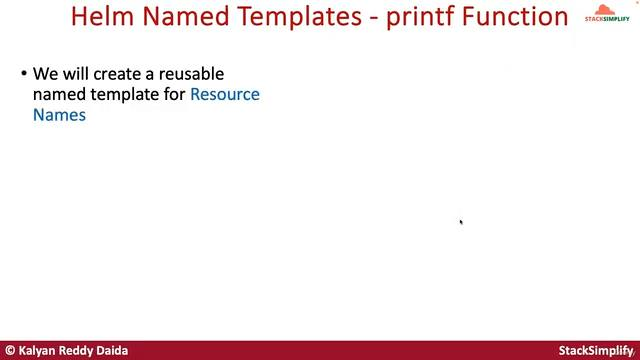
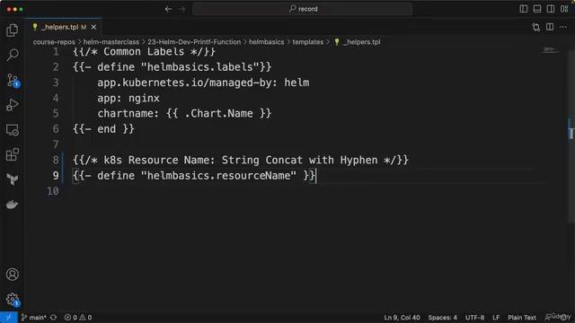
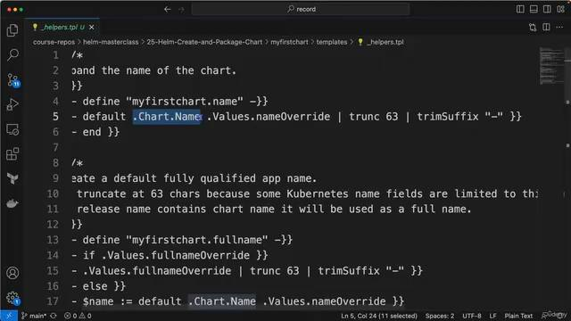
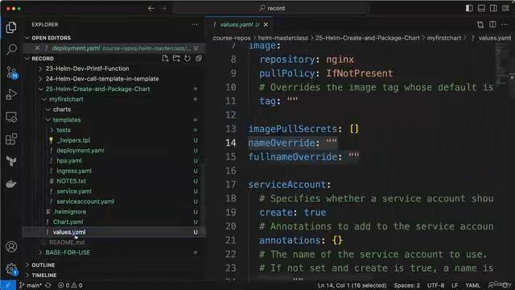

# Helm Masterclass｜P68–P74：名称模板、printf、模板套模板、创建与打包 Chart

> 覆盖课件：`BV1WNas6ZESg` 的 P068–P074
> 目录前提：下文中所有路径都相对于你克隆下来的课程仓库根目录。
> 本节结束，你会拥有 4 个可运行的 chart 目录、3 个 `.tgz` 包，以及一个用 NodePort 暴露、能显示 v1/v2/v3 版本的 Nginx 应用。

---

## 1. 这一节做什么

前 67 讲你已经会写 `helm install`、`helm upgrade`、`--set`、`values.yaml` 覆盖。这一节把视角掉过来：**你自己当 chart 的作者**。换句话说，前面你是在“使用别人写好的 chart”，这一节开始你要关心“chart 内部为什么这样渲染、模板片段如何复用、版本号如何进入镜像 tag、最终包如何交付”。建议严格按 P068 → P074 的顺序做，因为后面的目录都是在前一个 demo 上整体拷贝再改的；跳步虽然也能看代码，但会失去“每改一处、跑一次 `helm template` 验证一次”的节奏。

具体交付四件事：

1. **名称模板（named template）**：用 `define` / `end` 定义一段可复用的模板片段，用 `template` 动作调用它，并搞明白「作用域（scope）」为什么必须传。你可以把它理解成“把一段会重复出现的 YAML 片段抽成函数”，调用时把当前上下文对象传进去，模板内部才能读到 `.Chart`、`.Release`、`.Values`。
2. **`template` → `include`**：为什么 `template` 动作不能接管道（`| upper`），为什么必须换成 `include`。这一步的重点不是背结论，而是亲眼看到 `template` 接管道时的报错，再用 `include` 把同一段逻辑跑通。
3. **`printf` 生成资源名**：把 `.Release.Name` 和 `.Chart.Name` 用连字符拼成 `my-app-one-helm-basics`，做成一个可复用的 `resourceName` 模板，然后在标签模板里调用它——也就是**模板套模板（template in template）**。这样命名规则只写一次，Deployment 名和标签里的资源名都从同一处来。
4. **`helm create` + `helm package`**：从 `helm create` 生成的官方脚手架出发，改镜像、改 Service 为 NodePort、改版本号，然后打出 `1.0.0`、`2.0.0`、`3.0.0` 三个版本包，分别安装并验证镜像 tag 是否跟着 `appVersion` 走。最后你要能说清楚：为什么 `values.yaml` 里的 `image.tag` 要留空，为什么 `service.yaml` 里必须显式写 `nodePort`。

> 给前端同学的一句话对位：`define` 就是声明一个函数，`template` / `include` 就是调用这个函数；`.Release.Name` 就是函数参数/上下文对象；`printf` 就是模板里的 `String.prototype.replace` + `util.format`。如果你熟悉组件化，可以把 `_helpers.tpl` 想成“公共组件文件”，把 `include` 想成“返回字符串的渲染函数”，而 `template` 更像“只能整体插入、不能继续加工返回值”的指令。

---

## 2. 讲师原话（带时间戳）

> 「现在我们来创建一个名称模板。要创建名称模板，需要使用 define 动作。」—— p068 [00:56]

> 「你可以看到 chart name 是空的。为什么是空的？因为你没有给这次模板调用传任何作用域（scope）。这里需要传的作用域就是 `.`，也就是你的根对象。」—— p068 [04:43] – p068 [05:13]

> 「它之所以抛错，是因为 **template 不支持 Helm 的管道（pipeline）**。」—— p069 [00:57]

> 「我们已经讨论过修法，就是必须用那个特殊用途的函数——include。」—— p069 [01:09]

> 「我们需要用 include，是因为 template 调用不支持管道，而特殊用途函数 include 支持管道。」—— p069 [03:22]

> 「printf 函数是 Helm 里非常非常重要的函数，它负责格式化字符串。」—— p070 [00:57]

> 「printf 会做字符串拼接，中间加连字符，这就是它的作用。」—— p070 [01:25]

> 「我们用的是内置对象 `.Release.Name` 和 `.Chart.Name`，所以如果不传作用域，就会拿到空值。我们必须把作用域传给这个 include 调用。」—— p071 [03:52]

> 「为什么会给出 `executing "include" wrong number of arguments for include`？因为它还需要一个参数，也就是我们的作用域。template 只传一个参数（模板名）就够了，但 include 是特殊用途函数，它还要求传第二个参数——作用域。」—— p071 [03:52] – p071 [04:21]

> 「我们为什么需要在一个模板里调用另一个模板？是为了不重复代码。」—— p072 [00:53]

> 「有时候为了交叉验证 `helm template` 生成的 YAML 是否真的能用，你总是需要去创建一个 release，并且还要配合 `--dry-run` 命令一起验证。」—— p072 [03:49] – p072 [03:54]

> 「`version` 和 `appVersion` 这个数字很重要，因为它会成为你的 Docker 镜像 tag。」—— p074 [07:16]

> 「用 package 来安装，意思是不只是用 chart 目录能装 release，直接指定 `.tgz` 包安装也可以。」—— p073 [03:20]

---

## 3. 从零复现

### 3.0 环境前提

| 项 | 值 |
|---|---|
| Helm | 3.x（课里没指定具体小版本，`helm version` 能跑即可） |
| kubectl | 已配置到某个可用的 K8s 集群 |
| 集群 | 课里没讲怎么搭，讲师开讲时集群已就绪；你用 minikube / kind / Docker Desktop 都行 |
| 编辑器 | VS Code（讲师用的是 VS Code） |

先验证：

```bash
helm version
kubectl get nodes
```

两条都能出结果再往下走。`helm version` 主要确认 Helm 客户端存在且版本是 3.x；`kubectl get nodes` 主要确认你的 kubeconfig、current context 和集群连通性都没问题。如果第二条失败，不要急着改 chart：先看 `kubectl config current-context` 是否指向正确集群，再看集群是否启动。Chart 模板错误和集群连接错误是两类问题，混在一起排查会很浪费时间。

### 3.1 建练习目录

课里每个 demo 是一个独立目录，后一个 demo 是前一个 demo 的**整体拷贝**。照着建：

```bash
mkdir -p helm-masterclass && cd helm-masterclass

mkdir -p 22-helm-dev-name-templates/helm-basics/templates
mkdir -p 23-helm-dev-printf-function/helm-basics/templates
mkdir -p 24-helm-dev-template-in-template/helm-basics/templates
mkdir -p 25-helm-create-and-package-chart

ls
```

这里先建空目录，是为了让你后面每一步都有明确的落点：P068 在 `22-...` 里写最小 `Chart.yaml` 和 `deployment.yaml`；P069 把 `define` 块搬到 `_helpers.tpl`；P071 新增 `resourceName`；P072 在 `labels` 模板里再调用 `resourceName`；P074 则单独用 `helm create` 生成完整脚手架。每进入一个目录，建议先 `pwd` 和 `ls templates` 确认位置，避免在错误目录里执行 `helm template` 导致“找不到 Chart.yaml”。

### 3.2 步骤 1（P068）：在 deployment.yaml 里先垫一个名称模板

进入 `22-helm-dev-name-templates/helm-basics/`，先手写两个最小文件：`Chart.yaml` 和 `templates/deployment.yaml`（完整内容见第 4 节 4.1、4.2）。

要点顺序，跟讲师一模一样：

1. 在 `deployment.yaml` **顶部**加注释块 `{{/* Common labels */}}`。讲师说：「斜星号、星号斜杠」，在 Helm 里就是 `{{/* ... */}}`，**不能**写成裸的 `/* */`，否则 Helm 会把它当 YAML 内容原样输出。裸注释在模板里不是“注释”，而是普通文本，轻则多出无意义内容，重则把 YAML 结构弄坏。
2. 用 `define "（未提供英文原文，无法翻译）"` + `end` 定义模板体，模板体里先只放一行 `app: nginx`。此时模板名里的 `helm-basics` 来自 `Chart.yaml` 的 `name`，这样做的目的是避免和子 chart 的命名模板冲突。
3. 把原来硬编码的 `app: nginx` 删掉，改成 `{{ template "（未提供英文原文，无法翻译）" . }}`。注意末尾的 `.` 就是作用域，先保留它，后面会专门演示去掉它会怎样。
4. 在 `22-helm-dev-name-templates/helm-basics/` 目录里跑：

```bash
helm template my-app-one .
```

你应该在输出的 `Deployment` 里看到 `app: nginx`，并且 `metadata.name` 是 `my-app-one-helm-basics-deployment`。讲师当场验证过这一点：「name 就是 release 名、连字符、chart 名、连字符、deployment」—— p068 [03:19]。`helm template` 的第一个参数 `my-app-one` 是假想的 release 名，第二个参数 `.` 是 chart 目录；它只在本地渲染，不会真的创建资源。

5. 把模板体里的 `app: nginx` 改成 `app: nginx2`，再跑一次 `helm template my-app-one .`，确认输出跟着变了。这一步是讲师用来证明「模板体是唯一事实来源」的：调用处没有写死 `app`，真正的内容来自 `define` 块。
6. 在模板体里**追加**一行 `chart-name: {{ .Chart.Name }}`，再跑：

```bash
helm template my-app-one .
```

**此时 `chart-name` 是空的**——这就是讲师说的「chart name is empty」。原因：调用写成 `{{ template "（未提供英文原文，无法翻译）" }}`，没传作用域，模板内部的 `.` 不是根对象。排查这类问题的第一反应就是看 `template` / `include` 后面有没有传 `.`。
7. 改成 `{{ template "（未提供英文原文，无法翻译）" . }}`（末尾加个点），再跑一次，`chart-name: helm-basics` 就出来了。如果仍然为空，检查 `Chart.yaml` 的 `name` 是否拼写正确，以及命令是否在 chart 根目录执行。



### 3.3 步骤 2（P069）：加管道 → 报错 → 换 include → 搬进 _helpers.tpl

1. 在模板调用后加管道：`{{ template "（未提供英文原文，无法翻译）" . | upper }}`，保存后跑：

```bash
helm template my-app-one .
```

你会拿到报错，讲师念出来的内容是：「at 11 … at the 37th character … wrong type for value expected string got chart util dot values」—— p069 [00:28] – p069 [00:49]。**行号 11、第 37 个字符就是那个 `|` 的位置**，这是定位这类错误的通用手法：先看行号，再数第几个字符。遇到 Helm 报错不要只看最后一行，先把行号和字符位置对回模板文件，通常能立刻发现是哪个管道写错了。

2. 把 `template` 换成 `include`：

```yaml
{{- include "helm-basics.labels" . | upper }}
```

再跑 `helm template my-app-one .`，这次标签全部变成大写（`APP: NGINX`、`CHART-NAME: HELM-BASICS`）。注意这里 `include` 的第二个参数仍然是 `.`，少了它就会在下一步之外再遇到参数个数错误。


3. 把 `define` 那一整块从 `deployment.yaml` 里**剪切**出来，粘到新建的 `templates/_helpers.tpl` 里。`deployment.yaml` 里只留下调用。搬完再跑一次 `helm template my-app-one .`——讲师原话：「有没有变化或问题？理论上没有」—— p069 [02:23]。文件名以下划线开头是有意义的：Helm 不会把 `_helpers.tpl` 当成要渲染成 K8s 资源的模板文件，它只作为可被调用的模板片段存在。
4. 顺手装一次真集群：

```bash
helm install my-app-one . --atomic
helm list
helm status my-app-one --show-resources
kubectl get deploy -o yaml
```

`kubectl get deploy -o yaml` 里能看到你生成的 `app` / `chart-name` 标签。字段名以你集群的实际输出为准。`--atomic` 的作用是安装失败时自动回滚，适合练习时避免留下半成品 release；如果提示 release 名已存在，先 `helm list` 找到旧 release，再 `helm uninstall my-app-one` 后重试。

### 3.4 步骤 3（P071）：printf 生成资源名模板

进入 `23-helm-dev-printf-function/helm-basics/`（把 22 整个拷过来）：

```bash
cp -r 22-helm-dev-name-templates/helm-basics 23-helm-dev-printf-function/
```

1. 打开 `templates/_helpers.tpl`，新增：

```gotemplate
{{- define "helm-basics.resourceName" -}}
{{- printf "%s-%s" .Release.Name .Chart.Name -}}
{{- end -}}
```

讲师特别强调的一个坑：**`.Release.Name` 和 `.Chart.Name` 必须写在 `{{ }}` 模板动作里面**。他原话是「它也还需要 … 这些都是 action 元素，意味着它们必须出现在 template expression 或 template action 里」—— p071 [02:23] – p071 [02:52]。也就是不能写成裸的 `printf "%s-%s" .Release.Name .Chart.Name`。模板文件不是普通文本文件，所有以 `.` 开头的内置对象都要放在模板动作里才会被替换。

2. 打开 `templates/deployment.yaml`，把 `metadata.name` 里的 `{{ .Release.Name }}-{{ .Chart.Name }}` 换成：

```yaml
  name: {{ include "helm-basics.resourceName" . }}
```

3. **先故意不传作用域**，跑：

```bash
cd 23-helm-dev-printf-function/helm-basics
helm template my-app-one .
```

拿到 `executing "include" at ...: wrong number of arguments for include`。这正是讲师要你亲眼看到的那一条—— p071 [03:52]。这个错误信息的关键词是 `wrong number of arguments`，看到它先数 `include` 后面是不是只给了模板名、没给作用域。
4. 把 `.` 加回去，再跑，输出 `my-app-one-helm-basics`。

> 这里有个细节值得记：`template` 少传参数只会渲染出空字符串，不报错；`include` 少传参数直接报错。这是两者行为差异里最实用的一条。也就是说，`template` 的“静默失败”更容易让人误以为模板写对了，而 `include` 在参数缺失时更早暴露问题。



### 3.5 步骤 4（P072）：模板套模板

进入 `24-helm-dev-template-in-template/`（拷贝 23 再改）：

```bash
cp -r 23-helm-dev-printf-function/helm-basics 24-helm-dev-template-in-template/
```

只改一个文件：`24-helm-dev-template-in-template/helm-basics/templates/_helpers.tpl`，在 `helm-basics.labels` 的模板体里追加一行调用：

```gotemplate
template-in-template: {{ include "helm-basics.resourceName" . }}
```

`deployment.yaml` **一行都不用改**。跑：

```bash
cd 24-helm-dev-template-in-template/helm-basics
helm template my-app-one .
```

输出里的标签应该是三条：`app: nginx`、`chart-name: helm-basics`、`template-in-template: my-app-one-helm-basics`。如果第三条为空，优先检查 `include "（未提供英文原文，无法翻译）" .` 的 `.` 是否漏了；如果报找不到模板，检查 `resourceName` 的 `define` 名字和调用名是否完全一致，包括连字符。

然后进真集群验证：

```bash
helm install my-app-one . --atomic
kubectl get pods
helm get manifest my-app-one
helm uninstall my-app-one
```

`helm get manifest` 是把 Helm 渲染后真正下发给集群的 YAML 拿回来，比 `helm template` 更可信一层（`helm template` 只是本地渲染）。讲师特意说了「有时候为了交叉验证……你总是需要去创建一个 release，并且还要配合 `--dry-run`」—— p072 [03:49]。如果你暂时不想真的创建资源，可以用 `helm install my-app-one . --dry-run` 看渲染结果；但要验证集群是否接受这些字段，最终还是需要一次真实安装或 `--dry-run=server` 之类的服务端校验。



### 3.6 步骤 5（P074）：helm create 一个真实 chart 并做三处改造

```bash
cd 25-helm-create-and-package-chart
helm create my-first-chart
```

生成后 `tree` 一下（或 `ls -R my-first-chart`），你会看到：

```
my-first-chart/
├── Chart.yaml
├── values.yaml
├── charts/                     # 空目录，没有子 chart
└── templates/
    ├── NOTES.txt
    ├── _helpers.tpl
    ├── deployment.yaml
    ├── hpa.yaml
    ├── ingress.yaml
    ├── service.yaml
    ├── serviceaccount.yaml
    └── tests/
        └── test-connection.yaml
```

然后做三处改造（完整文件见第 4 节）：

1. `values.yaml` → `image.repository` 从 `nginx` 换成你自己的镜像仓库地址；`image.tag` 保持 `""`（空字符串），这样才会 fallback 到 `Chart.AppVersion`。如果镜像仓库是私有的，还要考虑 `imagePullSecrets`；课里用的是可直接拉取的镜像，所以这一步先不展开。
2. `values.yaml` → `service.type` 改 `NodePort`，加 `nodePort: 31231`；`templates/service.yaml` 的 `ports` 里补一行 `nodePort: {{ .Values.service.nodePort }}`——**这一行不加，NodePort 就不会是 31231**，讲师专门讲了这一点：「你在这里定义了 31231，但当前没有被引用」—— p074 [06:17]。这是 values 与模板引用的经典关系：values 只是数据，模板不引用就不会进入最终 YAML。
3. `Chart.yaml` → `version: 1.0.0`、`appVersion: "1.0.0"`。`version` 是 chart 包版本，`appVersion` 是应用版本；本课里后者会通过 `default` 进入镜像 tag，所以两个都要关注。



装一次验证：

```bash
helm install mfc-v1 ./my-first-chart
kubectl get pods
kubectl get svc
```

浏览器打开 `http://<节点IP>:31231`，应该看到 **hello world v1**。如果 `kubectl get svc` 里 NodePort 不是 31231，回到 `templates/service.yaml` 检查是否真的写了 `nodePort` 那一行；如果 Pod 一直 `ImagePullBackOff`，先确认 `image.repository` 是否可拉取，再检查 `image.tag` 是否被意外写死。

### 3.7 步骤 6：打三个版本的包

```bash
# 1.0.0：直接打（Chart.yaml 里已经是 1.0.0）
cd 25-helm-create-and-package-chart
helm package my-first-chart
# 产物：my-first-chart-1.0.0.tgz

# 2.0.0：先改 Chart.yaml 的 version 和 appVersion 都为 2.0.0，再打
helm package my-first-chart
# 产物：my-first-chart-2.0.0.tgz

# 3.0.0：不改文件，直接用 flag 覆盖
helm package my-first-chart --version 3.0.0 --app-version 3.0.0
# 产物：my-first-chart-3.0.0.tgz
```

**从包安装**（不再指向目录）：

```bash
helm install mfc-v2 ./my-first-chart-2.0.0.tgz
kubectl get pods
# 浏览器刷新 http://<节点IP>:31231 → hello world v2

helm install mfc-v3 ./my-first-chart-3.0.0.tgz
# 浏览器刷新 → hello world v3
```

打包后可以用 `helm show chart my-first-chart-2.0.0.tgz` 检查包里的 `version` / `appVersion` 是否确实是你想要的；安装 `.tgz` 和安装目录在 Helm 看来都是 chart 来源，只是前者已经把 chart 固化成一个压缩包。若三个 release 同时存在，注意 Service 的 NodePort 不能重复，练习时最好装一个、验证一个、必要时卸载一个。



---

## 4. 完整代码

### 4.1 `22-helm-dev-name-templates/helm-basics/Chart.yaml`

```yaml
apiVersion: v2
name: helm-basics
description: Helm basics chart used across the name-template demos
type: application
version: 1.0.0
appVersion: "1.0.0"
```

> `name` 必须和模板名前缀一致。讲师口述时说的是「helm basics」，但 `Chart.yaml` 里写的是 `helm-basics`。模板名请照抄 `Chart.yaml` 的 `name`，别自己加空格。

### 4.2 `22-helm-dev-name-templates/helm-basics/templates/deployment.yaml`（P068 中间态，含 define）

```yaml
{{/* Common labels */}}
{{- define "helm-basics.labels" -}}
app: nginx
chart-name: {{ .Chart.Name }}
{{- end -}}

apiVersion: apps/v1
kind: Deployment
metadata:
  name: {{ .Release.Name }}-{{ .Chart.Name }}-deployment
  labels:
    {{- template "helm-basics.labels" . | nindent 4 }}
spec:
  replicas: 1
  selector:
    matchLabels:
      app: nginx
  template:
    metadata:
      labels:
        {{- template "helm-basics.labels" . | nindent 8 }}
    spec:
      containers:
        - name: nginx
          image: nginx:latest
          ports:
            - containerPort: 80
```

### 4.3 `22-helm-dev-name-templates/helm-basics/templates/_helpers.tpl`（P069 搬家后）

```gotemplate
{{/*
Common labels for every Kubernetes object in this chart.
*/}}
{{- define "helm-basics.labels" -}}
app: nginx
chart-name: {{ .Chart.Name }}
{{- end -}}
```

### 4.4 `22-helm-dev-name-templates/helm-basics/templates/deployment.yaml`（搬家后，只剩调用）

```yaml
apiVersion: apps/v1
kind: Deployment
metadata:
  name: {{ .Release.Name }}-{{ .Chart.Name }}-deployment
  labels:
    {{- include "helm-basics.labels" . | nindent 4 }}
spec:
  replicas: 1
  selector:
    matchLabels:
      app: nginx
  template:
    metadata:
      labels:
        {{- include "helm-basics.labels" . | nindent 8 }}
    spec:
      containers:
        - name: nginx
          image: nginx:latest
          ports:
            - containerPort: 80
```

### 4.5 `23-helm-dev-printf-function/helm-basics/templates/_helpers.tpl`

```gotemplate
{{/*
Common labels.
*/}}
{{- define "helm-basics.labels" -}}
app: nginx
chart-name: {{ .Chart.Name }}
{{- end -}}

{{/*
Kubernetes resource name: <release>-<chart>
*/}}
{{- define "helm-basics.resourceName" -}}
{{- printf "%s-%s" .Release.Name .Chart.Name -}}
{{- end -}}
```

### 4.6 `23-helm-dev-printf-function/helm-basics/templates/deployment.yaml`

```yaml
apiVersion: apps/v1
kind: Deployment
metadata:
  name: {{ include "helm-basics.resourceName" . }}
  labels:
    {{- include "helm-basics.labels" . | nindent 4 }}
spec:
  replicas: 1
  selector:
    matchLabels:
      app: nginx
  template:
    metadata:
      labels:
        {{- include "helm-basics.labels" . | nindent 8 }}
    spec:
      containers:
        - name: nginx
          image: nginx:latest
          ports:
            - containerPort: 80
```

### 4.7 `24-helm-dev-template-in-template/helm-basics/templates/_helpers.tpl`（最终版）

```gotemplate
{{/*
Common labels. Calls the resourceName template below (template in template).
*/}}
{{- define "helm-basics.labels" -}}
app: nginx
chart-name: {{ .Chart.Name }}
template-in-template: {{ include "helm-basics.resourceName" . }}
{{- end -}}

{{/*
Kubernetes resource name: <release>-<chart>
*/}}
{{- define "helm-basics.resourceName" -}}
{{- printf "%s-%s" .Release.Name .Chart.Name -}}
{{- end -}}
```

### 4.8 `25-helm-create-and-package-chart/my-first-chart/Chart.yaml`

```yaml
apiVersion: v2
name: my-first-chart
description: A Helm chart for Kubernetes
type: application
version: 1.0.0
appVersion: "1.0.0"
```

> 打 2.0.0 时把 `version` 和 `appVersion` 都改成 `2.0.0`；打 3.0.0 时**不要改这个文件**，用 `--version` / `--app-version` 命令行覆盖。

### 4.9 `25-helm-create-and-package-chart/my-first-chart/values.yaml`

```yaml
replicaCount: 1

image:
  # 课里讲师用的是他自己的 GHCR 镜像，逐字稿口述为 ghcr.io/stack-simplify/kubenginx
  # 换成你自己的仓库地址，或者改成 nginx 也能跑通除版本号以外的全部步骤
  repository: ghcr.io/stack-simplify/kubenginx
  pullPolicy: IfNotPresent
  # 留空才会 fallback 到 Chart.AppVersion，这是 1.0.0 / 2.0.0 / 3.0.0 版本切换的关键
  tag: ""

imagePullSecrets: []
nameOverride: ""
fullnameOverride: ""

serviceAccount:
  create: true
  automount: true
  annotations: {}
  name: ""

podAnnotations: {}
podLabels: {}

podSecurityContext: {}
securityContext: {}

service:
  type: NodePort
  port: 80
  nodePort: 31231

ingress:
  enabled: false
  className: ""
  annotations: {}
  hosts:
    - host: chart-example.local
      paths:
        - path: /
          pathType: ImplementationSpecific
  tls: []

resources: {}

autoscaling:
  enabled: false
  minReplicas: 1
  maxReplicas: 100
  targetCPUUtilizationPercentage: 80

nodeSelector: {}
tolerations: []
affinity: {}
```

> 你机器上 `helm create` 生成的内容可能比上面多几个字段（取决于 Helm 版本）。**以你实际生成的文件为准**，只需要保证上面这几处改动生效即可。

### 4.10 `25-helm-create-and-package-chart/my-first-chart/templates/service.yaml`

`helm create` 生成的版本在 `ports` 里没有 `nodePort` 字段，必须补：

```yaml
apiVersion: v1
kind: Service
metadata:
  name: {{ include "my-first-chart.fullname" . }}
  labels:
    {{- include "my-first-chart.labels" . | nindent 4 }}
spec:
  type: {{ .Values.service.type }}
  ports:
    - port: {{ .Values.service.port }}
      targetPort: http
      protocol: TCP
      name: http
      nodePort: {{ .Values.service.nodePort }}
  selector:
    {{- include "my-first-chart.selectorLabels" . | nindent 4 }}
```

### 4.11 `25-helm-create-and-package-chart/my-first-chart/templates/deployment.yaml`（镜像行的关键改动）

`helm create` 生成的镜像行本身就是我们要的写法，**不用改**，但要读懂：

```yaml
          image: "{{ .Values.image.repository }}:{{ .Values.image.tag | default .Chart.AppVersion }}"
```

---

## 5. 逐行解释

### 5.1 `define` / `end` / 花括号里的连字符

```gotemplate
{{- define "helm-basics.labels" -}}
app: nginx
{{- end -}}
```

- `define "名字"`：声明一个具名模板。名字是**全局命名空间**的字符串，所以要加 chart 名前缀（`helm-basics.`）避免和子 chart 撞车。这和 JS 里把函数挂到 `window` 上是一个道理，不加前缀迟早冲突。
- `{{-` 和 `-}}` 里的连字符叫 **空白裁剪（whitespace trim）**：`{{-` 吃掉左边所有空白（含换行），`-}}` 吃掉右边所有空白。不加的话，`define`/`end` 会各留下一个多余空行，渲染出来的 YAML 里就多出空行。
- 为什么 `end` 要写成 `{{- end -}}`？因为 `end` 右边如果还有内容，不裁剪就会多一行。多一行空行在 YAML 里不一定报错，但在 `labels:` 下面可能造成缩进层级变化，排查时很容易被忽略。

### 5.2 `template` vs `include`

```yaml
    {{- template "helm-basics.labels" . | nindent 4 }}   # 报错
    {{- include  "helm-basics.labels" . | nindent 4 }}   # 正确
```

- 两者都接受 `(模板名, 作用域)` 两个参数。
- **`template` 是「动作」（action），它的返回值不能参与管道**。Go 模板引擎在这里把 `template` 当成语句而不是表达式，所以 `| upper` 会立刻炸。讲师念出的 `wrong type for value expected string got chart util dot values` 就是这个机制的表现——引擎把管道右侧收到的值当成了奇怪的东西。
- **`include` 是「函数」（function），返回 string**，所以能接 `| upper`、`| nindent`、`| trunc` 等任何字符串管道。
- 结论：**只要你想对输出做任何字符串处理，就必须用 `include`**。`template` 只在「纯插入、不加工」时才有存在感，实际工程里几乎全用 `include`。
- 前端对位：`template` 像 `<%- include(...) %>` 只能整体插入；`include` 像返回字符串的 `renderToString()`，返回值你可以 `.toUpperCase()`。

### 5.3 作用域（scope）为什么必须传

```yaml
{{- define "helm-basics.labels" -}}
chart-name: {{ .Chart.Name }}
{{- end -}}
```

- `define` 内部的 `.` **不是**根上下文，而是调用时传进来的那个对象。传 `.`（根）就能拿到 `.Chart` / `.Release` / `.Values`；不传就传了个 `nil`，`.Chart.Name` 渲染成空串（用 `template` 时）或直接报参数个数错误（用 `include` 时）。
- 讲师在 P068 [04:43] 演示的 `chart-name` 为空，就是「没传作用域」的经典症状。**看到渲染结果里某段莫名是空的，第一反应应该是查 include/template 第二个参数。**
- 也可以传子对象，比如 `{{ include "（未提供英文原文，无法翻译）" .Values }}`，那模板内部就只能用 `.image` 这种相对路径。但这样模板就和调用方耦合了，不推荐。传根 `.` 的意义在于模板片段仍然能访问完整上下文，复用时不依赖调用方当前在哪一层。

### 5.4 `printf "%s-%s"`

```gotemplate
{{- printf "%s-%s" .Release.Name .Chart.Name -}}
```

- `%s` 是 Go 的字符串占位符，按**位置顺序**替换后两个参数。讲师在 P070 [00:27] 顺带提了 `%d`（十进制整数）、`%t`（布尔）、浮点等一堆，`printf` 是 Helm 里做一切字符串拼接的底层工具。
- 不用 `printf` 也能写 `{{ .Release.Name }}-{{ .Chart.Name }}`，但那样中间那个连字符会被模板引擎当成普通文本，遇到空值时容易拼出 `--` 这种脏名字。`printf` 是「一次成型」，语义更清楚。
- 首尾都加了 `{{- ... -}}`：因为这是要嵌到 `metadata.name:` 后面的，多一个换行就变成两行 YAML，直接报错。`printf` 返回的是纯字符串，不包含换行，适合放在冒号后面直接消费。

### 5.5 模板套模板

```gotemplate
template-in-template: {{ include "helm-basics.resourceName" . }}
```

- 命名模板之间可以互相调用，作用域照样要传。讲师的理由很直接：不这么写，你就要在两处重复 `printf "%s-%s"` 的逻辑，以后改命名规则得改两遍——P072 [00:53]。
- 注意 YAML 标签 key 里**不能有空格**，所以 key 用 `template-in-template`，不用讲师口述时的 "模板中的模板"。YAML 的 key 可以是带连字符的字符串，但空格会破坏解析。

### 5.6 `nindent`

```yaml
  labels:
    {{- include "helm-basics.labels" . | nindent 4 }}
```

- `include` 返回的是**多行字符串**（`app: nginx\nchart-name: helm-basics`）。如果直接贴上去，第二行会顶格，YAML 就散了。
- `nindent 4` = 先插入一个换行，再把每一行整体缩进 4 格。节点在 `metadata.labels` 下，所以是 4；在 `spec.template.metadata.labels` 下就是 8。
- 前端对位：等价于 `''.padStart` 但要作用于每一行，类似 `str.split('\n').map(l => ' '.repeat(4) + l).join('\n')`，前面再加个 `\n`。如果你写成 `indent 4`，它不会先加换行，位置不对时就会和前一行的冒号粘在一起。

### 5.7 `image.tag | default .Chart.AppVersion`

```yaml
image: "{{ .Values.image.repository }}:{{ .Values.image.tag | default .Chart.AppVersion }}"
```

- `| default X` 的语义是：左边是**空值**（`""`、`nil`、`false`、`0`）时才用 `X`。
- 因为 `values.yaml` 里 `tag: ""` 是空的，所以实际 tag 永远是 `Chart.AppVersion`。
- 这就解释了整条版本链：`Chart.AppVersion = 1.0.0` → 拉 `kubenginx:1.0.0` → 页面显示 v1。讲师改 `appVersion` 为 `2.0.0` → 拉 `:2.0.0` → 显示 v2。他用 `--app-version 3.0.0` 打 3.0.0 包 → 装出来显示 v3。
- **如果你在 `values.yaml` 里把 `tag` 填成 `"1.0"`，那就 `appVersion` 怎么改都没用了**——这是这条链上最常见的手滑。排查版本不生效时，先看 `helm get values` 或 `helm get manifest` 里的最终镜像行。

### 5.8 `nodePort: {{ .Values.service.nodePort }}`

Kubernetes Service 的 `nodePort` 字段是「节点上对外暴露的端口」，它必须落在集群允许的 NodePort 范围内（常见默认是 30000–32767，具体以你的集群配置为准），并且不能和已有 Service 冲突。只在 `values.yaml` 里写 `nodePort: 31231` 是不够的，`templates/service.yaml` 的 `ports` 里必须有一行真正引用 `.Values.service.nodePort`，否则 Helm 渲染出来的 Service 不会带这个字段，K8s 会自己分配一个端口。验证时看 `kubectl get svc` 的 `PORT(S)` 列，或 `kubectl get svc <name> -o yaml` 里的 `nodePort`。如果你改了 `service.type` 却忘了改模板里的 `type` 引用，也会出现“values 里是 NodePort、实际仍是 ClusterIP”的错觉；这时用 `helm get manifest` 看最终 YAML 最直接。

---

## 6. 复现检查清单

- [ ] `helm version` 能输出版本，`kubectl get nodes` 能看到至少一个 Ready 节点。验证方式：两条命令都执行一遍，第二条若失败先修 kubeconfig / 集群，不要继续改模板。
- [ ] `22-.../helm-basics/Chart.yaml` 的 `name` 是 `helm-basics`，且 `templates/deployment.yaml` 顶部注释使用 `{{/* ... */}}`。验证方式：`helm template my-app-one .` 不报 YAML 解析错误，输出里没有裸的 `/* Common labels */` 文本。
- [ ] P068 中把 `chart-name: {{ .Chart.Name }}` 放进 `define` 后，不传作用域时该值为空；补上 `.` 后变为 `helm-basics`。验证方式：分别用 `{{ template "（未提供英文原文，无法翻译）" }}` 和 `{{ template "helm-basics.labels" . }}` 跑 `helm template`，对比输出。
- [ ] P069 中 `template ... | upper` 会报错，换成 `include ... | upper` 后标签变为大写。验证方式：观察报错行号是否指向 `|`，再确认输出里出现 `APP: NGINX`。
- [ ] `define` 块搬到 `templates/_helpers.tpl` 后，`helm template my-app-one .` 输出与搬家前一致。验证方式：对比搬家前后 `metadata.name` 和 `labels` 是否仍为 `my-app-one-helm-basics-deployment`、`app: nginx`、`chart-name: helm-basics`。
- [ ] P071 的 `resourceName` 模板使用 `printf "%s-%s" .Release.Name .Chart.Name`，并且 `deployment.yaml` 通过 `include "（未提供英文原文，无法翻译）" .` 调用。验证方式：`helm template my-app-one .` 中 `metadata.name` 为 `my-app-one-helm-basics`；故意删掉 `.` 时应看到 `wrong number of arguments for include`。
- [ ] P072 的 `_helpers.tpl` 中，`helm-basics.labels` 内出现 `template-in-template: {{ include "helm-basics.resourceName" . }}`。验证方式：`helm template my-app-one .` 输出三条标签，第三条值为 `my-app-one-helm-basics`。
- [ ] `25-.../my-first-chart/values.yaml` 中 `image.tag` 为空，`service.type` 为 `NodePort`，`service.nodePort` 为 `31231`，且 `templates/service.yaml` 的 `ports` 下确实有 `nodePort: {{ .Values.service.nodePort }}`。验证方式：`helm template mfc-v1 ./my-first-chart | grep -A5 'kind: Service'`，确认渲染结果里有 `type: NodePort` 和 `nodePort: 31231`。
- [ ] `helm install mfc-v1 ./my-first-chart` 后，`kubectl get pods` 能看到 Pod 运行，`kubectl get svc` 的 NodePort 为 31231，浏览器访问 `http://<节点IP>:31231` 显示 v1。验证方式：分别执行 `kubectl get pods`、`kubectl get svc`，再刷新页面确认文案。
- [ ] 打 2.0.0 包前，`Chart.yaml` 的 `version` 和 `appVersion` 都改为 `2.0.0`；打 3.0.0 包时使用 `--version 3.0.0 --app-version 3.0.0` 覆盖。验证方式：`helm show chart my-first-chart-2.0.0.tgz` 和 `helm show chart my-first-chart-3.0.0.tgz` 分别查看版本字段。
- [ ] 用 `.tgz` 安装后，页面能从 v1 切到 v2、v3。验证方式：`helm install mfc-v2 ./my-first-chart-2.0.0.tgz`、`helm install mfc-v3 ./my-first-chart-3.0.0.tgz`，每次安装后 `kubectl get pods` 确认新 Pod，再刷新浏览器看文案。

---

## 7. 课里没讲但你会撞上的（表格：现象 / 原因 / 怎么办）

| 现象 | 原因 | 怎么办 |
|---|---|---|
| `helm template` 报 YAML 解析错误，行号指向模板顶部 | 注释写成了裸 `/* ... */`，被当成 YAML 内容输出；或 `{{-` / `-}}` 裁剪后缩进错位 | 注释统一用 `{{/* ... */}}`；用 `helm template` 的输出对照报错行号，检查 `labels:` 下是否多出空行或缩进不一致。 |
| `chart-name` 渲染为空，但模板里明明写了 `.Chart.Name` | `template` 或 `include` 调用时没传作用域，模板内部 `.` 不是根对象 | 把调用改成 `{{ include "（未提供英文原文，无法翻译）" . }}`；看到空值先查第二个参数。 |
| `template ... | upper` 报 `wrong type for value expected string` | `template` 是动作，不支持管道；管道右侧拿到的是非字符串值 | 换成 `include`：`{{ include "（未提供英文原文，无法翻译）" . | upper }}`；需要字符串处理时一律用 `include`。 |
| `executing "include" wrong number of arguments for include` | `include` 少传了作用域参数，只给了模板名 | 补上第二个参数 `.`：`{{ include "（未提供英文原文，无法翻译）" . }}`；`template` 少传可能静默为空，`include` 会直接报错。 |
| `helm install` 提示 release 名已存在 | 同名 release 还在集群里，练习时重复安装 | 先 `helm list` 查看，再 `helm uninstall <release>`；或换一个 release 名重新安装。 |
| Pod 一直 `ImagePullBackOff` | `image.repository` 不可拉取，或 `image.tag` 指向不存在的 tag | 用 `kubectl describe pod` 看拉取事件；确认仓库地址和 tag；把 `image.tag` 留空让 `appVersion` 生效，或显式填可用的 tag。 |
| 改了 `appVersion`，但页面版本没变 | `values.yaml` 里 `image.tag` 不是空值，`default` 没有 fallback 到 `Chart.AppVersion` | 把 `image.tag` 改回 `""`；用 `helm get manifest` 看最终 `image:` 行，确认 tag 来源。 |
| `values.yaml` 写了 `nodePort: 31231`，但 Service 端口不是它 | `templates/service.yaml` 没有引用 `.Values.service.nodePort`，values 只是数据，不引用不生效 | 在 `ports` 下补 `nodePort: {{ .Values.service.nodePort }}`；用 `helm template` 或 `kubectl get svc -o yaml` 验证。 |
| NodePort 安装时报端口冲突 / 不可用 | 31231 已被其他 Service 占用，或不在集群允许范围内 | 换一个未占用的 NodePort，或删掉冲突 Service；先用 `kubectl get svc -A` 查端口占用。 |
| `helm package` 出来的包版本不是想要的 | 只改了 `Chart.yaml` 但忘了同步 `version` / `appVersion`，或命令行覆盖参数写错 | 打包前检查 `Chart.yaml`；需要临时覆盖时用 `--version` 和 `--app-version`；用 `helm show chart *.tgz` 复核。 |
| 安装 `.tgz` 后行为和目录安装不一致 | 安装的是旧包，或包内 `values.yaml` 与你以为的目录内容不同 | 确认安装的是刚打出的 `.tgz`；用 `helm show values my-first-chart-2.0.0.tgz` 和 `helm get manifest` 对照最终结果。 |