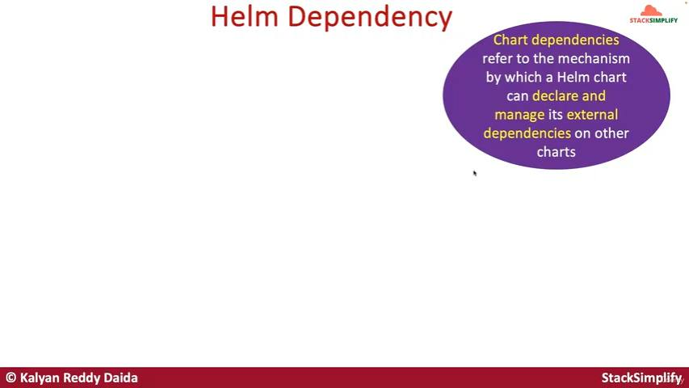
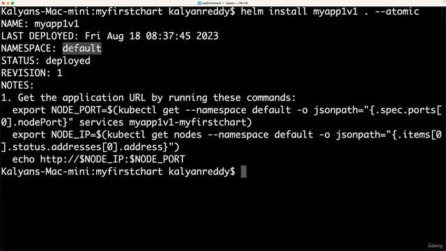
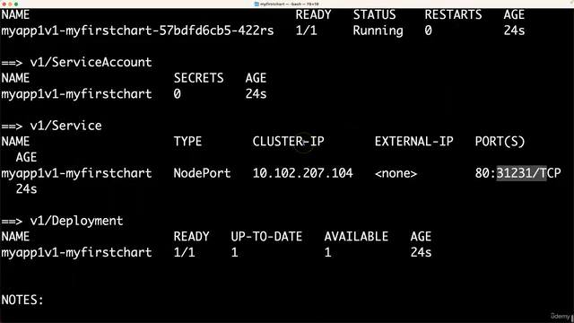
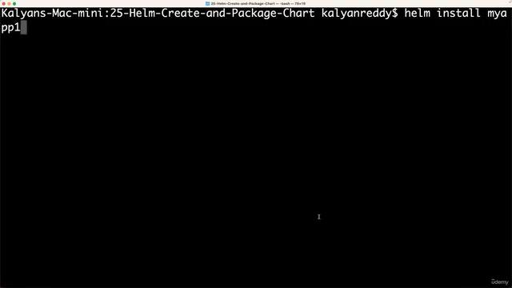
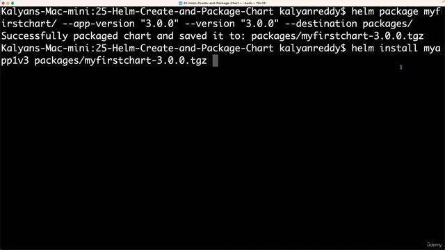
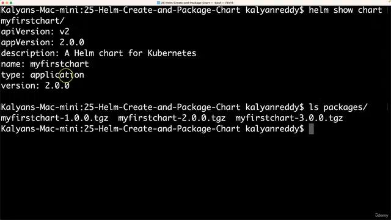
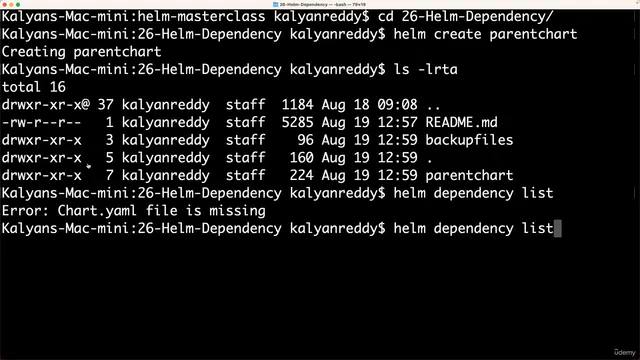
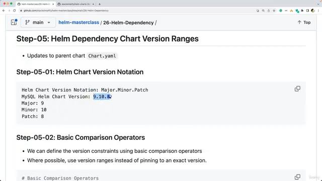
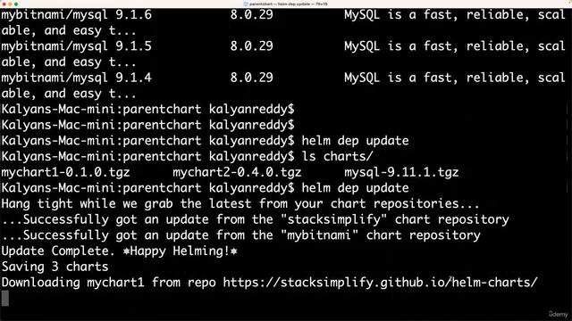

## 1 这一节做什么

这一段课（P75–P81）把前面已经创建好的 `myfirstchart` 真正走完一条 Helm 发布链路：安装、验证、打包、用不同方式生成 2.0.0/3.0.0 包、查看包内容，然后进入 Helm dependency：父 chart 如何声明子 chart 依赖、`helm dependency list/update` 如何把依赖下载到 `charts/` 目录、`Chart.lock` 如何记录锁定结果，最后解释依赖版本的精确版本、比较运算符、`^` 和 `~` 范围。

换句话说，这一段不是单独讲某一个命令，而是把 Helm 里最常见的两条工作流串起来：第一条是“把一个 chart 安装成 release，再打包成可分发产物”，第二条是“让一个父 chart 声明依赖，并把依赖真正拉取到本地 `charts/` 目录”。你需要重点观察 release 名称、Service 的 NodePort、`Chart.yaml` 里的 `version` 与 `appVersion`、`helm package` 生成的 tgz 文件名、`helm show` 读取包内元数据的结果，以及 `helm dependency list/update` 前后 `charts/` 和 `Chart.lock` 的变化。

你要复现出来的目录大致是：

```text
helm-demo/
├── 25-helm-create-and-package-charts/
│   ├── myfirstchart/
│   │   ├── Chart.yaml
│   │   ├── values.yaml
│   │   └── templates/
│   │       ├── deployment.yaml
│   │       ├── service.yaml
│   │       └── serviceaccount.yaml
│   └── packages/
│       ├── myfirstchart-1.0.0.tgz
│       ├── myfirstchart-2.0.0.tgz
│       └── myfirstchart-3.0.0.tgz
└── 26-helm-dependency/
    └── parentchart/
        ├── Chart.yaml
        ├── Chart.lock
        └── charts/
```

课程里 `myfirstchart` 的模板细节没有在本段逐字稿中逐行展示；下面第 4 节给出一套**完整可运行的最小 chart**，用于让你真正完成安装、打包、依赖和版本范围实验。课程实际镜像名也没有在逐字稿里出现，因此下面的 chart 用 `hashicorp/http-echo` 作为占位镜像，让浏览器能显示 `application version v1/v2/v3`。你如果已有课程镜像，只改 `values.yaml` 的 `image.repository` 和 `image.tag` 即可。

对前端同学来说，可以把这一节粗略类比成三件事：`Chart.yaml` 类似包的清单文件，`helm package` 类似把项目打成可分发压缩包，`helm dependency update` 类似根据清单把依赖安装到本地目录并生成锁文件。但要注意，Helm 管理的是 Kubernetes chart，不是 npm 包；这个类比只是帮助你理解流程，不能把命令语义完全等同。复现时不要跳过验证命令，因为 Helm 的很多问题不是“命令有没有执行”，而是“release 创建出了哪些资源、包内元数据是什么、依赖最终解析到了哪个版本”。

## 2 讲师原话（带「—— pNNN [MM:SS]」）

> "如果你不希望在发布失败时仍然创建发布版本，可以指定 atomic；它会通过抛出错误信息来删除该发布版本。"
> —— p075 [00:55]

> "执行 helm status myapp1v1 --show-resources，就能看到 Deployment myapp1v1 和 Service myapp1v1 都已创建……"
> —— p075 [01:25]

> "把该 Chart 打包并发布到某个 Helm 仓库……执行 helm package my-first-chart --destination……"
> —— p075 [02:47]

> "myapp1v2 失败了，并且已被卸载，因为你使用了 atomic；毕竟 31231 已经被另一个……占用。"
> —— p076 [03:46]

> "在 3.0.0 中，你只需通过命令覆盖它们。"
> —— p077 [00:29]

> "Chart 依赖指的是 Helm Chart 能够声明并管理其对外部其他 Chart 的依赖的机制。"
> —— p079 [00:27]

> "helm dependency list 会列出 Chart 中声明的所有依赖……helm dependency update 会根据 chart.yml 的内容更新父 Chart 的 charts 文件夹。"
> —— p080 [02:26]

> "插入符（^）运算符用于主版本级别的变更……波浪号（~）运算符在指定了次版本号时用于补丁级别的范围……"
> —— p081 [04:39]

以上引用按逐字稿保留，不额外改写讲师原话。逐字稿里的命令口述有时会有转写误差，例如把 `--show-resources` 写成 “hyphen hyphen show resources”，实际执行时以终端里的 `helm --help`、`helm status --help` 和命令输出为准。阅读这些原话时，建议把注意力放在讲师强调的三个动作上：失败时用 `--atomic` 清理 release、用 `helm status --show-resources` 从 release 视角看资源、用 `helm package --destination` 把 chart 打成可分发 tgz。



## 3 从零复现

### 3.1 前置条件

- 一个可用的 Kubernetes 集群；课程默认你已经有集群，课里没讲如何安装 Kubernetes。
- Helm 3；课里没给具体 Helm 版本，先运行 `helm version` 确认。
- `kubectl` 能访问当前集群。
- 你能访问课程用到的 Helm 仓库：`stacksimplify` 和 `bitnami`。仓库地址以 `helm search repo` 实际结果为准。

先建工作目录：

```bash
mkdir -p helm-demo/25-helm-create-and-package-charts
mkdir -p helm-demo/26-helm-dependency
cd helm-demo
```

在真正安装前，建议先做三条环境检查：`helm version` 确认 Helm 3 可用；`kubectl config current-context` 确认当前上下文是你想操作的集群；`kubectl get nodes` 确认集群节点可访问。如果你在本地同时有多个 kubeconfig，最容易犯的错误是把 chart 安装到了错误的集群或命名空间，然后在另一个上下文里查不到 Pod。对前端同学来说，这有点像在错误的 Node 版本或错误的项目目录里执行 `npm install`：命令本身没写错，但环境和目录不对，结果就会和预期不一致。

如果 `helm version` 显示的是 Helm 2 或提示找不到命令，不要继续往下复现。本文所有命令按 Helm 3 书写，`helm install` 的 release 名称和 chart 路径顺序、`--atomic`、`helm dependency update` 等行为都以 Helm 3 为准。如果 `kubectl get nodes` 报连接失败或权限不足，先解决集群访问问题；否则后面 `helm install` 即使 chart 渲染成功，也无法创建资源。

### 3.2 创建并安装 1.0.0

在 `25-helm-create-and-package-charts` 下创建 `myfirstchart`，写入第 4 节的完整文件。然后执行：

```bash
cd 25-helm-create-and-package-charts/myfirstchart
helm lint .
helm install myapp1v1 . --atomic
```

讲师在这一步强调 `--atomic`：如果 release 失败，Helm 会把这次失败的 release 清理掉，并返回错误信息。安装成功后验证：

```bash
helm status myapp1v1 --show-resources
kubectl get pods
kubectl get deploy
kubectl get svc
```

这里的命令可以拆开理解：`helm lint .` 检查当前目录这个 chart 的模板和元数据是否有明显问题；`helm install myapp1v1 . --atomic` 表示把当前目录的 chart 安装成一个名为 `myapp1v1` 的 release，`. --atomic` 表示安装失败时清理失败 release。`helm status myapp1v1 --show-resources` 是从 Helm release 视角查看这个 release 关联到的 Kubernetes 资源；后面的 `kubectl get` 是从 Kubernetes 视角查看 Pod、Deployment、Service。两种视角要结合看，因为 Helm 只显示某个 release 的资源，`kubectl get deploy` 则会列出当前命名空间里所有 Deployment。

课程里服务使用 `NodePort`，端口是 `31231`。浏览器访问：

```text
http://localhost:31231
```

课程环境里能看到 `application version v1`。如果你本机不能直接访问 NodePort，见第 7 节的处理办法。常见排查顺序是：先 `kubectl get pods` 看 Pod 是否 Running，再 `kubectl get svc` 看 Service 的 `PORT(S)` 是否包含 `31231:31231/TCP` 或类似映射，最后 `kubectl describe svc <service-name>` 看 Endpoints 是否为空。如果 Pod 是 `ImagePullBackOff`，说明镜像拉取有问题；如果 Service 没有 Endpoints，通常是 selector 与 Pod 标签不一致，或者 Pod 还没 Ready。





### 3.3 打包 1.0.0

回到 `25-helm-create-and-package-charts`，把 chart 打包到单独的 `packages` 目录：

```bash
cd ..
helm package myfirstchart --destination packages
ls -l packages
```

因为 `Chart.yaml` 里 `version: 1.0.0`，会生成类似：

```text
packages/myfirstchart-1.0.0.tgz
```

课程里还演示了进入 chart 目录后执行 `helm package .`，包会生成在当前目录；讲师认为把包放到单独 `packages` 目录更清晰。`--destination packages` 的价值是把构建产物集中管理，避免 tgz 包散落在 chart 源目录里。复现时要养成一个习惯：打包后不要只看命令有没有报错，还要 `ls -l packages` 确认文件名里的版本号是否符合 `Chart.yaml`。如果文件名不是预期的 `myfirstchart-1.0.0.tgz`，优先检查 `Chart.yaml` 的 `version` 是否被改过，或者执行 `helm show chart myfirstchart` 查看源 chart 的元数据。

常见错误是把 `--destination` 后面的目录写错，导致包生成到别处；也可能因为 `Chart.yaml` 的 `version` 与预期不一致，生成 `myfirstchart-2.0.0.tgz` 而不是 1.0.0。排查方法是回到 chart 目录执行 `helm show chart .`，再回到上级目录执行 `helm package myfirstchart --destination packages`。对前端同学可以把这一步类比成 `npm pack`：源目录仍然是项目源文件，打包产物是另一个可分发文件；打包动作本身不改变源目录里的 `Chart.yaml`。

### 3.4 制作并安装 2.0.0

修改 `myfirstchart/Chart.yaml` 的 `version` 和 `appVersion` 为 `2.0.0`，把 `values.yaml` 的 `app.text` 改成 `application version v2`。然后打包：

```bash
cd 25-helm-create-and-package-charts
helm package myfirstchart --destination packages
ls -l packages
```

安装 2.0.0 包。先故意不传新 NodePort，观察 `--atomic` 的效果：

```bash
helm install myapp1v2 packages/myfirstchart-2.0.0.tgz --atomic
```

因为 1.0.0 已经占用了 `31231`，而 `values.yaml` 里默认 `service.nodePort` 仍是 `31231`，安装会失败；`--atomic` 会把失败的 `myapp1v2` 清理掉。然后指定新端口重装：

```bash
helm install myapp1v2 packages/myfirstchart-2.0.0.tgz \
  --atomic \
  --set service.nodePort=31232
```

验证：

```bash
helm list
helm status myapp1v2 --show-resources
kubectl get pods
```

浏览器访问 `http://localhost:31232`，应看到 v2 内容。注意 `helm status myapp1v2 --show-resources` 只显示这个 release 的资源；`kubectl get deploy` 会同时看到 v1 和 v2 的 Deployment。这里第一次安装失败是课程故意展示的，不是你复现步骤错了。你需要确认两件事：失败信息里是否出现 NodePort 已被占用或 Service 创建失败；失败后 `myapp1v2` 是否被 `--atomic` 清理，不留下半成品 release。可以用 `helm list` 查看当前正常 release，用 `helm list --all` 或 `helm history myapp1v2` 辅助判断历史状态；不同 Helm 版本对失败 release 的保留展示可能略有差异，以实际输出为准。

常见排查：如果 `--set service.nodePort=31232` 后仍失败，检查 31232 是否已被其他 Service 占用；如果安装成功但页面仍是 v1，检查你访问的端口是否是 31232，以及 Pod 使用的镜像和 `app.text` 是否真的来自 2.0.0 包。`--set` 会覆盖 values 中的字段，但不会修改 tgz 包本身；`helm get values myapp1v2` 可以查看 release 最终使用的覆盖值。对前端同学可以把 `--set` 理解为命令行临时覆盖配置，类似构建时传入环境变量，源文件不改，但本次发布使用覆盖后的值。



### 3.5 用命令行覆盖版本，制作并安装 3.0.0

3.0.0 不修改 `Chart.yaml`，直接用 `helm package` 的 `--version` 和 `--app-version` 覆盖：

```bash
cd 25-helm-create-and-package-charts
helm package myfirstchart \
  --version 3.0.0 \
  --app-version 3.0.0 \
  --destination packages
```

课程里强调：`myfirstchart/Chart.yaml` 里仍然写着 2.0.0，但打出来的包名和包内 chart 元数据会变成 3.0.0。安装：

```bash
helm install myapp1v3 packages/myfirstchart-3.0.0.tgz \
  --atomic \
  --set service.nodePort=31233 \
  --set app.text="application version v3"
```

这里额外 `--set app.text` 是因为我们的占位镜像不会根据 `appVersion` 自动换页面内容；课程里是让 `appVersion: 3.0.0` 去对应镜像 tag `3.0.0`。验证：

```bash
helm list
helm status myapp1v3 --show-resources
```

浏览器访问 `http://localhost:31233`。复现时建议额外执行 `helm show chart packages/myfirstchart-3.0.0.tgz`，确认包内 `version` 和 `appVersion` 是否已被命令行覆盖成 3.0.0；再执行 `helm show chart myfirstchart`，确认源目录里的 `Chart.yaml` 仍然是 2.0.0。这个对比能说明 `--version` 和 `--app-version` 是打包时覆盖元数据，不是回写源文件。

常见错误是误以为执行 `helm package --version 3.0.0` 后源 `Chart.yaml` 也变成了 3.0.0，接着直接修改源文件，导致后续包版本混乱。正确做法是：如果要长期升级源 chart，就修改 `Chart.yaml`；如果只是演示打包覆盖，就明确知道源文件未变。对前端同学可以类比为构建命令传入版本号参数：产物里的版本号变了，但 `package.json` 不一定被改写。



### 3.6 用 helm show 查看 chart 和 tgz 包

```bash
cd 25-helm-create-and-package-charts
helm show chart myfirstchart
helm show chart packages/myfirstchart-2.0.0.tgz
helm show values packages/myfirstchart-3.0.0.tgz
helm show all packages/myfirstchart-3.0.0.tgz
helm show --help
```

课程里演示了 `helm show chart` 显示 `Chart.yaml` 信息，`helm show values` 显示 `values.yaml`，`helm show all` 显示包的整体信息。`helm show --help` 里能看到 `chart`、`readme`、`values`、`crds`、`all` 等子命令；逐字稿里口述有轻微含混，实际以 `helm show --help` 输出为准。复现时可以把这一组命令当成“检查构建产物”的手段：安装前看包内元数据，确认版本、应用版本和 values 默认值是否符合预期；安装后如果行为不对，也可以回头用 `helm show` 对比包内内容与源目录内容。

常见错误是只检查源目录而不检查 tgz 包。源目录正确不代表包内正确，尤其在你使用 `--version`、`--app-version` 或多次覆盖打包之后，必须以 tgz 包内信息为准。`helm show values` 显示的是包内默认 values，不一定等于某个 release 最终运行时的 values；要查看某个 release 的覆盖值，应使用 `helm get values <release>`。



### 3.7 创建 parent chart 并声明依赖

进入 dependency 目录：

```bash
cd 26-helm-dependency
helm create parentchart
```

用第 4 节的 `parentchart/Chart.yaml` 覆盖生成的文件。先添加仓库；课程里本地仓库名分别是 `stacksimplify` 和 `mybitnami`，其中 `mybitnami` 指向 Bitnami：

```bash
helm repo add stacksimplify https://stacksimplify.github.io/helm-charts/
helm repo add mybitnami https://charts.bitnami.com/bitnami
helm repo update
helm search repo stacksimplify
helm search repo mybitnami/mysql --versions
```

如果你的 `helm search repo stacksimplify` 输出的 chart 名不是 `mychart1`/`mychart2`，把 `parentchart/Chart.yaml` 里的 `name` 改成实际名称。课程口述的是 “my chart one / my chart two”，版本是 `0.1.0` 和 `0.4.0`；MySQL 初始用 `9.9.0`。`helm repo add` 只是添加仓库配置，`helm repo update` 才会刷新本地索引；如果只 add 不 update，搜索或依赖解析可能拿不到最新索引。`helm search repo` 用来确认仓库里实际存在的 chart 名称和版本，避免直接照抄一个当前仓库已改名的依赖。

查看依赖声明：

```bash
cd parentchart
helm dependency list
```

刚写完 `Chart.yaml`、还没下载时，`STATUS` 会是 `missing`。下载依赖：

```bash
helm dependency update
```

也可以使用别名：

```bash
helm dep list
helm dep update
```

更新后：

```bash
helm dependency list
ls charts
cat Chart.lock
```

`charts/` 下会出现 `mychart1-0.1.0.tgz`、`mychart2-0.4.0.tgz`、`mysql-9.9.0.tgz` 这类依赖包；`Chart.lock` 记录依赖名称、仓库和版本。`Chart.lock` 不要手写，运行 `helm dependency update` 生成。复现时重点看三个状态：第一次 `helm dependency list` 的 `STATUS` 是否为 `missing`；`helm dependency update` 是否没有报错；更新后 `charts/` 是否出现 tgz 文件、`Chart.lock` 是否出现且内容与 `Chart.yaml` 的依赖声明对应。对前端同学可以把它类比成 `package.json` 声明依赖、`node_modules` 存放依赖、lock 文件锁定解析结果；但 Helm 的依赖最终进入 `charts/` 目录，而不是 `node_modules`。

常见错误：`helm dependency update` 报仓库找不到，通常是 `repository` 地址写错或没有执行 `helm repo add/update`；报 chart 名称不存在，通常是 `Chart.yaml` 里的 `name` 与仓库实际名称不一致；`Chart.lock` 与 `Chart.yaml` 不一致，通常是你手改了 `Chart.yaml` 却没重新执行 `helm dep update`。



### 3.8 MySQL 依赖版本范围实验

先查看 Bitnami MySQL 可用版本：

```bash
helm search repo mybitnami/mysql --versions
```

课程当时的结果是：最新版 `9.11.1`，另有 `9.10.10`、`9.10.9`、`9.10.8` 等。然后改 `parentchart/Chart.yaml` 中 mysql 的 `version`，每次执行：

```bash
cd 26-helm-dependency/parentchart
helm dep update
ls charts
```

实验顺序可按课程：

1. `version: 9.9.0`：精确版本，下载 `9.9.0`。
2. `version: ">=9.10.8"`：下载当时最新的 `9.11.1`。
3. `version: ">=9.10.8 <9.11.0"`：下载 `9.10.10`。
4. `version: "^9.10.1"`：等价于 `>=9.10.1 <10.0.0`，当时下载 `9.11.1`。
5. `version: "~9.10.1"`：等价于 `>=9.10.1 <9.11.0`，当时下载 `9.10.10`。

课程里这些具体下载结果依赖当时仓库中的版本；你今天复现时，最新版可能已经变化，但范围语义不变。复现时每改一次 `Chart.yaml` 里的 mysql `version`，都应重新执行 `helm dep update`，然后观察 `charts/` 中 mysql tgz 的版本号变化；不要只看 `Chart.lock` 的文本而不看实际下载的包名。更稳妥的验证方式是执行 `helm dependency list`，它会把声明的依赖和当前状态列出来；再执行 `ls charts` 确认实际文件。若范围写错导致没有匹配版本，`helm dep update` 会报错，这时应回到 `helm search repo mybitnami/mysql --versions` 查看当前可用版本，再调整范围。





## 4 完整代码

以下代码块保留本文给出的完整可运行最小 chart 与 parent chart 示例，用于复现第 3 节命令；它们不是对讲师未展示模板的逐行复刻，而是为了让你能实际完成安装、打包、依赖和版本范围实验。

### 4.1 `myfirstchart/Chart.yaml`（1.0.0）

```yaml
apiVersion: v2
name: myfirstchart
description: A minimal Helm chart for the Helm Masterclass P75-P81 demo
type: application
version: 1.0.0
appVersion: "1.0.0"
```

### 4.2 `myfirstchart/values.yaml`（1.0.0）

```yaml
replicaCount: 1

image:
  repository: hashicorp/http-echo
  tag: "1.0"
  pullPolicy: IfNotPresent

service:
  type: NodePort
  port: 80
  targetPort: 5678
  nodePort: 31231

app:
  text: "application version v1"

serviceAccount:
  create: true
  name: ""
```

### 4.3 `myfirstchart/templates/deployment.yaml`

```yaml
apiVersion: apps/v1
kind: Deployment
metadata:
  name: {{ .Release.Name }}-myfirstchart
  labels:
    app: {{ .Release.Name }}-myfirstchart
spec:
  replicas: {{ .Values.replicaCount }}
  selector:
    matchLabels:
      app: {{ .Release.Name }}-myfirstchart
  template:
    metadata:
      labels:
        app: {{ .Release.Name }}-myfirstchart
    spec:
      {{- if .Values.serviceAccount.create }}
      serviceAccountName: {{ .Values.serviceAccount.name | default (printf "%s-myfirstchart" .Release.Name) }}
      {{- end }}
      containers:
        - name: app
          image: "{{ .Values.image.repository }}:{{ .Values.image.tag }}"
          imagePullPolicy: {{ .Values.image.pullPolicy }}
          args:
            - "-listen=:{{ .Values.service.targetPort }}"
            - "-text={{ .Values.app.text }}"
          ports:
            - name: http
              containerPort: {{ .Values.service.targetPort }}
```

### 4.4 `myfirstchart/templates/service.yaml`

```yaml
apiVersion: v1
kind: Service
metadata:
  name: {{ .Release.Name }}-myfirstchart
  labels:
    app: {{ .Release.Name }}-myfirstchart
spec:
  type: {{ .Values.service.type }}
  selector:
    app: {{ .Release.Name }}-myfirstchart
  ports:
    - name: http
      port: {{ .Values.service.port }}
      targetPort: {{ .Values.service.targetPort }}
      {{- if and (eq .Values.service.type "NodePort") .Values.service.nodePort }}
      nodePort: {{ .Values.service.nodePort }}
      {{- end }}
```

### 4.5 `myfirstchart/templates/serviceaccount.yaml`

```yaml
{{- if .Values.serviceAccount.create }}
apiVersion: v1
kind: ServiceAccount
metadata:
  name: {{ .Values.serviceAccount.name | default (printf "%s-myfirstchart" .Release.Name) }}
  labels:
    app: {{ .Release.Name }}-myfirstchart
{{- end }}
```

### 4.6 `myfirstchart/Chart.yaml`（2.0.0，完整替换）

```yaml
apiVersion: v2
name: myfirstchart
description: A minimal Helm chart for the Helm Masterclass P75-P81 demo
type: application
version: 2.0.0
appVersion: "2.0.0"
```

### 4.7 `myfirstchart/values.yaml`（2.0.0，完整替换）

```yaml
replicaCount: 1

image:
  repository: hashicorp/http-echo
  tag: "1.0"
  pullPolicy: IfNotPresent

service:
  type: NodePort
  port: 80
  targetPort: 5678
  nodePort: 31231

app:
  text: "application version v2"

serviceAccount:
  create: true
  name: ""
```

### 4.8 `parentchart/Chart.yaml`（依赖演示）

```yaml
apiVersion: v2
name: parentchart
description: Parent chart for Helm dependency demo
type: application
version: 0.1.0
appVersion: "1.0.0"

dependencies:
  - name: mychart1
    version: "0.1.0"
    repository: "https://stacksimplify.github.io/helm-charts/"
  - name: mychart2
    version: "0.4.0"
    repository: "https://stacksimplify.github.io/helm-charts/"
  - name: mysql
    version: "9.9.0"
    repository: "https://charts.bitnami.com/bitnami"
```

> 如果 `helm search repo stacksimplify` 显示的名称不是 `mychart1`/`mychart2`，只改 `name`，不要改版本范围语义。

### 4.9 `parentchart/values.yaml`

```yaml
# 这段依赖实验只做 dependency list/update，不需要额外覆盖子 chart 的 values。
# 保留一个空 values 文件即可。
{}
```

## 5 逐行解释

`Chart.yaml` 里的 `version` 是 chart 自身版本，决定 `helm package` 生成的文件名。`appVersion` 是应用版本，课程用它来对应 Docker 镜像 tag：2.0.0 的 chart 要配 2.0.0 镜像，3.0.0 同理。我们的占位 chart 不自动根据 `appVersion` 改镜像 tag，所以演示 v2/v3 页面内容时用了 `app.text` 和 `--set`；真实项目里应把 `appVersion`、`image.tag`、应用发布版本对齐。`apiVersion: v2` 表示使用 Helm 3 的 chart API；`type: application` 表示这是可部署应用 chart；`name` 是 chart 名称，会参与包名和部分资源命名。

`service.nodePort: 31231` 是课程里 1.0.0 使用的固定 NodePort。Kubernetes 的 NodePort 是集群级资源，不能同时被两个 Service 占用。因此 2.0.0 如果还沿用 31231，会失败；课程用 `--atomic` 让失败的 release 自动回滚清理，然后用 `--set service.nodePort=31232` 指定新端口。这个失败不是 Helm 安装逻辑错误，而是端口冲突。排查时先看 Helm 报错，再看 `kubectl get svc` 里是否已有 Service 占用该端口；如果端口冲突，换一个未被占用的 NodePort，或把 Service 类型改成 ClusterIP 后用端口转发访问。

`--atomic` 的作用可以理解成“安装失败就不要留下半成品 release”。课程原话是失败时删除 release 并抛错。它不是数据库事务；这里只是 Helm 的 release 清理行为。类比到 Node/JS，类似失败后执行 cleanup 并把错误继续抛出，但不要把它理解成跨资源的强事务。使用 `--atomic` 时仍要看原始错误，因为清理失败 release 不等于根因消失；例如 NodePort 冲突被清理后，你仍然需要换端口才能成功安装。

`helm status myapp1v2 --show-resources` 的价值是只看某个 release 创建的资源；`kubectl get deploy` 会列出命名空间里所有 Deployment，所以 v1 和 v2 都会出现。课程强调这一点，是为了让你区分“Helm release 视角”和“Kubernetes 资源视角”。如果 `helm status` 看不到资源，先确认 release 名称和命名空间是否正确；如果 `kubectl get` 能看到资源但 `helm status` 看不到，检查这些资源是否由该 release 管理。

`helm package myfirstchart --destination packages` 会根据 `Chart.yaml` 的 `version` 生成包名。`--version` 和 `--app-version` 是打包时覆盖元数据，不修改源文件；所以 3.0.0 实验里 `Chart.yaml` 仍是 2.0.0，但 tgz 包内元数据是 3.0.0。`helm show chart packages/...tgz` 能直接读包内 `Chart.yaml`，`helm show values` 能直接读包内 `values.yaml`。打包后建议同时检查源 chart 与 tgz 包，确认版本号和 values 是否符合预期；这是排查“为什么安装的是旧版本”的第一手证据。

`helm dependency list` 只读取 `Chart.yaml` 中声明的依赖，不下载；`helm dependency update` 才会根据声明把依赖包下载到 `charts/` 并生成 `Chart.lock`。`Chart.lock` 类似前端项目的 `package-lock.json`：记录这次解析到的依赖版本，方便复现。这个类比不是讲师原话，但可以帮助前端同学理解。注意 `Chart.lock` 不要手写；依赖声明变化后应重新执行 `helm dependency update`，让 Helm 重新解析并更新锁文件。

版本范围里，`9.9.0` 是精确版本；`>=9.10.8` 会拿满足条件的最新版；`>=9.10.8 <9.11.0` 把上限卡在 `9.11.0` 之前；`^9.10.1` 表示 `>=9.10.1 <10.0.0`，锁定 major；`~9.10.1` 表示 `>=9.10.1 <9.11.0`，锁定 minor。它们和 npm semver 的 `^`/`~` 思路相近，但 Helm 这里操作的是 chart 版本，不是 npm 包版本。复现时要记住：课程中的 `9.11.1`、`9.10.10` 是当时仓库里的结果；你今天执行时可能解析到别的版本，但“精确版本、比较范围、caret 锁 major、tilde 锁 minor”的语义不变。

模板部分可以按依赖关系理解：Deployment 和 Service 都使用 `{{ .Release.Name }}-myfirstchart` 作为名称和标签，因此它们能互相对应；Service 的 `selector` 必须匹配 Deployment Pod 模板里的 `labels`，否则 Service 找不到后端 Pod。`serviceaccount.yaml` 根据 `.Values.serviceAccount.create` 决定是否创建 ServiceAccount，Deployment 也在同样条件下设置 `serviceAccountName`。如果 ServiceAccount 名称在两边不一致，Pod 可能因为找不到 ServiceAccount 而无法创建；本文两处都使用 `default (printf "%s-myfirstchart" .Release.Name)`，目的就是保持一致。

## 6 复现检查清单

- [ ] `helm lint .` 通过。验证：在 `myfirstchart` 目录执行 `helm lint .`，确认退出码为 0；如果报模板错误，先修模板再看后续命令。
- [ ] `helm install myapp1v1 . --atomic` 后 `helm status myapp1v1 --show-resources` 能看到 Deployment、Service、ServiceAccount、Pod 等资源。验证：执行 `helm status myapp1v1 --show-resources`，同时用 `kubectl get deploy,svc,sa,pod` 对照资源是否存在。
- [ ] Service 类型为 `NodePort`，1.0.0 使用 `31231`。验证：执行 `kubectl get svc`，查看 Service 的 TYPE 是否为 NodePort，端口映射是否包含 `31231`。
- [ ] 浏览器能打开 `http://localhost:31231`，看到 v1 内容。验证：先 `kubectl get pods` 确认 Pod Running，再访问页面；若不通，用第 7 节的方法排查访问路径。
- [ ] `packages/myfirstchart-1.0.0.tgz` 已生成。验证：执行 `ls -l packages`，确认文件名和版本号；必要时 `helm show chart packages/myfirstchart-1.0.0.tgz` 查看包内元数据。
- [ ] 修改 `Chart.yaml` 和 `values.yaml` 后生成 `myfirstchart-2.0.0.tgz`。验证：打包后 `ls -l packages`，并执行 `helm show chart packages/myfirstchart-2.0.0.tgz` 确认 version/appVersion 为 2.0.0。
- [ ] 不传新端口安装 2.0.0 会失败，且 `--atomic` 清理失败 release。验证：观察 `helm install myapp1v2 packages/myfirstchart-2.0.0.tgz --atomic` 的错误输出；失败后 `helm list` 不应显示正常部署的 `myapp1v2`。
- [ ] `--set service.nodePort=31232` 后 `myapp1v2` 安装成功。验证：执行 `helm status myapp1v2 --show-resources` 和 `kubectl get svc`，确认端口为 31232 且资源存在。
- [ ] `helm package --version 3.0.0 --app-version 3.0.0` 生成 `myfirstchart-3.0.0.tgz`。验证：`ls -l packages` 看文件名，`helm show chart packages/myfirstchart-3.0.0.tgz` 看包内版本。
- [ ] `myapp1v3` 使用 `31233` 安装成功。验证：`helm status myapp1v3 --show-resources`，`kubectl get svc` 确认端口，访问 `http://localhost:31233` 看 v3 内容。
- [ ] `helm show chart packages/myfirstchart-2.0.0.tgz` 能看到 2.0.0 元数据。验证：执行命令后检查输出中的 `version` 和 `appVersion` 字段。
- [ ] `helm show values packages/myfirstchart-3.0.0.tgz` 能看到 3.0.0 包的 values。验证：执行命令后检查 `app.text`、`image`、`service.nodePort` 等字段是否来自包内 values。
- [ ] `helm dependency list` 初始显示 `missing`。验证：在 `parentchart` 目录首次执行 `helm dependency list`，看 `STATUS` 列。
- [ ] `helm dependency update` 后 `charts/` 出现依赖 tgz，`Chart.lock` 生成。验证：执行 `ls charts` 和 `cat Chart.lock`，对照依赖名称与版本。
- [ ] 再次 `helm dependency list`，STATUS 不再是 `missing`。验证：再次执行 `helm dependency list`，确认依赖状态已变为可用或已下载状态。
- [ ] 修改 mysql 版本范围后，`helm dep update` 能按范围下载对应版本。验证：每次修改 `Chart.yaml` 后执行 `helm dep update`，再 `ls charts` 看 mysql tgz 版本，并与 `helm search repo mybitnami/mysql --versions` 的可用版本对照。

## 7 课里没讲但你会撞上的

| 现象 | 原因 | 怎么办 |
| --- | --- | --- |
| Pod 出现 `ImagePullBackOff`，或页面内容不是课程里的 v1/v2/v3 | 课程逐字稿没有给出实际镜像仓库地址，本文用 `hashicorp/http-echo` 作为占位镜像 | 如果只是复现流程，继续使用占位镜像；如果已有课程镜像，只改 `values.yaml` 的 `image.repository` 和 `image.tag`，不要改模板逻辑。 |
| 照课程命令执行后，资源名称、标签或页面行为与讲师屏幕不完全一致 | P75–P81 主要演示 Helm 命令和依赖，模板细节没有在逐字稿中逐行展示 | 使用第 4 节的最小可运行 chart 完成实验；把它当作复现载体，不要当作对讲师模板的逐行复刻。 |
| 浏览器访问 `http://localhost:31231` 打不开 | NodePort 能否用 `localhost` 访问取决于集群类型、节点网络、Docker Desktop/minikube/远程集群的映射方式 | 先确认 Pod 和 Service 正常；minikube 可用 `minikube service <service-name>`，本地可用 `kubectl port-forward`，远程集群可用节点 IP 加 NodePort，并检查防火墙或安全组。 |
| `helm install` 报 release 名称已存在 | 同名 release 之前安装过但没有卸载，或上次失败后仍残留历史记录 | 执行 `helm list --all` 查看，必要时 `helm uninstall <release>` 后重装，或换一个新的 release 名称。 |
| 2.0.0 安装失败，提示 NodePort 已被占用或端口不合法 | `31231` 已被 1.0.0 的 Service 占用；NodePort 是集群级资源，不能重复；端口还需在集群允许范围内 | 按课程用 `--set service.nodePort=31232` 换端口；确认端口在 NodePort 范围内；也可以改用 ClusterIP 加 `kubectl port-forward` 访问。 |
| `helm dependency update` 报找不到仓库或 chart | 没有执行 `helm repo add/update`，`repository` 地址写错，或 `Chart.yaml` 里的依赖名称与仓库实际名称不一致 | 先 `helm repo add`、`helm repo update`，再 `helm search repo` 确认名称和版本；按搜索结果修正 `Chart.yaml`。 |
| 手改 `Chart.yaml` 后 `Chart.lock` 看起来没变化或与声明不一致 | `Chart.lock` 是 `helm dependency update` 解析后生成的，不应当手写；只改声明不执行 update 不会自动同步 | 重新执行 `helm dep update`，再用 `helm dependency list`、`ls charts`、`cat Chart.lock` 三处对照。 |
| `helm show values` 显示的默认值和实际运行值不同 | `helm show values` 只显示包内默认 values，不包含安装时 `--set` 或自定义 values 文件的覆盖 | 查看某个 release 的最终覆盖值用 `helm get values <release>`；渲染结果可用 `helm template` 或 `helm install --dry-run` 检查。 |
| `--set` 传入带空格、逗号或特殊字符的值时解析不符合预期 | `--set` 有自己的解析规则，字符串、数字、逗号和转义需要小心 | 简单值可改用 `--set-string`；复杂配置优先写 values 文件并用 `-f` 传入，再用 `helm template` 验证渲染结果。 |
| 使用 `--atomic` 失败后 `helm list` 看不到该 release | `--atomic` 的设计就是安装失败时清理失败 release，避免留下半成品 | 这是预期行为；重点看安装失败时的错误输出，修复根因后重新安装。需要查看历史时结合 `helm list --all` 或 `helm history` 的实际输出判断。 |