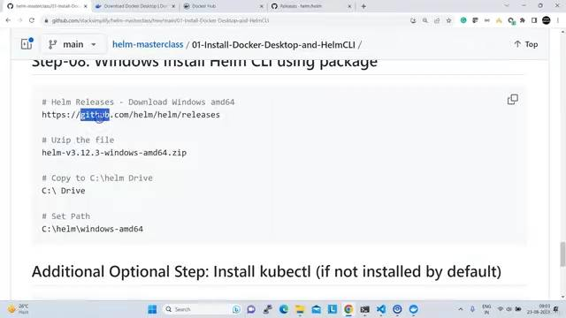
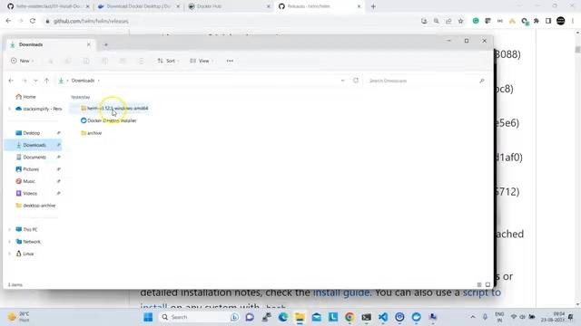
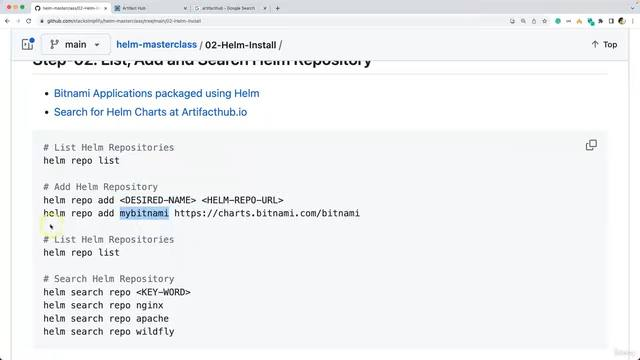
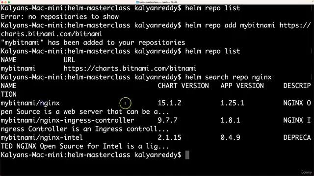
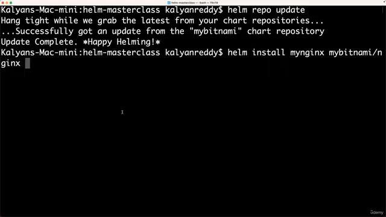
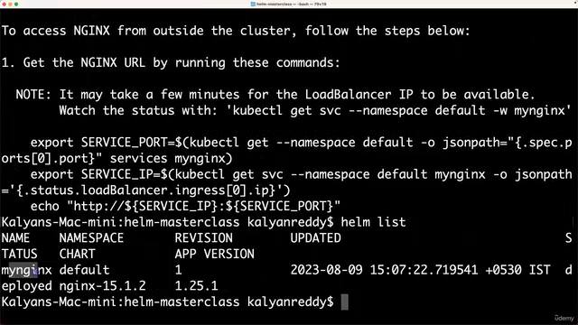
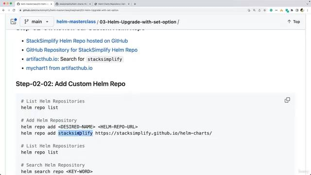
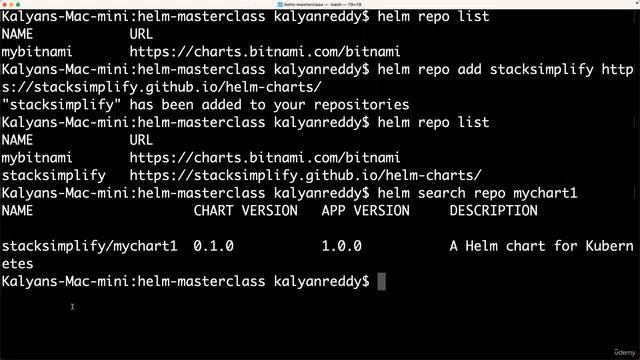
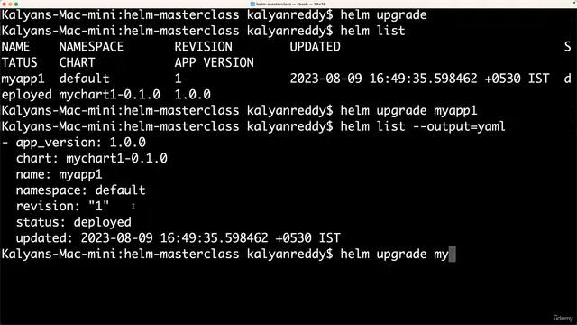
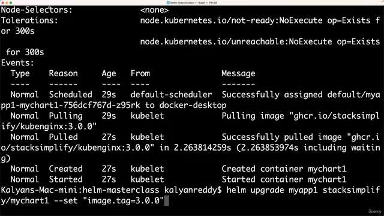

# Helm Masterclass · P008–P015 复现文档

> 覆盖内容：P008 用 zip 包安装 Helm CLI → P009–P011 用 Bitnami 公共仓库装卸 nginx 的完整闭环 → P012–P015 用自定义 GitHub Pages 仓库装卸 mychart1 并用 `--set` 连续升级 4 个版本。
> 前置假设：一台已装 Docker Desktop（并启用内置 Kubernetes）的 Windows 机器。这是讲师在 P009 明确交代的"上一次 demo 已经装好了"的前提；**Docker Desktop 里怎么开 Kubernetes，本段逐字稿没有讲**，请按 Docker Desktop 官方文档开启 `Enable Kubernetes`。

---

## 1. 这一节做什么

这一节不是讲 Helm 的概念，而是把 Helm 的**三条真实使用路径**从头跑一遍，每一步都有终端输出可以对照：

**路径 A：没有包管理器时怎么把 Helm 装上（P008）**
很多 Windows 机器上没有 Chocolatey、没有 Scoop。讲师演示的是最原始也最通用的办法：去 GitHub Releases 下载对应 OS/架构的压缩包 → 解压到 `C:\helm\windows-amd64` → 把这个目录加进系统 `Path` 环境变量 → 用 `helm version` 和 `where helm` 反向验证。这一步的价值在于：它不依赖任何包管理器，在任何离线/受限环境都能照做。

**路径 B：用公共仓库装一个别人做好的应用（P009–P011）**
用 Bitnami 仓库装 nginx。链条是 `helm repo list`（看现在有什么）→ `helm repo add`（加仓库）→ `helm search repo`（找 chart）→ `helm repo update`（刷新索引）→ `helm install`（生成 release）→ `helm list`（看 release）→ `kubectl get deploy/pods/svc`（看 release 到底在集群里落了哪些 Kubernetes 资源）→ 浏览器访问 → `helm uninstall`（删干净）。
这一段最重要的认知是：**`helm install` 不是"创建一个叫 nginx 的东西"，而是"把一个 chart 渲染成一批 Kubernetes YAML，并以某个 release 名字提交给集群"**。所以后面 `kubectl get pods` 看到的 Pod 名字是 `mynginx-xxxx`，名字前缀来自 release 名，不是来自 chart 名。

**路径 C：用自定义仓库 + `--set` 做滚动升级（P012–P015）**
换成讲师自己的仓库 `stacksimplify`（托管在 GitHub Pages 上），装 `mychart1`。这个 chart 的镜像有 4 个 tag（1.0.0 ~ 4.0.0），页面上分别是 V1~V4 四种颜色。用 `helm upgrade ... --set image.tag=2.0.0` 一档一档往上推，观察三件事：
1. `REVISION` 从 1 涨到 2、3、4；
2. Pod 被替换，`kubectl describe pod` 里的镜像 tag 跟着变；
3. 服务端口（NodePort 31231）不变，所以浏览器地址不变，只是页面变成 V2/V3/V4。

最后 P015 讲师打开 chart 源码，解释了一个关键机制：`values.yaml` 里 `image.tag` 是**空**的，此时模板会回落到 `Chart.yaml` 的 `appVersion`（1.0.0）。这就是为什么 `helm install` 时什么都没指定，装出来的却是 V1。

---

## 2. 讲师原话（带时间戳）

> "所以有时候在你的本地桌面上，并没有 Choco 或其他包管理器。这个时候，我们甚至可以下载对应操作系统的相应 zip 包，然后按需进行配置。"
> —— p008 [00:00]

> "然后我们可以进入 C 盘；如果我在这里进入 Helm，对吧，我创建了一个 Helm 文件夹，并在这里解压了二进制文件……这就是 Helm CLI，所以这个路径，看，是 Helm Windows AMD64，我们可以复制这个路径，然后搜索环境变量。"
> —— p008 [01:24]

> "在我们本地桌面上，之前的演示中，我们已经安装了 Helm CLI，还使用 Docker Desktop 安装了一个 Kubernetes 集群。"
> —— p009 [00:29]

> "要添加 Helm 仓库，你需要执行 Helm repo add，并为这个仓库提供一个想要的名字。Helm 仓库 URL 是 charts.bitnami.com/bitnami。"
> —— p010 [03:22]

> "发布名称就是你要为这次部署中安装到 Kubernetes 集群上的一组资源所提供的名称……你还需要提供仓库名/Chart 名。"
> —— p011 [00:29]

> "所以，即使是你仓库的 URL，你的 GitHub 仓库 URL 也不会生效。对于这个 GitHub 仓库 URL，你需要提供一个与 GitHub Pages 相关的东西，也就是 stacksimplify.github.io/helm-charts。"
> —— p013 [02:19]

> "现在，我们运行 Helm upgrade 命令，发布名称是 my-app-one，Chart 是 stacksimplify/my-chart-one……--set image.tag=2.0.0。"
> —— p014 [03:51]

> "作为升级的一部分，它在这里删除了旧的 Pod，并创建了一个新的 Pod。所以，当我在这里查看这个 Pod 的详情时，它显示正在拉取镜像 ghcr.io/stacksimplify/kubenginx:2.0.0，而之前是 1.0.0。"
> —— p014 [06:13]

> "如果你不提供任何标签，它默认会采用 Chart 的应用版本。"
> —— p015 [07:10]

> "所以，如果你要覆盖配置，比如副本数等于 2，--set replicaCount=2，它就会创建 2 个 Pod。"
> —— p015 [06:14]

---

## 3. 从零复现

下面每一步都按"命令 → 你应该看到什么"来写。**所有命令在 Windows `cmd` 下验证**（讲师全程用的是 `cmd`，不是 PowerShell）。

### 步骤 0：前置检查

```cmd
kubectl get ns
```

应能看到至少 `default`、`kube-system`、`kube-public`、`kube-node-lease` 四个命名空间。讲师在 p011 [03:46] 原话是"你也可以运行 kubectl get ns 查看当前存在的命名空间：default 和这三个系统相关的命名空间。"，说的就是这几个。

如果这条命令报连接错误，说明 Docker Desktop 的 Kubernetes 没开或没起起来——本段课程不复现这一步。

### 步骤 1：安装 Helm CLI（zip 方式）

1. 浏览器打开 `https://github.com/helm/helm/releases`，在 Assets 里按架构下载。讲师下载的是 **Windows AMD64**。

   

2. 用 7-Zip / 系统自带解压，解压到 `C:\helm\windows-amd64\`，确保目录里有 `helm.exe`。

3. 打开「编辑系统环境变量」→「环境变量」→ 选中 `Path` →「编辑」→「新建」，填入：

   ```
   C:\helm\windows-amd64
   ```

4. **关掉所有已打开的 cmd 窗口**，重新开一个（PATH 修改不会对已开进程生效）。

5. 验证：

   ```cmd
   helm version
   where helm
   ```

   `helm version` 应输出 `version.BuildInfo{Version:"v3.12.3", ...}`；`where helm` 应输出 `C:\helm\windows-amd64\helm.exe`。

   

> macOS / Linux 的安装：同一个 releases 页面提供 `macOS amd64/arm64`、`linux amd64/arm64` 的包，流程同样是"解压 + 把目录加进 PATH"。**讲师本段只逐步演示了 Windows，其他平台的细节课里没讲。**

### 步骤 2：Bitnami 仓库 —— 加、查、装、看、删

```cmd
helm repo list
```
此时应该是 `Error: no repositories to show` 或空列表（讲师 p010 [03:22] 原话是"当前没有可显示的仓库。"）。

```cmd
helm repo add mybitnami https://charts.bitnami.com/bitnami
```

注意：仓库的"名字"是你自己起的。讲师故意的用 `mybitnami` 而不是 `bitnami`，就是为了说明"这个名字完全由你定"。

```cmd
helm repo list
```

应输出两列：`NAME = mybitnami`，`URL = https://charts.bitnami.com/bitnami`。



```cmd
helm search repo nginx
```

会返回三条：`mybitnami/nginx`、`mybitnami/nginx-intel`、`mybitnami/nginx-ingress-controller`。讲师在 p010 [05:14] 解释了原因：search 是**前缀/包含匹配**，你搜 `nginx`，任何名字里带 `nginx` 的 chart 都会出来。



```cmd
helm search repo wildfly --versions
```

`--versions` 会把这个 chart 的**所有历史 chart 版本**列出来，从新到旧（讲师看到的顺序是 15.15 → 15.14 → 15.13 …）。不加 `--versions` 只显示最新一条。

想锁定某一个版本，用 `--version`：

```cmd
helm search repo wildfly --version 13.3.7
```

（讲师只是在讲 `--version` 的用法时举了这个例子，**并没有真的去 install 这个版本**。）

```cmd
helm repo update
```

刷新本地索引。讲师在 p011 [00:15] 说"安装 Helm 图表之前，如果你想更新 Helm 仓库，可以运行 Helm repo update。这样我们就能获取最新的图表列表。"。

```cmd
helm install mynginx mybitnami/nginx
```

语法固定是 `helm install <release名> <仓库名>/<chart名>`，**不加 `--version` 就装最新**。

输出里会有一段 `NAME / LAST DEPLOYED / NAMESPACE / STATUS / REVISION / TEST SUITE / CHART / APP VERSION` 的表格，讲师这一次装出来的是 `CHART: nginx-15.12.x`、`APP VERSION: 1.25.1`、`REVISION: 1`、`NAMESPACE: default`。表格下面还有一段 `NOTES:`，是从 chart 的 `templates/NOTES.txt` 渲染出来的访问说明。



```cmd
helm list
helm ls
```

两个命令完全等价，`ls` 是别名。表格列是 `NAME / NAMESPACE / REVISION / UPDATED / STATUS / CHART / APP VERSION`。



想给脚本消费，切成 YAML 或 JSON：

```cmd
helm list --output yaml
helm list --output json
```

YAML 里能直接看到 `app_version: 1.25.1`、`chart: nginx-15.12.x`、`name: mynginx`、`namespace: default`、`revision: "1"`、`status: deployed`、`updated: ...`。

release 是**按 namespace 隔离**的，所以要指定命名空间：

```cmd
helm list --namespace default
helm list -n default
```

讲师在 p011 [03:46] 演示了 `--namespace dev` 返回空（因为没这个 namespace），换成 `default` 才看到 `mynginx`。

看这个 release 在集群里到底落了哪些资源：

```cmd
kubectl get deploy
kubectl get pods
kubectl get svc
```

`kubectl get svc` 里能看到一个 `mynginx` 的 Service，`TYPE` 是 `LoadBalancer`。Docker Desktop 的 LoadBalancer 实现会把 80 端口直接映射到本机，所以浏览器访问 `http://localhost` 就能看到 "欢迎使用 nginx！"。也可以用 `curl http://localhost` 验证。

最后删掉：

```cmd
helm uninstall mynginx
helm list
```

第二条应该返回空表（表头还在，但没数据行）。讲师 p011 [06:12] 的返回就是"当前没有 Helm 发布。"。

### 步骤 3：切到自定义仓库 stacksimplify，装 mychart1

```cmd
helm repo list
```

此时列表里应该只有上一步的 `mybitnami`。

```cmd
helm repo add stacksimplify https://stacksimplify.github.io/helm-charts
```

**这里是本段最容易踩坑的一行。** 讲师在 p013 [02:19] 反复强调：GitHub 仓库地址是 `github.com/stacksimplify/helm-charts`，但 `helm repo add` 要的是**这个仓库的 GitHub Pages 地址**，即 `https://stacksimplify.github.io/helm-charts`。用前者 `helm repo add` 会失败。



```cmd
helm search repo mychart1
```

应返回 `stacksimplify/mychart1`，`CHART VERSION = 0.1.0`，`APP VERSION = 1.0.0`。



```cmd
helm search repo mychart2 --versions
```

可以对照一下：这个 chart 有 4 个 chart 版本（0.1.0 / 0.2.0 / 0.3.0 / 0.4.0），`--versions` 全部列出。这一步只是让你看到"同一个 chart 可以有多个 chart 版本"，本节真正的升级实验用的还是 mychart1。

```cmd
helm install myapp1 stacksimplify/mychart1
```

同样不指定版本，装最新 chart（0.1.0）。

### 步骤 4：看清 myapp1 落地的资源

```cmd
helm ls
kubectl get pods
kubectl get deploy
kubectl get svc
```

资源命名规则是 **`<release名>-<chart名>`**：
- Deployment：`myapp1-mychart1`
- Pod：`myapp1-mychart1-<随机后缀>`
- Service：`myapp1-mychart1`，`TYPE = NodePort`，NodePort 端口是 **31231**

所以访问地址是 `http://localhost:31231`。第一次打开应该是 **V1** 页面。

```cmd
kubectl describe pod myapp1-mychart1-<pod后缀>
```

在输出里找到 `Image:` 字段，应该是 `ghcr.io/stacksimplify/kubenginx:1.0.0`。

### 步骤 5：连续三次 `helm upgrade --set`

```cmd
helm upgrade myapp1 stacksimplify/mychart1 --set image.tag=2.0.0
```



输出里 `REVISION` 变成 `2`。用 YAML 复核：

```cmd
helm list --output yaml
```

```cmd
kubectl get pods
kubectl describe pod myapp1-mychart1-<新pod后缀>
```

Pod 的 `AGE` 会归零（讲师这里说"这是仅在 100 秒前创建的 pod。"），`describe` 里 `Image:` 变成 `kubenginx:2.0.0`。浏览器刷新 `http://localhost:31231`，页面变 **V2**。

讲师还演示了两个过滤开关：

```cmd
helm list --deployed
helm list --superseded
```

`--deployed` 只显示当前生效的那一版（revision 2），`--superseded` 只显示已被取代的历史版本（revision 1）。

继续推：

```cmd
helm upgrade myapp1 stacksimplify/mychart1 --set image.tag=3.0.0
helm upgrade myapp1 stacksimplify/mychart1 --set image.tag=4.0.0
```



每推一次：`REVISION` +1，Pod 被替换，`describe pod` 里镜像 tag 跟着变，Service 和 NodePort 31231 始终不动，浏览器页面依次变成 **V3**、**V4**。

三次升级完，`helm list --output yaml` 里 `revision: "4"`。

> **本段没有执行 `helm history` 和 `helm status`。** 讲师在 p012 [01:23] 和 p015 [09:03] 两次说这两个命令"会在后面的 lecture 里讲"，P008–P015 的实际演示中并没有出现它们的输出。

### 步骤 6（可选）：验证 replicaCount

```cmd
helm upgrade myapp1 stacksimplify/mychart1 --set replicaCount=2
```

讲师 p015 [06:14] 说"如果你用 5 个 pod 覆盖，就会创建 5 个 pod。"，道理一样——`replicaCount` 会直接写进 Deployment 的 `replicas` 字段。**这一步只演示了思路，讲师实际没有执行并把输出贴出来。**

---

## 4. 完整代码

课程主线是**用现成 chart**，所以大多数时候你不需要自己写文件。但第 5、6 节要解释 chart 内部结构，且"照着复现"需要一份能在本地跑通的最小 chart，所以下面给出 mychart1 的完整等价文件。

> **诚实标注**：讲师在 P015 [03:20]–[04:46] 展示了 `mychart1` 的目录结构、`Chart.yaml` 的字段（apiVersion / name / description / type / version / appVersion）和 `values.yaml` 里 `replicaCount`、`image.repository`、`image.tag` 三处。**模板文件（deployment.yaml / service.yaml / _helpers.tpl / NOTES.txt）的具体内容课里没有逐行展示**，下面是按讲师描述的行为（命名规则 = release-chart、NodePort 31231、tag 为空回落 appVersion、NOTES 输出访问命令）补全的标准写法，已在上方逐条说明哪些是补的。

### 4.1 目录结构

```
C:\helm-demo\
└── mychart1\
    ├── Chart.yaml
    ├── values.yaml
    ├── .helmignore
    └── templates\
        ├── _helpers.tpl
        ├── deployment.yaml
        ├── service.yaml
        └── NOTES.txt
```

### 4.2 `mychart1/Chart.yaml`（完整文件）

```yaml
apiVersion: v2
name: mychart1
description: A Helm chart for Kubernetes
type: application
version: 0.1.0
appVersion: "1.0.0"
```

### 4.3 `mychart1/values.yaml`（完整文件）

```yaml
replicaCount: 1

image:
  repository: ghcr.io/stacksimplify/kubenginx
  pullPolicy: IfNotPresent
  tag: ""

containerPort: 80

service:
  type: NodePort
  port: 80
  nodePort: 31231
```

### 4.4 `mychart1/templates/deployment.yaml`（完整文件）

```yaml
apiVersion: apps/v1
kind: Deployment
metadata:
  name: {{ .Release.Name }}-{{ .Chart.Name }}
  labels:
    app: {{ .Release.Name }}-{{ .Chart.Name }}
spec:
  replicas: {{ .Values.replicaCount }}
  selector:
    matchLabels:
      app: {{ .Release.Name }}-{{ .Chart.Name }}
  template:
    metadata:
      labels:
        app: {{ .Release.Name }}-{{ .Chart.Name }}
    spec:
      containers:
        - name: {{ .Chart.Name }}
          image: "{{ .Values.image.repository }}:{{ .Values.image.tag | default .Chart.AppVersion }}"
          imagePullPolicy: {{ .Values.image.pullPolicy }}
          ports:
            - name: http
              containerPort: {{ .Values.containerPort }}
              protocol: TCP
```

### 4.5 `mychart1/templates/service.yaml`（完整文件）

```yaml
apiVersion: v1
kind: Service
metadata:
  name: {{ .Release.Name }}-{{ .Chart.Name }}
  labels:
    app: {{ .Release.Name }}-{{ .Chart.Name }}
spec:
  type: {{ .Values.service.type }}
  selector:
    app: {{ .Release.Name }}-{{ .Chart.Name }}
  ports:
    - name: http
      port: {{ .Values.service.port }}
      targetPort: {{ .Values.containerPort }}
      nodePort: {{ .Values.service.nodePort }}
      protocol: TCP
```

### 4.6 `mychart1/templates/_helpers.tpl`（完整文件）

```
{{/*
Expand the name of the chart.
*/}}
{{- define "mychart1.name" -}}
{{- .Release.Name }}-{{ .Chart.Name -}}
{{- end -}}
```

### 4.7 `mychart1/templates/NOTES.txt`（完整文件）

```
1. Get the application URL by running these commands:
  export NODE_PORT=$(kubectl get --namespace {{ .Release.Namespace }} -o jsonpath="{.spec.ports[0].nodePort}" services {{ .Release.Name }}-{{ .Chart.Name }})
  export NODE_IP=$(kubectl get nodes --namespace {{ .Release.Namespace }} -o jsonpath="{.items[0].status.addresses[0].address}")
  echo http://$NODE_IP:$NODE_PORT
```

### 4.8 `.helmignore`（完整文件）

```
.git/
.gitignore
.DS_Store
*.tgz
```

### 4.9 一键复现脚本 `run.cmd`

```cmd
@echo off
REM ============ 步骤 1：Bitnami 仓库与 nginx ============
helm repo list
helm repo add mybitnami https://charts.bitnami.com/bitnami
helm repo list
helm search repo nginx
helm repo update
helm install mynginx mybitnami/nginx
helm list
helm list --output yaml
kubectl get deploy
kubectl get pods
kubectl get svc
REM 浏览器打开 http://localhost 应看到 Welcome to nginx!
helm uninstall mynginx
helm list

REM ============ 步骤 2：自定义仓库与 mychart1 ============
helm repo add stacksimplify https://stacksimplify.github.io/helm-charts
helm repo list
helm search repo mychart1
helm search repo mychart2 --versions
helm install myapp1 stacksimplify/mychart1
helm ls
kubectl get pods
kubectl get svc
REM 浏览器打开 http://localhost:31231 应看到 V1

REM ============ 步骤 3：三次升级 ============
helm upgrade myapp1 stacksimplify/mychart1 --set image.tag=2.0.0
helm list --output yaml
kubectl get pods
helm upgrade myapp1 stacksimplify/mychart1 --set image.tag=3.0.0
helm upgrade myapp1 stacksimplify/mychart1 --set image.tag=4.0.0
helm list --deployed
helm list --superseded

REM ============ 步骤 4：清理 ============
helm uninstall myapp1
```

---

## 5. 逐行解释

### `Chart.yaml`

| 行 | 含义 | 为什么必须这样 |
|---|---|---|
| `apiVersion: v2` | chart 的 API 版本 | Helm 3 用 v2。**讲师没有解释这一行的含义**，只是把它念了出来。 |
| `name: mychart1` | chart 名 | 这个值会被模板里的 `{{ .Chart.Name }}` 读到，直接参与资源命名（`myapp1-mychart1`）。改这里，集群里的资源名会跟着变。 |
| `description: A Helm chart for Kubernetes` | 描述 | 纯元数据，`helm search repo` 里能看到。 |
| `type: application` | chart 类型 | 讲师 p015 [04:46] 说：Kubernetes 里有 library chart 和 application chart 两类，"应用图表是我们日常使用的关键内容。"。library chart 只提供可复用的工具模板，不渲染资源；application chart 才是能 install 出一堆资源的那种。 |
| `version: 0.1.0` | **chart 版本** | 这就是 `helm search repo mychart1` 里 `CHART VERSION` 显示的 0.1.0。改 chart 内容（加一个模板、改一个默认值）就该 bump 这个版本。 |
| `appVersion: "1.0.0"` | **应用版本** | 这就是 `helm search repo` 里 `APP VERSION` 显示的 1.0.0，也是升级实验的起点。讲师在 p015 [05:16] 特别提示："在这个演示的整个文件中，我们需要记住的是这个应用版本 1.0.0。"。 |

### `values.yaml`

| 行 | 含义 |
|---|---|
| `replicaCount: 1` | Deployment 的副本数。这就是为什么 `helm install` 之后 `kubectl get pods` 只有一个 Pod。讲师 p015 [06:14] 说用 `--set replicaCount=2` 就会变 2 个。 |
| `image.repository: ghcr.io/stacksimplify/kubenginx` | 镜像地址，对应讲师在 p014 [02:15] 打开 `values.yaml` 时指出的那一行。 |
| `image.tag: ""` | **故意留空**。这是整个升级实验的关键设计，见下一节。 |
| `pullPolicy: IfNotPresent` | 拉取策略。**课里没讲**，不写也行（K8s 默认 `IfNotPresent`，tag 为 latest 时默认 `Always`）。 |
| `containerPort: 80` | 容器监听端口。**课里没讲**具体端口号，按 kubenginx（nginx 镜像）默认 80 写。 |
| `service.type: NodePort` / `nodePort: 31231` | 讲师在 p014 [00:58] 说"我们创建了一个 NodePort 服务，使用的端口是 31231。"，这是他在 `kubectl get svc` 输出里**观察到**的结果，不是他从模板里读出来的。 |

### 最关键的一行：`image.tag: ""` → `appVersion`

模板里这行：

```yaml
image: "{{ .Values.image.repository }}:{{ .Values.image.tag | default .Chart.AppVersion }}"
```

渲染顺序是：`image.tag` 是空字符串（Helm 里空字符串在 `default` 函数下算"空"）→ 于是取 `.Chart.AppVersion` → 也就是 `Chart.yaml` 里的 `"1.0.0"` → 最终镜像 `ghcr.io/stacksimplify/kubenginx:1.0.0`。

这就完整解释了讲师 p015 [07:10] 那句话："如果你不提供任何标签，它默认会采用图表的应用版本。"

而当你执行 `--set image.tag=2.0.0` 时，`image.tag` 变成 `"2.0.0"`（非空），`default` 不再生效，镜像变成 `kubenginx:2.0.0`。**讲师只讲了"行为"，没有展示模板里的 `default` 写法**，上面这一行是让该行为成立的标准实现。

> 用前端视角类比：`--set` 是做一次深度合并（类似 `lodash.merge(defaults, overrides)`），`default` 函数类似 `overrides.image.tag ?? chart.appVersion`。区别是 Helm 把合并结果**存进 release 的历史记录**，下一次 upgrade 若不再传 `--set`，就会回落到 `values.yaml` 的空值（见第 7 节）。

### 资源命名：`{{ .Release.Name }}-{{ .Chart.Name }}`

所有三个资源（Deployment / Pod / Service）都用了这个拼接，所以 `helm install myapp1 stacksimplify/mychart1` 装出来的名字一定是 `myapp1-mychart1`。这正好对得上讲师 p014 [00:46] 的原话："已经部署的是 my-app-one-my-chart-one，也就是发布名称加连字符再加图表名称。"。

好处：同一个 chart 在同一个 namespace 里可以用不同 release 名装多次而不冲突（`myapp1-mychart1` 和 `myapp2-mychart1` 并存）。这也是 Helm 相对裸 `kubectl apply` 的核心价值之一。

### `helm upgrade --set image.tag=2.0.0` 到底做了什么

1. 从仓库拉取 chart（未指定版本 → 最新）；
2. 用 `values.yaml` + `--set` 覆盖值渲染模板，得到一份新的 YAML；
3. 和当前 release（revision 1）的清单做 diff；
4. 提交给集群。Deployment 的 `spec.template` 里镜像变了，触发 Pod 重建；
5. **新建一个 release revision（2），旧的 revision 1 不删除，标记为 superseded。**

第 5 步就是为什么 `helm list` 的 `REVISION` 会涨、`helm list --superseded` 还能看到旧版本。讲师在 p014 [05:18] 说"我们已将版本从 1.0.0 升级到 2.0.0……这是镜像标签。"，指的就是上面第 4 步的触发点。

> **对 Node 开发者的一句话对照**：这里的 revision 很像 git commit——每次 upgrade 打一个新 commit，旧的 commit 还在历史里（可用 `helm rollback` 回去），但**只有 HEAD 在生效**。`helm history`（本段没演示）就是 `git log`。

### 为什么 Service 端口不变

`helm upgrade --set image.tag=...` 只改了镜像 tag，`service.nodePort` 依然是 31231，Service 本身也没被删除重建。所以浏览器地址 `http://localhost:31231` 从头到尾不用改，只是页面变颜色。**这是讲师想让你观察的重点：升级换的是工作负载，不是网络入口。**

### `kubectl describe pod` 里看什么

讲师每次升级后都跑一遍，只看两个地方：
- `Image:` —— 是不是变成了新 tag；
- `Events:` —— 讲师 p014 [06:39] 说"它成功拉取了镜像、创建了容器并启动了容器。"，指的就是 Events 里 `Pulling → Pulled → Created → Started` 这几条。

> **注意**：具体的事件字段名（`ExitCode`、`OOMKilled`、`HostConfig` 之类）在逐字稿里**没有出现**，如果你在输出里看到别的字段，以你的实际输出为准。

---

## 6. 复现检查清单

按顺序打勾，任何一项不符合就先停下来排查，不要往后走。

**A. 环境**
- [ ] `helm version` 输出 `v3.12.x`（或你下载的版本），不报错
- [ ] `where helm` 指向 `C:\helm\windows-amd64\helm.exe`
- [ ] `kubectl get ns` 能列出 `default` 和至少三个 `kube-*` 命名空间

**B. nginx 闭环**
- [ ] `helm repo add mybitnami https://charts.bitnami.com/bitnami` 成功
- [ ] `helm repo list` 里有一行 `mybitnami`
- [ ] `helm search repo nginx` 至少返回 3 条（含 `nginx-ingress-controller`）
- [ ] `helm search repo wildfly --versions` 返回多条，版本号从大到小排列
- [ ] `helm install mynginx mybitnami/nginx` 输出的 `REVISION` 是 `1`，`NAMESPACE` 是 `default`
- [ ] `helm list` 和 `helm ls` 输出一致
- [ ] `helm list --output yaml` 里 `status: deployed`
- [ ] `helm list -n default` 能看到 `mynginx`；`helm list -n dev` 返回空
- [ ] `kubectl get svc` 里 `mynginx` 的 `TYPE` 是 `LoadBalancer`
- [ ] 浏览器 `http://localhost` 显示 "欢迎使用 nginx！"
- [ ] `helm uninstall mynginx` 后 `helm list` 为空

**C. mychart1 与升级**
- [ ] `helm repo add stacksimplify https://stacksimplify.github.io/helm-charts` 成功（**用 `github.io` 那个地址，不是 `github.com`**）
- [ ] `helm search repo mychart1` 显示 `CHART VERSION 0.1.0`、`APP VERSION 1.0.0`
- [ ] `helm install myapp1 stacksimplify/mychart1` 成功，NOTES 里有访问 URL 提示
- [ ] `kubectl get deploy` 显示 `myapp1-mychart1`
- [ ] `kubectl get svc` 显示 `myapp1-mychart1`，NodePort 是 `31231`
- [ ] `http://localhost:31231` 显示 **V1**
- [ ] `kubectl describe pod myapp1-mychart1-xxx` 里 `Image:` 是 `kubenginx:1.0.0`
- [ ] `helm upgrade ... --set image.tag=2.0.0` 后 `helm list --output yaml` 里 `revision: "2"`
- [ ] `kubectl get pods` 里 Pod 的 AGE 归零（新 Pod）
- [ ] `describe pod` 里 `Image:` 变成 `kubenginx:2.0.0`
- [ ] 浏览器（**建议无痕窗口**）显示 **V2**
- [ ] `helm list --deployed` 只显示 revision 2；`helm list --superseded` 显示 revision 1
- [ ] 推到 3.0.0、4.0.0 后，`revision` 依次是 3、4，浏览器依次是 V3、V4
- [ ] 全程 Service 名字和 31231 端口没变

---

## 7. 课里没讲但你会撞上的

**1. `helm upgrade` 不传 `--set` 会把 tag 打回去**
这是本段最容易翻车的地方。`--set` 的效果只保存在那一次 upgrade 的 release 记录里，**不会写回 `values.yaml`**。所以如果你在升到 4.0.0 之后又手贱执行了一次 `helm upgrade myapp1 stacksimplify/mychart1`（不带 `--set`），`image.tag` 会重新变成空 → 回落 `appVersion` → 镜像退回 **1.0.0**，页面从 V4 变回 V1，而 `REVISION` 还会 +1。讲师本段没有演示这个场景，但你一定会遇到。
正确做法：要么每次都带 `--set`，要么写一个自己的 `values-prod.yaml` 用 `-f` 传。

**2. `helm search repo` 显示的版本和实际装出来的版本可能不一致**
讲师在 p010 [06:13] 搜索时看到 wildfly 最新 chart 版本是 **15.15**，但 p011 装 nginx 装出来是 **15.12**。逐字稿没有解释这个差异。大概率是本地索引刷新时机不同（`helm repo update` 之前搜的 vs 之后装的），也可能是 Bitnami 在这期间发布了新版本。**复现时以你自己 `helm search repo nginx` 的输出为准，不要硬套文档里的版本号。**

**3. `github.com/...` 不能当 repo URL**
p013 [02:19] 讲师专门强调过一次。`helm repo add` 要的是能提供 `index.yaml` 的 HTTP 端点。GitHub 仓库网页不是，GitHub Pages 才是（`https://<user>.github.io/<repo>`）。如果你自己的 chart 想这样发布，需要在仓库里开 Pages 并把打包好的 `.tgz` 和 `index.yaml` 放在 `/docs` 或 `gh-pages` 分支。**讲师在 p013 [00:29] 提过"仓库里其实只需要 `.tgz` 包文件，图表源码不是必需的。"，但 Pages 具体怎么配，课里没讲。**

**4. Docker Desktop 的 `LoadBalancer` 其实是 localhost**
`kubectl get svc` 里 nginx 的 `TYPE` 是 `LoadBalancer`，`EXTERNAL-IP` 显示 `localhost`。这不是真的云负载均衡，是 Docker Desktop 的内置实现。所以讲师能直接 `http://localhost` 访问。**换到 minikube 或云上集群，这个地址就不是 localhost 了。**

**5. 80 端口被占用**
Docker Desktop 本身、IIS、其他容器都可能占着 80。`helm install mynginx mybitnami/nginx` 会成功（Pod 能起），但浏览器打不开。排查顺序：`kubectl get svc mynginx` 看 `PORT(S)` 是不是 `80:32xxx/TCP`，如果是，那就改用 `http://localhost:32xxx` 访问；或者 `netstat -ano | findstr :80` 看谁占着。

**6. NodePort 的合法范围**
31231 落在 Kubernetes 默认的 `30000-32767` 区间内，所以能用。如果你在 `values.yaml` 里把 `nodePort` 写成 `8080`，`helm install` 会直接报错（除非改过 apiserver 的 `--service-node-port-range`）。**课里没提这个范围限制。**

**7. 浏览器缓存骗你**
讲师在 p014 [07:08] 自己说了："万一它总是从缓存加载，你可以打开一个新的无痕窗口。" 升级到 2.0.0 后刷新还是 V1，第一反应应该是开无痕窗口，而不是怀疑 Helm 没生效。

**8. `helm list` 只显示当前 namespace**
讲师 p011 [03:46] 演示过 `helm list --namespace dev` 返回空。所以你 `helm install` 时如果没有 `-n`，就装在 `default`；如果装在别的 namespace，`helm list` 看不到，别以为是 release 丢了。加 `helm list -A` 可以看全部 namespace（**这个参数课里没讲**）。

**9. `helm uninstall` 会把你手动加的资源也一起带走吗？**
不会。`helm uninstall` 只删这个 release 自己创建的资源。但反过来，如果你在 release 之外手动 `kubectl apply` 了同名资源，再 `helm uninstall` 可能会删掉它（看 owner reference）。讲师 p011 [06:12] 只演示了"卸载之后，helm list 为空。"，**没有讲资源删除的边界**。

**10. `_helpers.tpl` 和 `NOTES.txt` 是干嘛的**
讲师 p015 [03:20] 说"不用担心这些，我们会详细讨论所有内容。"。本段确实没有展开：
- `_helpers.tpl` 是模板片段仓库，用 `define` 定义、`include` 引用，用来避免重复（比如标签选择器）；
- `NOTES.txt` 是 install/upgrade 成功后打印的那段提示，纯文本，不做任何部署动作；
- `tests/` 目录放 `helm test` 用的 Pod 定义。
这些都不影响本次复现能否跑通，可以先照抄。

**11. chart 打包与本地 install**
`helm install` 的第一个参数除了 `<repo>/<chart>`，还可以是本地目录（`helm install