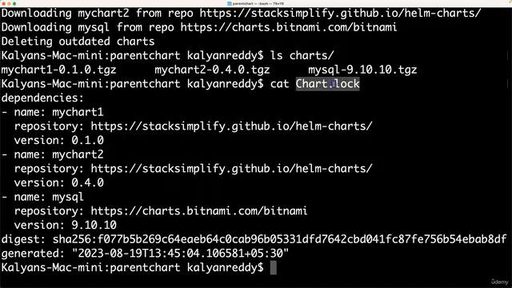
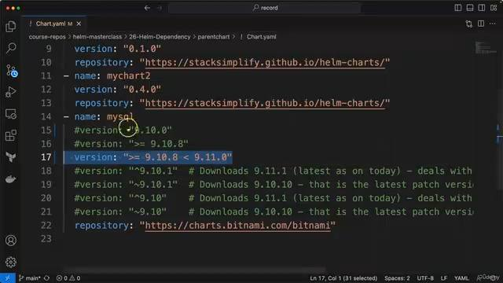
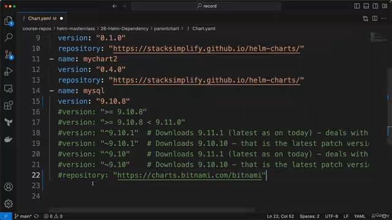
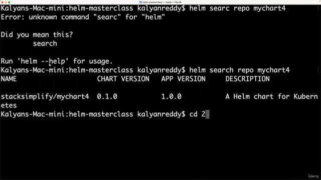
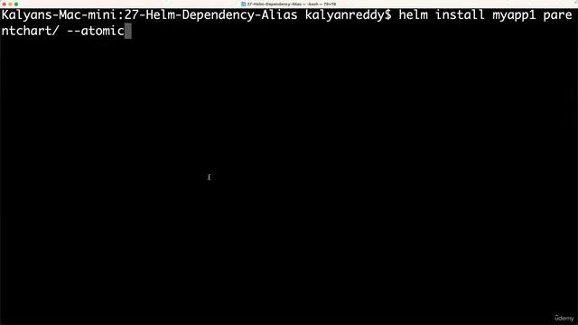
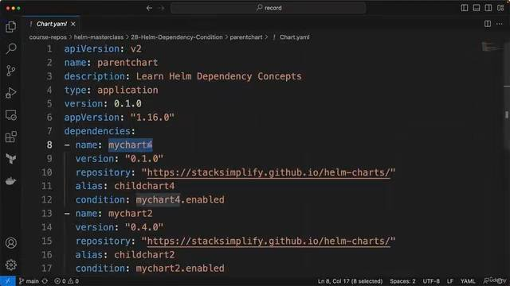
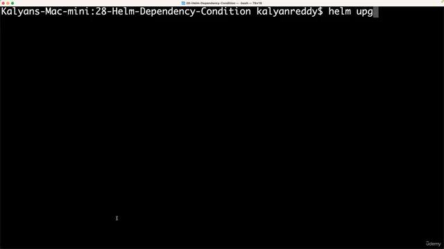
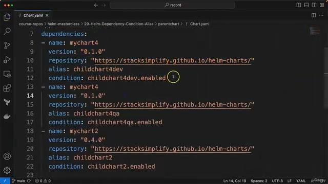
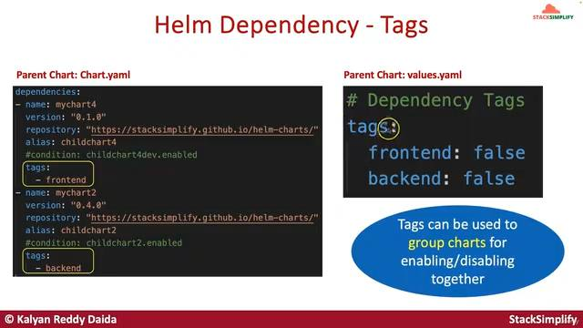

# Helm Masterclass（BV1WNas6ZESg）P82–P88：Helm Dependency 全链路实战

> 覆盖内容：`helm dependency build` vs `update`、`chart.lock` 锁文件、`@repo` 形式仓库引用、`alias`、`condition`、`condition + alias`、`tags`。
> 目标读者：前端转 AI 应用工程师。本文所有命令都能直接粘进终端执行，所有文件都能直接保存运行。

---

## 1. 这一节做什么

这七集（P82–P88）是同一个主题的连续推进：**怎么用 Helm 的 `dependencies` 机制，把「一个父 chart + 若干子 chart」组装成一个可部署的整体，并且精确控制哪些子 chart 被装、装哪个版本、装几份。**

具体拆成六个能力点，每一集解决一个：

| 能力点 | 解决什么问题 | 对应 P |
|---|---|---|
| `dependency build` vs `update` | 团队里 A 装出来是 9.10.10、B 装出来是 9.11.1，怎么保证一致 | P82 |
| `chart.lock` 锁文件 | 版本约束是「范围」，锁文件把它变成「确定值」 | P82 |
| `repository: @repoName` | 用本地配置的仓库别名代替 URL | P83 |
| `alias` | 同一个 chart 想在父 chart 里出现两次（dev 一份、qa 一份） | P84 |
| `condition` | 用 values.yaml 里的布尔开关决定某个子 chart 装不装 | P85、P86 |
| `condition + alias` | 开关的 key 用 alias 名而不是 chart 名 | P87 |
| `tags` | 几十个子 chart 按「组」一次性开关 | P88 |

产出物是一个 **`parent-chart` 目录**，它的 `Chart.yaml` 里声明了 3 条依赖（`my-chart4` 出现两次、`my-chart2` 出现一次），加一个 `values.yaml` 里的开关区块。你 `helm install` 一次，集群里就会出现 1 个父应用的资源 + N 个子应用的资源，N 由 values.yaml 里的布尔值决定。

对前端同学的一句话类比：**父 chart 的 `Chart.yaml` 就是 `package.json` 的 `dependencies`，`chart.lock` 就是 `package-lock.json`，`helm dependency update` 就是 `npm install`（会更新 lock），`helm dependency build` 就是 `npm ci`（严格按 lock 装，不协商）。** 这个类比贯穿全文，后面每个行为都能对上。

---

## 2. 讲师原话

> 下面每条都是逐字稿里的原句（英文原话，后面跟中文要点），时间戳对应视频进度。

**P82 —— build 和 update 的分工**

> "update 命令会与 chart.yaml 中定义的版本约束进行协商；而 dependency build 会尝试构建、下载或更新 chart.lock 文件中存在的版本。"
> —— p082 [00:27]

讲师把两者的差别一句话讲清了：`update` 是「和 Chart.yaml 里的版本约束**谈判**」，`build` 是「照 `chart.lock` 里已经定下来的版本**下载**」。

> "每当你运行 Helm dependency build 时，它总是只下载 9.10.10，不会去下载 10.11 或 10.9，因为它会把 chart.lock 文件作为参考。"
> —— p082 [02:17]



> "Helm dependency build 永远不会与 chart.yaml 进行协商，也就是说，只要 chart.lock 文件还在，它就不会与 chart.yaml 中的任何内容协商。但如果你删除了这个 chart.lock 文件，它就可以继续与 chart.yaml 协商，因为锁文件不在了，它的行为就像 helm dependency update 一样。"
> —— p082 [02:45]

关键补充：**锁文件不存在时，`build` 会退化成 `update` 的行为**。这一点很多人不知道，导致「我明明跑的是 build，怎么版本变了」。



> "看日志文件 chart.log，它和依赖文件 chart.yaml 不同步，因为按照这个约束，chart.yaml 期望的是 9.11.1 版本，但如果你看 chart.lock 文件，它里面是 9.10.10。所以它会抛出错误，说它与依赖文件不同步。"
> —— p082 [04:10]

**P83 —— `@repoName` 的坑**

> "所以你可以这样指定 @bitnami。这里的 bitnami 不过是你本地桌面中对应仓库的名称。"
> —— p083 [00:00]

`@bitnami` 里的 `bitnami` 不是官方的什么标识，**就是你自己机器上 `helm repo add` 时起的那个名字**。

> "不推荐这样做……这些 Helm chart 依赖可能无法在全局范围内正常工作。如果你在本地桌面中定义了 @myBitnami，而别人尝试从他们的桌面使用并部署，并且他们的桌面中使用了名为 Bitnami 或我们的 bitnami 的仓库……那时就会失败。"
> —— p083 [00:57]



> "它说没有为 @myBitnami1 定义仓库。请通过 Helm repo add 添加它们，然后继续运行这个命令。"
> —— p083 [03:19]

**P84 —— alias**

> "你又一次定义了 my chart 4，并把别名设为 child chart 4 qa，你可能会疑惑，为什么我们不把这个用作 my chart 4，把那个用作 my chart 5。这是不可能的，因为你使用的 name 参数正是 chart 名称本身。所以你不能两次定义 my chart 4，你需要在依赖中区分它们。"
> —— p084 [00:27]

这段话是 alias 存在的**唯一理由**：`name` 字段必须写 chart 的真实名字，所以同一个 chart 想放两次，只能靠 `alias` 区分。



> "它创建了一个服务账号 my app one parent chart 相关的服务账号，而在 v1 服务中，你可以看到 my app 1 child 2 在那里，child chart 2 在那里，child chart 4 dev 在那里，child chart 4 qa 在那里，然后父 chart 也在那里。"
> —— p084 [05:20]



> "对于 child chart 4，以及 dev、qa 和父 chart，你的编号也会不同，你需要验证这些动态端口并在浏览器中访问它们。对于 child chart 2，它在 chart 中是硬编码的，所以你总是会得到 31232。"
> —— p084 [06:17]

**P85 —— condition 的默认值是「开」**

> "无论你是否定义 values.yaml，无论你是否定义 condition，或者即使你为 my chart 定义了 condition 为 enabled，却没有 values.yaml 相关配置，此时它默认也是启用的。两者默认都是启用的。"
> —— p085 [01:24]

这是整个 P85 最重要的一句话：**`condition` 只是「读取某个 YAML 路径」的声明，路径不存在时不会禁用任何东西，默认是启用的。**



**P86 —— 用 upgrade 动态开关**

> "我会把它设为 true，然后运行命令 helm upgrade my app one parent chart --atomic，这时我把 my chart 2 设为 enabled。所以，如果我运行命令 helm status my app one --show-resources，它应该会自动显示 child chart 2 已启用。"
> —— p086 [01:27]



**P87 —— condition 的 key 用 alias**

> "在 chart.yaml 中，我们将为 my chart 4 定义别名为 child chart 4 dev，并将 condition 定义为 child chart 4.enabled……即使对于 myChart2，我们也将使用同样的标准 alias.condition，也就是 alias.conditionRelated.enabled。"
> —— p087 [00:59]



**P88 —— tags 是分组开关**

> "标签可用于对 chart 进行分组，以便一起启用或禁用它们。"
> —— p088 [00:00]

> "当我们使用标签时，如果你有 10 个 chart，你可以在依赖 YAML 中为这 10 个 chart 定义标签为 frontend，然后只需为这 10 个 chart 统一设置 frontend 为 true 或 false，这 10 个 chart 就会根据这一行配置一起启用或禁用。"
> —— p088 [02:20]



---

## 3. 从零复现

### 3.0 环境准备

课里没有明确说用的是哪种集群，但从「`localhost:端口` 直接访问 NodePort」这一点看，是本地单节点集群。下面两种任选其一：

```bash
# 方案 A：Docker Desktop 自带的 Kubernetes（Enable Kubernetes 勾上即可）
kubectl get nodes          # 期望看到 docker-desktop   Ready

# 方案 B：minikube
minikube start --driver=docker
kubectl get nodes
```

Helm 必须是 3.x（`chart.lock` 是 Helm 3 才有的）：

```bash
helm version --short        # 期望 v3.x.x+...
kubectl version --client --short
```

### 3.1 建立目录骨架

课里的子 chart 来自讲师自己的仓库（`my-chart4` 版本 `0.1.0`、`my-chart2` 版本 `0.4.0`），逐字稿里**没有给出这些 chart 的仓库 URL**。为了让你今天就能跑通全流程，下面用「本地 chart + `file://` 依赖」的方式复刻同样的结构：两个子 chart 用 nginx 镜像 + ConfigMap 挂一个自定义首页来模拟「v1 应用 / v4 应用」，父 chart 用 nginx 默认页，效果与课里一致。

```bash
mkdir -p helm-demo && cd helm-demo

# 子 chart 1：my-chart4（课里 v1 应用，dev / qa 两份都用它）
helm create my-chart4
# 子 chart 2：my-chart2（课里 v4 应用，nodePort 硬编码 31232）
helm create my-chart2
# 父 chart
helm create parent-chart
```

`helm create` 会生成一堆用不上的模板，直接删掉重写：

```bash
rm -rf my-chart4/templates/* my-chart2/templates/* parent-chart/templates/*
```

最终目录结构：

```
helm-demo/
├── my-chart2/
│   ├── Chart.yaml
│   ├── values.yaml
│   └── templates/
│       ├── configmap.yaml
│       ├── deployment.yaml
│       └── service.yaml
├── my-chart4/
│   ├── Chart.yaml
│   ├── values.yaml
│   └── templates/
│       ├── configmap.yaml
│       ├── deployment.yaml
│       └── service.yaml
└── parent-chart/
    ├── Chart.yaml
    ├── values.yaml
    ├── chart.lock          ← helm dependency update 生成，不要手写
    ├── charts/             ← 生成，不要提交到 git 也可以
    └── templates/
        ├── deployment.yaml
        ├── service.yaml
        └── serviceaccount.yaml
```

### 3.2 复现 P82：`build` vs `update` + `chart.lock`

这一段用 bitnami 的 mysql chart 做实验，完全可复现（不需要讲师私有仓库）：

```bash
helm repo add my-bitnami https://charts.bitnami.com/bitnami
helm repo update

# 新建一个实验 chart
mkdir -p /tmp/locklab && cd /tmp/locklab
helm create locklab && cd locklab
rm -rf templates/* charts/* chart.lock        # 清空，只留 Chart.yaml / values.yaml
```

把 `Chart.yaml` 改成带版本约束（对应 p082 [01:22] 讲师说的 `>9.10.8 <9.11.0`）：

```yaml
# /tmp/locklab/locklab/Chart.yaml
apiVersion: v2
name: locklab
description: chart.lock experiment
type: application
version: 0.1.0
appVersion: "1.0.0"

dependencies:
  - name: mysql
    version: ">9.10.8 <9.11.0"      # 区间约束
    repository: "https://charts.bitnami.com/bitnami"
```

**第一步：跑 `update`，看它怎么「谈判」**

```bash
helm dependency update .
ls charts/
# 课里出现的是：mysql-9.10.10.tgz
# 你拉到的具体版本以实际输出为准，因为 bitnami 仓库的旧版本可能已下架
ls chart.lock && cat chart.lock
```

`chart.lock` 里会出现 `dependencies` 段，`version` 是**确定值**（课里是 `9.10.10`），不是区间。这就是「把范围焊死成点」。

**第二步：跑 `build`，看它怎么「照抄」**

```bash
rm -rf charts/*        # 只清 charts 目录，保留 chart.lock
helm dependency build .
ls charts/
# 课里结果：仍然是 9.10.10 —— 因为 build 不读 Chart.yaml 的区间，只读 chart.lock
```

**第三步：故意制造不同步**

把 `Chart.yaml` 的约束改成 `">=9.10.8"`（对应 p082 [04:10] 讲师取消注释提到上面那条约束），然后：

```bash
helm dependency build .
# 期望报错（课里的原文）：
#   chart.lock is out of sync with dependencies file Chart.yaml
```

这正是 `package-lock.json` 和 `package.json` 打架时 `npm ci` 报的那个错。**修复方式只有两个：跑一次 `helm dependency update` 重建 lock，或者删掉 `chart.lock` 让 `build` 退化。**

**第四步：验证「没有 lock 时 build 变 update」**

```bash
rm -f chart.lock && rm -rf charts/*
# Chart.yaml 里改成 "^9.10.1"
helm dependency build .
ls charts/        # 课里结果：拉到 9.11.1（当时最新），并重新生成了 chart.lock
ls chart.lock     # 确认 lock 文件被重新创建
```

> 注意：bitnami 仓库会滚动保留版本，`9.10.x` 这一批现在可能已经取不到了。**如果报 "未找到版本"，把版本约束换成你现在能取到的区间（例如 `">=14.0.0 <15.0.0"`），其余命令一字不改，实验结论完全一样。**

### 3.3 复现 P83：`@repoName` 形式

```bash
helm repo list
# 期望输出里有一行，NAME 是 my-bitnami，URL 是 https://charts.bitnami.com/bitnami
```

把 `Chart.yaml` 的 `repository` 从 URL 改成 `@my-bitnami`（`@` 后面必须和 `helm repo list` 里的 NAME 逐字符一致）：

```yaml
dependencies:
  - name: mysql
    version: "^9.10.1"
    repository: "@my-bitnami"     # 读的是你本机 helm repo 配置
```

```bash
rm -f chart.lock && rm -rf charts/*
helm dependency update .
ls charts/      # 能下下来，因为本机存在 my-bitnami 这个 repo
```

然后换成**不存在的本地名字**，验证报错：

```yaml
    repository: "@my-bitnami1"
```

```bash
rm -f chart.lock && rm -rf charts/*
helm dependency update .
# 期望报错（课里原文）：
#   no repository definition for @my-bitnami1. Please add them via helm repo add
```

这就是讲师说的「不可移植」的实际后果：**换一台机器就炸。** 所以生产上永远写完整 URL。

### 3.4 复现 P84：alias 让同一个 chart 出现两次

回到 `helm-demo/parent-chart`，把 `Chart.yaml` 写成三条依赖：

```yaml
apiVersion: v2
name: parent-chart
description: Helm dependency demo parent chart
type: application
version: 0.1.0
appVersion: "1.0.0"

dependencies:
  # 同一个 my-chart4 出现两次，必须用不同 alias 区分
  - name: my-chart4
    version: 0.1.0
    repository: "file://../my-chart4"
    alias: child-chart4-dev

  - name: my-chart4
    version: 0.1.0
    repository: "file://../my-chart4"
    alias: child-chart4-qa

  - name: my-chart2
    version: 0.4.0
    repository: "file://../my-chart2"
    alias: child-chart2
```

注意：`file://../my-chart4` 是相对 **parent-chart 目录**的路径，`..` 指向 `helm-demo/`。你如果用本地路径依赖，每次改子 chart 都要重跑 `helm dependency update`，它会打出 `.tgz` 放进 `parent-chart/charts/`——这也是为什么课里 `ls charts` 能看到 `my-chart2` 和 `my-chart4`。

```bash
cd helm-demo
helm dependency update parent-chart
ls parent-chart/charts/
# 期望：my-chart2-0.4.0.tgz  my-chart4-0.1.0.tgz
cat parent-chart/chart.lock
```

安装（对应 p084 [03:51] 讲师演示的两种写法，选一种）：

```bash
# 写法一：在父 chart 目录内
cd parent-chart && helm install myapp1 . --atomic && cd ..

# 写法二：在外面用路径（课里更常用）
helm install myapp1 parent-chart --atomic
```

验证资源（对应 p084 [04:51] 的 `helm status ... --show-resources`）：

```bash
helm list
helm status myapp1 --show-resources
kubectl get svc
```

`kubectl get svc` 会告诉你四个 NodePort。课里当时抓到的是 `32401`（parent）、`31113`（child-chart4-dev）、`30250`（child-chart4-qa）、`31232`（child-chart2，硬编码）。**你的端口一定不一样**，除了 `31232` 那个硬编码的。

浏览器访问 `http://localhost:<端口>`：parent 出 nginx 欢迎页，两个 child-chart4 出 v1 页面，child-chart2 出 v4 页面。

```bash
helm uninstall myapp1
```

### 3.5 复现 P85：condition 不写 values 等于没写

在 `parent-chart/Chart.yaml` 的三条依赖上各加一个 `condition`：

```yaml
    condition: myChart4.enabled

    condition: myChart4.enabled

    condition: myChart2.enabled
```

然后 `parent-chart/values.yaml` 里**什么都不加**，直接：

```bash
helm dependency update parent-chart
helm install myapp1 parent-chart --atomic
helm status myapp1 --show-resources
```

结果：**三个子 chart 全装上了。** 因为 `values.yaml` 里没有 `myChart4` 这个 key，`condition` 找不到路径，Helm 就按默认「启用」处理。这就是 p085 [01:24] 讲师反复强调的那句话。

### 3.6 复现 P86：用 `helm upgrade` 动态开关

在 `parent-chart/values.yaml` 末尾追加：

```yaml
myChart4:
  enabled: false
myChart2:
  enabled: false
```

```bash
helm uninstall myapp1 || true
helm install myapp1 parent-chart --atomic
helm status myapp1 --show-resources
# 期望：只剩 parent chart 的 ServiceAccount / Service / Deployment / Pod
```

把 `myChart2.enabled` 改成 `true`：

```bash
helm upgrade myapp1 parent-chart --atomic
helm status myapp1 --show-resources
# 期望：parent chart + child-chart2
```

再把 `myChart4.enabled` 也改成 `true`：

```bash
helm upgrade myapp1 parent-chart --atomic
helm status myapp1 --show-resources
# 期望：parent + child-chart2 + child-chart4-dev + child-chart4-qa 全套
```

都改回 `false` 再 upgrade 一次，验证「减」也生效。最后 `helm uninstall myapp1`。

### 3.7 复现 P87：condition 的 key 换成 alias

这一步是把 condition 的路径从「chart 名」改成「alias 名」：

```yaml
    alias: child-chart4-dev
    condition: childChart4Dev.enabled

    alias: child-chart4-qa
    condition: childChart4Qa.enabled

    alias: child-chart2
    condition: childChart2.enabled
```

`parent-chart/values.yaml` 里改成：

```yaml
childChart4Dev:
  enabled: false
childChart4Qa:
  enabled: true
childChart2:
  enabled: false
```

```bash
helm uninstall myapp1 || true
helm install myapp1 parent-chart --atomic
helm status myapp1 --show-resources
# 期望：只有 parent chart + child-chart4-qa
```

把另外两个改成 `true`，再 `helm upgrade myapp1 parent-chart --atomic`，两套资源就都会出现。

> **大小写必须逐字符一致。** `childChart4Dev.enabled` 和 `childchart4dev.enabled` 在 Helm 看来是两个不同的路径，后者永远读不到，于是那个 chart 会**保持默认启用**——你会以为「我明明写了 false 怎么还装上了」，其实是你写错了 key。

### 3.8 复现 P88：tags 分组

把三条依赖的 `condition` 全部注释掉，换成 `tags`：

```yaml
    alias: child-chart4-dev
    tags:
      - frontend

    alias: child-chart4-qa
    tags:
      - frontend

    alias: child-chart2
    tags:
      - backend
```

`parent-chart/values.yaml` 里写：

```yaml
tags:
  frontend: false
  backend: false
```

```bash
helm uninstall myapp1 || true
helm install myapp1 parent-chart --atomic
helm status myapp1 --show-resources
# 期望：只有 parent chart
```

把 `backend` 改成 `true`：

```bash
helm upgrade myapp1 parent-chart --atomic
helm status myapp1 --show-resources
# 期望：parent chart + child-chart2（因为只有它打了 backend 标签）
```

把 `frontend` 也改成 `true`：

```bash
helm upgrade myapp1 parent-chart --atomic
helm status myapp1 --show-resources
# 期望：全部装齐
```

**核心差异**：用 `condition` 时你要为每个 chart 各写一行 `xxx.enabled`；用 `tags` 时，**十个 chart 打同一个 tag，只需一行 `frontend: true`**。

```bash
helm uninstall myapp1
```

---

## 4. 完整代码

以下文件可直接保存运行，`helm-demo/` 目录下（`chart.lock` / `charts/` 由命令生成，不要手写）。

### 4.1 `my-chart4/Chart.yaml`

```yaml
apiVersion: v2
name: my-chart4
description: Simulated V1 application chart (used with two aliases in the parent chart)
type: application
version: 0.1.0
appVersion: "1.0.0"
```

### 4.2 `my-chart4/values.yaml`

```yaml
# 用于在父 chart 里给同一个 chart 的多次 alias 部署起不同资源名
fullnameOverride: ""

replicaCount: 1

image:
  repository: nginx
  tag: "1.27-alpine"
  pullPolicy: IfNotPresent

# 会写进 ConfigMap，作为 index.html 的正文，用来区分不同版本
pageText: "V1 application"

service:
  type: ClusterIP
  port: 80
  # 仅当 type=NodePort 且该值非空时才生效；留空则由集群动态分配
  nodePort: null
```

### 4.3 `my-chart4/templates/configmap.yaml`

```yaml
{{- $name := .Values.fullnameOverride | default .Chart.Name -}}
apiVersion: v1
kind: ConfigMap
metadata:
  name: {{ $name }}-page
  labels:
    app: {{ $name }}
data:
  index.html: |
    <!doctype html>
    <html>
      <head><title>{{ .Values.pageText }}</title></head>
      <body style="font-family: sans-serif; text-align: center; padding-top: 80px;">
        <h1>{{ .Values.pageText }}</h1>
        <p>rendered by chart: {{ .Chart.Name }}</p>
      </body>
    </html>
```

### 4.4 `my-chart4/templates/deployment.yaml`

```yaml
{{- $name := .Values.fullnameOverride | default .Chart.Name -}}
apiVersion: apps/v1
kind: Deployment
metadata:
  name: {{ $name }}
  labels:
    app: {{ $name }}
spec:
  replicas: {{ .Values.replicaCount }}
  selector:
    matchLabels:
      app: {{ $name }}
  template:
    metadata:
      labels:
        app: {{ $name }}
    spec:
      containers:
        - name: web
          image: "{{ .Values.image.repository }}:{{ .Values.image.tag }}"
          imagePullPolicy: {{ .Values.image.pullPolicy }}
          ports:
            - containerPort: 80
          volumeMounts:
            - name: page
              mountPath: /usr/share/nginx/html
          resources:
            requests:
              cpu: 50m
              memory: 64Mi
            limits:
              cpu: 200m
              memory: 128Mi
      volumes:
        - name: page
          configMap:
            name: {{ $name }}-page
```

### 4.5 `my-chart4/templates/service.yaml`

```yaml
{{- $name := .Values.fullnameOverride | default .Chart.Name -}}
apiVersion: v1
kind: Service
metadata:
  name: {{ $name }}
  labels:
    app: {{ $name }}
spec:
  type: {{ .Values.service.type }}
  ports:
    - port: {{ .Values.service.port }}
      targetPort: 80
      protocol: TCP
      {{- if and (eq .Values.service.type "NodePort") .Values.service.nodePort }}
      nodePort: {{ .Values.service.nodePort }}
      {{- end }}
  selector:
    app: {{ $name }}
```

### 4.6 `my-chart2/Chart.yaml`

```yaml
apiVersion: v2
name: my-chart2
description: Simulated V4 application chart (nodePort hardcoded, same as the lecture)
type: application
version: 0.4.0
appVersion: "4.0.0"
```

### 4.7 `my-chart2/values.yaml`

```yaml
fullnameOverride: ""

replicaCount: 1

image:
  repository: nginx
  tag: "1.27-alpine"
  pullPolicy: IfNotPresent

pageText: "V4 application"

service:
  type: NodePort
  port: 80
  # 课里这个 chart 的 NodePort 就是写死的，所以讲师说「你永远会拿到 31232」
  nodePort: 31232
```

### 4.8 `my-chart2/templates/*.yaml`

与 `my-chart4/templates/` 下的三个文件**逐字符相同**（`configmap.yaml`、`deployment.yaml`、`service.yaml`），直接复制即可：

```bash
cp my-chart4/templates/*.yaml my-chart2/templates/
```

### 4.9 `parent-chart/Chart.yaml`（P88 tags 版本 / 最终形态）

```yaml
apiVersion: v2
name: parent-chart
description: Parent chart demonstrating alias, condition and tags
type: application
version: 0.1.0
appVersion: "1.0.0"

dependencies:
  - name: my-chart4
    version: 0.1.0
    repository: "file://../my-chart4"
    alias: child-chart4-dev
    # condition: childChart4Dev.enabled
    tags:
      - frontend

  - name: my-chart4
    version: 0.1.0
    repository: "file://../my-chart4"
    alias: child-chart4-qa
    # condition: childChart4Qa.enabled
    tags:
      - frontend

  - name: my-chart2
    version: 0.4.0
    repository: "file://../my-chart2"
    alias: child-chart2
    # condition: childChart2.enabled
    tags:
      - backend
```

> 想回到 P87 的 condition 版本，就把三行 `tags` 换成被注释掉的那三行 `condition`。

### 4.10 `parent-chart/values.yaml`

```yaml
# --- 父 chart 自己的配置（对应课里 parent chart 使用 nginx 镜像） ---
replicaCount: 1

image:
  repository: nginx
  tag: "1.27-alpine"
  pullPolicy: IfNotPresent

service:
  type: NodePort
  port: 80
  nodePort: null

# --- 子 chart 通过 alias 传值，键名 = alias 名 ---
child-chart4-dev:
  fullnameOverride: child-chart4-dev
  pageText: "V1 application (dev)"
  service:
    type: NodePort
    nodePort: null

child-chart4-qa:
  fullnameOverride: child-chart4-qa
  pageText: "V1 application (qa)"
  service:
    type: NodePort
    nodePort: null

child-chart2:
  fullnameOverride: child-chart2
  pageText: "V4 application"
  service:
    type: NodePort
    nodePort: 31232

# --- condition 开关（P85–P87 使用；P88 用 tags 时这一段可以留着不影响） ---
childChart4Dev:
  enabled: false
childChart4Qa:
  enabled: true
childChart2:
  enabled: false

# --- tags 开关（P88 使用） ---
tags:
  frontend: false
  backend: false
```

### 4.11 `parent-chart/templates/serviceaccount.yaml`

```yaml
apiVersion: v1
kind: ServiceAccount
metadata:
  name: {{ .Release.Name }}-{{ .Chart.Name }}
  labels:
    app: {{ .Release.Name }}-{{ .Chart.Name }}
```

### 4.12 `parent-chart/templates/deployment.yaml`

```yaml
apiVersion: apps/v1
kind: Deployment
metadata:
  name: {{ .Release.Name }}-{{ .Chart.Name }}
  labels:
    app: {{ .Release.Name }}-{{ .Chart.Name }}
spec:
  replicas: {{ .Values.replicaCount }}
  selector:
    matchLabels:
      app: {{ .Release.Name }}-{{ .Chart.Name }}
  template:
    metadata:
      labels:
        app: {{ .Release.Name }}-{{ .Chart.Name }}
    spec:
      serviceAccountName: {{ .Release.Name }}-{{ .Chart.Name }}
      containers:
        - name: web
          image: "{{ .Values.image.repository }}:{{ .Values.image.tag }}"
          imagePullPolicy: {{ .Values.image.pullPolicy }}
          ports:
            - containerPort: 80
```

### 4.13 `parent-chart/templates/service.yaml`

```yaml
apiVersion: v1
kind: Service
metadata:
  name: {{ .Release.Name }}-{{ .Chart.Name }}
  labels:
    app: {{ .Release.Name }}-{{ .Chart.Name }}
spec:
  type: {{ .Values.service.type }}
  ports:
    - port: {{ .Values.service.port }}
      targetPort: 80
      protocol: TCP
      {{- if and (eq .Values.service.type "NodePort") .Values.service.nodePort }}
      nodePort: {{ .Values.service.nodePort }}
      {{- end }}
  selector:
    app: {{ .Release.Name }}-{{ .Chart.Name }}
```

### 4.14 一键跑全流程的脚本 `run.sh`

```bash
#!/usr/bin/env bash
set -euo pipefail
cd "$(dirname "$0")"

RELEASE=myapp1

echo "==> 1. 装配依赖（生成 chart.lock + charts/）"
helm dependency update parent-chart
cat parent-chart/chart.lock

echo "==> 2. 清掉同名 release（如果存在）"
helm uninstall "$RELEASE" --ignore-not-found

echo "==> 3. 安装"
helm install "$RELEASE" parent-chart --atomic

echo "==> 4. 资源清单"
helm status "$RELEASE" --show-resources

echo "==> 5. NodePort 一览，去浏览器验证"
kubectl get svc

echo "==> 清理：helm uninstall $RELEASE"
```

```bash
chmod +x run.sh && ./run.sh
```

---

## 5. 逐行解释

### `helm dependency update` vs `helm dependency build`

- **`update` 读的是 `Chart.yaml` 的 `dependencies[].version`**，这个字段可以是区间（`>9.10.8 <9.11.0`、`^9.10.1`、`~9.10.0`、`9.10.10`）。Helm 会去仓库列出所有可用版本，挑出满足区间的最高版本，下载，**然后把这个确定版本写进 `chart.lock`**。所以 `update` 是「求解 + 落地」。
- **`build` 读的是 `chart.lock` 的 `dependencies[].version`**，这个字段永远是确定值。它不会去问仓库「还有没有更新的」，直接按 lock 里的版本下载。所以 `build` 是「照单执行」。
- **`chart.lock` 不存在时，`build` 会退化成 `update`**（p082 [02:45]）。这就是为什么 CI 里要严格区分：CI 必须保证 `chart.lock` 已经提交在仓库里，否则 `build` 就会**静默地**把版本升上去，然后把一套没测试过的依赖跑进生产。

**在 JS/Node 里对应的就是**：`update` = `npm install`（有 lock 就按 lock，没 lock 就求解并写 lock）、`build` = `npm ci`（强制要求 lock 存在且与 `package.json` 一致，否则直接失败）。你要的「可复现构建」，靠的就是把 `chart.lock` 提交进 git。

### `chart.lock is out of sync with dependencies file Chart.yaml`

`build` 不只是比对 `chart.lock`，它还会**校验 `Chart.yaml` 的约束是否被 lock 满足**。你改了约束（比如从 `<9.11.0` 放宽成 `>=9.10.8`），lock 里锁的 `9.10.10` 虽然仍然「可能满足」，但 Helm 的判定逻辑是「约束变了就等于不同步」——因为放宽之后重新求解可能会选出 `9.11.1`。所以它直接报错，逼你显式跑一次 `update`，把「重新求解」这件事留给人来做决定。**这是设计上的安全阀，不是 bug。**

### `repository: "@my-bitnami"` 为什么不可移植

Helm 解析 `@xxx` 时，只做一件事：去读 `~/.config/helm/repositories.yaml`（或 `HELM_REPOSITORY_CONFIG` 指定的文件），找 `name == xxx` 的那一项，取它的 URL。**这个文件在你的机器上、在你的 CI 容器里、在你同事的 Mac 上，内容是各不相同的。** 所以 `@xxx` 只是「本地配置的引用」，不是「仓库的标识」。因此：

- 报错 `no repository definition for @my-bitnami1. Please add them via helm repo add` 是必然的，只要对方机器上没有同名 repo。
- 团队协作永远写完整 URL；`@` 形式只在「确定所有人都在同一套 CI 镜像里跑」时才有一点点价值。

### `alias` 为什么必须存在

`dependencies[].name` 是 Helm 用来「定位 chart」的字段，它必须等于目标 chart 的 `Chart.yaml` 里的 `name`。写两遍 `name: my-chart4` 而不加 alias，Helm 会认为你在重复声明同一个依赖（会报重复/覆盖），而不是「装两份」。`alias` 的作用就是给这次依赖声明一个**独立的身份**：它决定了资源名、决定了 values.yaml 里的 key、也决定了 `condition` 路径怎么写。

### `fullnameOverride` 在本文代码里为什么必要

真实的 Helm 里，被 alias 的子 chart 展开后，`.Chart.Name` 仍然是 `my-chart4`。所以如果子 chart 的模板写 `name: {{ .Release.Name }}-{{ .Chart.Name }}`，两次 alias 会生成**完全同名的资源**，第二次创建就会失败。为了避免这个坑、同时让资源名带上 alias（和课程演示的 `myapp1-child-chart4-dev` 那种命名一致），本文在子 chart 模板里用 `{{ .Values.fullnameOverride | default .Chart.Name }}`，并在父 chart 的 values.yaml 里给每个 alias 显式指定 `fullnameOverride`。这是本文为了可运行做的工程处理。**课程里讲师没有展开讲这一点。**

### `condition` 的三条规则

1. `condition` 的值是一个 **values.yaml 里的 YAML 路径**（用点号分隔），不是布尔值本身。声明 `condition: myChart4.enabled` 只是告诉 Helm「去读 `myChart4.enabled` 这个位置的布尔值」。
2. **路径不存在 → 视为启用**（p085 [01:24]）。所以「我加了 condition 但它没生效」几乎是所有新手都会撞的坑，原因是忘了在 values.yaml 里写那个 key。
3. **路径存在且为 `false` → 该子 chart 完全不出现在渲染结果里**。不是「replicas 设成 0」，是「这个 chart 的所有资源根本不会生成」。所以 `helm upgrade` 把它设成 false 时，Kubernetes 会真的删掉那些资源。

**在 Node 里对应**：`condition` 很像 `process.env.ENABLE_XXX === 'false'`，而「未设置默认 true」这个行为更像 `if (process.env.ENABLE_XXX !== 'false') { ... }` —— 只有显式写 `false` 才关闭。

### `condition + alias` 里的 key 大小写

Helm 读 values 路径时是**严格字符串匹配**。`childChart4Dev.enabled` 与 `childchart4dev.enabled` 是两个路径。写错一个字母，条件就找不到值，于是 fallback 到默认值 `enabled = true`，在 `helm status --show-resources` 的输出里你会看到它已经**静默地**装上了——没有任何报错。这是 Helm 的依赖管理里最容易造成线上多装资源的问题。

### `tags` 与 `condition` 的分工

- `condition`：一对一的开关。N 个 chart 需要 N 行 values 配置。
- `tags`：多对

## 6. 复现检查清单

- [ ] **`helm version --short` 是 v3.x**：终端输出以 `v3.` 开头。若是 v2，`chart.lock` 机制不存在，后面所有 build/lock 实验都不成立。
- [ ] **`kubectl get nodes` 有一个 Ready 节点**：输出里 STATUS 列是 `Ready`。不是 Ready 就先解决集群，别往下走。
- [ ] **`helm repo list` 里有 `my-bitnami`**：输出中 NAME 列逐字符等于 `my-bitnami`，URL 是 `https://charts.bitnami.com/bitnami`。P83 的 `@my-bitnami` 实验全靠这一行。
- [ ] **`helm dependency update .` 后 `ls charts/` 有 `.tgz`**：`/tmp/locklab/locklab/charts/` 下出现 `mysql-<版本>.tgz`。若报 "未找到版本"，说明约束区间在 bitnami 仓库已取不到，按 3.2 末尾的提示换区间，**不要**改成 `latest`。
- [ ] **`cat chart.lock` 里 version 是确定值**：`dependencies:` 段下 `version:` 是一个点版本（如 `9.10.10`），不是 `>9.10.8 <9.11.0` 这种区间。这是「范围焊死成点」的直接证据。
- [ ] **清空 `charts/` 后 `helm dependency build .` 仍拉到同一版本**：`ls charts/` 的 tgz 文件名与上一步 `chart.lock` 里的 version 完全一致。若版本变了，说明 `chart.lock` 被删了或没生效。
- [ ] **改 `Chart.yaml` 约束后 `helm dependency build .` 报 out of sync**：终端出现 `chart.lock is out of sync with dependencies file Chart.yaml`。看到这句才算复现了 P82 [04:10]。
- [ ] **删掉 `chart.lock` 后 `helm dependency build .` 能成功且重新生成 lock**：`ls chart.lock` 存在，且 `charts/` 里是按 `Chart.yaml` 约束解出的版本。这是「build 退化成 update」的证据。
- [ ] **`repository: "@my-bitnami1"` 报 no repository definition**：终端出现 `no repository definition for @my-bitnami1. Please add them via helm repo add`。看到这句才算复现 P83 [03:19]。
- [ ] **`helm dependency update parent-chart` 后 `ls parent-chart/charts/` 有两个 tgz**：期望 `my-chart2-0.4.0.tgz` 和 `my-chart4-0.1.0.tgz`。只有一个说明某条依赖的 `file://` 路径写错了（路径相对 parent-chart 目录）。
- [ ] **`helm install myapp1 parent-chart --atomic` 后 `helm list` 有 myapp1**：STATUS 列是 `deployed`。若是 `failed`，先 `helm uninstall myapp1` 再查 `kubectl get pods`。
- [ ] **`helm status myapp1 --show-resources` 里能看到 4 个 Service**：`myapp1-child-chart2`、`myapp1-child-chart4-dev`、`myapp1-child-chart4-qa`、`myapp1-parent-chart`（名字以你实际渲染为准，关键是**四个都在**）。少一个说明 alias 或 values 传值有问题。
- [ ] **`kubectl get svc` 里 child-chart2 的 NodePort 是 31232**：这一列固定是 `31232`（课里硬编码）。其余三个是动态分配的，**每次重装都可能变**，不要拿课里的 32401/31113/30250 去对。
- [ ] **浏览器访问四个端口页面内容对得上**：parent 出 nginx 默认页；child-chart4-dev 出 `V1 application (dev)`；child-chart4-qa 出 `V1 application (qa)`；child-chart2 出 `V4 application`。页面文字不对说明 values 里的 `pageText` 没传到对应 alias 下。
- [ ] **P85：values.yaml 里不写 `myChart4`/`myChart2` 时三个子 chart 全装上**：`helm status myapp1 --show-resources` 里四个 Service 全在。若只装了 parent，说明你在 values.yaml 里残留了 `enabled: false`。
- [ ] **P86：values.yaml 里两个 `enabled: false` 后只剩 parent**：`helm status myapp1 --show-resources` 里只有 `myapp1-parent-chart` 相关资源。看到子 chart 资源还在，说明 key 名和 `condition` 路径不一致。
- [ ] **P86：改 `myChart2.enabled: true` 后 `helm upgrade myapp1 parent-chart --atomic` 多出 child-chart2**：`helm status myapp1 --show-resources` 里出现 `myapp1-child-chart2`。没出现就是 upgrade 没带上新 values 或 key 拼错。
- [ ] **P87：`childChart4Qa.enabled: true` 其余 false 时只有 parent + child-chart4-qa**：`helm status myapp1 --show-resources` 里恰好两个 Service。若三个都在，检查 `condition` 路径大小写是否与 values.yaml 的 key 逐字符一致。
- [ ] **P88：`tags.frontend: false` / `tags.backend: false` 时只有 parent**：`helm status myapp1 --show-resources` 里只有 parent 资源。若子 chart 还在，说明 `Chart.yaml` 里 `condition` 没注释掉、和 `tags` 同时生效了。
- [ ] **P88：`tags.backend: true` 后只有 child-chart2 出现**：`helm status myapp1 --show-resources` 里多出 `myapp1-child-chart2`，两个 child-chart4 仍不在。这是「按组开关」的核心验证点。
- [ ] **`helm uninstall myapp1` 后 `helm list` 为空**：输出只有表头。若有残留，`helm uninstall myapp1 --ignore-not-found` 再跑一次，然后 `kubectl get all` 确认资源已清。

## 7. 课里没讲但你会撞上的

| 现象 | 原因 | 怎么办 |
|---|---|---|
| `helm dependency update` 报 `version not found` / 拉不到 `9.10.x` | **课里没讲**：bitnami 仓库滚动保留版本，课里录屏时的 `9.10.10`、`9.11.1` 现在可能已下架 | 把 `Chart.yaml` 的 `version` 约束换成当前仓库里存在的区间（如 `">=14.0.0 <15.0.0"`），其余命令一字不改，实验结论不变 |
| `helm dependency update parent-chart` 报 `directory not found` / 找不到 `../my-chart4` | **课里没讲**：`file://` 路径是相对 **parent-chart 目录**解析的，不是相对你当前 shell 的目录 | 确认 `helm-demo/my-chart4`、`helm-demo/my-chart2` 与 `parent-chart` 同级；`repository` 写 `file://../my-chart4`，不要写成 `file://./my-chart4` |
| 改了子 chart 的模板，`helm upgrade` 后集群里没变化 | **课里没讲**：`file://` 依赖在 `helm dependency update` 时被打成 `.tgz` 放进 `parent-chart/charts/`，之后改子 chart 源目录不会自动同步 | 每次改子 chart 后重跑 `helm dependency update parent-chart`，再 `helm upgrade` |
| 两个 alias 的子 chart 资源名冲突，`helm install` 报 `already exists` | **课里没讲**：alias 只改依赖声明身份，子 chart 模板里若用 `.Chart.Name` 渲染资源名，两次 alias 会生成同名资源 | 本文 4.x 已用 `fullnameOverride` 规避：在 `parent-chart/values.yaml` 的每个 alias 下写 `fullnameOverride: child-chart4-dev` 等，子 chart 模板用 `{{ .Values.fullnameOverride \| default .Chart.Name }}` |
| `helm status myapp1 --show-resources` 里子 chart 资源名不是 `myapp1-child-chart4-dev` 这种形式 | **课里没讲**：资源名前缀取决于子 chart 模板怎么写，课里子 chart 是讲师私有 chart，命名规则未展示 | 以 `kubectl get svc` 实际输出为准；本文代码用 `fullnameOverride` 固定名字，不依赖 `.Release.Name` 前缀 |
| 写了 `condition: childChart4Dev.enabled`，values.yaml 里也写了 `childChart4Dev.enabled: false`，但子 chart 还是装上了 | **课里没讲**：Helm 读 values 路径是严格字符串匹配，`childChart4Dev` 与 `childchart4dev` 是两个路径；路径读不到就 fallback 到默认 `true`，**不报错** | 逐字符比对 `Chart.yaml` 的 `condition` 路径和 `values.yaml` 的 key；用 `helm template parent-chart --set childChart4Dev.enabled=false \| grep child-chart4-dev` 确认渲染结果里没有该子 chart 资源 |
| `helm upgrade` 把 `enabled` 从 `true` 改 `false` 后，Pod 还在 | **课里没讲**：`condition` 为 false 时子 chart 资源**不参与渲染**，Helm 会删掉它们；但如果 upgrade 没带 `--atomic` 且中途失败，旧资源可能残留 | 先 `helm status myapp1` 看 STATUS 是否 `deployed`；失败就 `helm rollback myapp1` 或 `helm uninstall myapp1` 重来；确认 `helm get values myapp1` 里 key 确实是 `false` |
| `helm install` 报 `myapp1 is still in use` / `cannot re-use a name that is still in use` | **课里没讲**：上一次 release 没卸载干净（课里 p084 [04:21] 讲师也撞到过，现场 `helm uninstall` 解决） | `helm list --all` 看是否有 `myapp1`（含 `failed`/`pending` 状态），`helm uninstall myapp1` 后再装；顽固的加 `--no-hooks` |
| `kubectl get svc` 里 child-chart2 的 NodePort 不是 31232 | **课里没讲**：31232 是课里那个 chart 的 `values.yaml` 硬编码；本文 4.7 也硬编码了，但如果你改过 `my-chart2/values.yaml` 的 `service.nodePort` 就会变 | 检查 `my-chart2/values.yaml` 的 `service.nodePort: 31232`；若集群里 31232 已被占用，install 会报 `provided port is already allocated`，改成别的端口或设 `null` 让集群分配 |
| 浏览器访问 NodePort 打不开 / 连接被拒 | **课里没讲**：Docker Desktop 的 Kubernetes 下 `localhost:<NodePort>` 通常可用，但 minikube 需要 `minikube service` 或 `minikube tunnel`；另外 Pod 没 Ready 时也会拒连 | 先 `kubectl get pods` 确认对应 Pod 是 `Running` 且 `READY 1/1`；minikube 用 `minikube service myapp1-child-chart2 -n default --url` 拿可访问地址 |
| `helm dependency build` 在 CI 里静默把版本升了 | **课里没讲**：`chart.lock` 不存在时 `build` 退化成 `update`（P82 [02:45] 讲了行为，但没讲 CI 后果） | CI 里先断言 `test -f parent-chart/chart.lock`，不存在直接 fail；`chart.lock` 必须提交进 git |
| `helm dependency update` 后 `git status` 里 `charts/` 一堆 `.tgz` 被跟踪 | **课里没讲**：`charts/` 是生成物，不该提交 | 在 `helm-demo/.gitignore` 加 `parent-chart/charts/`；`chart.lock` 要提交，`charts/` 不提交 |
| `helm template parent-chart` 输出为空 / 只有 parent 资源，但 values.yaml 里 `enabled: true` | **课里没讲**：`helm template` 默认不读 `chart.lock` 也不下载依赖，`charts/` 为空时子 chart 不参与渲染 | 先 `helm dependency update parent-chart` 生成 `charts/`，再 `helm template`；或加 `--dependency-update` |
| `tags` 和 `condition` 同时写在一条依赖上，行为不符合预期 | **课里没讲**：两者同时存在时 `condition` 优先于 `tags`（Helm 文档行为，课里只演示了二选一） | 按 P88 的做法把 `condition` 注释掉，只留 `tags`；要混用就明确知道 `condition` 会覆盖 `tags` 的开关 |
