# Helm Masterclass P89–P100 复现文档：依赖标签、子 Chart 取值、全局值、import-values 与 Starter Chart

> 读者对象：前端转 AI 应用工程师。本文所有命令都在 Linux/macOS 终端执行；Windows 请用 WSL2 或 Git Bash。
> 课程仓库：`https://github.com/stacksimplify/helm-charts`（讲师在 P092 提到 `stacksimplify.github.io/helm-charts` 作为 chart 包下载源，实际 `helm pull` 用的是 GitHub Pages 上的 `.tgz` 包地址）。
> 说明：课里没有给出完整的 `Chart.yaml` / `values.yaml` / 模板文件全文，本文中凡是「课里没讲」的字段都明确标注；凡是逐字稿里出现过的字段名（如 `tags`、`condition`、`import-values`、`exports`、`global`、`alias`）都按原样使用。

---

## 1. 这一节做什么

P89–P100 是 Helm 依赖（dependency）体系的收尾部分，一共覆盖 6 个可独立复现的实验，全部围绕「父 chart 如何控制子 chart」展开：

| 实验 | 目录（课程仓库） | 核心机制 | 一句话目标 |
|---|---|---|---|
| Demo 30 | `30-helm-dependency-tags` | `tags` | 用**一个开关**批量启停多个子 chart |
| Demo 31 | `31-helm-dependency-override-sub-chart-values` | 父 `values.yaml` 覆盖子 chart 值 | 在父 chart 里把子 chart 的 `replicaCount` 从 1 改成 3 / 5 |
| Demo 32 | `32-helm-sub-chart-global-values` | `global` | 父 chart 定义一个全局值，父 + 两个子 chart 同时读它 |
| Demo 33 | `33-helm-dependency-import-values-explicit` | `exports` + `import-values` | 子 chart **显式**导出字典，父 chart 导入后在 ConfigMap 里用 |
| Demo 34 | `34-helm-dependency-import-values-implicit` | `import-values` 的 child/parent 映射 | 子 chart **一行不改**，父 chart 直接把子 chart 的 `service`、`image` 对象搬过来 |
| Demo 35 | `35-helm-starters` | `helm create --starter` | 把简化后的 chart 变成组织级 starter 模板，再用它生成新 chart |

学完你能回答的问题：`tags` 和 `condition` 到底差在哪、`global` 和普通父级覆盖的区别、`import-values` 显式和隐式分别怎么写、starter chart 的 `Chart.yaml` 为什么会被覆盖。

从学习路径看，这 6 个 Demo 可以分成三组：Demo 30 解决「批量开关」，Demo 31 和 Demo 32 解决「值如何从父传到子」，Demo 33 和 Demo 34 解决「值如何从子导入父」，Demo 35 则把前面简化后的 chart 固化成组织模板。前端读者可以把父 chart 暂时类比成 monorepo 的根目录，子 chart 类比成某个 package；父 `values.yaml` 像根级配置，子 chart 的 `values.yaml` 像包内默认配置。Helm 的合并是深度合并，不是简单覆盖整个对象；但数组、类型不一致时的具体行为要以实际渲染结果为准，不要只凭前端对象合并经验下结论。每个 Demo 的验收方式不是「命令没报错」就结束，而是要用 `helm status --show-resources`、`kubectl get pods`、`kubectl get cm -o yaml`、`helm template` 等命令看到资源或渲染结果确实发生变化。

---

## 2. 讲师原话

> "如果它是条件，对吧，我们这里有一个禁用条件；但如果是条件，就需要为每个图表定义一个条目。所以这里总共有四个图表……但你可以看到，对于那三个标签属于前端的图表，这里只有一个条目。"
> —— p089 [01:26]

这句是 Demo 30 的全部动机：`condition` 是「一 chart 一开关」，`tags` 是「一组 chart 一个开关」。

> "在父图表的 values.yaml 中……myChart4.enabled 应为 true，myChart2.enabled 也应为 true；在其下，按你在子图表中使用的值名称提供对应项，例如 replicaCount。把它写在这里，它就会自动被读取。"
> —— p090 [00:29]

> "我们会写成 .Values.global.replicaCount，此时它会从父图表获取值。"
> —— p091 [01:25]

> "之所以会出现“显式”这个词，是因为你是在从子图表中显式导出数据。"
> —— p094 [02:18]

> "你不应使用 .Values.myChart1.data……这只是一个映射元素。映射到此结束。"
> —— p094 [03:46]

这是 Demo 33 最容易踩的坑，讲师重复了三遍。

> "采用这种方法时，我们不需要在子图表的值中显式定义导出项。因此，我们甚至不需要改动子图表。"
> —— p096 [00:00]

> "它会被生成器覆盖。因此，我们无法从起始图表的 chart.yaml 中获取图表版本、应用版本或依赖信息。"
> —— p098 [03:51]

> "helm lint 会在这里验证一些事项……它可以检查图表是否存在潜在错误。"
> —— p100 [00:28]

读这些引用时要注意：讲师原话是在演示过程中说的，很多句子有口语重复和指代。本文保留原话，是为了让你在复现时能对上视频时间点；具体命令和字段解释以本文复现步骤为准。引用里出现的 `condition`、`tags`、`global`、`exports`、`import-values` 都是 Helm 依赖体系里的关键词，不要把它们当成普通变量名随意改写。尤其是 P094 那句「This is just the mapping element. So mapping is over.」，它提醒你：子 chart 里 `exports` 下的第一层名字只是导入时的映射键，真正进入父 chart 顶层的是它里面那一层内容。

---

## 3. 从零复现

### 3.0 前置环境

```bash
# 版本以你本机为准，课里没讲具体版本号
helm version
kubectl version --client
# 需要一个可用的 k8s 集群（minikube / kind / Docker Desktop 均可）
kubectl get nodes
```

准备课程仓库：

```bash
git clone https://github.com/stacksimplify/helm-charts.git
cd helm-charts
ls   # 应能看到 30-... 到 35-... 的目录
```

> 课里没讲仓库的默认分支名和目录前缀的完整拼写，请以 `ls` 实际输出为准。下文统一用 `NN-xxx` 指代对应目录。

命令解释：`helm version` 用来确认 Helm 客户端版本，部分版本还会显示服务端版本；`kubectl version --client` 只确认 kubectl 客户端可用；`kubectl get nodes` 才是确认集群连通性的关键。如果 `helm version` 有输出但 `kubectl get nodes` 报连接错误，说明 Helm 本身没问题，问题在 kubeconfig 或集群状态。常见排查顺序是：先看 `kubectl config current-context`，再看 `kubectl get nodes -o wide`，最后确认当前 context 是否指向你预期的集群。前端读者可以把 `helm` 类比成包管理器命令行，把 `kubectl` 类比成部署后的运行时检查工具；包管理器能打印版本，不代表目标环境已经可用。

---

### 3.1 Demo 30：用 tags 批量启停子 chart

**目标**：父 chart 依赖 4 个子 chart（`my-chart-4` 出现 3 次，别名 `child-chart-4-dev` / `child-chart-4-qa1` / `child-chart-4-qa2`，加一个 `my-chart-2`）。三个前端 chart 共用一个 `tags: frontend`，后端 chart 用 `tags: backend`。

**步骤**

1. 进入目录，看父 chart 的 `Chart.yaml`：

```bash
cd 30-helm-dependency-tags/parent-chart
cat Chart.yaml
```

你会看到 `dependencies` 里 4 条记录，其中 3 条带 `tags: [frontend]`，1 条带 `tags: [backend]`。

2. 看 `values.yaml`，确认默认状态：

```bash
cat values.yaml
# 期望看到：
# tags:
#   frontend: false
#   backend: false
```

3. 默认全关，安装：

```bash
helm install my-app-1 ./parent-chart --atomic
helm status my-app-1 --show-resources
kubectl get pods
```

预期：只有父 chart 自己的 1 个 Pod、1 个 Service、1 个 Deployment。

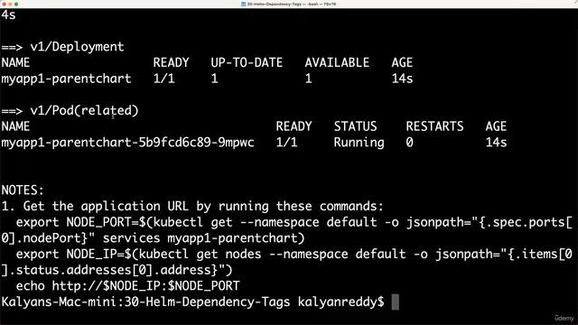

4. 只开后端：

```bash
helm upgrade my-app-1 ./parent-chart --atomic --set tags.backend=true
kubectl get pods
```

预期：多出 `child-chart-2` 的 Pod / Deployment / NodePort Service。

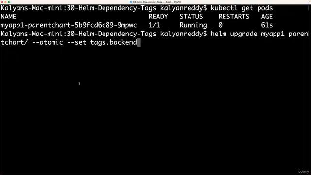

5. 再开前端（一次开三个）：

```bash
helm upgrade my-app-1 ./parent-chart --atomic \
  --set tags.backend=true \
  --set tags.frontend=true
helm status my-app-1 --show-resources
```

预期：`child-chart-4-dev`、`child-chart-4-qa1`、`child-chart-4-qa2` 三个同时出现，各自带 Deployment + NodePort Service。

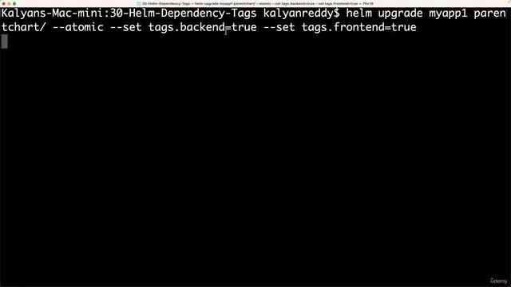

6. 清理：

```bash
helm uninstall my-app-1
helm list
```

命令解释与排查：`helm install ... --atomic` 表示安装失败时自动回滚，适合实验时避免留下半成品；`helm status --show-resources` 会把该 release 关联的资源一起列出来，比只看 `kubectl get pods` 更直观；`helm upgrade ... --set tags.backend=true` 只覆盖本次升级的 `tags.backend`，不会自动帮你保留上一次命令行里传过的值，所以第 5 步要同时写 `backend=true` 和 `frontend=true`。常见错误是只写 `--set tags.frontend=true` 就升级，然后发现后端 Pod 消失，这不是 Helm 丢值，而是本次升级的 values 没有包含 `tags.backend=true`，默认值又把后端关掉了。前端对照：`tags` 像给一组包打同一个 feature flag，父级开关一次控制一组；`condition` 则像每个包一个独立 flag，数量多了就要逐个写。

---

### 3.2 Demo 31：父 chart 覆盖子 chart 的 replicaCount

**目标**：`my-chart-4` 和 `my-chart-2` 各自默认 `replicaCount: 1`，在父 `values.yaml` 里改成 3，再改成 5。

**步骤**

1. 先确认子 chart 的原始值（子 chart 是打包好的 `.tgz`，不能直接 `cat`）：

```bash
cd 31-helm-dependency-override-sub-chart-values
helm show values ./parent-chart/charts/my-chart-4-0.1.0.tgz
helm show values ./parent-chart/charts/my-chart-2-0.4.0.tgz
```

> 文件名里的版本号请以 `ls parent-chart/charts/` 实际输出为准，课里念的是 `010` / `040` 这类版本串。

预期：两个子 chart 的 `replicaCount` 都是 `1`。

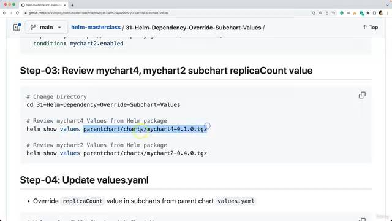

2. 编辑父 `values.yaml`，在 `my-chart-4.enabled: true` 和 `my-chart-2.enabled: true` 之下各加一行 `replicaCount: 3`（完整文件见第 4 节）。

3. 安装并验证：

```bash
helm install my-app ./parent-chart --atomic
helm status my-app --show-resources
kubectl get pods
```

预期：`my-chart-2` 3 个 Pod + `my-chart-4` 3 个 Pod。

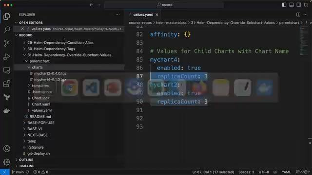

4. 改成 5 再升级：

```bash
# 把 values.yaml 里两个 replicaCount 改成 5
helm upgrade my-app ./parent-chart --atomic
kubectl get pods
```

5. 清理：`helm uninstall my-app`。

命令解释与排查：`helm show values` 只读取 chart 的默认 values，不会安装资源，适合先确认子 chart 里到底有没有 `replicaCount` 这个键。父 chart 覆盖子 chart 值时，第一层 key 要和依赖名或 alias 对齐；Demo 31 没有写 alias，所以这里用 `my-chart-4` / `my-chart-2`。如果写错第一层 key，Helm 不会报「这个键不存在」，而是把这段值当成父 chart 自己的普通值，子 chart 仍然用默认 1 副本，现象就是「改了没效果」。排查时先 `helm get values my-app` 看当前 release 的值，再 `helm template` 看渲染后的 `replicas`。前端对照：这类似在根级 `package.json` 里覆盖某个 workspace 包的配置；覆盖的是同名键，不是替换整个子包配置对象。

---

### 3.3 Demo 32：global 值 + helm pull 拉取未打包子 chart

**目标**：父 `values.yaml` 定义 `global.replicaCount: 4`，父 chart 和两个子 chart 的 `deployment.yaml` 都写 `.Values.global.replicaCount`，最终三处都是 4 个副本。

**关键差异**：这次子 chart 必须是**解包后的目录**（因为要改子 chart 的模板），所以用 `helm pull --untar`。

**步骤**

1. 进入目录，确认 `parent-chart/charts/` 是空的：

```bash
cd 32-helm-sub-chart-global-values
ls parent-chart/charts/
```

2. 拉取并解包两个子 chart：

```bash
cd parent-chart/charts
helm pull https://stacksimplify.github.io/helm-charts/my-chart-4-0.1.0.tgz --untar
helm pull https://stacksimplify.github.io/helm-charts/my-chart-2-0.4.0.tgz --untar
ls
# 期望看到 my-chart-4/ 和 my-chart-2/ 两个目录，以及两个 .tgz
rm -rf *.tgz
```

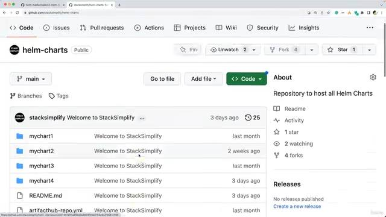

> 如果 URL 404，说明课程仓库的 Pages 路径变了，请到 GitHub 仓库 Releases / Packages 页找到实际 `.tgz` 地址替换。课里没讲 URL 失效时的备选方案。

3. 改三个 `deployment.yaml` 的 `replicas` 字段（见第 4 节完整文件）。

4. 确认父 `values.yaml` 里有：

```yaml
global:
  replicaCount: 4
tags:
  frontend: true
  backend: true
```

5. 安装并验证：

```bash
cd ..   # 回到 parent-chart
helm install my-app-1 . --atomic
helm status my-app-1 --show-resources
```

预期：父 chart 4 个 Pod、`child-chart-2` 4 个、`child-chart-4` 4 个。

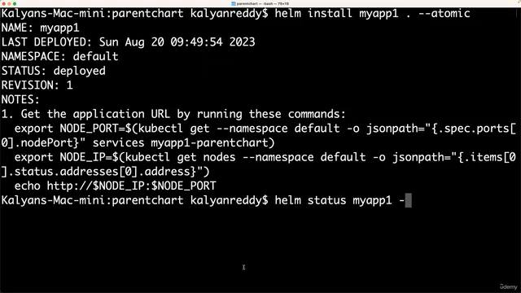

6. 清理：`helm uninstall my-app-1`。

命令解释与排查：`helm pull URL --untar` 会把远程 `.tgz` 下载到当前目录并解包；解包后你才能修改子 chart 的 `templates/deployment.yaml`。如果 `helm pull` 成功但 `ls` 只看到 `.tgz` 没有目录，检查是否漏了 `--untar`。如果解包后父 chart 仍然使用 `charts/` 下旧的 `.tgz`，可能出现「改了目录但安装没生效」的错觉，所以第 2 步最后用 `rm -rf *.tgz` 清掉压缩包，避免 Helm 选择打包文件。`global` 的排查重点是三处模板是否都写了 `.Values.global.replicaCount`；只改父 chart 的 values 而不改子 chart 模板，子 chart 不会自动读取同名普通值。前端对照：`global` 类似全局环境配置，但组件必须显式读取这个全局键，不能指望框架自动把局部配置替换成全局配置。

---

### 3.4 Demo 33：import-values 显式（exports）

**目标**：子 chart `my-chart-1` 的 `values.yaml` 用 `exports` 导出一个字典 `my-chart-1-data`，父 chart 的 `Chart.yaml` 用 `import-values` 把它导入，父 chart 的 ConfigMap 直接读 `.Values.my-chart-1-app-info`。

**步骤**

1. 看子 chart 的导出段：

```bash
cd 33-helm-dependency-import-values-explicit
cat parent-chart/charts/my-chart-1/values.yaml
# 末尾应有：
# exports:
#   my-chart-1-data:
#     my-chart-1-app-info:
#       app-name: k-app-1
#       app-type: microservice
#       app-description: used for listing some products
```

2. 看父 `Chart.yaml` 的 `import-values`（见第 4 节）。

3. 看父 ConfigMap 模板，确认用的是 `.Values.my-chart-1-app-info`，**不是** `.Values.my-chart-1-data.my-chart-1-app-info`。

4. 先 dry-run 看渲染结果：

```bash
cd parent-chart
helm template my-app-1 . | grep -A 10 "kind: ConfigMap"
```

预期：ConfigMap 的 `data` 下出现 `app-name` / `app-type` / `app-description` 三个键。

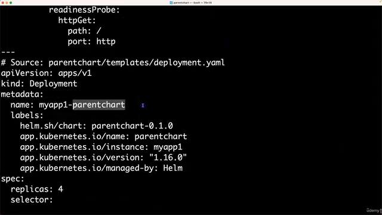

5. 真正安装并验证：

```bash
helm install my-app-1 . --atomic
kubectl get cm
kubectl get cm <上一步输出的 configmap 名> -o yaml
```

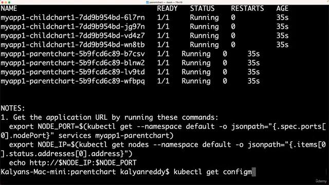

6. 反向验证：把父 `values.yaml` 里 `tags.frontend` 改成 `false`，子 chart 被禁用，导出链断开：

```bash
helm uninstall my-app-1
# 改 tags.frontend: false
helm template my-app-1 . | grep -A 5 "kind: ConfigMap"
# 预期 data 为 null
helm install my-app-1 . --atomic
kubectl get cm <configmap 名> -o yaml
# 预期没有 data 字段
```

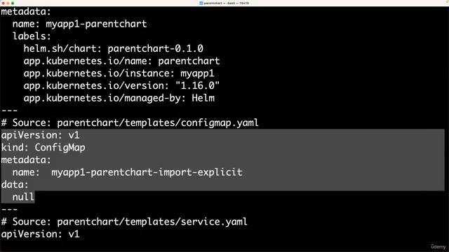

7. 改回 `tags.frontend: true`，`helm uninstall my-app-1`。

命令解释与排查：`helm template` 是本地渲染，不会创建资源，适合在安装前检查 ConfigMap 的 `data` 是否出现预期键。`grep -A 10 "kind: ConfigMap"` 只截取 ConfigMap 附近输出，实际排查时可以去掉 `grep` 看完整渲染，再用 `kubectl apply --dry-run=client -f -` 做客户端校验。常见错误是 ConfigMap 里写成 `.Values.my-chart-1-data.my-chart-1-app-info`，这样会取不到值；讲师在 P094 [03:46] 已经强调 `my-chart-1-data` 只是映射元素。前端对照：`exports` 像子模块显式 `export` 一个对象，`import-values` 像父模块按导出名导入；导入后用的是对象内部内容，不是导出名本身。

---

### 3.5 Demo 34：import-values 隐式（child/parent 映射）

**目标**：子 chart `my-chart-2` **一行不改**。父 `Chart.yaml` 写：

```yaml
import-values:
  - child: service
    parent: my-chart-2-service
  - child: image
    parent: my-chart-2-image
```

父 ConfigMap 读 `.Values.my-chart-2-service.type` / `.port` / `.nodePort` 和 `.Values.my-chart-2-image.repository`。

**步骤**

1. 确认子 chart 的 `values.yaml` 里有 `service` 和 `image` 两个对象：

```bash
cd 34-helm-dependency-import-values-implicit
cat parent-chart/charts/my-chart-2/values.yaml
```

2. 看父 `Chart.yaml` 和 ConfigMap 模板（见第 4 节）。注意 ConfigMap 里 `port` 和 `nodePort` 后面都加了 `| quote`——因为 ConfigMap 的 `data` 只接受字符串，而这两个值是整数。

3. 确认父 `values.yaml` 里 `tags.backend: true`。

4. 安装并验证：

```bash
cd parent-chart
helm install my-app-1 . --atomic
helm status my-app-1 --show-resources
kubectl get cm
kubectl get cm <configmap 名> -o yaml
```

预期 `data` 下四个键：`service-type: NodePort`、`service-port: "80"`、`service-node-port: "31232"`、`image-repository: ghcr.io/stacksimplify/kubenginx`（具体值以子 chart 实际 `values.yaml` 为准）。

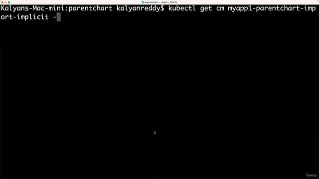

5. 反向验证：禁用后端 chart：

```bash
helm uninstall my-app-1
helm install my-app-1 . --atomic --set tags.backend=false
```

预期：**安装直接失败**，报错类似 `nil pointer evaluating interface {}.type`——因为 `my-chart-2-service` 这个父键根本不存在，ConfigMap 模板取 `.type` 时炸了。

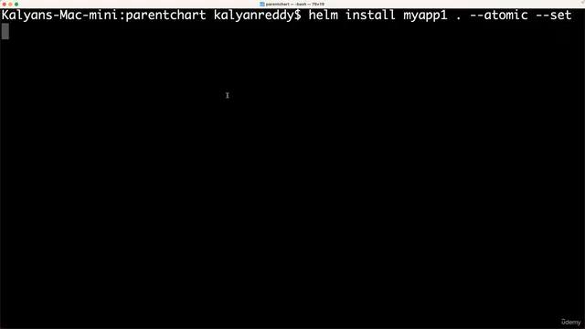

> 这是 Demo 33 和 Demo 34 的关键行为差异：显式导入在子 chart 禁用时渲染成 `null`（安装能过），隐式导入在子 chart 禁用时**直接渲染失败**。课里没解释原因，但从两次实验现象可以确认。

6. 清理：`helm uninstall my-app-1`（如果第 5 步失败，用 `helm list --all` 确认无残留）。

命令解释与排查：隐式 `import-values` 的 `child` 是子 chart values 里的键名，`parent` 是导入父 chart 后使用的重命名键。因为父 chart 自己也可能有 `service` / `image`，所以这里要改名避免冲突。`| quote` 不是可选装饰，ConfigMap 的 `data` 值必须是字符串，整数直接渲染可能被 Kubernetes 拒绝。排查 nil pointer 时，先看父 `Chart.yaml` 中依赖是否被 `tags` 禁用，再看 ConfigMap 引用的父键是否真的存在。前端对照：这类似把子包里的 `service` 配置整体 re-export 成父级的 `my-chart-2-service`，子包不用改导出语句；但父级模板如果直接访问一个不存在的重命名对象，就会在渲染阶段报错。

---

### 3.6 Demo 35：Starter Chart

**目标**：用 `helm create` 生成一个 chart，删到只剩 Deployment + Service，改成一个「组织标准模板」，放进 `$HELM_DATA_HOME/starters/`，再用 `helm create --starter` 生成新 chart。

**步骤**

1. 生成初始 chart：

```bash
cd 35-helm-starters
helm create my-starter-chart
```

2. 按讲师步骤精简（详见第 4 节完整文件）：

- 删 `templates/tests/`
- 删 `templates/hpa.yaml`、`templates/ingress.yaml`、`templates/serviceaccount.yaml`
- 删 `templates/_helpers.tpl` 里 service account name 相关模板
- `values.yaml` 删 `serviceAccount`、`ingress`、`autoscaling` 三段
- `values.yaml` 里 `service.type` 改 `NodePort`，加 `nodePort: 31239`
- `values.yaml` 里 `image.repository` 改 `ghcr.io/stacksimplify/kubenginx-helm`
- `deployment.yaml` 删 autoscaling 和 serviceAccount 引用
- `service.yaml` 加 `nodePort: {{ .Values.service.nodePort }}`
- `Chart.yaml` 里 `version: 1.0.0`、`appVersion: "0.4.0"`（故意设成和默认不同，用来观察被覆盖）
- `Chart.yaml` 加一条 `my-chart-4` 依赖（同样用来观察被覆盖）
- `charts/` 下用 `helm pull --untar` 放入 `my-chart-4`
- `templates/NOTES.txt` 删掉 ingress 那段 `if`

3. 先 lint 再装：

```bash
cd my-starter-chart
helm lint .
# 预期：1 chart(s) linted, 0 chart(s) failed
# 可能有一条 warning：icon is recommended（可忽略）
helm install my-app-1 . --atomic
helm status my-app-1 --show-resources
kubectl get svc
```

4. 浏览器访问 `http://localhost:31239`，应看到 v4 版本页面（因为 `appVersion: 0.4.0` 对应 `kubenginx-helm` 的 v4 tag）。

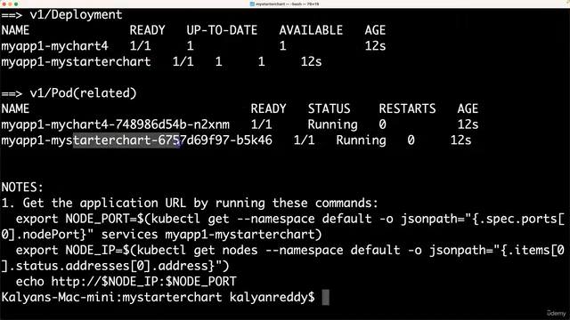

5. 再访问 `my-chart-4` 的 NodePort（`kubectl get svc` 查，课里示例是 32101，你的环境可能不同），应看到 v1。

6. 清理：`helm uninstall my-app-1`。

7. 转成 starter 并生成新 chart：

```bash
helm env | grep HELM_DATA_HOME
# 假设输出 HELM_DATA_HOME="/home/you/.local/share/helm"
mkdir -p "$HELM_DATA_HOME/starters"
cp -r my-starter-chart "$HELM_DATA_HOME/starters/"
cd ..
helm create my-new-chart --starter my-starter-chart
cat my-new-chart/Chart.yaml
```

预期：`my-new-chart/Chart.yaml` 的 `version` 和 `appVersion` 都是 `0.1.0`（被生成器覆盖），`dependencies` 段**完全消失**，但 `my-new-chart/charts/` 下仍有 `my-chart-4`（且是 `.tgz` 形式，即使你放进去的是解包目录）。

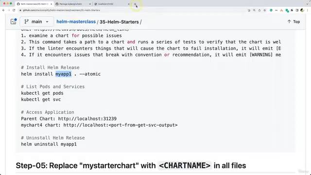

> 课里没讲 `HELM_DATA_HOME` 在 Windows 下的默认路径，也没讲 `helm create --starter` 时 starter 名是否要带路径。以上命令以 Linux/macOS 为准。

命令解释与排查：`helm lint .` 会检查 chart 结构和模板语法，先 lint 再 install 可以更早发现 YAML 错误；`helm env | grep HELM_DATA_HOME` 用来定位 starter 应该放的位置；`cp -r my-starter-chart "$HELM_DATA_HOME/starters/"` 把 chart 复制成 starter。常见错误是 starter 放错目录导致 `helm create --starter` 找不到；另一个是删模板时删得不彻底，`deployment.yaml` 里还残留 `serviceAccountName` 或 `autoscaling` 引用，`helm lint` 或安装阶段才会报错。前端对照：starter chart 类似公司内部脚手架模板；`helm create --starter` 类似用脚手架生成新项目，生成器会重置版本号，不保留模板里的 `dependencies` 段，但模板里的 `charts/` 内容仍会以打包形式带过去。

---

## 4. 完整代码

> 以下文件均为**可直接保存运行**的完整内容。凡课程仓库里已有的文件，字段名严格按逐字稿出现过的写；凡逐字稿没提到的字段（如 `apiVersion` 具体值、`description`），标注「课里没讲，按 Helm 默认填」。

使用这些代码时，先确认你在对应 Demo 的 `parent-chart` 或 starter chart 目录内；`repository: file://...` 的路径要和 `charts/` 下实际文件或目录名一致。如果复制后 `helm dependency build` 或 `helm install` 报找不到依赖，先用 `ls charts/` 对照路径，不要急着改字段名。

### 4.1 Demo 30 父 chart `Chart.yaml`

```yaml
apiVersion: v2
name: parent-chart
description: Demo 30 - dependency tags
type: application
version: 0.1.0
appVersion: "1.0.0"

dependencies:
  - name: my-chart-4
    version: 0.1.0
    repository: file://charts/my-chart-4-0.1.0.tgz
    alias: child-chart-4-dev
    tags:
      - frontend
  - name: my-chart-4
    version: 0.1.0
    repository: file://charts/my-chart-4-0.1.0.tgz
    alias: child-chart-4-qa1
    tags:
      - frontend
  - name: my-chart-4
    version: 0.1.0
    repository: file://charts/my-chart-4-0.1.0.tgz
    alias: child-chart-4-qa2
    tags:
      - frontend
  - name: my-chart-2
    version: 0.4.0
    repository: file://charts/my-chart-2-0.4.0.tgz
    tags:
      - backend
```

> `repository` 的写法课里没逐字念，但 P092 明确说过 `file://charts/my-chart-4` 这种形式，此处按 `.tgz` 路径写；若你的 `charts/` 下是解包目录，改成 `file://charts/my-chart-4`。

### 4.2 Demo 30 父 chart `values.yaml`

```yaml
tags:
  frontend: false
  backend: false
```

### 4.3 Demo 31 父 chart `values.yaml`

```yaml
my-chart-4:
  enabled: true
  replicaCount: 3

my-chart-2:
  enabled: true
  replicaCount: 3
```

### 4.4 Demo 32 父 chart `values.yaml`

```yaml
global:
  replicaCount: 4

tags:
  frontend: true
  backend: true
```

### 4.5 Demo 32 父 chart `templates/deployment.yaml`（关键片段）

```yaml
apiVersion: apps/v1
kind: Deployment
metadata:
  name: {{ include "parent-chart.fullname" . }}
  labels:
    {{- include "parent-chart.labels" . | nindent 4 }}
spec:
  replicas: {{ .Values.global.replicaCount }}
  selector:
    matchLabels:
      {{- include "parent-chart.selectorLabels" . | nindent 6 }}
  template:
    metadata:
      labels:
        {{- include "parent-chart.selectorLabels" . | nindent 8 }}
    spec:
      containers:
        - name: {{ .Chart.Name }}
          image: "{{ .Values.image.repository }}:{{ .Values.image.tag | default .Chart.AppVersion }}"
          ports:
            - name: http
              containerPort: 80
              protocol: TCP
```

> `include "parent-chart.fullname"` 等 helper 名依赖 `_helpers.tpl`，课里没逐字展示，按 `helm create` 默认生成的名字即可。

### 4.6 Demo 32 子 chart `my-chart-2/templates/deployment.yaml`（关键片段）

```yaml
spec:
  replicas: {{ .Values.global.replicaCount }}
```

### 4.7 Demo 32 子 chart `my-chart-4/templates/deployment.yaml`（关键片段）

```yaml
spec:
  replicas: {{ .Values.global.replicaCount }}
```

> 三处 `replicas` 都改成 `.Values.global.replicaCount`，这是 Demo 32 的全部改动。

### 4.8 Demo 33 子 chart `my-chart-1/values.yaml`（末尾导出段）

```yaml
exports:
  my-chart-1-data:
    my-chart-1-app-info:
      app-name: k-app-1
      app-type: microservice
      app-description: used for listing some products
```

### 4.9 Demo 33 父 chart `Chart.yaml`

```yaml
apiVersion: v2
name: parent-chart
description: Demo 33 - import-values explicit
type: application
version: 0.1.0
appVersion: "1.0.0"

dependencies:
  - name: my-chart-1
    version: 0.1.0
    repository: file://charts/my-chart-1
    alias: child-chart-1
    tags:
      - frontend
    import-values:
      - my-chart-1-data
  - name: my-chart-2
    version: 0.4.0
    repository: file://charts/my-chart-2
    tags:
      - backend
```

### 4.10 Demo 33 父 chart `templates/configmap.yaml`

```yaml
apiVersion: v1
kind: ConfigMap
metadata:
  name: {{ include "parent-chart.fullname" . }}-import-explicit
data:
  app-info.yaml: |
    {{- toYaml .Values.my-chart-1-app-info | nindent 4 }}
```

> 逐字稿里讲师说的是「piped it with nindent 2」，此处 `nindent 4` 是为了让 YAML 缩进合法；`nindent` 的数字课里念的是 2，实际写 2 也能渲染，只是缩进层级不同。以你 `helm template` 输出能通过 `kubectl apply --dry-run=client` 为准。

### 4.11 Demo 33 父 chart `values.yaml`

```yaml
tags:
  frontend: true
  backend: false
```

### 4.12 Demo 34 父 chart `Chart.yaml`

```yaml
apiVersion: v2
name: parent-chart
description: Demo 34 - import-values implicit
type: application
version: 0.1.0
appVersion: "1.0.0"

dependencies:
  - name: my-chart-2
    version: 0.4.0
    repository: file://charts/my-chart-2
    tags:
      - backend
    import-values:
      - child: service
        parent: my-chart-2-service
      - child: image
        parent: my-chart-2-image
```

### 4.13 Demo 34 父 chart `templates/configmap.yaml`

```yaml
apiVersion: v1
kind: ConfigMap
metadata:
  name: {{ include "parent-chart.fullname" . }}-import-implicit
data:
  service-type: {{ .Values.my-chart-2-service.type | quote }}
  service-port: {{ .Values.my-chart-2-service.port | quote }}
  service-node-port: {{ .Values.my-chart-2-service.nodePort | quote }}
  image-repository: {{ .Values.my-chart-2-image.repository | quote }}
```

### 4.14 Demo 34 父 chart `values.yaml`

```yaml
tags:
  frontend: false
  backend: true
```

### 4.15 Demo 35 starter chart `Chart.yaml`（精简后）

```yaml
apiVersion: v2
name: my-starter-chart
description: Organization standard starter chart
type: application
version: 1.0.0
appVersion: "0.4.0"

dependencies:
  - name: my-chart-4
    version: 0.1.0
    repository: file://charts/my-chart-4
```

### 4.16 Demo 35 starter chart `values.yaml`（精简后）

```yaml
replicaCount: 1

image:
  repository: ghcr.io/stacksimplify/kubenginx-helm
  pullPolicy: IfNotPresent
  tag: ""

service:
  type: NodePort
  port: 80
  nodePort: 31239

resources: {}
```

> `resources` 段课里没细讲，保留 `helm create` 默认的空对象即可。

### 4.17 Demo 35 starter chart `templates/deployment.yaml`

```yaml
apiVersion: apps/v1
kind: Deployment
metadata:
  name: {{ include "my-starter-chart.fullname" . }}
  labels:
    {{- include "my-starter-chart.labels" . | nindent 4 }}
spec:
  replicas: {{ .Values.replicaCount }}
  selector:
    matchLabels:
      {{- include "my-starter-chart.selectorLabels" . | nindent 6 }}
  template:
    metadata:
      labels:
        {{- include "my-starter-chart.selectorLabels" . | nindent 8 }}
    spec:
      containers:
        - name: {{ .Chart.Name }}
          image: "{{ .Values.image.repository }}:{{ .Values.image.tag | default .Chart.AppVersion }}"
          imagePullPolicy: {{ .Values.image.pullPolicy }}
          ports:
            - name: http
              containerPort: 80
              protocol: TCP
```

### 4.18 Demo 35 starter chart `templates/service.yaml`

```yaml
apiVersion: v1
kind: Service
metadata:
  name: {{ include "my-starter-chart.fullname" . }}
  labels:
    {{- include "my-starter-chart.labels" . | nindent 4 }}
spec:
  type: {{ .Values.service.type }}
  ports:
    - port: {{ .Values.service.port }}
      targetPort: http
      protocol: TCP
      name: http
      {{- if contains "NodePort" .Values.service.type }}
      nodePort: {{ .Values.service.nodePort }}
      {{- end }}
  selector:
    {{- include "my-starter-chart.selectorLabels" . | nindent 4 }}
```

### 4.19 Demo 35 starter chart `templates/NOTES.txt`

```text
1. Get the application URL by running these commands:
{{- if contains "NodePort" .Values.service.type }}
  export NODE_PORT=$(kubectl get --namespace {{ .Release.Namespace }} -o jsonpath="{.spec.ports[0].nodePort}" services {{ include "my-starter-chart.fullname" . }})
  export NODE_IP=$(kubectl get nodes --namespace {{ .Release.Namespace }} -o jsonpath="{.items[0].status.addresses[0].address}")
  echo http://$NODE_IP:$NODE_PORT
{{- else if contains "LoadBalancer" .Values.service.type }}
  NOTE: It may take a few minutes for the LoadBalancer IP to be available.
{{- else if contains "ClusterIP" .Values.service.type }}
  export POD_NAME=$(kubectl get pods --namespace {{ .Release.Namespace }} -l "app.kubernetes.io/name={{ include "my-starter-chart.name" . }},app.kubernetes.io/instance={{ .Release.Name }}" -o jsonpath="{.items[0].metadata.name}")
  echo "Visit http://127.0.0.1:8080 to use your application"
  kubectl --namespace {{ .Release.Namespace }} port-forward $POD_NAME 8080:80
{{- end }}
```

---

## 5. 逐行解释

### 5.1 `tags` vs `condition`（Demo 30）

```yaml
tags:
  - frontend
```

- `tags` 是**列表**，一个 chart 可以打多个 tag；父 `values.yaml` 里 `tags.frontend: true` 会一次性打开所有带 `frontend` tag 的依赖。
- `condition` 是**单值路径**，比如 `my-chart-4.enabled`，一个 chart 一个开关。讲师在 P089 [01:26] 明确对比过：4 个 chart 用 condition 要写 4 行，用 tags 只写 2 行。
- 在 JS/Node 里类比：`tags` 像 `Promise.all` 批量 resolve，`condition` 像逐个 `await`。
- 注意：`tags` 和 `condition` 可以同时存在，Helm 的优先级课里没讲，不要凭印象下结论。
- 常见错误是把 `tags` 写成 `tag` 或写成 `frontend: true` 的对象；`tags` 在依赖项里是列表，在父 values 里才是以 tag 名为键的布尔开关。
- 排查时先看父 `Chart.yaml` 的依赖项里是否真的写了 `tags`，再看父 `values.yaml` 的 `tags` 层级是否拼写一致；两边名字不一致时不会报错，只会静默不启用。

### 5.2 父 values 覆盖子 chart（Demo 31）

```yaml
my-chart-4:
  enabled: true
  replicaCount: 3
```

- 第一层 key `my-chart-4` 是**依赖名**（不是 alias）。如果依赖写了 `alias: child-chart-4-dev`，覆盖时要用 alias 名，不是原名——课里 Demo 31 没写 alias，所以用原名。
- 第二层 `replicaCount` 直接对应子 chart `values.yaml` 里的同名 key，Helm 会做深度合并（deep merge），不是替换整个对象。
- 在 JS 里等价于 `_.merge(parentValues, childValues)`，数组是整体替换不是拼接。
- 常见错误是父 values 里多套了一层 `parent-chart:` 或 `my-chart-4.values:`；Helm 不会自动剥掉这一层，子 chart 就收不到 `replicaCount`。
- 排查时用 `helm get values my-app` 看 release 实际值，再用 `helm template` 看 Deployment 的 `replicas` 是否变成 3。

### 5.3 `global`（Demo 32）

```yaml
global:
  replicaCount: 4
```

- `global` 是 Helm 保留字，父 chart 定义一次，**所有子 chart 都能通过 `.Values.global.xxx` 读到**，不需要在父 values 里为每个子 chart 重复写。
- 和 Demo 31 的区别：Demo 31 是「父 → 某个特定子 chart」的点对点覆盖；Demo 32 是「父 → 所有 chart（含父自己）」的广播。
- 子 chart 模板里必须**主动**写 `.Values.global.replicaCount`，Helm 不会自动把 `replicaCount` 替换成 global 值。这是 Demo 32 要改三个 `deployment.yaml` 的原因。
- 常见错误是只改父 chart 的 `deployment.yaml`，忘改两个子 chart 模板；现象是父 chart 4 副本，子 chart 仍是 1 副本。
- 前端对照：`global` 像全局配置对象，但组件要显式读取；不能把它理解成会自动覆盖所有同名局部变量。

### 5.4 `exports` + `import-values` 显式（Demo 33）

子 chart `values.yaml`：

```yaml
exports:
  my-chart-1-data:          # ← 这是「导出包」的名字，也是父 chart 里 import-values 引用的 key
    my-chart-1-app-info:    # ← 这是真正被导入到父 chart 顶层的内容
      app-name: k-app-1
```

父 `Chart.yaml`：

```yaml
import-values:
  - my-chart-1-data
```

- 导入后，父 chart 的 `.Values` 顶层会多出 `my-chart-1-app-info` 这个 key，**不会**多出 `my-chart-1-data`。
- 所以 ConfigMap 里写 `.Values.my-chart-1-app-info`，不是 `.Values.my-chart-1-data.my-chart-1-app-info`。讲师在 P094 [03:46] 反复强调这一点。
- 在 JS 里类比：`exports` 像 ES module 的 `export { foo }`，`import-values` 像 `import { foo } from './child'`，导入后直接用 `foo`，不用写 `module.foo`。
- 常见错误是父 `Chart.yaml` 里把 `import-values` 写到 `values.yaml`；它属于依赖声明的一部分，应放在依赖项下。
- 反向验证时子 chart 被禁用，显式导入可能渲染成 `null` 但安装能过；排查时看 `helm template` 的 ConfigMap 输出，不要只看安装是否成功。

### 5.5 `import-values` 隐式（Demo 34）

```yaml
import-values:
  - child: service
    parent: my-chart-2-service
```

- `child: service` 指子 chart `values.yaml` 里的 `service` 对象整体。
- `parent: my-chart-2-service` 是导入到父 chart 后**重命名**成什么。讲师在 P096 [01:51] 解释过为什么改名：父 chart 自己也有 `service` 对象，不改名会冲突。
- 子 chart 完全不用改，这是和 Demo 33 最大的区别。
- ConfigMap 里 `port` 和 `nodePort` 加 `| quote`：ConfigMap 的 `data` 只接受字符串，而这两个值在子 chart 里是整数。不加 `quote` 会报 `cannot unmarshal number into Go struct field ConfigMap.data of type string`（具体报错文案以你环境为准）。
- 反向验证时禁用子 chart 会直接渲染失败（nil pointer），因为 `my-chart-2-service` 这个父键不存在，模板取 `.type` 时炸。这和 Demo 33 的「渲染成 null 但能装」不同。
- 前端对照：这像把子模块的整个配置对象 re-export 到父级的新命名空间；父级访问不存在的命名空间时会在渲染阶段直接报错。

### 5.6 Starter Chart（Demo 35）

- `helm create my-starter-chart` 生成的是 Helm 官方默认模板，包含 HPA、Ingress、ServiceAccount、tests，对「组织标准模板」来说太重，所以要删。
- 删 `_helpers.tpl` 里 service account name 模板是必须的，否则 `deployment.yaml` 里残留的 `serviceAccountName: {{ include "..." . }}` 会引用不存在的 helper 报错。
- `Chart.yaml` 的 `version: 1.0.0` / `appVersion: "0.4.0"` 是**故意**设成和默认不同的，用来观察 `helm create --starter` 时被覆盖成 `0.1.0`。
- `charts/` 下放解包目录 `my-chart-4/`，但生成新 chart 时会被**重新打包成 `.tgz`**——这是 P098 [05:43] 提到的行为。
- `helm lint` 在 P100 [00:28] 被强调：改完模板先 lint，能提前抓 YAML 语法错误。讲师演示了删一个 `{{` 的 `}`，lint 报 `unable to parse yaml`。
- 常见错误是直接复制 starter chart 后忘了改 `name`，导致模板 helper 名和新 chart 名不一致；生成新 chart 时生成器会处理一部分，但手工复制时要检查。
- 前端对照：starter chart 像脚手架模板，`helm create --starter` 像用模板初始化项目；生成器会重置 `Chart.yaml` 的版本和依赖段，但 `charts/` 下的内容仍会带过去。

---

## 6. 复现检查清单

按顺序打勾，任何一项不过不要往下走：

**环境**
- [ ] `helm version` 有输出  
  验证方法：终端直接运行，能打印 Client 版本即通过；若还需要服务端信息，用 `helm version --short` 或查看输出中的 Server 部分。
- [ ] `kubectl get nodes` 至少一个 Ready  
  验证方法：看 STATUS 列是否为 `Ready`；若不是，先 `kubectl config current-context` 确认集群。
- [ ] `git clone` 课程仓库成功，`ls` 能看到 `30-` 到 `35-` 目录  
  验证方法：在仓库根目录执行 `ls | grep -E '^(30|31|32|33|34|35)-'`，能列出目录即通过。

**Demo 30**
- [ ] 默认 `helm install` 后 `kubectl get pods` 只有 1 个 Pod  
  验证方法：先 `helm status my-app-1 --show-resources` 看资源列表，再用 `kubectl get pods` 对照 Pod 数量。
- [ ] `--set tags.backend=true` 后多出 `child-chart-2` 的 Pod  
  验证方法：升级后执行 `kubectl get pods`，用 Pod 名或标签找到后端子 chart 对应 Pod。
- [ ] `--set tags.frontend=true` 后一次多出 3 个 `child-chart-4-*` 的 Pod  
  验证方法：同时传 `tags.backend=true` 和 `tags.frontend=true` 升级，执行 `kubectl get pods` 应看到三个前端子 chart 的 Pod。
- [ ] `helm uninstall` 后 `helm list` 为空  
  验证方法：`helm uninstall my-app-1` 后执行 `helm list`，不应再看到该 release；必要时 `helm list --all` 确认为空。

**Demo 31**
- [ ] `helm show values` 两个子 chart 的 `replicaCount` 都是 1  
  验证方法：分别对两个 `.tgz` 执行 `helm show values`，在输出中搜索 `replicaCount`。
- [ ] 父 values 改成 3 后 `kubectl get pods` 看到 3+3  
  验证方法：安装后 `kubectl get pods`，按子 chart 名或标签分组计数；也可 `helm status --show-resources` 对照 Deployment。
- [ ] 改成 5 后 `helm upgrade` 看到 5+5  
  验证方法：修改 `values.yaml` 后 `helm upgrade`，再 `kubectl get pods` 确认 Pod 数变化。

**Demo 32**
- [ ] `helm pull --untar` 后 `charts/` 下是目录不是 `.tgz`  
  验证方法：`ls parent-chart/charts/`，应看到 `my-chart-4/`、`my-chart-2/` 目录；如仍有 `.tgz`，按步骤清理。
- [ ] 三个 `deployment.yaml` 的 `replicas` 都是 `.Values.global.replicaCount`  
  验证方法：分别打开父 chart 和两个子 chart 的 `templates/deployment.yaml`，搜索 `replicas:`。
- [ ] 安装后父 + 两个子 chart 各 4 个 Pod  
  验证方法：`kubectl get pods` 按名称分组计数；也可 `helm status my-app-1 --show-resources` 查看 Deployment 副本。

**Demo 33**
- [ ] `helm template` 输出的 ConfigMap 有 `app-name` / `app-type` / `app-description`  
  验证方法：`helm template my-app-1 . | grep -A 10 "kind: ConfigMap"`，在输出中搜索三个键。
- [ ] `kubectl get cm -o yaml` 能看到这三个值  
  验证方法：先 `kubectl get cm` 找到 ConfigMap 名，再 `kubectl get cm <名字> -o yaml` 查看 `data`。
- [ ] 把 `tags.frontend` 改 false 后，ConfigMap 的 `data` 为 null 或不存在  
  验证方法：改值后 `helm template` 先看渲染；安装后 `kubectl get cm <名字> -o yaml` 确认 `data` 为空或缺失。

**Demo 34**
- [ ] `kubectl get cm -o yaml` 看到 `service-type` / `service-port` / `service-node-port` / `image-repository`  
  验证方法：安装后找到 ConfigMap，检查四个 key 是否都存在，注意 `port` 和 `nodePort` 是否为带引号字符串。
- [ ] `--set tags.backend=false` 时安装**失败**（nil pointer），不是静默成功  
  验证方法：执行 `helm install my-app-1 . --atomic --set tags.backend=false`，观察终端是否报 nil pointer；失败后用 `helm list --all` 检查残留。

**Demo 35**
- [ ] `helm lint .` 输出 `0 chart(s) failed`  
  验证方法：在 `my-starter-chart` 目录执行 `helm lint .`，看最后汇总行。
- [ ] 访问 `localhost:31239` 看到 v4 页面  
  验证方法：`kubectl get svc` 确认 NodePort 为 31239 后，浏览器访问；若本机不是集群节点，需用节点 IP 或端口转发。
- [ ] `helm create my-new-chart --starter my-starter-chart` 后新 chart 的 `Chart.yaml` 里 `version` 是 `0.1.0`、`dependencies` 段消失  
  验证方法：执行 `cat my-new-chart/Chart.yaml`，检查 `version`、`appVersion`、`dependencies` 三处。
- [ ] 新 chart 的 `charts/` 下 `my-chart-4` 是 `.tgz` 不是目录  
  验证方法：`ls my-new-chart/charts/`，看是否出现 `.tgz` 文件。

---

## 7. 课里没讲但你会撞上的

> 下表保留原文列出的常见问题，并按「现象 / 原因 / 怎么办」整理。凡标注「推测」的内容都不是讲师原话，只是根据实验现象做的解释，复现时以你本地实际输出为准。

| 现象 | 原因 | 怎么办 |
|---|---|---|
| `helm pull` 的 URL 失效，下载 404 | P092 用的是 `https://stacksimplify.github.io/helm-charts/my-chart-4-0.1.0.tgz`，GitHub Pages 路径可能随仓库结构调整 | 去仓库 Releases 页找实际 `.tgz` 地址，或直接 `helm package` 本地子 chart 目录；课里没讲 URL 失效时的备选方案 |
| 找不到 `HELM_DATA_HOME`，尤其 Windows 下路径不确定 | P099 只说「run `helm env` 找 HELM_DATA_HOME」，没给 Windows 默认值 | 以 `helm env` 实际输出为准；Windows 一般是 `%APPDATA%\helm`，但不要照抄，先看命令输出 |
| `helm create --starter` 时不确定 starter 名要不要带路径 | P098 只说 `--starter=your-starter-chart-name`，没演示 starter 在 `$HELM_DATA_HOME/starters/` 下时是写名字还是写绝对路径 | 实测写名字即可（Helm 会在 starters 目录下找），但课里没验证；找不到时先 `ls "$HELM_DATA_HOME/starters/"` 对照 |
| `import-values` 显式导入时子 chart 禁用，ConfigMap 的 `data` 为 null 而不是报错 | P095 [08:31] 只演示了现象，没解释机制。推测是 `exports` 段在子 chart 被禁用时不参与合并，父 chart 的 `.Values.my-chart-1-app-info` 就是 undefined，`toYaml` 渲染成 `