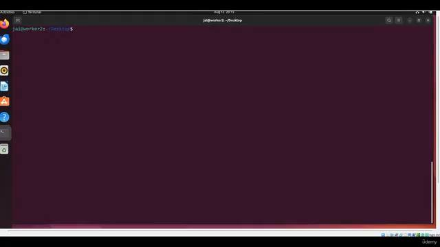
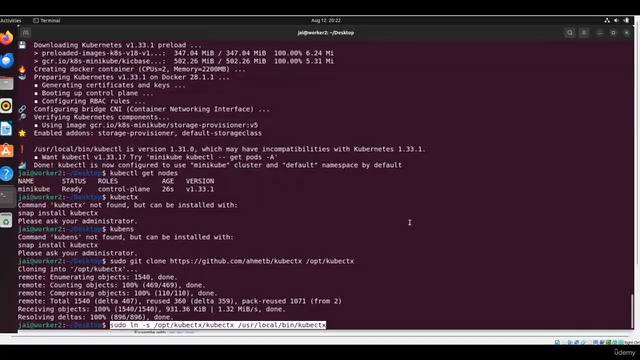
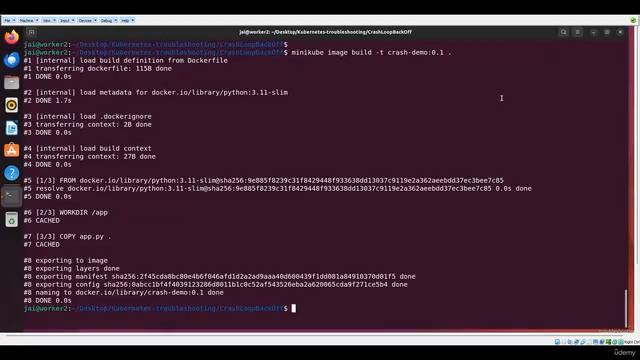
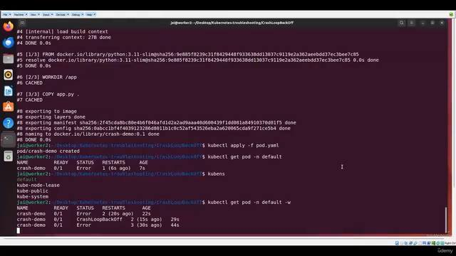
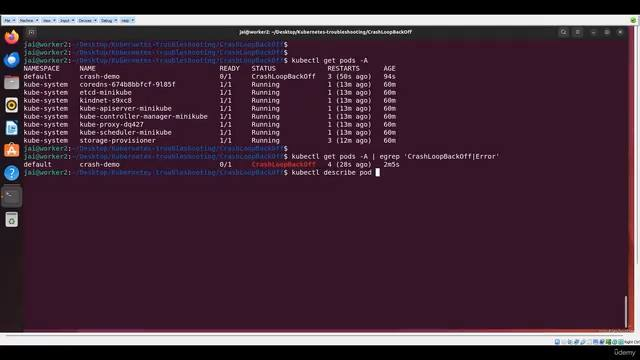
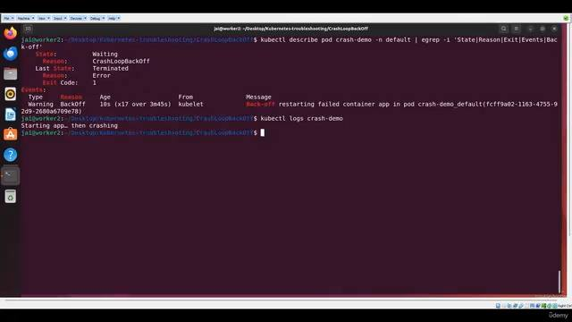
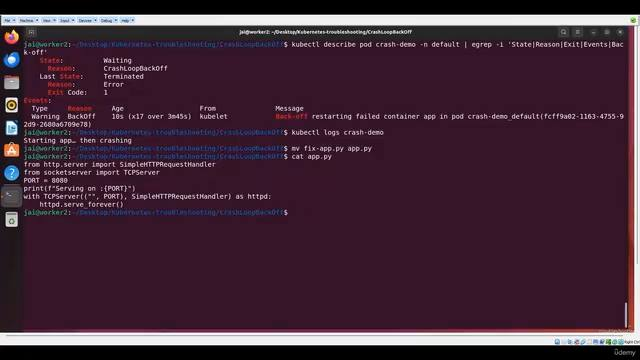
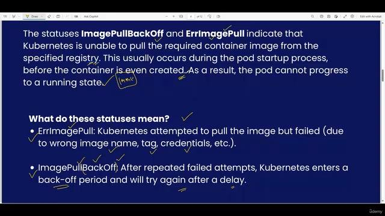
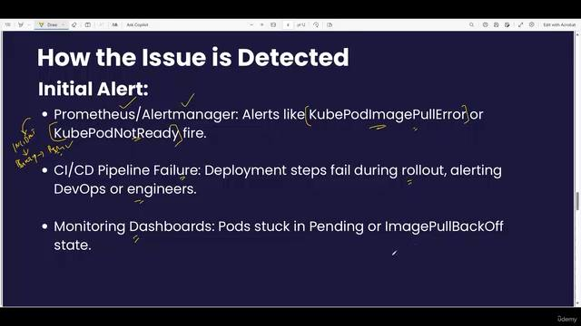

# Kubernetes Troubleshooting（BV1Uz9dBrEDy）P1–P5 可复现文档

> 读者定位：前端转 AI 应用工程师，没做过后端运维。本文档把 P1–P5 的内容按「怎么把东西做出来」重组。凡是逐字稿没讲的地方，都明确标了「课里没讲」；凡是示意代码，都标了「示意」。

---

## 1. 这一节做什么

P1–P5 是这门课的开篇五集，但它不是「五个知识点」，而是一条完整的动手链条：

1. **P1**：定调。这门课不做「怎么从零搭集群」，而是 **break and fix**——故意把集群弄坏，再用固定套路修回来。
2. **P2**：把机器准备好。装 minikube（单节点集群）、装 `kubectx`（切集群）、装 `kubens`（切 namespace）。
3. **P3**：把 `CrashLoopBackOff` 这个概念拆开：它是什么、为什么会出现、业务和系统各受什么影响、谁来处理、怎么发现。
4. **P4**：**真正动手**。写一个必然崩溃的 Python 应用 → 打成镜像 `crash-demo:0.1` → 用 `pod.yaml` 跑起来 → 看着它反复重启 → 用 `kubectl describe` + `kubectl logs` 定位 → 改代码 → 打成 `crash-demo:0.2` → 重新部署 → 变 Running。
5. **P5**：讲 `ImagePullBackOff` / `ErrImagePull`。注意：**P5 只讲了概念和排查路径，逐字稿在 [09:11] 就结束了，没有在集群里实操**。所以 P5 部分本文只给「按讲师的方法你应该怎么查」，不给「讲师演示过的命令」。

**这一节做完你会得到的东西：**

| 产物 | 说明 |
|---|---|
| 一个跑着的 minikube 单节点集群 | P2 产出 |
| `kubectx` / `kubens` 两个命令行工具 | P2 产出 |
| `crash-demo:0.1`（坏镜像） | P4 产出，用来复现故障 |
| `crash-demo:0.2`（好镜像） | P4 产出，用来验证修复 |
| 一套可背下来的排查动作 | `get pods` → `describe` → `logs` → 换镜像 → 验证 |

**关于版本：** 课里没讲 minikube / kubectl / Docker 的具体版本号，也没讲 Ubuntu 版本。你按各自官方的最新稳定版装即可，唯一要守的一条是 minimuke 与 kubectl 的 minor 版本别差太多（差一个 minor 以内最稳）。本文所有命令都是这个前提下可跑的。

**注意 P4 的一个关键前提：** 讲师构建的镜像**没有推到任何镜像仓库**，是直接构建在 minikube 内部的。这意味着后面 `pod.yaml` 里的 `imagePullPolicy` 必须能让 kubelet 用本地镜像，否则你会在 P4 直接撞上 P5 的 `ImagePullBackOff`。这一点课里没讲，但它是你复现时最容易翻车的地方，第 7 章展开。

---

## 2. 讲师原话（带「—— pNNN [MM:SS]」）

关于课程定位：

> "我们不再做传统式的学习，比如从零搭建集群，或者记 Kubernetes 的定义……我们转向一种新策略：破坏并修复。我们会刻意在每一层触发故障。"
> —— p001 [01:08]

> "所以这完全是一套系统化方法论：观察、诊断、解决、验证。"
> —— p001 [01:53]

关于环境准备：

> "你需要在系统上安装好 Kubernetes，或者已经有一个 Kubernetes 集群……我们所有操作都会在 minikube 里完成。"
> —— p002 [00:07]

> "我有一个名为 minikube Ubuntu installation 的脚本，已经放在 GitHub 上……你只需要运行这个脚本，先给它权限，比如执行 chmod 700。"
> —— p002 [00:26]

> "如果我想切换到其他集群，可以使用 kubectx。你可以看到，这里安装了两个集群。"
> —— p002 [02:27]

> "kubens 本身没什么特别的，它只会列出命名空间，并显示你当前处于哪个命名空间。"
> —— p002 [03:02]

关于 CrashLoopBackOff 的机制：

> "当容器以非零状态码退出时……Kubernetes 总是会尝试重启这个容器，但它会反复失败。"
> —— p003 [01:15]

> "Kubernetes 总是采用指数退避策略……第一次重启时，它会等待 10 秒；第一次重启之后，如果进入第二次重启，就会等待 20 秒，然后是 40 秒、80 秒，最长到五分钟。"
> —— p003 [02:05]

> "记住，CrashLoopBackOff 是一种症状……它不是原因。"
> —— p003 [10:21]

> "我记得，每当你执行 kubectl logs 或 kubectl describe 时，Kubernetes 中 90% 的问题……大多数情况下我们都能查明问题出在哪里。"
> —— p003 [11:04]

关于 P4 实操：

> "这是一个有问题的应用，你会看到它一启动就崩溃。也就是说，这个应用一开始运行就会立刻崩溃。"
> —— p004 [00:29]

> "我把那个 app.py 文件复制进去，然后构建镜像；接着有一个 pod.yaml，我们会在其中使用名为 crash-demo:0.1 的镜像。"
> —— p004 [00:59]

> "我的 Docker 驱动有些问题，所以那个命令没有成功执行……因此现在你可以用这个命令：minikube image build -t crash-demo:0.1 .，在当前目录下构建。"
> —— p004 [03:24]

> "它只显示应用正在启动，然后就崩溃了。看起来我没拿到多少信息，但只要你查看这些日志……就能清楚看出你的应用出了问题。"
> —— p004 [08:10]

> "这里有个关键点。我们用的是 minikube，所以我想在 minikube 内部构建镜像，这样就能直接使用这个镜像。"
> —— p004 [09:47]

> "这完全通过持续集成与持续交付流程完成……你去找应用团队构建新镜像，然后把镜像推送到镜像仓库。"
> —— p004 [11:10]

关于 ImagePullBackOff：

> "ErrImagePull 表示 Kubernetes 尝试拉取镜像但失败了。可能是镜像名不对，可能是标签不对，也可能是凭据不对，导致无法从私有仓库拉取镜像。"
> —— p005 [01:13]

> "ImagePullBackOff 关乎镜像是否可访问……本质上都是 Kubernetes 无法获取镜像。"
> —— p005 [07:28]

---

## 3. 从零复现

下面按「一台干净的 Ubuntu 机器」走全流程。每一步都写了**预期结果**，对不上就停在那一步查，别往下走。

### Step 0 · 确认前置条件

机器上要有：能上网的 Ubuntu、Docker、`kubectl`。检查：

```bash
kubectl version --client
docker version
```

讲师在 [00:07] 说「you need to have Kubernetes installed or Kubernetes cluster already installed on your system」，并且演示时 `kubectl get nodes` 已经能返回内容，说明他的机器上先装过 K8s（他说「I have kubedm installed」），但他**后面所有操作都切到 minikube 上做**。



### Step 1 · 安装 minikube

讲师的做法：GitHub 上一个他自己写的 `minikube ubuntu installation` 脚本，`chmod 700` 后执行，约 5 分钟。

> 课里没讲这个脚本的内容，逐字稿的转写也没法确定文件全名（听起来像 `minikube-ubuntu-installation.sh`），**请以课程仓库里的实际文件名为准，不要照抄本文猜测的名字**。如果你拿不到脚本，用 minikube 官方 Linux 二进制安装方式等价。

执行后跑：

```bash
minikube start
```

讲师说这一步再等 2–3 分钟（—— p002 [01:01]）。

### Step 2 · 验证节点

```bash
kubectl get nodes
```

预期：**只有一行**，minikube 单节点，状态 Ready。讲师特别说明「So, it just shows one single node for my cluster. So, because this is a minikube」（—— p004 [01:59]）。

### Step 3 · 装 kubectx 和 kubens

讲师的路径：打开 `kubectx` 的 GitHub → clone → 把 `kubectx` 脚本拷到 `/usr/local/bin`（—— p002 [01:53]）。他也提到可以用 APT 装，但更推荐 clone 脚本的方式。

`kubectx` 的官方仓库是 `ahmetb/kubectx`（课里只说了「kubectx 的 GitHub」，没念 URL，这里补全）：

```bash
git clone https://github.com/ahmetb/kubectx.git
sudo cp kubectx/kubectx /usr/local/bin/kubectx
sudo cp kubectx/kubens /usr/local/bin/kubens
sudo chmod +x /usr/local/bin/kubectx /usr/local/bin/kubens
```

验证并切换：

```bash
kubectx          # 列出所有集群上下文，当前那个会高亮
kubens           # 列出所有 namespace，当前那个会高亮
kubens kube-system
kubens default
```

讲师演示的现象是：切到 `kube-system` 后提示「context has been changed... active namespace is now kube-system」，再跑 `kubens` 就显示当前在 `kube-system`（—— p002 [03:26]）。



### Step 4 · 建工作目录

讲师在仓库里有一个 `crash loop backoff` 目录，里面同时放了 `app.py`、`Dockerfile`、`pod.yaml` 和一份命令清单（—— p004 [00:29]）。

```bash
mkdir -p ~/k8s-ts/crash-demo
cd ~/k8s-ts/crash-demo
```

把第 4 章的三个文件写进去。

### Step 5 · 构建本地镜像（关键一步）

讲师先试了「把当前 shell 指向 minikube 内部的 Docker daemon」这条路：

```bash
eval $(minikube docker-env)
docker build -t crash-demo:0.1 .
```

**他这一步失败了**——原话是「now it is having some issue with my docker driver so i have some issues in my docker driver so that command did work」（—— p004 [03:24]，转写有误，实际意思是这条命令**没**成功）。

于是他改用 minikube 自带的构建命令：

```bash
minikube image build -t crash-demo:0.1 .
```

讲师后来说改好的版本也用同样方式构建：`minikube image build -t crash-demo:0.2 .`（—— p004 [10:00]）。

**为什么必须这么做：** 讲师在 [09:47] 解释得很直白——他不想为了这次演示先把镜像推到 Docker Hub 再用，所以「inside the minikube I want to build the image so that I can directly pick that image」。镜像直接躺在 minikube 节点的镜像库里，`imagePullPolicy` 才可能命中本地。



### Step 6 · 部署并观察故障

```bash
kubectl apply -f pod.yaml
kubectl get pods -n default -w
```

讲师特意解释为什么带 `-n default`：「why I am giving a `-n default` this is my namespace... you can say `kubens`」（—— p004 [04:12]）。`-w` 是 watch，实时刷。

预期现象（讲师的原话节奏）：pod 先重启两次 → 进入 `CrashLoopBackOff` → 等一段时间（退避）→ 再尝试启动 → 应用又挂 → 又回到 `CrashLoopBackOff`，如此循环（—— p004 [04:12]–[05:15]）。



### Step 7 · 模拟「收到告警后」的发现动作

真实世界里你是先收到 Prometheus 的 `kube_pod_crash_loop` 类告警，再进场（—— p003 [05:26]）。这里手动扮演这个角色：

```bash
kubectl get pods -A
```

讲师说这会列出所有 namespace 的 pod，如果你有 100 个 namespace 会很吵，「which is not a great solution but you can always do something on a grep」（—— p004 [05:15]）：

```bash
kubectl get pods -A | grep -iE 'crashloopbackoff|error'
```

> 这里的 grep 模式是按讲师 [06:02] 说的「I will just say crash loop back off and also I will say error」重建的，正则写法课里没给，你自己按习惯写即可。

### Step 8 · describe（第一个 90% 的武器）

```bash
kubectl describe pod crash-demo -n default
```

> pod 名以 `kubectl get pods` 的实际输出为准，课里没念出 pod 名，本文统一按 `pod.yaml` 的 `metadata.name: crash-demo` 写。

讲师在 [06:30] 列了 describe 会告诉你什么：pod 名、属于哪个 namespace、什么时候启动、pod IP、容器信息、用的镜像、当前 state、last state、reason、以及 events。

想只看关键几行，可以过滤（讲师 [07:18] 演示了用 grep 只捞自己关心的字段）：

```bash
kubectl describe pod crash-demo -n default \
  | grep -iE 'state|reason|exit|events|backoff'
```

> 这个 grep 的模式串是按讲师口头列举的 state / reason / exit / events / backoff 五个词拼的，课里没逐字给正则。



### Step 9 · logs（第二个 90% 的武器）

```bash
kubectl logs crash-demo -n default
```

预期输出（讲师的原话）：「so it just says starting app then crashing」（—— p004 [08:10]）。

如果容器启动后瞬间就挂、当前实例已经没了，就加 `--previous` 看上一个已死容器的日志。讲师在 [11:34] 专门强调：「the `--previous` log for logs is crucial for containers that fail immediately」。

```bash
kubectl logs crash-demo -n default --previous
```

到这里，结论已经很明确了：**不是集群的问题，是应用自己 `exit` 了非零码**。这就是讲师反复强调的那句——CrashLoopBackOff 是症状，不是原因（—— p003 [10:21]）。



### Step 10 · 修应用 + 重打镜像

改 `app.py`（改成第 4 章的「好版本」），然后：

```bash
minikube image build -t crash-demo:0.2 .
```

再把 `pod.yaml` 里的 `image` 从 `crash-demo:0.1` 改成 `crash-demo:0.2`。



### Step 11 · 重新部署 + 验证

讲师的做法是先删掉旧的 pod，再 apply 新的（—— p004 [10:25]）：

```bash
kubectl delete pod crash-demo -n default
kubectl apply -f pod.yaml
kubectl get pods -n default
```

预期：`STATUS` 变成 `Running`（—— p004 [10:55]）。

> 严格来说，删 Pod 再 apply 不是生产做法（生产上 Deployment 滚动更新会自己替换 Pod）。讲师在 [11:10] 也明说了：「remember that we are not going to do this manually like how we have done this completely happens through CI CD」。

### Step 12（P5 部分）· ImagePullBackOff：课里只给了方法，没做演示

逐字稿在 P5 的 [09:11] 停在「so, now we will go and try to replicate this in the cluster」，然后就结束了。**P5 没有实操录像。** 所以这一小节只复述讲师给的排查路径，命令是我按他的描述写的，不是他演示过的：

1. 先 `kubectl describe pod <name> -n <ns>`，在 Events 里找 `Failed to pull image` 和认证失败相关的字样。讲师点名了两个高频错误文案：「failed to pull image」和「no basic auth credentials」（—— p005 [04:49]）。
2. 再看事件流，按时间倒排：
   ```bash
   kubectl get events -n default --sort-by=.lastTimestamp
   ```
   讲师描述的现象是能看到 back-off pulling image 或 failed to pull image（—— p005 [05:19]）。
3. 因为容器根本没起来，**这一步 `kubectl logs` 是没用的**。讲师说得很清楚：「your pod is not coming into the running state so you cannot go and check the logs but you can definitely go and describe your pod」（—— p005 [04:49]）。

讲师列的常见根因（—— p005 [06:48]）：镜像名或 tag 写错、私有仓库缺 pull secret、Docker Hub 限流、镜像压根没构建/没推送、网络不通、以及资源限制。他特别提到新环境里最常见的是「防火墙挡住了到容器仓库的访问」（—— p005 [06:48]）。

关于仓库种类，他点了 `quay`、`ECR`、`ACR`、`GCR`、Docker Hub 私有仓库，说「understand what is the registry authentication」（—— p005 [07:58]）。





---

## 4. 完整代码

> **重要声明：** 逐字稿只说了「有一个会在启动时崩溃的 app.py」「一个 Dockerfile 把 app.py 拷进去」「一个 pod.yaml 用 crash-demo:0.1 这个镜像」。**它没有给出任何一行源码、Dockerfile 内容或 YAML 内容。** 下面三个文件是我按讲师描述的行为（日志打印 starting app 后立即非零退出、镜像 tag `crash-demo:0.1` → `crash-demo:0.2`）重建的**可运行版本**，用 `⚠️示意` 标注。你可以直接用，也可以换成课程仓库里的原文件。

### 4.1 目录结构

```
~/k8s-ts/crash-demo/
├── app.py           # 应用源码（坏版本 → 好版本）
├── Dockerfile       # 镜像构建文件
├── pod.yaml         # Pod 清单
└── commands.sh      # 本次实验的全部命令（方便重跑）
```

### 4.2 `app.py`（坏版本）⚠️示意

```python
import sys
import time


def main() -> None:
    print("starting app", flush=True)
    time.sleep(2)
    print("crashed: demo failure on startup", flush=True)
    sys.exit(1)


if __name__ == "__main__":
    main()
```

### 4.3 `app.py`（好版本，Step 10 用这个覆盖）⚠️示意

```python
import time


def main() -> None:
    print("starting app", flush=True)
    while True:
        print("app is running", flush=True)
        time.sleep(10)


if __name__ == "__main__":
    main()
```

### 4.4 `Dockerfile` ⚠️示意

```dockerfile
# 课里没讲基础镜像是什么，任何带 python3 的镜像都可以，这里用官方 slim 版
FROM python:3.12-slim

WORKDIR /app

COPY app.py .

CMD ["python", "-u", "app.py"]
```

### 4.5 `pod.yaml` ⚠️示意

```yaml
apiVersion: v1
kind: Pod
metadata:
  name: crash-demo
  namespace: default
  labels:
    app: crash-demo
spec:
  containers:
    - name: crash-demo
      image: crash-demo:0.1        # 修好之后改成 crash-demo:0.2
      imagePullPolicy: IfNotPresent
```

> `imagePullPolicy: IfNotPresent` 这一行**课里完全没提**，但它是本文档能跑通的关键——原因见第 7 章第 1 条。

### 4.6 `commands.sh`（把整条链路固化成脚本）

```bash
#!/usr/bin/env bash
set -euo pipefail

cd "$(dirname "$0")"

echo "==> 0. 当前上下文与 namespace"
kubectx
kubens

echo "==> 1. 集群只有一个节点（minikube）"
kubectl get nodes

echo "==> 2. 构建坏镜像 0.1"
minikube image build -t crash-demo:0.1 .

echo "==> 3. 部署"
kubectl apply -f pod.yaml

echo "==> 4. 观察（Ctrl+C 退出 watch）"
kubectl get pods -n default -w

echo "==> 5. 发现：全 namespace 扫一遍再 grep"
kubectl get pods -A | grep -iE 'crashloopbackoff|error' || true

echo "==> 6. describe"
kubectl describe pod crash-demo -n default

echo "==> 7. 只看关键字段"
kubectl describe pod crash-demo -n default \
  | grep -iE 'state|reason|exit|events|backoff' || true

echo "==> 8. logs"
kubectl logs crash-demo -n default || true
kubectl logs crash-demo -n default --previous || true

echo "==> 9. 修复：覆盖 app.py 为好版本后重跑本脚本的 10-12 步"
# minikube image build -t crash-demo:0.2 .
# sed -i 's/crash-demo:0.1/crash-demo:0.2/' pod.yaml
# kubectl delete pod crash-demo -n default
# kubectl apply -f pod.yaml
# kubectl get pods -n default
```

执行权限：

```bash
chmod +x commands.sh
```

> 注意：`commands.sh` 里的第 4 步 `-w` 会一直挂着，跑的时候要么单独开一个终端，要么先注释掉。

---

## 5. 逐行解释

### 5.1 `app.py` 坏版本

- `print("starting app", flush=True)` —— 这行决定了 `kubectl logs` 里你会看到什么。讲师在 [08:10] 说日志「just says starting app then crashing」，所以这行文案基本可以确定是讲师应用里有的东西。`flush=True` 很关键：Python 默认会缓冲 stdout，容器里如果没有 tty，缓冲可能导致日志在崩溃时来不及刷出来，`kubectl logs` 就是空的。前端同学可以类比 `console.log` 在 Node 里是同步写的，而 Python 的 stdout 有缓冲层，不加 flush 会「日志丢失」。
- `time.sleep(2)` —— 让容器活够 2 秒，好让 `kubectl get pods -w` 能捕捉到一次完整的「起来了 → 挂了」的循环。如果是立即退出，watch 里可能只看到重启计数在跳。
- `sys.exit(1)` —— **这一行是整个实验的核心**。讲师原话：「when a container exits with a non zero status code... nothing but it is a failure」（—— p003 [01:15]）。Kubernetes 的判断依据就是进程退出码：0 = 成功，非 0 = 失败，失败就按 `restartPolicy` 重启。Pod 默认 `restartPolicy: Always`，所以永远重启。**在 Node 里对应的是 `process.exit(1)` 或未捕获异常导致进程退出码非 0**——效果完全一样。

### 5.2 `app.py` 好版本

去掉 `sys.exit(1)`，改成死循环 `while True` + `sleep`。这模拟一个「长驻服务」。之所以不加 `sys.exit(0)`，是因为容器主进程退出即容器结束——哪怕退出码是 0，Pod 也会按 `restartPolicy` 重启（`Always` 下 Completed 也会重启），最后你会看到一个不停 Completed/Running 抖动的 Pod，同样不是「修好」的样子。

### 5.3 `Dockerfile`

- `FROM python:3.12-slim` —— 课里没讲用什么基础镜像。选 slim 是为了镜像小、`minikube image build` 快。
- `WORKDIR /app` + `COPY app.py .` —— 对应讲师那句「I am copying that app.py file inside」（—— p004 [00:59]）。
- `CMD ["python", "-u", "app.py"]` —— `-u` 强制 stdout 无缓冲，和 `flush=True` 是双保险。前端同学注意这里是 **exec form（JSON 数组）**，不是 shell form。差别在于：exec form 里 `python` 是 PID 1，能直接收到 `SIGTERM`；shell form 会多一层 `/bin/sh -c`，信号会被 sh 吃掉，`kubectl delete` 时要等 `terminationGracePeriodSeconds` 超时才被杀。

### 5.4 `pod.yaml`

- `kind: Pod` —— 直接用 Pod 而不是 Deployment，是因为课里就是要「一个会坏的 Pod，方便你亲手删掉再重建」。生产上你会用 Deployment（讲师在 [11:10] 也说了真实流程是 CI/CD 走 Deployment 滚动更新）。
- `metadata.namespace: default` —— 和讲师全程用 `-n default` 对应。他解释过为什么显式带 namespace：「this is a good practice」（—— p004 [06:30]）。
- `image: crash-demo:0.1` —— 讲师明确说的镜像名和 tag（—— p004 [00:59]）。
- `imagePullPolicy: IfNotPresent` —— **课里没提，本文补的**。理由见第 7 章。

### 5.5 命令逐条

| 命令 | 为什么这么写 |
|---|---|
| `kubectl get nodes` | 讲师用它确认 minikube 单节点就绪（—— p004 [01:59]） |
| `kubens` / `kubens default` | 讲师用它确认「我在哪个 namespace」，避免 describe 时找不到 pod |
| `eval $(minikube docker-env)` | 把当前 shell 的 `DOCKER_HOST` 指向 minikube 内部 daemon。讲师试了这条但失败（—— p004 [03:24]），失败原因他没细说，只说是 docker driver 的问题 |
| `minikube image build -t crash-demo:0.1 .` | 绕过宿主 Docker，直接在 minikube 节点内部构建，镜像天然落在节点本地镜像库 |
| `kubectl apply -f pod.yaml` | 声明式创建，可重复执行 |
| `kubectl get pods -n default -w` | `-w` 是 watch，实时观察状态流转。不加 `-w` 你只能看到某一瞬间的快照，看不到「Running → Error → CrashLoopBackOff → Running」的循环 |
| `kubectl get pods -A \| grep ...` | `-A` = 所有 namespace。讲师说全量列出来太吵，要用 grep 收窄（—— p004 [06:02]） |
| `kubectl describe pod ... -n default` | 拿到 state / last state / reason / exit code / events。讲师称它和 logs 一起能覆盖 90% 的根因 |
| `kubectl describe ... \| grep -iE '...'` | 只留关键字段，输出更短 |
| `kubectl logs ... --previous` | 容器瞬间挂掉时，当前实例已销毁，只能看上一个死掉的实例的日志（—— p003 [11:34]） |
| `kubectl delete pod` + `kubectl apply` | 讲师用的是「先删再建」（—— p004 [10:25]）。因为 `image` 字段是 Pod spec 的一部分，且 `:0.2` 与 `:0.1` 不同名，直接 apply 会因不可变字段被拒；删掉重建最省事 |
| `kubectl get events -n default --sort-by=.lastTimestamp` | P5 里讲师提到的按时间排序看事件（—— p005 [05:19]），用来定位「最后一次拉镜像失败是什么时候、报了什么」 |

### 5.6 关于「为什么要有退避」

讲师讲得很透：第一次重启等 10 秒，第二次 20 秒，然后 40、80 秒，最长到 5 分钟（—— p003 [02:05]）。目的原话是「it will prevent the system from being overwhelmed by rapid restart attempts of a consistently failing container」。

所以你在 `-w` 里看到的「卡在 CrashLoopBackOff 不动」**不是卡死**，而是在退避窗口里。这个设计对你排查有直接影响：**你修好镜像之后，不要干等它自己重启**，直接 `delete pod` 重建，否则可能要等好几分钟。

在 Node 生态里，这就是 `p-retry` 的 `factor: 2` 或 `bull` 的 exponential backoff，逻辑一模一样。

---

## 6. 复现检查清单

按顺序打钩，任何一项不过就别往下走。

**环境层**

- [ ] `kubectl version --client` 有输出，且与 `minikube version` 的 minor 差 ≤ 1
- [ ] `minikube status` 显示 Running
- [ ] `kubectl get nodes` 恰好返回 **1 行**，STATUS = Ready
- [ ] `kubectx` 能列出多个 context（如果你机器上只有 minikube 就只有一个，这也正常，讲师机器上是两个）
- [ ] `kubens` 能列出 namespace，当前是 `default`
- [ ] `kubens kube-system` 后提示 context/namespace 已切换，`kubens` 再跑显示 `kube-system`，最后切回 `default`

**构建层**

- [ ] `~/k8s-ts/crash-demo/` 下四个文件齐全
- [ ] `minikube image build -t crash-demo:0.1 .` 退出码 0
- [ ] 构建完能确认镜像在节点里：`minikube image ls | grep crash-demo`（这条命令课里没讲，是本文补的验证手段）

**故障复现层**

- [ ] `kubectl apply -f pod.yaml` 返回 `pod/crash-demo created`
- [ ] `kubectl get pods -n default -w` 里 STATUS 出现过 `CrashLoopBackOff`
- [ ] `RESTARTS` 列的数字在增长（讲师说「already it has restarted two times」，—— p004 [04:12]）
- [ ] `kubectl get pods -A | grep -i crashloopbackoff` 能定位到它
- [ ] `kubectl describe pod crash-demo -n default` 输出里有 `State`、`Last State`、`Reason`、`Events` 这几段
- [ ] `kubectl logs crash-demo -n default` 能看到 `starting app` 和崩溃字样

**修复层**

- [ ] `app.py` 换成好版本后 `minikube image build -t crash-demo:0.2 .` 成功
- [ ] `pod.yaml` 里 image 已改为 `crash-demo:0.2`
- [ ] `kubectl delete pod crash-demo -n default` 返回 deleted
- [ ] 重新 apply 后 `kubectl get pods -n default` 显示 `Running`
- [ ] `kubectl logs crash-demo -n default` 持续输出 `app is running`，不再退出

**P5 概念层（无实操）**

- [ ] 你能说清 `ErrImagePull` 和 `ImagePullBackOff` 的区别：前者是「拉取失败」这个瞬时事件，后者是「失败多次后进入退避」的状态
- [ ] 你能说出至少 4 个根因：镜像名错、tag 错、缺凭证、限流、镜像没推、网络/防火墙
- [ ] 你知道这时 `kubectl logs` 没用，要看 `describe` 的 Events

---

## 7. 课里没讲但你会撞上的

这一节全是逐字稿里没有、但你照着做一定会遇到的东西。每一条都说明「为什么撞上」和「怎么绕」。

**① 不加 `imagePullPolicy: IfNotPresent`，P4 会直接变成 P5 的战场。**

这是最容易踩的坑。minikube 默认使用 `imagePullPolicy: Always`（当 tag 是 `latest` 或未指定时）或 `IfNotPresent`（指定了非 latest tag 时）。但如果你本地构建的镜像 tag 和节点上已有的不一致，或者策略被判成 Always，kubelet 就会去 Docker Hub 找 `crash-demo:0.2`——那是个不存在的公开镜像，于是你得到 `ErrImagePull` → `ImagePullBackOff`，而 `kubectl logs` 什么都不给你。**你会在本应「修好」的那一步，误以为自己把问题搞得更糟了。** 显式写 `imagePullPolicy: IfNotPresent` 就没事。

**② `eval $(minikube docker-env)` 只对当前 shell 生效。**

讲师在这一步失败了（—— p004 [03:24]），但他没解释为什么不成功。常见原因是 minikube 的 driver 与宿主 Docker 的 socket 路径不一致、或者你用的是 `--driver=none` / 容器内环境。实际影响是：**你新开一个终端窗口，这个环境变量就没了**，`docker build` 又会往宿主 Docker 里构建，然后 Pod 还是找不到镜像。所以本文推荐直接用 `minikube image build`，它在任何 shell 里都一样，不依赖环境变量。

**③ minikube 里构建的镜像，在宿主机上看不到。**

`minikube image build` 构建出来的镜像位于 minikube 节点内部的镜像库。你在宿主 shell 里 `docker images | grep crash-demo` 会是空的。这不是失败。验证要在节点里做：`minikube image ls`。

**④ `kubectl delete pod` + `apply` 会丢 IP，如果 Pod 有 Service 需要注意。**

讲师用的是裸 Pod（—— p004 [10:25]），删掉重建后 Pod IP 会变。这次实验里没有 Service，所以没影响。但如果你照着这个套路去改有 Service 的 Pod，重建期间会短暂 5xx。生产做法是 Deployment 滚动更新。

**⑤ Python 日志在容器里可能「消失」。**

如果你的 `app.py` 没加 `flush=True`，`kubectl logs` 很可能只返回空行或者只有半截。讲师说他的日志能看到「starting app then crashing」（—— p004 [08:10]），说明他的应用确实把日志刷出来了。你照抄第 4 章的版本就没这个问题（`flush=True` + `python -u` 双保险）。

**⑥ `--previous` 不是万能的。**

讲师强调它「crucial for containers that fail immediately」（—— p003 [11:34]）。但注意：**只有在容器至少重启过一次之后，`--previous` 才有内容**。如果 Pod 刚创建、第一次就挂了、你立刻去看 `--previous`，会得到 `previous terminated container not found` 之类的报错。这不是命令错了，是还没有「上一个」。等 restart 计数 ≥ 1 再看。

**⑦ 事件默认只保留 1 小时。**

`kubectl get events` 返回的是 etcd 里还没过期的事件（默认 TTL 1 小时）。如果你是第二天才来复盘，`describe` 的 Events 段大概率是空的。课里没讲这个，但它会直接导致你「照着文档做却看不到讲师说的那些事件」。要长期留存事件得靠日志系统或事件导出器，那超出 P1–P5 范围了。

**⑧ P5 没有任何可复制的配置文件。**

必须说清楚：**P5 从头到尾没有 `kubectl apply` 过任何东西，也没有给出任何 YAML。** 讲师在 [09:11] 说「now we will go and try to replicate this in the cluster」，然后逐字稿到此为止。所以如果你在找「P5 的 ImagePullBackOff 复现 YAML」，它不存在于这五集里。想自己造一个，最省事的办法是把第 4 章的 `pod.yaml` 里 image 改成 `crash-demo:9.9.9`（一个不存在的 tag），并把 `imagePullPolicy` 改成 `Always`——**但这是本文的延伸做法，不是讲师演示过的步骤。**

**⑨ 关于团队分工，讲师给的是「谁负责什么」，不是流程。**

讲师在 [07:24]（P3）和 [05:35]（P5）都讲了团队：DevOps / SRE / 平台团队负责集群层排查（`kubectl`、监控面板、日志聚合），应用开发团队负责代码、镜像、依赖和配置，QA 团队负责在 staging/测试环境先撞上问题并验证修复，安全合规团队在「仓库访问被防火墙挡住」时介入。他的核心论点是「collaboration is essential」，但**没有给出具体的沟通流程、升级路径或工单规范**——这部分课里没讲。

---

**最后一句总结，也是讲师反复强调的那句：** CrashLoopBackOff 和 ImagePullBackOff 都是**症状**，不是原因。前者是「容器起了又死」，后者是「镜像拿不到」。`kubectl describe` + `kubectl logs`（必要时加 `--previous`）能覆盖 90% 的根因——这句话在 P3 [11:04] 和 P4 [08:29] 各说了一遍，值得背下来。