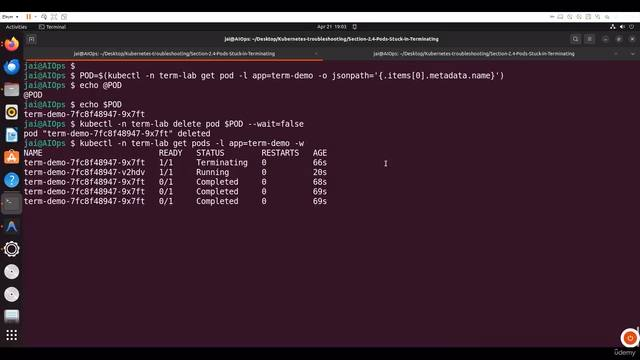
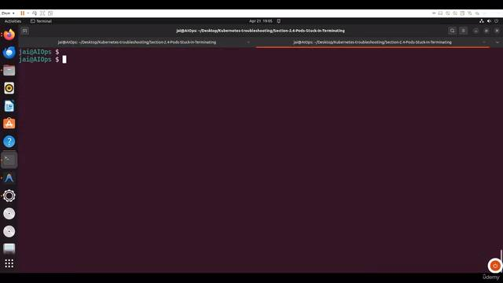
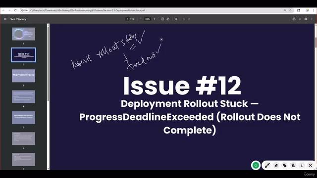
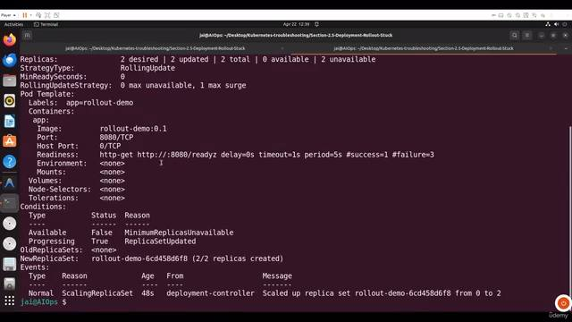
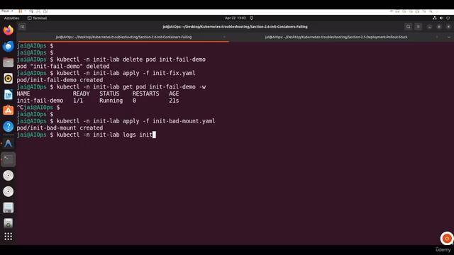
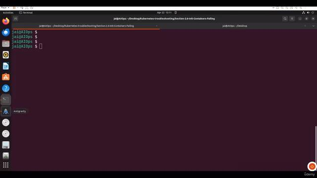

# Kubernetes Troubleshooting 复现文档（P010–P014）

> 覆盖：Pod 卡在 Terminating ｜ Deployment Rollout 卡住 ｜ Init Container 失败三类故障的手工复现与修复
> 环境：minikube + Docker + kubectl（讲师全程使用本地 Linux 机器上的 minikube）
> 说明：逐字稿里出现的 YAML 字段是本节的核心证据。凡讲师没在口述里点名的字段，我在代码块中用注释标出「课里没讲」，并说明为什么补它。

---

## 1. 这一节做什么

这三节课（P010–P014）是把 Kubernetes 里最常见、也最让前端同学困惑的三类"卡住"问题做成可复现的小实验：

1. **Pod 卡在 Terminating 不消失**。讲师先澄清一个误解：`kubectl delete pod` 之后 Pod 显示 `Terminating`，绝大多数情况下**不是故障**，而是"受控关闭正在进行中"——控制器正在按 `terminationGracePeriodSeconds` 给容器倒计时，让它把正在处理的请求处理完。真正需要动手修的只有一种：`metadata.finalizers` 上挂了自定义终结器，导致对象永远不会从 API 里被摘掉。
2. **Deployment 的 rollout 永远不结束**。表现为 `kubectl rollout status` 一直挂着或者直接 timeout，`kubectl describe deployment` 里能看到进度截止条件被触发。讲师给了两个成因：一是 readiness 探针路径写错（探 `/readyz` 但应用只提供 `/healthz`），叠加 `maxUnavailable: 0` 这种"过于保守"的滚动策略，形成死锁；二是 init 容器永远以非零码退出，主容器根本没机会启动。
3. **Init 容器失败导致应用永远起不来**。三个子场景：迁移脚本退出码非零、init 与 app 之间卷挂载不一致（init 写进 work-a，app 从 work-b 读）、NetworkPolicy 默认拒绝 egress 导致 init 里的 curl 出不去。

终点状态很明确：你能亲手把这三个故障**造出来**，再用课程里给出的命令**修掉**，并且知道每一条命令是看什么、改什么。

---

## 2. 讲师原话

> "每当我执行 kubectl delete pod 并带上 Pod 名称时，它会立即删除我的 Pod，但 Pod 会显示为终止中。为什么显示为终止中？因为集群正在尝试优雅地关闭它。"
> —— p010 [00:15]

> "处于终止中只说明我们正处在受控关闭的过程中，并不代表它坏了。"
> —— p010 [00:45]

> "有一个名为 terminationGracePeriodSeconds 的设置；如果你不设置这个值，默认值始终是 30 秒。"
> —— p010 [02:02]

> "preStop 完全可选；例如，如果它是一个健康检查，它会去请求该健康检查，告知它即将停止。"
> —— p010 [02:37]

> "如果我给 preStop 设置 20 秒，而宽限期是 30 秒，这并不意味着我们总共有 50 秒。这 20 秒包含在宽限期内，所以实际只剩 10 秒。"
> —— p010 [03:51]

> "我正在添加一个 Finalizer，以此明确表示：还不要把这个对象从 API 中移除。"
> —— p010 [05:12]

> "有一种东西叫 Finalizer，这里是我添加的自定义 Finalizer：troubleshooting.local/block-until-manual-cleanup。所以除非我去清理它，否则它不会进入关闭状态。"
> —— p010 [13:05]

> "你可以运行 patch 命令：kubectl patch pod 加上 Pod 名称、命名空间、--type=merge，然后只是清空 Finalizer。我认为 patch 是最好的命令。"
> —— p010 [13:35]

> "大多数情况下，当你看到某个对象卡在终止中状态时，可以去清空 Finalizer，这样它就会删除你的对象。它可能是 Pod，可能是命名空间，也可能是任意对象。"
> —— p010 [15:01]

> "每当我运行 kubectl rollout status，它永远不会结束，或者只会显示超时。"
> —— p011 [00:20]

> "每当你运行 kubectl describe deployment 时，就会看到这些条件，例如 ProgressDeadlineExceeded。"
> —— p011 [00:37]

> "每当它创建一个新的 ReplicaSet，就会尝试滚动出一个新的 Pod；因此，当新的 ReplicaSet 拥有足够多健康的 Pod 时，滚动发布才算完成。"
> —— p011 [02:03]

> "通俗地说，这意味着如果 Deployment 在这 60 秒内没有取得进展，Kubernetes 就会把这次滚动发布标记为失败。"
> —— p012 [00:35]

> "当我们在滚动更新中把 maxUnavailable 设为 0 时，意思是在更新期间，除非替换用的新 Pod 已经就绪，否则不要让旧 Pod 变为不可用；如果新 Pod 永远无法就绪，就可能陷入某种死锁。"
> —— p012 [01:31]

> "应用始终提供 /healthz；就绪探针指向 /readyz。"
> —— p012 [02:07]

> "如果我返回并执行 kubectl get pods，你可以看到它正在终止旧的 Pod，而我已经有一个 Pod 处于运行中状态。"
> —— p012 [08:14]

> "我们也可以把 maxUnavailable 设为 1 或 2，这样就能留出一些缓冲空间。"
> —— p012 [08:32]

> "它会运行一个假的迁移，这个迁移每次都会以错误退出；它总是以错误退出。"
> —— p012 [09:32]

> "什么是初始化容器？初始化容器不过是在主容器之前运行的任务。"
> —— p013 [00:05]

> "直到所有初始化容器都成功完成，主容器才会启动。"
> —— p013 [00:35]

> "应用容器挂载 work-b，这是一个不同的空目录。"
> —— p014 [04:02]

> "如果我向下滚动查看事件，在事件里得不到太多信息。它只是说进入了 CrashLoopBackOff；即使我去看日志，也看不到它是被网络策略拒绝的。这就是 Kubernetes 中棘手的地方。"
> —— p014 [12:57]

---

## 3. 从零复现

### 3.0 前置与目录

需要的东西：Docker、minikube、kubectl。讲师在整个 P010–P014 里反复执行 `minikube status` 来确认集群是 Running 的，第一步就照做：

```bash
minikube status
```

预期能看到 `host / kubelet / apiserver` 一类的状态行（具体字段名以你本机输出为准）。

建议的目录结构（讲师把每节课的实验放进各自 section 目录，p012 [04:13] 里他说「I am not into these sections. So I will go into this section CD section 2 dot 5」，说的就是没 cd 对目录导致构建失败）：

```
k8s-troubleshooting/
├── section2.4/                      # P010：Terminating / preStop / finalizer
│   ├── Dockerfile
│   ├── server.py
│   ├── deployment-bad.yaml
│   ├── deployment-good.yaml
│   └── podstuck-finalizer.yaml
├── section2.5/                      # P011–P012：rollout 卡住
│   ├── Dockerfile
│   ├── server.py
│   └── deployment-bad.yaml
└── section2.6/                      # P013–P014：init 容器
    ├── deployment-init-bad.yaml
    ├── init-fail.yaml
    ├── init-fix.yaml
    ├── init-bad-mount.yaml
    ├── init-deny-egress.yaml
    ├── init-curl.yaml
    └── allow-dns-egress.yaml
```

### 3.1 让 Docker 走进 minikube 的镜像仓库

讲师在 p010 [07:19] 的做法是「I'm going into the mini cube Docker hyphen Env then I'll do Docker build」。这一步是把 `docker` CLI 指向 minikube 内部的 Docker daemon，这样构建出来的镜像不用推仓库，集群直接能拉：

```bash
cd k8s-troubleshooting/section2.4
eval $(minikube docker-env)
docker build -t term-demo:0.1 .
```

⚠️ `eval $(minikube docker-env)` **只在当前 shell 会话生效**。每开一个新终端窗口都要重新执行一次，否则你会构建到宿主机的 Docker 里，集群拉镜像时报 `ImagePullBackOff`。

P012 里讲师就踩到了构建失败的坑：p012 [04:13] 他跑构建命令报错，然后 `pwd` 一看不在正确目录，补了一句 `cd section 2.5` 再跑才成。

### 3.2 实验 A：造出一个"卡在 Terminating 状态"的 Pod

**第一步，建命名空间并应用 bad 版部署**（p010 [07:49]–[08:19]：`term-lab` 命名空间 + `deployment-bad.yaml`）：

```bash
kubectl create namespace term-lab
kubectl apply -f deployment-bad.yaml -n term-lab
kubectl get pods -n term-lab
```

等 Pod 变成 Running / Ready。讲师在 p010 [08:38] 描述过：「it is saying container creating running and my pod came into the running state」，接一句 `my deployment is ready`。

**第二步，把 Pod 名字抓进变量，然后删掉它**（p010 [08:38] 的原话是「a simple command where I am just fetching the pod name and assigning that pod name to a variable called pod」）：

```bash
pod=$(kubectl get pods -n term-lab -l app=term-demo -o jsonpath='{.items[0].metadata.name}')
echo $pod
kubectl delete pod $pod -n term-lab
```

**第三步，立刻看状态**（p010 [09:23]）：

```bash
kubectl get pods -n term-lab -w
kubectl describe pod $pod -n term-lab
```

你会看到 Pod 显示 `Terminating`，并且**在 30 秒左右才真正消失**。原因讲师在 p010 [09:53] 解释了：「we have added that pre-stop …… asking a pre-stop nothing but to sleep 20 seconds. that is why it took 30 second exactly」。也就是说 30 秒的 grace period 里，preStop 占掉 20 秒，剩下 10 秒才是应用真正收尾的窗口。



**第四步，换成 good 版对比**（p010 [04:42]：「whenever you see in the good deployment, so that is pretty quicker. Nothing but my pre-stop is very quick」）：

```bash
kubectl apply -f deployment-good.yaml -n term-lab
kubectl get pods -n term-lab -w
```

这次 Pod 几乎瞬间就没了。你可以把这个差值当成本节课的核心体感。

### 3.3 实验 B：用 finalizer 把 Pod 永久钉死

**第一步，应用 finalizer Pod**（p010 [10:27]）：

```bash
kubectl apply -f podstuck-finalizer.yaml -n term-lab
kubectl get pods -n term-lab
```

此时 `term-lab` 里会有两个 Pod（bad 版留下的痕迹 + 这个 finalizer 版）。讲师在 p010 [10:57] 原话：「I have two pods running」。

**第二步，删它，然后看它卡住**：

```bash
kubectl delete pod $(kubectl get pods -n term-lab -l app=finalizer-demo -o jsonpath='{.items[0].metadata.name}') -n term-lab
kubectl get pods -n term-lab -w
```

你会看到状态停在 `Terminating` / 讲师口述的 `error` 状态（p010 [11:46]：「it went into the error state actually it went into the terminating and it went into the error state」），`kubectl describe pod` 里能看到容器状态已经是 `terminated`、`killing stopping container app`，但对象就是**不消失**。



**第三步，把 finalizer 摘掉**（p010 [13:05]–[13:35]，讲师推荐 patch）：

```bash
kubectl patch pod <上面那个卡住的 pod 名> -n term-lab --type=merge -p '{"metadata":{"finalizers":[]}}'
```

讲师原话：「you are just emptying the finalizer …… Patch is the one which I would say the best command」。跑完这条，Pod 立刻消失（p010 [14:04]：「it came out nothing why it has got deleted now」）。

想先看现场的话，可以用 `kubectl edit pod <pod> -n term-lab` 打开编辑，你会看到 `finalizers` 列表里那一行 `troubleshooting.local/block-until-manual-cleanup`。

### 3.4 实验 C：让 rollout 卡死

**第一步，切换目录 + 构建镜像**（p012 [03:33]–[04:43]）：

```bash
cd k8s-troubleshooting/section2.5
eval $(minikube docker-env)
docker build -t rollout-demo:0.1 .
```

**第二步，建命名空间 + 应用 + 盯 rollout**（p012 [05:12]）：

```bash
kubectl create namespace rollout-lab
kubectl apply -f deployment-bad.yaml -n rollout-lab
kubectl rollout status deployment/rollout-demo -n rollout-lab
```

`kubectl rollout status` 会一直挂着。讲师在 p012 [05:35] 的原始输出是：「it says waiting for deployment rollout to finish, zero of two update replicas are available」。

**第三步，看 Pod 和 Deployment 的状态**（p012 [05:35]–[06:29]）：

```bash
kubectl get pods -n rollout-lab
kubectl describe deployment rollout-demo -n rollout-lab
```

`get pods` 里两个 Pod 是 `Running` 但 `0/1`（replicas ready 是 0）。`describe deployment` 里能看到「three failures already」这类失败计数和 `progress deadline exceeded` 相关的条件。



**第四步，定位到探针路径错了**（p012 [06:39]）：

```bash
kubectl describe pod <上面两个 pod 之一> -n rollout-lab
```

讲师在这一步的原话是「Here it says readiness probe failed. Okay, so it is saying connection are refused」。因为探针打的是 `/readyz`，而应用只实现了 `/healthz`。



**第五步，就地改 Deployment**（p012 [07:15]–[07:45]）：

```bash
kubectl edit deployment rollout-demo -n rollout-lab
```

把 `readinessProbe.httpGet.path` 从 `/readyz` 改成 `/healthz`，保存退出。讲师原话：「it has to point to correct URL …… so now I will just save this」。

**第六步，观察旧 Pod 开始被替换**（p012 [08:14]）：

```bash
kubectl get pods -n rollout-lab -w
```

预期：一个 Pod 进入 `Terminating`，一个新的 `ContainerCreating`，然后两个都变成 `1/1 Running`。`kubectl rollout status` 这时会打印 successfully rolled out。

**第七步，把 `maxUnavailable` 从 0 调到 1**（p012 [08:32]–[09:02]）：

```bash
kubectl edit deployment rollout-demo -n rollout-lab
# spec.strategy.rollingUpdate.maxUnavailable: "0" → "1"
```

讲师解释：「so that it will have some breathing space …… so that it will be very quick in my deployments」。

### 3.5 实验 C-2：init 容器失败把 rollout 拖死

```bash
kubectl apply -f deployment-init-bad.yaml -n rollout-lab
kubectl get pods -n rollout-lab -w
```

Pod 会一直卡在 `Init:CrashLoopBackOff`（p012 [11:30]：「in it crash loop back off, nothing but my Init container is failing」）。再 `kubectl describe pod`，会看到 init 容器反复 `Started container init` / `Back-off restarting failed container`（p012 [12:00]）。

### 3.6 实验 D：init 容器三连（P014）

#### D-1 迁移脚本退出码非零

```bash
cd k8s-troubleshooting/section2.6
kubectl create namespace init-lab
kubectl apply -f init-fail.yaml -n init-lab
kubectl get pods -n init-lab -w
```

Pod 停在 `Init:CrashLoopBackOff`。讲师在 p014 [00:38] 的原话是「I am seeing init error init error init crash loop backoff」。

```bash
kubectl describe pod init-fail-demo -n init-lab
```

`Init Containers` 段里会显示 `State: Terminated`、`Reason: Error`（p014 [01:44]：「it is showing it as terminated and I'm seeing reason as error」）。

**修复**（p014 [02:14]–[03:02]）：

```bash
kubectl delete pod init-fail-demo -n init-lab
kubectl apply -f init-fix.yaml -n init-lab
kubectl get pod init-fail-demo -n init-lab -w
```

`init-fix.yaml` 与 bad 版唯一的差别是退出码从 1 变成 0，Pod 随即进入 `Running`。

#### D-2 init 与 app 的卷名不一致

```bash
kubectl apply -f init-bad-mount.yaml -n init-lab
kubectl -n init-lab logs init-bad-mount -c app --tail 5
```

讲师在 p014 [06:28] 念出来的原始输出是「can't open work/flag: no such file or directory」，也就是 `flag missing`（p014 [05:02] 说过「Logs might show something like flag missing」）。



**修复**：讲师先试 `kubectl edit pod`，然后自己发现不行（p014 [07:44]：「anyway this is a pod level I cannot edit」），改成**编辑 YAML 文件再 apply**：

```bash
vi init-bad-mount.yaml
# 把 app 容器 volumes 引用的 work-b 改成 work-a，与 init 容器用同一个卷
kubectl apply -f init-bad-mount.yaml -n init-lab
kubectl get pods -n init-lab
```

修好后 Pod 名是 `init-good-mount`，状态 `Running`（p014 [08:45]）。**注意**：`kubectl edit pod` 改不了 `spec.volumes` 这类字段，这是 K8s 的硬限制，不是讲师操作失误。

#### D-3 NetworkPolicy 掐死 init 的出网

**第一步，先上默认拒绝 egress 的策略**（p014 [09:37]）：

```bash
kubectl apply -f init-deny-egress.yaml -n init-lab
kubectl get networkpolicy -n init-lab
```

输出里会看到一条 default-deny-egress（讲师在 p014 [12:12] 的原话：「I have my default deny egress applied」）。

**第二步，上 curl 版 init 的 Pod**：

```bash
kubectl apply -f init-curl.yaml -n init-lab
kubectl get pods -n init-lab -w
```

卡在 `Init:CrashLoopBackOff`。

**第三步，见识一下最坑的地方**（p014 [12:57]–[13:24]）：

```bash
kubectl describe pod init-curl -n init-lab
kubectl -n init-lab logs init-curl -c init-curl
```

讲师原话：「in the events I am not getting much, it just says you are into the crash loop back off …… even if I am going into the logs I will not be seeing that it is denied by a network policy. **That is the tricky part in the Kubernetes.**」也就是说，日志和事件里**都不会**出现 "network policy" 字样，你要靠「我知道这个 init 在 curl 外网，它却起不来」这个业务上下文反推。

**第四步，放行 DNS egress 后重启**（p014 [14:24]）：

```bash
kubectl apply -f allow-dns-egress.yaml -n init-lab
kubectl delete pod init-curl -n init-lab
kubectl apply -f init-curl.yaml -n init-lab
kubectl get pods -n init-lab -w
```



Pod 进入 `Running`（p014 [14:39]：「now my pod is in running state because I am allowing the network to connect to the example.com」）。

---

## 4. 完整代码

> 每个文件都能直接保存运行。凡是标注 `# 课里没讲` 的行，都是逐字稿里没有出现的字段，我按最小可运行原则补齐并在第 7 节解释原因。

### 4.1 `section2.4/server.py`（课里只提了存在，内容未给，以下为按行为倒推的最小实现）

```python
# 课里没讲：server.py 的具体内容讲师没展示。
# 按 p010 [03:21] 的描述（preStop 会 ping 健康检查），这里实现一个只响应 /healthz 的 HTTP 服务。
import http.server
import socketserver


class Handler(http.server.BaseHTTPRequestHandler):
    def do_GET(self):
        if self.path == "/healthz":
            self.send_response(200)
            self.end_headers()
            self.wfile.write(b"ok")
        else:
            self.send_response(404)
            self.end_headers()

    def log_message(self, fmt, *args):
        pass


if __name__ == "__main__":
    with socketserver.TCPServer(("", 8080), Handler) as httpd:
        httpd.serve_forever()
```

### 4.2 `section2.4/Dockerfile`

```dockerfile
# 课里没讲细节，讲师只说「copying my python script into it and I am building my image」(p010 [07:49])
FROM python:3.12-slim
WORKDIR /app
COPY server.py /app/server.py
EXPOSE 8080
CMD ["python", "server.py"]
```

### 4.3 `section2.4/deployment-bad.yaml`

```yaml
apiVersion: apps/v1
kind: Deployment
metadata:
  name: term-demo-bad
  namespace: term-lab
spec:
  replicas: 1
  selector:
    matchLabels:
      app: term-demo
  template:
    metadata:
      labels:
        app: term-demo
    spec:
      # 讲师重点讲的字段：整个 Pod 的关闭预算是 30 秒（不写就是默认 30）
      terminationGracePeriodSeconds: 30
      containers:
        - name: app
          image: term-demo:0.1
          imagePullPolicy: IfNotPresent
          ports:
            - containerPort: 8080
          lifecycle:
            preStop:
              exec:
                # 慢 preStop：吃掉 30 秒预算里的 20 秒
                command: ["sh", "-c", "sleep 20"]
```

### 4.4 `section2.4/deployment-good.yaml`

```yaml
apiVersion: apps/v1
kind: Deployment
metadata:
  name: term-demo-good
  namespace: term-lab
spec:
  replicas: 1
  selector:
    matchLabels:
      app: term-demo-good
  template:
    metadata:
      labels:
        app: term-demo-good
    spec:
      terminationGracePeriodSeconds: 30
      containers:
        - name: app
          image: term-demo:0.1
          imagePullPolicy: IfNotPresent
          ports:
            - containerPort: 8080
          lifecycle:
            preStop:
              exec:
                # 快 preStop：几乎瞬间返回，Pod 秒删
                command: ["sh", "-c", "sleep 1"]
```

### 4.5 `section2.4/podstuck-finalizer.yaml`

```yaml
apiVersion: v1
kind: Pod
metadata:
  name: finalizer-demo
  namespace: term-lab
  labels:
    app: finalizer-demo
  # 讲师原话点名的自定义 finalizer(p010 [13:05])
  finalizers:
    - troubleshooting.local/block-until-manual-cleanup
spec:
  # 讲师原话：termination grace period seconds 给 0(p010 [10:27])
  terminationGracePeriodSeconds: 0
  containers:
    - name: app
      image: term-demo:0.1
      imagePullPolicy: IfNotPresent
      ports:
        - containerPort: 8080
```

### 4.6 `section2.5/server.py`

```python
# 课里没讲：rollout 演示用的 server.py 同样没给内容。
# 按 p012 [02:07]「App always serves to /healthz」实现：只提供 /healthz，故意不提供 /readyz。
import http.server
import socketserver


class Handler(http.server.BaseHTTPRequestHandler):
    def do_GET(self):
        if self.path == "/healthz":
            self.send_response(200)
            self.end_headers()
            self.wfile.write(b"ok")
        else:
            # 访问 /readyz 时返回 404 → readiness probe 永远失败
            self.send_response(404)
            self.end_headers()

    def log_message(self, fmt, *args):
        pass


if __name__ == "__main__":
    with socketserver.TCPServer(("", 8080), Handler) as httpd:
        httpd.serve_forever()
```

### 4.7 `section2.5/Dockerfile`

```dockerfile
FROM python:3.12-slim
WORKDIR /app
COPY server.py /app/server.py
EXPOSE 8080
CMD ["python", "server.py"]
```

### 4.8 `section2.5/deployment-bad.yaml`

```yaml
apiVersion: apps/v1
kind: Deployment
metadata:
  name: rollout-demo
  namespace: rollout-lab
spec:
  replicas: 2
  # 讲师原话：60 秒内没有前进就判 rollout 失败(p012 [00:35])
  progressDeadlineSeconds: 60
  strategy:
    type: RollingUpdate
    rollingUpdate:
      # 讲师重点：0 表示旧 Pod 一个都不许下线，直到新 Pod 已经 Ready → 死锁温床
      maxUnavailable: 0
      # 课里没讲：不写 maxSurge 会走默认 25%，显式写 1 让实验更可控
      maxSurge: 1
  selector:
    matchLabels:
      app: rollout-demo
  template:
    metadata:
      labels:
        app: rollout-demo
    spec:
      containers:
        - name: app
          image: rollout-demo:0.1
          imagePullPolicy: IfNotPresent
          ports:
            - containerPort: 8080
          readinessProbe:
            httpGet:
              # 错误就在这里：应用只提供 /healthz
              path: /readyz
              port: 8080
            # 课里没讲具体数值，给一组较短的参数便于观察失败
            periodSeconds: 2
            failureThreshold: 3
```

### 4.9 `section2.5/deployment-init-bad.yaml`

```yaml
apiVersion: apps/v1
kind: Deployment
metadata:
  name: init-bad-demo
  namespace: rollout-lab
spec:
  replicas: 1
  selector:
    matchLabels:
      app: init-bad-demo
  template:
    metadata:
      labels:
        app: init-bad-demo
    spec:
      initContainers:
        - name: init
          image: busybox:1.36
          command: ["sh", "-c", "echo migrating; exit 1"]
      containers:
        - name: app
          image: rollout-demo:0.1
          imagePullPolicy: IfNotPresent
          ports:
            - containerPort: 8080
```

### 4.10 `section2.6/init-fail.yaml`

```yaml
apiVersion: v1
kind: Pod
metadata:
  name: init-fail-demo
  namespace: init-lab
spec:
  initContainers:
    - name: migrate
      image: busybox:1.36
      # 讲师原话：prints a message and then it exits with one(p013 [03:20])
      command: ["sh", "-c", "echo migrating; exit 1"]
  containers:
    - name: app
      image: busybox:1.36
      command: ["sh", "-c", "sleep 3600"]
```

### 4.11 `section2.6/init-fix.yaml`

```yaml
apiVersion: v1
kind: Pod
metadata:
  name: init-fail-demo
  namespace: init-lab
spec:
  initContainers:
    - name: migrate
      image: busybox:1.36
      # 唯一的改动：exit 0
      command: ["sh", "-c", "echo migrating; exit 0"]
  containers:
    - name: app
      image: busybox:1.36
      command: ["sh", "-c", "sleep 3600"]
```

### 4.12 `section2.6/init-bad-mount.yaml`

```yaml
apiVersion: v1
kind: Pod
metadata:
  name: init-bad-mount
  namespace: init-lab
spec:
  initContainers:
    - name: init
      image: busybox:1.36
      # 把数据写进 /work，而这个 /work 由卷 work-a 支撑
      command: ["sh", "-c", "echo hello > /work/flag"]
      volumeMounts:
        - name: work-a
          mountPath: /work
  containers:
    - name: app
      image: busybox:1.36
      # 故意读错卷：work-b 是另一个完全空的目录
      command: ["sh", "-c", "cat /work/flag"]
      volumeMounts:
        - name: work-b
          mountPath: /work
  volumes:
    - name: work-a
      emptyDir: {}
    - name: work-b
      emptyDir: {}
```

> 修法：把 app 容器的 `volumeMounts[].name` 从 `work-b` 改成 `work-a`，Pod 名改成 `init-good-mount` 再 apply。

### 4.13 `section2.6/init-deny-egress.yaml`

```yaml
apiVersion: networking.k8s.io/v1
kind: NetworkPolicy
metadata:
  name: default-deny-egress
  namespace: init-lab
spec:
  podSelector: {}
  policyTypes:
    - Egress
  # 不写 egress 规则 = 什么都不允许出去
```

### 4.14 `section2.6/init-curl.yaml`

```yaml
apiVersion: v1
kind: Pod
metadata:
  name: init-curl
  namespace: init-lab
spec:
  initContainers:
    - name: init-curl
      # 讲师原话：the init container is using something as curl(p014 [10:07])
      image: curlimages/curl:8.10.1
      command: ["sh", "-c", "curl -s https://example.com -o /tmp/page.html; echo saved"]
  containers:
    - name: app
      image: busybox:1.36
      command: ["sh", "-c", "sleep 3600"]
```

### 4.15 `section2.6/allow-dns-egress.yaml`

```yaml
apiVersion: networking.k8s.io/v1
kind: NetworkPolicy
metadata:
  name: allow-dns-egress
  namespace: init-lab
spec:
  podSelector: {}
  policyTypes:
    - Egress
  egress:
    # 讲师原话：which will allow dns to kube dns(p014 [11:14])
    - ports:
        - protocol: UDP
          port: 53
        - protocol: TCP
          port: 53
```

---

## 5. 逐行解释

**`terminationGracePeriodSeconds: 30`（4.3）**
这是整个 Pod 关闭流程的**总预算**，不是每个容器各 30 秒。讲师在 p010 [03:51] 把最容易错的地方说透了：「if I am adding pre-stop for 20 seconds and we have 30 seconds of grace period that is not means that we are getting 50 seconds」。preStop 的 20 秒是从这 30 秒里**扣**的，留给应用自己处理 SIGTERM 的只剩 10 秒。不写这个字段就是默认 30 秒。**在 Node/JS 里对应什么**：你在 Node 里写 `process.on('SIGTERM', ...)` 收尾，能用的时间就是这剩下的 10 秒；超时后 kubelet 直接 SIGKILL，你写的清理逻辑全部作废。

**`preStop.exec.command: ["sh","-c","sleep 20"]`（4.3）**
preStop 是**完全可选**的（p010 [02:37]）。它的作用是在容器真的收到停止信号之前，先跑一段脚本来「告诉外界我要走了」——典型用法是把自己从上游的负载均衡/注册中心里摘出去，或者像这里一样单纯拖时间，好让你肉眼看见 `Terminating` 状态持续存在。bad 版用 20 秒、good 版用 1 秒，就是 P010 全部对比实验的变量。

**`finalizers: [troubleshooting.local/block-until-manual-cleanup]`（4.5）**
这是 finalizer 的语义核心：它给 API Server 挂了一块「**先别从 etcd 里删**」的牌子。任何带 finalizer 的对象被 `DELETE` 时，API Server 只会给它打上 `deletionTimestamp`，然后**等人来把 finalizer 摘掉**。摘掉之前，对象永久停在 `Terminating`。讲师在 p010 [05:12] 的原话是「don't remove this from the API yet」。清空用的是 `--type=merge -p '{"metadata":{"finalizers":[]}}'`——merge patch 是**整体替换**这个数组，不是追加，所以空数组等于清空。

**`progressDeadlineSeconds: 60`（4.8）**
这是「新 ReplicaSet 多快之内必须出现进展」的判据。讲师在 p012 [00:35] 的翻译是大白话：「if the deployment does not make forward progress without this 60 seconds time Kubernetes will mark this rollout as failed」。注意它是**标记失败**，不是**回滚**——Deployment 不会自己退回去，`kubectl rollout status` 只是报错退出，真实 Pod 还在那儿挂着。

**`maxUnavailable: 0`（4.8）**
讲师在 p012 [01:31] 花了整整半分钟讲这个字段：意思是「旧 Pod 一个都不许下线，除非新 Pod 已经 Ready」。听起来特别安全，但和「新 Pod 永远 Ready 不了」叠加就是死锁——旧的不能死、新的活不了，整条 rollout 冻住。修法不是二选一，而是**同时**改探针路径 + 把 `maxUnavailable` 放到 1（p012 [08:32]：「so that it will have some breathing space」）。

**`readinessProbe.httpGet.path: /readyz`（4.8）**
这个字段本身没错，错在它和应用实际暴露的路径对不上。讲师在 p012 [02:07] 说的「App always serves to slash health Z」而探针打的是 `/readyz`，于是探针永远拿到 404，容器 `Running` 但 `Ready=False`。**在 Node/JS 里对应什么**：就是你 Express 里 `app.get('/healthz', ...)` 只挂了一个路由，却让 K8s 去探 `/readyz`。

**`initContainers[].command: ["sh","-c","echo migrating; exit 1"]`（4.10 / 4.9）**
init 容器的语义讲师在 p013 [00:05] 说得非常清楚：「the job that runs before your main container」。它必须**按顺序全部成功退出**，主容器才会被创建。所以这里一个 `exit 1` 就等于在主容器启动前设了一道永远过不去的闸门。P012 里 `deployment-init-bad.yaml` 和 P014 里 `init-fail.yaml` 是同一个套路，区别是一个包在 Deployment 里（表现为 rollout 卡住）、一个是裸 Pod（表现为 `Init:CrashLoopBackOff`）。

**`volumes: work-a / work-b` + 两边 `mountPath: /work`（4.12）**
关键点是：**`mountPath` 相同不代表是同一个目录**。K8s 是按 `volumes[].name` 去匹配的，两个 `emptyDir` 就是两块完全不同的盘。init 把 `flag` 写进 work-a，app 从 work-b 读 `/work/flag`，日志里就是讲师念出来的那句 `can't open work/flag: no such file or directory`（p014 [06:28]）。修法只有一个方向：**让两边指向同一个 volume 名**，而不是改 mountPath。

**`policyTypes: [Egress]` 且不写 `egress:`（4.13）**
NetworkPolicy 的语义是「一旦选中了 Pod 且声明了 Egress 类型，未在 `egress` 里显式放行的出站流量全部丢弃」。规则是**白名单**而不是黑名单。所以这个 YAML 不写 egress 段，效果就是全禁。P014 里最阴的地方在这儿：被拦的流量在容器内表现成「连接挂起/超时」，**日志和事件里没有任何 network policy 字样**——讲师在 p014 [13:24] 特意强调「That is the tricky part in the Kubernetes」。你的排查依据只能是业务上下文：「这个 init 就是要 curl 外网，它起不来，那先怀疑网络策略」。

**`egress: ports: 53`（4.15）**
只放行 DNS 的 UDP/TCP 53 端口的规则。讲师在 p014 [11:14] 说这段的本意是「this simplification for this lab is that it will go and finish the job」——在生产里你可能还要放行目标服务的端口，这里最小化是为了让实验能通过。

---

## 6. 复现检查清单

- [ ] `minikube status` 显示集群在跑
- [ ] 每个新终端窗口都执行过 `eval $(minikube docker-env)`
- [ ] `docker build -t term-demo:0.1 .` 成功，且在**正确目录**（section2.4）下执行（对照 p012 [04:13] 的构建失败）
- [ ] `term-lab` 命名空间创建成功
- [ ] `deployment-bad.yaml` 应用后 Pod 变 `1/1 Running`
- [ ] `kubectl delete pod` 后 `kubectl get pods -w` 能看到 `Terminating` 持续约 20–30 秒
- [ ] 换 `deployment-good.yaml` 后 Pod 几乎秒删
- [ ] `podstuck-finalizer.yaml` 应用后，delete 该 Pod 会永久卡在 `Terminating`
- [ ] `kubectl edit pod` 能看到 `troubleshooting.local/block-until-manual-cleanup`
- [ ] `kubectl patch ... --type=merge -p '{"metadata":{"finalizers":[]}}'` 后 Pod 立刻消失
- [ ] 切到 section2.5 目录后 `docker build -t rollout-demo:0.1 .` 成功
- [ ] `rollout-lab` 命名空间创建成功
- [ ] `kubectl rollout status deployment/rollout-demo` 长时间挂起不返回
- [ ] `kubectl get pods` 显示 `Running` 但 READY 列是 `0/1`
- [ ] `kubectl describe pod` 里能看到 readiness probe 失败 / connection refused
- [ ] `kubectl edit deployment` 把路径改成 `/healthz` 后，旧 Pod Terminating、新 Pod 起来并 `1/1`
- [ ] `maxUnavailable` 从 `0` 改成 `1` 后 rollout 明显更快
- [ ] `deployment-init-bad.yaml` 应用后 Pod 是 `Init:CrashLoopBackOff`
- [ ] `init-lab` 命名空间创建成功
- [ ] `init-fail.yaml` → `Init:CrashLoopBackOff`，`describe` 里 init 状态 `Terminated` / `Reason: Error`
- [ ] 换成 `init-fix.yaml` 后 Pod `Running`
- [ ] `init-bad-mount.yaml` 的 app 日志出现 `flag missing` / `can't open work/flag`
- [ ] 改成同名 volume 后 Pod `Running`
- [ ] `init-deny-egress.yaml` + `init-curl.yaml` → `Init:CrashLoopBackOff`，且 `describe`/`logs` 里**都看不到** network policy 字样
- [ ] 上 `allow-dns-egress.yaml`、删 Pod、重新 apply 后 `Running`

---

## 7. 课里没讲但你会撞上的

1. **`eval $(minikube docker-env)` 的会话作用域**。讲师在 p010 [07:19] 演示了这一步但没强调它只在当前 shell 有效。你新开一个窗口跑 `docker build`，镜像会落到宿主机 Docker 里，Pod 拉镜像时报 `ImagePullBackOff`。同时镜像名要配 `imagePullPolicy: IfNotPresent`（我已在每个 YAML 里写了），否则 K8s 会去 Docker Hub 拉同名镜像。

2. **`kubectl edit pod` 改不了 `spec.volumes`**。讲师在 P014 亲自撞了一次，p014 [07:44] 说「this is a pod level I cannot edit」。原因是 Pod 的大部分 spec 字段不可变，`volumes` 就在其中。正确做法就是改 YAML 再 `apply`，或者用 `kubectl replace --force`。同理 `edit deployment` 可以改，因为它会创建新的 ReplicaSet 和 Pod——Deployment 的 Pod 模板本身就是「可变」的，改完自动滚动更新。

3. **`kubectl delete pod` 后 Deployment 会自动重建**。如果你想让改动生效，直接删 Pod 是最快的（`kubectl delete pod <name>` 会触发 Deployment 重建一个带新配置的 Pod），但这只对 Deployment 管着的 Pod 有效；裸 Pod 删了就没了。排查「为什么改了 Deployment 但 Pod 没更新」时，先看 `kubectl rollout status`，再看 `kubectl describe pod` 的 `Image` 是否是新 tag。