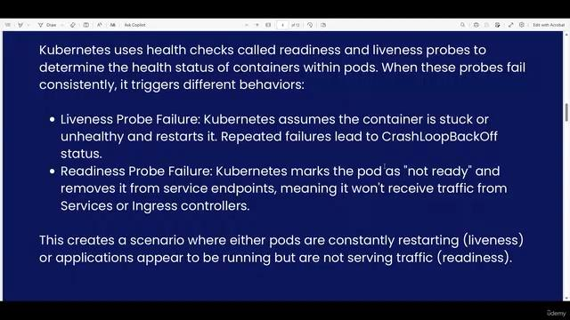
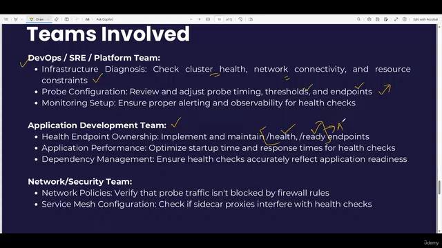
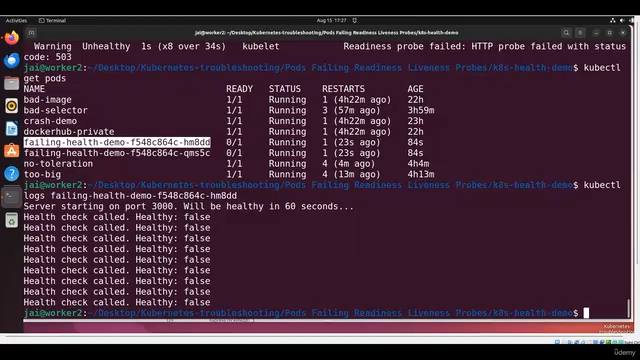
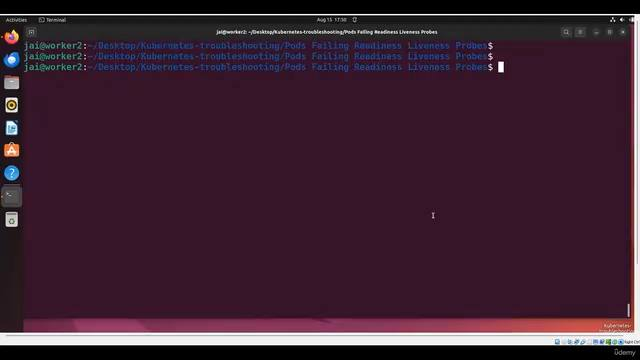
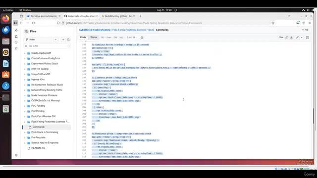
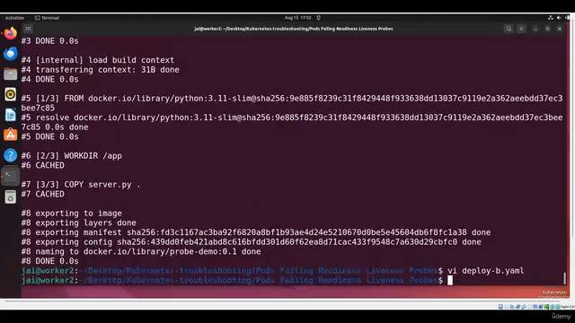
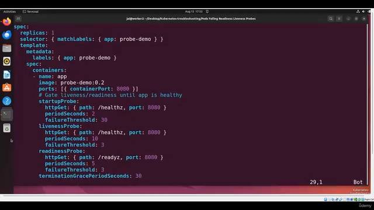
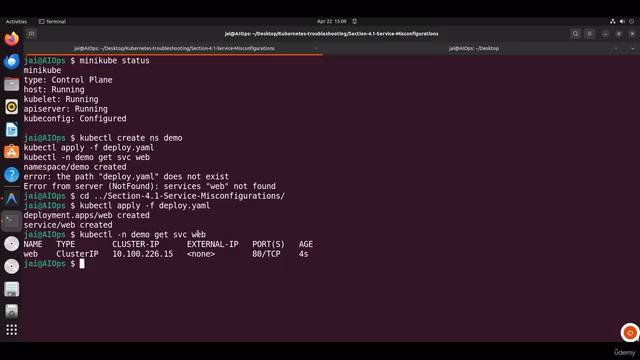
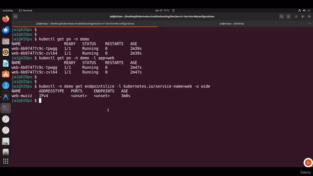
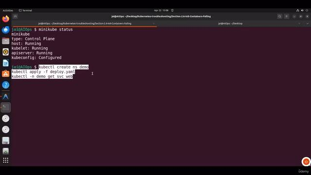

# Kubernetes Troubleshooting（P15–P18）：探针失败与 Service 无 Endpoints 的复现与修复

> 读者定位：前端转 AI 应用工程师。本文所有 Node.js 代码都用你熟悉的方式写（原生 `http` 模块、`Promise`/`setTimeout` 那一套），Python 部分只需「看懂即可」。Kubernetes 部分只用到 `kubectl` 和 YAML，不需要后端框架知识。

---

## 1. 这一节做什么

P15–P18 是同一门排障课里的**两个独立故障专题**，每个专题都是「先讲原理（PPT）→ 再进集群复现 → 再修好」的节奏：

| 专题 | 覆盖 P | 故障现象 | 你最终要交付的东西 |
|---|---|---|---|
| Issue 4：Pod 因 readiness / liveness 探针失败 | P15、P16 | `kubectl get pods` 显示 `Running` 但 `0/1 READY`，容器反复重启；Service 后面没有 endpoint | 一套能跑起来的 Node 应用 + 一份「探针时间与应用启动时间不匹配」的坏 YAML，以及两种修法（改应用 / 加 `startupProbe`） |
| Issue 7：Service 没有 endpoint | P17、P18 | `kubectl get endpoints <svc>` 返回 `none`，Pod 明明 `Running`，流量却到不了 | 一个 nginx 应用 + 三个故意写错的服务（selector 拼错 / targetPort 拼错 / namespace 写错），以及逐个修复的验证方式 |

**为什么两件事要放在一起做**：它们的现象是同一类——「Pod 看起来是好的，但流量进不来」。第一种是 Pod 自己没 Ready（被 Service 摘掉），第二种是 Service 压根选不中 Pod。学会看 `READY` 列和 endpoint，这两类问题就是同一个动作的两个分支。

课里一共有 **4 个可独立运行的小实验**（Node 慢启动应用、Node 快启动应用、Python 慢启动应用 + startupProbe、nginx + 三个错误 Service），下面的「从零复现」会把它们拆成 A/B/C/D 四段，你可以只做某一段。

**一个前置认知**（P15 讲师反复强调的）：

- `readinessProbe` 管**流量**：失败 → Pod 从 Service 的 endpoint 里被摘掉，但不重启。
- `livenessProbe` 管**重启**：失败 → kubelet 杀掉容器并重起。
- 两者是两个完全不同的东西，不要互相当替代品。



如果你有前端经验，可以先用下面这张「对照表」建立直觉，再进集群：

| Kubernetes 概念 | 你可以先类比成前端里的什么 | 但要注意的差异 |
|---|---|---|
| `readinessProbe` | 一个组件是否「可被路由使用」的开关 | 它不重启容器，只影响 Service 是否把流量发给这个 Pod |
| `livenessProbe` | 进程是否「还活着」的 watchdog | 它失败会触发重启，不是只标红 |
| `Service selector` | 用属性选择器挑中一批 DOM 节点 | 它按 Pod label 选，不按名字选；选不中就真的一个都没有 |
| `targetPort` | 请求最终转发到容器的哪个端口/端口名 | 名字必须和 `containerPort.name` 对上，对不上就是空 endpoint |
| `namespace` | 类似前端项目里的环境/作用域隔离 | 同名 Service 在不同 namespace 里完全不同，`kubectl` 不写 `-n` 很容易看错 |

本节的学习目标不是背 YAML，而是练一个排障顺序：先看 `READY` 和 `RESTARTS`，再看 `describe` 的 Events，再看应用日志，最后看 `endpoints` / `endpointslice`。这个顺序能让你在前端联调时也受益：先确认「服务是否被注册」，再确认「注册的地址是否可达」，最后才怀疑业务代码。

---

## 2. 讲师原话

> "存活探针失败意味着什么？Kubernetes 会认为容器已经卡住或不健康，并重启它。因此反复失败会导致容器进入 CrashLoopBackOff 状态。就绪探针失败时，Kubernetes 会把 Pod 标记为未就绪，并将其从 Service 端点中移除，这意味着它不会收到来自 Service 或 Ingress 控制器的流量。"
> —— p015 [00:23]

> "每当你看到 Pod 显示 0/1 就绪时，它虽然总是显示为 Running，但你的 Pod 并不会处于就绪状态。"
> —— p015 [01:15]

> "kubelet 的开销会使工作节点因探针执行和容器生命周期管理而承受更高负载……还会出现事件日志泛滥和服务发现问题。"
> —— p015 [02:28]

> "你可以通过探针配置来获取这些信息，也可以在 kubectl get 的输出中查看所有探针配置。"
> —— p015 [04:20]

> "健康检查端点不正确、应用启动缓慢等时序问题：你的应用正在启动。应用启动需要 10 分钟，但你把就绪探针的时间设为 5 分钟，那么它就会失败。"
> —— p015 [05:33]

> "健康检查端点应当轻量，并遵循关注点分离；也就是为存活探针和就绪探针使用不同的端点，我们会在示例中这样做。"
> —— p015 [07:41]



> "这里显示存活探针失败，HTTP 探针以状态码 503 失败；同时还显示容器应用未通过存活探针，并指出存活探针持续失败；随后又显示就绪探针失败，HTTP 探针以状态码 503 失败。"
> —— p016 [06:15]

> "如果你去检查端点，会发现不会显示任何端点，对吧？没有端点，也就是说你的 Pod 没有对应到任何 Service，这同样是个问题。"
> —— p016 [07:55]

> "我们重新构建了镜像，并在应用中调整了启动时间；这完全不推荐，也完全不是正确的做法，对吧……所以针对这种情况，我们有了启动探针。"
> —— p016 [11:53]

> "启动探针会先等待一段时间：我们在启动探针里配置多长时间，探针就会等待多长时间；之后它才会启用就绪探针和存活探针。"
> —— p016 [12:18]

> "我们并没有修改任何应用，而是添加了一个名为启动探针的探针，这样会更稳妥。因为你不可以每次都去修改应用配置。"
> —— p016 [18:26]

> "因此大多数情况下会是配置不匹配，或者端口与容器不一致，或者 Service 位于错误的命名空间中，而你以为它指向的是那个 Pod；这里我们会再次走查三个场景。"
> —— p018 [00:34]

> "因此，如果端点为空的，Service 就没有任何可以转发流量的目标……Service 的作用就是通过标签把 Pod 分组，为你提供一个稳定的 DNS 名称，同时还会提供一个 ClusterIP。"
> —— p018 [01:03]

> "Endpoints v1 已弃用，这没问题。好，我们会确认这一点，并改用 EndpointSlice。"
> —— p018 [05:50]

把这几句原话连起来看，讲师的排障逻辑其实非常稳定：先用 `Running` 和 `READY` 区分「进程活着」与「可接流量」，再用 `describe` 的 Events 和 `logs` 定位探针失败原因，最后一定回到 `endpoints` / `endpointslice` 验证 Service 到底有没有后端。P18 的三个场景也都围绕同一句话：**配置对不上**——selector 对不上、端口对不上、namespace 对不上。你后面敲命令时，每做一步都问自己「我是在验证哪一处对不上」，就不会变成盲目重启。

---

## 3. 从零复现

### 3.0 环境准备

课里讲师用的是 minikube（原话 "我会在我的 mini cube 里把这个构建出来"），全程 `kubectl` 操作。本地复现需要：

```bash
# 1) 起集群
minikube start
minikube status

# 2) 建目录
mkdir -p k8s-probe-lab/{app-slow,app-fast,app-startup,svc-lab}
cd k8s-probe-lab

# 3) 后面 P18 要用到的 namespace
kubectl create namespace demo
```

> `minikube start` 的具体参数课里没讲，默认 driver 即可。如果你用 Docker Desktop 自带的 Kubernetes、kind、k3d，下面所有命令同样适用，唯一的差别是「把本地镜像塞进集群」那一步（minikube 是 `minikube image load`）。

命令解释与常见错误：

- `minikube status` 要看 `host`、`kubelet`、`apiserver` 是否都是 `Running`。如果 `kubectl` 报 `connection refused`，先回到这一步，不要急着 apply YAML。
- `kubectl create namespace demo` 如果提示 `AlreadyExists`，说明之前建过，可以直接继续；想确认可用 `kubectl get ns demo`。
- 前端对照：这一步相当于前端项目启动 dev server。集群没起来，后面所有「页面打不开」都没有意义；先确认基础设施再排查业务。

---

### 3.A 实验 A：复现「探针太激进 → Pod 永远 0/1」

**这一步的目标**：让一个「需要 60 秒才真正就绪」的应用上线，同时把探针配成 5 秒，亲眼看 `Running / 0 READY`。

**A-1 写应用**：`app-slow/server.js`、`app-slow/package.json`、`app-slow/Dockerfile`（完整内容见第 4 章）。

讲师对这份代码的描述是：

> "server.js，这是一个简单的 JavaScript server.js，其中启动时间设成 60000，也就是 60 秒。我的应用会等待 60 秒才启动。"
> —— p016 [01:03]

所以核心就是**启动后 60 秒内 `/health` 返回 503，60 秒后才 200**。这里不要偷懒把 `/health` 写成永远 200，否则你复现不出 `describe` 里的 `status code 503`，后面就对不上讲师现场看到的 Events。

**A-2 构建镜像并载入集群**。讲师在这里特意说了 minikube 的两种玩法：

> "我在本地构建，然后把它加载到 minikube；昨天我们做的是直接在 minikube 上构建，但现在我做的是 docker build，这样也可以把镜像从本地迁移到 minikube 上。好，这就是你会有的两种选择。"
> —— p016 [04:29]

```bash
cd app-slow
docker build -t failing-health-app:v1 .
minikube image load failing-health-app:v1
```

常见错误与排查：

- `docker build` 成功但 `kubectl describe pod` 里出现 `ErrImagePull` / `ImagePullBackOff`：优先怀疑镜像没 load 进集群，或 `imagePullPolicy` 与本地镜像不匹配。可以 `minikube image list | grep failing-health-app` 看镜像是否在集群里。
- 如果你用的是 kind，对应动作不是 `minikube image load`，而是 `kind load docker-image`；k3d 则是 `k3d image import`。命令不同，但排查逻辑一样：先确认镜像在节点上。
- 前端对照：这相当于你本地 `npm build` 出了产物，但部署环境没有拿到产物。页面白屏时先看构建产物有没有上传，而不是先改业务组件。

**A-3 应用故意写坏的 Deployment**：

```bash
kubectl apply -f deploy.yaml
kubectl get deploy
```

你会看到讲师看到的那一行：

> "Deployment 已经创建，但 2 个副本中 0 个就绪。"
> —— p016 [05:29]

**A-4 三连排查**：这是本节最重要的动作序列，顺序不要颠倒。

```bash
kubectl get pods
# NAME                                   READY   STATUS    RESTARTS
# failing-healthy-demo-xxxx               0/1     Running   3

kubectl describe pod <上面的 pod 名>
kubectl logs <上面的 pod 名>
kubectl get endpoints failing-healthy-demo
```

`describe` 里你要找的输出，讲师原话已经点明了：`liveness probe failed`、`http probe failed with status code 503`、`container app failed liveness probe`、`readiness probe failed`（[06:15]）。`logs` 里则是应用自己在说话：

> "它显示名为 healthy 的健康检查失败。因此它无法启动，因为服务器在 3000 端口启动后要 60 秒才会健康。"
> —— p016 [07:04]





`kubectl get endpoints` 为空这一条**必须自己跑一遍**——这是把「Issue 4」和「Issue 7」串起来的关键证据：

> "所以它不会显示任何端点，对吧？没有端点，也就是说你的 Pod 没有对应到任何 Service。"
> —— p016 [07:55]



命令的完整解释：

- `kubectl get pods` 的 `READY` 是「就绪容器数/总容器数」，不是「进程是否 Running」。所以 `0/1 Running` 表示容器进程在，但 readiness 没过。
- `kubectl describe pod` 重点看 `Events` 和 `Containers` 下的 `Readiness`/`Liveness` 状态。Events 里会重复出现 `probe failed`，不要只看第一行，要确认是 readiness 还是 liveness。
- `kubectl logs` 看应用自己的日志。如果应用还没开始监听端口，日志可能很少；这时 `describe` 的 Events 比 logs 更有信息量。
- `kubectl get endpoints` 验证的是「Service 当前有没有可用后端」。空并不一定代表 Service 配置错，也可能是 Pod 没 Ready。这正是实验 A 与实验 D 的连接点。
- 前端对照：`get pods` 像看组件是否 mounted，`describe` 像看浏览器 Network 里的失败原因，`logs` 像看 console，`endpoints` 像看当前可用的接口实例列表。四个视角不要混着用。

---

### 3.B 实验 B：改应用（讲师明确说不推荐）

**这一步的目标**：先把「错误解法」走一遍，你才知道 `startupProbe` 为什么存在。

讲师的做法是把 `server.js` 换成「立刻起来」的版本，重新打 v2 镜像、重新 load、把探针放宽到 15s / 20s：

> "这里我们做的是给应用 15 秒时间；就绪探针会等待 15 秒，存活探针会等待 20 秒，而我们的应用 10 秒就能启动。因此现在这是一个有效配置。"
> —— p016 [09:47]

```bash
# app-fast/ 里放新的 server.js 和放宽后的 deploy.yaml
cd ../app-fast
docker build -t failing-health-app:v2 .
minikube image load failing-health-app:v2

# 讲师是先删再 apply
kubectl delete -f ../app-slow/deploy.yaml
kubectl apply -f deploy.yaml

kubectl get pods          # 10 秒后变成 1/1 Running
kubectl describe pod <pod 名>   # Events 里不再有 probe failed
```

讲师随后自己否掉了这条路：

> "我们重新构建了镜像，并在应用中调整了启动时间；这完全不推荐，也完全不是正确的做法，对吧。"
> —— p016 [11:53]

**结论先记住**：真实项目里你改不动别人的应用启动时间，所以实验 B 只当作对照。

常见错误与排查：

- 先 `delete` 再 `apply` 是为了避免同名 Deployment 的滚动更新状态干扰观察；如果你直接 `apply`，也可能成功，但复现「0/1 → 1/1」的节奏不如先删干净直观。
- 改完镜像后如果还是 `0/1`，先确认 Pod 有没有真的用上 v2：`kubectl describe pod` 看 `Image`，再 `kubectl get pods -w` 看 `RESTARTS` 是否继续增长。
- 前端对照：这类似「为了绕过接口慢，把前端 loading 时间改成 10 秒」。它能让你页面看起来正常，但没有解决接口本身慢，所以讲师说不推荐。

---

### 3.C 实验 C：加 `startupProbe`（讲师推荐的正式解）

**C-1 换一个更贴近现实的慢应用**：`app-startup/server.py`，启动要 25 秒（讲师原话 "这里它需要 25 秒" [12:47]）。

**C-2 这次用另一种建镜像方式**：讲师这里直接用了 minikube 内建构建：

> "我会运行 minikube image build，好，我正在构建镜像。"
> —— p016 [13:09]

```bash
cd ../app-startup
minikube image build -t probe-demo:0.1 .
```

**C-3 先应用「没有 startupProbe」的坏版本，确认故障复现**：

```bash
kubectl apply -f deploy-b.yaml
kubectl get pods
# 0/1 Running，过一会儿 RESTARTS 会涨到 3
```

讲师在这里顺带踩了一个 YAML 坑，值得记住：

> "好，我们在 YAML 里加了一个 terminationGracePeriodSeconds 之类的东西。我已经把它删掉了，因为它放的位置不对。"
> —— p016 [17:27]

即：`terminationGracePeriodSeconds` 属于 `spec` 层级（和 `containers` 平级），不是塞在容器里。放错位置后 `kubectl apply` 会报 schema 校验错。



**C-4 换成 good 版本**：只加 `startupProbe`，**镜像一个字节都不改**（讲师强调 "我们只用了 0.1。所以，我们不会更改任何图像" [16:57]）。

```bash
kubectl delete -f deploy-b.yaml
kubectl apply -f deploy-g.yaml

kubectl get pods          # 0/1 → 30 秒左右变成 1/1
kubectl logs <pod 名>
```

> "所以 30 秒后，如果你看到它处于 Running 状态……即使现在在这里看，它也是 2/2 就绪。"
> —— p016 [17:57]



常见错误与排查：

- `kubectl apply -f deploy-b.yaml` 报 `ValidationError` 时，先看报错指向的字段层级，不要盲目删字段。像 `terminationGracePeriodSeconds` 这种位置错误，按 `spec` 层级放回去即可。
- `startupProbe` 不是万能加速器。它只是把「启动阶段的判断」单独拿出来，避免 liveness 在应用还没起来时误杀容器。应用真的永远起不来，`startupProbe` 也会失败并重启。
- 验证 good 版本时不要只看 `kubectl get pods` 一眼。用 `kubectl get pods -w` 观察 `0/1 → 1/1` 的过程，再 `kubectl describe pod` 确认 Events 里 startupProbe 成功后不再刷 probe failed。
- 前端对照：`startupProbe` 类似前端应用首屏加载期间先不要触发「接口失败重试风暴」，等应用初始化完成后再开始正常的 health check。

---

### 3.D 实验 D：Service 无 endpoint 的三个场景（P18）

讲师把这一类问题归纳成一句话：

> "通常是配置不匹配，比如 Service 的选择器没有匹配任何 Pod。这可能是第一个问题……或者端口与容器不一致，或者 Service 位于错误的命名空间。"
> —— p018 [00:04]

**D-0 每个场景都先跑这一条**：

```bash
kubectl -n demo get endpoints web
```

> "如果端点为空的，Service 就没有任何可以转发流量的目标，所以这是首先要检查的。"
> —— p018 [01:03]

⚠️ 讲师的集群是 v1.33，`Endpoints` 已被标记 deprecated，会提示建议改用 EndpointSlice。讲师的处理方式：

> "Endpoints v1 已弃用，这没问题。好，我们会确认这一点，并改用 EndpointSlice。"
> —— p018 [05:50]

对应命令（注意 label `kubernetes.io/service-name`）：

```bash
kubectl -n demo get endpointslice -l kubernetes.io/service-name=web
```

命令解释与前端对照：

- `kubectl -n demo get endpoints web` 里的 `-n demo` 很关键。namespace 不写，默认看 `default`；同名 Service 在不同 namespace 是两回事。
- `endpointslice` 的 label `kubernetes.io/service-name=web` 相当于「按 Service 名字过滤当前后端切片」。如果 `endpoints` 命令你觉得 deprecated 提示烦，可以一直用 endpointslice 验证。
- 前端对照：`Service` 像前端配置里的 API base URL，`endpoint` 像实际可用的后端实例列表。base URL 写对不代表实例列表非空；selector、targetPort、namespace 任何一处对不上，列表就是空。

---

**场景 1：selector 拼写错误**

Deployment 的 Pod label 是 `app: web`，而 Service 的 selector 被写成 `app: weeb`（多两个字母）。

```bash
cd svc-lab
kubectl apply -f deploy.yaml      # 里面故意写了 app: weeb
kubectl -n demo get svc            # 有 ClusterIP，80/TCP，看起来一切正常
kubectl -n demo get pods -l app=web
# 两个 Pod 都 Running 1/1 —— Pod 完全健康
kubectl -n demo get endpoints web
# ENDPOINTS 一列是 <none> —— 这就是故障
```



修复动作就是改 Service 的 selector（**不是改 Deployment**，讲师在这里说的是 "我们需要编辑这个服务"）：

```bash
kubectl -n demo edit svc web
# 把 spec.selector.app: weeb 改成 app: web

kubectl -n demo get endpointslice -l kubernetes.io/service-name=web
# 现在能看见 Pod IP:80 了
```



常见错误与排查：

- `kubectl get pods -l app=web` 能选出 Pod，说明 Pod 标签是对的；`get endpoints web` 为空，说明 Service 的 selector 没选中它们。两边对照就能定位。
- 不要一看到 endpoint 为空就重启 Pod。Pod 本来就 `1/1 Running`，重启不会让 selector 自动变对。
- `kubectl edit svc web` 保存后如果 endpoint 还没出现，等几秒或 `kubectl -n demo get endpointslice -w` 观察；也可以 `kubectl -n demo describe svc web` 看 `Selector` 是否已更新。

---

**场景 2：targetPort 对不上**

Pod 里的 nginx 监听 80，`containerPort` 命名为 `http`。Service 的 `targetPort` 却写成了 `api`——这个端口名在容器里不存在。

```bash
kubectl apply -f bad-port-svc.yaml
kubectl -n demo get endpoints web-bad-port
# <none>
```

> "因为目标端口不匹配，对吧？目标端口没有对上，所以我的端点显示为 none。"
> —— p018 [11:14]

修复：

```bash
# 把 targetPort: api 改成 targetPort: http（也可以直接写 80）
kubectl apply -f bad-port-svc.yaml
kubectl -n demo get endpoints web-bad-port
# 出现 10.244.x.x:80
```



常见错误与排查：

- `targetPort: http` 里的 `http` 必须能在 Pod 的 `containerPort.name` 里找到；找不到就是空 endpoint。可以直接写数字 `80`，但数字要和容器实际监听端口一致。
- 改 YAML 后重复 `kubectl apply -f bad-port-svc.yaml` 即可，不必删 Service。
- 前端对照：`port` 像网关对外暴露的路径，`targetPort` 像路径重写到容器内真实端口。路径存在但重写目标不存在，请求自然到不了。

---

**场景 3：namespace 没写**

`cross-namespace-svc.yaml` 里**没有写 `metadata.namespace`**，所以 Service 落到 `default`；而 Pod 在 `demo`。

> "Pod 存在于 demo 命名空间，而不是 default 命名空间。所以每当我应用这个配置时，它都会跑到 default 命名空间里。"
> —— p018 [12:14]

```bash
kubectl apply -f cross-namespace-svc.yaml
kubectl get endpoints cross-namespace
# <none>：default 里根本没有 app=web 的 Pod

kubectl -n demo get endpoints cross-namespace
# Error from server (NotFound)：demo 里也没有这个 Service
```

修复就是补上 `namespace: demo`，或者一开始就 `kubectl apply -n demo -f ...`。

常见错误与排查：

- `kubectl apply` 不写 `-n`，YAML 里也不写 `namespace`，对象就进 `default`。这不是 K8s 随机行为，是默认规则。
- 修复时两种方式选一种即可：在 YAML `metadata` 下补 `namespace: demo`，或命令统一加 `-n demo`。不要一半命令带 `-n`、一半不带，否则你会看到「刚修好又没了」的假象。
- 前端对照：这类似你在 staging 环境改了配置，却去 production 页面验证。环境（namespace）不对，后面所有验证都不可信。

---

**D-5 端到端验证（必做，不然你只是「相信」它好了）**

讲师最后起了一个 curl Pod 去实际访问 nginx：

> "所以现在我创建了一个名为 curl 的 Pod……现在你看，我已经能够访问 nginx 页面了，很简单。"
> —— p018 [13:28]

```bash
kubectl apply -f curl-test.yaml
kubectl -n demo exec -it curl -- curl -sS http://web.demo.svc.cluster.local/
# 返回 nginx 的默认 HTML
```

看到 `<h1>Welcome to nginx!</h1>` 才算这一节做完。

补充解释：`web.demo.svc.cluster.local` 是集群内 FQDN，格式是 `<service>.<namespace>.svc.cluster.local`。curl Pod 必须和 Service 在同一集群，且最好在同一 namespace 方便测试；不在同一 namespace 时用 FQDN 更稳。若 curl 超时，先回到 `endpointslice` 确认后端存在，再检查 curl Pod 是否真的在 `demo`。

---

## 4. 完整代码

> **重要声明**：讲师在 P16/P18 里是**口述行为 + 现场敲命令**，逐字稿没有完整贴出 `server.js` / `server.py` / 各个 YAML 的全文。下面这些文件是**按讲师口述的行为和数值补全的可运行版本**（60 秒启动、5 秒探针、15/20 秒、25 秒启动、startupProbe 30 秒、selector 写 `app: weeb`、`targetPort: api` 等，全部来自逐字稿）。凡是我补的、讲师没说的字段，都在第 5 章标注出来了。

使用方式：每个实验目录独立 apply，不要把所有 YAML 一次 `kubectl apply -f .`。同名 Deployment/Service 在不同实验里可能复用名字，混在一起会让你看到旧 Pod 或旧 Service，干扰复现。建议每做完一个实验就 `kubectl delete -f <该实验的 YAML>`，或者至少 `kubectl get pods` 确认当前只有目标实验的对象。

### 目录结构

```
k8s-probe-lab/
├── app-slow/                 # 实验 A：60 秒才就绪
│   ├── Dockerfile
│   ├── package.json
│   ├── server.js
│   └── deploy.yaml
├── app-fast/                 # 实验 B：改快后的应用（讲师不推荐）
│   ├── Dockerfile
│   ├── package.json
│   ├── server.js
│   └── deploy.yaml
├── app-startup/              # 实验 C：25 秒启动 + startupProbe
│   ├── Dockerfile
│   ├── server.py
│   ├── deploy-b.yaml
│   └── deploy-g.yaml
└── svc-lab/                  # 实验 D：三个 Service 场景
    ├── deploy.yaml
    ├── bad-port-svc.yaml
    ├── cross-namespace-svc.yaml
    └── curl-test.yaml
```

---

### 4.1 `app-slow/server.js`

```js
// 故意做成慢启动：容器起来后 60 秒内 /health 返回 503，60 秒后才 200
const http = require("http");

const STARTUP_MS = 60000; // 模拟 60 秒的应用启动时间
const PORT = 3000;
const startedAt = Date.now();

function secondsLeft() {
  return Math.ceil((STARTUP_MS - (Date.now() - startedAt)) / 1000);
}

const server = http.createServer((req, res) => {
  const warmingUp = Date.now() - startedAt < STARTUP_MS;

  if (req.url === "/health") {
    if (warmingUp) {
      res.writeHead(503, { "Content-Type": "text/plain; charset=utf-8" });
      res.end(`health check called healthy fails: still warming up, ${secondsLeft()}s left\n`);
      return;
    }
    res.writeHead(200, { "Content-Type": "text/plain; charset=utf-8" });
    res.end("ok\n");
    return;
  }

  if (warmingUp) {
    res.writeHead(503, { "Content-Type": "text/plain; charset=utf-8" });
    res.end("not ready\n");
    return;
  }

  res.writeHead(200, { "Content-Type": "text/plain; charset=utf-8" });
  res.end("hello from failing-health-app\n");
});

server.listen(PORT, () => {
  console.log(`server starting on port ${PORT}, will be healthy in ${STARTUP_MS / 1000} seconds`);
});
```

### 4.2 `app-slow/package.json`

```json
{
  "name": "failing-health-app",
  "version": "1.0.0",
  "private": true,
  "main": "server.js",
  "scripts": {
    "start": "node server.js"
  }
}
```

### 4.3 `app-slow/Dockerfile`

```dockerfile
FROM node:20-alpine
WORKDIR /app
COPY package.json .
COPY server.js .
EXPOSE 3000
CMD ["node", "server.js"]
```

### 4.4 `app-slow/deploy.yaml`（坏版本：探针 5 秒，应用 60 秒）

```yaml
apiVersion: apps/v1
kind: Deployment
metadata:
  name: failing-healthy-demo
  labels:
    app: failing-healthy-demo
spec:
  replicas: 2
  selector:
    matchLabels:
      app: failing-healthy-demo
  template:
    metadata:
      labels:
        app: failing-healthy-demo
    spec:
      containers:
        - name: app
          image: failing-health-app:v1
          imagePullPolicy: IfNotPresent
          ports:
            - containerPort: 3000
          readinessProbe:
            httpGet:
              path: /health
              port: 3000
            initialDelaySeconds: 5
            periodSeconds: 5
          livenessProbe:
            httpGet:
              path: /health
              port: 3000
            initialDelaySeconds: 5
            periodSeconds: 5
---
apiVersion: v1
kind: Service
metadata:
  name: failing-healthy-demo
spec:
  selector:
    app: failing-healthy-demo
  ports:
    - port: 80
      targetPort: 3000
```

---

### 4.5 `app-fast/server.js`

```js
// 立即就绪版本：改完这个文件就是讲师说的「改应用」路线
const http = require("http");

const PORT = 3000;

const server = http.createServer((req, res) => {
  if (req.url === "/health") {
    res.writeHead(200, { "Content-Type": "text/plain; charset=utf-8" });
    res.end("ok\n");
    return;
  }
  res.writeHead(200, { "Content-Type": "text/plain; charset=utf-8" });
  res.end("hello from failing-health-app v2\n");
});

server.listen(PORT, () => {
  console.log(`server starting on port ${PORT}, ready immediately`);
});
```

### 4.6 `app-fast/package.json`

```json
{
  "name": "failing-health-app",
  "version": "2.0.0",
  "private": true,
  "main": "server.js",
  "scripts": {
    "start": "node server.js"
  }
}
```

### 4.7 `app-fast/Dockerfile`

```dockerfile
FROM node:20-alpine
WORKDIR /app
COPY package.json .
COPY server.js .
EXPOSE 3000
CMD ["node", "server.js"]
```

### 4.8 `app-fast/deploy.yaml`（修好的版本：readiness 15s / liveness 20s）

```yaml
apiVersion: apps/v1
kind: Deployment
metadata:
  name: failing-healthy-demo
  labels:
    app: failing-healthy-demo
spec:
  replicas: 2
  selector:
    matchLabels:
      app: failing-healthy-demo
  template:
    metadata:
      labels:
        app: failing-healthy-demo
    spec:
      containers:
        - name: app
          image: failing-health-app:v2
          imagePullPolicy: IfNotPresent
          ports:
            - containerPort: 3000
          readinessProbe:
            httpGet:
              path: /health
              port: 3000
            initialDelaySeconds: 15
            periodSeconds: 5
          livenessProbe:
            httpGet:
              path: /health
              port: 3000
            initialDelaySeconds: 20
            periodSeconds: 10
---
apiVersion: v1
kind: Service
metadata:
  name: failing-healthy-demo
spec:
  selector:
    app: failing-healthy-demo
  ports:
    - port: 80
      targetPort: 3000
```

---

### 4.9 `app-startup/server.py`

```python
"""25 秒才启动完成的示例应用（Python 标准库，无第三方依赖）。"""

import http.server
import socketserver
import time

STARTUP_SECONDS = 25
PORT = 8080

# 模拟应用启动耗时：这 25 秒内端口根本没监听，
# 探针会拿到 connection refused，从而判定失败。
time.sleep(STARTUP_SECONDS)


class Handler(http.server.BaseHTTPRequestHandler):
    def do_GET(self):
        if self.path == "/health":
            body = b"ok\n"
        else:
            body = b"hello from probe-demo\n"
        self.send_response(200)
        self.send_header("Content-Type", "text/plain")
        self.send_header("Content-Length", str(len(body)))
        self.end_headers()
        self.wfile.write(body)

    def log_message(self, fmt, *args):
        print(fmt % args, flush=True)


with socketserver.TCPServer(("", PORT), Handler) as httpd:
    print(f"server starting on port {PORT}", flush=True)
    httpd.serve_forever()
```

### 4.10 `app-startup/Dockerfile`

```dockerfile
FROM python:3.12-alpine
WORKDIR /app
COPY server.py .
EXPOSE 8080
CMD ["python", "server.py"]
```

### 4.11 `app-startup/deploy-b.yaml`（坏版本：没有 startupProbe，探针 5 秒）

```yaml
apiVersion: apps/v1
kind: Deployment
metadata:
  name: probe-demo
  labels:
    app: probe-demo
spec:
  replicas: 1
  selector:
    matchLabels:
      app: probe-demo
  template:
    metadata:
      labels:
        app: probe-demo
    spec:
      containers:
        - name: app
          image: probe-demo:0.1
          imagePullPolicy: IfNotPresent
          ports:
            - containerPort: 8080
          readinessProbe:
            httpGet:
              path: /health
              port: 8080
            initialDelaySeconds: 5
            periodSeconds: 5
          livenessProbe:
            httpGet:
              path: /health
              port: 8080
            initialDelaySeconds: 5
            periodSeconds: 5
```

### 4.12 `app-startup/deploy-g.yaml`（good 版：加 startupProbe，镜像不变）

```yaml
apiVersion: apps/v1
kind: Deployment
metadata:
  name: probe-demo
  labels:
    app: probe-demo
spec:
  replicas: 1
  selector:
    matchLabels:
      app: probe-demo
  template:
    metadata:
      labels:
        app: probe-demo
    spec:
      containers:
        - name: app
          image: probe-demo:0.1
          imagePullPolicy: IfNotPresent
          ports:
            - containerPort: 8080
          # 启动探针：最多等 3 x 10 = 30 秒；通过之后 liveness/readiness 才开始工作
          startupProbe:
            httpGet:
              path: /health
              port: 8080
            periodSeconds: 10
            failureThreshold: 3
          readinessProbe:
            httpGet:
              path: /health
              port: 8080
            initialDelaySeconds: 10
            periodSeconds: 5
          livenessProbe:
            httpGet:
              path: /health
              port: 8080
            initialDelaySeconds: 10
            periodSeconds: 10
```

---

### 4.13 `svc-lab/deploy.yaml`（场景 1：selector 拼成 `weeb`）

```yaml
apiVersion: apps/v1
kind: Deployment
metadata:
  name: web
  namespace: demo
spec:
  replicas: 2
  selector:
    matchLabels:
      app: web
  template:
    metadata:
      labels:
        app: web          # Pod 的标签是 web
    spec:
      containers:
        - name: web
          image: nginx:1.27-alpine
          ports:
            - name: http
              containerPort: 80
---
apiVersion: v1
kind: Service
metadata:
  name: web
  namespace: demo
spec:
  selector:
    app: weeb             # 故意拼错：永远选不中上面的 Pod
  ports:
    - port: 80
      targetPort: http
```

### 4.14 `svc-lab/bad-port-svc.yaml`（场景 2：targetPort 写成 `api`）

```yaml
apiVersion: v1
kind: Service
metadata:
  name: web-bad-port
  namespace: demo
spec:
  selector:
    app: web
  ports:
    - port: 80
      targetPort: api     # 容器里只有名为 http 的端口，没有 api
```

修复时把 `targetPort: api` 改成 `targetPort: http`（或直接写 `80`），再 `kubectl apply -f bad-port-svc.yaml`。

### 4.15 `svc-lab/cross-namespace-svc.yaml`（场景 3：漏写 namespace）

```yaml
apiVersion: v1
kind: Service
metadata:
  name: cross-namespace
  # 故意不写 namespace → 默认落到 default
spec:
  selector:
    app: web
  ports:
    - port: 80
      targetPort: http
```

### 4.16 `svc-lab/curl-test.yaml`（端到端验证用的 Pod）

```yaml
apiVersion: v1
kind: Pod
metadata:
  name: curl
  namespace: demo
spec:
  containers:
    - name: curl
      image: curlimages/curl:8.10.1
      command: ["sleep", "3600"]
```

---

## 5. 逐行解释

### 5.1 为什么 `server.js` 要「先返回 503」而不是「延迟监听」

这是**唯一能让 `describe` 里出现 `status code 503` 的写法**。讲师在 P16 [06:15] 念出来的报错正是 `http probe failed with status code 503`——如果应用是先睡 60 秒再 `listen`，探针拿到的是 `connection refused`，`describe` 里的措辞会不一样，你就对不上讲师的现场了。所以：

| 写法 | 探针看到什么 | 适用场景 |
|---|---|---|
| 先 `listen`，`/health` 返回 503（本文 Node 版） | HTTP 503 | 应用框架已起来、依赖未就绪 |
| 先 `sleep` 再 `listen`（本文 Python 版） | connection refused | 进程还没开始干活 |

两种写法在 Kubernetes 眼里都是「探针失败」，但报错文案不同，排查时不要被文案带偏。前端对照：503 更像「服务在，但依赖的下游还没好」；connection refused 更像「端口上根本没有服务监听」。你看到这两种文案时，排查方向不同。

### 5.2 `initialDelaySeconds` 与 `periodSeconds` 的区别（必须分清）

- `initialDelaySeconds`：容器启动后**第一次**探测前等多久。
- `periodSeconds`：之后每隔多久探测一次。

讲师只讲了 `initialDelaySeconds` 这个维度：

> "initialDelaySeconds 应该考虑应用的实际启动时间。不要在早期检查中设置得过于激进。"
> —— p015 [07:23]

`periodSeconds` 讲师**没讲**，本文统一设成 5 或 10（K8s 默认是 10 秒）。它决定「多久失败一次」以及「容器被重启的频率」，调小时故障出现得更快，演示更方便；生产上不要为了看得爽而调得太小，会给 kubelet 增加无谓负担——这正是讲师说的 "kublet overhead"（[02:28]）。

另外还有 `failureThreshold`：连续失败多少次才算失败。它和 `periodSeconds` 一起决定「最多容忍多久」。例如 `periodSeconds: 10`、`failureThreshold: 3`，大约可以容忍 30 秒。实验 C 的 startupProbe 就是按这个思路配的。

### 5.3 坏 YAML 里 `readinessProbe` 和 `livenessProbe` 都指向 `/health`，为什么必须让它失败

因为你的应用**60 秒内 `/health` 就是 503**，这不是配置写错了，是「配置与事实不符」。讲师把这个叫 "timing issues"（[05:33]）：应用的启动时间是客观事实，探针的超时是你设的，两者必须匹配。修复只有两条路——改应用（实验 B）或者改探针（实验 C 的 startupProbe）。

这里再强调一次两者失败后的区别：readiness 失败只会让 Pod 从 Service endpoint 里摘掉，容器不重启；liveness 失败会重启容器。实验 A 里你把两个都配成 5 秒，所以会同时看到「endpoint 为空」和「RESTARTS 增长」两种现象。排查时要先分清你看到的是哪一种，否则容易误判成「应用崩了」。

### 5.4 `startupProbe` 的三个参数怎么算

`periodSeconds: 10` × `failureThreshold: 3` = **最多容忍 30 秒**。

对 25 秒启动的 Python 应用：第 10 秒失败、第 20 秒失败、第 30 秒大概率已成功（应用 25 秒起监听，30 秒这次探测能拿到 200），刚好卡住。讲师的说法：

> "启动探针会在这里等待 30 秒，好吗。你的应用会在 25 秒后启动，但这里你也可以把它设为 20 秒。"
> —— p016 [15:28]

**关键语义**（讲师反复强调的一点）：

> "所以它会去请求你的健康探针。"
> —— p016 [15:28]

（逐字稿此处截断。按上下文，startupProbe 通过之前，liveness/readiness 不会“抢跑”；startupProbe 成功后，才会交给 readiness/liveness 继续判断。）

因此你可以把 startupProbe 理解成「启动阶段的守门员」：它只负责回答「应用是否已经完成启动」。它通过之后，readiness 才开始决定要不要接流量，liveness 才开始决定要不要重启。它不能替代 readiness，也不能替代 liveness；它只是把「启动慢」这个客观事实从业务健康判断里隔离出来。

常见错误与排查：

- `failureThreshold` 太小，比如 25 秒应用只给 20 秒容忍，startupProbe 会失败并重启，现象和没有 startupProbe 很像。先算 `periodSeconds × failureThreshold`，再和实际启动时间比较。
- `startupProbe` 的 `httpGet.path` 写错，会一直失败；`describe pod` 里会看到 startup probe failed。先看 Events，再看应用日志。
- `startupProbe` 成功后，如果 readiness 仍然失败，Pod 还是 `0/1`。这时不要把锅甩给 startupProbe，回到 readiness 的 endpoint、端口、返回码继续查。
- 前端对照：startupProbe 像首屏初始化阶段先不要触发业务健康检查；初始化完成后，readiness 像「页面可交互」，liveness 像「页面没崩」。三者职责不同，不能一个开关全包。

---

## 6. 复现检查清单

下面每条都给出「怎么验证」。不要只看命令返回成功，要看到对应字段或输出变化。

- [ ] **集群可用，namespace 存在**
  - 验证：`minikube status` 的 host/kubelet/apiserver 正常；`kubectl get ns demo` 返回 `Active`。如果 namespace 不存在，后面 `-n demo` 的命令会直接 NotFound。

- [ ] **实验 A 镜像已进入集群**
  - 验证：`minikube image list | grep failing-health-app` 能看到 `v1`；`kubectl describe pod` 的 Events 里没有 `ErrImagePull` / `ImagePullBackOff`。

- [ ] **实验 A 复现 `0/1 Running`**
  - 验证：`kubectl get pods` 的 `READY` 是 `0/1`，`STATUS` 是 `Running`，`RESTARTS` 过一会儿会增长。用 `kubectl get pods -w` 观察变化。

- [ ] **`describe` 里能看到探针失败事件**
  - 验证：`kubectl describe pod <pod>` 后搜索 `probe failed`，应出现 `liveness probe failed`、`http probe failed with status code 503`、`readiness probe failed` 等字样。

- [ ] **`logs` 里能看到应用自述慢启动**
  - 验证：`kubectl logs <pod>` 应出现类似 `server starting on port 3000, will be healthy in 60 seconds`，以及 `/health` 返回 503 时的 `still warming up` 文案。

- [ ] **实验 A 的 Service endpoint 为空**
  - 验证：`kubectl get endpoints failing-healthy-demo` 的 `ENDPOINTS` 为 `<none>`；`kubectl get endpointslice` 也看不到对应后端。

- [ ] **实验 B 改应用后能 `1/1`**
  - 验证：`kubectl get pods` 约 10 秒后变成 `1/1 Running`；`kubectl describe pod` 的 Events 不再持续刷 `probe failed`。

- [ ] **实验 C 坏版本复现，good 版本恢复**
  - 验证：`deploy-b.yaml` 应用后 `kubectl get pods` 为 `0/1` 且 `RESTARTS` 增长；换 `deploy-g.yaml` 后约 30 秒变 `1/1`。`kubectl describe pod` 中 startupProbe 通过后，readiness/liveness 才继续工作。

- [ ] **场景 1：selector 拼错可复现、可修复**
  - 验证：`kubectl -n demo get pods -l app=web` 能看到 `1/1` Pod；`kubectl -n demo get endpoints web` 为 `<none>`。`kubectl -n demo edit svc web` 把 `weeb` 改成 `web` 后，`kubectl -n demo get endpointslice -l kubernetes.io/service-name=web` 出现 Pod IP。

- [ ] **场景 2：targetPort 拼错可复现、可修复**
  - 验证：`kubectl -n demo get endpoints web-bad-port` 为 `<none>`；把 `targetPort: api` 改成 `http` 或 `80` 再 apply 后，endpointslice 出现 `10.244.x.x:80`。

- [ ] **场景 3：namespace 漏写可复现、

## 7. 课里没讲但你会撞上的

| 现象 | 原因 | 怎么办 |
|---|---|---|
| 没确认集群状态就 apply，`kubectl` 报 `connection refused` | 课里没讲；补充：`minikube start` 的具体参数没讲，集群未就绪时 `kubectl` 会直接失败 | 先跑 `minikube status`，确认 host、kubelet、apiserver 都是 Running，再 apply YAML（补充：文档 3.0） |
| `docker build` 成功，但 Pod 一直 `ErrImagePull` / `ImagePullBackOff` | 课里没讲；补充：镜像没 load 进 minikube，或 `imagePullPolicy` 与本地镜像不匹配 | 用 `minikube image list` 后 grep 确认镜像；`kubectl describe pod` 看 Events；必要时重新 `minikube image load`（补充：文档 3.A） |
| 用 kind / k3d 复现时，照抄 `minikube image load` 不生效 | 课里没讲；补充：不同集群导入本地镜像的命令不同，课里只演示了 minikube | kind 用 `kind load docker-image`，k3d 用 `k3d image import`；排查逻辑仍是先确认镜像在节点上（补充：文档 3.A） |
| 实验 A 的 `describe` 里看不到 `status code 503`，甚至没有探针失败 | 课里没讲；补充：把 `/health` 改成永远 200，或让应用先 sleep 60 秒再 `listen`，探针文案会变 | 保持文档 4.1 的「60 秒内 `/health` 返回 503」；若出现 `connection refused`，按文档 5.1 区分「端口未监听」和「依赖未就绪」（补充） |
| 实验 C 的 `describe` 里是 `connection refused`，不是实验 A 的 503，误以为配置写错 | 课里没讲；补充：`server.py` 在 `time.sleep(25)` 后才 `listen`，25 秒内端口没有服务 | 这是正常复现现象；看 startupProbe / readiness 事件即可；不要为了出现 503 去改 Python 启动逻辑（补充：文档 5.1） |
| startupProbe 配了 30 秒，25 秒启动的应用仍然被重启 / 一直 0/1 | 课里没讲；补充：只看了「30 秒」，没算 `periodSeconds × failureThreshold`；`periodSeconds` 和 `failureThreshold` 的配合没展开 | 先算 `10 × 3 = 30` 与 25 秒比较；`kubectl describe pod` 看 startup probe failed；必要时调大 `failureThreshold` 或 `periodSeconds`（补充：文档 5.4） |
| 实验 B 直接 `kubectl apply` 新 deploy，同时看到旧 Pod / 新 Pod，`READY` 变化不直观 | 课里没讲；补充：同名 Deployment 滚动更新时旧 Pod 未清理，观察会被干扰；课里现场是先 delete 再 apply，但没解释原因 | 先 `kubectl delete -f ../app-slow/deploy.yaml`，再 apply `app-fast/deploy.yaml`；用 `kubectl get pods -w` 观察（补充：文档 3.B） |
| 修好 selector 后，`endpointslice` 没有立刻出现，以为修复失败 | 课里没讲；补充：改完 Service 后 endpoint 更新不是瞬间可见 | 等几秒或用 `kubectl -n demo get endpointslice -w`；同时 `kubectl -n demo describe svc web` 确认 `Selector` 已更新（补充：文档场景 1） |
| curl Pod 访问 `http://web.demo.svc.cluster.local/` 超时 | 课里没讲；补充：curl Pod 不在 `demo`，或 FQDN 写错；课里只演示了创建 curl 并访问 nginx，没讲 FQDN 格式和 namespace 检查 | 确认 `kubectl -n demo get pod curl`；用 `<service>.<namespace>.svc.cluster.local`；先查 endpointslice 确认后端存在（补充：文档 D-5） |
| startupProbe 通过后 Pod 仍 0/1，`describe` 里是 readiness probe failed | 课里没讲；补充：startupProbe 只负责启动阶段，成功后 readiness 仍失败的二次排查没展开 | 不要甩锅 startupProbe；回到 readiness 的 path、端口、返回码继续查（补充：文档 5.4） |
