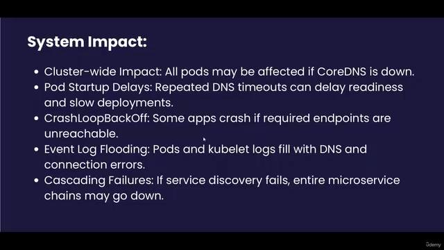
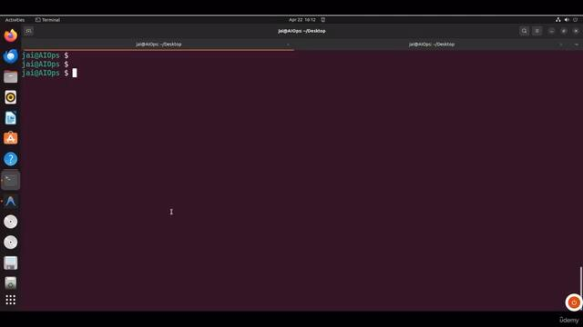
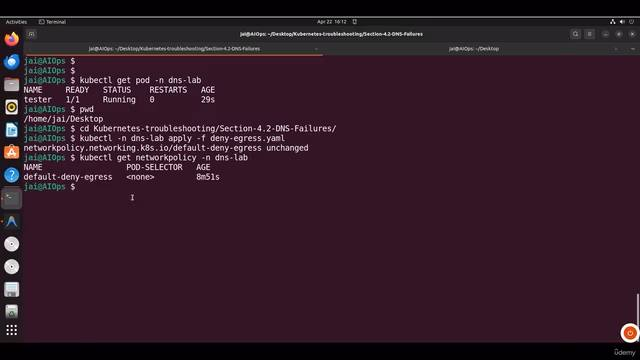
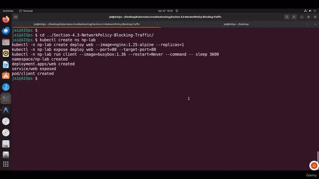
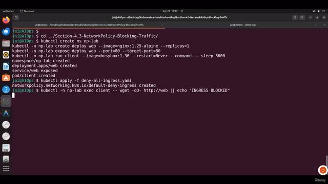
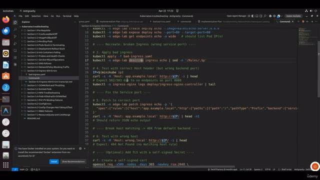
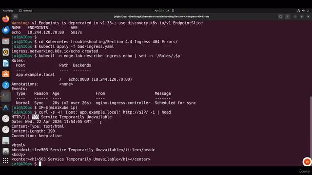

# Kubernetes Troubleshooting（P19–P24）：DNS / Network Policy / Ingress 三类故障的「破坏—定位—修复」

## 1. 这一节做什么

P19–P24 是同一门课里连续的三组「故障专题」，每组都是「先讲原理 → 再进集群亲手把故障做出来 → 再修回去」。三组分别是：

| 专题 | 原理讲解 | 实战复现 | 故障面 |
|---|---|---|---|
| Pod 解析不了 DNS | P019 | P020 | `dns-lab` 命名空间里的 busybox tester |
| Network Policy 阻断流量 | P021 | P022 | `np-lab` 命名空间里的 nginx + busybox client |
| Ingress 404 / 502 / 503 | P023 | P024 | minikube ingress addon 后面的 echo 服务 |

这一节你要真正跑出来的东西是三个可复现的最小实验环境，全部在 **minikube** 上完成（讲师全程用 minikube，`minikube status` 开场）：

1. **DNS 实验**：在 `dns-lab` 里起一个 `sleep 3600` 的 busybox pod，先套一条 `deny-all-egress` 的 NetworkPolicy，让 `nslookup` 失败；再套一条只放行 `kube-system` 命名空间 53 端口（UDP/TCP）的 policy，让 `nslookup` 恢复。这个实验的核心结论是：**DNS 挂了不一定是 CoreDNS 挂了，先看 NetworkPolicy 是否放行 egress 到 DNS**。
2. **NetworkPolicy 实验**：在 `np-lab` 里起 nginx deployment + `web` service + `client` busybox，然后依次演示三个场景——`deny-all-ingress`（同命名空间也进不去）、`deny-all-egress`（出站全断）、`namespaceSelector` 依赖命名空间标签（`ingress-nginx` 没有 `role=ingress` 标签时规则永远不生效）。
3. **Ingress 实验**：`minikube addons enable ingress`，部署 echo 服务并确认 endpoints，然后 apply 一个把 backend port 故意写成 `8080` 的 `bad-ingress.yaml`，`curl` 得到 503；用 `kubectl patch` 把 `backend.service.port.number` 改回 `80`，`curl` 恢复 200；再故意用错的 Host 头访问，得到 404。

讲师反复强调的一条主线是：**很多看起来像「应用 bug」的 5xx，根因在路由层**——P023 [01:13] 原话是「errors may seem like app bugs but root cause is routing」，P024 [07:53] 收尾又给了一个判别口诀：「502 503 always check service ports target ports and endpoints，404 check the host header versus rules dot host」。

补充说明：这一节的价值不只是「把三个故障做出来」，而是建立一条固定的排障顺序。DNS 问题先分清「解析失败」还是「连不上」；NetworkPolicy 问题先分清「入站被拒」还是「出站被拒」；Ingress 问题先分清「404 没匹配规则」还是「503 匹配了规则但后端不可达」。每类问题都先在最小 pod 里用 `nslookup`、`wget`、`curl` 做对照，再回到业务应用，这样就不会一上来重启 CoreDNS 或改业务镜像。前端/Node 工程师可以把这三个实验对应成三层：DNS 对应「域名解析/服务发现」，NetworkPolicy 对应「网关白名单/中间件鉴权」，Ingress 对应「反向代理路由 + upstream 端口映射」。排障时先判断故障落在哪一层，再决定看 Pod、看 Service、看 Endpoints，还是看 Ingress 规则。

## 2. 讲师原话（带页码与时间）

> "Kubernetes 集群使用 CoreDNS 或 kube-dns 作为内部 DNS 解析器，负责所有 Service 和 Pod 的查找……如果 CoreDNS 宕机、配置错误，或者网络策略阻断了 DNS 流量，Pod 就无法解析 DNS 名称，既解析不了内部 Kubernetes Service，也解析不了外部互联网地址。"
> —— p019 [00:24]

> "去检查 `kubectl get pods`，确认与 kube-dns 相关的 Pod 状态应当全部为 Running，尤其是所有 CoreDNS 的 Pod……大多数情况下，它们运行在 `kube-system` 命名空间中。"
> —— p019 [03:41]

> "检查网络策略：如果启用了任何网络策略，就确认是否允许 DNS 的 UDP 53 和 TCP 53 流量。"
> —— p019 [04:33]

> "网络策略或防火墙规则可能会阻断发往 kube-dns 的 UDP 53 或 TCP 53 流量……所以这是主要排查点。"
> —— p020 [00:29]

> "在检查或修改 CoreDNS 本身之前，先确认网络策略是否允许向 DNS 发起出站流量……不要一上来就重启 DNS 组件，而应始终先检查网络策略。"
> —— p020 [05:31]

> "网络策略本质上就是规则，用来规定各组件之间、命名空间之间以及访问外部世界时允许哪些流量。"
> —— p022 [00:00]

> "我们允许来自同一命名空间的流量……我们会通过 Pod 选择器来指定，也就是同一命名空间中的任意 Pod。"
> —— p022 [03:31]

> "要求给源命名空间打标签，该命名空间应带有 `role=ingress` 标签……没有这个标签，流量会始终被阻断。"
> —— p022 [07:53]

> "用户可能会看到 404 Not Found——这表示 Ingress 没有匹配到任何规则或后端 Service……也可能是 TLS、SSL 错误、找不到证书、Host 不匹配或 Secret 配置错误。若没有到 Service 的路由，则会返回 502、503。"
> —— p023 [00:33]

> "只有当这个 Service 和 Pod 都健康时，Ingress 才能正常工作——本来就应该如此。"
> —— p024 [01:12]

> "我们可以用 patch 命令修复这个问题，也就是调整 `backend.service.port.number`。"
> —— p024 [02:02]

> "它提示“HTTP 1.1 503 服务暂时不可用”，是因为它尝试连接 8080，而该端口不可用。"
> —— p024 [04:49]

> "现在再看，它已经能连接了，并返回 `200 OK`……所以这个问题已经修复，因为我们现在做了正确的映射。"
> —— p024 [05:53]

> "遇到 `502`、`503` 时，始终检查 Service 端口、targetPort 和 Endpoints；每当看到 `404`，就检查 Host 头与 `rules.host` 是否一致。"
> —— p024 [07:53]

这些原话对应的可操作结论可以归纳成三句话：DNS 故障先查 CoreDNS 是否 Running，再查 NetworkPolicy 是否放行 UDP/TCP 53；NetworkPolicy 故障先分清 ingress/egress 和 selector 两侧；Ingress 故障先看状态码，503 查 Service 端口、targetPort、Endpoints，404 查 Host 与 `rules.host`。下面第 3 段就是按这个顺序把实验跑出来，第 5 段再把字段逐行对应到这些结论上。

## 3. 从零复现

### 3.1 前置环境（三组实验共用）

需要：`minikube` 已启动、`kubectl` 能连上、`curl`。讲师在 P020 [02:14] 也是先 `minikube status` 确认集群起来了才往下走。

```bash
minikube status
# host: Running
# kubelet: Running
# apiserver: Running
# kubeconfig: Configured
```

（上面四行是 minikube 的常见输出字段，具体以你本机 `minikube status` 实际输出为准。）

Ingress 实验需要额外打开 addon，见 3.4。

> ⚠️ 一个课里没明说、但你一定会撞上的前提：**NetworkPolicy 要生效，CNI 必须实现它**。minikube 默认 driver 自带的网络往往不实现 NetworkPolicy，P021 [05:12] 讲师本人也提到要「check what are the CNI and what are the policy standards」。如果你照做后 deny 策略没有任何效果（`wget` 依然能通），先确认 CNI 是否支持 NetworkPolicy，具体用哪个 CNI 课里没讲。

命令解释：`minikube status` 是检查本机 minikube 虚拟机/容器是否处于可连接状态，看到 `host`、`kubelet`、`apiserver` 都是 `Running`，`kubeconfig` 是 `Configured`，说明 `kubectl` 已经指向这个集群。常见错误是 `kubectl` 连到了别的 context，或者 minikube 启动到一半失败；排查时先 `kubectl config current-context`，再 `kubectl get nodes`。前端对照：这相当于启动本地 dev server 前先确认端口没被占用、代理指向正确；如果 `kubectl` 的 context 指错，后面所有实验都会在错误集群里做。

### 3.2 实验一：DNS 解析失败（`dns-lab`）

目录建议：

```
k8s-ts/p020-dns/
├── 00-namespace.yaml
├── 01-busybox.yaml
├── 02-deny-all-egress.yaml
└── 03-allow-dns.yaml
```

**Step 1 建命名空间和 tester pod**

讲师 P020 [02:41] 演示时先遇到「already exists」，说明之前跑过一遍，他 P020 [03:06] 把旧的删掉重建——**这一步你第一次跑不会有，但重要：pod 名字冲突时先 `kubectl -n dns-lab delete pod dns-test` 再重建。**

```bash
kubectl apply -f 00-namespace.yaml
kubectl apply -f 01-busybox.yaml
kubectl -n dns-lab get pods
```

`01-busybox.yaml` 里的 `sleep 3600` 来自讲师 P020 [03:19] 原话「because we have given 3600 seconds」。



命令解释：`kubectl apply -f` 是声明式创建/更新资源；`get pods` 用来确认 pod 进入 `Running`。常见错误有两个：一是命名空间没先建，pod apply 时报 `namespaces "dns-lab" not found`；二是镜像拉取慢，pod 停在 `ContainerCreating`，此时先 `kubectl -n dns-lab describe pod dns-test` 看 Events。前端对照：这相当于起一个最小 Node 容器做 `curl` 探针，先确认容器本身能跑，再谈 DNS。验证方法：`kubectl -n dns-lab get pods` 的 `STATUS` 必须是 `Running`，`READY` 是 `1/1`，否则不要进入下一步。

**Step 2 先确认「故障前」是好的**（这一步是为了对照）

```bash
kubectl -n dns-lab exec -it dns-test -- nslookup kubernetes.default
kubectl -n dns-lab exec -it dns-test -- nslookup google.com
```

两个都应当返回 `Name:` / `Address:` 之类的结果（busybox 自带的 nslookup 输出）。

命令解释：`kubectl exec -it ... -- nslookup ...` 是在 tester pod 里执行 DNS 查询。`kubernetes.default` 验证集群内部 service 解析，`google.com` 验证外部域名解析。常见错误是 busybox 的 `nslookup` 输出格式和宿主机不同，不要用宿主机的输出去对照；另外如果集群没有外网，`google.com` 本来就可能失败，这时只把 `kubernetes.default` 当基线，并在记录里注明「外网不可达」。前端对照：这相当于在容器里分别 `ping` 内部服务名和公网域名，先确认 DNS 解析链路是通的。验证方法：两条命令中至少 `kubernetes.default` 要返回 `Address`，并记下当前输出，作为 Step 3 的对照基线。

**Step 3 上 `deny-all-egress`，把 DNS 打死**

```bash
kubectl apply -f 02-deny-all-egress.yaml
kubectl -n dns-lab exec -it dns-test -- nslookup kubernetes.default
kubectl -n dns-lab exec -it dns-test -- nslookup google.com
```

预期：两种查询都失败。讲师 P020 [01:05] 描述的输出是「timeouts、could not resolve host、nslookup fail」，P020 [04:07] 演示时说的是「connection timed out」。具体报错文字以你集群实际输出为准。

命令解释：`02-deny-all-egress.yaml` 里的 `egress: []` 是「出站全部拒绝」，所以 tester pod 连 DNS 的 53 端口都出不去，`nslookup` 会超时或报无法解析。常见错误是 apply 后立刻查询，CNI 还没把规则下发完，建议等几秒或重试一次；如果仍然能解析，回到 3.1 的警告查 CNI。前端对照：这相当于在 Node 服务所在容器上封掉出站 53，业务代码报 `EAI_AGAIN`/`ENOTFOUND`，但 DNS 服务器本身没挂。验证方法：两条 `nslookup` 都应失败；同时 `kubectl -n kube-system get pods` 里 CoreDNS 仍是 `Running`，用来排除「DNS 真挂了」。

**Step 4 上 `allow-dns`，只放行 53**

```bash
kubectl apply -f 03-allow-dns.yaml
kubectl -n dns-lab exec -it dns-test -- nslookup kubernetes.default
kubectl -n dns-lab exec -it dns-test -- nslookup google.com
```

预期：两条都恢复。讲师 P020 [05:01] 原话：「Now if you see it is able to connect. So it is giving me the server and it is giving me the server address as well…if I try to connect to the google.com again…it is able to connect to the internet.」





命令解释：`03-allow-dns.yaml` 在 `deny-all-egress` 之上追加一条「允许到 `kube-system` 的 UDP/TCP 53」的白名单。NetworkPolicy 是叠加生效的，所以最终效果是「只放行 DNS，其余出站仍拒绝」。常见错误是只写 UDP 53，遇到大响应 fallback TCP 时偶发失败；另一个错误是 `namespaceSelector` 用了旧版本不存在的自动标签。前端对照：这相当于在出站防火墙里只放行 DNS resolver 的 53，其他出站继续封死。验证方法：两条 `nslookup` 都恢复，且 `kubectl -n dns-lab get networkpolicy` 能看到 `deny-all-egress` 与 `allow-dns` 同时存在。

### 3.3 实验二：Network Policy 三场景（`np-lab`）

目录建议：

```
k8s-ts/p022-netpol/
├── 00-namespace.yaml
├── 01-deny-all-ingress.yaml
├── 02-allow-web-same-ns.yaml
├── 03-deny-all-egress.yaml
├── 04-allow-all-egress.yaml
└── 05-allow-from-ingress-ns.yaml
```

**Step 1 建环境**（P022 [00:29]–[01:55]：`kubectl create deploy` + `expose` + 一个 client pod）

```bash
kubectl apply -f 00-namespace.yaml
kubectl -n np-lab create deployment web --image=nginx:alpine
kubectl -n np-lab expose deployment web --name=web --port=80 --target-port=80
kubectl -n np-lab run client --image=busybox:1.36 -- sleep 3600
kubectl -n np-lab get pods
kubectl -n np-lab get svc
```

（讲师 P022 用的是 `kubectl create deploy …nginx alpine` 和 expose 出来的 `web` service、`client` pod；pod 名和镜像 tag 课里没逐字打出来，`client` / `web` 这两个名字是讲师明说的，镜像 tag 按上面写法即可。）

命令解释：`create deployment` 创建 nginx 工作负载，`expose` 创建 ClusterIP service 并把 80 映射到 pod 的 80，`run client` 起一个带 `sleep 3600` 的 busybox 作为测试源。常见错误是 `expose` 的 `--target-port` 和容器实际监听端口不一致，导致后面即使 policy 放行也连不上；排查时 `kubectl -n np-lab get endpoints web` 必须看到 `IP:80`。前端对照：这相当于本地起一个 nginx 容器和一个 `curl` 容器，先确认 service 层通，再上白名单。验证方法：`get pods` 中 `web-*` 和 `client` 都 `Running`，`get svc web` 有 ClusterIP，`get endpoints web` 非空。

**Step 2 场景一：deny-all-ingress（同命名空间也进不来）**

```bash
kubectl apply -f 01-deny-all-ingress.yaml
kubectl -n np-lab exec -it client -- wget -qO- --timeout=3 http://web
```

预期：超时 / 连不上。讲师 P022 [02:48] 原话：「it will not connect because we have enabled a network policy」，并且 P022 [02:25] 强调「even if you are doing within the pods within the same name space it will not allow」。

命令解释：`deny-all-ingress` 的 `podSelector: {}` 选中 `np-lab` 所有 pod，`ingress: []` 表示入站全拒，所以同一命名空间的 client 也进不来。常见错误是 `wget` 不带 `--timeout` 会卡很久；建议加 `--timeout=3` 快速失败。前端对照：这相当于网关层默认拒绝所有来源，即使来源和你在同一个 VPC 也不放行。验证方法：命令应在数秒内失败（超时/连接被拒），而不是返回 nginx HTML。

**Step 3 修复：allow-web-same-ns**

```bash
kubectl apply -f 02-allow-web-same-ns.yaml
kubectl -n np-lab exec -it client -- wget -qO- --timeout=3 http://web
```

预期：拿到 nginx 欢迎页的 HTML。讲师 P022 [04:01] 的原理：「we will be giving from pod selector so any pod in the same name space… whatever the namespace we are using here `np-lab` So we are saying like any part within the namespace can connect with each other」。



命令解释：`02-allow-web-same-ns.yaml` 的 `spec.podSelector` 选 `app: web`（保护 web），`ingress[0].from.podSelector: {}` 选「同命名空间任意 pod」（允许 client）。常见错误是把 `from` 写成 `namespaceSelector` 却忘了本命名空间标签，或者 `ports` 写成 8080。前端对照：这相当于只允许同 namespace 的调用方访问 `/`，端口只放 80。验证方法：`wget` 返回 `<title>Welcome to nginx!</title>` 之类 HTML；同时 `kubectl -n np-lab get networkpolicy` 能看到 `deny-all-ingress` 与 `allow-web-same-ns` 叠加。

**Step 4 场景二：deny-all-egress**

```bash
kubectl apply -f 03-deny-all-egress.yaml
kubectl -n np-lab exec -it client -- wget -qO- --timeout=3 http://web
kubectl -n np-lab exec -it client -- wget -qO- --timeout=3 http://example.com
```

预期：内部 `web` 和外部 `example.com` 都失败。讲师 P022 [05:43] 原话：「Even it is not connecting to the internal host names or the external host names」。

```bash
kubectl apply -f 04-allow-all-egress.yaml
kubectl -n np-lab exec -it client -- wget -qO- --timeout=3 http://example.com
```

预期恢复。讲师 P022 [06:13] 原话：「now it is connecting. Now I will just do control C」。



命令解释：`03-deny-all-egress.yaml` 的 `policyTypes: [Egress]` 只封出站，`egress: []` 表示 client 的所有出站都断，所以内部 service 和外部域名都失败。`04-allow-all-egress.yaml` 的 `egress: - {}` 是全部放行。常见错误是混淆「不写 egress」和「egress: []」：前者不限制，后者全拒。前端对照：这相当于在 client 容器上封掉所有出站，DNS 和 HTTP 都出不去。验证方法：deny 后两条 `wget` 都失败；allow 后 `example.com` 恢复，且 `kubectl -n np-lab get networkpolicy` 能看到 egress 规则。

**Step 5 场景三：namespace label 不匹配**

```bash
kubectl apply -f 05-allow-from-ingress-ns.yaml
kubectl -n np-lab get networkpolicy allow-from-ingress-ns -o yaml
kubectl get namespace ingress-nginx -o jsonpath='{.metadata.labels}'
```

讲师 P022 [07:53] 的原话：「if you don't have a namespace with `role ingress` it cannot work」，并演示了 `kubectl label namespace ingress-nginx role=ingress`。

```bash
kubectl label namespace ingress-nginx role=ingress
kubectl get namespace ingress-nginx --show-labels
```

讲师还坦白说明了他自己的 minikube **没装 ingress controller**：「I do not have `ingress-nginx` installed, I do not have the controller」，所以这个场景只是演示**标签是 NetworkPolicy 生效的前提**，不受控制器是否存在影响。

```bash
# 想完整复现的话先装上：minikube addons enable ingress
```

命令解释：`05-allow-from-ingress-ns.yaml` 用 `namespaceSelector.matchLabels.role=ingress` 选择来源命名空间；如果 `ingress-nginx` 没有这个标签，规则永远不匹配。`kubectl label namespace` 是给命名空间打标签，`--show-labels` 用来确认。常见错误是命名空间不存在时 label 报 `not found`；如果没装 ingress addon，可以先 `minikube addons enable ingress` 再打标签。前端对照：这相当于反向代理白名单里写死了 `x-forwarded-for` 所在的网段标签，标签没打上，白名单永远不生效。验证方法：label 前 `jsonpath` 输出里没有 `role:ingress`，label 后 `--show-labels` 能看到 `role=ingress`；同时 `get networkpolicy -o yaml` 里 `namespaceSelector` 的标签与之一致。

### 3.4 实验三：Ingress 404 / 502 / 503（minikube ingress）

目录建议：

```
k8s-ts/p024-ingress/
├── 00-namespace.yaml
└── 01-bad-ingress.yaml
```

**Step 1 开 addon**

```bash
minikube addons enable ingress
kubectl -n ingress-nginx get pods
```

讲师 P024 [02:27] 原话：「this is the ingress which we are enabling… my controller is running so everything looks good」。

命令解释：`minikube addons enable ingress` 会在 `ingress-nginx` 命名空间部署 controller。常见错误是 addon 开了但镜像拉取失败，pod 停在 `ImagePullBackOff`；排查用 `kubectl -n ingress-nginx describe pod` 看 Events。前端对照：这相当于本地起 nginx 反向代理，先确认代理进程活着。验证方法：`kubectl -n ingress-nginx get pods` 中 controller pod 全部 `Running`，否则先不要做后面的 503/404。

**Step 2 部署 echo 服务并确认 endpoints**

```bash
kubectl apply -f 00-namespace.yaml
kubectl -n ing-lab create deployment echo --image=ealen/echo-server:0.9.2
kubectl -n ing-lab expose deployment echo --name=echo --port=80 --target-port=80
kubectl -n ing-lab get pods
kubectl -n ing-lab get svc
kubectl -n ing-lab get endpoints echo
kubectl -n ing-lab get pods -o wide
```

> ⚠️ 讲师 P024 [01:12] 只说「a deployment which is a echo deployment with the echo server」，**没有给出具体镜像名**。上面的 `ealen/echo-server` 只是你自己的占位，换成你集群能拉到的任意 echo 镜像都可以。P024 [01:12] 的原话是「ingress only works if this service and pods are healthy」。

命令解释：`create deployment` + `expose` 起一个 80 端口的 echo 服务；`get endpoints` 是确认 Service 后端有健康 Pod，这是 Ingress 503 排查的关键。常见错误是 `target-port` 写错或 Pod 没 Ready，导致 endpoints 为空；此时 Ingress 规则即使对也会 503。前端对照：这相当于反向代理 upstream 指向了 80，但 upstream 容器实际没监听 80，代理就报 502/503。验证方法：`get endpoints echo` 必须输出 `IP:80`；`get pods -o wide` 的 Pod IP 与 endpoints 对得上。

**Step 3：apply bad ingress，制造 503**

```bash
kubectl apply -f 01-bad-ingress.yaml
kubectl -n ing-lab describe ingress echo
```

`01-bad-ingress.yaml` 里 backend port 故意写成 `8080`，但 service 实际是 `80`——这就是讲师 P024 [04:03] 说的「pointing into the 8080 but we have created a service with 80」。

命令解释：`describe ingress` 会显示 `Backend Ports`，你要把它和 `get svc echo` 的 `PORT` 对照。常见错误是只看 YAML 不看 describe，或者 Service 有两个端口时看错行。前端对照：这相当于 nginx `proxy_pass http://upstream:8080`，但 upstream 只监听 80。验证方法：`describe ingress echo` 的 Backend Ports 显示 8080，而 `get svc echo` 的 PORT 是 80，二者不一致即制造成功。

**Step 4：用正确的 Host 头去访问，拿 503**

```bash
IP=$(minikube ip)
curl -i -H "Host: app.example.local" http://$IP/
```

预期：`HTTP/1.1 503 Service Temporarily Unavailable`。讲师 P024 [04:49] 原话：「it is saying `HTTP 1.1 503 service temporarily unavailable` because this is trying to connect to the 8080 which is not available」。



命令解释：`-H "主机：app.example.local"` 是为了让请求命中 Ingress 的 `rules.host`；`minikube ip` 取 ingress 入口 IP。常见错误是没带 Host 头，结果 404 而不是 503；另一个错误是本机代理拦截了 `curl`，用 `curl --noproxy '*'` 排除。前端对照：这相当于用 `curl -H "Host: ..."` 测试本地 nginx 的 server_name。验证方法：状态行必须是 503；如果看到 404，先检查 Host 头是否写对。

**Step 5：patch 修复**

讲师 P024 [02:02] 说修复方式是 patch `backend.service.port.number`：

```bash
kubectl -n ing-lab patch ingress echo --type=json \
  -p='[{"op":"replace","path":"/spec/rules/0/http/paths/0/backend/service/port/number","value":80}]'

kubectl -n ing-lab describe ingress echo   # 确认 Backend Ports 已经是 80
curl -i -H "Host: app.example.local" http://$IP/
```

预期：`HTTP/1.1 200 OK`。讲师 P024 [05:53] 原话：「now if you see this it is connecting now it says `200 ok` I am not seeing any 502 issues」。



命令解释：JSON Patch 的 `path` 必须和 YAML 里 `rules[0].http.paths[0].backend.service.port.number` 的层级完全一致；`value: 80` 是改成 Service 实际端口。常见错误是路径里 `rules/0` 写成 `rules/1`，或者 `paths/0` 写成 `paths/1`；patch 报错时先 `kubectl -n ing-lab get ingress echo -o yaml` 看实际数组下标。前端对照：等价于把代理配置里的 upstream 端口从 8080 改成 80。验证方法：`describe ingress echo` 的 Backend Ports 变为 80，`curl` 返回 200。

**Step 6：故意用错 Host 头，制造 404**

```bash
curl -i -H "Host: wrong.local" http://$IP/
```

预期：`404 Not Found`。讲师 P024 [06:23]–[06:53] 原话：「if I am testing with the wrong host it will give `404` obviously… ingress matches host names… rules define it as `app.example.local`… wrong.local no rule matches here」。

命令解释：Ingress 先按 Host 匹配 `rules.host`，`wrong.local` 不在规则里，所以 404。常见错误是把 404 当成后端问题；404 说明请求没命中规则，先查 Host 和 path。前端对照：这相当于 nginx 没有匹配的 `server_name`，直接返回默认 404。验证方法：状态行是 404，且 `describe ingress` 里只有 `app.example.local` 这条 host。

## 4. 完整代码

> 说明：讲师的逐字稿里**只报了文件名（`bad-ingress.yaml`）和关键字段名**，没有把全部 YAML 打出来。下面给出的每个文件都是可 `kubectl apply -f` 直接运行的完整版本，其中的字段均来自讲师原话里点到的（`podSelector` / `policyTypes` / `ingress` / `egress` / `from` / `namespaceSelector` / `matchLabels` / `port 53` / `protocol` / `rules.host` / `backend.service.port.number`）。凡是讲师没讲的（如镜像 tag、`kubernetes.io/metadata.name` 这类自动标签），代码块外都会标注。

使用顺序建议：DNS 实验按 `00 → 01 → 02 → 03` 应用；NetworkPolicy 实验按 `00 → 01 → 02 → 03 → 04 → 05` 应用，但 `03` 和 `04` 是同一方向的对照，实际演示时可以先后 apply；Ingress 实验先 `00`，再部署 echo，再 `01-bad-ingress.yaml`，修复用 patch，`01b-good-ingress.yaml` 只是可选的等价文件。所有 YAML 里的命名空间名、pod 名都来自上面实验，不要混用到别的 namespace。

### 4.1 dns-lab

**`00-namespace.yaml`**

```yaml
apiVersion: v1
kind: Namespace
metadata:
  name: dns-lab
```

**`01-busybox.yaml`**（讲师 P020 [03:19] 说过 `sleep 3600`，pod 名课里没明说，示意用 `dns-test`）

```yaml
apiVersion: v1
kind: Pod
metadata:
  name: dns-test
  namespace: dns-lab
spec:
  containers:
    - name: busybox
      image: busybox:1.36
      command: ["sleep", "3600"]
```

**`02-deny-all-egress.yaml`**

```yaml
apiVersion: networking.k8s.io/v1
kind: NetworkPolicy
metadata:
  name: deny-all-egress
  namespace: dns-lab
spec:
  podSelector: {}
  policyTypes:
    - Egress
  egress: []
```

**`03-allow-dns.yaml`**

```yaml
apiVersion: networking.k8s.io/v1
kind: NetworkPolicy
metadata:
  name: allow-dns
  namespace: dns-lab
spec:
  podSelector: {}
  policyTypes:
    - Egress
  egress:
    - to:
        # 自动标签 kubernetes.io/metadata.name 由 k8s 在 1.21+ 自动打上，
        # 讲师没展开讲；实际输出请以 `kubectl get ns kube-system --show-labels` 为准。
        - namespaceSelector:
            matchLabels:
              kubernetes.io/metadata.name: kube-system
      ports:
        - protocol: UDP
          port: 53
        - protocol: TCP
          port: 53
```

### 4.2 np-lab

**`00-namespace.yaml`**

```yaml
apiVersion: v1
kind: Namespace
metadata:
  name: np-lab
```

**`01-deny-all-ingress.yaml`**

```yaml
apiVersion: networking.k8s.io/v1
kind: NetworkPolicy
metadata:
  name: deny-all-ingress
  namespace: np-lab
spec:
  podSelector: {}
  policyTypes:
    - Ingress
  ingress: []
```

**`02-allow-web-same-ns.yaml`**（讲师 P022 [03:31] 原话：从 podSelector 里挑「同命名空间任意 pod」）

```yaml
apiVersion: networking.k8s.io/v1
kind: NetworkPolicy
metadata:
  name: allow-web-same-ns
  namespace: np-lab
spec:
  podSelector:
    matchLabels:
      app: web
  policyTypes:
    - Ingress
  ingress:
    - from:
        - podSelector: {}
      ports:
        - protocol: TCP
          port: 80
```

**`03-deny-all-egress.yaml`**

```yaml
apiVersion: networking.k8s.io/v1
kind: NetworkPolicy
metadata:
  name: deny-all-egress
  namespace: np-lab
spec:
  podSelector: {}
  policyTypes:
    - Egress
  egress: []
```

**`04-allow-all-egress.yaml`**（讲师 P022 [06:13] 只演示了「恢复连接」，完整 policy 没打出来，以下为示意：全部放行）

```yaml
apiVersion: networking.k8s.io/v1
kind: NetworkPolicy
metadata:
  name: allow-all-egress
  namespace: np-lab
spec:
  podSelector: {}
  policyTypes:
    - Egress
  egress:
    - {}
```

**`05-allow-from-ingress-ns.yaml`**（讲师 P022 [07:23] 只说「requires labeling the source namespace… with `role=ingress`」）

```yaml
apiVersion: networking.k8s.io/v1
kind: NetworkPolicy
metadata:
  name: allow-from-ingress-ns
  namespace: np-lab
spec:
  podSelector: {}
  policyTypes:
    - Ingress
  ingress:
    - from:
        - namespaceSelector:
            matchLabels:
              role: ingress
```

**配套命令（不属于 yaml 文件，是操作）**

```bash
kubectl -n np-lab create deployment web --image=nginx:alpine
kubectl -n np-lab expose deployment web --name=web --port=80 --target-port=80
kubectl -n np-lab run client --image=busybox:1.36 -- sleep 3600
kubectl label namespace ingress-nginx role=ingress
```

### 4.3 ingress（minikube）

**`00-namespace.yaml`**

```yaml
apiVersion: v1
kind: Namespace
metadata:
  name: ing-lab
```

**`01-bad-ingress.yaml`**（`backend.service.port.number` 故意错成 8080）

```yaml
apiVersion: networking.k8s.io/v1
kind: Ingress
metadata:
  name: echo
  namespace: ing-lab
spec:
  rules:
    - host: app.example.local
      http:
        paths:
          - path: /
            pathType: Prefix
            backend:
              service:
                name: echo
                port:
                  number: 8080
```

**`01b-good-ingress.yaml`**（可选，等价于 patch 后再 apply）

```yaml
apiVersion: networking.k8s.io/v1
kind: Ingress
metadata:
  name: echo
  namespace: ing-lab
spec:
  rules:
    - host: app.example.local
      http:
        paths:
          - path: /
            pathType: Prefix
            backend:
              service:
                name: echo
                port:
                  number: 80
```

**配套命令**

```bash
minikube addons enable ingress
kubectl -n ing-lab create deployment echo --image=ealen/echo-server:0.9.2
kubectl -n ing-lab expose deployment echo --name=echo --port=80 --target-port=80
kubectl apply -f 01-bad-ingress.yaml

IP=$(minikube ip)
curl -i -H "Host: app.example.local" http://$IP/     # 503
curl -i -H "Host: wrong.local"       http://$IP/     # 404

kubectl -n ing-lab patch ingress echo --type=json \
  -p='[{"op":"replace","path":"/spec/rules/0/http/paths/0/backend/service/port/number","value":80}]'

curl -i -H "Host: app.example.local" http://$IP/     # 200
```

## 5. 逐行解释

### 5.1 `deny-all-egress` 的三行关键字段

```yaml
podSelector: {}          # 空对象 = 选中该命名空间下所有 pod
policyTypes: [Egress]    # 只管制「出站」，不影响别人进它
egress: []               # 显式空列表 = 出站全部拒绝
```

- `podSelector: {}` 是 Kubernetes 里「select all」的惯用写法。它并不代表「什么都没选」，而是**空 matchLabels = 无条件匹配本命名空间内所有 pod**。在 P022 [02:11] 讲师说 `deny-all-ingress` 连同命名空间内部也封，原因就在这里——它把命名空间里所有 pod 的出/入都管起来了。
- `egress: []` 与「不写 `egress` 字段」是两种完全不同的语义：**不写 = 对出站不做任何限制；写空列表 = 拒绝所有出站**。这是 NetworkPolicy 最容易踩的坑之一。
- 这一点对应到前端/Node 工程师更熟悉的世界：NetworkPolicy 有点像 iptables，但**只写在 Pod 层面、由 CNI 插件实现**，不是 kubelet 自己拦。所以在不实现 NetworkPolicy 的 CNI 上，这些 YAML 都 apply 成功但实际不生效。

补充：`policyTypes` 只写 `Egress` 时，这条 policy 不会影响入站；如果你只 apply 了 `deny-all-egress`，从外面访问这个 pod 仍可能通，但 pod 自己 `nslookup`、`wget` 外网会失败。前端对照：这相当于只配置了「出站防火墙」，没配置「入站白名单」；排障时先问「是出不去还是进不来」，不要把所有 5xx 都归因到一条 policy。

### 5.2 `allow-dns` 里的 `egress[0].to` 为什么写成 namespaceSelector + ports

```yaml
egress:
  - to:
      - namespaceSelector:
          matchLabels:
            kubernetes.io/metadata.name: kube-system
    ports:
      - protocol: UDP
        port: 53
      - protocol: TCP
        port: 53
```

- `to:` 里放的是「目标白名单」。用 `namespaceSelector` 是因为 CoreDNS 跑在 `kube-system`，用命名空间粒度最省事；要更细就到 `podSelector` 里选 `k8s-app: kube-dns`。
- `ports:` 里 **UDP 53 和 TCP 53 都要写**。讲师 P019 [04:33] 的原话就是「check if DNS UDP 53 TCP 53 is allowed」——真实环境里有的 DNS 服务器对超大响应会 fallback 到 TCP，只放 UDP 会偶发失败。
- `kubernetes.io/metadata.name` 是 k8s 1.21+ 自动注入的命名空间标签，讲师没提过，**如果你在旧版本演示，换成一个手打的标签（比如 `name: kube-system`）再 apply**。

补充：`to` 和 `ports` 是「与」关系，必须同时满足「目标在 kube-system」和「端口是 53」才放行；如果 `ports` 写错成 5353，`nslookup` 仍然会失败但看起来像 policy 没生效。前端对照：等价于只放行发往 DNS resolver 的 53 端口，其他出站继续封死。

### 5.3 `allow-web-same-ns.spec.ingress[0].from` 为什么写 `podSelector: {}`

```yaml
ingress:
  - from:
      - podSelector: {}     # 同命名空间内任意 pod
    ports:
      - protocol: TCP
        port: 80
```

- 在 NetworkPolicy 的 `from` 里写裸的 `podSelector`，语义是「**跟当前 policy 同命名空间**的、选中这些 label 的 pod」。写空对象 = 同 ns 所有 pod。上面 `02-allow-web-same-ns.yaml` 的 `spec.podSelector` 选的是 `app: web`（只保护 web 这个 deployment），`spec.ingress[0].from.podSelector` 选的是「谁可以进来」。
- 两侧 selector 完全独立，这是 P022 [04:31] 讲师强调「connection is being controlled inside same namespace」的关键。

补充：`from` 里如果同时写 `podSelector` 和 `namespaceSelector` 在同一个数组元素里，是「与」关系；写成两个数组元素，是「或」关系。这个细节在复杂策略里最容易看错。前端对照：相当于中间件里先判断来源 namespace，再判断来源 pod label，两个条件都满足才 `next()`。

### 5.4 `namespaceSelector` 与 `role=ingress` 标签

```yaml
from:
  - namespaceSelector:
      matchLabels:
        role: ingress
```

- 这里选的是**命名空间**，不是 pod。讲师 P022 [08:21] 原话：「if your ingress controller runs in `ingress-nginx` you should label it with `role=ingress`… without this label traffic always remains blocked」。
- 这条在真实集群里非常常见：ingress-nginx 是 Helm 装的，装完不会自动打业务用的 `role=ingress` 标签，于是「允许 ingress 控制器访问我的后端」这条规则**永远不 match**，表现就是「明明 ingress 配好了 5xx」。P023 [05:28] 讲师归纳「keep configs very simple and collaboration is definitely needed」，就是这个原因。
- 在 JS/Node 里对应到「中间件白名单」：你写 `if (req.headers['x-forwarded-for'] === '10.0.0.5') next()` 但反代 IP 变了，效果一模一样。

补充：`kubectl get namespace ingress-nginx -o jsonpath='{.metadata.labels}'` 是验证标签是否存在的直接方法；`kubectl label namespace ingress-nginx role=ingress` 是补标签。注意如果命名空间不存在会报 `not found`，此时先确认是否真的装了 ingress addon。

### 5.5 Ingress 的 404 vs 503：两组字段决定

| 你看到的 | 决定它的字段 | 意思 |
|---|---|---|
| 404 | `spec.rules[].host` 与请求 `Host` 头是否匹配；`http.paths[].path` 与请求路径是否匹配 | 没规则命中 |
| 503 | `http.paths[].backend.service.port.number` 与 service 实际暴露端口是否一致；`endpoints` 是否有健康 Pod | 规则命中了，但后端不通 |

讲师 P024 [04:03] 演示的就是第二种：「we have created a service with 80 and target port as 80 now we are pointing into the 8080」。`kubectl describe ingress echo` 会显示 `Backend Ports` 一栏，与 `kubectl -n ing-lab get svc echo` 的 `PORT` 一栏对照即可。

补充：502 和 503 的边界在不同控制器上略有差异，但排查顺序一致：先 `get endpoints` 是否为空，再 `get svc` 的端口和 targetPort，再 `describe ingress` 的 Backend Ports。404 则先 `curl -H "Host: ..."` 确认 Host，再 `describe ingress` 看 `Rules` 里的 Host/Path。前端对照：404 像前端路由没有匹配到 path，503 像后端 upstream 挂了。

### 5.6 `kubectl patch` 那行 JSON

```bash
kubectl -n ing-lab patch ingress echo --type=json \
  -p='[{"op":"replace","path":"/spec/rules/0/http/paths/0/backend/service/port/number","value":80}]'
```

- `--type=json` 是 JSON Patch（RFC 6902），`op: replace` 表示「把旧值换成新值」，路径按 `rules[0].http.paths[0].backend.service.port.number` 一级一级写。
- `-p` 后面必须是**单引号包住的合法 JSON**，shell 里不要有中文引号。
- 讲师 P024 [02:02] 只点了字段名 `backend.service.port.number`，上面这行完整的 `kubectl patch` 是按这个字段拼出来的，**不是课上逐字念过的命令**。
- 前端对照：等价于对 `obj.rules[0].http.paths[0].backend.service.port.number = 80` 做一次 immer 的 produce。

补充：如果 patch 报 `path not found`，先用 `kubectl -n ing-lab get ingress echo -o yaml` 确认实际数组下标；如果 Ingress 有多个 rule/path，`0` 可能不是你要改的那条。`--type=merge` 也能改，但 JSON Patch 更精确，适合课里这种「只改一个字段」的演示。

### 5.7 「NetworkPolicy 是 addtive」在代码上的含义

讲师 P021 [05:40] 原话：「network policies are additive and default deny is powerful… after you deny you must add explicit allows for every required edge」。

- Kubernetes **没有「显式 deny」这个字段**，只有「默认全拒 + 白名单」。`deny-all-egress.yaml` 和 `allow-dns.yaml` apply 到同一个命名空间后，最终效果是**两条规则的并集**：凡是「出站到 kube-system 的 53 端口」就放行，其他全断。
- 所以真实排障里经常看到四五条 policy 叠加，你必须按「podSelector 匹配谁 → 该 pod 的出/入两个方向 → 每个方向都允许了哪些 to/from + 哪些 port」逐条列出来，不能只看一条。P021 [05:40] 也点出「mixed policies: multiple default deny plus partial allows」是常见根因。

补充：additive 意味着你不需要「删掉 deny 再建 allow」，而是在 deny 之上继续加 allow；但也要小心，多条 allow 叠加后可能放行了比你预期更多的流量。前端对照：这像 Express 中间件数组，默认 `return next(err)`，再逐条加白名单；排查时要把所有中间件按顺序列出来，而不是只看最后一条。

## 6. 复现检查清单

跑完三个实验后，请对照下表逐项自检。任何一项对不上，先把那一项修好再进下一个实验。每条后面的「验证」就是你应该执行的检查动作或观察点。

**环境层**

- [ ] `minikube status` 四个字段全是 `Running` / `Configured`。验证：直接看命令输出，`host`、`kubelet`、`apiserver` 为 `Running`，`kubeconfig` 为 `Configured`。
- [ ] `kubectl get nodes` 能看到 minikube 节点状态 `Ready`。验证：输出里 `STATUS` 列必须是 `Ready`，不是 `NotReady`。
- [ ] 若实验二任何 deny policy 都「没反应」，先查 CNI 是否实现 NetworkPolicy（讲师 P021 [05:12] 提过检查 CNI）。验证：先 apply `deny-all-ingress` 后从同 ns client 访问 web，若仍返回 HTML，再查集群 CNI 是否支持 NetworkPolicy；具体 CNI 以你的集群为准。
- [ ] Ingress 实验开始前 `minikube addons enable ingress` 已执行，`kubectl -n ingress-nginx get pods` 全部 `Running`。验证：`STATUS` 全为 `Running`，`READY` 为 `1/1` 或控制器实际副本数。

**实验一 dns-lab**

- [ ] `kubectl -n dns-lab get pods` 显示 `dns-test` 为 `Running`。验证：`STATUS=Running`，`READY=1/1`。
- [ ] 上 `deny-all-egress` 前，`nslookup kubernetes.default` 与 `nslookup google.com` 都能返回结果（**这是基线，没有基线后面无法证明是 policy 生效还是 DNS 本来就坏**）。验证：至少 `kubernetes.default` 返回 `Address`；外网不通时记录原因。
- [ ] 上 `deny-all-egress` 后，两条 nslookup 都失败。验证：命令在数秒内超时或报无法解析，而不是返回 `Address`。
- [ ] 上 `allow-dns` 后，两条 nslookup 都恢复。验证：重新看到 `Name:`/`Address:` 输出。
- [ ] `kubectl -n kube-system get pods` 里 CoreDNS 还在 `Running`（排除「其实 DNS 真的挂了」）。验证：CoreDNS pod `STATUS=Running`，排除因 CoreDNS 崩溃导致的 DNS 失败。

**实验二 np-lab**

- [ ] `kubectl -n np-lab get pods` 里 `web-*`、`client` 都在 `Running`。验证：两个 pod 的 `STATUS=Running`，`READY` 正常。
- [ ] `kubectl -n np-lab get endpoints web` 有 IP:80。验证：`ENDPOINTS` 列显示 `IP:80`，不能是 `<none>`。
- [ ] 场景一：apply `deny-all-ingress` 后，`client` 访问 `http://web` 失败。验证：`wget --timeout=3` 超时或连接被拒。
- [ ] 场景一：apply `allow-web-same-ns` 后，`client` 访问 `http://web` 返回 nginx HTML。验证：输出包含 `Welcome to nginx` 或 HTTP 200 内容。
- [ ] 场景二：apply `deny-all-egress` 后，内部 `http://web` 和外部 `http://example.com` 都失败。验证：两条 `wget --timeout=3` 都超时/失败。
- [ ] 场景二：apply `allow-all-egress` 后，外部 `http://example.com` 恢复。验证：`wget` 能拿到页面或至少建立连接；若集群无外网，记录为环境限制。
- [ ] 场景三：apply `allow-from-ingress-ns` 后，`kubectl -n np-lab get networkpolicy allow-from-ingress-ns -o yaml` 里能看到 `namespaceSelector.matchLabels.role: ingress`。验证：YAML 输出包含该字段。
- [ ] 场景三：`kubectl get namespace ingress-nginx --show-labels` 在打标签前没有 `role=ingress`，执行 `kubectl label namespace ingress-nginx role=ingress` 后能看到 `role=ingress`。验证：前后各执行一次 `--show-labels` 对照。

**实验三 ingress**

- [ ] `minikube addons enable ingress` 后 `kubectl -n ingress-nginx get pods` 控制器 `Running`。验证：pod `STATUS=Running`，否则看 `describe pod` 的 Events。
- [ ] `kubectl -n ing-lab get pods` 里 echo pod `Running`。验证：`STATUS=Running`，`READY=1/1`。
- [ ] `kubectl -n ing-lab get svc echo`

## 7. 课里没讲但你会撞上的

| 现象 | 原因 | 怎么办 |
|---|---|---|
| DNS 实验里 apply `deny-all-egress` 后，`nslookup` 仍然能解析，NetworkPolicy 像没生效 | 补充：课里没讲具体用哪个 CNI；minikube 默认 driver 自带网络往往不实现 NetworkPolicy，P021 只提到要检查 CNI 和 policy standards | 先确认当前 CNI 是否支持 NetworkPolicy；具体 CNI 课里没讲，按你集群 CNI 文档处理，或换成支持 NetworkPolicy 的 CNI 后再复现 |
| apply policy 后立刻测，结果时通时不通 | 补充：课里没讲 CNI 下发规则可能有延迟 | 等几秒后重试一次；仍不生效就回到上一条检查 CNI，不要先重启 CoreDNS |
| `kubectl apply -f 01-busybox.yaml` 报 pod 已存在 / 名字冲突 | 补充：课里没明说 tester pod 名，文档示意用 `dns-test`；P020 讲师自己也遇到 `already exists`，说明之前跑过会冲突 | 先 `kubectl -n dns-lab delete pod dns-test`，再重新 apply 或重建 |
| 基线测试时 `nslookup google.com` 本来就失败，误以为后面 policy 已生效 | 补充：课里没讲集群无外网场景；文档说明无外网时 `google.com` 本来就可能失败 | 只把 `nslookup kubernetes.default` 当基线，并在记录里注明“外网不可达” |
| busybox 里的 `nslookup` 输出和宿主机不一样，误判成功或失败 | 补充：课里没讲 busybox 自带 `nslookup` 的输出格式差异 | 以 pod 内输出为准，记下 `Name:` / `Address:` 作为对照基线，不要拿宿主机输出直接比对 |
| `allow-dns` 只放行 UDP 53 时偶发解析失败 | 补充：课里没讲大响应 fallback TCP 的机制，但 P019 原话要求检查 UDP 53 和 TCP 53 | `ports` 里 UDP 53 和 TCP 53 都写上 |
| `allow-dns` 用 `kubernetes.io/metadata.name: kube-system` 匹配不到目标 | 补充：课里没讲这是 1.21+ 自动注入的命名空间标签；旧版本或标签缺失时规则不 match | 先 `kubectl get ns kube-system --show-labels` 确认；没有就换成一个手打标签（如 `name: kube-system`）并同步改 `matchLabels` |
| `kubectl label namespace ingress-nginx role=ingress` 报 `not found` | 补充：课里没讲命名空间不存在时怎么处理；P022 讲师也说自己没装 ingress controller | 先 `minikube addons enable ingress`，或确认 `ingress-nginx` 命名空间已存在，再打标签 |
| `minikube addons enable ingress` 后 controller pod 不是 `Running` | 补充：课里没讲 addon 镜像拉取失败等排查；文档只提示常见 `ImagePullBackOff` | `kubectl -n ingress-nginx describe pod` 看 Events，先修到 controller `Running` 再做 503/404 |
| echo deployment 镜像拉不到 | 补充：课里没讲 echo 具体镜像名，文档明确 `ealen/echo-server` 只是占位 | 换成你集群能拉到的任意 echo 镜像；继续前确认 Pod `Running` |
| `get endpoints echo` 为空，Ingress 规则看起来对也返回 503 | 补充：课里没讲 `targetPort` 写错或 Pod 没 Ready 导致 endpoints 为空的排查细节；P024 只强调 service 和 pods 要健康 | 先查 `kubectl -n ing-lab get endpoints echo` 和 `get pods -o wide`，确认 Pod IP 与 endpoints 对得上，再测 Ingress |
| `curl http://$IP/` 不带 Host 头得到 404，而不是预期的 503 | 补充：课里没讲“不带 Host 头”的默认匹配结果；文档说明没带 Host 会先 404 | 加 `-H "主机：app.example.local"`；看到 404 先核对 Host 与 `rules.host` |
| 本机 `curl` 被代理拦截，访问结果和集群不一致 | 补充：课里没讲本机代理环境 | 用 `curl --noproxy '*'` 排除本机代理再测 |
| `kubectl patch` 报 `path not found`，或改错 rule/path | 补充：课里没讲完整 patch 路径排查，只点了 `backend.service.port.number` 字段名；文档说明完整 patch 命令不是课上逐字念过的 | 先 `kubectl -n ing-lab get ingress echo -o yaml` 确认实际数组下标，再按 `rules/0/http/paths/0/backend/service/port/number` 对照修改 |
| 502/503 的边界在不同控制器上表现略有差异，容易误判 | 补充：课里没讲不同控制器对 502/503 边界的差异 | 按文档顺序查：先看 endpoints 是否为空，再看 svc 端口和 targetPort，再看 `describe ingress` 的 Backend Ports；404 则查 Host 与 `rules.host` |
| `np-lab` 里 client 访问 web 失败，即使 policy 已允许 | 补充：课里没讲 `expose` 的 `--target-port` 与容器实际监听端口不一致会导致连不上 | 查 `kubectl -n np-lab get endpoints web` 应显示 `IP:80`，并核对 `--target-port` |
| 测试时 `wget` 卡很久 | 补充：课里没讲给 `wget` 加超时 | 用 `wget -qO- --timeout=3 http://web` 这类写法快速失败 |
