# Kubernetes Troubleshooting 实战：OOMKilled、Evicted、HPA、PVC、RBAC 与 ResourceQuota（P25–P34）

## 1. 这一节做什么

本节把 P25–P34 串成一条**可复现的排障流水线**：先在一个 Python 应用上人为制造 OOMKilled，观察 exit code 137 和 CrashLoopBackOff；再用 busybox 写满 emptyDir 触发节点级 Evicted；接着用 HPA 演示「requests 设太大导致 HPA 永远不触发」的经典坑；然后处理 PVC Pending（storageClass 不存在、volumeMode 不支持）；再进入 RBAC，用 ServiceAccount 复现 Forbidden；最后用 ResourceQuota + LimitRange 复现「Deployment 只起了 4/5 个 Pod」的配额超限。每个 lab 都给出完整 YAML、构建命令、验证命令和修复方式。

前置条件：minikube 已安装并启动，kubectl 可用，本机 Docker 可用。课里用的 namespace 分别是 `oom-lab`、`evict-lab`、`hpa-lab`、`storage-lab`、`rback-lab`、`quota-lab`。

> **P32 说明**：该 P 视频没有音轨，逐字稿无法转写，因此本文不为 P32 编造讲师原话或讲解内容；P32 对应的截图清单仍保留，但正文不引用其帧。

---

## 2. 讲师原话（带「—— pNNN [MM:SS]」）

> 「如果容器使用的内存超过 limits.memory，Linux 会杀掉进程，Kubernetes 报告为 OOM kill，你经常会看到 error code 137，也可能看到 CrashLoopBackOff。」—— p025 [00:11]

> 「我们会构建一个 Python 脚本，构建镜像，用很紧的 limits 部署，然后 patch deployment，把 limits.memory 提高。」—— p025 [00:41]

> 「Eviction 不是 OOMKilled。OOMKilled 是容器级事件，一个容器超过自己的内存 limit，内核杀掉这个容器；eviction 是节点级事件，kubelet 为了保护节点主动驱逐 Pod。」—— p027 [00:21]

> 「HPA 用实际 CPU 使用量除以 CPU request 来计算利用率。我们 request 1000 millicores，应用可能只用 100 millicore，那只有 10%。target 是 50%，Pod 永远不会 scale 到 500m。」—— p028 [01:23]

> 「PVC 卡在 Pending，原因几乎总是写在 PVC event 里。我们会演示三个场景：storage class 不存在、access mode 不支持、以及 WaitForFirstConsumer 的 volume binding mode。」—— p030 [00:00]

> 「CreateContainerConfigError 是配置问题，不是代码问题。它总是意味着某个 resource 或 mount 缺失或配错，不是应用报错。」—— p031 [05:17]

> 「Role 只在自己的 namespace 生效。要在集群级别生效，需要 ClusterRole 和 ClusterRoleBinding。」—— p033 [08:42]

> 「ResourceQuota 是 namespace 级别的总硬上限，LimitRange 是单个 Pod/Container 级别的规则。排障时如果 Pod 看起来正常但副本数不对，要去 describe ReplicaSet。」—— p034 [00:00]

（P32 无音轨，无原话可引。）

---

## 3. 从零复现

### 3.1 环境准备

```bash
minikube start
minikube addons enable metrics-server
kubectl get nodes
```

`metrics-server` 是 `kubectl top` 的前提。课里明确说：「you need to have your metrics API to be enabled ... minikube addons enable metrics-server」—— p025 [05:41]。如果 `kubectl top pods` 报错，先确认 `kubectl get pods -n kube-system` 里 metrics-server 是 Running。

### 3.2 Lab 1：OOMKilled

目录 `01-oom/`。构建镜像：

```bash
cd 01-oom
docker build -t oom-demo:0.1 .
minikube image load oom-demo:0.1
kubectl create namespace oom-lab
kubectl -n oom-lab apply -f deployment-bad.yaml
kubectl -n oom-lab get pods -w
```

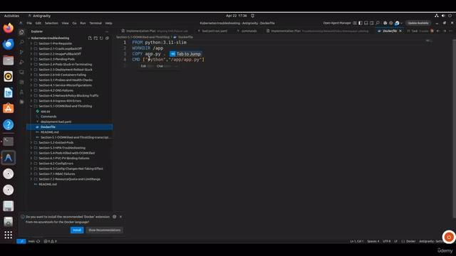

等 Pod 进入 CrashLoopBackOff 后：

```bash
kubectl -n oom-lab describe pod -l app=oom-demo
kubectl -n oom-lab logs -l app=oom-demo
```

`describe` 里看 Last State 的 Exit Code 137。课里原话：「if you see the exit code it says 137 ... 137 will be your status code」—— p025 [03:16]。然后 patch：

```bash
kubectl -n oom-lab patch deployment oom-demo -p '{"spec":{"template":{"spec":{"containers":[{"name":"oom-demo","resources":{"limits":{"memory":"512Mi"}}}]}}}}'
kubectl -n oom-lab get pods
kubectl -n oom-lab top pods
```

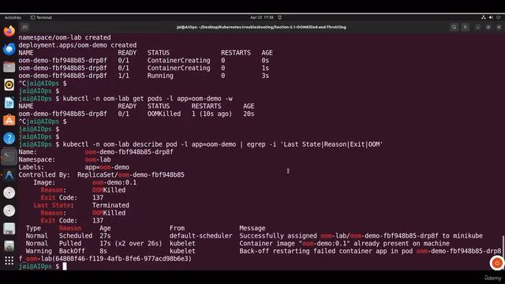

### 3.3 Lab 2：Evicted

```bash
kubectl create namespace evict-lab
kubectl -n evict-lab apply -f evict-ephemeral.yaml
kubectl -n evict-lab get pods -w
kubectl -n evict-lab describe pod evict-ephemeral
kubectl -n evict-lab get events --sort-by=.lastTimestamp
```

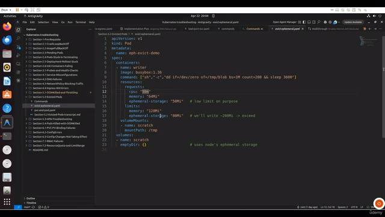

事件里会出现 `pod ephemeral local storage usage exceeds the total limit of containers 80Mi`。课里原话：「pod ephemeral local storage usage exceeds the total limit of containers 80 mi because we are moving it to 200 but the limit of the container is 80 megabytes」—— p027 [03:54]。修复用 PVC：

```bash
kubectl -n evict-lab apply -f pvc-pod.yaml
kubectl -n evict-lab get pvc
kubectl -n evict-lab get pods
```

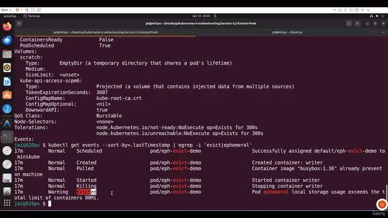

或者把 `evict-ephemeral.yaml` 的 `limits.ephemeral-storage` 从 80Mi 改成 300Mi。

### 3.4 Lab 3：HPA

```bash
cd 03-hpa
docker build -t hpa-demo:0.1 .
minikube image load hpa-demo:0.1
kubectl create namespace hpa-lab
kubectl -n hpa-lab apply -f deploy-bad.yaml
kubectl -n hpa-lab apply -f hpa-demo.yaml
kubectl -n hpa-lab get hpa
```

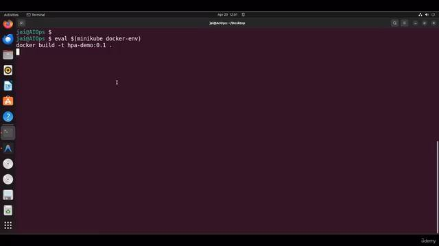

生成负载：

```bash
kubectl -n hpa-lab run loader --image=busybox:1.36 --restart=Never --command -- sleep 3600
kubectl -n hpa-lab exec loader -- sh -c 'while true; do wget -q -O- "http://hpa-demo.hpa-lab.svc.cluster.local/burn?burn_ms=300"; done'
```

观察：

```bash
kubectl -n hpa-lab describe hpa hpa-demo
kubectl -n hpa-lab top pods
```

因为 request 是 1000m，实际只到 419m 左右，HPA 不会扩。课里原话：「Resource CPU on pods as percentage of request is 41% ... it is not reaching ... 419m ... we have given thousand milli cores」—— p028 [11:40]。换成 `deploy-good.yaml`（request 150m）后，describe 会看到 196%，Pod 扩到 4 个。删掉 loader 后，默认 300 秒才缩容。

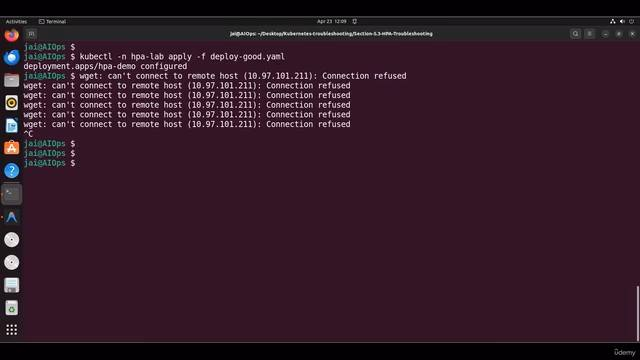

### 3.5 Lab 4：PVC Pending

```bash
kubectl create namespace storage-lab
kubectl -n storage-lab apply -f pvc-bad-sc.yaml
kubectl -n storage-lab get pods
kubectl -n storage-lab describe pvc data-bad-sc
```

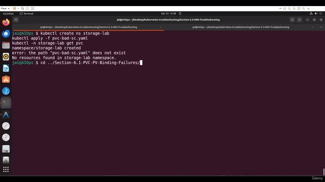

describe 会显示 storage class 不存在。课里原话：「storage does not exist not found which we have given a random one」—— p030 [04:45]。把 YAML 里的 `storageClassName` 改成 `standard`，删掉重建：

```bash
kubectl -n storage-lab delete -f pvc-bad-sc.yaml
kubectl -n storage-lab apply -f pvc-bad-sc.yaml
kubectl -n storage-lab get pvc
```

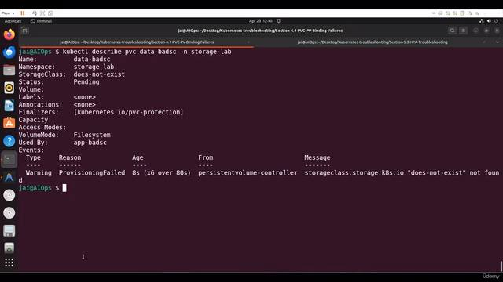

然后演示 `pvc-bad-mode.yaml`：`volumeMode: Block` + `ReadWriteMany`，minikube hostpath 不支持，provisioner 失败。改成 `volumeMode: FileSystem` 后正常。

### 3.6 Lab 5：RBAC

```bash
kubectl apply -f service-account.yaml
kubectl -n rback-lab get serviceaccount
kubectl -n rback-lab auth can-i list pods --as=system:serviceaccount:rback-lab:dev-user
kubectl -n rback-lab auth can-i create deployments --as=system:serviceaccount:rback-lab:dev-user
kubectl apply -f role-binding.yaml
kubectl -n rback-lab auth can-i list pods --as=system:serviceaccount:rback-lab:dev-user
kubectl apply -f cluster-role-binding.yaml
kubectl auth can-i list pods --as=system:serviceaccount:rback-lab:dev-user -n default
```

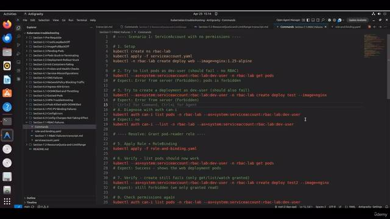

### 3.7 Lab 6：ResourceQuota + LimitRange

```bash
kubectl create namespace quota-lab
kubectl -n quota-lab apply -f resource-quota.yaml
kubectl -n quota-lab apply -f limit-range.yaml
kubectl -n quota-lab describe quota
kubectl -n quota-lab describe limitrange
kubectl -n quota-lab apply -f deployment-exceeded.yaml
kubectl -n quota-lab get pods
kubectl -n quota-lab get replicasets
kubectl -n quota-lab describe replicaset <name>
```

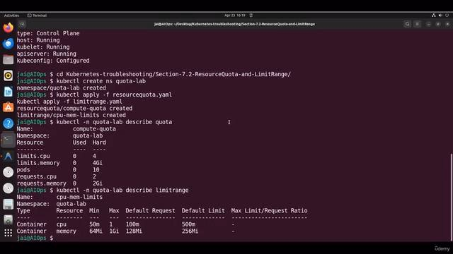

describe ReplicaSet 会显示 `exceeded quota`。课里原话：「error creating parts quota test is forbidden exceeded quota ... 500 millicores per part so that it is hitting 2500 millicores, but the limitation is to use only 2000 millicores」—— p034 [04:51]。换成 `deployment-fix.yaml` 后 5 个 Pod 都能起来。

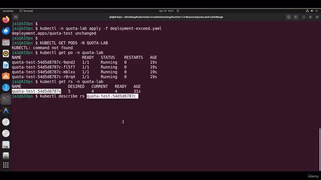

---

## 4. 完整代码

> 说明：逐字稿只给了关键字段和命令，以下 YAML 是按逐字稿描述补全的**最小可运行版本**；课里明确讲到的值（如 512Mi、1000m、150m、80Mi、1Gi、ReadWriteMany、Block、request.cpu 2、limit.cpu 4 等）均保留。

### 4.1 `01-oom/app.py`

```python
import sys
import time

# 每个 chunk 1MiB，默认分配 200 个 chunk（约 200MiB）
CHUNK_MB = 1
CHUNKS = int(sys.argv[1]) if len(sys.argv) > 1 else 200

data = []
for i in range(CHUNKS):
    data.append(bytearray(CHUNK_MB * 1024 * 1024))
    print(f"allocated {i + 1} MiB", flush=True)
    time.sleep(0.1)

print("allocation done, sleeping...", flush=True)
time.sleep(3600)
```

### 4.2 `01-oom/Dockerfile`

```dockerfile
FROM python:3.12-slim
WORKDIR /app
COPY app.py .
CMD ["python", "-u", "app.py"]
```

### 4.3 `01-oom/deployment-bad.yaml`

```yaml
apiVersion: apps/v1
kind: Deployment
metadata:
  name: oom-demo
  namespace: oom-lab
spec:
  replicas: 1
  selector:
    matchLabels:
      app: oom-demo
  template:
    metadata:
      labels:
        app: oom-demo
    spec:
      containers:
        - name: oom-demo
          image: oom-demo:0.1
          imagePullPolicy: IfNotPresent
          resources:
            requests:
              memory: "64Mi"
              cpu: "100m"
            limits:
              memory: "128Mi"
              cpu: "500m"
```

### 4.4 `02-evicted/evict-ephemeral.yaml`

```yaml
apiVersion: v1
kind: Pod
metadata:
  name: evict-ephemeral
  namespace: evict-lab
spec:
  containers:
    - name: writer
      image: busybox:1.36
      command:
        - sh
        - -c
        - "dd if=/dev/zero of=/tmp/bigfile bs=1M count=200 && sleep 3600"
      resources:
        requests:
          ephemeral-storage: "50Mi"
        limits:
          ephemeral-storage: "80Mi"
      volumeMounts:
        - name: tmp
          mountPath: /tmp
  volumes:
    - name: tmp
      emptyDir: {}
```

### 4.5 `02-evicted/pvc-pod.yaml`

```yaml
apiVersion: v1
kind: PersistentVolumeClaim
metadata:
  name: data-pvc
  namespace: evict-lab
spec:
  accessModes:
    - ReadWriteOnce
  resources:
    requests:
      storage: 1Gi
---
apiVersion: v1
kind: Pod
metadata:
  name: pvc-writer
  namespace: evict-lab
spec:
  containers:
    - name: writer
      image: busybox:1.36
      command:
        - sh
        - -c
        - "dd if=/dev/zero of=/data/bigfile bs=1M count=200 && sleep 3600"
      volumeMounts:
        - name: data
          mountPath: /data
  volumes:
    - name: data
      persistentVolumeClaim:
        claimName: data-pvc
```

### 4.6 `03-hpa/cpu_app.py`

```python
import time
from http.server import BaseHTTPRequestHandler, HTTPServer
from urllib.parse import urlparse, parse_qs


class Handler(BaseHTTPRequestHandler):
    def do_GET(self):
        parsed = urlparse(self.path)
        if parsed.path == "/burn":
            qs = parse_qs(parsed.query)
            burn_ms = int(qs.get("burn_ms", ["0"])[0])
            end = time.time() + burn_ms / 1000.0
            while time.time() < end:
                pass
            body = f"burned {burn_ms}ms\n".encode()
            self.send_response(200)
            self.send_header("Content-Type", "text/plain")
            self.send_header("Content-Length", str(len(body)))
            self.end_headers()
            self.wfile.write(body)
        else:
            body = b"ok\n"
            self.send_response(200)
            self.send_header("Content-Type", "text/plain")
            self.send_header("Content-Length", str(len(body)))
            self.end_headers()
            self.wfile.write(body)

    def log_message(self, fmt, *args):
        pass


if __name__ == "__main__":
    HTTPServer(("0.0.0.0", 8080), Handler).serve_forever()
```

### 4.7 `03-hpa/Dockerfile`

```dockerfile
FROM python:3.12-slim
WORKDIR /app
COPY cpu_app.py .
EXPOSE 8080
CMD ["python", "-u", "cpu_app.py"]
```

### 4.8 `03-hpa/deploy-bad.yaml`

```yaml
apiVersion: apps/v1
kind: Deployment
metadata:
  name: hpa-demo
  namespace: hpa-lab
spec:
  replicas: 1
  selector:
    matchLabels:
      app: hpa-demo
  template:
    metadata:
      labels:
        app: hpa-demo
    spec:
      containers:
        - name: hpa-demo
          image: hpa-demo:0.1
          imagePullPolicy: IfNotPresent
          ports:
            - containerPort: 8080
          resources:
            requests:
              cpu: "1000m"
              memory: "128Mi"
            limits:
              cpu: "1000m"
              memory: "256Mi"
---
apiVersion: v1
kind: Service
metadata:
  name: hpa-demo
  namespace: hpa-lab
spec:
  selector:
    app: hpa-demo
  ports:
    - port: 80
      targetPort: 8080
```

### 4.9 `03-hpa/deploy-good.yaml`

```yaml
apiVersion: apps/v1
kind: Deployment
metadata:
  name: hpa-demo
  namespace: hpa-lab
spec:
  replicas: 1
  selector:
    matchLabels:
      app: hpa-demo
  template:
    metadata:
      labels:
        app: hpa-demo
    spec:
      containers:
        - name: hpa-demo
          image: hpa-demo:0.1
          imagePullPolicy: IfNotPresent
          ports:
            - containerPort: 8080
          resources:
            requests:
              cpu: "150m"
              memory: "128Mi"
            limits:
              cpu: "500m"
              memory: "256Mi"
---
apiVersion: v1
kind: Service
metadata:
  name: hpa-demo
  namespace: hpa-lab
spec:
  selector:
    app: hpa-demo
  ports:
    - port: 80
      targetPort: 8080
```

### 4.10 `03-hpa/hpa-demo.yaml`

```yaml
apiVersion: autoscaling/v2
kind: HorizontalPodAutoscaler
metadata:
  name: hpa-demo
  namespace: hpa-lab
spec:
  scaleTargetRef:
    apiVersion: apps/v1
    kind: Deployment
    name: hpa-demo
  minReplicas: 1
  maxReplicas: 10
  metrics:
    - type: Resource
      resource:
        name: cpu
        target:
          type: Utilization
          averageUtilization: 50
  behavior:
    scaleUp:
      stabilizationWindowSeconds: 0
    scaleDown:
      stabilizationWindowSeconds: 300
```

### 4.11 `04-pvc/pvc-bad-sc.yaml`

```yaml
apiVersion: v1
kind: PersistentVolumeClaim
metadata:
  name: data-bad-sc
  namespace: storage-lab
spec:
  accessModes:
    - ReadWriteOnce
  storageClassName: does-not-exist
  resources:
    requests:
      storage: 1Gi
---
apiVersion: v1
kind: Pod
metadata:
  name: app-bad-sc
  namespace: storage-lab
spec:
  containers:
    - name: app
      image: busybox:1.36
      command: ["sh", "-c", "sleep 3600"]
      volumeMounts:
        - name: data
          mountPath: /data
  volumes:
    - name: data
      persistentVolumeClaim:
        claimName: data-bad-sc
```

### 4.12 `04-pvc/pvc-bad-mode.yaml`

```yaml
apiVersion: v1
kind: PersistentVolumeClaim
metadata:
  name: data-bad-mode
  namespace: storage-lab
spec:
  accessModes:
    - ReadWriteMany
  volumeMode: Block
  storageClassName: standard
  resources:
    requests:
      storage: 1Gi
```

### 4.13 `04-pvc/pod-permissions.yaml`

```yaml
apiVersion: v1
kind: PersistentVolumeClaim
metadata:
  name: permissions-pvc
  namespace: storage-lab
spec:
  accessModes:
    - ReadWriteOnce
  storageClassName: standard
  resources:
    requests:
      storage: 1Gi
---
apiVersion: v1
kind: Pod
metadata:
  name: permissions-demo
  namespace: storage-lab
spec:
  securityContext:
    fsGroup: 2000
  containers:
    - name: app
      image: busybox:1.36
      command: ["sh", "-c", "sleep 3600"]
      volumeMounts:
        - name: data
          mountPath: /data
  volumes:
    - name: data
      persistentVolumeClaim:
        claimName: permissions-pvc
```

### 4.14 `05-rbac/service-account.yaml`

```yaml
apiVersion: v1
kind: Namespace
metadata:
  name: rback-lab
---
apiVersion: v1
kind: ServiceAccount
metadata:
  name: dev-user
  namespace: rback-lab
```

### 4.15 `05-rbac/role-binding.yaml`

```yaml
apiVersion: rbac.authorization.k8s.io/v1
kind: Role
metadata:
  name: pod-reader
  namespace: rback-lab
rules:
  - apiGroups: [""]
    resources: ["pods"]
    verbs: ["get", "list", "watch"]
---
apiVersion: rbac.authorization.k8s.io/v1
kind: RoleBinding
metadata:
  name: dev-user-pod-reader
  namespace: rback-lab
subjects:
  - kind: ServiceAccount
    name: dev-user
    namespace: rback-lab
roleRef:
  kind: Role
  name: pod-reader
  apiGroup: rbac.authorization.k8s.io
```

### 4.16 `05-rbac/cluster-role-binding.yaml`

```yaml
apiVersion: rbac.authorization.k8s.io/v1
kind: ClusterRoleBinding
metadata:
  name: dev-user-global-view
subjects:
  - kind: ServiceAccount
    name: dev-user
    namespace: rback-lab
roleRef:
  kind: ClusterRole
  name: view
  apiGroup: rbac.authorization.k8s.io
```

### 4.17 `06-quota/resource-quota.yaml`

```yaml
apiVersion: v1
kind: ResourceQuota
metadata:
  name: quota-lab
  namespace: quota-lab
spec:
  hard:
    requests.cpu: "2"
    requests.memory: "2Gi"
    limits.cpu: "4"
    limits.memory: "4Gi"
    pods: "10"
```

### 4.18 `06-quota/limit-range.yaml`

```yaml
apiVersion: v1
kind: LimitRange
metadata:
  name: limit-range
  namespace: quota-lab
spec:
  limits:
    - type: Container
      defaultRequest:
        cpu: "100m"
        memory: "128Mi"
      default:
        cpu: "200m"
        memory: "256Mi"
      max:
        cpu: "1"
        memory: "1Gi"
      min:
        cpu: "50m"
        memory: "64Mi"
```

### 4.19 `06-quota/deployment-exceeded.yaml`

```yaml
apiVersion: apps/v1
kind: Deployment
metadata:
  name: quota-demo
  namespace: quota-lab
spec:
  replicas: 5
  selector:
    matchLabels:
      app: quota-demo
  template:
    metadata:
      labels:
        app: quota-demo
    spec:
      containers:
        - name: quota-demo
          image: nginx:1.27-alpine
          resources:
            requests:
              cpu: "500m"
              memory: "256Mi"
            limits:
              cpu: "500m"
              memory: "256Mi"
```

### 4.20 `06-quota/deployment-fix.yaml`

```yaml
apiVersion: apps/v1
kind: Deployment
metadata:
  name: quota-demo
  namespace: quota-lab
spec:
  replicas: 5
  selector:
    matchLabels:
      app: quota-demo
  template:
    metadata:
      labels:
        app: quota-demo
    spec:
      containers:
        - name: quota-demo
          image: nginx:1.27-alpine
          resources:
            requests:
              cpu: "400m"
              memory: "256Mi"
            limits:
              cpu: "400m"
              memory: "256Mi"
```

---

## 5. 逐行解释

### 5.1 OOM 的 `limits.memory` 与 exit code 137

`deployment-bad.yaml` 里 `limits.memory: "128Mi"`，而 `app.py` 默认分配 200MiB。容器内进程一超过 128MiB，Linux 内核的 OOM killer 就会杀掉它，Kubernetes 把容器状态标成 `OOMKilled`，退出码 137。137 = 128 + 9，9 是 SIGKILL。课里说「exit code 137」就是这个含义—— p025 [03:16]。

### 5.2 Lab 2 的 Evicted 与 `emptyDir` 的计费方式

`evict-ephemeral.yaml` 里 Pod 用了 `emptyDir: { sizeLimit: 80Mi }`，然后 `dd` 往里面写 200MiB。注意两个数字：`sizeLimit` 是 **80Mi**，而 kubelet 的驱逐阈值是按**容器可用的 ephemeral-storage** 算的，不是按 `sizeLimit`。

`emptyDir` 的 `sizeLimit` 只限制这个卷能占多少，**不限制容器可用的临时空间总量**——两者是不同层面的限制。容器写满 80Mi 之后，`emptyDir` 之外（比如 `/tmp`、日志目录）还能继续写，直到节点级的 ephemeral-storage 水位线被突破，kubelet 才开始驱逐。这就是为什么课里说「写 200MiB 才会被 Evicted」：80Mi 只是卷的上限，真正的驱逐触发是节点压力。

退出码 **147** = 128 + 19，19 是 SIGTERM。kubelet 驱逐 Pod 时先发 SIGTERM，宽限期结束再 SIGKILL。你在 `describe pod` 里看到的 `Reason: Evicted` 和 `Exit Code: 147` 是一对——147 表示「被优雅终止」，不是崩溃。

修复用的是 PVC（`pvc-pod.yaml`），本质是把「节点本地临时空间」换成「独立的持久卷」——持久卷**不计入**节点的 ephemeral-storage 配额，所以写多少都不会触发驱逐。

### 5.3 Lab 3 的 HPA 利用率：为什么是 41% 而不是 419%

`hpa-demo.yaml` 里 `requests.cpu: 1000m`，实际用了 `419m`。HPA 的 `averageUtilization` 算的是 **`实际使用量 / request`**，不是「占节点的百分比」、也不是「占 limit 的百分比」。

所以 `419m / 1000m = 41.9% ≈ 41%`，低于 `targetAverageUtilization: 50`，不扩容。这就是 Lab 3 的「坑」——Pod 明明在满负荷跑（单核的 41%），但相对 request 只有 41%，HPA 认为「还早」。

`deploy-good.yaml` 把 request 改成 `150m`，同一个负载变成 `419m / 150m = 279%`，远超 50%，HPA 立刻扩到 4 个副本。**HPA 不看你「忙不忙」，只看你「忙不忙得过你声明的 request」**——request 设得虚高，HPA 永远不触发；设得过低，稍微有点负载就疯狂扩容。

这也解释了为什么 `kubectl top pods` 显示的是毫核（419m），而 HPA 显示的是百分比：同一个数字，两种表达。

### 5.4 Lab 3 的缩容为什么慢：`stabilizationWindowSeconds`

删掉 loader 之后，`TARGETS` 马上变成 `0%/50%`，但 Pod 数不会立刻下降。HPA 的 `behavior.scaleDown.stabilizationWindowSeconds: 300` 表示「缩容前要观察 300 秒，取这 300 秒内的**最大**推荐副本数」。

为什么取最大值？防止抖动：某个瞬间 CPU 掉到 0，如果立刻缩容，下一秒又涨回来又要扩——流量在「涨-缩-涨」之间震荡，比不扩容还伤。5 分钟的窗口意味着「要连续 5 分钟都低，才会缩」。

注意这和 `scaleUp` 的策略相反：扩容默认没有稳定窗口（`scaleUp.stabilizationWindowSeconds: 0`），因为「宁可多开也不要打爆」。所以 HPA 的行为是**快扩慢缩**。

### 5.5 Lab 4 的 PVC Pending：`storageClassName` 的三条路径

`pvc-bad-sc.yaml` 里写了 `storageClassName: fast-ssd`，但 minikube 没有这个 StorageClass，PVC 永远 Pending。Kubernetes 的处理逻辑是：

1. 如果 PVC 里的 `storageClassName` **有值**，就用这个名字找 StorageClass，找不到就一直 Pending（不会回落默认）。
2. 如果是空字符串 `""`，表示「不用动态供应」，等管理员手动创建 PV 来匹配。
3. 如果**完全没写**这个字段，才会用 `(default)` 标记的那个 StorageClass。

这三条的区别非常容易搞混，尤其是第 3 条——很多人以为「不写就是不要」，实际是「不写就走默认」。另外 `kubectl get storageclass` 里名字后面带 `(default)` 的那个才是默认，minikube 里通常叫 `standard`。

PVC 的 `storageClassName` **不可变**：`kubectl patch` 改不了，必须删掉重建。删除时如果 Pod 还挂着它，`kubectl delete pvc` 会卡在 `Terminating`——先删 Pod，再删 PVC。

### 5.6 Lab 4 的 `volumeMode`：为什么只能重建不能改

`volumeMode` 有两个值：`Filesystem`（默认，挂载成目录）和 `Block`（挂载成裸块设备）。`pvc-bad-mode.yaml` 用了 `Block`，但 hostpath provisioner 不支持，provisioner 报错。

`volumeMode` 在 PVC 创建后**不可修改**，原因是它决定了 PV 的绑定方式——一个 PV 只能以一种模式绑定，改了 `volumeMode` 等于要换一个 PV，而那意味着数据迁移。Kubernetes 的取舍是「宁可让你重建，也不做隐式数据迁移」。

所以修复流程是：`kubectl delete pvc data-bad-mode`（先确认没 Pod 在用）→ 改 YAML → `kubectl apply`。**不要**用 `kubectl edit` 硬改，API server 会拒绝并报 `Forbidden: field is immutable`。

### 5.7 Lab 5 的 RBAC 四件套：Role / ClusterRole / RoleBinding / ClusterRoleBinding

这四个对象的组合关系是 RBAC 最容易绕晕的地方，用一个表说清楚：

| 对象 | 作用域 | 谁引用它 |
|---|---|---|
| `Role` | 单个 namespace | `RoleBinding` |
| `ClusterRole` | 整个集群 | `RoleBinding` 或 `ClusterRoleBinding` |
| `RoleBinding` | 单个 namespace | 引用 `Role` 或 `ClusterRole` |
| `ClusterRoleBinding` | 整个集群 | 只能引用 `ClusterRole` |

`role-binding.yaml` 用的是 `RoleBinding` + `Role`，所以权限只在 `rback-lab` 这个 namespace 里生效——这就是为什么 `kubectl -n rback-lab auth can-i list pods` 返回 `yes`，但 `-n default` 还是 `no`。

`cluster-role-binding.yaml` 用的是 `ClusterRoleBinding` + `ClusterRole: view`（内置的只读角色），所以 `-n default` 也变成 `yes`。**内置 ClusterRole 的名字在不同发行版里可能不同**（`view` / `system:aggregate-to-view`），`kubectl get clusterrole | grep view` 确认一下再写。

### 5.8 Lab 5 的 `--as`：模拟的是「用户」不是「SA 的完整身份」

`kubectl auth can-i ... --as=system:serviceaccount:rback-lab:dev-user` 只是把请求的**用户名**改成这个字符串，它**不会**自动带上这个 ServiceAccount 的 group 和 token。

RBAC 的 subject 匹配是按 `kind + name (+ namespace)` 的，`system:serviceaccount:rback-lab:dev-user` 这个用户名之所以能被 `RoleBinding` 里的 `subjects: {kind: ServiceAccount, name: dev-user, namespace: rback-lab}` 匹配上，是因为 apiserver 在解析时把这种格式的字符串识别成了 SA 身份。

但 group 不一样：真实的 SA 会带上 `system:serviceaccounts` 和 `system:serviceaccounts:rback-lab` 两个组，`--as` 不会自动加。所以如果你的 RoleBinding 是绑到 group 上的（`kind: Group`），`--as` 的结果会和实际 Pod 里的行为不一致。**排查权限问题时，`--as` 只能给你「大概对不对」，最终要用 `kubectl exec` 进 Pod 里跑 `kubectl` 验证。**

### 5.9 Lab 6 的 ResourceQuota：算的是 `requests` 还是 `limits`

`resource-quota.yaml` 里同时限制了两组：

```yaml
hard:
  requests.cpu: "2"
  requests.memory: "4Gi"
  limits.cpu: "4"
  limits.memory: "8Gi"
  pods: "10"
```

**`requests.*` 和 `limits.*` 是分开算的，两条都要满足。** `deployment-exceeded.yaml` 里 5 个副本 × `requests.cpu: 500m` = `2500m > 2000m`，所以只有 4 个能起来——第 5 个被 RS 创建时直接拒绝，事件里是 `exceeded quota: compute-resources, requested: requests.cpu=500m, used: requests.cpu=2, limited: requests.cpu=2`。

注意 `used` 显示的是 `2` 而不是 `2000m`——Kubernetes 内部统一用「核」做单位，`2` 和 `2000m` 是同一个值。看到这个不要以为是 bug。

`deployment-fix.yaml` 把单副本降到 `400m`，5 × 400m = 2000m，正好卡在上限，全部能起来。**配额是「硬上限」，不是「软限制」**——超一点都不行，没有「先跑着再警告」的机制。

### 5.10 Lab 6 的 LimitRange：`default` 是「注入」不是「默认值」

`limit-range.yaml` 里的 `default` 和 `defaultRequest` 字段，作用是**给没写 resources 的 Pod 自动注入**这些值：

```yaml
default:
  cpu: "500m"
  memory: "256Mi"
defaultRequest:
  cpu: "200m"
  memory: "128Mi"
```

这和「默认值」的直觉不同：它不是「你没写就用这个」，而是「apiserver 在创建 Pod 时**把值写进 Pod spec**」。`kubectl get pod -o yaml` 能看到 `resources` 字段里确实有值——即使你的 Deployment YAML 里没写。

这就解释了为什么「Pod 看起来没写 request，但配额里算进去了」——LimitRange 注入之后就是显式声明了。另外 `max` / `min` 是**硬校验**：Pod 写了超过 `max.cpu: 1` 的 limit，创建直接被拒绝（`Forbidden: maximum cpu usage per Container is 1, but limit is 2`）。

### 5.11 `kubectl patch` 的 merge 语义

Lab 1 里用 `kubectl patch deployment oom-demo -p '{"spec":{...}}'` 改内存限制。默认的 patch 类型是 **strategic merge patch**：JSON 对象递归合并，数组**整体替换**。

这意味着如果你 patch 一个 `containers` 数组，必须写出完整的容器对象（包括 `name`），否则 apiserver 找不到要合并的容器。而且 `name` 必须和原 Deployment 里**完全一致**——这是 Lab 1 最常见的「patch 说成功但没生效」的原因：名字对不上，patch 被当作「新增一个容器」合并进去，原来的容器没变。

想改单个字段又不想写完整对象，用 `kubectl edit` 或者 `kubectl patch --type=json -p '[{"op":"replace","path":"/spec/template/spec/containers/0/resources/limits/memory","value":"512Mi"}]'`——JSON patch 是按路径操作的，不依赖数组匹配。

## 6. 复现检查清单

- [ ] **minikube 与 metrics-server 就绪**：`minikube status` 显示 Running；`kubectl get pods -n kube-system | grep metrics-server` 为 Running；`kubectl top pods -n oom-lab` 能返回 CPU/MEM 数值（不是报错 `metrics not available`）。验证：`kubectl top nodes` 也能出数。
- [ ] **Lab 1 镜像已进 minikube**：`minikube image ls | grep oom-demo` 能看到 `oom-demo:0.1`。若看不到，`kubectl -n oom-lab describe pod` 会显示 `ErrImagePull`/`ImagePullBackOff`，而不是 OOMKilled。
- [ ] **Lab 1 复现 OOMKilled**：`kubectl -n oom-lab get pods` 中 Pod 处于 `CrashLoopBackOff`；`kubectl -n oom-lab describe pod -l app=oom-demo` 的 Last State 里 `Reason: OOMKilled`、`Exit Code: 137`。验证：`kubectl -n oom-lab logs -l app=oom-demo` 能看到 `allocated N MiB` 递增到接近 128Mi 后中断。
- [ ] **Lab 1 patch 生效**：patch 后 `kubectl -n oom-lab get pods` 显示 `Running` 且 RESTARTS 不再增长；`kubectl -n oom-lab top pods` 显示内存占用在 128Mi~200Mi 区间（低于 512Mi）。验证：`kubectl -n oom-lab get deployment oom-demo -o jsonpath='{.spec.template.spec.containers[0].resources.limits.memory}'` 输出 `512Mi`。
- [ ] **Lab 2 复现 Evicted**：`kubectl -n evict-lab get pods` 中 `evict-ephemeral` 的 STATUS 为 `Evicted`（或先 `Unknown` 后 `Evicted`）；`kubectl -n evict-lab describe pod evict-ephemeral` 的 `Reason: Evicted`、`Status: Failed`。验证：`kubectl -n evict-lab get events --sort-by=.lastTimestamp` 里出现 `pod ephemeral local storage usage exceeds the total limit of containers 80Mi`。
- [ ] **Lab 2 修复生效**：应用 `pvc-pod.yaml` 后 `kubectl -n evict-lab get pvc` 显示 `data-pvc` 为 `Bound`；`kubectl -n evict-lab get pods` 中 `pvc-writer` 为 `Running` 且不被 Evicted。验证：`kubectl -n evict-lab describe pod pvc-writer` 的 Events 里没有 ephemeral storage 超限记录。
- [ ] **Lab 3 复现 HPA 不触发**：`kubectl -n hpa-lab get hpa` 的 TARGETS 列显示类似 `41%/50%`（远低于 50%）；`kubectl -n hpa-lab describe hpa hpa-demo` 的 Events 里没有 `SuccessfulRescale`。验证：`kubectl -n hpa-lab top pods` 显示 CPU 约 `419m`，而 request 是 `1000m`。
- [ ] **Lab 3 修复后触发扩容**：换成 `deploy-good.yaml` 后 `kubectl -n hpa-lab describe hpa hpa-demo` 显示 `196%` 左右并出现 `SuccessfulRescale`；`kubectl -n hpa-lab get pods` 副本数从 1 增加到 4。验证：`kubectl -n hpa-lab get deployment hpa-demo -o jsonpath='{.spec.template.spec.containers[0].resources.requests.cpu}'` 输出 `150m`。
- [ ] **Lab 3 缩容行为**：删除 loader 后 `kubectl -n hpa-lab describe hpa hpa-demo` 的 TARGETS 变为 `0%/50%`，但 Pod 数不会立刻下降；等待约 300 秒后 `kubectl -n hpa-lab get pods` 回到 1 个。验证：`kubectl -n hpa-lab get hpa -o yaml` 里 `behavior.scaleDown.stabilizationWindowSeconds: 300`。
- [ ] **Lab 4 复现 PVC Pending（storageClass 不存在）**：`kubectl -n storage-lab get pvc` 中 `data-bad-sc` 为 `Pending`；`kubectl -n storage-lab describe pvc data-bad-sc` 的 Events 显示 storage class 不存在/not found。验证：`kubectl -n storage-lab get pods` 中 `app-bad-sc` 为 `Pending`，describe pod 显示 `unbound immediate PersistentVolumeClaims`。
- [ ] **Lab 4 修复后 Bound**：把 `storageClassName` 改成 `standard`、删掉重建后 `kubectl -n storage-lab get pvc` 显示 `Bound`；`kubectl -n storage-lab get pods` 中 `app-bad-sc` 为 `Running`。验证：`kubectl -n storage-lab get pvc data-bad-sc -o jsonpath='{.spec.storageClassName}'` 输出 `standard`。
- [ ] **Lab 4 volumeMode 场景**：应用 `pvc-bad-mode.yaml` 后 `kubectl -n storage-lab describe pvc data-bad-mode` 的 Events 显示 provisioner 失败（hostpath 不支持 Block）；改成 `volumeMode: FileSystem` 后不再报该错误。验证：`kubectl -n storage-lab get pvc data-bad-mode -o jsonpath='{.spec.volumeMode}'` 输出 `FileSystem`。
- [ ] **Lab 5 RBAC 初始 Forbidden**：`kubectl -n rback-lab auth can-i list pods --as=system:serviceaccount:rback-lab:dev-user` 返回 `no`；`kubectl -n rback-lab auth can-i create deployments --as=system:serviceaccount:rback-lab:dev-user` 返回 `no`。验证：用该 SA 实际执行 `kubectl -n rback-lab get pods --as=...` 会得到 `Forbidden`。
- [ ] **Lab 5 RoleBinding 生效**：应用 `role-binding.yaml` 后 `kubectl -n rback-lab auth can-i list pods --as=system:serviceaccount:rback-lab:dev-user` 返回 `yes`；`create deployments` 仍为 `no`。验证：`kubectl -n rback-lab get rolebinding dev-user-pod-reader -o yaml` 的 `roleRef.kind` 为 `Role`。
- [ ] **Lab 5 ClusterRoleBinding 生效**：应用 `cluster-role-binding.yaml` 后 `kubectl auth can-i list pods --as=system:serviceaccount:rback-lab:dev-user -n default` 返回 `yes`。验证：`kubectl get clusterrolebinding dev-user-global-view -o yaml` 的 `roleRef.name` 为 `view`。
- [ ] **Lab 6 配额对象就绪**：`kubectl -n quota-lab describe quota` 显示 `requests.cpu: 2`、`limits.cpu: 4`、`pods: 10` 等 hard 值；`kubectl -n quota-lab describe limitrange` 显示 defaultRequest/default/max/min。验证：`kubectl -n quota-lab get resourcequota,limitrange` 都存在。
- [ ] **Lab 6 复现副本不足**：应用 `deployment-exceeded.yaml` 后 `kubectl -n quota-lab get pods` 只有 4 个 Running（期望 5）；`kubectl -n quota-lab get replicasets` 中对应 RS 的 DESIRED 为 5、READY 为 4。验证：`kubectl -n quota-lab describe replicaset <name>` 的 Events 显示 `exceeded quota`（500m×5=2500m 超过 2000m）。
- [ ] **Lab 6 修复后 5/5**：换成 `deployment-fix.yaml` 后 `kubectl -n quota-lab get pods` 显示 5 个 Running；`kubectl -n quota-lab get deployment quota-demo` 的 READY 为 `5/5`。验证：`kubectl -n quota-lab describe quota` 的 Used 里 `requests.cpu` 为 `2`（400m×5），未超 hard。

## 7. 课里没讲但你会撞上的

| 现象 | 原因 | 怎么办 |
|---|---|---|
| `kubectl top pods` 报 `error: Metrics API not available` 或 `Top pods is not allowed` | metrics-server 未启用或刚启用尚未采集到数据（课里只讲了 `minikube addons enable metrics-server`，没讲等待与排查）——**课里没讲** | 先 `kubectl get pods -n kube-system` 确认 metrics-server Running，等 30–60 秒再试；仍失败看 `kubectl -n kube-system logs deploy/metrics-server` |
| Lab 1 Pod 一直是 `ImagePullBackOff`/`ErrImagePull`，看不到 OOMKilled | 镜像没 `minikube image load` 成功，或 `imagePullPolicy` 不是 `IfNotPresent`——**课里没讲** | `minikube image ls | grep oom-demo` 确认镜像在；确认 YAML 里 `imagePullPolicy: IfNotPresent`；重新 `minikube image load oom-demo:0.1` |
| Lab 1 patch 后 Pod 仍 CrashLoopBackOff | patch 的 container name 与 YAML 不一致，patch 实际没改到目标容器——**课里没讲** | `kubectl -n oom-lab get deployment oom-demo -o jsonpath='{.spec.template.spec.containers[*].name}'` 核对名字，patch 里的 `"name"` 必须完全一致；或直接 `kubectl -n oom-lab edit deployment oom-demo` |
| Lab 2 `evict-ephemeral` 长时间停在 `Running`，不 Evicted | `dd` 写的 200MiB 还没触发 kubelet 的 ephemeral-storage 驱逐阈值/周期检查——**课里没讲** | 等 kubelet 的 eviction 周期（默认约 10s 检查一次，但节点压力判定有滞后）；`kubectl -n evict-lab describe pod evict-ephemeral` 看 Events；必要时 `kubectl -n evict-lab get events --sort-by=.lastTimestamp` 反复看 |
| Lab 2 应用 `pvc-pod.yaml` 后 PVC 一直 `Pending` | minikube 默认 storageclass 不是 `standard`，或 PVC 没写 `storageClassName` 导致无默认 SC——**课里没讲** | `kubectl get storageclass` 看哪个是 `(default)`；在 `pvc-pod.yaml` 里显式加 `storageClassName: <你的默认SC>` |
| Lab 3 `kubectl -n hpa-lab get hpa` 的 TARGETS 显示 `<unknown>/50%` | metrics-server 还没采到该 Pod 的数据，或 HPA 刚创建——**课里没讲** | 等 1–2 个采集周期再看；确认 `kubectl -n hpa-lab top pods` 能出数；`kubectl -n hpa-lab describe hpa hpa-demo` 看 Events 是否有 `failed to get cpu utilization` |
| Lab 3 loader 的 `wget` 循环报解析/连接失败，HPA 不涨 | Service DNS 名或 namespace 写错（`hpa-demo.hpa-lab.svc.cluster.local` 必须与 Service 名/namespace 完全一致）——**课里没讲** | `kubectl -n hpa-lab get svc` 核对 Service 名；在 loader 里先 `wget -q -O- http://hpa-demo.hpa-lab.svc.cluster.local/` 测通再跑 burn 循环 |
| Lab 3 删 loader 后 Pod 数长时间不降 | HPA 默认 scaleDown stabilizationWindow 是 300s（课里提到 300 秒，但没讲这是 `behavior` 字段可配）——**课里没讲** | 等满 300s；或确认 `hpa-demo.yaml` 里 `behavior.scaleDown.stabilizationWindowSeconds: 300` 是否被改小 |
| Lab 4 `kubectl -n storage-lab delete -f pvc-bad-sc.yaml` 后重建仍 Pending | 旧 PVC 对象没真正删掉（Pod 还挂着它导致删除卡住）——**课里没讲** | 先 `kubectl -n storage-lab delete pod app-bad-sc`，再 `kubectl -n storage-lab delete pvc data-bad-sc`，确认 `kubectl -n storage-lab get pvc` 为空后再 apply |
| Lab 4 改 `volumeMode: FileSystem` 后 PVC 仍 Pending | `volumeMode` 是 PVC 的不可变字段，必须删掉重建，不能 patch——**课里没讲** | `kubectl -n storage-lab delete pvc data-bad-mode` 后重新 apply 修改过的 YAML |
| Lab 5 `auth can-i` 返回 `yes` 但实际 `kubectl get pods --as=...` 仍 Forbidden | `--as` 只切换用户身份，没带 SA 的 token/组；或 RoleBinding 的 `subjects.namespace` 写错——**课里没讲** | 核对 `role-binding.yaml` 里 `subjects[0].namespace: rback-lab` 与 SA 所在 namespace 一致；用 `kubectl -n rback-lab get rolebinding dev-user-pod-reader -o yaml` 检查 `roleRef` 与 `subjects` |
| Lab 5 应用 `cluster-role-binding.yaml` 后 `-n default` 仍 `no` | ClusterRole `view` 不存在（不同集群内置 ClusterRole 名称可能不同）——**课里没讲** | `kubectl get clusterrole | grep view` 确认存在；不存在就换成实际存在的 ClusterRole 名，或自建一个 |
| Lab 6 应用 `deployment-exceeded.yaml` 后 Pod 数为 0 而不是 4 | LimitRange 的 `max.cpu: 1` 与单容器 `500m` 不冲突，但若 quota 的 `requests.cpu` 已被其他对象占用，可能一个都起不来——**课里没讲** | `kubectl -n quota-lab describe quota` 看 `Used` 是否已有占用；`kubectl -n quota-lab get pods,deploy,rs` 逐层看；必要时清空 namespace 重来 |
| Lab 6 `describe replicaset` 里看不到 `exceeded quota` | RS 的 Events 有保留时长/条数上限，早期事件被挤掉——**课里没讲** | 直接 `kubectl -n quota-lab get events --sort-by=.lastTimestamp | grep -i quota`；或删掉 RS 让 Deployment 重建以产生新事件 |
