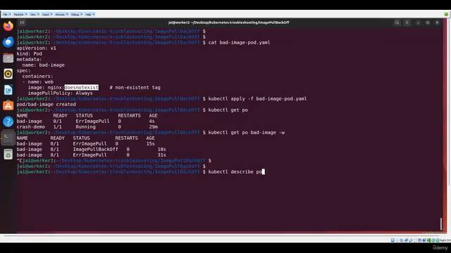
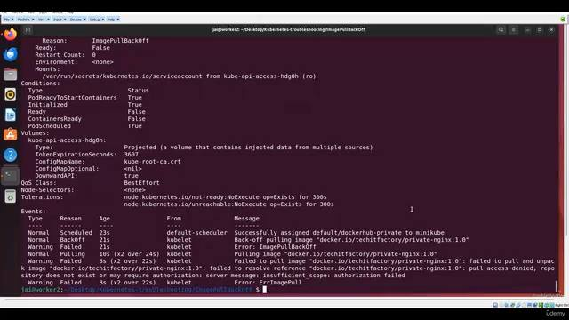
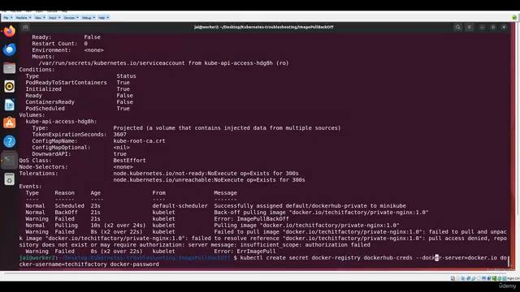
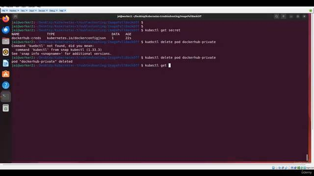
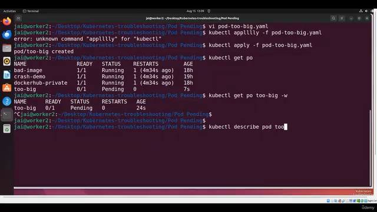
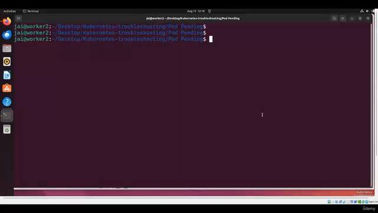
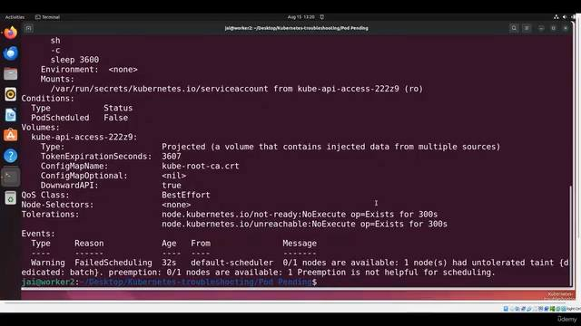
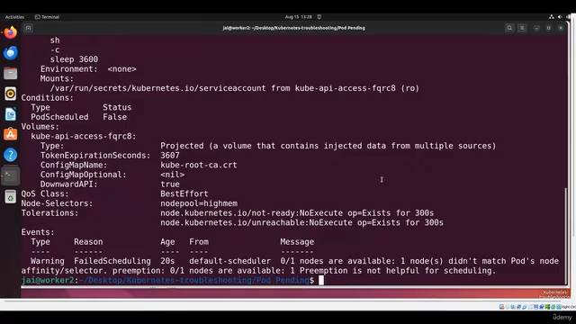
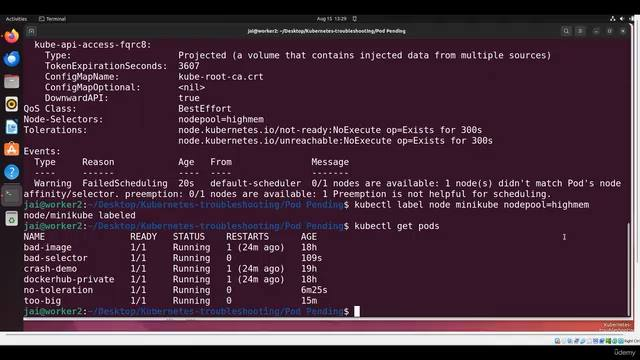

# Kubernetes Troubleshooting 实战复盘（P006–P009）

## 1. 这一节做什么

这四段课（P006–P009）不是按知识点罗列，而是围绕**四类"看起来都不工作、但根因完全不同"的故障**做现场复现：镜像拉不下来（`ErrImagePull` / `ImagePullBackOff`）、Pod 停在 `Pending`、私有仓库 401 拉取失败、Pod 卡在 `Terminating`。讲师的做法非常统一，值得先抽象出来：

> 先用 `kubectl get pods` 确认**症状字符串**（ErrImagePull / ImagePullBackOff / Pending / Terminating），再用 `kubectl describe pod` 读 **Events 段里的那一句话**，然后才决定是改 YAML、加 Secret、加 Toleration，还是重建 PVC。

这套"症状 → describe 里的那句话 → 对应动作"的映射，就是本节要交付的东西。读完之后你应该能在一台 minikube 上把下面六种故障**逐个手工复现，再逐个修好**：

| # | 故障现象 | describe 里的关键信息 | 修复动作 | 出自 |
|---|---|---|---|---|
| 1 | `ErrImagePull` → `ImagePullBackOff` | `Failed to pull image ... Not found` | 修正镜像 tag，delete + apply（或 patch） | P006 |
| 2 | `ImagePullBackOff`（私有镜像） | `insufficient scope unauthorized` | 建 `docker-registry` Secret，Pod 挂 `imagePullSecrets` | P006 |
| 3 | `Pending` | `0/1 nodes are available: 1 Insufficient memory` | 把 `requests.memory` 从 32Gi 改到 128Mi | P007 / P008 |
| 4 | `Pending` | `1 node(s) had untolerated taint {dedicated: batch}` | 给 Pod 加 `tolerations`（或去掉节点 taint） | P008 |
| 5 | `Pending` | `didn't match`（nodeSelector 不匹配） | `kubectl label node` 打上对应标签 | P008 |
| 6 | `Pending`（PVC） | PVC describe 里没有可用 StorageClass | 用 `standard` 存储类重建 PVC（改不了，只能重建） | P008 |

第七个现象 `Terminating` 在 P009 里只讲了理论和排查路径，**没有在集群里实操**，所以本文第 3.7 节只给排查顺序，不假装有演示。

---

## 2. 讲师原话

关于镜像拉取的**重试循环**，讲师解释得很直白：

> "Kubernetes 会怎么做呢？它会再次重试拉取该镜像，然后又会看到镜像拉取错误；接着进入退避状态，增加一些等待时间，再次重试，于是你会在状态里不断看到这个错误。"
> —— p006 [00:41]

> "所以它只显示“未找到”，也就是说这个名称下根本没有镜像；但我们给的是错误的镜像标签。"
> —— p006 [01:49]

私有仓库那一幕，讲师把 `describe` 里最关键的一句念了出来：

> "最后它显示“范围不足、未授权、失败”。也就是说，你没有足够的权限获取或拉取这个镜像。"
> —— p006 [09:18]

并且他强调这是真实工作中最常见的形态，而不是错 tag 那种玩具例子：

> "要实时获取这些信息；大多数时候，你看到的问题都与凭据或 Secret 有关。"
> —— p006 [04:23]

Pending 的定性，P007 里有一句可以直接当口诀用：

> "处于 Pending 是调度器的问题，这意味着 Pod 无法被放置，而不是启动之后才失败。"
> —— p007 [06:53]

P008 现场复现资源不足时，讲师复述 describe 的输出：

> "1 个节点中 0 个可用：1 个内存不足。抢占：1 个节点中 0 个可用：没有为新来的 Pod 找到可抢占的牺牲者。"
> —— p008 [02:17]

taint 场景他补了一句"为什么业务 Pod 从来不落到 master 上"：

> "它永远不会进入 Kubernetes 主节点。那为什么不会进入主节点呢？因为主节点通常会被打上污点，这样就不会有 Pod 进入并驻留在主节点上。"
> —— p008 [11:42]

PVC 场景他撞到了"字段不可变"这个硬墙：

> "这清楚地说明，创建之后 spec 是不可变的，但 resources.request 除外。"
> —— p008 [18:39]

P009 对 `Terminating` 的定性和风险提示：

> "Pod 卡在 Terminating 状态，等同于关闭流程或集群资源问题。"
> —— p009 [04:15]

> "只有在理解风险的情况下才使用强制删除。大多数时候，人们会直接删除 Pod 并加上 --force。但这可能带来什么？它可能无法优雅地关闭应用，也可能引发其他问题。"
> —— p009 [04:44]

---

## 3. 从零复现

### 3.0 环境与前置

讲师全程在一台 **minikube 单节点**集群上操作，节点名就叫 `minikube`（`kubectl get nodes` 只返回一个节点，所以 describe 里永远是 `0/1 nodes are available`，不是 `0/3`）。准备清单：

- 一台 Linux 虚拟机，装好 `minikube`、`kubectl`、`docker`
- 一个 Docker Hub 账号，以及一个**有 push 权限的 Personal Access Token（PAT）**
- 磁盘至少留几个 GB 给镜像

先确认环境：

```bash
minikube start
kubectl get nodes
# 期望看到一行：minikube   Ready   control-plane   ...
```

工作目录统一放在一个地方，后面所有 YAML 都丢进去：

```bash
mkdir -p ~/k8s-troubleshooting && cd ~/k8s-troubleshooting
mkdir -p image-pull-back-off pending terminating
```

### 3.1 实验一：tag 不存在 → ErrImagePull → ImagePullBackOff

进入目录，写一个"故意写错 tag"的 Pod：

```bash
cd ~/k8s-troubleshooting/image-pull-back-off
vi bad-image-pod.yaml
```

内容见第 4 节 `bad-image-pod.yaml`。关键点是 `image: nginx:1.25-alpine-does-not-exist`——这个 tag 在 Docker Hub 上不存在。

```bash
kubectl apply -f bad-image-pod.yaml
kubectl get pods
```

第一次 `get pods` 会看到 `ErrImagePull`；过一会儿再查一次，状态变成 `ImagePullBackOff`。这就是讲师说的"拉取失败 → 退避 → 再拉 → 再失败"的循环，`BackOff` 是 Kubernetes 在两次重试之间**加了等待时间**，不是新错误。

现在读那句话：

```bash
kubectl describe pod bad-image
```



在 `Events` 段里能找到 `Failed to pull image ...` 加一个 `Not found`。到这里根因就确定了：**不是网络问题，是 tag 写错了**。

修复有两条路。第一条是改 YAML（讲师推荐的做法）：

```bash
vi bad-image-pod.yaml      # 把 image 改成 nginx:1.25-alpine
kubectl delete -f bad-image-pod.yaml
kubectl apply -f bad-image-pod.yaml
kubectl get pods
```

会依次经过 `ContainerCreating` → `Running`。验证应用真的起来了：

```bash
kubectl logs -f bad-image
```

第二条是 `kubectl patch`，讲师口述了字段路径但没逐字念完整 JSON，按他的描述补全如下：

```bash
kubectl patch pod bad-image --type=strategic \
  -p '{"spec":{"containers":[{"name":"web","image":"nginx:1.25-alpine"}]}}'
```

> 注意：`patch` 只适合开发/临时环境。讲师在 P008 里明确说过，"在合适的环境中操作时……最好还是修改你的 YAML 文件"，生产环境请走 Git 里的 manifest 或 Helm values。

### 3.2 实验二：私有仓库 → insufficient scope unauthorized

这一段是整节课信息密度最高的部分，因为它演示了一个**会骗人的中间状态**。

先造一个私有镜像：

```bash
docker login
docker pull nginx:1.25-alpine
docker tag nginx:1.25-alpine <你的DockerHub用户名>/private-nginx:1.0
docker push <你的DockerHub用户名>/private-nginx:1.0
```

推上去之后，去 Docker Hub 网页端把这个仓库改成私有：进入仓库 → Settings → Make private（讲师现场就是这么点的）。

然后直接跑：

```bash
kubectl run docker-hub-private \
  --image=docker.io/<你的DockerHub用户名>/private-nginx:1.0 \
  --restart=Never
kubectl get pods
```

**这里会出现第一个坑**：Pod 显示 `Running`。讲师的原话是它"从本机选择镜像……它已经存在于这台机器上"——因为 minikube 这个节点复用了本机 docker 的镜像缓存，根本没去远端拉。所以这个 `Running` 是假象。

要复现真实故障，必须先清掉本地缓存再重建：

```bash
docker rmi <你的DockerHub用户名>/private-nginx:1.0
kubectl delete pod docker-hub-private
kubectl run docker-hub-private \
  --image=docker.io/<你的DockerHub用户名>/private-nginx:1.0 \
  --restart=Never
kubectl get pods
```

这次才是 `ImagePullBackOff`。describe：

```bash
kubectl describe pod docker-hub-private
```



Events 里会出现 `failed to pull and unpack image`、`failed to resolve reference`，最后落到 `insufficient scope unauthorized`。这句话的意思是：**仓库认得你，但你没权限拉这个仓库**——也就是"没带凭据"。

建 Secret：

```bash
kubectl create secret docker-registry docker-hub-creds \
  --docker-server=docker.io \
  --docker-username=<你的DockerHub用户名> \
  --docker-password=<你的PAT> \
  --docker-email=<你的邮箱>
kubectl get secret
```



讲师在这里踩了一个语法坑并现场纠正：`--docker-username` 这类长参数**必须带两个短横线**，他第一遍漏了，命令报错。你照着上面的写法复制就不会踩。

确认 Secret 存在后，**不能继续用 `kubectl run`**——讲师试过，`run` 没法把 `imagePullSecrets` 传进去，于是他改用 YAML：

```bash
kubectl delete pod docker-hub-private
kubectl apply -f private-nginx-pod.yaml
kubectl get pods
kubectl describe pod docker-hub-private
```



这次 describe 的 Events 里能看到镜像被成功拉取，Pod 进入 `ContainerCreating` → `Running`。

> 讲师在这里打错过一次镜像名（`nginx41.0`），报错后才发现是拼写问题。这类"看起来像权限问题、其实是手滑"的情况在真实排障里占比不低，所以每次改完 YAML 都要重新 `describe` 确认 Events 变了。

### 3.3 实验三：Pending —— 资源请求远超节点容量

```bash
cd ~/k8s-troubleshooting/pending
vi pod-too-big.yaml
kubectl apply -f pod-too-big.yaml
kubectl get pods
```

状态是 `Pending`，而且**没有 BackOff**——这是它和实验一最直观的区别：调度器压根没让它上节点，所以谈不上"重试拉镜像"。

```bash
kubectl describe pod pod-too-big
```



Events 里会出现 `0/1 nodes are available: 1 Insufficient memory`，后面还跟着一行与抢占（preempt）相关的说明——讲师念的是 `no preemptive victims found for incoming pod`，意思是"想抢占别人的资源腾地方，也没有可抢的对象"。

也可以用只看事件的方式（讲师演示了这条捷径，但转写里命令不完整，这里给等价写法）：

```bash
kubectl get events --sort-by=.metadata.creationTimestamp | tail -20
```

修复：把 `requests.memory` 从 `32Gi` 改成 `128Mi`，`limits.memory` 给 `256Mi`。

```bash
vi pod-too-big.yaml
kubectl delete -f pod-too-big.yaml
kubectl apply -f pod-too-big.yaml
kubectl get pods
```

**这里有个真实会踩的坑**：讲师第一次把单位写错了（写成了非法的 quantity 后缀），`apply` 直接报 `quantity suffix` 相关错误。Kubernetes 的内存单位是大小写敏感的：`Mi` 是 Mebibyte，`m` 是"千分之一"，`128m` 对内存来说是另一个量级的值，别混。

修好之后 Pod 会走 `ContainerCreating` → `Running`。

讲师的 `patch` 版本（他口述了字段路径，没念完整 JSON，下面按路径补全）：

```bash
kubectl patch pod pod-too-big --type=strategic \
  -p '{"spec":{"containers":[{"name":"app","resources":{"requests":{"memory":"128Mi"},"limits":{"memory":"256Mi"}}}]}}'
```

同样，讲师强调这只在开发环境用，pre-prod / prod 请改 manifest 或 Helm values。

### 3.4 实验四：Pending —— 节点有 taint，Pod 没有 toleration

```bash
kubectl get nodes
kubectl taint nodes minikube dedicated=batch:NoSchedule
```

打完之后节点就"脏"了：**任何没有对应 toleration 的 Pod 都不会被调度上去**。讲师顺带解释了 master 节点为什么永远不跑业务 Pod——"主节点总是会被打上污点"，是同一个机制。

```bash
kubectl apply -f pod-with-no-toleration.yaml
kubectl get pods
```



`Pending`。describe：

```bash
kubectl describe pod no-toleration
```

Events 里出现 `0/1 nodes are available: 1 node(s) had untolerated taint {dedicated: batch}`。到这里根因非常明确。

修复：在 Pod spec 里加 `tolerations`，字段要和 taint 一一对应——taint 是 `dedicated=batch:NoSchedule`，toleration 就是 `key: dedicated` / `operator: Equal` / `value: batch` / `effect: NoSchedule`。



```bash
kubectl delete -f pod-with-no-toleration.yaml
kubectl apply -f pod-with-no-toleration.yaml
kubectl get pods
```

变 `Running`。最后把 taint 去掉（讲师说这是常见面试题，命令末尾加一个 `-`）：

```bash
kubectl taint nodes minikube dedicated=batch:NoSchedule-
# 输出：node/minikube untainted
```

### 3.5 实验五：Pending —— nodeSelector 找不到匹配的标签

```bash
kubectl apply -f bad-selector-pod.yaml
kubectl get pods
```

`Pending`。Pod 里写的是 `nodeSelector: { node-pool: high-mem }`，但集群里唯一的节点 `minikube` 上没有这个标签。

```bash
kubectl describe pod bad-selector
```



Events 里会出现 `didn't match` 之类的表述。修复不是改 Pod，而是**给节点打标签**：

```bash
kubectl label node minikube node-pool=high-mem
kubectl get pods
```

讲师说这个 Pod "不到一秒，它就进入了运行状态"——因为调度器一直在重试调度，标签一出现立刻就匹配上了。

> 讲师也提醒了：这只是为了演示，真实环境里不要随便给节点打业务标签来"迁就"一个 Pod，nodeSelector 应该反过来——先规划好节点池，再让 Pod 去选。

### 3.6 实验六：PVC 卡在 Pending —— StorageClass 不存在

```bash
kubectl apply -f bad-pvc.yaml
kubectl get pvc
```

`STATUS` 是 `Pending`。因为 `storageClassName: does-not-exist` 在集群里不存在。

先试最常见的"改一下"思路：

```bash
kubectl patch pvc bad-pvc -p '{"spec":{"storageClassName":null}}'
```

直接报错，讲师念的那句是 `spec is immutable after creation except resources.requests`。也就是说，**PVC 的 `storageClassName` 创建后不可修改**（除了 `resources.requests`）。

唯一出路是删掉重建：

```bash
kubectl delete pvc bad-pvc
vi bad-pvc.yaml        # storageClassName 改成 standard
kubectl apply -f bad-pvc.yaml
kubectl get pvc
```



状态变 `Bound`。讲师确认过 minikube 自带一个叫 `standard` 的 StorageClass；如果你用的是别的集群，先用 `kubectl get storageclass` 查清楚名字再填。

### 3.7 实验七：Pod 卡在 Terminating（P009 只有理论，没有实操）

P009 里讲师讲完原理后说 "让我们登录集群，看看如何解决这个问题"，但这段课到此结束，**集群演示没有进行**。所以这一节只给排查顺序，全部来自他讲的方法论，不编造输出。

```bash
# 1. 找出所有卡住的 Pod
kubectl get pods -A | grep Terminating

# 2. 看 describe 的 Events：找 preStop hook、volume unmount、finalizer 相关行
kubectl describe pod <pod-name> -n <namespace>

# 3. 看应用日志，确认是不是没处理 SIGTERM
kubectl logs <pod-name> -n <namespace>

# 4. 看 PDB 是不是挡住了驱逐
kubectl get pdb -n <namespace>

# 5. 看 PVC / PV 是否卡在卸载
kubectl get pvc -n <namespace>
```

讲师列出的常见根因是：应用收到 SIGTERM 后不退出、`preStop` hook 挂住、PDB 阻止最后一个 Pod 被驱逐、finalizer 阻止删除、卷 detach/unmount 卡住、API server 或网络问题。

关于 `--force`，他的态度是明确的：可以删，但**要先理解后果**——强删不会走优雅关闭，可能留下卷挂载残留或其他副作用。

---

## 4. 完整代码

目录结构：

```
~/k8s-troubleshooting/
├── image-pull-back-off/
│   ├── bad-image-pod.yaml
│   ├── private-nginx-pod.yaml
├── pending/
│   ├── pod-too-big.yaml
│   ├── pod-with-no-toleration.yaml
│   ├── bad-selector-pod.yaml
│   └── bad-pvc.yaml
└── terminating/
    └── README.md          # P009 未实操，只放排查命令
```

### 4.1 `bad-image-pod.yaml`

```yaml
apiVersion: v1
kind: Pod
metadata:
  name: bad-image
  labels:
    app: bad-image
spec:
  containers:
    - name: web
      image: nginx:1.25-alpine-does-not-exist
      ports:
        - containerPort: 80
```

### 4.2 `private-nginx-pod.yaml`

把 `<DOCKER_HUB_USER>` 换成你的 Docker Hub 用户名，`docker-hub-creds` 与第 3.2 节创建的 Secret 名保持一致。

```yaml
apiVersion: v1
kind: Pod
metadata:
  name: docker-hub-private
  labels:
    app: docker-hub-private
spec:
  imagePullSecrets:
    - name: docker-hub-creds
  containers:
    - name: private-nginx
      image: docker.io/<DOCKER_HUB_USER>/private-nginx:1.0
      imagePullPolicy: Always
      ports:
        - containerPort: 80
```

### 4.3 `pod-too-big.yaml`

```yaml
apiVersion: v1
kind: Pod
metadata:
  name: pod-too-big
  labels:
    app: pod-too-big
spec:
  containers:
    - name: app
      image: nginx:1.25-alpine
      resources:
        requests:
          memory: "32Gi"
        limits:
          memory: "32Gi"
```

修好之后的版本（只改 resources 段）：

```yaml
apiVersion: v1
kind: Pod
metadata:
  name: pod-too-big
  labels:
    app: pod-too-big
spec:
  containers:
    - name: app
      image: nginx:1.25-alpine
      resources:
        requests:
          memory: "128Mi"
        limits:
          memory: "256Mi"
```

### 4.4 `pod-with-no-toleration.yaml`（含 toleration 的修复版）

第一版（会 Pending）：

```yaml
apiVersion: v1
kind: Pod
metadata:
  name: no-toleration
  labels:
    app: no-toleration
spec:
  containers:
    - name: busybox
      image: busybox:1.36
      command: ["sh", "-c", "sleep 3600"]
```

修复版：

```yaml
apiVersion: v1
kind: Pod
metadata:
  name: no-toleration
  labels:
    app: no-toleration
spec:
  tolerations:
    - key: dedicated
      operator: Equal
      value: batch
      effect: NoSchedule
  containers:
    - name: busybox
      image: busybox:1.36
      command: ["sh", "-c", "sleep 3600"]
```

### 4.5 `bad-selector-pod.yaml`

```yaml
apiVersion: v1
kind: Pod
metadata:
  name: bad-selector
  labels:
    app: bad-selector
spec:
  nodeSelector:
    node-pool: high-mem
  containers:
    - name: nginx
      image: nginx:1.25-alpine
```

### 4.6 `bad-pvc.yaml`

```yaml
apiVersion: v1
kind: PersistentVolumeClaim
metadata:
  name: bad-pvc
spec:
  accessModes:
    - ReadWriteOnce
  storageClassName: does-not-exist
  resources:
    requests:
      storage: 1Gi
```

修复版只改一行：

```yaml
  storageClassName: standard
```

### 4.7 一键跑完所有实验的脚本 `run-all.sh`

```bash
#!/usr/bin/env bash
set -euo pipefail

BASE="$HOME/k8s-troubleshooting"
USER_NAME="${DOCKER_HUB_USER:?请先 export DOCKER_HUB_USER=你的用户名}"

echo "== 实验一：错误 tag =="
kubectl apply -f "$BASE/image-pull-back-off/bad-image-pod.yaml"
sleep 15
kubectl get pods
kubectl describe pod bad-image | sed -n '/Events:/,$p'

echo "== 实验三：资源过大 =="
kubectl apply -f "$BASE/pending/pod-too-big.yaml"
sleep 5
kubectl get pods
kubectl describe pod pod-too-big | sed -n '/Events:/,$p'

echo "== 实验四：taint =="
kubectl taint nodes minikube dedicated=batch:NoSchedule --overwrite
kubectl apply -f "$BASE/pending/pod-with-no-toleration.yaml"
sleep 5
kubectl get pods
kubectl describe pod no-toleration | sed -n '/Events:/,$p'

echo "== 实验五：nodeSelector =="
kubectl apply -f "$BASE/pending/bad-selector-pod.yaml"
sleep 5
kubectl get pods
kubectl describe pod bad-selector | sed -n '/Events:/,$p'

echo "== 实验六：PVC =="
kubectl apply -f "$BASE/pending/bad-pvc.yaml"
sleep 5
kubectl get pvc

echo "== 清理 =="
echo "手动执行：kubectl delete -f <各 yaml>；kubectl taint nodes minikube dedicated=batch:NoSchedule-"
```

### 4.8 `terminating/README.md`

```markdown
# Pod 卡在 Terminating 的排查顺序（P009 未在集群实操）

1. kubectl get pods -A | grep Terminating
2. kubectl describe pod <pod> -n <ns>   # 看 Events：preStop / unmount / finalizer
3. kubectl logs <pod> -n <ns>           # 应用是否处理 SIGTERM
4. kubectl get pdb -n <ns>              # 是否被 PodDisruptionBudget 挡住
5. kubectl get pvc -n <ns>              # 卷是否卡在卸载

--force 慎用：不会优雅关闭，可能留下卷残留。
```

---

## 5. 逐行解释

先看 `bad-image-pod.yaml`。

`kind: Pod` 意味着这是**裸 Pod**，没有 ReplicaSet 兜底，删了就没了——这也是为什么修复时用 `delete` + `apply` 而不是等它自愈。`name: bad-image` 是后面所有 `describe` / `logs` 命令的锚点。`containers[].name: web` 这个值在做 `kubectl patch` 时**必须一字不差**，因为 strategic merge patch 靠它定位容器。`image: nginx:1.25-alpine-does-not-exist` 是本实验的全部变量——tag 不存在时，kubelet 在拉取阶段就失败，容器根本不会创建，所以 `logs` 是空的，只能靠 `describe`。

再看 `private-nginx-pod.yaml` 里的两个关键字段。

`imagePullSecrets[].name: docker-hub-creds` 告诉 kubelet："拉这个 Pod 的镜像时，去读这个 Secret 里的凭据"。这个字段放在 `spec` 层级（不是容器层级），意味着对 Pod 里所有容器生效。少了它，`kubectl create secret` 建得再对也没用——Secret 和 Pod 之间没有任何自动关联。

`imagePullPolicy: Always` 是我们故意加的。默认策略是 `IfNotPresent`，节点上已经有同名镜像时就直接复用、不联网，你就永远复现不出 401。讲师在 P006 里正是被这个策略坑了一次（Pod 显示 Running，其实是本地缓存）。**在生产环境里，`Always` 配合固定 tag 会让每次重启都去校验一次镜像，是有成本的；这里只是为了教学复现。** 讲师在转写里说他显式写了 `imagePullPolicy`，但具体值没听清，这里取 `Always` 是为了让实验稳定可复现。

`pod-too-big.yaml` 的 `resources.requests.memory: "32Gi"` 是调度器的**硬门槛**：调度器会把 Pod 的 requests 和节点可分配资源做比较，32Gi 超过单机容量，于是永远匹配不上，Pod 停在 `Pending`。注意 `limits` 也写成 32Gi 是为了让"请求=上限"，语义更清晰；如果你只写 `requests` 不写 `limits`，Pod 属于 Burstable 类型，调度行为一样，但运行时更容易被 OOM 影响邻居。改成 `requests: 128Mi` / `limits: 256Mi` 之后，调度器能放下它，kubelet 也能启动容器。

`pod-with-no-toleration.yaml` 的 `tolerations` 和节点上的 taint 是一组**必须严格配对**的字段。taint 写作 `key=value:Effect`，toleration 就要拆成 `key` / `value` / `effect` 三段；`operator: Equal` 表示值必须相等（另一个合法值是 `Exists`，表示只要 key 存在就容忍，不需要 value）。`effect: NoSchedule` 必须和 taint 的 effect 一致——taint 有三种 effect（`NoSchedule` / `PreferNoSchedule` / `NoExecute`），容忍的行为各不相同，课里只演示了 `NoSchedule`。讲师口述时说 "等于运算符"，YAML 里实际写的是 `Equal`，这两个词在 K8s 里不是一个东西，复制时以 YAML 为准。

`bad-selector-pod.yaml` 的 `nodeSelector: { node-pool: high-mem }` 是**精确匹配**的键值对，节点上必须存在完全相同的 label。它比 `nodeAffinity` 简单，但也没有"软约束"能力——匹配不上就是 `Pending`，不会退而求其次。修复时用 `kubectl label node minikube node-pool=high-mem`，标签一落地，调度器下次重试就成功了，所以你观察到的是"秒变 Running"。

`bad-pvc.yaml` 的 `storageClassName: does-not-exist` 是故意指向一个不存在的 StorageClass。PVC 的绑定依赖 StorageClass 里的 provisioner 去创建 PV，StorageClass 不存在，PVC 永远等不到 PV，就停在 `Pending`。这里最重要的一课是**字段不可变**：`storageClassName` 在 PVC 创建后被 API Server 锁定，`patch` 会直接报 `spec is immutable after creation except resources.requests`。所以修 PVC 的姿势永远是"删了重建"，而不是"改一改"。

Secret 那条命令里的四个 `--docker-*` 参数，分别对应"仓库地址 / 用户名 / 密码或 PAT / 邮箱"。`--docker-server=docker.io` 必须和镜像前缀 `docker.io/...` 对得上，否则 kubelet 匹配不到凭据。密码位置填 **PAT 而不是登录密码**——讲师演示时就是这么做的。至于这个 Secret 在集群里最终被存成什么类型、包含哪些字段，课里没展开，可以用 `kubectl get secret docker-hub-creds -o yaml` 自己看，**字段名以实际输出为准**。

最后补一句和前端背景相关的：P009 讲的"应用收到 SIGTERM 不退出"在 Node 里就是 `process.on('SIGTERM', ...)` 没写、或者写了但没在超时前 `process.exit()`。K8s 默认给 30 秒宽限期，超时就 SIGKILL。这个对应关系**课里没讲**，是我按 Node 的运行时行为补的，供你排查时对照。

---

## 6. 复现检查清单

按顺序打勾，任何一项不符合就先停下来看 describe 的 Events，不要往下走。

- [ ] `kubectl get nodes` 返回 `minikube`，状态 `Ready`
- [ ] `bad-image-pod.yaml` apply 后 15 秒内出现 `ErrImagePull` 或 `ImagePullBackOff`
- [ ] `kubectl describe pod bad-image` 的 Events 里能看到 `Not found`
- [ ] 把 image 改成 `nginx:1.25-alpine` 后，Pod 到 `Running`，`kubectl logs` 有 nginx 启动日志
- [ ] `docker push` 成功，Docker Hub 网页端该仓库已显示为 private
- [ ] 直接 `kubectl run` 时 Pod 是 `Running`（说明命中了本地镜像缓存）
- [ ] 执行 `docker rmi` 并删除 Pod 后重建，状态变成 `ImagePullBackOff`
- [ ] describe 里出现 `insufficient scope unauthorized`
- [ ] `kubectl get secret` 能看到 `docker-hub-creds`
- [ ] 用 `private-nginx-pod.yaml` 重建后 Pod 到 `Running`，describe 里不再有 unauthorized
- [ ] `pod-too-big.yaml`（32Gi）apply 后是 `Pending`，且**没有** BackOff
- [ ] describe 里出现 `Insufficient memory`
- [ ] 改成 `128Mi` / `256Mi` 后到 `Running`
- [ ] `kubectl taint nodes minikube dedicated=batch:NoSchedule` 输出 `tainted`
- [ ] `no-toleration` Pod 是 `Pending`，describe 出现 `untolerated taint`
- [ ] 加 `tolerations` 后到 `Running`
- [ ] `kubectl taint nodes minikube dedicated=batch:NoSchedule-` 输出 `untainted`
- [ ] `bad-selector` Pod 是 `Pending`，describe 出现 `didn't match`
- [ ] `kubectl label node minikube node-pool=high-mem` 之后秒变 `Running`
- [ ] `bad-pvc` 是 `Pending`
- [ ] `kubectl patch pvc` 报 `spec is immutable after creation except resources.requests`
- [ ] 用 `standard` 重建后 PVC 是 `Bound`

---

## 7. 课里没讲但你会撞上的

**1）`kubectl run` 传不了 `imagePullSecrets`。** 讲师现场撞上了，但他只说了"改用 YAML"，没给别的方案。如果你必须用命令行，`kubectl run` 支持 `--overrides` 传一段 JSON patch，但语法很绕；直接写 YAML 更省事，这也是讲师最后的选择。

**2）Secret 建好了，Deployment 里还是要一个个挂。** 每个 Pod spec 都写 `imagePullSecrets` 很啰嗦。标准做法是把 secret 挂到 ServiceAccount 上，Pod 用这个 SA 就自动继承——**课里没讲 SA 这一层**，但你在真实项目里一定会遇到。

**3）PAT 的权限范围。** 讲师只说了"用 PAT"，没说 token 需要勾哪些 scope。只读仓库的 token 就足够拉取；如果你 push 失败，先怀疑 token 没有 write 权限，而不是 K8s 的问题。

**4）`0/1` 和 `0/3` 的区别。** P007 的 PPT 上写的是 `0 of 3 nodes are available`，但实操环境是单节点所以显示 `0/1`。看到这个数字就能反推集群规模，别被 PPT 和终端的差异搞混。

**5）YAML 改了不生效，先怀疑没重新 apply。** 讲师在 P006 里就撞到过 `apply` 报"pod 已存在"，必须先 `delete`。裸 Pod 的很多字段（比如 `resources` 之外的不少项）是不可变的，改 YAML 后 `apply` 未必能原地更新。

**6）单位大小写。** `32Gi` 的 `Gi`、`128Mi` 的 `Mi` 都不能写成小写 `g` / `m`。讲师在 P008 就因为这个报过 `quantity suffix` 错误。

**7）PVC 的"删了重建"有数据风险。** 课里演示的是空 PVC，删了无所谓。生产环境删 PVC 可能连带删掉底层 PV（取决于 reclaim policy），重建前先确认数据能不能丢。

**8）`Terminating` 的 `--force` 不是银弹。** 讲师提醒了风险但没展开。强删只是把 API 里的对象摘掉，节点上的容器/卷可能还在，容易造成"看起来删了、实际没删干净"的假象。排查顺序应该是先看 finalizer、再看 PDB、再看卷，最后才考虑强删。

**9）多命名空间排查。** P007 提到 `kubectl get pods --all-namespaces | grep pending`，但实际告警里通常已经带了 namespace，直接 `-n` 更快。跨 namespace 全量扫在大集群上会很慢。

**10）Helm values 的修改路径。** 讲师在 P008 说过"去改你的 Helm values"，但**没有演示具体怎么改**。如果你用 Helm 部署，改 `values.yaml` 里的 `resources` 段然后 `helm upgrade`，比 `kubectl patch` 更符合生产规范。