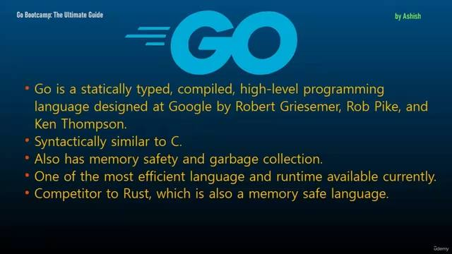
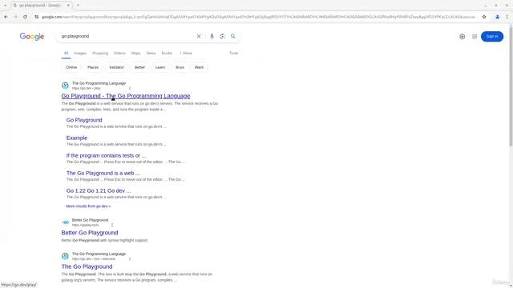
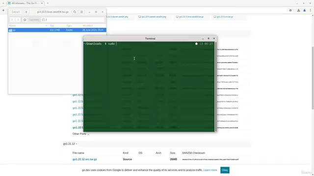
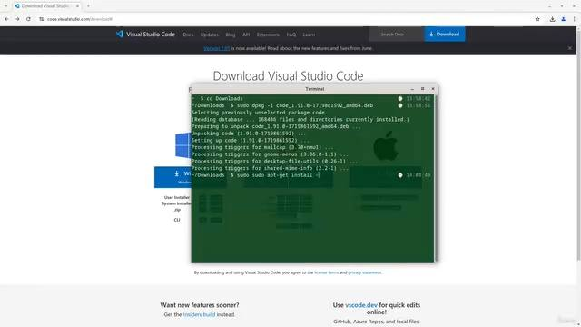
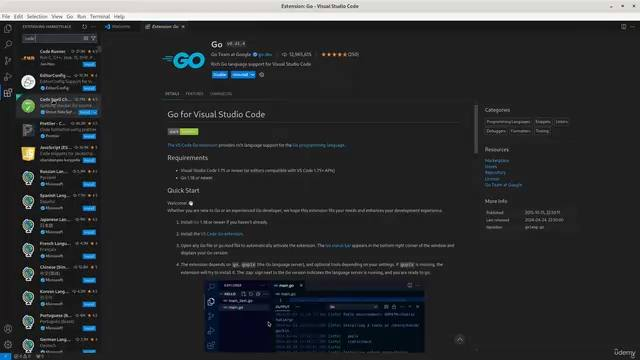
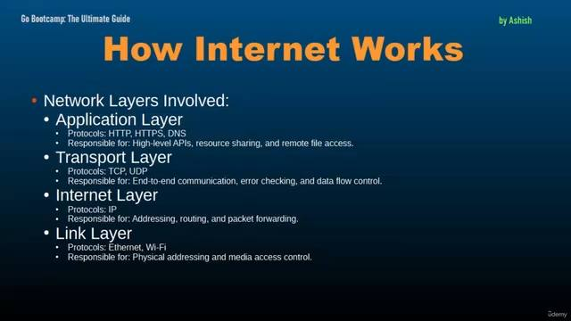

# 课程文档：gRPC & Protobuf（BV1oYx56TECn）P1–P15 —— Go 环境与网络基础

> 说明：课程标题叫《gRPC & Protobuf》，但 P1–P15 的逐字稿实际是 Go Bootcamp 的前导部分：介绍 Go、搭建本地开发环境、讲清互联网请求链路。真正的 REST 与 gRPC 对比在后续章节。本文档只复现 P1–P15 能做出的实际产物。

## 1. 这一节做什么

这一节是后续所有 API 项目的“地基”。它不写业务代码，而是先解决三件事：

**第一，把 Go 装到你的 Linux 上。** 课程在 Debian Linux 上用 tar 包安装，并把 Go 可执行文件目录加进 PATH，最终让 `go version` 能打印出版本号。

**第二，把写代码的工具准备好。** 课程选 VS Code 作为编辑器，并安装四个扩展：官方 Go 扩展、Code Runner、ErrorLens、To Do Tree。

**第三，在动手写 REST/gRPC 之前，建立网络常识。** 课程用一整讲（P015）讲清楚：你在浏览器输入网址回车后，DNS 怎么把域名翻译成 IP，TCP 怎么通过三次握手建立连接，HTTP 请求和响应长什么样，URL/URI/URN 有什么区别。

这一节结束时，你应该能回答三个问题：我的 Go 环境在哪？我怎么运行一个 `.go` 文件？一个网页请求从浏览器出发到渲染完成，中间经过哪些层？




## 2. 讲师原话

> "2007 年 9 月，谷歌工程师罗伯特·格里斯默、罗布·派克和肯·汤普森开始着手创建 Go。这是一门于 2009 年 11 月正式面向公众发布的编程语言。Go 在设计上精益求精，力求在代码编译和执行过程中同时兼顾清晰性与效率……"
> —— p004 [00:00]

> "Go 最突出的特性之一是其处理并发的方式。并发对于需要同时处理多个任务的现代应用至关重要。Go 的协程和通道为并发编程提供了一种简洁而强大的模型。"
> —— p005 [01:20]

> "Go Playground 是 Go 团队自己提供的在线环境。它让你无需在电脑上安装任何东西，就能编写、编译和执行 Go 代码。"
> —— p006 [00:26]

> "我们先输入 sudo，再输入 tar，因为要解压拿到的 tar 文件；也就是输入 tar -C，后面跟上要解压到的位置……接着输入 xzf，再跟上文件名。"
> —— p007 [00:57]

> "现在，我们通过在 VS Code 中安装一些扩展来改善编码体验。首先，我们会安装对我们最重要的扩展，也就是 Go。它是 Visual Studio Code 的官方 Go 语言支持扩展。"
> —— p014 [00:00]

> "互联网是由相互连接的计算机组成的全球网络，这些计算机使用标准化协议进行通信。其关键组成部分是客户端和服务器。客户端请求资源，服务器提供资源。"
> —— p015 [00:26]

> "这涉及 TCP/IP 协议。浏览器向服务器发送 TCP 同步包。服务器返回一个同步确认包，然后浏览器发送确认包，完成三次握手。"
> —— p015 [04:40]

> "端口是可选的。HTTP 的默认端口是 8080，HTTPS 的默认端口是 443。"
> —— p015 [12:19]

最后这句话里的“HTTP 默认端口是 8080”是口误，标准答案是 80；在本文档第 5、7 节会专门纠正。

## 3. 从零复现

### 3.1 准备：确认你的 Linux 版本和 CPU 架构

课程用的是 Debian Linux，CPU 是 64 位 AMD/x86 架构。复现前先确认你的环境：

```bash
uname -m
```

如果是 `x86_64`，就按课程选 Linux x86-64 的安装包。如果是 `aarch64`（ARM64），请下载 `linux-arm64` 包；课程没讲，但你大概率会撞上。

### 3.2 先在浏览器里跑一次 Go（可选，但建议做）

这一步不需要安装任何东西，用来验证“Go 长什么样”：

1. 打开 https://go.dev/play 。
2. 页面会自动带一个 Hello World 程序，直接点 **Run**。
3. 输出会显示在编辑器下方的面板里。
4. 右上角的下拉框可以切换 Go 版本，课程录制时默认是 Go 1.22。
5. 点 **Share** 会生成一个 URL，可以把代码片段发给别人。
6. 在示例下拉菜单里选择 **Fibonacci closure**，可以看到 Go Team 写的闭包版斐波那契代码和它的输出。



### 3.3 在 Linux 上安装 Go

**第 1 步：下载。** 打开 https://go.dev/dl ，选择 Linux 下的 `x86-64` 版本（对应 `uname -m` 输出 `x86_64`），得到一个类似 `go1.22.5.linux-amd64.tar.gz` 的文件。实际文件名以你下载到的版本为准。

**第 2 步：解压到 `/usr/local`。** 进入下载目录，执行：

```bash
cd ~/Downloads
sudo tar -C /usr/local -xzf go1.22.5.linux-amd64.tar.gz
```

`-C /usr/local` 的意思是“先切换目录再解压”，这样 tar 包里的 `go/` 文件夹会被放进 `/usr/local/go`。如果系统询问 sudo 密码，输入密码即可。

**第 3 步：确认解压成功。**

```bash
cd /usr/local && ls
```

你应该能在输出里看到 `go` 这个文件夹。

**第 4 步：把 Go 的可执行文件目录加进 PATH。**

课程讲师用的是 Z shell，所以他改了 `~/.zshrc`；如果你用 bash，就改 `~/.bashrc`。在文件末尾加一行：

```bash
export PATH=$PATH:/usr/local/go/bin
```

为了能直接照着抄，这里给出一行命令（效果相同，只是用命令代替打开编辑器）：

```bash
echo 'export PATH=$PATH:/usr/local/go/bin' >> ~/.zshrc
source ~/.zshrc
```

bash 用户把两条命令里的 `.zshrc` 换成 `.bashrc`。

**第 5 步：验证。**

```bash
go version
```

能打印出 `go version go1.22.X linux/amd64` 就说明装好了。课里只说“我们得到响应”，没有展示具体字段，实际输出以你的版本为准。



### 3.4 安装 VS Code

课程在 Debian 上用 `.deb` 包安装：

1. 打开 https://code.visualstudio.com/download，选择 Debian 的 x64 版本，下载 `.deb` 文件。
2. 在下载目录里安装：

```bash
cd ~/Downloads
sudo dpkg -i code_*.deb
```

3. 如果 `dpkg` 提示有未满足的依赖，修复：

```bash
sudo apt-get install -f
```

4. 在终端里启动 VS Code：

```bash
code
```

第一次启动时，VS Code 会询问是否向 Microsoft 发送数据，课程选择的是不发送。



### 3.5 安装 VS Code 扩展

打开 VS Code 左侧的扩展图标（或按 `Ctrl+Shift+X`），搜索并安装：

- **Go** —— 官方 Go 语言支持，提供语法高亮、自动补全。
- **Code Runner** —— 快速运行代码片段或整个文件。
- **ErrorLens** —— 把错误信息直接显示在代码旁边。
- **To Do Tree** —— 把代码里的 TODO 标记收集成列表。

课程还建议登录 VS Code 账号，这样扩展和配置会同步到云端，换电脑不丢。



### 3.6 本地验证：跑一个 Go 文件

课里没有在本地新建 Go 文件，但为了确认环境真的能写代码，本文档加一步验证。创建目录和文件：

```bash
mkdir -p ~/gobootcamp/hello && cd ~/gobootcamp/hello
```

把第 4 节的 `hello.go` 保存进去，然后：

```bash
go run hello.go
```

看到 `Hello, World!` 就说明 Go 环境完整可用。

### 3.7 复述一遍“网页请求链路”

这不是命令操作，而是把 P015 的讲解按步骤复现成你自己的笔记：

1. 输入 URL：浏览器拿到 `https://example.com` 这样的地址。
2. DNS 查询：浏览器先查自己的缓存；没有就去问 DNS resolver；resolver 按根服务器 → TLD 服务器（如 `.com`）→ 权威服务器 的顺序查到域名对应的 IP。
3. TCP 三次握手：浏览器发 SYN，服务器回 SYN-ACK，浏览器回 ACK，连接建立。
4. 发送 HTTP 请求：浏览器请求 `/index.html`，请求行如 `GET /index.html HTTP/1.1`。
5. 服务器响应：返回状态码（如 200）、headers（如 Content-Type）、body（HTML 或 JSON）。
6. 浏览器渲染：解析 HTML 构造 DOM，加载 CSS、JS、图片，画出页面。



## 4. 完整代码

### 4.1 `hello.go`

课程在 Go Playground 里直接运行了默认的 Hello World，但没有把源码逐字念出来。下面是标准写法，可直接保存运行：

```go
package main

import "fmt"

func main() {
	fmt.Println("Hello, World!")
}
```

> 课里没有逐字给出这个文件，以上是 Go Playground 默认 Hello World 的标准代码（示意）。

### 4.2 `fibonacci.go`

课程演示了 Go Playground 自带的 **Fibonacci closure** 示例，但没有贴源码。下面是 go.dev/play 该示例的标准实现：

```go
package main

import "fmt"

// fib 返回一个闭包；每次调用闭包，返回下一个斐波那契数。
func fib() func() int {
	a, b := 0, 1
	return func() int {
		a, b = b, a+b
		return a
	}
}

func main() {
	f := fib()
	for i := 0; i < 10; i++ {
		fmt.Println(f())
	}
}
```

> 课里只演示了“选这个示例 → 运行 → 看输出”，没有贴源码；以上为示意代码。

运行方式：

```bash
go run fibonacci.go
```

预期输出：

```
1
1
2
3
5
8
13
21
34
55
```

### 4.3 `install_go.sh`

由 P007 的安装命令整理而成。用法：`bash install_go.sh 你下载的go文件名.tar.gz`。

```bash
#!/usr/bin/env bash
# 安装 Go 到 /usr/local 并配置 PATH
# 用法: bash install_go.sh go1.22.5.linux-amd64.tar.gz

GO_TARBALL="$1"

if [ -z "$GO_TARBALL" ]; then
  echo "请把 go 的 tar.gz 文件名作为参数传入"
  exit 1
fi

sudo tar -C /usr/local -xzf "$GO_TARBALL"

# zsh 用户写入 ~/.zshrc；bash 用户把下面两行改成 ~/.bashrc
echo 'export PATH=$PATH:/usr/local/go/bin' >> ~/.zshrc
source ~/.zshrc

go version
```

### 4.4 `install_vscode.sh`

由 P011 的安装命令整理而成：

```bash
#!/usr/bin/env bash
# 安装 VS Code 的 .deb 包并修复依赖
cd ~/Downloads || exit 1
sudo dpkg -i code_*.deb
sudo apt-get install -f
code
```

### 4.5 互联网请求流程（课堂笔记产物）

| 阶段 | 发生什么 | 关键概念 |
|---|---|---|
| 1. 输入 URL | 浏览器拿到 `https://example.com/images/picture.jpg?category=tech` | URL/URI |
| 2. DNS 解析 | 浏览器缓存 → DNS resolver → 根/TLD/权威服务器 | DNS，IP 地址 |
| 3. TCP 连接 | SYN → SYN-ACK → ACK 三次握手 | TCP/IP |
| 4. HTTP 请求 | 发送 `GET /index.html HTTP/1.1` | HTTP |
| 5. HTTP 响应 | 状态码 200，headers，body（HTML/JSON） | 状态码、Content-Type |
| 6. 渲染 | 解析 HTML 构造 DOM，加载 CSS/JS/图片 | DOM |

### 4.6 URL 组成表（课堂笔记产物）

| 组成 | 例子 | 说明 |
|---|---|---|
| 协议 / scheme | `https` | 也可是 `http`、`ftp` |
| host | `example.com` | 域名或 IP，域名靠 DNS 解析成 IP |
| port | （课里说 HTTP 默认 8080，标准是 80） | 可选；HTTPS 默认 443 |
| path | `/images/picture.jpg` | 资源在服务器上的路径 |
| query | `?category=tech` | 可选，`key=value` 键值对，用 `?` 开头 |

## 5. 逐行解释

### 5.1 安装 Go 的命令

```bash
sudo tar -C /usr/local -xzf go1.22.5.linux-amd64.tar.gz
```

- `sudo`：写入 `/usr/local` 需要 root 权限。前端同学可以类比 `npm install -g` 经常要管理员权限。
- `tar`：解包工具。
- `-C /usr/local`：先进入 `/usr/local` 再解压。如果不加 `-C`，tar 会在当前目录解出 `go/`，导致 Go 装到奇怪的位置。
- `-xzf`：`x` 表示解压，`z` 表示 gzip 压缩，`f` 表示后面的参数是文件名。这个 tar 包最外层是 `go/` 目录，所以解开后自然变成 `/usr/local/go`。
- 文件名里的 `linux-amd64`：表示 Linux + x86-64 架构。文件名必须和你实际下载的一致，不然会找不到文件。

```bash
echo 'export PATH=$PATH:/usr/local/go/bin' >> ~/.zshrc
```

- 单引号很关键：`$PATH` 不会被现在这个 shell 展开，而是原样写进文件；等你 `source` 的时候才展开成当时的 PATH。如果误用双引号，会把此刻的 PATH 值“焊死”进文件，以后 PATH 变化也带不上新目录。
- `>>` 是追加，不会覆盖文件原有内容。
- 在 Node 生态里，nvm 做的事和这一行本质相同：把某个可执行文件目录塞进 PATH，让 `node` 命令全局可用。

```bash
source ~/.zshrc
```

`source` 让当前终端立刻重新读取配置文件。如果不开新终端也不 source，`go` 命令在当前会话里仍然找不到。

```bash
go version
```

验证安装。能打印出 `go version go1.22.X linux/amd64` 即成功。课里没有展示具体输出字段，实际以你安装的版本为准。

### 5.2 安装 VS Code 的命令

```bash
sudo dpkg -i code_*.deb
```

- `dpkg -i`：Debian 系安装本地 `.deb` 包的命令。`code_*.deb` 是通配符，匹配你下载的 VS Code 安装包。
- 它不会自动解决依赖；如果缺少公共库，会报错。

```bash
sudo apt-get install -f
```

- `-f` 是 `--fix-broken`，修复刚才因为依赖缺失而处于损坏状态的包。
- 如果执行后仍失败，通常要先 `sudo apt update` 再重试；这是课里没讲但常见的坑。

```bash
code
```

启动 VS Code。安装成功后，`code` 命令已经在 PATH 里（`.deb` 包会自动处理）。

### 5.3 `hello.go`

```go
package main
```

- Go 程序从 `main` 包开始执行。相当于 JS 里入口文件。
- 注意：Go 目录里所有 `.go` 文件必须属于同一个包；`main` 包特指可执行程序。

```go
import "fmt"
```

- 导入标准库的 `fmt` 包，用于格式化输出。JS 里没有直接对应物，更像 Python 的 `print` 库函数。

```go
func main() {
	fmt.Println("Hello, World!")
}
```

- `main` 函数是程序入口。
- `fmt.Println` 等价于 `console.log`，输出一行文本并换行。

### 5.4 `fibonacci.go`

```go
func fib() func() int {
	a, b := 0, 1
	return func() int {
		a, b = b, a+b
		return a
	}
}
```

- `fib` 返回的是一个函数（闭包），不是数字。
- `a, b := 0, 1` 初始化两个变量；`:=` 是 Go 的短变量声明，自动推断类型。
- 内层匿名函数“记住”了外层 `a`、`b`，每次调用把 `a` 更新成上一个 `b`，`b` 更新成 `a+b`，并返回新的 `a`。
- JS 对应写法：

```js
function fib() {
  let a = 0, b = 1;
  return () => {
    [a, b] = [b, a + b];
    return a;
  };
}
```

```go
f := fib()
for i := 0; i < 10; i++ {
	fmt.Println(f())
}
```

- `f := fib()` 拿到闭包；每次 `f()` 得到下一个斐波那契数。
- 因为初始 `a=0, b=1`，第一次调用返回 1，所以输出是 `1 1 2 3 5 8 ...`。

### 5.5 互联网流程的关键决策点

- **为什么先查 DNS？** 因为 TCP/IP 不认 `example.com`，只认 IP。浏览器必须先把人类可读的域名翻译成 `192.0.2.1` 这种地址。这就像前端调接口时要先知道 API 的 host，但浏览器替你把“查通讯录”这步做了。
- **为什么三次握手？** 因为 TCP 是可靠、全双工的传输层协议。SYN 表示“我要连你”，SYN-ACK 表示“我同意并且我也要连你”，ACK 表示“收到”。三次之后双方都确认“我能发也能收”。在 Node 里你用 `http.createServer` 写服务端，或者用 `fetch` 发请求，这三步由内核和 Node 底层完成，你不会看到包。
- **为什么 URL 要有 path 和 query？** path 定位“哪台服务器上的哪个资源”，query 传“这次请求的额外参数”。对应到前端就是 `fetch('/api/users?page=2')` 里的 `path` 和 `query`。
- **URI / URL / URN 的区别**：URI 是统称（标识一个资源），URL 是“通过位置找到它”，URN 是“通过命名空间里的名字找到它”。前端日常写接口地址用的就是 URL。
- **课程口误纠正**：P015 说 HTTP 默认端口是 8080，标准是 **80**。8080 是开发服务器常用的非特权端口（比如后续 REST API 课里 `:8080` 起服务），所以容易和“默认端口”混淆。HTTPS 默认 443 是对的。

### 5.6 与前端/Node 的对应关系

- DNS 缓存：浏览器和操作系统都会缓存 DNS，对应到 Node 里，`dns.lookup` 也走系统缓存。
- TCP 握手：Node 的 `net` 模块或 `http` 模块自动完成，你只需要监听 `connect` 或 `request` 事件。
- 并发：P005 讲的 goroutine/channel，在 JS/Node 里对应 `worker_threads` 或 `cluster`；但 goroutine 不是线程，它更轻量。P1–P15 没有涉及锁和事务，所以此处不展开。

## 6. 复现检查清单

- [ ] 浏览器打开 https://go.dev/play，默认 Hello World 点 Run 后能看到输出。
- [ ] Go Playground 的版本下拉框显示 Go 1.22（或你能切到 1.22）。
- [ ] `uname -m` 输出是 `x86_64`（如果你按课程选 linux/amd64 的话）。
- [ ] `/usr/local/go` 目录存在。
- [ ] `go version` 能打印版本号；若打印不出来，说明 PATH 没生效。
- [ ] `echo $PATH | grep go/bin` 有输出。
- [ ] `code` 命令能打开 VS Code。
- [ ] VS Code 扩展列表里有 Go、Code Runner、ErrorLens、To Do Tree。
- [ ] `go run hello.go` 输出 `Hello, World!`。
- [ ] `go run fibonacci.go` 输出 1 1 2 3 5 8 13 21 34 55。
- [ ] 不看视频能复述：DNS 解析 → TCP 三次握手 → HTTP 请求 → HTTP 响应 → 渲染。
- [ ] 能说出 URL 五部分：协议、host、端口、path、query。

## 7. 课里没讲但你会撞上的

1. **Go 具体版本号**：课里只说当前是 Go 1.22。你下载时 go.dev/dl 上可能是 1.22.x 或更高版本，所有命令里的版本号要改成你实际下载的文件名。
2. **HTTP 默认端口是 80，不是 8080**：课里口误把 HTTP 默认端口说成 8080。标准是 HTTP 80、HTTPS 443；8080 只是开发期常用端口。面试和配置时都别写错。
3. **`~/.zshrc` vs `~/.bashrc`**：讲师用 zsh，所以写 `~/.zshrc`。Ubuntu/Debian 默认是 bash，要写 `~/.bashrc`；如果是 fish，语法完全不同。写错文件不会报错，但新终端里 `go` 命令永远不存在。
4. **单引号 vs 双引号**：`echo 'export PATH=$PATH:/usr/local/go/bin'` 必须用单引号。用双引号会把当前 PATH 展开后写入文件，长期来看会丢新路径。
5. **Windows / macOS 安装**：P1–P15 只讲了 Linux。macOS 可以用 `brew install go`，Windows 用 MSI 安装包，VS Code 同理。课里没讲。
6. **`go mod init` 还没出现**：P1–P15 没有提 Go module。但你在本地建项目跑后续 REST/gRPC 代码时，几乎都要先在项目目录执行 `go mod init <模块名>`，否则 `go run` 会因为当前目录不在 GOPATH 里而报错。
7. **网络环境**：下载 Go、安装扩展、拉 Go 模块都要求网络能通。公司代理环境下，需要在 shell 里配置 `HTTP_PROXY`/`HTTPS_PROXY`，VS Code 也要配代理；课里没讲。
8. **P008 / P009 / P012 / P013 是“空帧”**：这四讲的逐字稿只有 "you"，没有实质教学内容；你看到视频只有背景音乐或过渡画面，不用到处找“错过的东西”。
9. **真正的 gRPC / Protobuf 不在本部分**：课程标题虽然叫 gRPC & Protobuf，但 P1–P15 全部是前置基础。gRPC 与 REST 的对比、`.proto` 文件、protoc 生成代码，都在后续章节。