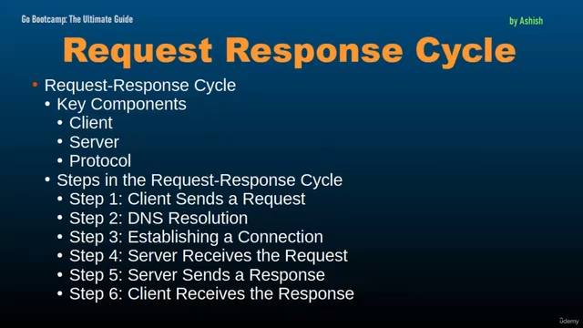
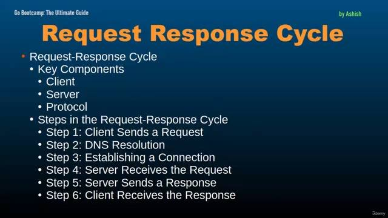
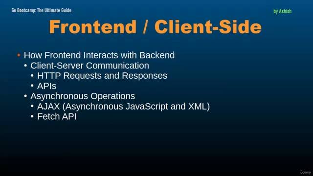
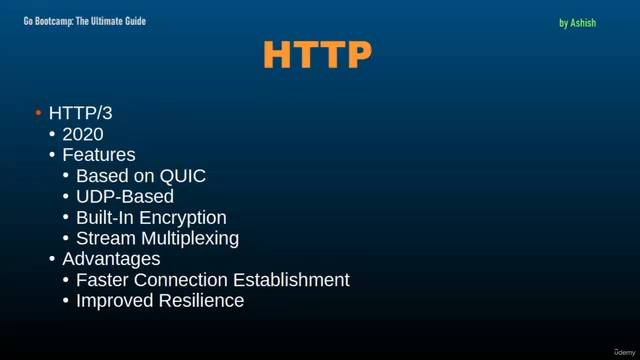
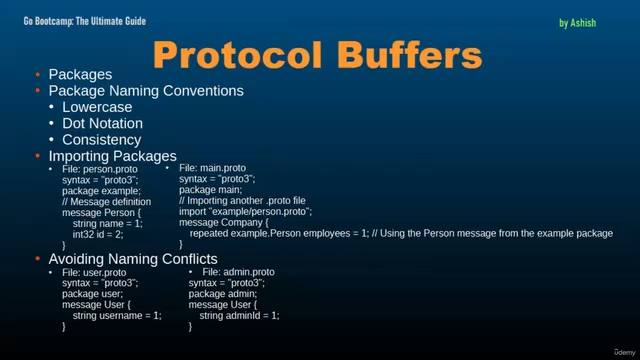
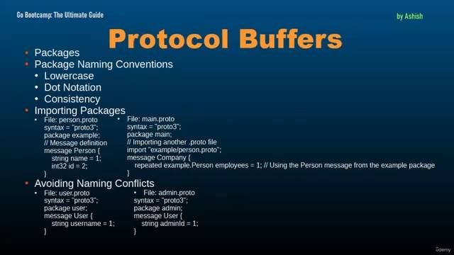

# gRPC & Protobuf（BV1oYx56TECn）P16–P22 复现文档

> 面向读者：前端转 AI 应用工程师。本节涉及的 HTTP、序列化、Node/浏览器差异都会额外标注。
> **先说明范围**：这 7 个片段里，P16–P19 讲的是 HTTP 请求-响应周期、前后端分工、HTTP/1.0→HTTP/3 演进；P20–P22 讲 Protobuf 是什么、`.proto` 文件语法、`package` 与 `import`。**课里没有出现 `service`、`rpc` 关键字，也没有 gRPC 的服务端/客户端代码**——本节能复现的产物是一个能通过 `protoc` 编译的 `.proto` 数据契约工程。凡是逐字稿没讲的东西，本文都会明确写「课里没讲」。

---

## 1. 这一节做什么

一句话：**讲师先用 4 节课把「客户端和服务端到底怎么说话」这件事讲透，再用 3 节课把「说话的内容长什么样」从 JSON 换成 Protobuf，并落地成 `.proto` 文件。**

拆成四块可复现的目标：

1. **建立请求-响应的心智模型**（p016）。一个请求从浏览器发出到页面渲染，中间有 7 个必经步骤：客户端发请求 → DNS 解析 → 建连接（TCP 三次握手，HTTPS 再加 TLS 握手）→ 服务端接收并处理（解析 / 路由 / 鉴权）→ 服务端构造响应（状态行 + 头 + 体）→ 客户端接收并处理 → 关闭或复用连接。附带三组必须记住的概念：HTTP 方法（GET/POST/PUT/PATCH/DELETE）、状态码分档（2xx/3xx/4xx/5xx）、请求头与响应头。

2. **划分前后端职责**（p017、p018）。前端 = 用户直接交互的部分（UI、UX、HTML/CSS/JS、React/Angular/Vue）；后端 = 服务端逻辑、数据库、应用逻辑（认证、校验、支付）、以及对外暴露的 API。两者的边界只有一个：**HTTP 请求与响应**。

3. **知道协议版本在优化什么**（p019）。HTTP/1.0 每个请求一条 TCP；HTTP/1.1 持久连接 + 分块传输 + 缓存类头，但仍有队头阻塞；HTTP/2 二进制分帧 + 多路复用 + 头部压缩 + 服务端推送；HTTP/3 基于 QUIC 走 UDP，默认加密，0-RTT。

4. **把数据契约从「文本」换成「二进制 + schema」**（p020–p022）。Protobuf = 语言无关的二进制序列化格式，由 Google 开发；你写 `.proto` 描述数据结构 → `protoc` 编译成目标语言代码 → 代码负责序列化/反序列化。语法层面要掌握 `syntax`、`package`、`message`、字段（类型 + 名字 + 唯一编号）、`repeated`、注释、`import`。

**为什么前端要关心这个**：你做 AI 应用，前后端之间传的是 JSON；一旦后端换成 Protobuf（gRPC 的默认搭档），前端拿到的不再是可读文本，而是二进制流。**课里没讲**浏览器端怎么消费 gRPC（这部分见第 7 节）。

---

## 2. 讲师原话

下面是从逐字稿里摘的原句（英文原文，保留讲师的用词和语序），后面附中文还原。

> "请求-响应周期是客户端（通常是 Web 浏览器）与服务器通信以请求并接收资源的基本过程。请求-响应周期的关键组成部分包括客户端、服务器和协议。"
> —— p016 [00:00]

中文：请求-响应周期是客户端（通常是浏览器）与服务端通信以请求和接收资源的基本过程，三个关键组件是客户端、服务端、协议。

> "PUT 表示我们完全替换服务器上的某条数据，而 PATCH 表示我们修改某条数据中的某个元素或某一部分。"
> —— p016 [07:09]

中文：PUT 是整体替换，PATCH 是局部修改。这是两个方法最容易混的地方，讲师在原话里专门停了一下。

> "前端向后端发送请求，例如获取数据、提交表单，然后接收响应，例如数据或状态更新。前端和后端之间的这种通信会涉及 API。"
> —— p017 [03:11]

中文：前后端之间就是发请求、收响应，中间靠 API 衔接。讲师后面补了一句「我们这门课会做很多个 API」。

> "这些限制包括队头阻塞，即在管道化连接中，如果某个请求被阻塞，即使后续请求并不依赖这个被阻塞的请求，也可能被它延迟。"
> —— p019 [01:52]

中文：HTTP/1.1 的队头阻塞——管道化连接里前面一个请求卡住，后面不相干的请求也会被拖慢。这是 HTTP/2 多路复用要解决的问题。

> "HTTP 3 基于 QUIC，这是一种旨在取代 TCP 的传输协议……与基于 TCP 的 HTTP 1.1 和 HTTP 2 不同，HTTP 3 使用 UDP。"
> —— p019 [03:47]

中文：HTTP/3 基于 QUIC（逐字稿记作 Qwik/Quik，即 QUIC 的发音转写），用 UDP 取代 TCP。

> "序列化是将结构化数据转换为便于传输或存储的格式的过程，而 protocol buffers 是完成这项任务的一种强大方案。"
> —— p020 [00:26]

中文：序列化 = 把结构化数据转成便于传输或存储的格式，Protobuf 就是干这个的强力方案。

> "你在一个 `.proto` 文件中定义数据结构。这个文件描述你要序列化的数据的模式。创建 `.proto` 文件后，你使用 `protoc` 编译器生成多种编程语言的源代码。"
> —— p020 [04:07]

中文：在 `.proto` 里定义 schema，然后用 `protoc` 生成各种语言的源码。**这就是全课最核心的一条流水线**。


> "先写字段类型，再写字段名，然后写等号，末尾是字段编号，最后以分号结束……最后，每个字段都会被分配一个唯一编号，该编号用于二进制编码。这个编号必须是正数，并且在消息内应当唯一。"
> —— p021 [01:21]

中文：字段写法是「类型 名字 = 编号;」，编号用于二进制编码，必须是正数且在 message 内唯一。这是 `.proto` 里唯一一个**不能随便改**的东西。

> "在 proto 2 中，你可以把字段标记为 required 或 optional。但在 proto 3 中，所有字段默认都是 optional 的。我们还有另一种选择：repeated 字段。"
> —— p021 [02:16]

中文：proto2 有 required/optional，proto3 默认全部可选；列表用 `repeated`。

> "在 protocol buffers 中，package 是一种在 `.proto` 文件中为消息和枚举定义命名空间的方式。它有助于将相关消息归组，并在使用多个 `.proto` 文件时避免命名冲突。"
> —— p022 [00:27]

中文：package 就是命名空间，用来分组、避免多个 `.proto` 之间的重名冲突。

> "在这个示例中，我们从 `example` 包中导入了 `person.proto` 文件。这样我们就可以在 `company` 消息中使用 `person` 消息。"
> —— p022 [02:40]

中文：用 `import` 把别的 `.proto` 引进来，就能在自己的 message 里用对方的 message。

---

## 3. 从零复现

这一节没有代码，复现的是**讲师的推导链**：需求 → 约束 → 估算 → 方案 → 取舍。照着走一遍，你就得到了第 4 节那份 `.proto` 工程的立项理由。

### 步骤 0：搭好能验证语法的最小环境

课里没讲 `protoc` 怎么装，但**没有编译器你就无法验证第 4 节的代码**。你需要一个能跑 `protoc` 的终端：

```bash
protoc --version
```

能打印出版本号（形如 `libprotoc 2x.x`）就说明装好了。装不上就先用第 7 节里的「只校验不生成」命令作为最低验证手段。**具体版本号以你本机输出为准**，课里没有指定版本。

### 步骤 1：确认需求——「服务之间要传结构化数据」

p016 给出的链路是：客户端 → （DNS → TCP → TLS）→ 服务端 → 响应 → 客户端。p017/p018 把这个链路两侧的职责切开：前端管「看得见的东西」，后端管「数据、逻辑、鉴权」，中间唯一接口是 API。

于是需求被压缩成一句话：**我们要在两个进程之间，反复传一批结构固定的对象（人、公司、用户……）。**

### 步骤 2：识别约束（这是 p019、p020 存在的理由）

| 约束 | 来自哪 | 对方案的影响 |
|---|---|---|
| 传输量大、频次高 | p020「reduced network bandwidth usage」 | 文本格式（JSON/XML）太啰嗦，字段名每次都传一遍 |
| 解析要快 | p020「significantly faster than with traditional text formats」 | 文本要词法分析，二进制按 schema 直读 |
| 多语言、多端 | p020「language agnostic」「C++, Java, Dart, Python, Go」 | 不能绑定某一种语言的对象模型 |
| schema 会变 | p020「evolve our data structures without breaking existing implementations」 | 需要一个向前/向后兼容的演进规则 |
| 连接层还有性能问题 | p019 队头阻塞、HTTP/2 多路复用 | 传输层已经在优化，应用层的序列化不能拖后腿 |

前端的直觉是用 JSON——因为 `fetch` 直接 `res.json()` 就完事。讲师的取舍是：**JSON 好用在人读，Protobuf 好用在机器读**，性能敏感的场景选后者。

### 步骤 3：做一次量级估算（课里没给数字，以下是我按讲师结论做的演算）

假设一条记录包含 `name`、`id`、`email`、`phone_numbers` 四个字段，日传输 100 万条。

JSON 单条：
```
key 字符数：name(4) + id(2) + email(5) + phone_numbers(13) = 24
每个 key 额外要 2 个引号 + 1 个冒号 = 3 → 24 × 3 = 72
结构符号（{} [] , ""）保守按 25 计
实际值：姓名 6 + id 4 + 邮箱 9 + 手机号 11 = 30
合计 ≈ 72 + 25 + 30 + 30 ≈ 150 B
```
Protobuf 单条：每个字段 = 1 字节 tag + 1 字节长度 + 数据（无字段名）。粗算 `(2+6) + (2+4) + (2+9) + (2+11) ≈ 38 B`。

量级结论：**约 4 : 1**。百万条/天 → 150 MB vs 38 MB。这只是量级示意，**课里没有给出任何具体数字**，真实压缩比取决于字段名长度、重复率、数值大小。估算的意义不是精度，是判断「值不值得为它引入 schema 这套工程成本」。

### 步骤 4：定方案——四件套

1. **一个 schema 文件（`.proto`）**：p021 规定的三件套 `syntax` + `package` + `message`。
2. **字段编号规则**：每个字段一个正数、message 内唯一、用于二进制编码（p021）。
3. **命名空间与拆分**：文件多了就用 `package` 分组，用 `import` 跨文件引用（p022）。
4. **编译产物**：`protoc` 生成目标语言代码（p020）。

### 步骤 5：把方案写成文件并从零跑通

按第 4 节的目录结构建文件 → 用 `protoc` 校验语法 → 生成代码 → （可选）用一份样例数据走一遍序列化/反序列化。

### 步骤 6：留好演进余地（讲师在 p020/p022 反复强调的点）

- 加字段：新编号，老客户端读到不认识就跳过——这是「不破坏现有实现」的前提。
- 拆文件：新功能放新 `.proto` + 新 `package`，再 `import` 进主文件（p022 原话就是这么说的）。
- 重名：靠 `package` 隔离，p022 举的例子是两个不同 package 下同名的 `User` 可以共存。

---

## 4. 完整代码

下面是本节唯一真正「可保存即用」的产物：一套能通过 `protoc` 编译的 `.proto` 工程。**每一行都对应 p021/p022 讲过的语法**，没有引入课外的语法糖。

### 4.1 目录结构

```
grpc-proto-demo/
├── protos/
│   ├── example/
│   │   ├── person.proto
│   │   ├── company.proto
│   │   ├── user.proto
│   │   └── admin/
│   │       └── user.proto
└── README.md
```

`protos/` 是**根目录（proto_path）**，`example/` 是对应的 package 路径。这个约定决定了 `import` 里写什么。

### 4.2 `protos/example/person.proto`（完整文件）

```proto
syntax = "proto3";

package example;

// 一条人员记录
message Person {
  string name = 1;
  int32 id = 2;
  string email = 3;
  repeated string phone_numbers = 4;
}
```

### 4.3 `protos/example/company.proto`（完整文件，演示 import）

```proto
syntax = "proto3";

package example;

// 引用同 package 下的 person.proto
import "example/person.proto";

message Company {
  string name = 1;
  repeated Person employees = 2;
}
```

### 4.4 `protos/example/user.proto`（完整文件，演示命名冲突）

```proto
syntax = "proto3";

package user;

message User {
  string username = 1;
  string email = 2;
}
```

### 4.5 `protos/example/admin/user.proto`（完整文件，同名不同 package）

```proto
syntax = "proto3";

package admin;

message User {
  string username = 1;
  bool is_admin = 2;
  repeated string permissions = 3;
}
```

两个文件里都有 `message User`，但一个在 `package user`、一个在 `package admin`——这就是 p022 说的「both user messages can exist because they are in different packages」。

### 4.6 设计决策表（把讲师的口头取舍固化下来）

| 决策点 | 选了什么 | 依据（讲师原话要点） | 不这样会怎样 |
|---|---|---|---|
| 序列化格式 | Protobuf（二进制） | p020：更小的报文、更快的序列化/反序列化 | 继续用 JSON，字段名重复传输，解析靠文本分析 |
| 是否需要 schema | 需要，独立 `.proto` 文件 | p020：「clear data contract between client and server」 | 前后端各写各的结构，靠口头约定 |
| 语法版本 | `proto3` | p021：最新版，且默认字段可选，比 proto2 简单 | 用 proto2 要处理 required/optional 语义 |
| 字段编号 | 每个字段一个正数、message 内唯一 | p021：编号用于二进制编码 | 编不出来，或编出来对不上 |
| 列表字段 | `repeated` | p021：定义一组值用 repeated | 只能一个字段一个值 |
| 命名风格 | 字段用 snake_case | p021：下划线分隔 | 与生成的代码风格冲突 |
| 组织方式 | `package` + `import` | p022：命名空间 + 跨文件复用 | 文件一多就重名 |
| 拆分策略 | 新功能放新 `.proto` / 新 package，再 import 进来 | p022 原话 | 单文件膨胀，改一处全量重编 |

### 4.7 编译与校验命令

> **说明**：课里讲到了「用 protoc 编译器生成代码」，但**没有给出任何命令行参数**。下面是与上面文件匹配的标准用法，参数写法请以你本地 `protoc --help` 为准。

只校验语法、不生成代码（最推荐的第一次运行）：

```bash
cd grpc-proto-demo
protoc --proto_path=protos \
       --descriptor_set_out=/tmp/protos.bin \
       protos/example/person.proto \
       protos/example/company.proto \
       protos/example/user.proto \
       protos/example/admin/user.proto
```

没有任何输出 = 全部通过。有 `error:` 就是语法或 import 路径错。

生成代码（以 Go 为例，因为讲师的 p022 明确举了 Go 的包名例子）：

```bash
protoc --proto_path=protos \
       --go_out=gen --go_opt=paths=source_relative \
       protos/example/person.proto
```

注意：这条命令需要额外安装 `protoc-gen-go` 插件，**课里没讲**。

### 4.8 示意代码（课里没有代码，以下为示意）

用来理解「生成代码是干什么用的」，不是讲师给过的实现：

```js
// 课里没有代码，以下为示意
// 前提：已用 protoc 生成 example/person_pb.js
const { Person } = require('./gen/example/person_pb.js');

const p = new Person();
p.setName('张三');
p.setId(1001);
p.setEmail('zhangsan@example.com');
p.setPhoneNumbersList(['13800000000']);

const bytes = p.serializeBinary();          // 序列化：结构化对象 → 二进制
const restored = Person.deserializeBinary(bytes); // 反序列化：二进制 → 结构化对象
console.log(restored.getName());            // 张三
```

这两个动作就是 p020 全篇在说的「serialize / deserialize」。**API 名字取决于你用的 protobuf 运行时版本，以实际生成的代码为准。**

---

## 5. 逐行解释

这一节逐条解释第 4 节里每一个语法单元**为什么这么写**，以及不这么写会出什么问题。

### `syntax = "proto3";`

必须是文件第一行（注释除外）。p021 原话：「The first line declares the syntax version, either proto2 or proto3. We will focus on proto3.」不写这一行，`protoc` 会按 proto2 解析，`repeated`、默认值、字段存在性判断的语义都会变。**这是最容易漏的一行**，因为漏了不一定报错，只会悄悄改变行为。

### `package example;`

p022 的定义是 namespace。它有三个实际作用：

1. **防止跨文件重名**——4.4 和 4.5 的两个 `User` 就是靠这个共存的。
2. **决定生成代码的命名空间**——p022 原话：「if you define a package as example, the generated classes will be organized under that namespace in the target programming language. For example in Go, if you have a package declared as package example in your .protofile, the generated Go code will have the same package name.」
3. **包名一般全小写**——p022：「Package names should be in lower case to avoid conflicts with message names.」这条很实在：如果包名写成 `Person`，而你又有个 `message Person`，人和工具都会晕。

**前端对照**：这等价于 JS 的模块作用域 + `export` 名字。两个文件都 `export class User` 不冲突，是因为它们在不同的模块路径下——package 就是那个路径。

### `import "example/person.proto";`

p022 讲的用法是：把新功能的 `.proto` 放进新 package，再 import 进主文件。两个坑：

- **路径必须相对于 `--proto_path`**，不是相对于当前文件。4.3 里写 `example/person.proto`（而不是 `person.proto`），就是因为根目录设成了 `protos/`。写错了会得到 `File not found` 一类错误。
- **被 import 的文件必须一起参与编译**，或者被 `--proto_path` 覆盖到，否则同样找不到。

### `message Person { ... }`

p021：「The message keyword is used to define a structured data type.」它是唯一的顶层数据结构单位，等价于 TS 的 `interface`、Java 的 `class`、Go 的 `struct`——但**只是数据契约**，不带方法。

### `string name = 1;` 这四段分别是什么

p021 把语法拆得很清楚：「Field type then field name and then equal to symbol with a field number at the end followed by semicolon.」

| 部分 | 本例 | 规则 | 后果 |
|---|---|---|---|
| 字段类型 | `string`、`int32`、`bool` | 由 schema 决定，编译期检查 | 类型不匹配在编译期就报错，不会拖到运行时 |
| 字段名 | `name`、`phone_numbers` | 通常 snake_case，下划线分隔 | 影响生成代码里的访问器命名 |
| `=` | 语法符号 | 固定 | —— |
| 字段编号 | `1`、`2`、`3`、`4` | 正数、message 内唯一、用于二进制编码 | **改了编号 = 改了协议**，老数据解不出来 |
| `;` | 结束符 | 固定 | 漏了直接报错 |

关于编号，讲师的原话很直接：「This number must be positive and should be unique within the message.」**这句话背后的意思是：二进制里不存字段名，只存编号。** 所以 `name` 改名成 `full_name` 是安全的（编号没变），但 `name = 1` 改成 `name = 5` 会让所有历史数据错位。

> 编号在 1–15 与 16 以上编码开销不同——**课里没讲**，见第 7 节。

### `repeated string phone_numbers = 4;`

p021：「To define a list of values, we use the repeated keyword before defining the type of that field.」`repeated` 加在类型前面，字段就变成一个数组/切片。

注意一个细节：讲师举例时说 `repeated string phone numbers = 1`，那是**单独一个示例**。在 4.2 的完整 `Person` 里我把编号定为 `4`，因为 `1` 已经被 `name` 占用了——这正是「编号在 message 内必须唯一」的直接应用。**照抄示例不改编号是初学者最常见的编译错误。**

**前端对照**：`repeated string` ≈ `string[]`；`repeated Person employees` ≈ `Person[]`。

### `// 一条人员记录`

p021：「Comments in .protofiles can be added using two forward slashes for single line comments or we can use forward slash followed by asterisk...」多行注释用 `/* ... */`。讲师还加了一句实践建议：「It's a good practice to document your fields and messages for better understanding.」——因为 `.proto` 是前后端、多语言共享的唯一契约，注释是给所有人看的。

### 4.4 / 4.5 两个 `User`

对照 p022 的原话：「if you have multiple messages with the same name in different .protofiles, using packages ensures that they can coexist without issues. In this case, both user messages can exist because they are in different packages, user and admin.」

生成代码时，命名空间会体现这两个 package，所以你在业务代码里能明确区分「这是用户端的 User」还是「管理端的 User」。**不用 package 硬拆名字（比如写成 `UserVO`、`AdminUserVO`）就是反模式**——那是用命名去弥补缺失的命名空间。

---

## 6. 复现检查清单

按顺序打勾，全过就说明你把这一节跑通了。

**环境**
- [ ] `protoc --version` 有输出（版本号以实际为准，课里未指定版本）
- [ ] 目录结构是 `grpc-proto-demo/protos/example/...`，`protos/` 作为 proto_path 根

**文件**
- [ ] `person.proto` 第一行是 `syntax = "proto3";`，没有漏
- [ ] 四个文件的 `package` 声明分别是 `example`、`example`、`user`、`admin`
- [ ] `Person` 的四个字段编号 `1,2,3,4` 互不重复
- [ ] `company.proto` 里的 `import` 路径是 `example/person.proto`（相对 proto_path，不是相对当前文件）
- [ ] 两个 `User` 文件的 package 不同，且都没有被改名成 `UserVO` 之类

**编译**
- [ ] 4.7 的「只校验」命令四个文件一起跑，无任何输出
- [ ] 故意把某个编号改成重复值，确认 `protoc` 报错，再改回来
- [ ] 故意把 `import` 改成 `person.proto`，确认报找不到文件，再改回来

**理解**
- [ ] 能说清「改字段名安全、改字段编号不安全」的原因
- [ ] 能说清 `package` 和 JS 模块作用域的对应关系
- [ ] 能说清 `protoc` 在整条链路里的位置（`.proto` → 生成代码 → 序列化/反序列化）

**边界确认**
- [ ] 知道本节**没有**涉及 `service` / `rpc` / gRPC 服务端代码（见第 7 节第 1 条）

---

## 7. 课里没讲但你会撞上

按「撞上的概率」排序。这一节全部是课外补充，逐字稿里没有。

**1. gRPC 本身在这 7 个片段里完全没出现**
课程标题是 gRPC & Protobuf，但这几 P 只到「数据结构定义」。gRPC 的核心是 `.proto` 里的 `service` 块和 `rpc` 方法声明，配合四种调用方式（一元、服务端流、客户端流、双向流），以及拦截器、超时、元数据——**这七段逐字稿一个字都没提**。你学完这一节能定义数据，但不能定义服务。别把 `.proto` 当成 gRPC 的全部。

**2. `protoc` 的安装和插件机制**
讲师只说了「use the protoc compiler」，没讲怎么装、也没讲每种语言要装对应的插件（Go 要 `protoc-gen-go`，Node 侧是另一套运行时）。第一次跑生成命令 90% 会卡在「插件找不到」上。命令参数以你本地 `protoc --help` 为准。

**3. 字段编号 1–15 更省字节**
二进制 tag 里「编号 + 类型」占一个字节还是一个多字节，取决于编号大小——**课里没讲**。实务上的含义是：高频字段用小编号。这条一定要自己查证再用于生产，本文不给具体阈值。

**4. 编号删除后不能复用**
课里只说了「编号必须唯一」。实际演进中，删掉的编号要显式保留（`reserved` 关键字），否则将来有人复用了同一个编号、而类型不同，历史数据会被解成脏值。**`reserved` 课里没讲。**

**5. proto3 的「所有字段可选」不等于「能区分有没有传」**
p021 说「in proto 3, all fields are optional by default」。但默认值（`0`、`""`、`false`）和「没传」在 proto3 初始语义里是不可区分的。后期语言层面加了显式 `optional` 来恢复字段存在性追踪——**这部分课里没讲，需要你按所用版本查证**。前端对照：这就像 `{a: undefined}` 和 `{}` 在 JSON 里能区分，但过一遍 proto3 默认语义后就分不出来了。

**6. 二进制造就了调试难题**
JSON 直接 `console.log` 就能看，Protobuf 是一串字节。课里没讲怎么把它变回可读形式（无论是工具还是 JSON 映射）。这是团队从 JSON 迁到 Protobuf 后最常抱怨的一点，提前有心理准备。

**7. 浏览器里不能直接发 gRPC**
p017 提到前端用 `fetch` 发请求。但 `fetch` 说不了 gRPC 的协议；浏览器端要用 gRPC 需要额外的代理层和一套 Web 端方案——**课里没讲**，也不要点名任何具体库，因为讲师没提过。做 AI 应用时更常见的折中是：**外部 API 用 JSON/HTTP，内部服务间用 gRPC/Protobuf**，边界放在 BFF 层。

**8. Node 里的锁/并发对照（后端概念补一句）**
本节没涉及锁和事务。但当你真的写 gRPC 服务端时会遇到并发请求：在 Node 里，单个请求处理是单线程事件循环，真正的竞态出现在 `await` 之间的共享状态（数据库、文件、内存缓存）上，对应做法是数据库层面的原子操作/事务，而不是语言级 `synchronized`。Java 里的 `synchronized`、Go 里的 `sync.Mutex`——**知道即可**，讲师在这 7 段里未涉及。

**9. 截图与 PPT 里的术语拼写**
逐字稿里出现过 `HPEC`（HTTP/2 头部压缩，通用写法是 HPACK）、`Qwik`/`Quik`（QUIC）、`Gorillamax`（gorilla/mux）等听写误差。以上均为语音转写结果，**不代表讲师在 PPT 上写错了**；引用时以标准术语为准，但不要反过来认为讲师讲错。

---

### 附：本节截图索引

| 截图 | 对应论述 |
|---|---|
| p016 [00:25] | 第 1 节：请求-响应周期的三个组件 |
| p016 [02:06] | 第 3 节步骤 1：请求报文结构 |
| p017 [01:31] | 第 1 节第 2 块：前后端职责划分 |
| p019 [02:20] | 第 3 节步骤 2：HTTP/2 的约束来源 |
| p020 [04:07] | 第 2 节：`.proto` → `protoc` → 代码 |
| p021 [01:50] | 第 5 节：字段「类型 名字 = 编号」语法 |
| p021 [02:16] | 第 5 节：proto3 默认可选 + `repeated` |
| p022 [00:55] | 第 5 节：`package` 声明 |
| p022 [02:40] | 第 5 节：`import` 跨文件引用 |








