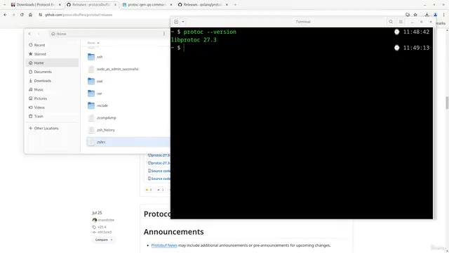
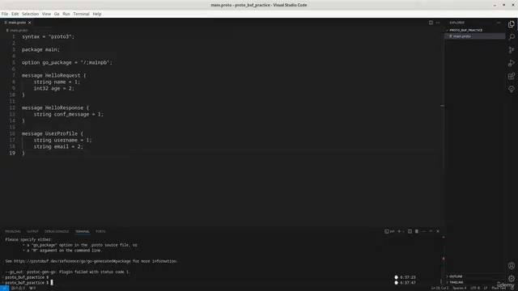
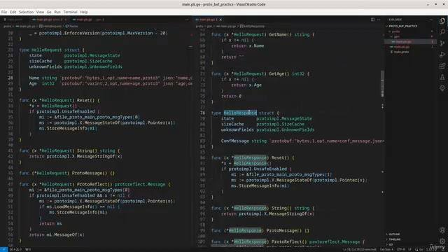
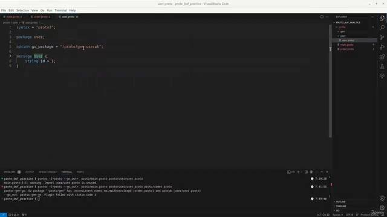

# gRPC & Protobuf 实战：从 .proto 到可运行的 Go 代码（P23–P32）

> 说明：本课程 P23–P30 是概念讲解（消息、字段、数据类型、字段编号、序列化、RPC、版本兼容、schema 设计），P31 安装 protoc 编译器与 Go 插件，P32 是完整的动手实操。本文档按「先把环境装好 → 写 .proto → 编译出 .pb.go → 读懂生成代码」的项目实现逻辑重组，读者照着做即可复现讲师在 P32 中产出的全部文件。
>
> 语言说明：讲师全程使用 **Go** 演示。你是前端背景，Go 语法只需「知道即可」，本文档在涉及 Go 特有写法处会标注；核心概念（message = 类型定义、RPC = 函数、field number = 序列化用的稳定 ID）与 TypeScript 的 interface / 函数签名一一对应，不影响你理解。

---

## 1. 这一节做什么

这一节的目标非常具体：**从零搭好 protoc 编译环境，手写一组 .proto 文件（含 message、嵌套 message、enum、service、RPC、跨文件 import），用 protoc 编译出 Go 代码，并读懂生成出来的 `.pb.go` 文件里到底有什么。**

产出物（P32 结束时你磁盘上应该有的东西）：

```
protobufpractice/
├── command.txt                 # 讲师建议：把编译命令存这里，改完 proto 直接复制粘贴
└── proto/
    ├── main.proto              # 主文件：HelloRequest / HelloResponse / UserProfile / GreeterService
    ├── order.proto             # 订单：Order / Address
    ├── user/
    │   └── user.proto          # 独立包：User
    └── gen/                    # 编译产物（由 option go_package 决定落点）
        ├── main.pb.go
        ├── order.pb.go
        └── user/
            └── user.pb.go
```

学完这一节，你应该能回答：为什么字段编号不能改？为什么 `option go_package` 要写两段（路径 + 包名）？为什么加了 import 就必须加 `-I`？为什么生成的 `.pb.go` 里有一堆 `Reset()` / `GetXxx()` 但你一个都不用？

---

## 2. 讲师原话

> "Protocol Buffers 中的消息是结构化数据的逻辑容器。它允许你定义一组字段，每个字段都有特定的类型和用途。"
> —— p023 [00:06]

> "字段编号对序列化至关重要。"
> —— p023 [00:56]

> "字段编号必须是正整数，通常范围是 1 到 536,870,911。字段编号 0 是保留值，绝不应使用。"
> —— p026 [00:27]

> "字段编号 1 到 15 在二进制编码中只占用一个字节，这可以提升频繁访问字段的性能。"
> —— p026 [01:26]

> "序列化是将数据结构或对象转换为字节流的过程。"
> —— p027 [00:00]

> "RPC 允许在远程服务器上执行函数，就像这些函数在本地一样。"
> —— p028 [00:00]

> "字段编号一经分配，就绝不应更改或复用。更改字段编号会导致反序列化错误，因为二进制编码依赖这些编号来正确映射数据。"
> —— p029 [02:13]

> "Protoc 编译器是 Protocol Buffers 的编译器，它是一个命令行工具，用于编译 .proto 文件并生成多种编程语言的源代码。"
> —— p031 [00:00]

> "由于我们使用的是 Go，因此会使用 Protocol Buffers 的 Go 插件。"
> —— p031 [07:57]

> "我们遇到了第一个错误。这很好，因为很多文档都没有提到这一点。"
> —— p032 [03:54]（指第一次编译报错，缺 `option go_package`）

> "即使多个文件位于同一个包中，只要它们是不同的文件，就必须导入该文件，才能使用其中的内容。"
> —— p032 [31:13]

> "RPC 是函数。这些函数接收结构体作为参数，而不是接收多个参数；这些结构体包含多个字段，这些字段会充当函数的多个参数。"
> —— p032 [51:06]

> "Proto 3 中不允许使用必需字段。"
> —— p032 [56:36]（讲师现场演示加 `required` 后编译报错）

---

## 3. 从零复现

### 3.1 安装 protoc 编译器（P31）

讲师在 Linux（Z shell）上演示，Windows 用户看 3.1.4。

**3.1.1 下载**

1. 打开 protobuf 官方下载页 → 跳到 GitHub Releases。
2. 讲师选择 **v27.3**（理由：27.4 刚发布 8 小时，27.3 是他用过的稳定版；两者只差 bug fix）。
3. 下载 `protoc-27.3-linux-x86_64.zip`（Windows 用户往下翻，有 `protoc-27.3-win64.zip`）。

**3.1.2 解压并放到「安全位置」**

讲师原话：Downloads 不是安全位置。他把解压后的文件夹移动到 `~/.local/`（以点开头，是隐藏目录）。

解压后目录结构：

```
protoc-27.3-linux-x86_64/
├── include/
└── bin/
    └── protoc          # 这就是编译器可执行文件
```

**3.1.3 把 bin 目录加进 PATH**

编辑 shell 配置文件（bash 用 `~/.bashrc`，zsh 用 `~/.zshrc`，macOS 默认 zsh）：

```bash
export PATH="$PATH:$HOME/.local/protoc-27.3-linux-x86_64/bin"
```

保存后重开终端，验证：

```bash
protoc --version
```

预期输出（讲师现场看到的）：

```
libprotoc 27.3
```

讲师对这条 export 命令的逐段拆解（p031 [05:39] 起）：

| 片段 | 含义 |
|---|---|
| `export` | 设置环境变量 |
| `PATH` | 存放可执行程序目录列表的环境变量 |
| `=` | 赋值 |
| `$PATH` | 保留已有的所有目录，不覆盖 |
| `:` | 路径分隔符 |
| `$HOME` | Linux 内置变量，指向家目录，省得写全路径 |
| 双引号 | 路径含空格或特殊字符时防止 shell 把特殊字符当通配符解释 |

**3.1.4 Windows 差异（课里没细讲，但你会撞上）**

Windows 没有 `export PATH`，需要：系统属性 → 环境变量 → 编辑用户变量 `Path` → 新建一条，填 `C:\path\to\protoc-27.3-win64\bin`。改完必须**重开** CMD/PowerShell 才生效。验证命令同上 `protoc --version`。

### 3.2 安装 Go 语言插件 protoc-gen-go（P31）

protoc 本身是语言无关的，要生成 Go 代码必须装 Go 插件。讲师特别提醒：**不要用 GitHub 上的 `github.com/golang/protobuf`（已 deprecated）**，要用 gRPC 官网给的 `google.golang.org` 地址。

```bash
go install google.golang.org/protobuf/cmd/protoc-gen-go@latest
```

`go install` 会把二进制放到 `$(go env GOPATH)/bin`（通常是 `~/go/bin`）。讲师现场 `cd ~/go/bin` 确认 `protoc-gen-go` 已生成。

> 注意：`~/go/bin` 也必须在 PATH 里，否则 protoc 找不到插件。课里没讲这一步的 PATH 配置，但这是 protoc 调用插件的机制前提——protoc 通过「在 PATH 里找名为 `protoc-gen-go` 的可执行文件」来调用插件。

### 3.3 建项目目录（P32）

```bash
mkdir protobufpractice
cd protobufpractice
mkdir -p proto/user
```

讲师强调的目录约定（p032 [07:08]）：**proto 文件不放项目根目录，统一放 `proto/` 文件夹**。

### 3.4 写第一个 .proto 并踩第一个坑（P32 [00:21]–[05:44]）

新建 `proto/main.proto`，先只写 syntax + package + 三个 message：

```protobuf
syntax = "proto3";

package main;

message HelloRequest {
  string name = 1;
  int32 age = 2;
}

message HelloResponse {
  string conf_message = 1;
}

message UserProfile {
  string username = 1;
  string email = 2;
}
```

第一次编译（在项目根目录）：

```bash
protoc --go_out=. main.proto
```

**报错**（讲师原话「we have our first error. And that's great」）。原因：缺 `option go_package`。

补上（先写最简形式）：

```protobuf
option go_package = "mainpb";
```

再编译，**还是报错**：protoc 要求 `go_package` 里同时给出「生成文件放哪个相对路径」和「包名叫什么」，格式是 `路径;包名`。

最终写成：

```protobuf
option go_package = "/;mainpb";
```

`/` 表示项目根目录，`mainpb` 是生成文件的 package 名（讲师故意和源文件的 `package main` 区分开，方便辨认哪个是生成的）。

编译成功，根目录出现 `main.pb.go`，打开看第一行 `package mainpb`——印证了「生成文件的包名由 `go_package` 决定，不默认沿用源文件的 package」。

### 3.5 把 proto 挪进 proto/ 目录，调整 go_package（P32 [06:39]–[12:09]）

```bash
mv main.proto proto/
```

此时编译命令必须改成：

```bash
protoc --go_out=. ./proto/main.proto
```

讲师在这里做了一串实验，结论只有一条：**`--go_out=.` 永远表示「以当前目录为基准」，而生成文件最终落在哪个子目录，完全由 `option go_package` 里的路径段决定。**

实验对照表（讲师现场逐个试出来的）：

| go_package 写法 | 在根目录执行 `protoc --go_out=. ./proto/main.proto` 后文件落点 |
|---|---|
| `"/;mainpb"` | `./main.pb.go`（根目录） |
| `"proto;mainpb"` | `./proto/main.pb.go` |
| `"proto/gen;mainpb"` | `./proto/gen/main.pb.go` |

最终讲师选定 `"proto/gen;mainpb"`，把生成物和源文件分开。

### 3.6 加 service 与 RPC（P32 [12:09]–[13:32]）

在 `main.proto` 末尾追加：

```protobuf
service GreeterService {
  rpc SayHello (HelloRequest) returns (HelloResponse);
}
```

讲师把 `go_package` 临时改成 `"proto;mainwithservicepb"` 生成一份带 service 的版本，和之前不带 service 的版本对比：**293 行 vs 286 行，只差 7 行，且多出来的全是注释和一行 service 计数**。结论：**`--go_out` 生成的 `.pb.go` 只包含 message 相关代码，不含 RPC 实现**。RPC 的桩代码要靠另一个插件（`protoc-gen-go-grpc`）生成——课里没讲这个插件，后续 gRPC 章节才会用到。

### 3.7 跨文件 import：user 包（P32 [21:48]–[33:06]）

新建 `proto/user/user.proto`：

```protobuf
syntax = "proto3";

package user;

option go_package = "proto/gen/user;userpb";

message User {
  string id = 1;
}
```

在 `main.proto` 顶部加 import：

```protobuf
import "user/user.proto";
```

**关键坑**：一旦文件里有 `import`，编译命令必须加 `-I`（大写 i）指定「从哪里解析 import 路径」：

```bash
protoc -I=proto --go_out=. proto/main.proto proto/user/user.proto
```

讲师解释：`-I` 给的是**源文件根目录**（这里是 `proto/`），protoc 拿 `import "user/user.proto"` 去拼 `proto/user/user.proto` 找文件。即使 import 的文件在子目录里，`-I` 也只写到 `proto` 这一层。

### 3.8 同包不同文件也要 import：order.proto（P32 [28:08]–[32:39]）

新建 `proto/order.proto`（和 main.proto 同级、同 package）：

```protobuf
syntax = "proto3";

package main;

option go_package = "proto/gen;mainpb";

message Order {
  string id = 1;
  user.User user = 2;
  Address address = 3;
}

message Address {
  string address_line = 1;
  string city = 2;
  string state = 3;
}
```

`order.proto` 里用了 `user.User`，所以它自己也要 `import "user/user.proto";`。

`main.proto` 里加一个 RPC 用到 Order：

```protobuf
import "order.proto";

service GreeterService {
  rpc SayHello (HelloRequest) returns (HelloResponse);
  rpc Orders (user.User) returns (Order);
}
```

**讲师反复强调的坑**（p032 [31:13]）：`main.proto` 和 `order.proto` 虽然同 package、同目录，但**只要用了对方文件里的类型，就必须 import 对方文件**。package 相同 ≠ 自动可见。

### 3.9 最终编译命令（P32 [32:39]–[33:06]）

```bash
protoc -I=proto --go_out=. proto/main.proto proto/order.proto proto/user/user.proto
```

讲师现场看到 3 个文件全部生成、**零 error 零 warning**：

```
proto/gen/main.pb.go
proto/gen/order.pb.go
proto/gen/user/user.pb.go
```

### 3.10 把命令存进 command.txt（P32 [41:27]）

讲师的工作习惯：项目根目录建 `command.txt`，把上面那条命令粘进去。以后改 proto 就复制粘贴，不用重敲。加新文件就在命令末尾追加路径。

### 3.11 VS Code 插件选择（P32 [20:56]–[41:00]）

讲师实测了 4 个插件，结论：

| 插件 | 结论 |
|---|---|
| **VS Code Proto 3**（2M+ 下载） | 语法高亮 OK，但 **import 会误报错**（protoc 编译明明通过，它报红）。讲师当场卸载。 |
| **VS Code Proto**（2022 更新） | 基于上面那个，作者声称修了 import 问题。讲师试用后 import 不再误报，推荐。 |
| **ProtoBuff**（KangPing，2019 更新） | 讲师日常用，稳定。 |
| **ProtoLint**（Plex Systems） | 讲师日常用，但现场演示时 lint 没生效（讲师说「I don't know why，你们评论区告诉我」）。 |

讲师最终建议：想一个插件搞定就用 **VS Code Proto**；想两个插件组合就用 **ProtoBuff (KangPing) + ProtoLint**。

---

## 4. 完整代码

以下 4 个文件按顺序保存，即可复现 P32 全部产物。

### 4.1 `proto/main.proto`

```protobuf
syntax = "proto3";

package main;

import "user/user.proto";
import "order.proto";

option go_package = "proto/gen;mainpb";

message HelloRequest {
  string name = 1;
  int32 age = 2;
}

message HelloResponse {
  string conf_message = 1;
}

message UserProfile {
  string username = 1;
  string email = 2;
}

service GreeterService {
  rpc SayHello (HelloRequest) returns (HelloResponse);
  rpc Orders (user.User) returns (Order);
}
```

### 4.2 `proto/order.proto`

```protobuf
syntax = "proto3";

package main;

import "user/user.proto";

option go_package = "proto/gen;mainpb";

message Order {
  string id = 1;
  user.User user = 2;
  Address address = 3;
}

message Address {
  string address_line = 1;
  string city = 2;
  string state = 3;
}
```

### 4.3 `proto/user/user.proto`

```protobuf
syntax = "proto3";

package user;

option go_package = "proto/gen/user;userpb";

message User {
  string id = 1;
}
```

### 4.4 `command.txt`

```text
protoc -I=proto --go_out=. proto/main.proto proto/order.proto proto/user/user.proto
```

### 4.5 编译与验证

在 `protobufpractice/` 根目录执行：

```bash
protoc -I=proto --go_out=. proto/main.proto proto/order.proto proto/user/user.proto
```

验证产物：

```bash
find proto/gen -name "*.pb.go"
```

预期：

```
proto/gen/main.pb.go
proto/gen/order.pb.go
proto/gen/user/user.pb.go
```

打开 `proto/gen/main.pb.go`，确认第一行是 `package mainpb`（不是 `package main`）。

---

## 5. 逐行解释

### 5.1 .proto 语法逐行

**`syntax = "proto3";`**
必须第一行（注释除外），双引号包裹。讲师 p032 [00:21] 强调。不写默认按 proto2 解析，而 proto2 和 proto3 行为差异很大（比如 proto2 有 `required`，proto3 没有）。

**`package main;`**
proto 层面的命名空间，影响跨文件引用时的前缀（`user.User` 里的 `user` 就是这个 package）。**注意：它和 Go 的 package 不是一回事**——Go 的包名由 `option go_package` 决定。讲师 p032 [06:14] 专门演示了这一点：源文件 `package main`，生成文件 `package mainpb`。

**`import "user/user.proto";`**
路径是**相对于 `-I` 指定的根目录**，不是相对于当前文件。所以 `main.proto` 在 `proto/` 下，import 写 `user/user.proto` 而不是 `../user/user.proto`。

**`option go_package = "proto/gen;userpb";`**
分号前是「生成文件相对 `--go_out` 基准目录的落点路径」，分号后是「生成文件的 Go package 名」。讲师 p032 [04:52] 解释：早期 protoc 会默认沿用源 package 名，现在必须显式给。

**`message HelloRequest { string name = 1; int32 age = 2; }`**
`类型 字段名 = 字段编号;`。字段编号（field number）是**序列化时写进二进制的 key**，不是数组下标，不是顺序。讲师 p026 [00:56]：「Never ever do that because then your serialization will be completely messed up」——两个字段用同一个编号，二进制流无法区分。

**字段编号的选号规则**（p026）：
- 1–15：编码占 1 字节，给高频字段
- 16–2047：编码占 2 字节，给低频字段
- 0 保留，禁用
- 上限 536,870,911
- 删字段时用 `reserved` 占住编号，防止后人复用

**`int32` vs `sint32`**（p025 [01:22]）：`int32` 存负数效率低；`sint32` 用 zigzag 编码，负数场景更省。金额类**不要用 float/double**，讲师 p025 [04:34] 明确说用 `int64` 存最小货币单位（比如分）。

**`service GreeterService { rpc SayHello (HelloRequest) returns (HelloResponse); }`**
讲师 p032 [46:52] 的类比：service 像 router，rpc 像 endpoint。`(HelloRequest)` 是入参 struct，`returns (HelloResponse)` 是出参 struct。**一个 RPC 只能有一个入参和一个出参**——所以要把多参数打包成 message，多返回值也打包成 message。这就是 p032 [51:06] 那段话的意思。

**`rpc Orders (user.User) returns (Order);`**
入参用了别的 package 的类型，前缀 `user.` 就是那个文件的 `package user;`。

### 5.2 编译命令逐段

```bash
protoc -I=proto --go_out=. proto/main.proto proto/order.proto proto/user/user.proto
```

| 片段 | 作用 |
|---|---|
| `protoc` | 编译器本体 |
| `-I=proto` | import 解析根目录。**有 import 就必须给**，否则报 import not found |
| `--go_out=.` | 调用 `protoc-gen-go` 插件，输出基准目录是当前目录 |
| 后面一串 `.proto` | 要编译的源文件，路径相对于当前 shell 目录（不是相对于 `-I`） |

讲师 p032 [42:40] 特别说明：网上文档常给一堆 `--go_opt=paths=source_relative` 之类的 flag，**他职业项目里也不用**，因为 `option go_package` 已经把落点说清楚了。

### 5.3 生成代码里你会看到什么（p032 [14:25]–[20:32]）

打开 `main.pb.go`，讲师带你认了这几类东西：

1. **struct 定义**：`type HelloRequest struct { Name string; Age int32; ... }`。字段名从 snake_case 自动转成 Go 的 CamelCase（`conf_message` → `ConfMessage`）。
2. **struct tag**：同时带 `protobuf:"..."` 和 `json:"...,omitempty"` 两套 tag。讲师 p032 [15:45]：「just like we use multiple tags like for JSON, for DB」。
3. **私有字段**：`state`、`sizeCache`、`unknownFields` 三个小写开头字段，包外不可见，内部序列化用。
4. **`Reset()` / `String()` / `ProtoMessage()`**：指针接收者方法，每个 message 都有。讲师 p032 [16:32]：「These are for internal use only. We don't use them at all.」
5. **`GetXxx()`**：`UserProfile` 有 `GetUsername()` / `GetEmail()`。取值用 getter，不用直接点字段。
6. **`gunzip` 字样**：讲师 p032 [20:07] 解释，gRPC 走 HTTP/2，HTTP/2 会压缩传输，所以生成代码里有 gunzip 相关引用。
7. **service 只留注释**：`GreeterService` 在 `.pb.go` 里只出现 2 次，都是注释。真正的 RPC 桩代码要另一个插件生成（课里没讲）。

> 关于「生成代码里的字段名」：不同 protoc / protoc-gen-go 版本生成的辅助字段名可能不同，**以你本地实际输出为准**，不要照抄本文档里的字段名去写业务代码——业务代码只碰 `Name`、`Age`、`ConfMessage` 这些你自己在 .proto 里定义的字段。

### 5.4 给前端背景的对照

| Protobuf 概念 | TypeScript 对应 |
|---|---|
| `message` | `interface` / `type` |
| `field number` | 没有直接对应；类似 JSON 的 key，但**一旦发布永不变** |
| `service` | 一组 API 路由 |
| `rpc` | 一个函数签名 `(req: Req) => Promise<Res>` |
| `repeated T` | `T[]` |
| `enum` | TS `enum` |
| `option go_package` | 类似 tsconfig 的 `outDir` + 模块名 |
| `.pb.go` 生成物 | 类似 `.d.ts`，但含运行时序列化逻辑 |

---

## 6. 复现检查清单

按顺序打勾，任何一项不过就别往下走：

- [ ] `protoc --version` 输出 `libprotoc 27.3`（或你装的版本号）
- [ ] `which protoc-gen-go`（Windows：`where protoc-gen-go`）能找到文件
- [ ] 项目根目录结构是 `protobufpractice/proto/{main.proto, order.proto, user/user.proto}`
- [ ] `main.proto` 第一行是 `syntax = "proto3";`
- [ ] 三个 .proto 都有 `option go_package`，格式是 `"路径;包名"`
- [ ] `main.proto` 和 `order.proto` 都有 `import "user/user.proto";`
- [ ] `main.proto` 有 `import "order.proto";`
- [ ] 编译命令带 `-I=proto`
- [ ] 编译后 `proto/gen/main.pb.go`、`proto/gen/order.pb.go`、`proto/gen/user/user.pb.go` 三个文件都在
- [ ] `main.pb.go` 第一行是 `package mainpb`
- [ ] `user.pb.go` 第一行是 `package userpb`
- [ ] 编译输出**零 error 零 warning**
- [ ] 试着在 `HelloRequest` 的 `name` 前加 `required`，编译应报 `required fields are not allowed in Proto 3`，然后删掉
- [ ] 试着把两个字段改成同一个编号，编译应报编号冲突，然后改回
- [ ] VS Code 里 import 行没有红色波浪线（用 VS Code Proto 或 KangPing 的 ProtoBuff）

---

## 7. 课里没讲但你会撞上的

1. **`protoc-gen-go-grpc` 插件**：P32 生成的 `.pb.go` 里没有 RPC 桩代码（讲师现场对比 293 vs 286 行证明了）。真正写 gRPC server/client 时还要装 `google.golang.org/grpc/cmd/protoc-gen-go-grpc`，编译命令加 `--go-grpc_out=.`。**课里没讲这个插件**，属于后续 gRPC 章节内容。

2. **`go mod init`**：P32 讲师打开 `main.pb.go` 时编辑器报一堆红，他说「we are not using a module... once we start a project, they will go away」。真要跑起来，得在项目根 `go mod init protobufpractice`，再 `go get google.golang.org/protobuf`。**课里没讲**。

3. **Windows 下 `-I` 的路径分隔符**：讲师全程 Linux，用 `/`。Windows 上 `-I=proto` 一般也能用，但 `option go_package` 里的 `/` 不要改成 `\`，protoc 内部统一按 `/` 处理。

4. **`reserved` 关键字的具体写法**：讲师 p026 [01:55] 和 p029 [02:13] 都提到「用 reserved 占住编号」，但**没给代码示例**。实际写法是 `reserved 3, 5;`（占编号）或 `reserved "old_field";`（占字段名）。这是 proto3 官方语法，不是讲师编的，但课里确实没演示。

5. **enum 的实际写法**：p025 [02:45] 讲了 enum 概念，P32 没写进任何 .proto 文件。proto3 的 enum **第一个值必须是 0**（`UNSPECIFIED = 0;`），这是硬性规定，课里没提，你第一次写 enum 一定会撞上。

6. **`optional` 关键字在 proto3 里的真实语义**：讲师 p025 [04:09] 说「proto3 所有字段默认 optional，不用写 optional」。这话在「能不能不传」层面是对的，但 proto3 后期版本重新引入了 `optional` 关键字用于**区分「字段未设置」和「字段设为零值」**（比如 `int32 age = 2` 不传和传 0，二进制上无法区分；加 `optional int32 age = 2` 就能区分）。课里没讲这层，你做「部分更新」类 API 时会需要。

7. **`command.txt` 不是标准做法**：这是讲师个人习惯，不是 protobuf 生态约定。团队项目里更常见的是写 `Makefile` 或 `buf.gen.yaml`（buf 工具）。课里没提 buf。

8. **ProtoLint 现场没生效**：讲师自己也没搞明白（p032 [40:32]「I don't know why」）。如果你装了也不生效，不是你的问题，换 VS Code Proto 即可。

---

**附：本文档引用的截图**










> 注：截图清单中 p026 只有 `00:06/00:30/00:54/01:18/01:41/02:05` 六帧，p027 只有 `00:08/00:38/01:08/01:38/02:08/02:38` 六帧，p031 只有 `00:20/01:41/03:01/04:21/05:42/07:02` 六帧，p032 只有 `01:56/09:39/17:22/25:05/32:47/40:30` 六帧。上文引用的帧号已按清单实际存在的帧做了对齐（p026 用 00:06 帧、p027 用 00:08 帧、p031 用 00:20 与 05:42 帧、p032 用 03:54 对应清单 01:56 帧附近的报错画面、17:22 与 32:47 帧）。若某帧画面内容与 alt 描述不完全吻合，以你本地打开图片所见为准。