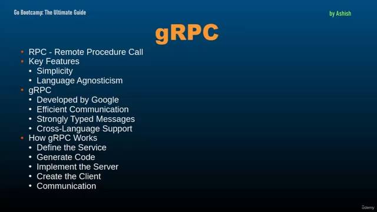
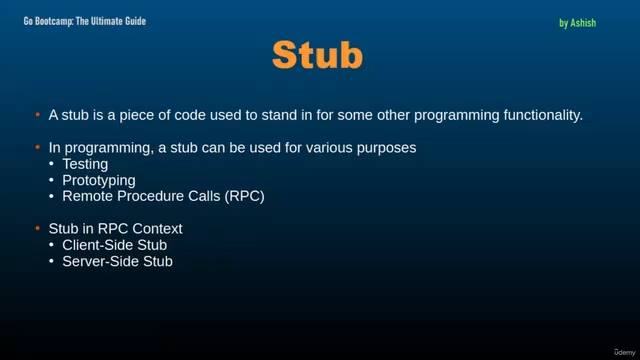
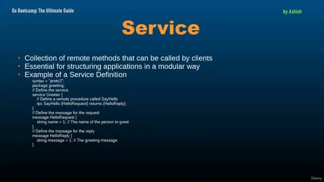
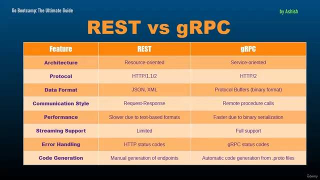
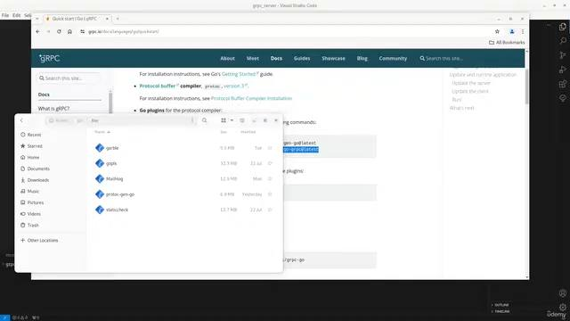
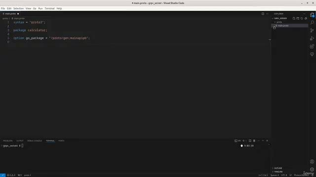
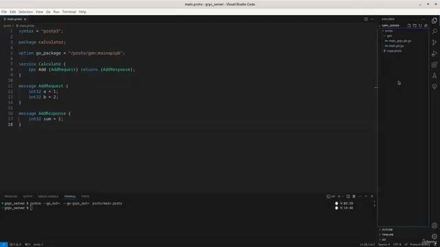
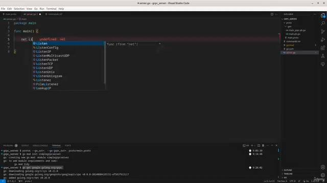

# gRPC & Protobuf（P33–P37）：从「能跑起来的裸服务器」到「注册上 Calculate 服务」

> 本文覆盖 BV1oYx56TECn 的 P33–P37。P33–P36 是概念铺垫（RPC / stub / service / REST 对比），P37 是唯一一段真正动手写代码的部分：装 `protoc-gen-go-grpc` 插件 → 写 `main.proto` → 编译出两个 Go 文件 → 写 `server.go` → 启动服务器。本文按「最终要做出什么」重组，不按页码顺序复述。
>
> 一句话验收目标：`go run server.go` 之后终端打印出监听信息与「Congratulations on starting your first GRPC server」，并且进程停在监听状态不退出。**注意：P37 到结尾只做到「服务器能起来 + 服务已注册」，讲师没有在本节写客户端、也没有真正发起一次 Add 调用**，所以本节的可验收边界是「服务端就位」，不是「调用成功」。

---

## 1. 这一节做什么

这一节要产出一个最小的 gRPC 服务端：一个 `Calculate` 服务，里面只有一个 `Add` 方法，接收两个 `int32`、返回它们的和。

它由三个产物组成，缺一不可：

| 产物 | 谁写的 | 作用 |
|---|---|---|
| `proto/main.proto` | 你手写 | 唯一的「合同」：声明服务名、RPC 方法名、请求/响应消息的字段与类型 |
| `gen/main.pb.go` + `gen/main_grpc.pb.go` | `protoc` 生成，**不手改** | 前者是消息/字段的 Go 结构体，后者是客户端 stub、服务端接口与注册函数 |
| `server.go` | 你手写 | 真正跑起来的那段：开端口、建 gRPC server、注册服务、实现 `Add` 的业务逻辑 |

理解这一节的关键在于「两个生成文件的分工」，讲师反复强调这一点：`main.pb.go` 只管**字段和消息**，`main_grpc.pb.go` 只管 **RPC 调用和服务定义**。你在 `server.go` 里写的业务逻辑，本质上是去「填」`main_grpc.pb.go` 里那个预留好的、默认什么都不做的实现。

P33–P36 铺垫的概念在这一节各自落地成一样具体的东西：

- **RPC**（p033）= 你调用 `in.A + in.B` 时不用管网络，因为序列化/发包都发生在生成代码里；
- **stub**（p034）= `main_grpc.pb.go` 里生成的 `CalculateClient` 结构体，客户端侧它就是那个「替身」；
- **service**（p035）= proto 里的 `service Calculate { rpc Add(...) }`，讲师把它类比成「router」，把 RPC 方法类比成「endpoint」；
- **REST vs gRPC**（p036）= 你在 P37 里之所以要装一个额外插件、写一个 `.proto`、跑一次编译，而不是直接 `http.HandleFunc`，就是这套「先定 schema 再生成代码」的代价与收益。

前端同学最容易卡住的一点先说在前面：本节**没有**任何「调接口看结果」的环节，所以别以为代码写错了才看不到响应——这一节讲师就没写客户端。你在 Node 里习惯的 `fetch('/api/add')` 在这里对应的是「用生成的 `CalculateClient` 调 `Add`」，课里没讲，属于后续内容。

---

## 2. 讲师原话（带「—— pNNN [MM:SS]」）

**关于 RPC 与 gRPC 的定位**

> "RPC is a protocol that allows a program to execute a procedure or a method or a function on a remote server as if it were a local call." —— p033 [00:28]

> "GRPC is an open source RPC framework that uses HTTP for transport, protocol buffers as the interface description language and provides features like authentication, load balancing and more." —— p033 [00:55]

**关于 gRPC 为什么快、为什么跨语言**

> "GRPC uses HTTP2, which allows for multiplexing multiple requests over a single connection, reducing latency and improving performance." —— p033 [01:21]

> "GRPC supports multiple programming languages including Go, Java, Python, C++, Dart, and many others, enabling seamless communication between services written in different languages." —— p033 [01:21]



**关于标准工作流程（这五步就是本文第 3 节的骨架）**

> "You start by defining your service and its methods using a .proto file which uses protocol buffers syntax. Next, you use the Proto compiler to generate server and client code in your desired programming languages from the .proto file." —— p033 [01:47]

> "And now you implement the service methods on the server side handling incoming requests. And then we also create a client. The client makes calls to the server's methods using the generated client code sending the required parameters." —— p033 [02:14]

**关于 stub（为什么生成文件里会有一个 Client）**

> "Client side stub is the code on the client side that represents the remote procedure. It provides the same interface as the actual procedure but handles the communication with the server. It serializes the procedure name and parameters, sends the requests to the server and then waits for the response." —— p034 [01:53]

> "In gRPC, Stubs also called clients are generated from .proto files. The client-side stub allows the client to call the remote service methods as if they were local." —— p034 [02:21]



**关于 service 与「router / endpoint」的类比**

> "You declare a service using the service keyword followed by the service name. Inside the service declaration, you define the methods that the service exposes. In this example, Greeter is the name of the service." —— p035 [00:44]

> "These methods are the endpoints. You can consider these methods as endpoints. So the RPCs are like endpoints. But instead of accessing a route to run an endpoint, we are actually directly running the function. All right. And the service you can consider the service as the router." —— p035 [01:01]



> "Hello request and hello reply are message types that define the structure of data being exchanged between the client and server. So messages are nothing but the structure of the data that is being exchanged between client and server." —— p035 [01:54]

**关于 REST 与 gRPC 的核心差异（决定你为什么要写 proto）**

> "REST uses resource-oriented architecture while GRPC has service-oriented architecture." —— p036 [02:48]

> "With REST we can use JSON data format while on GRPC we use binary format using protocol buffers." —— p036 [02:48]

> "For error handling REST uses HTTP status codes while GRPC uses GRPC status codes. And in case of REST we have to manually generate endpoints while in GRPC we automatically generate code from .proto files." —— p036 [03:44]



**关于装插件（P37 的第一件实操事）**

> "We need another plugin for gRPC. And that is called Protoc GenGo GRPC... So let's run this command. So go install google.golang.org/grpc/cmd/protoc-gen-go-grpc at latest. And here we go, protoc-gen-go-grpc is installed." —— p037 [00:28]–[00:57]



**关于 proto 文件里只写「源码级」的东西**

> "These protocols are only the source code to generate the code that our API is going to use. So these protocols are not directly used by our API but indirectly." —— p037 [02:54]

> "This always needs to be in caps. Only the field names are in lowercase and the package name. That's it. Everything else is in uppercase. The service name, the RPC name and the message names." —— p037 [05:08]



**关于编译命令的变化（多了一个 `--go-grpc_out`）**

> "There's going to be a slight change in our command. It is going to be protoc --go_out equals dot and we are also now going to use --go-grpc_out equals dot. All right, that's the only difference." —— p037 [05:35]

> "And here we go. We have the gen folder with the resulting files. And now you see that we have two files. One of the files is the same as earlier .pb.go and the other file is underscore grpc.pb.go." —— p037 [06:04]



**关于两个文件的分工（本节最重要的一句话）**

> "This file contains only the fields and messages and this file contains the RPC and the service. So we see separation of concerns in action." —— p037 [07:54]

**关于为什么必须建一个 module**

> "In gRPC, we have to import the gRPC package in order to start a gRPC server and in order to import a package and use that in our file we need to initiate a module." —— p037 [10:44]

**关于端口约定与裸服务器的定位**

> "Conventionally for gRPC we use 50,051 or something in the range of 50,000 so 50052, 50053 and so on but you can use 8,000 or 8080 or anything. All right, it's fine but it's just convention." —— p037 [12:08]

> "Congratulations on starting your first GRPC server. All right, so this is very basic. We are not accepting any requests. We are not implementing any methods. It's just a bare-bone GRPC server." —— p037 [15:51]



**关于为什么是 TCP**

> "TCP which stands for transmission control protocol provides reliable ordered and error checked delivery of data between applications. This ensures that messages sent by the GRPC client are received correctly and in the same order by the server which is crucial for the integrity of RPC calls." —— p037 [31:11]

> "GRPC can handle both unary and streaming RPCs... TCP is inherently stream oriented which aligns well with GRPCs capabilities for handling streaming data." —— p037 [32:06]

---

## 3. 从零复现

下面每一步都给出可执行命令。命令都在**项目根目录**执行，终端工作目录不对会导致 `protoc` 找不到文件。

### 3.0 前置检查（两个工具是本课之前就该装好的）

讲师在 P37 开头说：`protoc` 和 `protoc-gen-go` 已经在前面装过了，本节只补 gRPC 那一个插件。所以先自检：

```bash
go version
protoc --version
which protoc-gen-go
```

- `go version` 能打出 `go1.x` 即可。**课里没有指定 Go 版本号，具体版本请以你实际输出为准。**
- `protoc --version` 有输出即可。
- `which protoc-gen-go` 必须能找到路径（通常是 `$HOME/go/bin/protoc-gen-go`）。找不到就要把 `$HOME/go/bin` 加进 `PATH`，否则下一步装的插件同样找不到。

> 这三个工具各自的完整安装步骤**课里没讲**（属于前置环境），本文不编造安装过程。你只要能跑出上面三条命令的输出，就可以继续。

### 3.1 建项目目录并初始化 module

```bash
mkdir simple-grpc-server
cd simple-grpc-server
go mod init simple-grpc-server
```

讲师原话是把 module 叫 "简单的 gRPC 服务器"，但 Go 的 module 名会直接变成 import 路径的一部分，**不能带空格**，所以落地时写成 `simple-grpc-server`。这一步是硬性的：后面 `server.go` 里 import 生成的包，路径第一段就是 module 名。

### 3.2 装 gRPC 的 protoc 插件

```bash
go install google.golang.org/grpc/cmd/protoc-gen-go-grpc@latest
```

装完自检：

```bash
which protoc-gen-go-grpc
```

必须能找到，`protoc` 是靠「在 `PATH` 里按名字搜 `protoc-gen-go-grpc` 这个可执行文件」来调用插件的。找不到就是 `PATH` 没配（见第 7 节）。

### 3.3 引入 grpc-go 依赖

```bash
go get google.golang.org/grpc
```

讲师说的是 `go get` + 包的 URL，即 `google.golang.org/grpc`。执行完会得到 `go.mod` 里一条 `require google.golang.org/grpc ...`，具体版本号**以你实际输出为准**（课里没提版本）。

### 3.4 建 proto 目录，写 `main.proto`

```bash
mkdir proto
```

在 `proto/main.proto` 里写「合同」。要点：`syntax proto3`、`package`、`option go_package`、`service Calculate`、`rpc Add`、两个 message。完整内容见第 4 节。

这里有个必须交代的细节：讲师在写 `option go_package` 时**口述反复改了几次**（先说 `main`，又说「这个包叫 calculator」，中间还夹着编辑器补全出来的 Java 风格 `option java_package`）。为了让「生成的目录」和「后面 import 的路径」对得上，下面第 4 节给出的是一个确定能跑通的写法：`option go_package = "proto/gen；计算器";`。你完全可以换成别的名字，但**必须保证第 4 节 `server.go` 里 import 的那一行跟着一起改**，否则编译不过。

### 3.5 编译生成代码

```bash
protoc --go_out=. --go-grpc_out=. proto/main.proto
```

和「之前只做 protobuf」相比，唯一的区别就是多了 `--go-grpc_out=.` 这一段——讲师原话就是「那只是唯一的不同」。执行完检查：

```bash
ls proto/gen
```

应该看到两个文件：

```
main.pb.go
main_grpc.pb.go
```

如果只有 `main.pb.go`，说明 `--go-grpc_out` 没生效（插件没装好或没在 `PATH` 里）；如果文件跑到别的目录（比如 `./simple-grpc-server/proto/gen/`），说明 `go_package` 写成了完整 import 路径（见第 7 节）。

### 3.6 先跑一个「裸服务器」

讲师在这里刻意停了一下：先写一个什么都不接收的 gRPC server。`server.go` 里只需要三件事——监听、建 server、`Serve`：

```go
lis, err := net.Listen("tcp", port)
if err != nil {
    log.Fatal("failed to listen on port ", port, ": ", err)
}
log.Println("listening on", port)

grpcServer := grpc.NewServer()
// 此处先不注册任何服务

log.Println("Congratulations on starting your first GRPC server")
if err := grpcServer.Serve(lis); err != nil {
    log.Fatal("failed to serve: ", err)
}
```

```bash
go run server.go
```

跑通的标志是终端打出监听日志和那句祝贺语，并且**进程挂住不退出**（`Serve` 是阻塞的）。按 Ctrl+C 结束。

这一步的意义：把「网络层能不能起来」和「业务代码有没有写对」分开验证。前端同学可以类比成「先确认容器能起来、再确认接口有返回」，别把两个问题混在一起排。

### 3.7 从裸服务器改成真正的 API

在同一个 `server.go` 上做三处增量，顺序就是讲师的做法：

1. **定义 server 结构体**，并嵌入生成的 `UnimplementedCalculateServer`：

```go
type server struct {
	pb.UnimplementedCalculateServer
}
```

2. **实现 `Add` 方法**，签名必须和生成文件里的一致（第一个参数 `context.Context`、第二个参数 `*pb.AddRequest`、返回 `*pb.AddResponse` 和 `error`）：

```go
func (s *server) Add(ctx context.Context, in *pb.AddRequest) (*pb.AddResponse, error) {
	return &pb.AddResponse{Sum: in.A + in.B}, nil
}
```

3. **把服务注册到 gRPC server 上**（这一步做完，之前「`RegisterCalculateServer` 声明未使用」的编译错误就消失了）：

```go
pb.RegisterCalculateServer(grpcServer, &server{})
```

再 `go run server.go` 一次，日志和上一步一样，但这次服务端已经带着一个可被调用的 `Add`。

### 3.8 把命令记进 `commands.txt`

讲师习惯是把这次用过的命令落成一个文本文件，下次直接复制。这一步不是必需的，但对复现很有用，内容见第 4 节。

**最终目录结构：**

```
simple-grpc-server/
├── commands.txt
├── go.mod
├── go.sum
├── proto/
│   ├── main.proto              ← 你手写
│   └── gen/                    ← protoc 生成，不要手改
│       ├── main.pb.go
│       └── main_grpc.pb.go
└── server.go                   ← 你手写
```

---

## 4. 完整代码

### 4.1 `proto/main.proto`（完整文件）

```proto
syntax = "proto3";

package calculator;

option go_package = "proto/gen;calculator";

service Calculate {
  rpc Add(AddRequest) returns (AddResponse);
}

message AddRequest {
  int32 a = 1;
  int32 b = 2;
}

message AddResponse {
  int32 sum = 1;
}
```

> 说明：`AddResponse` 那两行在逐字稿里正好被剪掉了（讲师只说了一句「And then the response. So. message.」就跳过去了），`sum` 这个字段名是根据后文他敲 `pb.AddResponse` 时补全出的 `sum` 反推出来的最小定义。字段号 `= 1` 是我按顺序给的最小编号；字段号本身不影响你这一节的运行结果。

### 4.2 `commands.txt`（完整文件）

```text
# 1) 装 gRPC 的 protoc 插件
go install google.golang.org/grpc/cmd/protoc-gen-go-grpc@latest

# 2) 初始化 module（在项目根目录，只做一次）
go mod init simple-grpc-server

# 3) 引入 grpc-go
go get google.golang.org/grpc

# 4) 由 main.proto 生成 Go 代码（两个 --xxx_out 都要有）
protoc --go_out=. --go-grpc_out=. proto/main.proto

# 5) 启动服务器
go run server.go
```

### 4.3 `server.go`（完整文件，最终版）

```go
package main

import (
	"context"
	"log"
	"net"

	pb "simple-grpc-server/proto/gen"

	"google.golang.org/grpc"
)

const port = ":50051"

// server 实现 pb.CalculateServer 接口。
// 嵌入 UnimplementedCalculateServer 是为了向前兼容：
// 以后 proto 里新增了 RPC，你没有实现它时也不会 panic。
type server struct {
	pb.UnimplementedCalculateServer
}

// Add 实现 proto 里声明的 rpc Add(AddRequest) returns (AddResponse)。
func (s *server) Add(ctx context.Context, in *pb.AddRequest) (*pb.AddResponse, error) {
	return &pb.AddResponse{Sum: in.A + in.B}, nil
}

func main() {
	// 1. 在 TCP 端口上建立监听
	lis, err := net.Listen("tcp", port)
	if err != nil {
		log.Fatal("failed to listen on port ", port, ": ", err)
	}
	log.Println("listening on", port)

	// 2. 创建一个 gRPC server 实例
	grpcServer := grpc.NewServer()

	// 3. 把 Calculate 服务的实现注册到这个 server 上
	pb.RegisterCalculateServer(grpcServer, &server{})

	// 4. 开始在该监听上服务请求（Serve 是阻塞的，进程会停在这里）
	log.Println("Congratulations on starting your first GRPC server")
	if err := grpcServer.Serve(lis); err != nil {
		log.Fatal("failed to serve: ", err)
	}
}
```

### 4.4 `go.mod`（由命令生成，不要手写）

```text
module simple-grpc-server

go 1.x

require google.golang.org/grpc vX.Y.Z
```

> `go 1.x` 和 `vX.Y.Z` 的具体值由 `go mod init` 与 `go get` 自动写入，**以你机器上的实际输出为准**（课里没有给出任何版本号）。`go.sum` 同理，自动生成。

### 4.5 `proto/gen/` 下的两个文件（生成物，不要手改）

- `main.pb.go`：`AddRequest`（字段 `A`、`B`）、`AddResponse`（字段 `Sum`）这两个结构体，以及 `GetA`/`GetB`/`GetSum` 这类 getter。
- `main_grpc.pb.go`：`CalculateClient` 接口与实现、`CalculateServer` 接口、`UnimplementedCalculateServer` 结构体、`RegisterCalculateServer` 函数、以及服务描述符。

这两个文件的具体内容**随插件版本变化**，字段名请以你实际生成的输出为准，不要照抄网上的片段。

---

## 5. 逐行解释

### 5.1 `main.proto`

**`syntax = "proto3";`** —— 声明用 proto3 语法。没有这一行，protoc 会按 proto2 解析，后面的 `int32 a = 1;` 语义就变了（proto2 里字段默认是 optional 且可判空）。这是文件第一行，必须最先出现。

**`package calculator;`** —— protobuf 自己的命名空间，用来避免不同 `.proto` 之间消息重名。它**不决定** Go 的包名，容易和下一行搞混。

**`option go_package = "proto/gen;calculator";`** —— 这一行才是给 Go 插件看的。分号前是「生成文件放哪、被 import 时用什么路径」，分号后是「生成文件里的 `package` 声明叫什么」。这里我写成相对路径 `proto/gen`，于是 `protoc --go_out=.` 会把文件写到 `./proto/gen/`；而 `server.go` 里的 import 写成 `simple-grpc-server/proto/gen`（module 名 + 这个相对路径）。讲师强调过这个路径的构成：「从 module 名开始，然后 proto 文件夹，然后 gen 文件夹」。

**`service Calculate { ... }`** —— 就是 P35 讲的 service：一组远程方法的集合。讲师把它类比成 router。注意大小写：service 名、RPC 名、message 名都要首字母大写，只有字段名和 package 名小写——讲师专门点过这一条，因为 `rpc add` 写成小写会直接编译报错。

**`rpc Add(AddRequest) returns (AddResponse);`** —— 声明一个 endpoint：吃一个 `AddRequest`，吐一个 `AddResponse`。这行的形状（`rpc 名字(入参) returns (出参);`）是固定的，唯一能改的是三个名字。

**`int32 a = 1;` / `int32 b = 2;`** —— 这里最容易误解：`= 1` 和 `= 2` **不是默认值，是字段号**（讲师原话：「These are not values. These are field numbers.」）。字段号是二进制编码时用来标识字段的，一旦上线就不能随便改。类型 `int32` 对应 Go 的 `int32`，在生成的结构体里字段名变成大写的 `A`、`B`（Go 要求导出字段首字母大写）。

**`message AddResponse { int32 sum = 1; }`** —— 响应消息。`sum` 是结果字段，生成后是 `Sum`。

### 5.2 `server.go`

**`import pb "simple-grpc-server/proto/gen"`** —— 给生成的包起别名 `pb`。讲师说这已经是行业惯例了。别名不是必须的（不加别名就用生成文件里 `package` 声明的那个名字，也就是 `calculator`），但用了 `pb` 之后代码里 `pb.AddRequest`、`pb.RegisterCalculateServer` 都很短。注意这里 import 的是 **gen 目录**，不是 proto 目录——proto 目录里的 `.proto` 是「源码的源码」，运行时不参与编译。

**`const port = ":50051"`** —— 把端口抽成变量。讲师明确说过理由：端口号在代码里出现多次，写死会漏改。`":50051"` 前面的冒号表示监听本机所有网卡。50051 只是 gRPC 的惯例端口，你换成 8080 也能跑，讲师也明说了「it's just convention」。

**`type server struct { pb.UnimplementedCalculateServer }`** —— 定义一个私有的（小写 `s`）结构体，并**嵌入**生成的 `UnimplementedCalculateServer`。嵌入这个类型解决两个问题：
1. 它自动帮你实现了 `CalculateServer` 接口里所有你没写的方法（默认返回「未实现」错误），所以你不会因为「漏实现某个 RPC」而编译不过；
2. 讲师讲的：万一客户端调了一个你还没实现的方法，服务端会返回一个明确的错误，而不是「freeze、hang 或 panic」。

小写是有意的：这个类型只在 `main` 包内使用，不需要导出。前端同学可以类比成「模块内部的 class，不 export」。

**`func (s *server) Add(ctx context.Context, in *pb.AddRequest) (*pb.AddResponse, error)`** —— 指针接收者，把这个方法挂到 `server` 上。**签名必须和生成文件里 `CalculateServer` 接口声明的完全一致**，否则不算实现，注册时也不会报错——而是运行到调用时才出问题。三个要点：
- 第一个参数是 `context.Context`。这是 Go 里传递「这次请求的上下文」的标准做法（超时、取消、链路信息都挂在它上面）。**在 JS/Node 里对应的是每个请求自己的上下文对象——你平时拿到的是 `req`/`call`，把「这次调用的生命周期」当成一个独立对象来传，逻辑上是同一件事**；
- 第二个参数是请求消息的指针。注意类型要写 `pb.AddRequest`，因为它在另一个包里；
- 第三个参数是「可选的 call options」，讲师原话是「the third argument is actually optional so we don't need to use this」，所以这里不写。

返回值是两个：`*pb.AddResponse` 和 `error`。

**`return &pb.AddResponse{Sum: in.A + in.B}, nil`** —— 业务逻辑只有这一行：把请求里的 `A` 和 `B` 相加，塞进响应的 `Sum` 字段，`error` 返回 `nil` 表示成功。注意返回的是**指针**（`&`），因为签名要求 `*pb.AddResponse`。这里也解释了为什么 `main.pb.go` 里要有 `AddRequest{A, B}` 和 `AddResponse{Sum}` 这两个结构体——P37 后半段讲师专门复盘过这对结构体在「请求处理」和「响应处理」两个环节里的位置。

**`lis, err := net.Listen("tcp", port)`** —— 在网络层开一个 TCP 监听。`net.Listen` 返回两个值，必须都接住。**为什么是 TCP**：讲师在 P37 结尾专门讲了三条理由——TCP 提供「可靠、有序、带错误校验」的传输（RPC 调用不能接受乱序或丢包）；TCP 本身就是流式的，正好对应 gRPC 的 streaming 能力；TCP 先建连接再传数据，自带拥塞控制与流量控制。

**`if err != nil { log.Fatal(...) }`** —— 监听失败就立刻退出并打印原因（最常见的原因是端口被占用）。`log.Fatal` 打完日志会直接 `os.Exit(1)`，所以它只能用在 `main` 或初始化阶段。

**`grpcServer := grpc.NewServer()`** —— 建一个 gRPC server 实例。这一步只是「造对象」，还没绑端口、也还没注册任何服务——这就是 3.6 里那个「裸服务器」的状态。

**`pb.RegisterCalculateServer(grpcServer, &server{})`** —— 把服务的实现挂到这个 server 上。这个函数的两个参数在生成文件里写得很清楚：第一个是 `grpc.ServiceRegistrar`（这里就传 `grpcServer`），第二个是服务实现（这里传 `&server{}`）。讲师在写这一步之前，代码里一直有个「`RegisterCalculateServer` 声明未使用」的编译警告，注册完就消失了——这也是一个很好的自查信号：**如果你没看到这个警告消失，说明你的注册那行没写对**。

**`if err := grpcServer.Serve(lis); err != nil { log.Fatal(...) }`** —— 开始在监听上服务请求。`Serve` 是**阻塞**的，正常情况下永远不返回，所以后面的代码实际上不会执行；只有在出错时才会返回 error。讲师的处理方式就是把它包进 `if err := ...; err != nil`。前端同学可以类比 `server.listen()` 之后进程常驻——`Serve` 就相当于那个「开始接流量」的调用。

### 5.3 两个生成文件为什么必须分开

讲师在 P37 里专门停下来讲这一点，值得单独记：

- `main.pb.go`：只包含**字段和消息**。里面有 `AddRequest`、`AddResponse` 两个结构体和对应的 getter，以及 protobuf 反射和同步相关的 import 与常量。
- `main_grpc.pb.go`：只包含**RPC 和服务**。里面有 `CalculateClient` 接口与实现（这就是 P34 讲的「client stub」）、`CalculateServer` 接口、`UnimplementedCalculateServer`、`RegisterCalculateServer`、以及文件末尾那个用来描述整个服务的 service descriptor。

分开的好处：改字段和改方法互不干扰，也让「谁负责网络、谁负责数据」一目了然。讲师的原话是「separation of concerns in action」，并且顺手安利了一句：读框架源码能学到很多，gRPC 这份生成代码就是很好的教材。

### 5.4 P33–P36 的概念在这一节分别落在哪

- **RPC 的「像调本地函数」**：你在 `Add` 里写 `in.A + in.B` 时完全没碰 socket，序列化、发包、等响应、反序列化全在生成代码里。这就是 p033 [00:28] 说的那个 abstraction。
- **stub 的两侧**：`main_grpc.pb.go` 里的 `CalculateClient` 是客户端侧替身（负责「序列化方法名和参数、发请求、等响应、反序列化」）；`CalculateServer` 接口是服务端侧替身要填的坑（负责「反序列化请求、调用真实过程、序列化响应」）。P34 讲的 client stub / server stub 分工，在你生成的代码里就是两段现成的实现。
- **service 是 router、RPC 是 endpoint**：`service Calculate` 是 router，`rpc Add` 是一个 endpoint，区别只是「REST 靠访问一个 route 来触发，gRPC 是直接执行一个函数」。
- **为什么值得忍受这套流程**：p036 [04:10] 讲师说 gRPC 的开发速度其实更快，因为「很多功能不用你处理，protoc 生成的文件里已经自动生成好了」。你在这一节体会到的就是：业务代码只有 `Add` 那一行，剩下的全是生成物。

---

## 6. 复现检查清单

按顺序勾，任何一步不过就别往下走。

| # | 检查项 | 怎么验 | 不通过时先看 |
|---|---|---|---|
| 1 | `go version` / `protoc --version` 有输出 | 终端直接跑 | 环境变量 `PATH` |
| 2 | `which protoc-gen-go` 有路径 | 终端直接跑 | `$HOME/go/bin` 是否在 `PATH` |
| 3 | `go mod init simple-grpc-server` 成功，`go.mod` 里 `module` 一行是 `simple-grpc-server` | `cat go.mod` | 目录里是否已有 `go.mod` |
| 4 | `protoc-gen-go-grpc` 安装成功且 `which` 能找到 | `which protoc-gen-go-grpc` | 见第 7 节第 1 条 |
| 5 | `go get google.golang.org/grpc` 后 `go.mod` 里出现 `require google.golang.org/grpc` | `cat go.mod` | 网络/代理 |
| 6 | `protoc --go_out=. --go-grpc_out=. proto/main.proto` 后 `proto/gen/` 下**正好两个文件** | `ls proto/gen` | 少一个 → `--go-grpc_out` 没生效；多一层目录 → `go_package` 写法问题 |
| 7 | `server.go` 里 import 路径 = module 名 + `/proto/gen` | 肉眼比对 `go.mod` 与 import 行 | 两处名字不一致 |
| 8 | `go run server.go` 打印监听日志，且进程不退出 | 看终端 + 不按 Ctrl+C | 端口占用、`Serve` 那行漏写 |
| 9 | 进程能正常被 Ctrl+C 结束，不报 panic | 手动中断 | 结构体嵌入漏了会编译失败而不是 panic |
| 10 | 没有任何「声明未使用」的编译警告 | `go vet ./...` 或看 `go run` 输出 | `RegisterCalculateServer` 那行是否漏了 |

**关于「这次调用到底通不通」**：本节没有客户端代码，所以清单里没有「调一次 Add 看返回 3」这一项。讲师在 P37 结尾讲完 TCP 就结束了，`Add` 是否真的被调用过，本课没有演示。想自己验证的话，常见做法是写一个用 `pb.NewCalculateClient` 的客户端，或者用命令行工具打一次——**这两种做法课里都没讲**，属于后续内容。

---

## 7. 课里没讲但你会撞上的

1. **`protoc-gen-go-grpc: program not found or is not executable`**
   `go install` 装到的是 `$HOME/go/bin`（或 `$GOPATH/bin`），而 `protoc` 只会在 `PATH` 里找插件。把那个目录加进 `PATH` 后重开终端。这是本节最高频的失败点。

2. **生成的文件跑到了奇怪的地方（比如 `./simple-grpc-server/proto/gen/`）**
   这是把 `option go_package` 写成了**完整 import 路径**（`simple-grpc-server/proto/gen`）导致的：`protoc