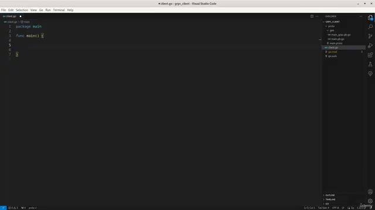
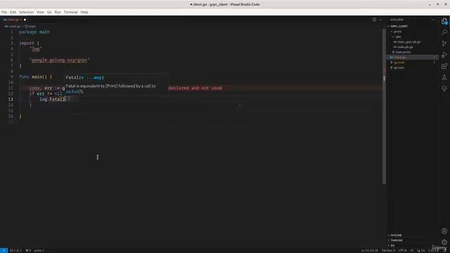
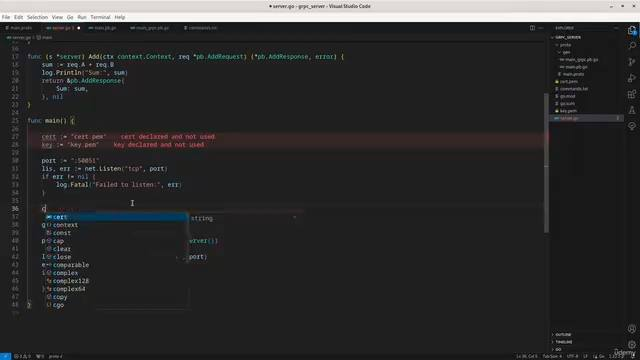
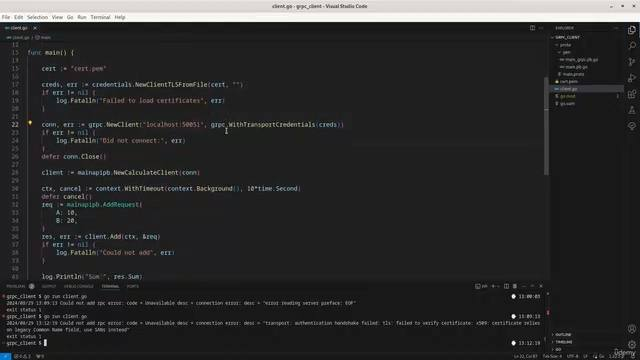
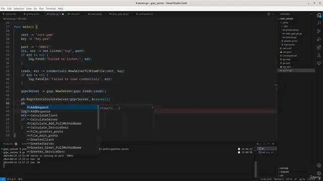
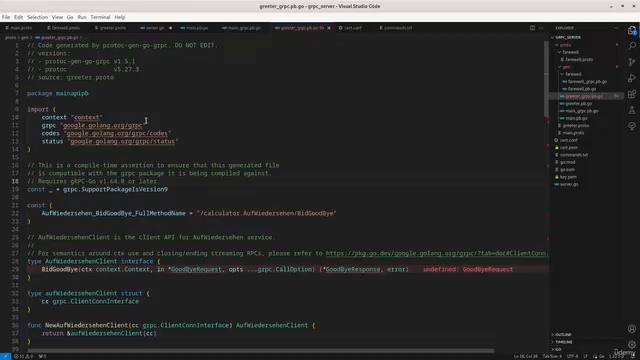

# gRPC & Protobuf 实战：客户端、TLS、多服务与多包（P38–P40）

> 课程：BV1oYx56TECn ｜ 覆盖 P38–P40
> 读者定位：前端转 AI 应用工程师。Go 语法只需「知道即可」，重点看「客户端怎么连、TLS 怎么配、多服务怎么注册、多包怎么 import」这四件事——这四件事在 Node/Python 里是同一套心智模型。

---

## 1. 这一节做什么

前三节（P35–P37，本课未覆盖）已经用 `.proto` 定义了 `Calculate` 服务、生成了 Go 代码、跑起了一个 gRPC server。P38–P40 要在这套基础上补齐「一个能真正跑通的 gRPC 项目」剩下的三块拼图：

1. **P38：写一个 Go 客户端**，用 `grpc.NewClient` 连上 server，调用 `Add` RPC，拿到 `sum`。中途会撞上「gRPC 默认要 TLS」的报错，用 `insecure.NewCredentials()` 绕过。
2. **P39：把 TLS 真正装上**。用 OpenSSL 生成证书/私钥，server 端 `credentials.NewServerTLSFromFile`，client 端 `credentials.NewClientTLSFromFile`。第一次会因为证书用的是 CN（Common Name）而不是 SAN（Subject Alternative Name）被 gRPC 拒绝，需要重写 `cert.conf` 重新签发。
3. **P40：多服务 + 多包 + 踩坑合集**。新增 `Greeter` 服务、新增 `farewell` 包里的 `BidGoodbye` RPC，演示：
   - 一个 server struct 里要注册多个服务；
   - 不同 service 要用不同的 client 实例；
   - 同名 RPC（`Add`）出现在两个 service 里时，server 端要用**不同的 struct** 承接；
   - `protoc` 不会删除旧文件，`_grpc.pb.go` 残留会导致编译错误，要手动删；
   - `protoc` 不知道你的 Go module 名，import 路径要手动补前缀。

最终产物：一个带 TLS 的 gRPC server，同时暴露 `Calculate`、`Greeter`、`BidFarewell` 三个服务；一个 Go 客户端能分别调用这三个服务并打印响应。

对前端来说，这三节对应的心智模型分别是：P38 相当于「用 `grpc-js` 建一个 typed client 并 `await client.add(...)`」；P39 相当于「把 `grpc.credentials.createInsecure()` 换成 `createSsl(cert)`」；P40 相当于「同一个 `channel` 上 new 出多个 service client，注意每个 service 的 client 类是独立的」。把 Go 的写法映射回 Node，你会发现概念一一对应，只是 Go 多了一层「struct 必须显式注册」的静态约束。

---

## 2. 讲师原话（带出处）

> "那么为了创建客户端，我会新建一个文件夹……我们把它命名为 grpc client。"
> —— p038 [00:25]

这段话对应 3.1：客户端是**独立目录、独立 Go module**，不是塞在 server 目录里。这样做的好处是后面可以单独把 `grpc-client/` 拷走部署，缺点是 `proto/` 要复制一份。

> "为了让客户端连接到服务器，我们现在调用 grpc.newClient。就这样。然后传入域名 localhost，以及端口 50051。"
> —— p038 [05:30]

注意讲师用了 `NewClient` 而不是旧教程常见的 `Dial`。第二个参数是可变长的 `grpc.DialOption`，后面加 TLS 凭证或 `insecure` 都塞在这里。

> "gRPC 使用 HTTP2，而且 gRPC 也在某种程度上强制使用 TLS……所以如果我们不使用 TLS，那么在这种情况下，就需要让 gRPC 服务器知道我们没有使用安全凭据。为此，我们使用 insecure.newCredentials。"
> —— p038 [06:58]

这是 P38 最关键的报错来源：不传任何 credentials 时，gRPC 会直接拒绝建连，而不是「默默用明文」。

> "客户端是基于服务的。一个服务可以包含多个 RPC……但如果其他 RPC 位于另一个服务中，那么在这种情况下，就需要为该服务创建一个新的客户端。"
> —— p038 [15:59]

一句话解释「为什么 `Calculate` 和 `Greeter` 要分别 `NewCalculateClient` / `NewGreeterClient`」：client 是 service 级别的，不是连接级别的。

> "为了创建安全服务器，也就是实现 TLS 的服务器，我们必须把凭据传给 grpc.NewServer……我们必须调用 credentials，然后调用与之关联的方法 NewServerTLSFromFile。"
> —— p039 [00:55] / [02:18]

对应 3.4 第三步：`grpc.NewServer(grpc.Creds(creds))`，`creds` 来自 `NewServerTLSFromFile`。

> "X509 标准已弃用通用名称字段来验证服务器身份，转而采用主题备用名称字段。因此，我们需要使用 SAN 创建一对新的证书和密钥。"
> —— p039 [05:52]

这是 P39 的第二个坑：证书里只写 `CN=localhost` 不够，必须写 `subjectAltName`。现代 Go/Node/浏览器都只认 SAN。

> "我们记得在服务器结构体中包含 pb.UnimplementedGreeterServer。我们还需要注册新服务。所以每个服务都需要注册。"
> —— p040 [10:21]

「嵌入 `UnimplementedXxxServer`」和「`RegisterXxxServer(s, &Impl{})`」是**两步**，只做第一步会编译通过但运行时 `unknown service`。

> "Protocol Buffers 编译器会覆盖文件，但不会删除先前生成、之后不再使用的文件。"
> —— p040 [36:10]

所以 service 从 proto 里移走后，旧的 `_grpc.pb.go` 会残留，里面还声明着接口，跟新生成的代码冲突。

> "Protocol Buffers 不会自动完成这件事，因为它不关心你的项目、你的模块……所以这件事需要你手动完成。"
> —— p040 [35:14]

所以 `option go_package` 里的 module 前缀必须手写，且 client 复制过去后要改成 client 的 module 名。

---

## 3. 从零复现

### 3.0 前置假设

P38 开头讲师说「our server is running」，说明 P35–P37 已经建好了 `simple-grpc-server` 目录，里面有 `main.go`、`proto/main.proto`、`proto/gen/` 生成目录，server 监听 `localhost:50051`。本节从「server 已存在」开始。

目录结构（复现后应长这样）：

```
workspace/
├── simple-grpc-server/
│   ├── go.mod
│   ├── main.go
│   ├── cert.pem
│   ├── key.pem
│   ├── cert.conf
│   └── proto/
│       ├── main.proto
│       ├── greeter.proto
│       ├── farewell/
│       │   └── farewell.proto
│       └── gen/
│           ├── main.pb.go
│           ├── main_grpc.pb.go
│           ├── greeter.pb.go
│           └── farewell/
│               ├── farewell.pb.go
│               └── farewell_grpc.pb.go
└── grpc-client/
    ├── go.mod
    ├── client.go
    ├── cert.pem
    └── proto/   （从 server 复制过来，含 gen/）
```

这个结构的两个关键点：第一，server 和 client 是**两个独立 module**，各自有 `go.mod`；第二，client 的 `proto/` 是 server 的副本，但 `go_package` 前缀要改（见 3.6 和 7.2）。如果你把两者放在同一个 module 里，可以省掉复制，但讲师演示的是分离结构，照做最稳。

### 3.1 建客户端目录（P38）

```bash
cd ..
mkdir grpc-client
cd grpc-client
code .
```

在 VS Code 里新建 `client.go`。然后把 server 的 `proto/` 整个文件夹复制到 `grpc-client/` 下。讲师特别说明：真实场景里你**只把 `.proto` 文件发给前端**，让前端自己按语言生成代码（Java 用 `--java_out`、Swift 用 `swift-protobuf`），这里为了省事直接连生成好的 `gen/` 一起复制。

```bash
go mod init simple-grpc-client
go get google.golang.org/grpc
```

命令解释：`go mod init` 创建 `go.mod` 并把 module 名设为 `simple-grpc-client`——这个名字后面会出现在 client 的 `go_package` 前缀里，必须一致。`go get` 下载 grpc-go 及其依赖，写入 `go.mod`/`go.sum`。跑完，编辑器里 `main_api_pb` 的红色波浪线会消失——讲师在 p038 [04:34] 专门指出这一点。

常见错误：如果目录里已有 `go.mod`，`go mod init` 会报 `go.mod already exists`，不用重复执行；如果 `go get` 卡住，先检查 `GOPROXY`（国内可设 `go env -w GOPROXY=https://goproxy.cn,direct`）。前端对照：这一步等价于 `npm init -y && npm i @grpc/grpc-js @grpc/proto-loader`。

### 3.2 写最小客户端（P38）

先只建立连接、不调 RPC，验证能连上。代码见第 4 节 `client.go` 的「阶段一」。跑起来会报错：

```
grpc: no transport security set (use grpc.WithInsecure() explicitly or set credentials)
```

讲师的处理：gRPC 默认要求 TLS，没配证书就得显式声明「我不加密」。用 `insecure.NewCredentials()` 作为 `grpc.NewClient` 的第二个参数。注意新版 grpc-go 里 `grpc.WithInsecure()` 已 deprecated，统一用 `grpc.WithTransportCredentials(insecure.NewCredentials())`。

常见错误与排查：如果报的是 `connection refused` 而不是 TLS 错误，说明 server 没启动或端口不对，先确认终端 1 的 server 在跑；如果报 `context deadline exceeded`，说明连接建立了但 RPC 超时，先回到 3.3 检查 context 时长。

### 3.3 调用 Add RPC（P38）

连接通了之后：

1. `main_api_pb.NewCalculateClient(conn)` 拿到 client 实例（注意：**client 是按 service 划分的**，一个 service 一个 client）；
2. `context.WithTimeout(context.Background(), 10*time.Second)` 建 context，`defer cancel()`；
3. 构造 `&main_api_pb.AddRequest{A: 10, B: 20}`；
4. `client.Add(ctx, req)` 返回 `res, err`；
5. `log.Println("Sum:", res.Sum)`。

讲师在 p038 [14:34] 提到第一次跑超时了，因为 context 只给了 1 秒，server 那边打印日志慢了一点，改成 10 秒后正常。**这是真实会撞上的坑，照抄时直接给 10 秒。** 排查方法：如果仍超时，在 server 的 `Add` 方法第一行加 `log.Println("Add hit")`，确认请求是否到达 server；如果 server 没打印，问题在连接/TLS，不在 context。

前端对照：这一步等价于 `const client = new CalculateClient(addr, creds); const res = await client.add({a:10,b:20})`。Node 里超时用 `deadline` 选项或 `AbortController`，Go 里就是 context。

### 3.4 给 server 装 TLS（P39）

**第一步：生成 SAN 证书。** 讲师复用了 REST API 那节课的 `openssl.cnf`，改名为 `cert.conf`，把 CN 段换成 SAN 段。内容见第 4 节 `cert.conf`。

**第二步：签发证书。** 命令（讲师在 p039 [07:36] 逐段念的）：

```bash
openssl req -x509 -nodes -days 365 \
  -newkey rsa:2048 \
  -keyout key.pem \
  -out cert.pem \
  -config cert.conf
```

参数解释：`-x509` 生成自签名证书；`-nodes` 表示私钥不加密（否则每次启动都要输密码）；`-days 365` 有效期一年；`-newkey rsa:2048` 同时生成 2048 位 RSA 私钥；`-keyout`/`-out` 分别是私钥和证书输出路径；`-config cert.conf` 指定 SAN 配置。一路回车用默认值。生成 `cert.pem` 和 `key.pem`。

**第三步：server 端加载。** 在 `grpc.NewServer()` 里加 `grpc.Creds(creds)`，`creds` 来自 `credentials.NewServerTLSFromFile("cert.pem", "key.pem")`。

**第四步：client 端加载。** 把 `cert.pem` 复制到 `grpc-client/`，把 `insecure.NewCredentials()` 换成 `credentials.NewClientTLSFromFile("cert.pem", "")`（第二个参数是 serverNameOverride，讲师留空）。

**第五步：如果报 CN 错误**，说明证书还是老格式，回到第一步重签。典型报错是 `certificate relies on legacy Common Name field, use SANs instead`。

常见错误与排查：如果 `openssl` 报 `Unable to load config info from cert.conf`，说明当前目录不对，`cert.conf` 要和命令在同一目录；如果 client 报 `x509: certificate signed by unknown authority`，说明 client 加载的 `cert.pem` 跟 server 用的不是同一份，重新复制；如果报 `x509: certificate is valid for ..., not localhost`，说明 SAN 里缺 `localhost`，检查 `cert.conf` 的 `[alt_names]` 段。

### 3.5 加 Greeter 服务（P40）

1. 在 `proto/` 下新建 `greeter.proto`，**只放 message**（`HelloRequest`、`HelloResponse`），package 与 `main.proto` 相同（`calculator`）。
2. 在 `main.proto` 里 `import "greeter.proto";`，新增 `service Greeter { rpc Greet(HelloRequest) returns (HelloResponse); }`。
3. 重新生成代码，命令要加 `-I` 参数指向 proto 根目录（因为有了 import）：

```bash
protoc --go_out=gen --go_opt=paths=source_relative \
       --go-grpc_out=gen --go-grpc_opt=paths=source_relative \
       -I proto \
       proto/main.proto proto/greeter.proto
```

命令解释：`--go_out` 和 `--go-grpc_out` 分别指定 message 代码和 service 代码的输出目录；`paths=source_relative` 表示按 proto 文件相对路径生成子目录；`-I proto` 是 import 搜索根，`main.proto` 里的 `import "greeter.proto"` 就是靠它找到的。

4. server 端：`Server` struct 里嵌入 `pb.UnimplementedGreeterServer`，**并且**在 `main()` 里 `pb.RegisterGreeterServer(s, &Server{})`。讲师在 p040 [10:21] 强调这是**两步**，漏了第二步会收到 `unknown service calculator.Greeter`。
5. client 端：`client2 := pb.NewGreeterClient(conn)`，再 `client2.Greet(ctx, &pb.HelloRequest{Name: "John"})`。

常见错误与排查：如果 `protoc` 报 `greeter.proto: File not found`，说明 `-I proto` 没加或路径不对；如果 Go 编译报 `undefined: pb.UnimplementedGreeterServer`，说明没重新生成代码；如果运行时 `unknown service`，说明只嵌入了 struct 没调 `RegisterGreeterServer`。

### 3.6 加 farewell 包（P40）

1. 新建 `proto/farewell/farewell.proto`，`package farewell;`，`option go_package` 指向 `gen/farewell`。
2. 里面定义 `GoodbyeRequest`、`GoodbyeResponse`、`service BidFarewell { rpc BidGoodbye(...) ... }`。
3. 生成命令追加 `proto/farewell/farewell.proto`。
4. server 端 import `farewellpb "simple-grpc-server/proto/gen/farewell"`，注册 `farewellpb.RegisterBidFarewellServer(s, &Server{})`。
5. client 端 `fwclient := farewellpb.NewBidFarewellClient(conn)`。

关键点：`package farewell` 与 `calculator` 不同，生成的 Go 代码落在 `gen/farewell/` 子目录，import 路径多一级。`option go_package` 必须写全 `simple-grpc-server/proto/gen/farewell`，不能只写 `gen/farewell`，否则 Go 不知道 module 前缀。前端对照：这相当于 Node 里 `require('./gen/farewell/farewell_grpc_pb')`，路径层级完全对应 proto 的目录层级。

常见错误与排查：如果 `protoc` 报 `farewell.proto: No such file or directory`，检查是否在 `simple-grpc-server/` 目录下执行、路径是否写成 `proto/farewell/farewell.proto`；如果 client 端 import 报 `cannot find package`，说明 client 的 `go_package` 前缀还是 `simple-grpc-server`，要改成 `simple-grpc-client`（见 7.2）。

### 3.7 同名 Add 冲突的处理（P40 后半）

讲师故意在 `Greeter` 服务里也加了一个 `Add` RPC（参数是 `HelloRequest`/`HelloResponse`），结果 server 端两个 `Add` 方法同名冲突。解决方案：**新建一个 `ServerGreeter` struct**，把 `UnimplementedGreeterServer` 和 `Greet`/`Add` 方法挂到它上面，注册时传 `&ServerGreeter{}`。`Calculate` 的 `Add` 留在原 `Server` struct 上。

排查方法：如果编译报 `method redeclared: Server.Add`，说明你把两个 `Add` 挂到了同一个 struct；如果运行时调 `Greeter.Add` 却走到 `Calculate.Add`，说明注册时传错了 struct 实例。前端对照：JS 里两个 class 各有一个 `add` 方法天然不冲突，Go 的 struct 方法集是扁平的，所以必须拆 struct。

### 3.8 清理残留 `_grpc.pb.go`（P40 关键坑）

把 `Greeter` 服务从 `greeter.proto` 移走后，`greeter_grpc.pb.go` 不会被 `protoc` 自动删除，会导致「重复声明」编译错误。**手动删掉** `proto/gen/greeter_grpc.pb.go` 和 `proto/gen/farewell/farewell_grpc.pb.go`（如果对应 proto 里已无 service）。

识别方法：打开报错行，如果提示 `GreeterServer redeclared in this block`，且两个声明分别来自 `main_grpc.pb.go` 和 `greeter_grpc.pb.go`，就是残留文件作祟。删之前先 `grep -r "GreeterServer" proto/gen/` 确认哪些文件还引用它。

### 3.9 启动

```bash
# 终端 1
cd simple-grpc-server
go run main.go

# 终端 2
cd grpc-client
go run client.go
```

预期输出（客户端）：

```
Sum: 30
Greeting message: Hello John, nice to receive request from you
Goodbye message: Goodbye Jane, nice to have received request from you. Farewell, my friend.
```

启动排查：如果终端 1 报 `failed to load TLS credentials`，检查 `cert.pem`/`key.pem` 是否在当前目录；如果终端 2 报 `connection refused`，确认终端 1 已打印 `listening`；如果终端 2 报 `context deadline exceeded`，确认 server 的 `Add`/`Greet`/`BidGoodbye` 里没有阻塞逻辑。

---

## 4. 完整代码

### 4.1 `simple-grpc-server/proto/main.proto`

```protobuf
syntax = "proto3";

package calculator;

option go_package = "simple-grpc-server/proto/gen";

import "greeter.proto";

message AddRequest {
  int32 a = 1;
  int32 b = 2;
}

message AddResponse {
  int32 sum = 1;
}

service Calculate {
  rpc Add(AddRequest) returns (AddResponse);
}

service Greeter {
  rpc Greet(HelloRequest) returns (HelloResponse);
}
```

> 说明：`option go_package` 里必须带 module 前缀 `simple-grpc-server/`，这是 p040 [35:14] 讲师强调的「protoc 不知道你的 module 名，要手动补」。`import "greeter.proto"` 只写相对 `-I` 根的路径，不写 `proto/` 前缀。

### 4.2 `simple-grpc-server/proto/greeter.proto`

```protobuf
syntax = "proto3";

package calculator;

option go_package = "simple-grpc-server/proto/gen";

message HelloRequest {
  string name = 1;
}

message HelloResponse {
  string message = 1;
}
```

> 注意：这个文件**只有 message，没有 service**。所以 `protoc` 只会生成 `greeter.pb.go`，不会生成 `greeter_grpc.pb.go`。如果之前生成过带 service 的版本，记得删残留（见 3.8）。

### 4.3 `simple-grpc-server/proto/farewell/farewell.proto`

```protobuf
syntax = "proto3";

package farewell;

option go_package = "simple-grpc-server/proto/gen/farewell";

message GoodbyeRequest {
  string name = 1;
}

message GoodbyeResponse {
  string message = 1;
}

service BidFarewell {
  rpc BidGoodbye(GoodbyeRequest) returns (GoodbyeResponse);
}
```

### 4.4 `simple-grpc-server/cert.conf`

```ini
[req]
default_bits       = 2048
prompt             = no
default_md         = sha256
distinguished_name = dn
x509_extensions    = v3_req

[dn]
C  = IN
ST = SomeState
L  = SomeCity
O  = SomeOrg
OU = SomeOU
CN = localhost

[v3_req]
subjectAltName = @alt_names

[alt_names]
DNS.1 = localhost
IP.1  = 127.0.0.1
```

> 讲师在 p039 [06:19] 说「completely change this」，把原来的 CN 段换成 SAN 段。上面是等价的最小可用版本，关键是 `subjectAltName` 必须包含 `localhost` 和 `127.0.0.1`。`CN` 字段保留但不参与验证，现代客户端只看 SAN。

### 4.5 `simple-grpc-server/main.go`

```go
package main

import (
	"context"
	"fmt"
	"log"
	"net"

	"google.golang.org/grpc"
	"google.golang.org/grpc/credentials"

	pb "simple-grpc-server/proto/gen"
	farewellpb "simple-grpc-server/proto/gen/farewell"
)

// Server 承接 Calculate 服务
type Server struct {
	pb.UnimplementedCalculateServer
}

func (s *Server) Add(ctx context.Context, req *pb.AddRequest) (*pb.AddResponse, error) {
	sum := req.A + req.B
	log.Printf("Add called: %d + %d = %d", req.A, req.B, sum)
	return &pb.AddResponse{Sum: sum}, nil
}

// ServerGreeter 承接 Greeter 服务（避免与 Calculate 的 Add 同名冲突）
type ServerGreeter struct {
	pb.UnimplementedGreeterServer
}

func (s *ServerGreeter) Greet(ctx context.Context, req *pb.HelloRequest) (*pb.HelloResponse, error) {
	msg := fmt.Sprintf("Hello %s, nice to receive request from you", req.Name)
	return &pb.HelloResponse{Message: msg}, nil
}

// BidFarewell 的 BidGoodbye 挂在 Server 上（与 Calculate 同 struct，方法名不冲突）
func (s *Server) BidGoodbye(ctx context.Context, req *farewellpb.GoodbyeRequest) (*farewellpb.GoodbyeResponse, error) {
	msg := fmt.Sprintf("Goodbye %s, nice to have received request from you. Farewell, my friend.", req.Name)
	return &farewellpb.GoodbyeResponse{Message: msg}, nil
}

func main() {
	lis, err := net.Listen("tcp", "localhost:50051")
	if err != nil {
		log.Fatalf("failed to listen: %v", err)
	}

	creds, err := credentials.NewServerTLSFromFile("cert.pem", "key.pem")
	if err != nil {
		log.Fatalf("failed to load TLS credentials: %v", err)
	}

	s := grpc.NewServer(grpc.Creds(creds))

	pb.RegisterCalculateServer(s, &Server{})
	pb.RegisterGreeterServer(s, &ServerGreeter{})
	farewellpb.RegisterBidFarewellServer(s, &Server{})

	log.Println("gRPC server listening on localhost:50051 with TLS")
	if err := s.Serve(lis); err != nil {
		log.Fatalf("failed to serve: %v", err)
	}
}
```

### 4.6 `grpc-client/client.go`

```go
package main

import (
	"context"
	"log"
	"time"

	"google.golang.org/grpc"
	"google.golang.org/grpc/credentials"

	pb "simple-grpc-client/proto/gen"
	farewellpb "simple-grpc-client/proto/gen/farewell"
)

func main() {
	creds, err := credentials.NewClientTLSFromFile("cert.pem", "")
	if err != nil {
		log.Fatalf("failed to load client TLS credentials: %v", err)
	}

	conn, err := grpc.NewClient("localhost:50051", grpc.WithTransportCredentials(creds))
	if err != nil {
		log.Fatalf("failed to create client: %v", err)
	}
	defer conn.Close()

	// 打印连接状态（p040 [00:00] 演示）
	log.Println("Connection state:", conn.GetState())

	ctx, cancel := context.WithTimeout(context.Background(), 10*time.Second)
	defer cancel()

	// ---- Calculate 服务 ----
	calcClient := pb.NewCalculateClient(conn)
	addRes, err := calcClient.Add(ctx, &pb.AddRequest{A: 10, B: 20})
	if err != nil {
		log.Fatalf("could not add: %v", err)
	}
	log.Println("Sum:", addRes.Sum)

	// ---- Greeter 服务（不同 service 要新建 client）----
	greeterClient := pb.NewGreeterClient(conn)
	greetRes, err := greeterClient.Greet(ctx, &pb.HelloRequest{Name: "John"})
	if err != nil {
		log.Fatalf("could not greet: %v", err)
	}
	log.Println("Greeting message:", greetRes.Message)

	// ---- BidFarewell 服务（不同 package 的 client）----
	fwClient := farewellpb.NewBidFarewellClient(conn)
	byeRes, err := fwClient.BidGoodbye(ctx, &farewellpb.GoodbyeRequest{Name: "Jane"})
	if err != nil {
		log.Fatalf("could not bid goodbye: %v", err)
	}
	log.Println("Goodbye message:", byeRes.Message)
}
```

### 4.7 生成代码命令（完整版）

```bash
# 在 simple-grpc-server/ 下执行
protoc \
  --go_out=proto/gen --go_opt=paths=source_relative \
  --go-grpc_out=proto/gen --go-grpc_opt=paths=source_relative \
  -I proto \
  proto/main.proto proto/greeter.proto proto/farewell/farewell.proto
```

> `-I proto` 是 p040 [04:07] 讲师说的「capital I flag」，用来解析 `import "greeter.proto"` 和 `import "farewell/farewell.proto"`。输出目录写 `proto/gen` 是因为 `go_package` 已包含 `proto/gen`，`source_relative` 会按 proto 文件相对路径再落一层。

---

## 5. 逐行解释

### 5.1 客户端连接部分

- `credentials.NewClientTLSFromFile("cert.pem", "")`：第二个参数是 `serverNameOverride`，讲师留空表示用 URL 里的 host（`localhost`）去匹配证书的 SAN。**在 Node 里对应 `grpc.credentials.createSsl(fs.readFileSync('cert.pem'))`**，心智模型一样。如果 server 地址是 IP 而证书 SAN 只有域名，就需要显式传 override。
- `grpc.NewClient("localhost:50051", ...)`：注意不是 `grpc.Dial`。讲师用的就是 `NewClient`（p038 [05:30]），这是较新的 API，`Dial` 已不推荐。`NewClient` 是懒连接，调用时不立刻建 TCP，第一次 RPC 才真正握手。
- `defer conn.Close()`：main 退出时关连接。**在 Node 里对应 `client.close()`**。不关的话进程可能挂住不退。
- `conn.GetState()`：p040 [00:00] 演示，返回 `IDLE`/`READY`/`CONNECTING` 等。讲师观察到「刚启动是 IDLE，发过请求后变 READY」——这是 gRPC 懒连接特性，**Node 里 `client.getChannel().getConnectivityState()` 同理**。排查连接问题时打印它比猜更有效。

### 5.2 context 部分

- `context.WithTimeout(context.Background(), 10*time.Second)`：给整个 RPC 调用设超时。**在 JS 里对应 `AbortController` + `setTimeout`**，或者 gRPC-js 的 `deadline` 选项。Go 的 context 会一路传到 server 端，server 也能感知 deadline。
- `defer cancel()`：防止 context 泄漏。**这是 Go 的固定套路，Node 里对应 `clearTimeout`**。即使 RPC 提前返回，`cancel` 也要调，否则计时器资源不释放。
- 讲师第一次给 1 秒导致超时（p038 [14:34]），说明 server 端日志打印会拖慢响应——**生产环境别把超时设太紧**。排查时可以先临时改成 30 秒，确认不是业务逻辑慢，再逐步收紧。

### 5.3 为什么 client 要按 service 分

p038 [15:59] 讲师原话：「a client is based on a service」。`pb.NewCalculateClient(conn)` 和 `pb.NewGreeterClient(conn)` 共用同一个 `conn`，但返回不同的 client 对象。**这跟 REST 里一个 axios 实例调不同 endpoint 不一样**——gRPC 的 client 是强类型的，每个 service 一个。**在 Node 里 `new CalculateClient(...)` 和 `new GreeterClient(...)` 也是分开 new 的**。

注意 `conn` 可以复用，底层是同一条 HTTP/2 连接；client 只是对 conn 的一层 typed 包装。所以三个 client 共享连接不会有三倍开销。

### 5.4 TLS 部分

- `credentials.NewServerTLSFromFile("cert.pem", "key.pem")`：server 端加载证书+私钥。**Node 里 `grpc.ServerCredentials.createSsl(null, [{private_key, cert_chain}])`**。
- `grpc.Creds(creds)`：把 credentials 塞进 server options。讲师在 p039 [01:24] 特意 control-click 进去看了 `ServerOption` struct，确认 `creds` 字段类型是 `credentials.TransportCredentials`。
- **为什么必须 SAN 不能 CN**：p039 [05:52] 讲师解释 X509 标准已废弃 CN 验证。现代浏览器、Node、Go 都只认 SAN。**这是 2024 年后所有 TLS 项目的通用坑，不只 gRPC**。排查时用 `openssl x509 -in cert.pem -text -noout` 看 `X509v3 Subject Alternative Name` 段是否存在。

### 5.5 多服务注册部分

- `pb.UnimplementedGreeterServer`：嵌入 struct，提供「未实现」的默认方法，这样你只实现部分 RPC 也能编译通过。**Node 里没有这个概念，因为 JS 是动态语言**。Go 的 interface 要求方法集完整，嵌入这个 struct 相当于拿到所有方法的默认实现。
- `pb.RegisterGreeterServer(s, &ServerGreeter{})`：**这一步漏了会报 `unknown service calculator.Greeter`**（p040 [09:54] 讲师实际撞到）。讲师强调「两步」：嵌入 + 注册。嵌入是编译期的事，注册是运行期把 service 名和实现绑到 server 上。
- **为什么 `ServerGreeter` 要单独一个 struct**：`Calculate.Add` 和 `Greeter.Add` 同名，Go 不允许同一个 struct 有两个同名方法。**在 JS 里因为方法是挂在不同 class 上的，天然不冲突**——这是 Go 的静态类型带来的额外约束。拆 struct 后，两个 `Add` 各自挂在不同 receiver 上，注册时各传各的实例。

### 5.6 protoc 残留文件部分

- p040 [36:10] 讲师原话：「protoc 会覆盖文件，但不会删除不再需要的文件」。所以 `greeter.proto` 里 service 被移走后，`greeter_grpc.pb.go` 还在，里面还声明着 `GreeterServer` 接口，跟 `main_grpc.pb.go` 里新生成的冲突。
- **手动删**：`rm proto/gen/greeter_grpc.pb.go`、`rm proto/gen/farewell/farewell_grpc.pb.go`（如果对应 proto 已无 service）。
- **这是 protoc 的通用行为，不是 bug**。Node 的 `grpc-tools` 也一样。养成习惯：每次改 proto 的 service 结构后，先 `ls proto/gen/**/*_grpc.pb.go` 对照 proto 文件检查一遍。

### 5.7 go_package 前缀部分

- p040 [35:14] 讲师原话：「protocol buffers 不知道你的 module 名」。所以 `option go_package = "simple-grpc-server/proto/gen"` 里的 `simple-grpc-server` 必须手动写，跟 `go.mod` 里的 `module` 行一致。
- 如果 client 和 server 是两个 module，client 复制过去的 proto 里 `go_package` 要改成 `simple-grpc-client/proto/gen`，否则 import 路径对不上。只改 `go_package` 不够，还要重新跑 `protoc` 生成 client 侧的 `gen/`，因为生成文件里的 import 路径是写死的。

---

## 6. 复现检查清单

按顺序打勾，任何一步失败先看第 7 节：

- [ ] `simple-grpc-server/` 能 `go run main.go` 启动，日志打印 `listening on localhost:50051 with TLS`
  - **怎么验证**：终端 1 执行后看到这行日志即通过；如果看到 `failed to load TLS credentials`，检查 `cert.pem`/`key.pem` 是否在当前目录。
- [ ] `grpc-client/` 能 `go run client.go`，输出三行：`Sum: 30`、`Greeting message: ...`、`Goodbye message: ...`
  - **怎么验证**：逐行核对输出，三行缺一说明对应 service 没注册或 client 没调；如果第一行就报错，看第 7 节表格。
- [ ] `openssl x509 -in cert.pem -text -noout | grep -A1 "Subject Alternative Name"` 能看到 `DNS:localhost` 和 `IP:127.0.0.1`
  - **怎么验证**：命令有输出且包含这两项即通过；如果输出为空，说明证书是 CN 版本，回 3.4 重签。
- [ ] `proto/gen/` 下**没有** `greeter_grpc.pb.go`（因为 greeter.proto 无 service）
  - **怎么验证**：`ls proto/gen/ | grep greeter`，只应看到 `greeter.pb.go`；如果多出 `greeter_grpc.pb.go`，说明是旧残留，删掉。
- [ ] `proto/gen/farewell/` 下**有** `farewell_grpc.pb.go`（因为 farewell.proto 有 service）
  - **怎么验证**：`ls proto/gen/farewell/`，应同时看到 `farewell.pb.go` 和 `farewell_grpc.pb.go`；缺后者说明生成命令没带 `farewell.proto` 或没重新生成。
- [ ] `main.proto` 的 `option go_package` 前缀与 `go.mod` 的 `module` 行一致
  - **怎么验证**：`head -1 go.mod` 看 module 名，`grep go_package proto/main.proto` 看前缀，两者应完全相同。
- [ ] client 的 `proto/` 是从 server 复制过来的，且 `go_package` 前缀已改成 client 的 module 名
  - **怎么验证**：`grep go_package grpc-client/proto/main.proto`，前缀应是 `simple-grpc-client`；如果还是 `simple-grpc-server`，client 编译会报找不到包。
- [ ] 故意把 `cert.pem` 换成 CN 版本，client 会报 `certificate relies on legacy Common Name field`——验证你理解了 SAN 的必要性
  - **怎么验证**：临时用旧 `cert.conf`（只有 CN 无 SAN）重签，重启 server、跑 client，看到该报错即通过；测完换回 SAN 版本。

---

## 7. 课里没讲但你会撞上的

| 现象 | 原因 | 怎么办 |
|---|---|---|
| 搜到的老教程用 `grpc.Dial`，照抄后编辑器提示 deprecated | 讲师用的是 `grpc.NewClient`，`Dial` 在新版 grpc-go 已标记 deprecated | 统一用 `grpc.NewClient`；两者参数类似，但 `NewClient` 不做阻塞握手，行为更可控 |
| client 编译报 `cannot find package "simple-grpc-server/proto/gen"` | client 直接复制了 server 的 `gen/`，`go_package` 前缀仍指向 server module | 把 client `proto/` 里所有 `option go_package` 改成 `simple-grpc-client/...`，重新跑 `protoc` 生成 client 侧 `gen/` |
| `protoc` 报 `program not found or is not executable` | 没装 `protoc-gen-go` / `protoc-gen-go-grpc`，或 `$GOPATH/bin` 不在 `PATH` | `go install google.golang.org/protobuf/cmd/protoc-gen-go@latest` 和 `go install google.golang.org/grpc/cmd/protoc-gen-go-grpc@latest`，确认 `$GOPATH/bin` 在 `PATH` |
| `go run client.go` 报 `open cert.pem: no such file or directory` | 证书用相对路径 `"cert.pem"`，必须在各自目录下执行 | `cd grpc-client` 再 `go run client.go`；或在代码里用绝对路径/`filepath.Join` 拼 |
| 第二个 RPC 立刻 `context deadline exceeded` | 三个 RPC 共用一个 10 秒 context，第一个耗时接近上限 | 每个 RPC 单独 `context.WithTimeout`；生产代码里别复用长 context |
| 把 `log.Fatalf` 换成 `log.Println` 后程序不退出、继续跑出奇怪结果 | `Fatalf` 会 `os.Exit(1)`，`Println` 只打印 | 调试时可以换，生产代码 RPC 失败应 `return err` 或 `log.Fatal`，别静默继续 |
| `farewell.proto` 的 `package` 写成 `calculator` 后编译冲突 | 两个 proto 同 package 且生成到同一目录，类型名可能撞 | `farewell.proto` 保持 `package farewell`，`go_package` 指向 `gen/farewell` 子目录，与 `calculator` 隔离 |
| `BidGoodbye` 挂在 `ServerGreeter` 上却注册 `&Server{}`，运行时 `unknown service` 或方法未实现 | 方法接收者必须与注册时传的 struct 实例类型匹配 | `RegisterBidFarewellServer(s, &Server{})` 就要求 `BidGoodbye` 的 receiver 是 `*Server`；改 receiver 或改注册实例，二者一致 |











