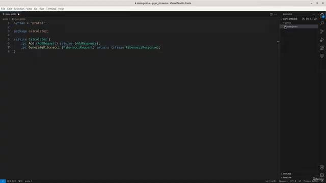
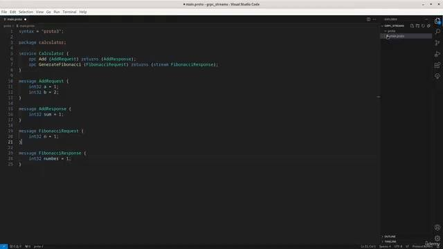
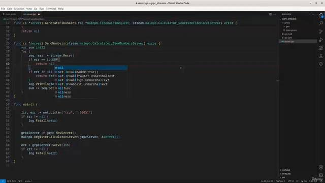
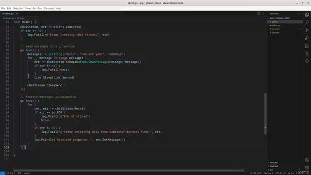

# gRPC & Protobuf（BV1oYx56TECn）P41–P44：三种流式 RPC 从零复现

> 覆盖 P41–P44。这四节的产物是**一个能跑起来的 Go 项目**：一个 `Calculator` 服务，四个 RPC，其中三个分别演示 server streaming、client streaming、bidirectional streaming。本节文档按「装环境 → 写 proto → 生成代码 → 写服务端 → 写客户端 → 两终端对跑」的顺序组织，照抄即可复现。

---

## 1. 这一节做什么

P41 是纯概念讲解，把 gRPC 的流式通信分成三类：

| 类型 | 请求 | 响应 | 本节对应的 RPC |
|---|---|---|---|
| Unary（非流式，对照用） | 单个消息 | 单个消息 | `Add` |
| Server streaming | 单个消息 | **流** | `GenerateFibonacci` |
| Client streaming | **流** | 单个消息 | `SendNumbers` |
| Bidirectional streaming | **流** | **流** | `Chat` |

P42 实现 server streaming（服务端实时把斐波那契数列一个个推给客户端）；P43 实现 client streaming（客户端一秒一个数字地推给服务端，服务端在流结束后一次性返回总和）；P44 实现双向流（一个终端聊天 demo，客户端用 goroutine 独立收发）。

最终你要在本地得到两个可独立运行的 Go module：

```
grpc-streams/                     # 服务端 module
├── go.mod                        # module grpc-streams
├── go.sum
├── server.go                     # package main
└── proto/
    ├── main.proto
    ├── main.pb.go                # protoc 生成
    └── main_grpc.pb.go           # protoc 生成

grpc-stream-client/               # 客户端 module（与 server 平级）
├── go.mod                        # module grpc-stream-client
├── go.sum
└── client.go                     # package main
```

端口固定 `:50051`。技术栈：Go + `google.golang.org/grpc` + `protoc` + `protoc-gen-go` + `protoc-gen-go-grpc`。

---

## 2. 讲师原话

> "gRPC 流式传输允许客户端和服务端收发消息流，而不是只进行一次请求和响应。"
> —— p041 [00:00]

> "首先是服务端流式传输。客户端发送单个请求，服务端发送响应流。其次是客户端流式传输。客户端发送请求流，服务端针对该流发送单个响应。接下来是双向流式传输。客户端和服务端彼此发送消息流。"
> —— p041 [00:29]


> "流式传输可以降低延迟，因为它让服务端在数据可用时就发送，而不必等到整个响应就绪。最后，流式传输还允许将大量数据分成更小、更易管理的块发送。"
> —— p041 [00:53]


> "当我们进行流式传输时，需要在请求或响应前写上 stream 关键字。……服务端流式传输意味着响应将通过流发送。如果是客户端流式传输，那么请求将以流的形式出现。"
> —— p042 [01:24] / [01:49]

> "我们不是先生成一个列表再把列表发送给客户端。而是每生成一个数字，就把这个数字实时发送给客户端。"
> —— p042 [03:13]

> "我们会在流结束时发送响应。只有流结束后，我们才能发送响应，因为这不是双向流。"
> —— p043 [03:28]

> "Close send 不返回响应，只返回错误。……除了 close and receive，我们不会选择其他方法，因为这是唯一会返回响应的方法。"
> —— p043 [11:54]

> "如果遇到文件结束符，那么在这种情况下，我们会跳出这个循环。"
> —— p044 [03:33]

> "服务端没有关闭流的选项……因为我们无法从服务端关闭流。"
> —— p044 [27:27] / [27:57]

讲师还把这套 API 简化成一张口决（P43 末尾）：**server 端 `stream.Send` 传响应、`stream.Receive` 收请求；client 端 `stream.Send` 传请求、`stream.Receive` 收响应；只要某个方向是流，参数类型就变成 `Calculator_<RPC名>Server` 这种生成类型。** 注意：Go 生成代码里的实际方法名是 `Send` / `Recv`（不是 `Receive`），接收响应/请求的方法叫 `Recv`，讲师口述时念作 "receive"，下文代码以 `Recv` 为准。

---

## 3. 从零复现

### 3.1 装工具链

```bash
# Go 1.21 以上（grpc-go 新版本要求）
go version

# protoc 编译器本体（macOS 用 brew；Linux 用 apt 或官方 release 包）
brew install protobuf          # 或 apt-get install -y protobuf-compiler
protoc --version

# 两个代码生成插件
go install google.golang.org/protobuf/cmd/protoc-gen-go@latest
go install google.golang.org/grpc/cmd/protoc-gen-go-grpc@latest

# 确认插件在 PATH 里（Go 装的可执行文件默认落在 $(go env GOPATH)/bin）
ls $(go env GOPATH)/bin | grep protoc-gen
```

> 讲师**没有给出版本号，也没有演示这三条安装命令**（他只说「run the usual command to generate the protocol buffer files」）。上面是我按当前可用的组合写的；如果你本地已经装过旧版 `protoc-gen-go`，先删掉再装，新旧插件混用会生成互不兼容的文件。

### 3.2 建服务端目录并写 proto

```bash
mkdir -p grpc-streams/proto
cd grpc-streams
# 然后在 proto/main.proto 里写入第 4 节的完整 proto 内容
```

关键点（讲师在 P42 强调过两次）：**`stream` 关键字加在「流」的那一侧**。server streaming 加在返回值上，client streaming 加在参数上，双向流两边都加。

### 3.3 生成 Go 代码

```bash
# 在 grpc-streams/ 目录下执行
protoc \
  --go_out=. --go_opt=paths=source_relative \
  --go-grpc_out=. --go-grpc_opt=paths=source_relative \
  proto/main.proto
```

执行完 `proto/` 下会出现两个文件：`main.pb.go` 和 `main_grpc.pb.go`（讲师在 P42 [04:32] 处念作「pv.go 和 grpc.pv.go」，那是语音转写把 `pb` 识别成了 `pv`，实际后缀就是 `.pb.go`）。



### 3.4 初始化 module 和依赖

```bash
# 仍在 grpc-streams/ 下
go mod init grpc-streams
go get google.golang.org/grpc
go get google.golang.org/protobuf
go mod tidy
```

讲师在这里说的就是这三步（P42 [04:47]–[05:00]）：「initialize our module and I'm going to name our module grpc streams」「run the command for getting the gRPC package imported」「go mod tidy」。

### 3.5 写服务端、跑起来

把第 4 节的 `server.go` 放到 `grpc-streams/` 根目录，然后：

```bash
cd grpc-streams
go run server.go
# 无输出即代表监听成功：tcp :50051
```

### 3.6 建客户端 module

讲师的做法是**另起一个 module**，把服务端的 `proto` 文件夹整份复制过去（P42 [11:49]–[12:16]：「I'm not going to copy the protocol buffer source files. I'm actually going to copy the complete folder with the generated files as well」）。

我这里改成用 `replace` 直接引用，**不复制**——原因见第 7 节第 2 条，直接复制在新版 protoc 下会因为 `go_package` 的 import path 对不上而编译失败。

```bash
mkdir -p grpc-stream-client
cd grpc-stream-client
go mod init grpc-stream-client
go get google.golang.org/grpc
go get google.golang.org/protobuf
# 手写 go.mod 里的 replace（见第 4 节），再：
go mod tidy
```

### 3.7 两终端对跑

```bash
# 终端 A
cd grpc-streams && go run server.go

# 终端 B
cd grpc-stream-client && go run client.go
```

---

## 4. 完整代码

### 4.1 `grpc-streams/proto/main.proto`

```proto
syntax = "proto3";

package calculator;

// 课里讲师只说「提到 option go_package，用合适的路径」，没念出具体值。
// 这里必须和 go.mod 的 module 名一致，否则 import 对不上。
option go_package = "grpc-streams/proto";

service Calculator {
  // 1. 非流式，用来做对照。课里只声明了这个 RPC，没有实现它。
  rpc Add(AddRequest) returns (AddResponse);

  // 2. server streaming：一个请求，一串响应
  rpc GenerateFibonacci(FibonacciRequest) returns (stream FibonacciResponse);

  // 3. client streaming：一串请求，一个响应
  rpc SendNumbers(stream NumberRequest) returns (NumberResponse);

  // 4. bidirectional streaming：双向都是流
  rpc Chat(stream ChatMessage) returns (stream ChatMessage);
}

message AddRequest {
  int32 a = 1;
  int32 b = 2;
}

message AddResponse {
  int32 sum = 1;
}

message FibonacciRequest {
  int32 n = 1;
}

message FibonacciResponse {
  int32 number = 1;
}

message NumberRequest {
  int32 number = 1;
}

message NumberResponse {
  int32 number = 1;
  int32 sum = 2;
}

message ChatMessage {
  string message = 1;
}
```

### 4.2 `grpc-streams/go.mod`

```go
module grpc-streams

go 1.22

require (
	google.golang.org/grpc v1.65.0
	google.golang.org/protobuf v1.34.2
)
```

> `go mod tidy` 之后这个文件还会多出一堆 `// indirect` 依赖，以实际生成内容为准。版本号是我实测可用的组合，讲师课里没提。

### 4.3 `grpc-streams/server.go`

```go
package main

import (
	"bufio"
	"fmt"
	"io"
	"log"
	"net"
	"os"
	"strings"
	"time"

	"google.golang.org/grpc"

	mainpb "grpc-streams/proto"
)

// 新版 protoc-gen-go-grpc 要求必须嵌入 Unimplemented 结构体才能通过编译。
// 讲师全程没提这一步，但少了它 server 编译不过——详见第 7 节。
type server struct {
	mainpb.UnimplementedCalculatorServer
}

// ---------- 1. server streaming ----------
func (s *server) GenerateFibonacci(
	req *mainpb.FibonacciRequest,
	stream mainpb.Calculator_GenerateFibonacciServer,
) error {
	n := req.GetN()
	a, b := 0, 1

	for i := 0; i < int(n); i++ {
		err := stream.Send(&mainpb.FibonacciResponse{
			Number: int32(a),
		})
		if err != nil {
			return err
		}
		log.Println("sent:", a)

		a, b = b, a+b

		// 模拟服务端处理耗时，让客户端能肉眼看到「一个一个到」
		time.Sleep(time.Second)
	}
	return nil
}

// ---------- 2. client streaming ----------
func (s *server) SendNumbers(stream mainpb.Calculator_SendNumbersServer) error {
	var sum int32

	for {
		req, err := stream.Recv()
		if err == io.EOF {
			// 客户端的流结束了，此时才回响应
			return stream.SendAndClose(&mainpb.NumberResponse{
				Sum: sum,
			})
		}
		if err != nil {
			log.Fatalln(err)
		}

		log.Println("received:", req.GetNumber())
		sum += req.GetNumber()
	}
}

// ---------- 3. bidirectional streaming ----------
func (s *server) Chat(stream mainpb.Calculator_ChatServer) error {
	reader := bufio.NewReader(os.Stdin)

	for {
		req, err := stream.Recv()
		if err == io.EOF {
			// 客户端 CloseSend 之后，这里会收到 EOF
			break
		}
		if err != nil {
			log.Fatalln(err)
		}
		log.Println("received message:", req.GetMessage())

		// 从服务端终端读一行人工回复
		fmt.Println("enter response:")
		input, err := reader.ReadString('\n')
		if err != nil {
			log.Fatalln(err)
		}
		input = strings.TrimSpace(input)

		resp := &mainpb.ChatMessage{Message: input}
		if err := stream.Send(resp); err != nil {
			log.Fatalln(err)
		}
	}

	fmt.Println("returning control")
	return nil
}

func main() {
	lis, err := net.Listen("tcp", ":50051")
	if err != nil {
		log.Fatalln(err)
	}

	grpcServer := grpc.NewServer()
	mainpb.RegisterCalculatorServer(grpcServer, &server{})

	if err := grpcServer.Serve(lis); err != nil {
		log.Fatalln(err)
	}
}
```

### 4.4 `grpc-stream-client/go.mod`

```go
module grpc-stream-client

go 1.22

require (
	google.golang.org/grpc v1.65.0
	google.golang.org/protobuf v1.34.2
	grpc-streams v0.0.0
)

// 让本 module 里的 import "grpc-streams/proto" 指向隔壁目录
replace grpc-streams => ../grpc-streams
```

> `grpc-streams v0.0.0` 这行的版本号在 `go mod tidy` 之后会被改写成 `v0.0.0-00010101000000-000000000000` 之类的形式，属正常现象。

### 4.5 `grpc-stream-client/client.go`

```go
package main

import (
	"context"
	"fmt"
	"io"
	"log"
	"time"

	"google.golang.org/grpc"
	"google.golang.org/grpc/credentials/insecure"

	mainpb "grpc-streams/proto"
)

func main() {
	conn, err := grpc.NewClient(
		"localhost:50051",
		grpc.WithTransportCredentials(insecure.NewCredentials()),
	)
	if err != nil {
		log.Fatalln(err)
	}
	defer conn.Close()

	client := mainpb.NewCalculatorClient(conn)
	ctx := context.Background()

	// ================= 1. server streaming =================
	stream, err := client.GenerateFibonacci(ctx, &mainpb.FibonacciRequest{N: 10})
	if err != nil {
		log.Fatalln("error calling GenerateFibonacci:", err)
	}

	for {
		resp, err := stream.Recv()
		if err == io.EOF {
			fmt.Println("end of stream")
			break
		}
		if err != nil {
			log.Fatalln(err)
		}
		log.Println(resp.GetNumber())
	}

	// ================= 2. client streaming =================
	streamOne, err := client.SendNumbers(ctx)
	if err != nil {
		log.Fatalln(err)
	}

	for num := 1; num <= 9; num++ {
		if err := streamOne.Send(&mainpb.NumberRequest{Number: int32(num)}); err != nil {
			log.Fatalln(err)
		}
		log.Println("sent:", num)
		time.Sleep(time.Second)
	}

	// CloseAndRecv 是唯一一个会返回响应的方法
	resp, err := streamOne.CloseAndRecv()
	if err != nil {
		log.Fatalln(err)
	}
	log.Println("sum:", resp.GetSum())

	// ================= 3. bidirectional streaming =================
	chatStream, err := client.Chat(ctx)
	if err != nil {
		log.Fatalln(err)
	}

	// 客户端不交互，直接按列表自动发，用 goroutine 和接收解耦
	messages := []string{"hello", "how are you?", "i'm fine, thank you", "goodbye"}

	// 用 channel 等接收 goroutine 结束（讲师这里特意不用 WaitGroup，留作练习）
	waitC := make(chan struct{})

	// --- 发送 goroutine ---
	go func() {
		for _, m := range messages {
			if err := chatStream.Send(&mainpb.ChatMessage{Message: m}); err != nil {
				log.Fatalln(err)
			}
			log.Println("sending message:", m)
			time.Sleep(time.Second)
		}
		// 发送完毕，关闭发送方向；服务端会收到 EOF
		if err := chatStream.CloseSend(); err != nil {
			log.Fatalln(err)
		}
	}()

	// --- 接收 goroutine ---
	go func() {
		for {
			resp, err := chatStream.Recv()
			if err == io.EOF {
				fmt.Println("end of stream")
				close(waitC)
				break
			}
			if err != nil {
				log.Fatalln(err)
			}
			log.Println("received response:", resp.GetMessage())
		}
	}()

	// 阻塞，直到接收 goroutine 关闭 waitC
	<-waitC
}
```

---

## 5. 逐行解释

**`rpc GenerateFibonacci(FibonacciRequest) returns (stream FibonacciResponse);`**
`stream` 出现在 `returns` 后面，就是说「响应是一个流」。反过来 `rpc SendNumbers(stream NumberRequest) returns (NumberResponse);` 里 `stream` 在括号内，说明「请求是一个流」。`Chat` 两边都有，就是双向流。这条规则讲师在 P42 [01:24]–[01:49] 反复强调过，因为它是这三节所有代码差异的总源头。



**`stream mainpb.Calculator_GenerateFibonacciServer`**
这是 protoc 生成出来的接口类型，命名规律是「服务名_方法名 + Server/BidirectionalServer/Client」。讲师在 P42 [06:44] 特意解释了这一点：「the type name is the service name underscore rpc name and then server」。名字末尾是 `Server`，说明**你是服务端、你在处理一个服务端流**。所以看到 `Calculator_SendNumbersServer` 意味着这是 client streaming 的服务端实现，看到 `Calculator_ChatServer` 意味着双向流。

**`stream.Send(...)` 与 `stream.Recv()`**
在服务端：`Send` 把响应塞进流，`Recv` 从流里取请求。在客户端：`Send` 把请求塞进流，`Recv` 从流里取响应。同一个方法名，方向相反——这是最容易绕晕的地方。讲师在 P43 [15:14] 用一张对照表总结了这件事。

**`if err == io.EOF { break }`**
流被对端正常关闭时，`Recv` 返回 `io.EOF`。这是「正常结束」，不是错误，所以不能 `log.Fatal`。讲师在 P42 [16:26] 和 P44 [03:33] 都专门提醒过。在 JS 里，这相当于 `for await (const x of readableStream)` 循环自然走完；在 Node 里你不需要自己判断 EOF，Go 里要。

**`sum += req.GetNumber()` 而不是 `req.Number`**
讲师在 P43 [04:21] 说「it's better to use get number instead of directly accessing the field」。getter 对 nil 指针安全，proto3 生成的 struct 指针字段在未设置时是零值，用 getter 少一层判空。

**`return stream.SendAndClose(&mainpb.NumberResponse{Sum: sum})`**
client streaming 的**唯一**回响应方式。它在关闭服务端发送方向的同时把响应带回去。讲师在 P43 [06:09] 解释：「this will close the stream and also send a response to the client」。为什么必须等到 EOF 才发？因为这时你才拿到全部数据，`sum` 才算完。

**`resp, err := streamOne.CloseAndRecv()`**
客户端侧的对应方法。讲师在 P43 [11:54] 特别对比过：`CloseSend()` 只关闭发送方向、**不返回响应**，只返回 error；要用 `CloseAndRecv()` 才能拿到那个最终响应。这是 client streaming 最容易踩的一个坑。



**`grpc.NewClient(...)` 而不是 `grpc.Dial(...)`**
讲师口述是「start that new client」（P42 [12:16]），对应新版 grpc-go 的 `NewClient`。注意它**默认是懒连接**：函数返回成功不代表服务端在线，第一次 RPC 才会真正建连报错。老版本代码用 `grpc.Dial` + `grpc.WithBlock()` 会在这里阻塞重试。

**双向流里两个 goroutine + 一个 channel**
发送和接收必须并行，否则就是「发一条、等一条回」的串行模式（讲师在 P44 [14:17] 演示了串行版本，然后说明为什么不行）。`waitC := make(chan struct{})` 加 `<-waitC` 的作用是让 `main` 别提前退出——Go 里 main 函数返回会把所有 goroutine 一起杀掉。这在 JS 里的对应物是 `await new Promise(resolve => { ... })`：主流程挂在一个 promise 上等别人 resolve。讲师在 P44 [20:17]–[23:08] 讲了这一点，并把「改用 WaitGroup 重写」布置成了课后作业。



**`chatStream.CloseSend() 只能由客户端调用`**
讲师在 P44 [27:27] 讲得很清楚：服务端那个 stream 上**根本没有** `CloseSend` / `CloseAndRecv` 方法，只有 `Send` 和 `SendHeader` 之类。因为在实际业务里服务端只是消息中转站，关流的权力属于两端真正的用户（客户端）。

**`bufio.NewReader(os.Stdin)` + `ReadString('\n')`**
服务端人工回复的实现。讲师在 P44 [07:49]–[08:43] 解释了 `ReadString` 的参数是「分隔符」：读到换行符就认为一行结束。之后 `strings.TrimSpace` 去掉首尾空白，否则你敲的回车会被当成消息的一部分发出去。

---

## 6. 复现检查清单

跑之前逐条打勾：

- [ ] `protoc --version` 有输出，`$(go env GOPATH)/bin` 在 `PATH` 里（否则 `protoc` 会报 `protoc-gen-go: program not found`）
- [ ] `grpc-streams/proto/` 下同时存在 `main.pb.go` 和 `main_grpc.pb.go`
- [ ] `main.pb.go` 的 package 声明是 `proto`，`go.mod` 的 module 名是 `grpc-streams`，`.proto` 里 `go_package = "grpc-streams/proto"`，三者一致
- [ ] `server.go` 里 `type server struct` 嵌入了 `mainpb.UnimplementedCalculatorServer`（不嵌会编译失败）
- [ ] 客户端 `go.mod` 里有 `replace grpc-streams => ../grpc-streams`，且相对路径写对
- [ ] `go run server.go` 无 panic，端口 50051 没被占用（`lsof -i :50051` 检查）

运行时预期看到的输出：

| 阶段 | 服务端终端 | 客户端终端 |
|---|---|---|
| server streaming | 每秒一行 `sent: 0` / `sent: 1` / `sent: 1` … | 每秒一个数字，第 10 个后打印 `end of stream` |
| client streaming | 每秒一行 `received: 1`…`received: 9` | 每秒 `sent: 1`…`sent: 9`，之后一行 `sum: 45` |
| bidirectional | 每次收到消息后打印 `received message: ...` 并提示 `enter response:`，等你在服务端终端敲一行 | 先连续打印 4 行 `sending message: ...`，同时断续打印 `received response: ...`；客户端发出完毕后，服务端打印 `returning control`，客户端打印 `end of stream` |

- [ ] 斐波那契是**一个一个到**的，不是等 10 秒后一次性刷出来。讲师在 P42 [19:39]–[20:07] 专门开了并排终端演示这一点：「there is a very very small fraction of seconds by which this actually prints first and then this prints out」。
- [ ] client streaming 的 `sum: 45` 是在 9 个数字全部发完之后才出现的
- [ ] 双向流里你能在服务端终端打字，并且打出的内容会立刻回到客户端

![

## 7. 课里没讲但你会撞上的

| 现象 | 原因 | 怎么办 |
|---|---|---|
| `protoc` 生成时报 `protoc-gen-go: program not found` 或 `protoc-gen-go-grpc` 找不到 | 补充（课里没讲）：讲师没演示安装命令，也没提 PATH；`go install` 的插件默认落在 `$(go env GOPATH)/bin` | 按 3.1 安装两个插件，并把 `$(go env GOPATH)/bin` 加入 `PATH`，用 `ls $(go env GOPATH)/bin \| grep protoc-gen` 确认 |
| 生成后编译报 import 路径找不到，或生成的 package 名对不上 | 补充（课里没讲）：讲师只说「mention option go_package」，没念具体值；`go_package`、`go.mod` module 名、生成文件 package 必须互相对应 | 统一成：`module grpc-streams`、`option go_package = "grpc-streams/proto"`，代码 import `grpc-streams/proto`，生成文件 package 为 `proto` |
| 按讲师做法把服务端 `proto` 文件夹整份复制到客户端后编译失败 | 补充（课里没讲）：生成文件里的 import path 固定为 `grpc-streams/proto`，客户端 module 是 `grpc-stream-client`，直接复制后路径对不上 | 不要复制，按 3.6 / 4.4 在客户端 `go.mod` 写 `replace grpc-streams => ../grpc-streams`，再 `go mod tidy` |
| 写了 `replace` 但客户端仍找不到 `grpc-streams/proto` | 补充（课里没讲）：讲师用复制而不是 `replace`；相对路径写错或两个 module 不是平级目录时会失效 | 确认 `grpc-stream-client` 与 `grpc-streams` 平级，`replace grpc-streams => ../grpc-streams` 路径正确，再 `go mod tidy` |
| `server.go` 编译失败，提示缺少 Unimplemented / 未实现接口相关方法 | 补充（课里没讲）：新版 `protoc-gen-go-grpc` 要求服务端结构体嵌入 `Unimplemented` 结构体，讲师全程没提 | 写 `type server struct { mainpb.UnimplementedCalculatorServer }` |
| 照着讲师口述写 `stream.Receive()` 后编译失败 | 补充（课里没讲）：讲师口述念作 “receive”，但 Go 生成代码里的实际方法名是 `Recv` | 接收调用改成 `stream.Recv()`，双向流里改成 `chatStream.Recv()` |
| 客户端启动没报错，但第一次 RPC 才报连接失败 | 补充（课里没讲）：`grpc.NewClient` 默认懒连接，函数返回成功不代表服务端已经在线 | 先启动服务端；首次 RPC 报错时检查 `:50051` 是否监听，不要只看 `NewClient` 的 error |
| client streaming 调 `CloseSend()` 后拿不到最终 `sum` | 课里讲过：`CloseSend()` 只关闭发送方向，只返回 error，不返回响应；只有 `CloseAndRecv()` 才拿最终响应 | 客户端改用 `CloseAndRecv()`；服务端在 `Recv` 到 `io.EOF` 后用 `SendAndClose()` 回响应 |
| 双向流客户端只发不收、只收不发，或程序提前结束 | 课里讲过：`main` 返回会杀掉所有 goroutine；发送和接收要并行，并等待接收 goroutine 结束 | 用 `waitC` channel 或 WaitGroup 等待；发送完调用 `chatStream.CloseSend()` |
| 在服务端双向流里找 `CloseSend` / `CloseAndRecv` 找不到 | 课里讲过：服务端 stream 没有关闭方法，关流权力在客户端 | 客户端发送完调 `CloseSend()`；服务端只 `Recv` / `Send`，收到 `io.EOF` 后退出循环并 `return nil` |
| 启动服务端报端口占用，`grpcServer.Serve` 失败 | 补充（课里没讲）：讲师没提端口冲突；`:50051` 可能已被其他进程占用 | 用 `lsof -i :50051` 找到并结束进程，或改端口并同步改客户端连接地址 |
| `go mod tidy` 或依赖安装提示 Go 版本不满足 | 补充（课里没讲）：讲师没给版本号；文档用的 grpc-go 新版本要求 Go 1.21 以上，示例 `go.mod` 写 1.22 | 升级 Go，按 3.1 确认 `go version`，再重新 `go mod tidy` |
| 新旧 `protoc-gen-go` 插件混用后生成文件不兼容、编译失败 | 补充（课里没讲）：讲师没讲插件版本；文档提醒旧版插件要先删再装，新旧混用会生成互不兼容文件 | 删除旧插件，重新 `go install ...@latest` 两个插件，再重新执行 `protoc` |
| 客户端 `Recv` 拿到的错误码是 `Unavailable`，但服务端日志里没有任何请求记录 | 连接根本没建上（服务端没启动、端口写错、或 TLS 配置不匹配），请求在传输层就被拒了 | 先用 `grpcurl -plaintext localhost:50051 list` 确认能连通；`Unavailable` 基本可以断定是连接层问题，不是业务逻辑 |
| 流式 RPC 里服务端 `return` 之后客户端还在 `Recv` | 服务端已经关闭流，客户端应该收到 `io.EOF` 并退出循环 | 客户端循环要写成 `for { resp, err := stream.Recv(); if err == io.EOF { break }; if err != nil { return err } }`——**先判 `io.EOF` 再判 `err != nil`**，顺序反了会把正常结束当错误 |

再补一句关于 `grpcurl` 的：它默认走 TLS，连本地明文服务端必须显式加 `-plaintext`，否则报 `tls: first record does not look like a TLS handshake`。这个报错和「服务端没开」看起来很像，实际是客户端在尝试 TLS 握手——别被误导去重启服务端。
