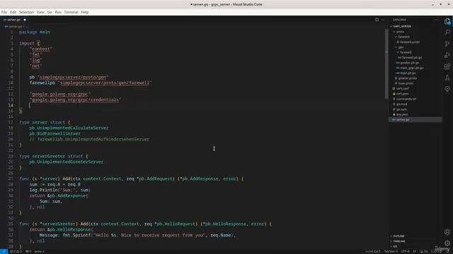
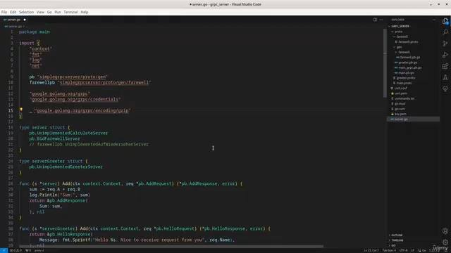
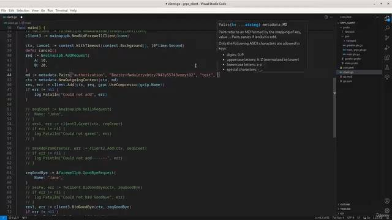
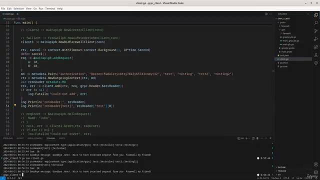
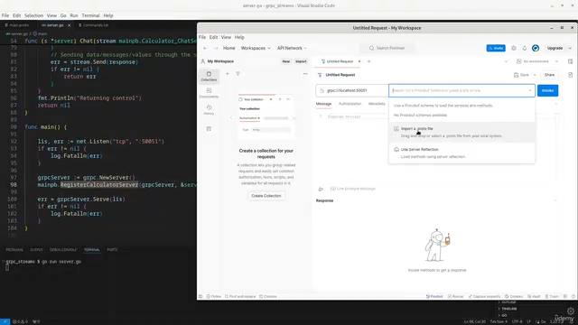
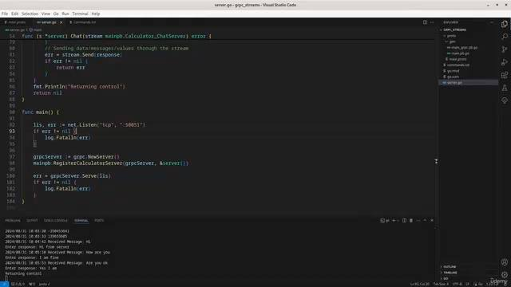

# gRPC & Protobuf 进阶：压缩、元数据、Trailer 与 Postman 调试（P045–P047）

> 适用读者：前端转 AI 应用工程师。本节所有代码是 Go 语言，**语法知道即可**，重点看「客户端/服务端各自要做什么」。涉及并发/上下文的地方会补一句「在 JS/Node 里对应什么」。

---

## 1. 这一节做什么

前三节（P045–P047）在已经能跑通的 gRPC 服务上，叠加四类「进阶能力」，并换一个调试工具：

1. **Deadline / Timeout**：给一次 RPC 调用设时间上限，超时返回 `DeadlineExceeded`。
2. **消息压缩（gzip）**：服务端一行 import 即可压缩所有出站消息；客户端可以「全局压缩」或「只压缩某一次调用」。
3. **Metadata（请求头/响应头）**：用 key-value 在客户端与服务端之间传 token、request id 等；请求头随 `context` 走，响应头用 `grpc.SendHeader` 发。
4. **Trailer**：响应体发完之后再补一段 key-value，用来传「处理完才知道」的信息（状态、错误细节）。**只有服务端能发 trailer，客户端不能发。**
5. **Postman 的 gRPC 客户端**：导入 `.proto` 或开启 **server reflection**，在 GUI 里调 unary / server-streaming / client-streaming / bidirectional-streaming 四种 RPC。

产出物：一个带压缩、metadata、trailer 的 gRPC 服务端 + 客户端，以及一份 Postman 调试步骤。

---

## 2. 讲师原话（带出处）

- 关于 deadline 与 timeout 的区别：「We can specify a time limit for a GRPC call and if the deadline is exceeded the call fails with a deadline exceeded error. And we can also apply timeouts. Timeouts are similar to deadlines but timeouts are applied to client side requests.」—— p045 [00:00]
- 关于服务端压缩有多简单：「all we need to do is import the encoding slash gunzip package which comes with the gRPC package... And we don't call any functions, any methods, any properties of gunzip package. We just import that into our server and it will do the job.」—— p045 [01:26]
- 关于客户端全局压缩：「we are going to introduce grpc.with default call options and to this I'm going to pass grpc dot use compressor and we need another argument and that is going to be dot name」—— p045 [02:49]
- 关于只压缩单次调用：「when we are passing the request as an argument to that method to the RPC along with the context. We see that the RPC also has a third argument and that is opts... we are actually going to pass it gRPC.useCompressor and then GunzipName.」—— p045 [05:31]
- 关于 metadata 走 context 不走 request：「We actually send the header along with the context, not with the request object.」—— p046 [01:56]
- 关于服务端取请求头：「we need to use from incoming context... metadata from incoming context returns us metadata and a Boolean value.」—— p046 [04:13]
- 关于 trailer 的定位：「Trailers are a way to send metadata at the end of a GRPC response... sent after the response body.」—— p046 [15:49]
- 关于 trailer 的方向：「trailers are only sent with the response, not with the request.」—— p046 [20:28]
- 关于 reflection 的生产禁令：「when you are implementing reflection, keep in mind that you need to disable reflection when you are in production. Do not use reflection in production. It's only for development.」—— p047 [12:05]
- 关于 Postman 的便利：「we can actually create an example message... the use example message will generate the proper request body as per the definition of the messages in the RPC.」—— p047 [03:12]





---

## 3. 从零复现

### 3.1 目录结构

```
grpc-advanced/
├── go.mod
├── main.proto
├── server/
│   └── main.go
└── client/
    └── main.go
```

### 3.2 环境与依赖

- Go 1.21+（讲师环境里 user-agent 显示 `grpc-go 1.66`，见 p046 [09:44] 的输出，说明用的是 grpc-go 1.66 这一代）
- 依赖：`google.golang.org/grpc`、`google.golang.org/protobuf`
- 生成代码工具：`protoc` + `protoc-gen-go` + `protoc-gen-go-grpc`

```bash
go mod init grpc-advanced
go get google.golang.org/grpc@v1.66.0
go get google.golang.org/protobuf
```

> 版本号以你实际拉到的为准；课里没讲具体版本号，只从 user-agent 输出能看出是 1.66 这一代。

### 3.3 生成 pb 代码

```bash
protoc --go_out=. --go_opt=paths=source_relative \
       --go-grpc_out=. --go-grpc_opt=paths=source_relative \
       main.proto
```

生成 `main.pb.go` 与 `main_grpc.pb.go`。**这两个文件不要手改。**

### 3.4 复现步骤（按顺序做，每步都能单独验证）

**Step 1｜先跑通一个最小 unary RPC（Add）**
先只实现 `Add`，客户端能拿到和，确认链路通。这一步是后面所有进阶能力的地基。

**Step 2｜加服务端压缩**
在 `server/main.go` 顶部加一行 `_ "google.golang.org/grpc/encoding/gzip"`（下划线导入，因为不直接调用它的函数）。重启服务端，客户端不用改，出站消息自动压缩。

**Step 3｜加客户端压缩（两种粒度）**
- 全局：`grpc.NewClient(addr, grpc.WithDefaultCallOptions(grpc.UseCompressor(gzip.Name)))`
- 单次：在 RPC 调用第三个参数传 `grpc.UseCompressor(gzip.Name)`

**Step 4｜加请求 metadata**
客户端：`metadata.Pairs(...)` → `metadata.NewOutgoingContext(ctx, md)` → 用新 ctx 调 RPC。
服务端：`metadata.FromIncomingContext(ctx)` 取出，`md.Get("authorization")` 拿值（返回 slice）。

**Step 5｜加响应 header**
服务端：`grpc.SendHeader(ctx, metadata.Pairs("test", "test value"))`。
客户端：调用时多传一个 `grpc.Header(&resHeader)`，调用结束后读 `resHeader`。

**Step 6｜加 trailer**
服务端：`grpc.SetTrailer(ctx, metadata.Pairs("test-trailer", "test trailer val"))`。
客户端：调用时多传一个 `grpc.Trailer(&resTrailer)`，调用结束后读 `resTrailer`。

**Step 7｜开 reflection（仅开发）**
服务端加 `reflection.Register(grpcServer)`，一行。Postman 里选 "使用服务器反射" 即可不导入 proto。

**Step 8｜Postman 验证四种 RPC**
见第 6 节检查清单。



---

## 4. 完整代码

### 4.1 `main.proto`

```proto
syntax = "proto3";

package advanced;

option go_package = "./;advanced";

service Calculator {
  rpc Add(AddRequest) returns (AddResponse);
  rpc GenerateFibonacci(FibonacciRequest) returns (stream FibonacciResponse);
  rpc SendNumbers(stream NumberRequest) returns (SumResponse);
  rpc Chat(stream ChatMessage) returns (stream ChatMessage);
}

message AddRequest {
  int32 a = 1;
  int32 b = 2;
}

message AddResponse {
  int32 sum = 1;
}

message FibonacciRequest {
  int32 n = 1;
}

message FibonacciResponse {
  int32 value = 1;
}

message NumberRequest {
  int32 value = 1;
}

message SumResponse {
  int32 sum = 1;
}

message ChatMessage {
  string text = 1;
}
```

> 说明：`int32` 是讲师在 p047 [05:31] 明确提到的——因为用了 `int32`，Postman 的 "使用示例消息" 会生成负数；换成 `uint32` 就不会。这里保留 `int32` 以复现课程现象。

### 4.2 `server/main.go`

```go
package main

import (
	"context"
	"io"
	"log"
	"net"

	"google.golang.org/grpc"
	"google.golang.org/grpc/encoding/gzip" // 下划线导入即可开启服务端压缩
	"google.golang.org/grpc/metadata"
	"google.golang.org/grpc/reflection"

	pb "grpc-advanced"
)

type server struct {
	pb.UnimplementedCalculatorServer
}

// Add：unary RPC，演示请求头、响应头、trailer
func (s *server) Add(ctx context.Context, req *pb.AddRequest) (*pb.AddResponse, error) {
	// 1) 取请求 metadata
	md, ok := metadata.FromIncomingContext(ctx)
	if !ok {
		log.Println("no metadata received")
	} else {
		log.Println("incoming metadata:", md)
		if vals := md.Get("authorization"); len(vals) > 0 {
			log.Println("authorization:", vals[0])
		} else {
			log.Println("no value with auth key")
		}
	}

	// 2) 发响应 header
	respHeaders := metadata.Pairs(
		"test", "test value",
		"test2", "testing2 value",
	)
	if err := grpc.SendHeader(ctx, respHeaders); err != nil {
		log.Println("SendHeader error:", err)
	}

	// 3) 发 trailer（响应体之后）
	trailer := metadata.Pairs(
		"test-trailer", "test trailer val",
		"test-trailer-2", "test trailer val 2",
	)
	grpc.SetTrailer(ctx, trailer)

	return &pb.AddResponse{Sum: req.A + req.B}, nil
}

// GenerateFibonacci：server streaming
func (s *server) GenerateFibonacci(req *pb.FibonacciRequest, stream pb.Calculator_GenerateFibonacciServer) error {
	a, b := int32(0), int32(1)
	for i := int32(0); i < req.N; i++ {
		if err := stream.Send(&pb.FibonacciResponse{Value: a}); err != nil {
			return err
		}
		a, b = b, a+b
	}
	return nil
}

// SendNumbers：client streaming
func (s *server) SendNumbers(stream pb.Calculator_SendNumbersServer) error {
	var sum int32
	for {
		req, err := stream.Recv()
		if err == io.EOF {
			return stream.SendAndClose(&pb.SumResponse{Sum: sum})
		}
		if err != nil {
			return err
		}
		sum += req.Value
	}
}

// Chat：bidirectional streaming
func (s *server) Chat(stream pb.Calculator_ChatServer) error {
	for {
		msg, err := stream.Recv()
		if err == io.EOF {
			return nil
		}
		if err != nil {
			return err
		}
		if err := stream.Send(&pb.ChatMessage{Text: "echo: " + msg.Text}); err != nil {
			return err
		}
	}
}

func main() {
	lis, err := net.Listen("tcp", ":50051")
	if err != nil {
		log.Fatalf("listen: %v", err)
	}

	grpcServer := grpc.NewServer()
	pb.RegisterCalculatorServer(grpcServer, &server{})

	// 仅开发环境开启 reflection
	reflection.Register(grpcServer)

	log.Println("server listening on :50051")
	if err := grpcServer.Serve(lis); err != nil {
		log.Fatalf("serve: %v", err)
	}
}
```

> 注意：`gzip` 包这里用普通导入（不是下划线），因为下面客户端代码里要用 `gzip.Name`；服务端只要 import 就会注册压缩器，用不用 `gzip.Name` 都行。讲师在 p045 [01:26] 用的是下划线导入，效果一样。

### 4.3 `client/main.go`

```go
package main

import (
	"context"
	"log"
	"time"

	"google.golang.org/grpc"
	"google.golang.org/grpc/credentials/insecure"
	"google.golang.org/grpc/encoding/gzip"
	"google.golang.org/grpc/metadata"

	pb "grpc-advanced"
)

func main() {
	// 全局压缩：所有请求都压缩
	conn, err := grpc.NewClient(
		"localhost:50051",
		grpc.WithTransportCredentials(insecure.NewCredentials()),
		grpc.WithDefaultCallOptions(grpc.UseCompressor(gzip.Name)),
	)
	if err != nil {
		log.Fatalf("dial: %v", err)
	}
	defer conn.Close()

	c := pb.NewCalculatorClient(conn)

	// 1) 构造请求 metadata
	md := metadata.Pairs(
		"authorization", "Bearer some-random-token",
		"test", "testing",
		"test2", "testing2",
	)

	// 2) 把 metadata 塞进 context
	ctx, cancel := context.WithTimeout(context.Background(), 10*time.Second)
	defer cancel()
	ctx = metadata.NewOutgoingContext(ctx, md)

	// 3) 准备接收响应 header 与 trailer 的容器
	var resHeader metadata.MD
	var resTrailer metadata.MD

	// 4) 调用 Add，同时传 header/trailer 接收器
	resp, err := c.Add(ctx, &pb.AddRequest{A: 9, B: 9},
		grpc.Header(&resHeader),
		grpc.Trailer(&resTrailer),
	)
	if err != nil {
		log.Fatalf("Add: %v", err)
	}
	log.Println("sum:", resp.Sum)
	log.Println("response header:", resHeader)
	log.Println("response trailer:", resTrailer)

	if vals := resHeader.Get("test"); len(vals) > 0 {
		log.Println("header test =", vals[0])
	}
	if vals := resTrailer.Get("test-trailer"); len(vals) > 0 {
		log.Println("trailer test-trailer =", vals[0])
	}
}
```

> 关于「只压缩单次调用」：把 `grpc.WithDefaultCallOptions(...)` 去掉，改成在 `c.Add(ctx, req, grpc.UseCompressor(gzip.Name), grpc.Header(&resHeader), grpc.Trailer(&resTrailer))` 里加第三个参数即可。讲师在 p045 [05:31] 演示的就是这个写法。

---

## 5. 逐行解释

**服务端 `_ "google.golang.org/grpc/encoding/gzip"`**
Go 的「下划线导入」= 只执行包的 `init()`，不引入名字。gzip 包的 `init()` 会把自己注册进 grpc 的压缩器表，所以只要 import 就生效。讲师原话「we don't call any functions... we just import that into our server and it will do the job」—— p045 [01:26]。**在 JS/Node 里对应什么**：类似 `import 'some-side-effect-module'`，只为了触发副作用。

**`grpc.WithDefaultCallOptions(grpc.UseCompressor(gzip.Name))`**
`WithDefaultCallOptions` 是 dial option，作用域是「这条连接上的所有调用」。`gzip.Name` 是字符串常量（值就是 `"gzip"`），必须用 grpc 自带的 gzip 包，不能用标准库 `compress/gzip`——讲师在 p045 [03:41] 专门强调过：标准库那个没有 `Name` 字段。

**`metadata.Pairs(...)`**
返回 `metadata.MD`，本质是 `map[string][]string`。所以一个 key 可以对应多个 value，取出来是 slice。讲师在 p046 [10:13] 演示过：`md.Get("authorization")` 拿到的是 slice，要 `[0]` 才拿到字符串。

**`metadata.NewOutgoingContext(ctx, md)`**
把 metadata 挂到 context 上，方向是「出站」（客户端→服务端）。**关键点**：metadata 不挂在 request 对象上，挂在 context 上。讲师原话「We actually send the header along with the context, not with the request object」—— p046 [01:56]。**在 JS/Node 里对应什么**：类似把 header 塞进 `AsyncLocalStorage` 或显式传一个 `ctx` 对象，而不是塞进 `fetch` 的 body。

**`metadata.FromIncomingContext(ctx)`**
服务端取「入站」metadata。返回 `(md, ok)`，第二个是 bool 不是 error——讲师在 p046 [04:41] 特意讲了「if a method instead of returning error returns Boolean value instead, we can handle that using OK variable」。

**`grpc.SendHeader(ctx, md)`**
把响应头发出去。必须在 `return response` 之前调用。返回 error，要处理。

**`grpc.SetTrailer(ctx, md)`**
设置 trailer。注意它**不返回 error**（和 SendHeader 不同），因为 trailer 是延迟到 RPC 结束时才真正写出的。

**`grpc.Header(&resHeader)` / `grpc.Trailer(&resTrailer)`**
这是 `CallOption`，作为 RPC 调用的可变参数传入。调用返回后，这两个变量被填充。**顺序无所谓**，但必须在调用时传，不能事后补。

**`reflection.Register(grpcServer)`**
一行注册 reflection 服务。Postman 勾 "使用服务器反射" 后就能动态发现 service 和 method，不用导入 proto。**生产环境必须去掉**——讲师 p047 [12:05] 明确说「Do not use reflection in production」。

**`context.WithTimeout(..., 10*time.Second)`**
这就是 deadline。超过 10 秒 RPC 返回 `DeadlineExceeded`。讲师在 p045 [00:29] 提到之前用 1 秒超时导致请求超时、改成 10 秒才成功——deadline 设太短会误杀正常请求。



---

## 6. 复现检查清单

按顺序打勾，任何一项不过就别往下走：

- [ ] `go build ./...` 无报错
- [ ] `go run server/main.go` 打印 `server listening on :50051`
- [ ] `go run client/main.go` 打印 `sum: 18`
- [ ] 客户端日志里 `response header` 含 `test: [test value]`
- [ ] 客户端日志里 `response trailer` 含 `test-trailer: [test trailer val]`
- [ ] 服务端日志里 `incoming metadata` 含 `authorization: [Bearer some-random-token]`
- [ ] 把服务端 gzip import 注释掉、重启，客户端日志里 metadata 不再出现 `grpc-encoding: gzip`（对应讲师 p046 [09:16] 的操作）
- [ ] Postman 新建 gRPC 请求，URL 填 `grpc://localhost:50051`，TLS 关闭
- [ ] 导入 `main.proto` 后，下拉框里 4 个方法图标各不相同（unary / server-stream / client-stream / bidi）
- [ ] 点 "使用示例消息" 能自动生成请求体
- [ ] `GenerateFibonacci` 传 10，能收到 10 条流式响应
- [ ] `SendNumbers` 先 Invoke 再逐条 Send，最后 End streaming 拿到 sum
- [ ] `Chat` 能双向收发
- [ ] 服务端加 `reflection.Register` 后，Postman 勾 "使用服务器反射" 能列出方法
- [ ] 注释掉 `reflection.Register` 重启，Postman 报 "无法加载反射服务器"（对应讲师 p047 [13:55]）





---

## 7. 课里没讲但你会撞上的

1. **TLS 与 Postman 的坑**：讲师在 p047 [14:55] 切到一个「实现了 TLS」的服务端，Postman 里必须勾上 TLS 才能连；同时 p047 [22:42] 提到「server certification verification」和「SSL certificate verification」两个开关都要关掉，否则报 `service is currently unavailable`。课里没讲这两个开关在 Postman 哪个菜单下，自己找一下 Settings → General。

2. **`grpc.NewClient` vs `grpc.Dial`**：讲师用的是 `grpc.NewClient`（p045 [02:49]）。老版本 grpc-go 里叫 `grpc.Dial`，如果你拉的是老版本会编译不过。课里没讲两者区别，遇到就换 `Dial` 或升级 grpc-go。

3. **metadata key 大小写**：讲师在 p046 [19:32] 踩过坑——trailer key 写成 `Test-Trailer`（大写 T）取不到值，改成 `test-trailer` 才行。gRPC 的 metadata key **必须小写**，这是规范，课里没明说但演示了这个坑。

4. **`grpc.SetTrailer` 不返回 error**：和 `grpc.SendHeader` 签名不一样，第一次写容易照着 SendHeader 的写法加 `if err := ...`，编译报错。课里没讲这个差异。

5. **reflection 与 proto 更新不同步**：讲师在 p047 [13:31] 演示了——不开 reflection 时，Postman 里缓存的是旧方法列表，新增的 RPC 不会出现，必须重启服务端 + 刷新 Postman。课里没讲 Postman 的缓存机制。

6. **`int32` 导致 Postman 生成负数**：p047 [05:31] 的现象。如果你把 proto 里改成 `uint32`，Postman 就不会生成负数了。课里讲了这个因果，但没讲「改完 proto 要重新生成 pb 代码 + 重启服务端」这一步。

7. **client-streaming 在 Postman 里的操作顺序**：必须先点 Invoke 建立流，再逐条 Send，最后 End streaming。讲师在 p047 [07:51] 演示了，但没解释「为什么不能先 Send」——因为流还没建立，没有连接可发。

8. **trailer 只能服务端发**：p047 [19:33] 讲师在 Postman 里点开请求，发现「request only has the option to use request headers」，没有 trailer 输入框。这是协议规定，不是 Postman 的缺陷。

9. **gzip 对已经压缩过的数据是负收益**
    讲师只演示了「import 一下就生效」。但 gRPC 的压缩是**逐消息**做的：每条消息单独加 gzip 头（约 18 字节）再压缩。对 JPEG、PDF、zip 这类本身就压缩过的 payload，压缩率接近 1，等于每条消息白多 18 字节。判断标准是看**消息体的熵**——protobuf 里字符串字段多、数字重复度高，压缩收益明显；`bytes` 字段里塞二进制文件，收益是负的。这种场景应该用 `grpc.CallContentSubtype` 换自定义编解码器，或者干脆别用 gRPC 传大文件。

10. **`grpc.UseCompressor` 的参数必须和 `RegisterCompressor` 注册的名字完全一致**
    服务端 `import _ "google.golang.org/grpc/encoding/gzip"` 之后，compressor 的注册名是 `gzip`（注意：不是 `gunzip`——讲师在 p045 [01:26] 口述时说的是 "import the encoding slash gunzip package"，这是口误，Go 包名是 `gzip`）。客户端写 `grpc.UseCompressor("gzip")`。如果你自己实现一个 compressor 并 `encoding.RegisterCompressor` 注册成 `mygzip`，两边对不上时会报 `grpc: Decompressor is not installed for grpc-encoding "mygzip"`——这个错误信息**不会告诉你是哪一端写错了**，只能两端一起查。

11. **metadata 有大小限制，默认 8KB**
    讲师往 metadata 里塞了一个 `Bearer some-random-token`，远没到上限。但 gRPC 服务端默认 `MaxHeaderListSize` 是 8KB（HTTP/2 的 SETTINGS 帧默认值），超过会直接 RST_STREAM 并报 `resource exhausted`。你如果走 JWT + 一堆自定义 header（trace-id、tenant-id、feature-flags），很容易撞上。调大的方式：`grpc.NewServer(grpc.MaxHeaderListSize(64*1024))`。**注意这个限制是服务端配的，客户端只能被动适应**，客户端改自己的上限没用。

12. **trailer 的「最后」是 HTTP/2 层的最后，不是应用层的最后**
    讲师的比喻是「header 在响应体前、trailer 在响应体后」。更精确的对应是 HTTP/2 的 HEADERS 帧：header 是响应开头的 HEADERS 帧，trailer 是带 `END_STREAM` 标志的**结尾** HEADERS 帧。这解释了两件事——(1) 为什么 server-streaming 场景下客户端必须等所有 `Send` 完、`return` 之后才能读到 trailer，想「中途读 trailer」在协议上不可能；(2) 为什么 trailer 只能由服务端发，因为 `END_STREAM` 是响应方向的终止标志，客户端发的流已经结束了。

13. **reflection 暴露的不只是方法名**
    讲师说「生产环境必须禁用 reflection」。风险比这句话听起来更大：`reflection.Register` 暴露的是**完整的 proto 描述符**——每个消息的字段名、类型、是否可选、文件级依赖、注释，全都通过 `FileDescriptorProto` 返回。任何能连上端口的客户端，一条 `grpcurl -plaintext localhost:50051 list` 就能拉下完整 API 清单，再用 `describe` 拿到字段结构，然后构造请求。这不是「方便调试」的代价，是「把接口文档和内部数据结构一起公开」。就算生产不开 reflection，gRPC 端口本身也应该只在内网暴露或者套 mTLS。

14. **`grpcurl` 和 Postman 的报错措辞不一样，同一个问题**
    服务端没开 reflection 时，Postman 报 `could not load reflection server`，`grpcurl` 报 `server does not support the reflection API`，Java 客户端如果是反射式调用会报 `UNIMPLEMENTED: unknown service grpc.reflection.v1alpha.ServerReflection`。三种措辞指的是同一件事。搜报错时如果只搜 Postman 那句，会错过 `grpcurl` 和 Java 生态里的大量资料。**排查顺序建议**：先用 `grpcurl -plaintext localhost:50051 list` 确认服务端到底开没开，再回头调客户端。

15. **deadline 会顺着 context 传播到下游服务**
    讲师在 p045 [00:00] 讲 deadline 时只演示了「客户端设 10 秒，超时报 `DeadlineExceeded`」。真实分布式系统里更关键的是**传播**：`ctx, cancel := context.WithTimeout(ctx, 10*time.Second)` 生成的 context 会通过 HTTP/2 的 `grpc-timeout` header 发给服务端，服务端 `func (s *server) Add(ctx context.Context, req *pb.Request) (...)` 里拿到的 `ctx.Deadline()` 就是剩余时间。如果服务端再用这个 `ctx` 去调下游（比如又发一个 gRPC 请求），下游会自动继承剩余时间——这样一次慢查询不会把整条链路拖到无限等。

    但这里有个最常见的失效点：服务端如果写 `ctx = context.Background()` 或者 `context.TODO()` 新建了 context，超时传播就**断了**，下游会拿到一个没有 deadline 的 ctx，然后一直等到 TCP 超时。查「为什么客户端超时了服务端还在跑」时，第一个要看的就是服务端有没有无意中丢掉 ctx。

    另外监控上要区分两个状态码：`DeadlineExceeded`（4）是 deadline 到了，通常是性能问题；`Canceled`（1）是客户端主动放弃，通常是用户关页面或者上层超时。两者混在一起统计会误判。

16. **流式 RPC 里 `Send` 返回 nil 不代表对端收到**
    `stream.Send(msg)` 返回 nil 只说明「消息写进了 HTTP/2 的发送缓冲」，不保证对端应用层收到了——TCP 缓冲、流控窗口都可能让数据停在路上。真正能确认对端处理了的只有：客户端 `Recv` 到对应的响应，或者流正常结束。

    对应地，客户端 `Recv` 的返回值要分清三种：`io.EOF` 是「对端**正常**关闭流」，`nil` 是「收到一条消息继续循环」，其他 error 才是真错误。很多人的写法是 `if err == io.EOF { break }` 然后 `if err != nil { return err }`——这个顺序是对的；但反过来写成 `if err != nil { break }` 就会把 `io.EOF` 之外的真错误也当成正常结束吞掉，最后表现为「循环退出了但数据少了一半」，查起来极其痛苦。讲师在 P047 演示 bidi 时没踩这个坑，是因为他的例子不返回错误，真实项目里务必按上面的顺序判。

---

**参考截图汇总**（正文已插入 6 张，此处不重复）：p045 [01:26]、p046 [04:13]、p046 [15:49]、p047 [02:44]、p047 [12:05]，另正文首段一张 p045 [01:26] 的压缩演示帧。