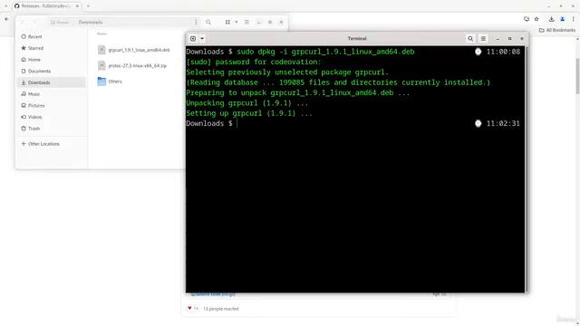
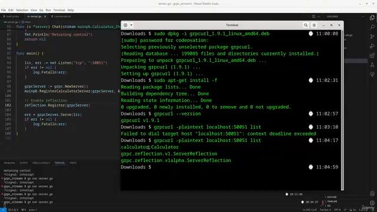
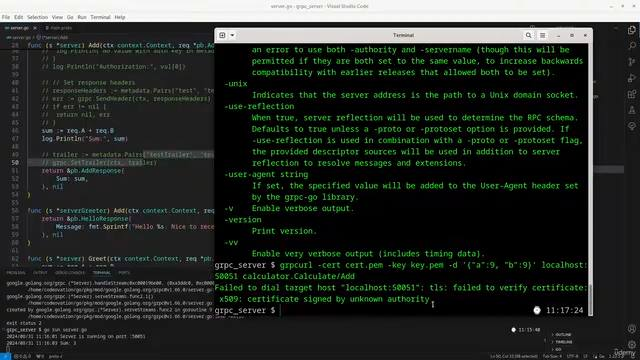
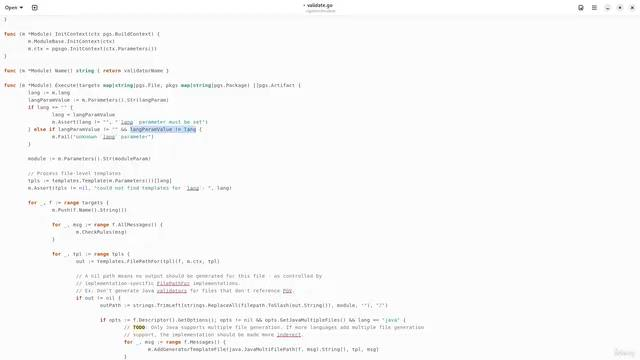
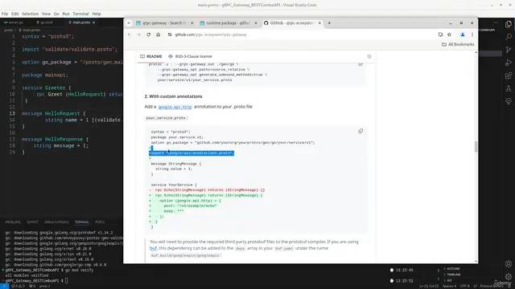
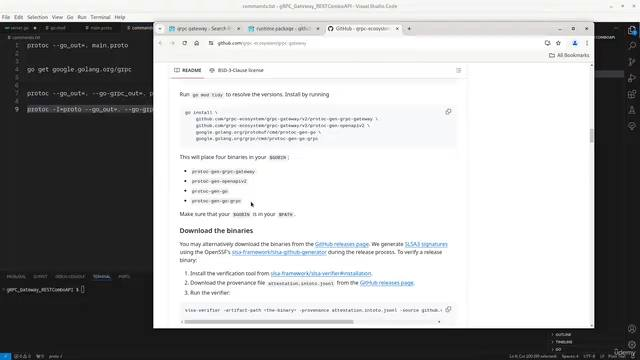

# gRPC & Protobuf（P048–P050）复现文档：grpcurl 调试 → 消息校验 → gRPC + REST 双协议网关

> 课程：BV1oYx56TECn，覆盖 P048 / P049 / P050
> 读者定位：前端转 AI 应用工程师。文中涉及 Go 语法的地方会标注「知道即可」，涉及并发/阻塞的地方会补一句「在 JS/Node 里对应什么」。
> 说明：本课是 Go 语言 + protoc 工具链的实操课。逐字稿里没有出现的工具名、字段名，本文一律不写；确实需要但课里没讲的，会明确标注「课里没讲」。

---

## 1. 这一节做什么

这三节课是一条完整的「把 gRPC 服务从能跑，做到能调试、能校验、能同时对外提供 HTTP」的链路：

- **P048**：安装 `grpcurl` 命令行工具，用它去探测一个已经开启了 **reflection（服务反射）** 的 gRPC 服务器——列出服务、列出方法、描述服务、发请求；并演示服务器开了 **TLS（自签名证书）** 时，`grpcurl` 要怎么带 `-cert` / `-key` / `-insecure` 才能连上，以及 `-v` / `-vv` 的详细输出。
- **P049**：引入 `protoc-gen-validate` 这个 protoc 插件。核心思想是：**校验规则写在 `.proto` 文件里**，编译时由插件自动生成一份 `*.pb.validate.go`，里面自带 `Validate()` 方法，业务代码里只要 `req.Validate()` 一行即可，不用手写校验逻辑。课里还对比了它的继任者 `protovalidate`（运行时校验、用 CEL 表达式、不是 protoc 插件）。
- **P050**：用 **gRPC Gateway** 把同一个服务同时暴露成 gRPC 和 REST/HTTP。做法是在 `.proto` 里加 `google.api.http` 注解，用 `protoc-gen-grpc-gateway` 生成一个反向代理（`*.pb.gw.go`），在 Go 里起两个 server：gRPC server 跑在 goroutine 里，HTTP gateway server 阻塞在主流程里。最后再给两边都套上 TLS，得到 HTTPS + gRPC over TLS 的「combo API」。

最终产物：一个 Go 项目，`go run server.go` 之后，**同一个进程**同时监听 `50051`（gRPC，可带 TLS）和 `8080`（HTTP 或 HTTPS），两边共用同一套 proto 定义和同一套校验规则。

从前端视角看，这三节其实是在补齐「接口契约」的三层能力：第一层是**能被发现和调试**，相当于你知道后端到底暴露了哪些 service、哪些 method、请求 JSON 长什么样；第二层是**能被校验**，相当于前端表单校验之外，后端也根据同一份协议定义自动拒绝非法参数；第三层是**能被不同客户端访问**，内部服务用 gRPC，浏览器或普通 HTTP 客户端用 REST，但底层仍然走同一个 `Greeter/Greet` 实现。因此不要把这三节当成三个孤立工具，它们最终会围绕同一份 `main.proto` 收口：P048 用 `grpcurl` 验证 gRPC 能不能调通，P049 在 proto 里加规则并把校验代码生成出来，P050 再把 HTTP 注解和 gateway 代理生成出来。

---

## 2. 讲师原话（带出处）

> "要安装 grpcurl，你需要访问 GitHub 上的这个仓库：fullstorydev/grpcurl，然后进入 releases 页面……如果你用的是 OSX，可以从这里下载。否则也可以用 brew 安装。"
> —— p048 [00:00]

> "现在运行 `sudo dpkg -i`，后面跟上文件名……如果存在缺失的依赖，可以用 apt-get 修复，运行 `sudo apt-get install -f`……然后运行 `grpcurl -version`，这样 grpcurl 就安装到系统里了。"
> —— p048 [01:27]

> "响应告诉我们存在 `calculator.calculator` 服务。第一个 calculator 是包名，后一个是服务名。所以这里只列出了服务。"
> —— p048 [03:08]

> "grpcurl 的 -cert 参数用于提供证书，即 `certificate cert.pem`，然后用 -key 参数指定 `key.pem`……因为我们没有来自证书颁发机构的证书……这种情况下我们会使用 `insecure`。"
> —— p048 [05:31]

> "我们得到的错误是 `failed to dial target host failed to verify certificate`。它会验证证书。所以要告诉 grpcurl 不需要验证证书，我们需要使用 -insecure 参数。"
> —— p048 [08:18]

> "Protoc GenValidate 是一个 Protoc 编译器插件，用来校验 protocol buffer 文件中的消息……使用 Protoc GenValidate 时，我们不必在 gRPC 代码里实现校验逻辑，只需要在 protocol buffer 文件中指定校验规则。"
> —— p049 [00:00]

> "我们现在使用另一个参数 `--validate_out=lang=go`。这里指定语言为 go，因为 Protoc GenValidate 也为 Java、Python 等许多其他语言提供校验代码。"
> —— p049 [10:38]

> "`main.pb.validate.go` 的作用是给 HelloRequest 添加一个 Validate 方法。这样我们就可以调用 `req.Validate()`，校验请求中收到的值。"
> —— p049 [12:54]

> "我们得到的错误信息是 `value length must be between 5 and 50 runes`；如果长度在 5 到 50 之间但不符合校验逻辑，那么就会返回该值与正则模式不匹配的错误。"
> —— p049 [14:17]

> "本节课我们将使用 gRPC Gateway 包……它会读取 protobuf 服务定义，并生成一个反向代理服务器，把 RESTful HTTP API 转换为 gRPC。"
> —— p050 [01:49]

> "运行服务器是一种阻塞机制，本质上会阻塞，正因如此我们才能运行一个服务器。那么如何运行两个服务器呢？我们可以把其中一个作为 goroutine 运行，然后再运行另一个。"
> —— p050 [06:50]

> "HTTP Gateway 会把 HTTP 请求转换为 gRPC 请求。证据之一就在响应头里。"
> —— p050 [28:08]

> "我们的 HTTPS 服务器同时成功接受 HTTP1 和 HTTP2 请求。"
> —— p050 [38:10]

读这些原话时，重点不是背命令，而是抓住讲师反复强调的三件事：`grpcurl` 是围绕 reflection 做运行时探测的工具；`protoc-gen-validate` 的价值是把校验规则前移到 `.proto` 文件并自动生成代码；gRPC Gateway 的本质是反向代理，它让 RESTful HTTP API 到底层 gRPC 之间发生翻译。后面所有复现步骤、常见错误排查和检查清单，都是围绕这三点展开的。

---

## 3. 从零复现

下面按「先能跑通 gRPC → 再能调试 → 再加校验 → 再加 REST → 最后加 TLS」的顺序走。每一步都给出可执行命令和文件。

### 3.0 环境与目录约定

课里用到的工具链（讲师在更早的 P 里已经装好，这里只列本课依赖的）：

| 工具 | 用途 | 课里怎么装的 |
|---|---|---|
| Go | 编译 server、`go install` 插件 | 课里没讲（前置） |
| `protoc` | protobuf 编译器 | 课里没讲（前置） |
| `protoc-gen-go` | 生成 `*.pb.go` | 课里说「已经装好」 |
| `protoc-gen-go-grpc` | 生成 `*_grpc.pb.go` | 课里说「已经装好」 |
| `protoc-gen-validate` | 生成 `*.pb.validate.go` | P049 从源码 `go install` |
| `protoc-gen-grpc-gateway` | 生成 `*.pb.gw.go` | P050 `go install ...@latest` |
| `grpcurl` | 命令行调试 | P048 下载 deb 包 `dpkg -i` |

目录结构（最终形态，P050 结束时）：

```
grpc-gateway-project/
├── go.mod
├── go.sum
├── server.go
├── cert.pem
├── key.pem
├── commands.txt
└── proto/
    ├── main.proto
    ├── validate/
    │   └── validate.proto
    └── google/
        └── api/
            ├── annotations.proto
            └── http.proto
```

> 注意：课里 `validate.proto` 放在 `proto/validate/`，`annotations.proto` / `http.proto` 放在 `proto/google/api/`。这两个路径是 proto 的 `import` 路径决定的，不能随意改。

这个目录约定非常关键。很多复现失败不是代码逻辑错，而是 proto 的 import 路径和实际文件位置没有对齐。比如 `main.proto` 里写了 `import "validate/validate.proto"`，那么 `protoc` 在搜索 import 路径时就必须能找到 `proto/validate/validate.proto`；如果文件名或目录层级少一层，编译器会直接报找不到文件。前端同学可以把它类比成 TypeScript 的 `paths` 或 npm 包路径：`import "validate/validate.proto"` 不是随便一个字符串，它对应磁盘上的相对目录结构。

### 3.1 安装 grpcurl（P048）

Linux / WSL（Debian 系，讲师用的就是这条）：

```bash
# 从 github.com/fullstorydev/grpcurl 的 releases 下载 amd64.deb
sudo dpkg -i grpcurl_*_linux_amd64.deb
# 如果报缺依赖
sudo apt-get install -f
grpcurl -version
```

macOS：

```bash
brew install grpcurl
```



这里的 `dpkg -i` 是 Debian 系安装本地 `.deb` 包的命令；`sudo apt-get install -f` 的作用是修复依赖。讲师原话里也明确说，如果有 missing dependencies，就用 `apt-get install -f` 修。验证是否装好，只看 `grpcurl -version` 是否有输出。常见错误有三种：一是下载的不是 amd64 包，`dpkg` 会报架构不匹配；二是没有 `sudo` 导致权限不足；三是安装后当前 shell 的 PATH 找不到 `grpcurl`，这时先确认二进制落在哪里，再检查 PATH。前端对照可以这样理解：`grpcurl` 之于 gRPC，类似 `curl` / Postman 之于 REST；它不是业务代码依赖，而是调试客户端。

### 3.2 用 grpcurl 探测服务（需要服务端开 reflection）

前提：gRPC server 里注册了 reflection。Go 里对应一行（课里在 P049 末尾也用了）：

```go
reflection.Register(grpcServer)
```

然后：

```bash
# 1) 列出所有服务（无 TLS 的 server）
grpcurl -plaintext localhost:50051 list
# 输出示例：calculator.Calculator

# 2) 列出某个服务的所有 RPC
grpcurl -plaintext localhost:50051 list calculator.Calculator

# 3) 描述某个服务（等价于看 proto 里的 service 定义）
grpcurl -plaintext localhost:50051 describe calculator.Calculator

# 4) 发请求：-d 后面是 JSON body
grpcurl -plaintext -d '{"a":1,"b":2}' localhost:50051 calculator.Calculator/Add
```



TLS + 自签名证书的 server：

```bash
grpcurl \
  -cert cert.pem -key key.pem -insecure \
  -d '{"a":1,"b":2}' \
  localhost:50051 calculator.Calculator/Add
```

- `-cert` / `-key`：客户端证书（课里是自签名的 cert.pem / key.pem）
- `-insecure`：**跳过对服务端证书的校验**。课里明确说：如果证书是 CA 签发的，应该用 `-cacert` 而不是 `-insecure`。
- 不加 `-insecure` 会报：`failed to dial target host failed to verify certificate`（讲师原话，p048 [08:18]）

详细输出：

```bash
grpcurl -v  ...   # 打印 method descriptor、metadata、response headers/trailers
grpcurl -vv ...   # 更详细，额外带 timing 数据
grpcurl -h        # 查看全部 flag（含 -H 发 header）
```



`-plaintext` 的意思是不走 TLS，直接明文连 gRPC；如果 server 开了 TLS，却仍用 `-plaintext`，连接行为会对不上。`list` 只列服务名，`list <service>` 列该服务下的方法，`describe <service>` 看服务定义，`-d` 后面跟 JSON 请求体。注意最后一个参数是 `包名.服务名/方法名`，例如 `calculator.Calculator/Add`，不要把 package 和 service 写反。讲师在 P048 里看到 `calculator.calculator` 时专门解释：第一个 `calculator` 是 package，第二个是 service，所以 `list` 只列服务。常见错误包括：服务端没开 reflection，会报类似 `server does not support the reflection API`；方法名写错，会报找不到 method；JSON 字段类型和 proto 不一致，会报解析失败；TLS 自签名证书没加 `-insecure`，会报 `failed to verify certificate`。前端对照：reflection 像一种运行时发现能力，类似你能从运行中的服务拿到接口清单；但它不是 OpenAPI/Swagger，课里用的是 gRPC reflection。

### 3.3 安装 protoc-gen-validate（P049）

课里的做法是**从源码编译**，并且要改一行代码。步骤：

```bash
# 1) 克隆到 $GOPATH/src 下（课里强调必须在 GOPATH/src 里）
mkdir -p $GOPATH/src
cd $GOPATH/src
git clone https://github.com/bufbuild/protoc-gen-validate.git
```

> 课里提到：在 Go packages 上搜 `protoc-gen-validate`，仓库会重定向到 `bufbuild/protoc-gen-validate`。

```bash
# 2) 修改 module/validate.go 里的一个条件判断
#    在原有条件里追加：&& m.GetLang() != lang
#    （讲师原话：we are not deleting anything. We are just adding this part）
```

```bash
# 3) 编译安装
cd $GOPATH/src/protoc-gen-validate
go install .
# 装完后 $GOBIN 下会出现 protoc-gen-validate 可执行文件
```



同时要把仓库里的 `validate/validate.proto` 复制到项目的 `proto/validate/validate.proto`：

```bash
mkdir -p proto/validate
cp $GOPATH/src/protoc-gen-validate/validate/validate.proto proto/validate/
```

这一步最容易卡住的不是 `go install` 本身，而是三个前置条件。第一，课里强调代码要在 `$GOPATH/src` 下，这是老式 GOPATH 模式的习惯；如果路径不对，后续复制 `validate.proto` 和编译插件都可能混乱。第二，`module/validate.go` 里的条件判断要按讲师说的追加 `&& m.GetLang() != lang`，不是删除原逻辑，而是在原条件后面补一段。第三，`go install .` 之后要确认 `$GOBIN` 下有 `protoc-gen-validate` 可执行文件；如果 `protoc` 找不到它，会报插件不存在或 exit status 1。前端对照：这有点像你在 JS 项目里安装一个 codegen 插件，它根据 schema 生成校验代码；区别是这里装的是 `protoc` 的插件，生成的是 Go 校验文件。

### 3.4 写带校验规则的 proto（P049）

`proto/main.proto`（P049 阶段，还没有 gateway 注解）：

```proto
syntax = "proto3";

package greet;

option go_package = "./gen";

import "validate/validate.proto";

service Greeter {
  rpc Greet(HelloRequest) returns (HelloResponse);
}

message HelloRequest {
  string name = 1 [
    (validate.rules).string = {
      min_len: 5
      max_len: 50
      pattern: "^[a-zA-Z]+$"
    }
  ];
}

message HelloResponse {
  string message = 1;
}
```

> 课里最后补了 `$` 到 pattern 末尾（`^[a-zA-Z]+$`），原因是：不加 `$` 时只校验「存在字母」，`John123` 也能过；加了 `$` 才强制「全部字符都是字母」。这是 p049 [17:09] 的原话要点。

这里的 `(validate.rules).string` 是写在字段上的规则：`min_len: 5` 表示最短 5，`max_len: 50` 表示最长 50，`pattern` 是正则。注意课里报错文案说的是 `runes`，也就是按 rune 计长度，不是简单地按字节数。`pattern` 的 `^` 和 `$` 一起用才表示整串匹配；只写 `^[a-zA-Z]+` 时，`John123` 可能因为前面存在字母而通过，这正是课里后来补 `$` 的原因。常见错误：忘记 `import "validate/validate.proto"`；`validate.proto` 没有放到 `proto/validate/`；正则里漏了 `$` 导致非法字符串通过；proto 语法写错导致 `protoc` 直接失败。前端对照：这相当于把表单校验规则从业务代码挪到协议定义里，由 codegen 生成服务端校验器，前端仍然可以在提交前做体验优化，但最终兜底在服务端 `req.Validate()`。

### 3.5 生成代码（三个插件叠加，P050 最终版）

`commands.txt` 里保存的最终命令：

```bash
protoc \
  --go_out=. --go_opt=paths=source_relative \
  --go-grpc_out=. --go-grpc_opt=paths=source_relative \
  --validate_out=lang=go:. \
  --grpc-gateway_out=. \
  proto/main.proto
```

- `--go_out` → `main.pb.go`（消息）
- `--go-grpc_out` → `main_grpc.pb.go`（service / RPC）
- `--validate_out=lang=go` → `main.pb.validate.go`（校验代码，**必须显式写 `lang=go`**，因为该插件也支持 Java / Python）
- `--grpc-gateway_out` → `main.pb.gw.go`（HTTP→gRPC 反向代理）

> 课里 `--go_out` / `--go-grpc_out` 用的是 `paths=source_relative` 风格（讲师在 P049 里说「we are not generating the generated code in a separate generated folder」，并用了 `gen` 目录）。如果你照抄讲师命令报路径错，先确认 `option go_package` 与 `--*_opt` 一致。

这条命令是整条链路的核心。`--go_out` 只生成消息结构和 protobuf 编解码；`--go-grpc_out` 生成 service 接口、client/server 注册代码；`--validate_out=lang=go` 生成 `Validate()`；`--grpc-gateway_out` 生成 HTTP 到 gRPC 的 handler 映射。四个输出缺一不可：少了 validate 文件，`req.Validate()` 编译不过；少了 gw 文件，`RegisterGreeterHandlerFromEndpoint` 编译不过；少了 grpc 文件，`RegisterGreeterServer` 编译不过。常见错误：插件不在 PATH；`--validate_out` 漏写 `lang=go`；`go_package` 和 `paths=source_relative` 不匹配导致生成路径和 import 路径对不上；`proto/main.proto` 的相对路径写错，`protoc` 找不到源文件。前端对照：这类似 GraphQL Code Generator 或 OpenAPI Generator，从一份 schema 生成多份客户端/服务端代码；区别是这里一次生成消息、RPC、校验、HTTP 网关四类代码。

### 3.6 下载 google.api 的 proto（P050）

`main.proto` 里 `import "google/api/annotations.proto"` 之后，必须把这两个文件放到 `proto/google/api/`：

```bash
mkdir -p proto/google/api
cd proto/google/api
curl -O https://raw.githubusercontent.com/googleapis/googleapis/master/google/api/annotations.proto
curl -O https://raw.githubusercontent.com/googleapis/googleapis/master/google/api/http.proto
cd ../../..
```

> 课里用的是 `curl -o <路径> <url>`，讲师说也可以用 `wget -P`。URL 具体分支课里没逐字念，以你实际能下载到为准。

`annotations.proto` 和 `http.proto` 是 gRPC Gateway 注解依赖的 proto 文件，不放进去，`protoc` 会在 `import "google/api/annotations.proto"` 处失败。常见错误：只下载了 `annotations.proto` 却没下载 `http.proto`，后者通常会被前者 import；目录层级错写成 `proto/google/annotations.proto`，导致 import 路径对不上；`curl` 下载到 HTML 错误页，文件内容不是 proto。前端对照：这就像引入一个第三方 schema 或类型声明文件，路径必须和 import 字符串完全一致。

### 3.7 安装 grpc-gateway 插件（P050）

```bash
go install github.com/grpc-ecosystem/grpc-gateway/v2/protoc-gen-grpc-gateway@latest
```

课里明确说：**只装 grpc-gateway，不装 openapiv2**（「as of now, we are only going to install gRPC gateway. We are not going to install open API v2」）。

然后在项目里拉依赖（课里锁了 2.21.0，因为 2.22 刚发布两周，讲师选择保守）：

```bash
go get github.com/grpc-ecosystem/grpc-gateway/v2@v2.21.0
go mod tidy
```

这里要区分两件事：`protoc-gen-grpc-gateway` 是生成 `*.pb.gw.go` 的 protoc 插件；`github.com/grpc-ecosystem/grpc-gateway/v2` 是运行时库，`runtime.NewServeMux()` 和 `RegisterGreeterHandlerFromEndpoint` 都来自它。课里只装 gateway 插件，不装 openapiv2，所以不要顺手多装。版本上讲师锁 `v2.21.0`，是因为 `v2.22` 刚发布，保守选择。常见错误：`@latest` 拿到新版本后 API 有细微差异；`protoc-gen-grpc-gateway` 没在 PATH；`go get` 版本与生成代码要求的 API 不一致。前端对照：gateway 可以理解为一个 BFF/反向代理层，前端看到的 REST 路由由它翻译成后端 gRPC 调用。

### 3.8 加 HTTP 注解（P050）

`proto/main.proto` 最终版：

```proto
syntax = "proto3";

package greet;

option go_package = "./gen";

import "google/api/annotations.proto";
import "validate/validate.proto";

service Greeter {
  rpc Greet(HelloRequest) returns (HelloResponse) {
    option (google.api.http) = {
      post: "/v1/greet"
      body: "*"
    };
  }
}

message HelloRequest {
  string name = 1 [
    (validate.rules).string = {
      min_len: 5
      max_len: 50
      pattern: "^[a-zA-Z]+$"
    }
  ];
}

message HelloResponse {
  string message = 1;
}
```



`option (google.api.http)` 是告诉 gateway：这个 RPC 对应哪个 HTTP 方法和路径。课里写的是 `post: "/v1/greet"`，`body: "*"` 表示整个 HTTP 请求体都映射到 `HelloRequest`。所以前端发 `POST /v1/greet` 且 body 为 `{"name":"Alice"}`，gateway 会翻译成 `Greeter/Greet` 的 gRPC 请求。常见错误：忘记 import `google/api/annotations.proto`；HTTP 路径写错；把 `post` 写成 `get` 后仍用 body；`body: "*"` 漏写导致字段映射不符合预期。前端对照：这就是「同一个业务方法，对外暴露成 REST 路由」的声明式写法；前端不需要知道 gRPC，仍然按 JSON + HTTP 调用。

### 3.9 启动

```bash
go run server.go
```

期望输出（讲师 p050 [24:55] 的实际输出）：

```
HTTP server is running on port 8080
gRPC server is running on 50051
```

（TLS 版本则是 `HTTPS server is running on port 8080` 和 `gRPC with TLS running on 50051`。）

启动阶段要特别注意「两个 server 怎么同时跑」：gRPC server 的 `Serve` 是阻塞的，所以放进 goroutine；gateway server 阻塞主流程，防止 `main` 退出。常见错误：端口被占用会 `log.Fatal` 直接退出；TLS 版本缺 `cert.pem` / `key.pem` 会在加载证书时失败；gateway 连本地 gRPC 的地址写错会 dial 失败；无 TLS 版本误用了 `ListenAndServeTLS` 或 TLS 版本误用了 `ListenAndServe`。前端对照：这类似 Node 里同时监听两个端口，一个作为内部 gRPC 入口，一个作为对外 HTTP 入口；Go 用 goroutine 显式把阻塞调用放到后台。

---

## 4. 完整代码

下面是 P050 结束时的 `server.go`，**可直接保存运行**（前提是 3.5 的生成文件已产出、3.6 的 proto 已下载、3.7 的依赖已 `go get`）。

```go
package main

import (
	"context"
	"crypto/tls"
	"log"
	"net/http"

	"github.com/grpc-ecosystem/grpc-gateway/v2/runtime"
	"google.golang.org/grpc"
	"google.golang.org/grpc/credentials"
	"google.golang.org/grpc/credentials/insecure"
	"google.golang.org/grpc/reflection"

	pb "grpc-gateway-project/gen"
)

func main() {
	certFile := "cert.pem"
	keyFile := "key.pem"

	// gRPC server 跑在 goroutine 里（非阻塞）
	go runGRPCServer(certFile, keyFile)

	// gateway server 阻塞主流程，防止 main 退出
	runGatewayServer(certFile, keyFile)
}

// runGRPCServer 启动 gRPC server（带 TLS）
func runGRPCServer(certFile, keyFile string) {
	lis, err := net.Listen("tcp", ":50051")
	if err != nil {
		log.Fatalf("failed to listen: %v", err)
	}

	creds, err := credentials.NewServerTLSFromFile(certFile, keyFile)
	if err != nil {
		log.Fatalf("failed to load TLS certificates: %v", err)
	}

	grpcServer := grpc.NewServer(grpc.Creds(creds))

	pb.RegisterGreeterServer(grpcServer, &greeterServer{})

	// 开启 reflection，Postman / grpcurl 才能不导入 proto 就探测服务
	reflection.Register(grpcServer)

	log.Println("gRPC with TLS running on 50051")
	if err := grpcServer.Serve(lis); err != nil {
		log.Fatalf("failed to serve gRPC: %v", err)
	}
}

// runGatewayServer 启动 HTTP/HTTPS 反向代理，把 REST 请求翻译成 gRPC
func runGatewayServer(certFile, keyFile string) {
	ctx, cancel := context.WithCancel(context.Background())
	defer cancel()

	mux := runtime.NewServeMux()

	opts := []grpc.DialOption{
		// gateway 作为客户端去连本地 gRPC server；自签名证书需要跳过校验
		grpc.WithTransportCredentials(credentials.NewTLS(&tls.Config{
			InsecureSkipVerify: true,
		})),
	}

	err := pb.RegisterGreeterHandlerFromEndpoint(ctx, mux, "localhost:50051", opts)
	if err != nil {
		log.Fatalf("failed to register gRPC gateway handler: %v", err)
	}

	tlsConfig := &tls.Config{
		Certificates: []tls.Certificate{loadTLSCredentials(certFile, keyFile)},
	}

	srv := &http.Server{
		Addr:      ":8080",
		Handler:   mux,
		TLSConfig: tlsConfig,
	}

	log.Println("HTTPS server is running on port 8080")
	if err := srv.ListenAndServeTLS(certFile, keyFile); err != nil {
		log.Fatalf("failed to start HTTP server: %v", err)
	}
}

// loadTLSCredentials 读取 cert/key，返回 tls.Certificate
func loadTLSCredentials(certFile, keyFile string) tls.Certificate {
	cert, err := tls.LoadX509KeyPair(certFile, keyFile)
	if err != nil {
		log.Fatalf("failed to load certificates: %v", err)
	}
	return cert
}

// greeterServer 实现 proto 里定义的 Greeter 服务
type greeterServer struct {
	pb.UnimplementedGreeterServer
}

func (s *greeterServer) Greet(ctx context.Context, req *pb.HelloRequest) (*pb.HelloResponse, error) {
	// 一行搞定校验：Validate() 由 protoc-gen-validate 生成
	if err := req.Validate(); err != nil {
		log.Printf("validation failed: %v", err)
		return nil, err
	}
	return &pb.HelloResponse{Message: "Hello " + req.GetName()}, nil
}
```

> 说明：上面 `net.Listen` 需要 `import "net"`；`pb` 的 import 路径要和你 `go.mod` 的 module 名 + `option go_package` 对齐。课里 module 名是 `grpc-gateway-project`（p050 [00:27] 讲师改的），`go_package` 是 `./gen`，所以生成文件在 `gen/` 目录下。

这个代码块保留课里 P050 的主体结构。实际复制时，如果编译报 `undefined: net`，就是在 import 区漏了 `net`，把 `"net"` 加进标准库 import 分组即可。如果编译报 `pb` 路径找不到，先检查 `go.mod` 的 module 名和 `main.proto` 里的 `option go_package`，再看生成文件到底落在哪个目录。如果编译报 `mustEmbedUnimplementedGreeterServer` 一类错误，通常是新版 `protoc-gen-go-grpc` 要求嵌入 `pb.UnimplementedGreeterServer`，上面代码已经嵌入了。常见错误还有：TLS 版本缺证书文件、gateway dial 地址写成 `:50051` 而不是 `localhost:50051`、`ListenAndServeTLS` 与无 TLS 版本的 `ListenAndServe` 混用。

**无 TLS 版本**（P050 前半段，讲师先跑通的版本）关键差异只有三处：

```go
// gRPC server：去掉 creds
grpcServer := grpc.NewServer()

// gateway 的 dial option：用 insecure
opts := []grpc.DialOption{
	grpc.WithTransportCredentials(insecure.NewCredentials()),
}

// HTTP server：用 ListenAndServe 而不是 ListenAndServeTLS
srv := &http.Server{Addr: ":8080", Handler: mux}
if err := srv.ListenAndServe(); err != nil { ... }
```



无 TLS 版本对前端调试更友好，因为你不用处理自签名证书；但它只适合本地验证链路。等无 TLS 版本跑通后，再按上面的完整代码加 `credentials.NewServerTLSFromFile`、`credentials.NewTLS` 和 `ListenAndServeTLS`，这样排错范围小：先确认 gRPC、gateway、校验都通，再确认证书和 TLS 配置。

---

## 5. 逐行解释

**`go runGRPCServer(...)` 为什么前面加 `go`？**
课里原话：「running a server is a blocking mechanism... we can run one of the servers as a go routine and then run the next server」。`grpcServer.Serve(lis)` 是阻塞调用，不返回。如果直接调用，`main` 永远走不到下一行，HTTP server 就起不来。加 `go` 把它丢到后台，主流程继续往下走。**在 JS/Node 里对应什么**：相当于 `server.listen()` 本身不阻塞事件循环，但如果你写了一个 `while(true)` 的同步循环就会卡死——Go 的 `go` 关键字就是显式开一个「不阻塞当前流程」的执行体，类似 Node 里 `setImmediate`/独立 async 任务的效果，但它是真并发（goroutine）。常见错误是忘了加 `go`，结果只看到 gRPC 启动日志，HTTP 端口永远不监听。

**`context.WithCancel(context.Background())` + `defer cancel()`**
`RegisterGreeterHandlerFromEndpoint` 需要一个 ctx 来管理到 gRPC 后端的连接生命周期。`WithCancel` 返回 ctx 和 cancel 两个值，`defer cancel()` 保证函数退出时释放。课里原话：「it's going to return us two values and the second value is cancel. And we are going to defer cancel.」常见错误是用了 `context.Background()` 却没有生命周期管理，短时间调试没问题，但连接释放语义不完整；另一个错误是 ctx 传错位置，导致 register 失败。

**`runtime.NewServeMux()`**
这是 grpc-gateway 提供的 HTTP 路由器（不是标准库的 `http.ServeMux`）。它根据 `*.pb.gw.go` 里生成的映射，把 `POST /v1/greet` 翻译成 `Greeter/Greet` 的 gRPC 调用。常见错误是把它误写成 `http.NewServeMux()`，这样就没有 gateway 的翻译逻辑，REST 路由不会命中。前端对照：它类似一个只负责路由转发的 BFF mux，路由表不是手写的，而是从 proto 注解生成的。

**`RegisterGreeterHandlerFromEndpoint(ctx, mux, "localhost:50051", opts)`**
课里解释得很清楚：「same as register greeter handler but automatically dials to endpoint and closes the connection when context gets done」。它内部会去 dial 你的 gRPC server。第三个参数是 gRPC 端点——课里强调「gRPC only has one endpoint it doesn't have multiple endpoints like a REST API」，所以这里就是一个 `host:port` 字符串。常见错误：端口写错；gRPC server 还没起来就启动 gateway；TLS 版本下 `opts` 没配对应 credentials。

**`opts` 里为什么是 `credentials.NewTLS(&tls.Config{InsecureSkipVerify: true})`？**
因为 gateway 是作为**客户端**去连本地 gRPC server，而 server 用的是自签名证书。课里原话：「this needs to be true because we are using self signed certificate」。无 TLS 版本则换成 `insecure.NewCredentials()`。这里最容易混淆：server 端的证书加载用 `credentials.NewServerTLSFromFile`，gateway 客户端连接用 `credentials.NewTLS`；两边不是同一个方向。前端对照：类似前端请求自签名 HTTPS 时临时跳过证书校验，只适合本地开发，不要照搬到生产。

**`req.Validate()` 这一行从哪来？**
来自 `main.pb.validate.go`。课里原话：「it adds a validate method to our hello request. And that way we can call `req.Validate()`」。这个文件是 `protoc-gen-validate` 根据 proto 里的 `(validate.rules).string` 自动生成的，里面包含 `min_len` / `max_len` / `pattern` 的完整判断逻辑和错误文案（`value length must be between 5 and 50 runes`、`value does not match the regex pattern`）。**你一行校验代码都没写。**常见错误是生成命令漏了 `--validate_out=lang=go`，此时 `req.Validate` 方法不存在，编译直接失败。

**`pattern: "^[a-zA-Z]+$"` 里的 `$` 为什么关键？**
课里踩过这个坑：一开始没写 `$`，`John123` 也能通过，因为正则只要求「存在字母」。加上 `$` 后强制「从开头到结尾全是字母」，`John123` 才被拒。这是 p049 [17:09]–[18:34] 的完整调试过程。前端对照：正则校验不要只测合法值，也要测「包含非法尾巴」的值，比如 `John123`、`123John`、`John_`，否则很容易漏掉锚点问题。

**`srv.ListenAndServeTLS(certFile, keyFile)`**
课里从 `http.ListenAndServe` 换成自定义 `http.Server` + `ListenAndServeTLS`，因为要挂 `TLSConfig`。讲师实测这个 server **同时接受 HTTP/1 和 HTTP/2**（p050 [38:10]：「our HTTPS server is accepting HTTP1 as well as HTTP2 requests successfully」）。常见错误：证书和 key 不匹配，启动时报 TLS 加载失败；无 TLS 版本误用 `ListenAndServeTLS`，会因缺证书失败；TLS 版本误用 `ListenAndServe`，浏览器/curl 的 https 请求打不通。

**`reflection.Register(grpcServer)`**
没有它，Postman / grpcurl 必须手动导入 `.proto` 才能发请求。课里在 P049 末尾加这行就是为了「we won't have to import the protocol buffer file」。常见错误是只在代码里写了但启动的不是这个 server，或者 grpcurl 连错端口。验证方式就是 `grpcurl -plaintext localhost:50051 list` 能否列出服务。

**`type greeterServer struct { pb.UnimplementedGreeterServer }`**
这是 Go 里实现 gRPC service 的常见写法。嵌入 `pb.UnimplementedGreeterServer` 可以满足新版 `protoc-gen-go-grpc` 的接口约束，同时只实现你关心的 `Greet` 方法。课里没有展开这个约束，但新版工具链会要求它。前端对照：类似实现一个接口时必须保留默认/兜底实现，避免未来新增方法时立即编译失败。

**`Greet` 里先 `Validate()` 再返回响应**
这是 P049 的核心落点：所有业务方法在进入真正业务逻辑前，先调用生成的 `req.Validate()`。如果失败，直接把 error 返回给 gRPC 客户端；gateway 会把它再翻译成 HTTP 错误响应。常见错误：校验放在 handler 最末尾，导致非法请求已经进入业务逻辑；或者校验失败后返回了 `nil, nil`，客户端看起来成功但响应为空。前端对照：服务端校验是最后一道闸门，前端校验只是体验优化，二者不能互相替代。

---

## 6. 复现检查清单

按顺序打勾，任何一项不过就别往下走：

- [ ] `grpcurl -version` 有输出（P048）
  - 怎么验证：终端执行 `grpcurl -version`，能看到版本号即可。
  - 失败先查：是否安装成功、当前 shell 的 PATH 是否包含 `grpcurl`、是否装错架构包。

- [ ] gRPC server 已 `reflection.Register`，`grpcurl -plaintext localhost:50051 list` 能列出服务
  - 怎么验证：先启动 server，再执行命令；输出里应出现服务名，课里示例是 `calculator.Calculator` 这一类格式。
  - 失败先查：server 是否真的注册了 reflection；端口是不是 50051；是否误连到别的进程。

- [ ] `grpcurl -plaintext localhost:50051 describe <pkg>.<Service>` 能打印 service 定义
  - 怎么验证：把 `<pkg>.<Service>` 换成 `list` 输出的服务名，执行后能看到 service / RPC 描述。
  - 失败先查：服务名写错、package 和 service 写反、reflection 未开启。

- [ ] TLS server 下，不带 `-insecure` 会报 `failed to verify certificate`；带上就通
  - 怎么验证：先用不带 `-insecure` 的命令确认报错，再加 `-insecure` 重试；同时确认 `-cert` / `-key` 文件路径正确。
  - 失败先查：证书文件是否存在、是否自签名、是否把 CA 签发证书场景误用 `-insecure`。

- [ ] `$GOBIN` 下同时存在 `protoc-gen-go`、`protoc-gen-go-grpc`、`protoc-gen-validate`、`protoc-gen-grpc-gateway`
  - 怎么验证：查看 `$GOBIN` 目录，或执行 `which protoc-gen-go` 一类命令确认 PATH。
  - 失败先查：对应插件是否 `go install` 成功；`$GOBIN` 是否在 PATH；`protoc-gen-validate` 是否按课里打了补丁。

- [ ] `proto/validate/validate.proto`、`proto/google/api/annotations.proto`、`proto/google/api/http.proto` 三个文件都在
  - 怎么验证：直接 `ls` 对应目录，确认文件名和层级与 `import` 字符串一致。
  - 失败先查：复制/下载时目录少一层、`curl` 下载到错误页、文件名拼错。

- [ ] `protoc ...` 跑完，`gen/` 下同时出现 `main.pb.go`、`main_grpc.pb.go`、`main.pb.validate.go`、`main.pb.gw.go`
  - 怎么验证：执行 `commands.txt` 里的完整命令后，检查 `gen/` 目录四个文件是否齐全。
  - 失败先查：插件不在 PATH、`--validate_out` 漏 `lang=go`、`go_package` 与输出路径不一致、proto import 找不到文件。

- [ ] `go mod tidy` 后 `go build ./...` 无报错
  - 怎么验证：执行 `go mod tidy`，再执行 `go build ./...`；没有红色报错即通过。
  - 失败先查：依赖版本、`pb` import 路径、`net` import、`UnimplementedGreeterServer` 嵌入、生成文件是否缺失。

- [ ] `go run server.go` 打印出两个端口
  - 怎么验证：终端应看到 HTTP/HTTPS 8080 和 gRPC 50051 两条日志。
  - 失败先查：端口是否被占用、证书是否缺失、`go` 关键字是否漏写、gateway register 是否失败。

- [ ] gRPC 侧：Postman 开 reflection 能 refresh 出 Greet；发 `{"name":"Amy"}` 返回 `InvalidArgument` + `value length must be between 5 and 50 runes`
  - 怎么验证：在 Postman 的 gRPC 请求里开启 reflection，刷新服务列表，调用 `Greet`，请求体传短名字。
  - 失败先查：reflection 是否注册；`Validate()` 是否生成；错误是否被 handler 正确返回。

- [ ] gRPC 侧：发 `{"name":"John123"}` 返回 `value does not match the regex pattern`
  - 怎么验证：长度满足 5–50，但包含数字，预期被正则拒绝。
  - 失败先查：`pattern` 是否写了 `$`；proto 是否重新生成；server 是否重启加载新代码。

- [ ] gRPC 侧：发 `{"name":"Alice"}` 返回 `Hello Alice`
  - 怎么验证：合法名字应通过 `Validate()` 并进入业务逻辑。
  - 失败先查：`GetName()` 是否正常取值；响应消息拼接是否正确；是否误用了旧生成文件。

- [ ] REST 侧：`POST http://localhost:8080/v1/greet`，body `{"name":"Alice"}`，返回 200 + `Hello Alice`
  - 怎么验证：用 `curl` 或 Postman 发 POST，确认状态码和响应体。
  - 失败先查：`google.api.http` 注解、`*.pb.gw.go` 是否生成、gateway 是否注册成功、gRPC 后端是否在线。

- [ ] REST 侧：`GET /v1/greet` 返回「method is not allowed」（因为注解是 `post`）
  - 怎么验证：对同一路径发 GET，预期不命中 POST 映射。
  - 失败先查：是否把注解写成了 `get`；gateway 是否加载了旧路由。

- [ ] REST 响应头里能看到 `Content-Type: application/json`，且**仍带着 gRPC 的 metadata content-type**（课里说 gateway 没删它，p050 [27:39]）
  - 怎么验证：用 `curl -v` 或 Postman 查看 response headers。
  - 失败先查：是否看的是 gRPC 侧响应而不是 gateway 侧响应；gateway 版本是否与课里一致。

- [ ] HTTPS 侧：`curl -k --cert cert.pem --key key.pem -X POST https://localhost:8080/v1/greet -d '{"name":"John Doe"}'` 返回 `Hello John Doe`，`-v` 能看到 TLS handshake 且走 HTTP/2
  - 怎么验证：执行命令，先看响应体是否为 `Hello John Doe`，再看 `curl -v` 输出里的 TLS 和 HTTP/2 信息。
  - 失败先查：证书/key 是否匹配、8080 是否真的走了 TLS、curl 是否支持 HTTP/2、gRPC 后端 TLS dial 配置是否正确。

---

## 7. 课里没讲但你会撞上的（表格：现象 / 原因 / 怎么办）

| 现象 | 原因 | 怎么办 |
|---|---|---|
| 项目根目录没有 `cert.pem` / `key.pem`，启动 TLS server 失败 | 课里是「从之前的项目复制过来」，没有现场生成证书 | 自己用 `openssl` 或 `mkcert` 生成一对自签名证书，放到项目根目录；课里没讲具体命令 |
| 编译报 `undefined: net` 或 `net.Listen` 找不到 | 代码用了 `net.Listen`，但 import 区没有 `import "net"`；讲师写代码时没有单独讲 import | 在标准库 import 分组里补 `"net"`，再 `go build` |
| 新版 `protoc-gen-go-grpc` 下编译报必须嵌入 `Unimplemented...` | 新版工具链要求 service 实现嵌入 `pb.UnimplementedGreeterServer`；课里没提这个约束 | 在 `greeterServer` 结构体里嵌入 `pb.UnimplementedGreeterServer`，只实现自己的 `Greet` |
| `pb` import 路径找不到，或生成文件和 import 对不上 | `option go_package` 与 `--go_opt=paths=source_relative`、module 名没有对齐；课里没有系统讲 `go_package` 规则 | 对齐 `go.mod` module 名、`option go_package`、`--*_opt` 和实际生成目录；改完后重新生成并改 `pb` import |
| `--validate_out=lang=go` 报错，或生成结果不符合预期 | 跳过了课里对 `module/validate.go` 的补丁；没有追加 `&& m.GetLang() != lang` | 按课里改：不删原逻辑，只在原条件后追加 `&& m.GetLang() != lang`，再 `go install .`；别自己发挥 |
| 选型时搞不清 `protovalidate` 和 `protoc-gen-validate` 的关系 | 课里给的是讲师个人分析：前者运行时校验、用 CEL 表达式、不是 protoc 插件；后者是 protoc 插件、生成 `Validate()` | 别把讲师的个人分析当官方结论；选型时去看两边官方文档，按项目需求决定 |
| 直接 `@latest