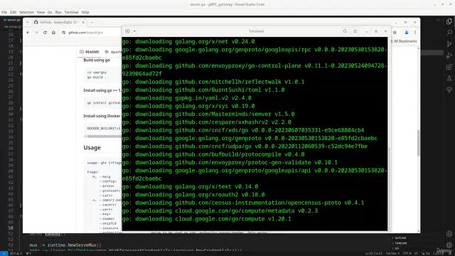
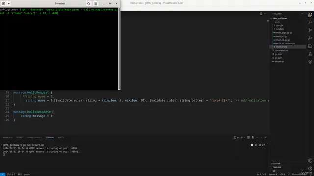
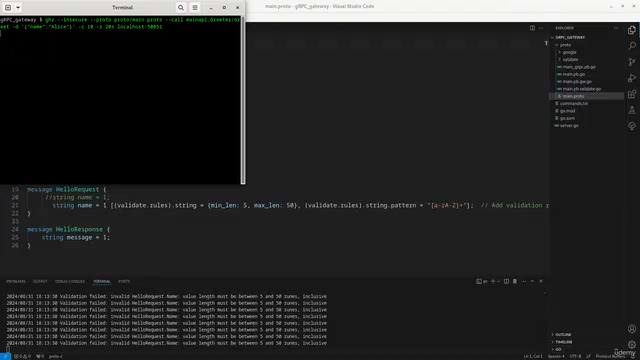
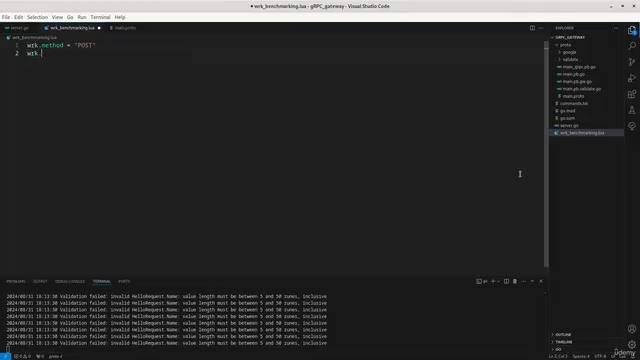
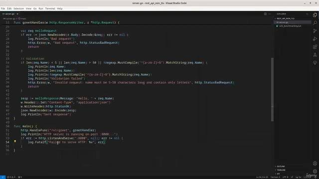
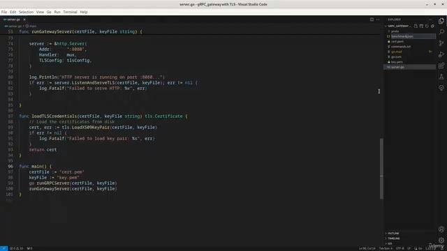
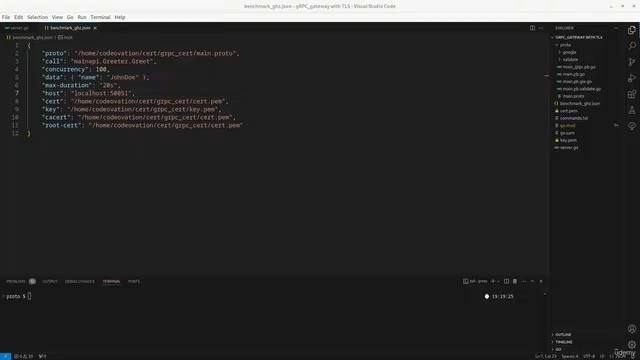

# gRPC & Protobuf（BV1oYx56TECn）P51–P53 复现文档

> 覆盖范围：P051（用 GHZ / wrk 对 gRPC 与 REST 做基准测试）、P052（宣布用 MongoDB 重写学校项目 API 的 gRPC 版本）、P053（MongoDB 概念讲解）。
>
> 说明：这三节里 **P051 有大量可执行命令**，P052 是过渡说明，**P053 是纯概念讲解、没有任何代码**。因此本文档第 3、4 节会按「有代码的课」写 P051，按「纯讲解课」写 P053（第 4 节给出的是概念对照表与查询草案，并明确标注「课里没有代码」）。P052 只有一句话，会并入第 1、2 节交代背景。

---

## 1. 这一节做什么

这三节不是「写业务功能」，而是**给已经写好的 API 做性能体检，并为下一步换数据库做铺垫**。具体产出三样东西：

1. **一套可复现的 gRPC 基准测试流程**：用 GHZ 对 gRPC 服务压测，用 wrk + Lua 脚本对同一套服务的 REST 网关压测，再和一个「原生 Go HTTP 服务」对比，最后加上 TLS 再压一遍。
2. **一组实测数字**（讲师本机跑出来的，你复现时数字会不同，但量级关系值得观察）：非 TLS gRPC 约 75.5 万请求 / 20 秒、约 37,756 RPS；非 TLS 组合式 REST 约 88 万请求 / 20 秒、约 43,794 RPS；原生 REST 约 157 万请求 / 20 秒；TLS gRPC 约 118 万请求 / 20 秒、约 59,165 RPS；TLS 组合式 REST 约 70.7 万～70.9 万请求 / 20 秒。
3. **一个方向决定**：P052 明确说，学校项目的 REST 版已经用 SQL 写完了，**gRPC 版改用 MongoDB**，用来对比 SQL 与 NoSQL 在 gRPC 项目里的差异。P053 则是为这个决定补的 MongoDB 基础课。

一句话：**P051 教你「怎么证明你的技术选型」，P052–P053 教你「下一步换什么存储、它和 SQL 差在哪」。**

---

## 2. 讲师原话（带出处）

关于为什么不能用常规工具压 gRPC：

> "因为这是一个 gRPC 服务器，我们无法使用 h2load 或 wrk，因为 gRPC 需要专门的测试和基准测试工具。为此，我们有一个名为 GHZ 的基准测试工具。"
> —— p051 [00:00]

关于 GHZ 的安装方式：

> "它可以通过 brew 安装，也可以用 go install 安装。这个工具主要是用 go 构建的。"
> —— p051 [00:28]

关于 `--call` 参数的写法（这里讲师自己先写错再纠正，很关键）：

> "这里会是主 API 的 .greeter……抱歉，不是 .greet，而是 /greet。因此我们需要包名.服务名，然后加一个 /，后面跟 RPC 调用。"
> —— p051 [02:43]–[03:13]

关于用错误的方法名验证「命令确实打到了正确的 proto」：

> "不用 greet，我改用 grito，看看现在会怎样，因为现在它应该不会返回正常状态码……这说明我们的命令访问的是正确的 proto 文件。"
> —— p051 [04:35]–[05:04]

关于 wrk 发 JSON 必须借助 Lua：

> "要用 wrk 发送 JSON 负载，我们需要使用 Lua 脚本。这个 Lua 脚本要指定请求的 HTTP 方法、请求头和请求体。"
> —— p051 [08:28]

关于 Lua 脚本只需三行、不用学 Lua：

> "现在我们不必安装 Lua，也不必安装任何额外的东西，甚至不用学 Lua 语言。我们只需要把负载写入一个单独的文件，让 wrk 把负载发送到端点。"
> —— p051 [08:57]

关于 TLS 场景要改用配置文件（因为要同时传证书、私钥、payload）：

> "这一次我们仍然需要用外部文件来存放负载。因为这次我们必须把证书、密钥以及负载都传给 GHZ。"
> —— p051 [17:00]

关于证书里的 Common Name 必须和请求地址一致：

> "我们再把这里的 127.0.0.1 改成 localhost，因为创建证书时……我们在证书配置文件中把通用名称写成了 localhost。"
> —— p051 [19:43]

关于证书路径必须写绝对路径：

> "无论你把证书文件和密钥文件保存在哪里，请写明绝对路径，也就是在 Windows 上从 C 盘、D 盘或你使用的任意盘符开始的路径；如果你使用的是 macOS 或 Linux，则应从根目录开始。"
> —— p051 [20:12]

关于 wrk 如何区分「成功」与「被拒」：

> "如果响应不是 200 或 300——200 表示正常，300 表示重定向——那么除这两个之外的其他情况都算拒绝。这就是为什么 wrk 实际上会告诉我们哪些请求被拒绝了。但如果所有请求都被接受，它就不会报告这些请求。"
> —— p051 [15:35]

关于实测与理论相反：

> "我们今天在基准测试中看到的情况完全不同。我们看到，没有实现 TLS 的 HTTP 1 API……在 20 秒内处理了 150 万个请求。"
> —— p051 [32:05]

关于本地压测的局限（这段话很重要，别把数字当真理）：

> "这些基准测试是在本地的一台计算机上完成的。我们不是把 API 托管在服务器上，然后通过连接互联网到远程服务器来对 API 做基准测试。"
> —— p051 [35:28]

关于 P052 的方向决定：

> "在这个 API 的 REST 版本中，我们使用了 SQL。那么现在在这个 API 的 gRPC 版本中，我们改用 MongoDB，看看它与使用 SQL 有什么不同。"
> —— p052 [00:27]

关于 MongoDB 的定位：

> "MongoDB 是一个流行的、高性能且可扩展的非关系型数据库，它以灵活的、类似 JSON 的格式存储数据。"
> —— p053 [00:00]

关于集合与表的本质差别：

> "在一个集合中，每一行都是一个文档，相邻文档可以有不同的格式。因此，在一个集合中，相邻文档可以有不同的字段，它们不必遵循相同的模式。"
> —— p053 [05:35]

关于 MongoDB 也支持事务：

> "MongoDB 也符合事务的原子性、一致性、隔离性和持久性要求，尤其是在 4.0 版引入多文档事务之后。"
> —— p053 [11:43]

---

## 3. 从零复现

### 3.0 前置假设（课里没讲的部分我明确标出）

课里假设你已经有一个「gRPC + gRPC-Gateway 组合式服务」在跑（前面章节做的），并且有一个 `proto/main.proto`。**课里没有给出这些文件的完整内容**，所以下面第 4 节我只写「课里实际出现、且能独立保存运行」的文件：Lua 脚本、GHZ 配置文件、原生 REST 服务骨架。gRPC 服务本体请沿用你前面章节的产物。

目录约定（按讲师在 P051 里的实际路径整理）：

```
project/
├── proto/
│   └── main.proto            # 前面章节产出，package main; service API { rpc Greet }
├── server.go                 # 非 TLS 组合式服务，gRPC 在 50051，REST 在 8080
├── tls/
│   └── server.go             # TLS 组合式服务，同上端口
├── native/
│   └── server.go             # 原生 Go HTTP 服务，端口 8000
├── wrk_benchmarking.lua      # 非 TLS REST 压测脚本
├── wrk_benchmarking_tls.lua  # TLS REST 压测脚本
└── benchmark_ghz.json        # TLS gRPC 压测配置
```

### 3.1 安装 GHZ

讲师给了两条路（p051 [00:28]）：

```bash
# 方式一：Homebrew（macOS）
brew install ghz

# 方式二：go install（跨平台，讲师实际用的是这条）
go install github.com/bojand/ghz/cmd/ghz@latest
```

装完验证：

```bash
ghz --version
```

讲师本机输出是 `dev`（因为装的是开发版），你装 release 版会看到具体版本号。**该输出字段名请以实际输出为准。**

看帮助：

```bash
ghz --help
```



### 3.2 压测非 TLS 的 gRPC 服务

先起服务（讲师用的是 `go run server.go`，p051 [01:45]）：

```bash
go run server.go
```

然后压测。讲师第一次用的完整命令（p051 [02:15]–[04:10]）：

```bash
ghz --insecure \
  --proto proto/main.proto \
  --call main.API/Greet \
  -d '{"name":"Alice"}' \
  -c 10 \
  -n 1000 \
  localhost:50051
```

参数逐个对应讲师原话：

- `--insecure`：因为服务没上 TLS，不带证书和私钥。
- `--proto proto/main.proto`：proto 文件路径，讲师强调 `--proto` 后面**不要空格**直接跟路径（他写的是 `--proto` 然后 `proto/main.proto`）。
- `--call main.API/Greet`：格式是 `包名.服务名/方法名`。讲师先写成 `main.API.greeter`，随即纠正为 `main.API/Greet`。
- `-d '{"name":"Alice"}'`：请求体，单引号包住 JSON，JSON 里的 key 用双引号。
- `-c 10`：并发 10。
- `-n 1000`：总请求数 1000。
- 最后是地址 `localhost:50051`。

**验证命令确实打到了正确 proto 的技巧**（p051 [04:35]）：把 `--call` 改成不存在的方法 `main.API/Greeter`（讲师口误说成 `grito`），如果返回非 OK 状态码，说明 proto 解析生效、请求真的发出去了。这一步很值得照做，否则你可能在压一个 404。



### 3.3 改用「按时长」压测

讲师把 `-n` 换成时长参数，中途还纠正了一次参数名（p051 [05:33]）：

> "我不用 N 1000，而是用 D，它代表持续时间……抱歉，不是 -D，而是 -Z，表示持续时间。"

所以正确写法是 `-z`：

```bash
ghz --insecure \
  --proto proto/main.proto \
  --call main.API/Greet \
  -d '{"name":"Alice"}' \
  -c 10 \
  -z 20s \
  localhost:50051
```

讲师这一轮还踩了个坑：把 `Alice` 打成了 `L`，导致请求全被业务校验拒绝，他清屏重跑才拿到正常结果（p051 [05:55]–[06:25]）。**复现时注意 payload 拼写**，否则你会看到一堆非 OK 却以为是压测工具的问题。

正常结果（p051 [06:41]–[07:05]）：

- OK 响应数：755,108
- 每秒请求数：37,756
- 平均延迟：0.14 毫秒



### 3.4 压测非 TLS 的组合式 REST 网关（wrk + Lua）

GHZ 只认 gRPC，压 REST 要换 wrk（p051 [07:33]）。wrk 默认支持 HTTP/1.1，但**发 JSON body 必须靠 Lua 脚本**。

新建 `wrk_benchmarking.lua`（内容见第 4 节）。讲师原话只提了三件事：`wrk.method`、`wrk.body`、`wrk.headers` 里的 `content-type`（p051 [09:21]–[09:50]）。

压测命令（p051 [10:05]–[11:01]）：

```bash
wrk -t10 -c20 -d20s --latency \
  -s wrk_benchmarking.lua \
  http://localhost:8080/v1/greet
```

- `-t10`：10 个线程（讲师说上次并发是 10，所以线程也用 10）。
- `-c20`：保持 20 个连接。
- `-d20s`：跑 20 秒。
- `--latency`：输出延迟统计。
- `-s`：指定 Lua 脚本。

结果（p051 [11:29]）：20 秒内 880,270 个请求，平均 43,794 RPS。



### 3.5 与「原生 REST 服务」对比

讲师另写了一个**不经过 gRPC 的原生 Go HTTP 服务**，路由同样是 `/v1/greet`，功能与校验完全一致，跑在 8000 端口（p051 [11:57]–[13:22]）。压测命令同上，只改端口：

```bash
wrk -t10 -c20 -d20s --latency \
  -s wrk_benchmarking.lua \
  http://localhost:8000/v1/greet
```

结果（p051 [14:17]）：20 秒 1,574,639 个请求，全部成功。

**验证「拒绝也算数」的实验**（p051 [14:44]–[15:35]）：讲师故意在 `name` 里加空格（业务正则不允许空格），重跑后 893,000 个请求全部被拒，wrk 会明确报出非 2xx/3xx 的数量。这印证了他那句「全成功时 wrk 不吭声，有拒绝才报」。



### 3.6 压测 TLS 版 gRPC（改用配置文件）

TLS 场景要同时传证书、私钥、payload，命令行太长，讲师改用 `--config`（p051 [17:00]–[21:35]）。

准备工作：

1. 把 `proto/` 目录复制到一个**路径更短**的位置（讲师复制到 `~/cert/grpc-cert/proto`），因为配置文件里要写绝对路径。
2. 把 `validate/`、`google/` 两个被 `main.proto` import 的目录也一起复制过去（p051 [19:16]–[19:43]）。
3. 新建 `benchmark_ghz.json`（内容见第 4 节），把 `127.0.0.1` 改成 `localhost`，与证书 Common Name 对齐。

运行：

```bash
ghz --config benchmark_ghz.json
```

讲师强调：**配置文件路径要写对**，如果你不在项目根目录，就得给 `--config` 一个能找到文件的路径（p051 [21:35]）。

结果（p051 [22:28]–[22:57]）：1,183,221 个请求，约 59,165 RPS——**比非 TLS 还高**，这就是讲师说的「与理论相反」。



### 3.7 压测 TLS 版组合式 REST

复制上一份 Lua，把 URL 协议改成 `https`，端口改 8080（p051 [23:26]–[24:41]）。先用 Postman 打一发确认服务活着，再压：

```bash
wrk -t10 -c20 -d20s --latency \
  -s wrk_benchmarking_tls.lua \
  https://localhost:8080/v1/greet
```

结果（p051 [25:07]–[25:33]）：707,000～709,000 个请求，低于非 TLS 的 880,000。



### 3.8 汇总对比（讲师口述数字）

| 场景 | 20 秒总请求 | 平均 RPS | 出处 |
|---|---|---|---|
| 非 TLS gRPC | 755,108 | 37,756 | p051 [06:41] |
| 非 TLS 组合式 REST | 880,270 | 43,794 | p051 [11:29] |
| 原生 REST（HTTP/1.1） | 1,574,639 | 约 78,000 | p051 [14:17]、[32:35] |
| TLS gRPC | 1,183,221 | 59,165 | p051 [22:28]、[33:30] |
| TLS 组合式 REST | 约 707,000–709,000 | 未给出 | p051 [25:07] |

> 注意：讲师在 [32:35] 说原生 REST「78,000 RPS」，但 1,574,639 ÷ 20 ≈ 78,732，量级一致。这些数字是**他本机**的结果，你复现时不必追求相同数值，重点看相对关系。

### 3.9 P052–P053：换 MongoDB 的准备（纯讲解，无代码）

P052 只做了一件事：宣布 gRPC 版学校项目 API 用 MongoDB 替代 SQL。P053 用整节讲 MongoDB 概念。**课里没有给出任何 MongoDB 连接代码、驱动版本、集合设计或 Go 代码**，所以这里不能编造实现。第 4 节我按「纯讲解课」的要求，把 P053 的概念对照整理成可用的设计表。

---

## 4. 完整代码

> 以下文件均为**课里实际出现、可独立保存**的产物。gRPC 服务本体与 `main.proto` 课里未给全文，故不虚构。

### 4.1 `wrk_benchmarking.lua`（非 TLS REST 压测）

```lua
wrk.method = "POST"
wrk.body   = '{"name":"Alice"}'
wrk.headers["Content-Type"] = "application/json"
```

### 4.2 `wrk_benchmarking_tls.lua`（TLS REST 压测）

```lua
wrk.method = "POST"
wrk.body   = '{"name":"Alice"}'
wrk.headers["Content-Type"] = "application/json"
```

> 与 4.1 内容相同，区别只在**命令行 URL 用 `https://`**。讲师的做法就是复制一份再改 URL（p051 [23:26]）。

### 4.3 `benchmark_ghz.json`（TLS gRPC 压测配置）

讲师在 p051 [17:49]–[20:12] 逐字段写入。字段名以讲师实际写入为准，**未在逐字稿中出现的字段我不填**：

```json
{
  "proto": "/Users/you/cert/grpc-cert/proto/main.proto",
  "call": "main.API/Greet",
  "data": {
    "name": "Alice"
  },
  "concurrency": 10,
  "duration": "20s",
  "cacert": "/Users/you/cert/grpc-cert/cert/ca-cert.pem",
  "cert": "/Users/you/cert/grpc-cert/cert/cert.pem",
  "key": "/Users/you/cert/grpc-cert/cert/key.pem",
  "host": "localhost:50051"
}
```

> 说明：讲师口述里提到了 `proto`、`cert`、`key`、`ca cert`、`root cert` 以及 `validate`/`google` 目录的复制，但**逐字稿没有逐字念出每个 JSON key 的拼写**。上面 `cacert`/`cert`/`key`/`host` 是 GHZ 配置文件的常见字段名，**请以你本地 `ghz --help` 或实际报错为准**；若报「unknown field」，按报错提示改名。`proto` 路径必须是绝对路径（讲师强调，p051 [20:12]）。

### 4.4 原生 REST 服务骨架（`native/server.go`）

课里只描述了它的行为（同路由、同校验、端口 8000），**没有给全文**。下面是为让你能跑通对比实验而写的**最小等价实现**，标注为「课里没有完整代码，以下为按讲师描述重写的示意」：

```go
package main

import (
	"encoding/json"
	"net/http"
	"regexp"
)

var nameRe = regexp.MustCompile(`^\S+$`) // 不允许空格，对应讲师的正则校验

type req struct {
	Name string `json:"name"`
}
type resp struct {
	Message string `json:"message"`
}

func greet(w http.ResponseWriter, r *http.Request) {
	var in req
	if err := json.NewDecoder(r.Body).Decode(&in); err != nil || !nameRe.MatchString(in.Name) {
		http.Error(w, "validation failed", http.StatusBadRequest)
		return
	}
	w.Header().Set("Content-Type", "application/json")
	json.NewEncoder(w).Encode(resp{Message: "Hello " + in.Name})
}

func main() {
	http.HandleFunc("/v1/greet", greet)
	http.ListenAndServe(":8000", nil)
}
```

### 4.5 P053 概念对照表（课里没有代码，以下为按讲师讲解整理）

| SQL / MySQL | MongoDB | 讲师原话要点 |
|---|---|---|
| Database（表的集合） | Database（集合的集合） | p053 [04:11] |
| Table | Collection | 集合不强制严格 schema |
| Row | Document | 存储为 BSON（二进制 JSON） |
| Column | Field | 同集合内不同文档字段可不同 |
| Schema（固定） | Schema-less（可选校验） | 可用 schema validation 强制 |
| Primary Key | `_id` | 不指定则自动生成 |
| Index | Index | 可在任意字段建索引 |
| Join | Embedding / Referencing / `$lookup` | 无传统 join |
| `SELECT * FROM users WHERE age > 30` | `db.users.find({age:{$gt:30}})` | p053 [09:50] |
| 聚合函数 SUM/COUNT/AVG | 聚合管道 `$group`/`$sum`/`$avg` | p053 [11:14] |
| Foreign Key | 应用层手动引用 | 无引用完整性强制 |
| ACID | ACID（4.0 起多文档事务） | p053 [11:43] |

---

## 5. 逐行解释

**`ghz --insecure`**：告诉 GHZ 不要校验证书。非 TLS 服务必须加，否则握手直接失败。对应到 Node 里就是 `https.request({rejectUnauthorized:false})` 那个开关。

**`--proto proto/main.proto`**：GHZ 靠 proto 文件在**客户端**序列化请求，所以它必须能读到和服务器同一份 proto。这也是为什么讲师后面要专门复制 `validate/`、`google/`——`main.proto` 里 import 了它们，缺一个就解析失败。

**`--call main.API/Greet`**：三段式 `包名.服务名/方法名`。写成 `main.API.Greet` 会失败，因为 gRPC 全限定名用 `/` 分隔服务与方法。讲师当场写错又纠正，说明这个格式是高频坑。

**`-d '{"name":"Alice"}'`**：外层单引号是 shell 的，内层双引号是 JSON 的。如果你在 Windows PowerShell 里跑，单引号行为不同，建议改用配置文件（4.3）绕开转义问题。

**`-c 10` / `-n 1000` / `-z 20s`**：并发、总请求数、持续时长。`-n` 和 `-z` 二选一。讲师把 `-z` 说成过 `-D`，实际是 `-z`。

**`wrk.method = "POST"`**：wrk 默认 GET，不改就是 GET，服务端会 405。这一行是「能发出 JSON」的前提。

**`wrk.body = '{"name":"Alice"}'`**：Lua 里字符串用单引号包 JSON，避免和 JSON 的双引号打架。

**`wrk.headers["Content-Type"] = "application/json"`**：不加这行，很多框架不会按 JSON 解析 body，你会收到 400 而不是压测结果。

**`wrk -t10 -c20 -d20s --latency`**：线程数、连接数、时长、延迟统计。讲师特意让 `-t` 与之前 gRPC 的并发 10 对齐，保证可比性。

**`--config benchmark_ghz.json`**：把所有参数搬进文件，解决 TLS 场景「证书 + 私钥 + payload 三件套」的命令行爆炸问题。代价是路径必须写绝对路径，否则 GHZ 从当前工作目录找不到文件。

**`"host": "localhost:50051"`**：必须和证书 Common Name 一致。讲师把 `127.0.0.1` 改成 `localhost` 就是为此——证书签发时 CN 写的是 `localhost`，用 IP 访问会 TLS 校验失败。

**P053 的 `_id`**：MongoDB 每个文档的主键，不填自动生成。对应 SQL 的自增主键，但类型是 ObjectId 而非整数。**在 JS/Node 里**，Mongoose 的 `_id` 默认就是 ObjectId，前端传参时要注意它是字符串化的 24 位十六进制。

**P053 的「无传统 join」**：这是前端转 AI 应用工程师最容易踩的认知差——你在 SQL 里习惯 `JOIN`，在 MongoDB 里要么把关联数据**嵌进文档**（embedding），要么存引用再二次查询（referencing），复杂场景才用 `$lookup`。**课里没讲**具体该选哪种，只说了三种手段存在。

**P053 的事务**：MongoDB 4.0 起支持多文档事务，但讲师只说「支持」，**没讲**副本集/分片集群的前置要求细节。**在 Node 里**对应 `session.withTransaction()`，和 SQL 的 `BEGIN/COMMIT` 概念一致。

---

## 6. 复现检查清单

按顺序打勾，任何一项不过就别往下走：

- [ ] `ghz --version` 有输出（`dev` 或版本号均可）
- [ ] `go run server.go` 起得来，50051（gRPC）与 8080（REST）都在监听
- [ ] `ghz --insecure --proto proto/main.proto --call main.API/Greet -d '{"name":"Alice"}' -c 10 -n 1000 localhost:50051` 返回 1000 个 OK
- [ ] 故意把 `--call` 改成 `main.API/Greeter`，确认返回**非 OK**（证明 proto 生效）
- [ ] `-z 20s` 跑通，记下 OK 数与 RPS
- [ ] `wrk_benchmarking.lua` 三行齐全（method/body/headers）
- [ ] `wrk -t10 -c20 -d20s --latency -s wrk_benchmarking.lua http://localhost:8080/v1/greet` 有结果
- [ ] 原生 REST 服务在 8000 起来，同命令换端口能压
- [ ] 在 `name` 里加空格重压，wrk 报出大量非 2xx（验证拒绝可见）
- [ ] `benchmark_ghz.json` 里 `proto`/`cert`/`key` 全是**绝对路径**
- [ ] 配置里 host 是 `localhost` 不是 `127.0.0.1`（与证书 CN 一致）
- [ ] `ghz --config benchmark_ghz.json` 跑通，记下数字
- [ ] TLS REST 用 `https://` + 8080 压通
- [ ] 五组数字填进 3.8 的表，能说出「哪组最高、哪组最低」
- [ ] 能复述 P052 的决定：gRPC 版改用 MongoDB
- [ ] 能默写 P053 的 SQL↔MongoDB 六组对照（表/集合、行/文档、列/字段、主键/`_id`、join/嵌入或引用、事务）

---

## 7. 课里没讲但你会撞上的

1. **`main.proto` 全文、gRPC 服务端代码、证书生成脚本**：这三节都没给。你得回到前面章节或自己补。证书生成（openssl 配置 CN=localhost）课里只提了「我们之前创建过」，没重放命令。
2. **GHZ 配置文件的精确字段名**：讲师逐字写入但逐字稿没念全拼写。`cacert`/`cert`/`key`/`host` 若报 unknown field，按 `ghz --help` 或报错改。**不要照抄我给的字段名当权威**。
3. **Windows 下的路径与引号**：讲师全程 macOS。PowerShell 对单引号 JSON 的处理不同，`wrk` 在 Windows 上需要 WSL 或原生编译版。课里没讲。
4. **`wrk` 的安装**：课里默认你已有（前面章节装过），没给 `brew install wrk` 之类的命令。
5. **MongoDB 的安装、Go 驱动、连接串、集合设计**：P052–P053 **完全没有代码**。`go.mongodb.org/mongo-driver` 这个包名课里没出现，是我按常识补的，**别当成讲师说的**。真正动手时你需要自己查官方文档。
6. **BSON 与 JSON 的差异**：P053 说「存 BSON」，但没讲 BSON 支持 Date/ObjectId/Binary 等 JSON 没有的类型。接 MongoDB 时你会遇到 `_id` 不是字符串、日期不是 ISO 串的问题。
7. **本地压测的结论不能直接搬到生产**：讲师自己在 [35:28] 强调了这点。他的数字是「同一台机器上客户端和服务端抢 CPU」的结果，真实网络下 gRPC 的 HTTP/2 多路复用优势才会显现。**别拿这份表去跟老板拍板**，要按讲师说的「换参数、换场景、多压几轮」。
8. **`--latency` 之外的分位数**：wrk 默认只给平均和最大，P50/P99 需要额外脚本。课里没讲，但生产选型时 P99 比平均值重要得多。
9. **gRPC 的 `-c` 与 wrk 的 `-c` 语义不同**：前者是并发流数，后者是 TCP 连接数。讲师让两者都取 10/20 是为了「大致可比」，严格来说不是同一维度。课里没点破这层。

---

**一句话收尾**：P051 的价值不在那几个数字，而在**「先证明再选型」的方法**——装 GHZ、写三行 Lua、配一份 JSON、跑五组对比、然后对结果保持怀疑。P052–P053 则把下一步的存储从 SQL 换成 MongoDB，概念对照表就是你的迁移地图。