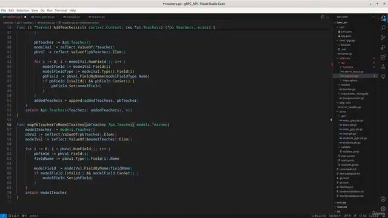
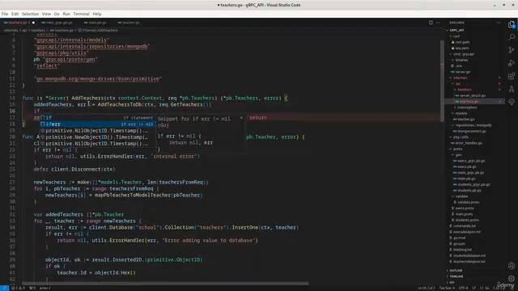
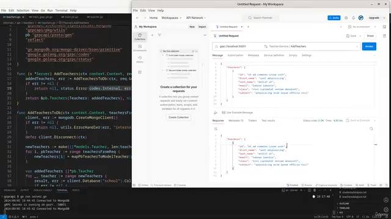
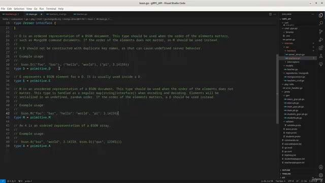
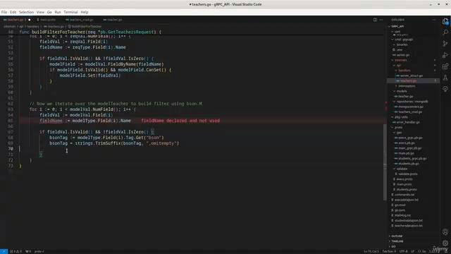
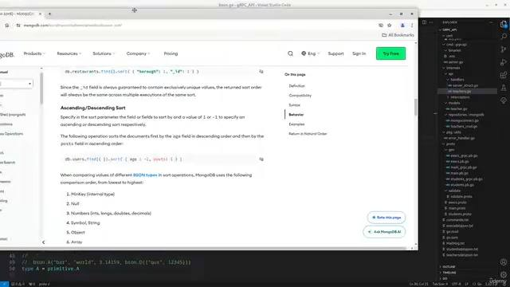
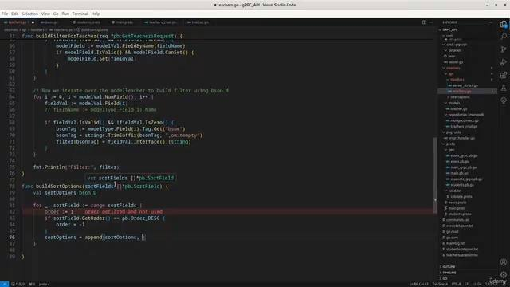
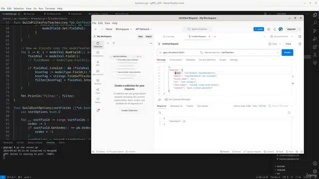

# gRPC & Protobuf 课程文档：教师服务的模块化重构、过滤与排序（P064–P066）

> 适用读者：前端转 AI 应用工程师。本文档基于 BV1oYx56TECn 的 P064–P066 逐字稿整理，目标是让你照着做就能把「教师服务」的 gRPC 接口从「一个函数干所有事」重构成「模块化 + 支持过滤 + 支持排序」的可用服务。
>
> 说明：逐字稿是英文自动转写，讲师在 P064 之前已经完成了 `main.proto` / `students.proto` 的定义、`server` 结构体、`addTeachers` 的初版实现、MongoDB 连接等前置工作。本文档只覆盖 P064–P066 三集的内容，前置部分「课里没讲」，需要你已有可运行的基线工程。

---

## 1. 这一节做什么

这三集的核心目标只有一个：**把 `addTeachers` 里「解码请求 → 转模型 → 写库」这一坨逻辑拆成独立函数，然后把同样的拆分思路套到 `getTeachers` 上，并给 `getTeachers` 加上过滤（filter）和排序（sort）能力。**

具体拆成四件事：

1. **P064：重构 `addTeachers`**。把「PB 请求 → `models.Teacher`」的映射抽成 `mapPBTeacherToModelTeacher`，把「模型 → 写 MongoDB」抽成 `addTeachersToDB`，并把数据库操作挪到 `repository/mongodb/teachers_crud.go`。同时补上两个业务校验：gRPC 错误要用 `status.Error(codes.Internal, ...)` 回传；请求里不允许带非空 `ID`（ID 必须由 MongoDB 生成）。
2. **P065：实现 `getTeachers` 的过滤**。用 `reflect` 遍历 `pb.Teacher` 的字段，把请求里非零值的字段塞进一个 `models.Teacher` 实例，再遍历这个实例、读它的 `bson` tag，拼出 `bson.M` 作为 MongoDB 的 filter。
3. **P066：实现 `getTeachers` 的排序**。读 `students.proto` 里的 `SortField`（`field` + `order`，`ASC=0`、`DESC=1`），拼出 `bson.D`（有序），其中每个元素是 `bson.E{Key: field, Value: ±1}`。
4. **贯穿三集的工程习惯**：用 `Ctrl+Shift+R`（GoLand 的 Extract Function）做重构；用 `reflect.Value.Elem()` 解指针；用 `strings.TrimSuffix` 去掉 bson tag 里的 `,omitempty`。

从学习路径看，这三集不是单纯讲「怎么写一个查询」，而是在讲「如何把 handler 里混杂的职责拆开」。对前端转后端的人来说，可以把 `AddTeachers` 想成一个 API Route Handler：它应该只负责接请求、做参数校验、调用 service/repository，而不是把 ORM 映射、数据库写入、错误包装全部塞在一个函数里。P064 的 Extract Function 就是在做这种职责切分。P065、P066 则是在 `GetTeachers` 上继续复用同样的工程思路：先构造 filter，再构造 sort，最后把两者交给数据库查询。虽然三集内没有把 `Find` 查询完整展开，但 filter 和 sort 的构造逻辑已经讲清楚，后续接数据库时就是把这两个值交给 MongoDB 驱动。

学完你应该能回答：为什么 filter 用 `bson.M` 而 sort 用 `bson.D`？为什么 `reflect.ValueOf(ptr).NumField()` 会 panic？为什么 gRPC 客户端能在发请求前就拒绝非法的 enum 值？如果你还能解释「为什么 ID 非空要在 handler 层拒绝」「为什么错误要用 `status.Error` 而不是普通 `errors.New`」「为什么 `IsZero()` 比 `== 0` 更适合反射场景」，这三集的目标就达到了。

---

## 2. 讲师原话（带出处）

> "这里我们正在把值解码到 r 结构体中。这里做的事情是把发往模型的请求解码到我们的结构体里。接下来我会把这段逻辑从这个函数中实际抽出来。"
> —— p064 [00:00]

> "然后我会把这个函数重命名为 mapPBProtocolBufferTeacherToModelTeacher。"
> —— p064 [01:53]

> "现在在 gRPC API 中也是一样，当遇到错误时，RPC 需要把错误传达给客户端，所以我们会通过 status 来传达。"
> —— p064 [07:14]

> "我们有三种 status，所以需要使用 gRPC status 里的那个。……然后我们在它上面调用 error，先传入 code，也就是错误码。……这里会是内部错误，所以用 codes.Internal；第二个参数则是一条消息。"
> —— p064 [07:38]–[08:06]

> "问题就在这里。……我们需要让 ID 由 MongoDB 自动生成，不需要自己创建 ID。"
> —— p064 [09:04]

> "我们会检查教师 ID，也就是 teacher.ID，然后检查教师 ID 是否不等于空字符串；如果不等于空字符串，就返回一个错误……使用 codes.InvalidArgument（而不是 codes.OK），并带上错误消息：请求格式不正确，不允许非空的 ID 字段。"
> —— p064 [09:51]–[10:43]

> "既然数据库操作已经有了单独的函数，我们就需要在 repository 的 MongoDB 文件夹里放一个教师的 CRUD 文件。"
> —— p064 [11:35]

> "那么，如何为教师构建过滤器呢？在这种情况下，我们需要了解正在使用的这个包，也就是 MongoDB 包。如果你读文档，会看到关于 bson.M 的一些说明。"
> —— p065 [03:08]

> "M 是 bson 文档的无序表示。当元素顺序不重要时，应使用这个类型。……如果元素顺序重要，则应改用 D。"
> —— p065 [04:29]（讲师朗读 MongoDB 驱动文档）

> "所以，如果我们希望字段是有序的，那就使用 D 类型；如果顺序不重要，就使用 M 类型。"
> —— p065 [04:56]

> "它会拿字段值与该类型的零值进行比较。……它检查的不是实际的零，而是该数据类型的零值。"
> —— p065 [12:48]

> "我们要传给它的是列名和值。所以我们是在要求 MongoDB 按这个列过滤，并且这个列应该具有这些值。"
> —— p065 [23:10]

> "所以是 reflect.ValueOf().Elem()。它用于获取指针所指向的值。如果你对非指针类型调用 Elem，它会 panic，因为没有可供解引用的底层值。"
> —— p065 [28:38]

> "这里可以看到，-1 表示降序，正数 1 表示升序。"
> —— p066 [02:44]（讲师朗读 MongoDB `cursor.sort()` 文档）

> "所以这会是一个 *pb.SortField 的切片。……repeated 就是切片，所以这里的 repeated 表示切片。"
> —— p066 [05:41]–[06:08]

> "E 表示 D 的 bson 元素，通常用在 D 里面。"
> —— p066 [08:59]

> "Postman 给我们报错，是因为这是 gRPC，而它也能访问 Protocol Buffer 文件。所以它知道有效值是什么。……这个错误实际上来自客户端，而不是服务端，因为客户端持有 proto 文件。"
> —— p066 [12:03]–[12:33]

---

## 3. 从零复现

### 3.1 前置假设（课里没讲，但你需要有）

这三集是在一个已经能跑的工程上做重构。你需要先具备：

- 一个 Go module（讲师用 GoLand，模块名课里没念，下文用 `grpc-teachers` 占位，你按自己的改）。
- 已定义好的 `main.proto` / `students.proto`，并已用 `protoc` 生成 `pb/*.pb.go`。其中至少包含：
  - `message Teacher { string id = 1; string first_name = 2; string last_name = 3; string class = 4; string subject = 5; }`（字段名以你实际 proto 为准）
  - `message GetTeachersRequest { Teacher teacher = 1; repeated SortField sort_by = 2; }`
  - `message SortField { string field = 1; Order order = 2; }`
  - `enum Order { ASC = 0; DESC = 1; }`
  - `service TeacherService { rpc AddTeachers(TeachersRequest) returns (...); rpc GetTeachers(GetTeachersRequest) returns (Teachers); }`
- 一个 `models.Teacher` 结构体，字段带 `bson:"...,omitempty"` tag。
- 一个已连上 MongoDB 的 `server` 结构体，持有 `*mongo.Client` 或 `*mongo.Collection`。
- `addTeachers` 的初版实现（就是 P064 要重构的那段）。

> 如果你没有基线工程，这三集本身无法从零跑起来——讲师是在已有代码上做 Extract Function。这一点必须说清楚。换句话说，这三集的学习重点不是「从空目录变出服务」，而是「在已有服务上做安全重构，并增加查询能力」。如果你的基线工程缺少 `pb` 生成代码、缺少 MongoDB 连接、缺少 `models.Teacher`，那么先补前置，不要直接照抄第 4 节代码，否则会出现大量「找不到包」「未定义字段」的错误。

### 3.2 环境与依赖

```bash
# Go 版本：课里没念具体版本，用你本地 1.21+ 即可
go mod init grpc-teachers   # 若已有 module 跳过

# 依赖（版本号课里没念，用 go get 拉最新即可）
go get go.mongodb.org/mongo-driver/mongo
go get go.mongodb.org/mongo-driver/bson
go get google.golang.org/grpc
go get google.golang.org/grpc/codes
go get google.golang.org/grpc/status
```

目录结构（重构后应长这样）：

```
grpc-teachers/
├── go.mod
├── main.go
├── main.proto
├── students.proto
├── pb/                      # protoc 生成
│   ├── main.pb.go
│   └── students.pb.go
├── models/
│   └── teacher.go           # models.Teacher，带 bson tag
├── server/
│   └── server.go            # server 结构体 + AddTeachers/GetTeachers handler
└── repository/
    └── mongodb/
        └── teachers_crud.go # addTeachersToDB（P064 新建）
```

命令解释：`go mod init` 只负责创建模块描述文件，不会自动下载依赖；`go get` 负责把依赖写入 `go.mod` 并下载到本地模块缓存。课里没有念版本号，所以不要机械复制某个旧版本；如果你本地依赖解析失败，先执行 `go mod tidy` 让 Go 自动补齐缺失依赖，再检查你的 import 路径是否和模块名一致。启动服务时，原文给出的命令是 `go run server`，它要求当前目录下存在可运行的 `server` 包目录或入口；如果你的入口是根目录的 `main.go`，则用 `go run .`。这一步的常见错误是：在错误目录执行 `go run server`，Go 会报「package server is not in std」或「cannot find package」；排查方法是先用 `pwd` 确认当前目录，再用 `go list ./...` 看包路径是否被正确识别。

常见错误与排查：第一，`protoc` 没有重新生成 `pb/*.pb.go`，导致代码里引用的 `pb.Order_DESC`、`pb.SortField` 不存在；处理方式是回到 proto 目录重新生成，并确认生成文件被放在 `pb/` 下。第二，MongoDB 没有启动，代码能编译但一调用写入就超时；处理方式是先确认本地 MongoDB 端口可连接，再检查连接串。第三，`models.Teacher` 的 `bson` tag 和 proto 字段名完全对不上，导致反射映射失败；处理方式是先打印字段名和 tag，再对照 proto。第四，`go run server` 与 `go run .` 混用；处理方式是按你的入口文件位置选择命令，不要照抄路径。

### 3.3 复现步骤（按顺序做）

**Step 1 — 重构 `addTeachers`（P064）**

1. 在 `server.go` 里选中「把 `pb.Teacher` 解码进 `models.Teacher`」那段，按 `Ctrl+Shift+R`（GoLand Extract Function），命名 `mapPBTeacherToModelTeacher`，返回类型改成 `models.Teacher`。
2. 选中「把 `models.Teacher` 写进 MongoDB」那段，再 Extract Function，命名 `addTeachersToDB`，参数从 `pb.Teachers` 改成 `[]*pb.Teacher`（讲师原话：`this is actually going to be a list. This is going to be a list of PB dot teacher`）。
3. 在 `repository/mongodb/` 下新建 `teachers_crud.go`，把 `addTeachersToDB` 挪进去。
4. 在 `addTeachers` 里加 ID 校验循环（见第 4 节代码）。
5. 错误回传改成 `status.Error(codes.Internal, err.Error())`。

**Step 2 — 实现 `getTeachers` 的过滤（P065）**

1. 在 `server.go` 加 `func (s *server) GetTeachers(ctx context.Context, req *pb.GetTeachersRequest) (*pb.Teachers, error)`。
2. 写 `buildFilterForTeacher(req *pb.GetTeachersRequest) bson.M`：用 `reflect` 把请求里非零字段搬进 `models.Teacher`，再遍历模型读 `bson` tag 拼 filter。
3. 注意 `reflect.ValueOf(modelTeacher).Elem()`——传指针必须 `.Elem()`，否则 `NumField()` panic（讲师在 [28:38] 专门讲了这点）。
4. 用 `fmt.Println(filter)` 打印验证。

**Step 3 — 实现 `getTeachers` 的排序（P066）**

1. 写 `buildSortOptions(sortFields []*pb.SortField) bson.D`。
2. 默认 `order = 1`（升序）；若 `sortField.GetOrder() == pb.Order_DESC` 则 `order = -1`。
3. 每个 sort field 生成一个 `bson.E{Key: sortField.Field, Value: order}`，`append` 进 `bson.D`。
4. 在 `GetTeachers` 里调用 `buildSortOptions(req.GetSortBy())`，`fmt.Println` 验证。

**Step 4 — 用 Postman 验证**

1. `go run server`（讲师命令是 `go run server`，即跑 `server` 目录/包；你按自己入口改）。
2. Postman 新建 gRPC 请求，导入 proto，选 `GetTeachers`。
3. 先只填 `teacher.last_name`，invoke，看终端打印的 filter。
4. 再填 `sort_by: [{field:"subject", order:ASC}, {field:"class", order:DESC}]`，invoke，看打印的 sort options。
5. 故意把 `order` 填成 `"ascending"`（字符串），观察 Postman 在客户端就报错——因为客户端持有 proto，知道合法 enum 值。

上述步骤的验收重点是「每一步都可观察」：Extract Function 后先编译，确认没破坏原逻辑；加 ID 校验后用带 `id` 的请求验证错误 message；加 filter 后先打印 `bson.M`，不要急着查库；加 sort 后先打印 `bson.D`，确认顺序和正负号。对前端来说，这类似先看 Network 面板里的 request payload 是否符合预期，再看 response；不要一上来就怀疑数据库，先验证你构造的 filter/sort 是否正确。

---

## 4. 完整代码

> 以下代码按逐字稿还原。逐字稿里讲师没有逐字念出全部行（比如 `models.Teacher` 的完整定义、`server` 结构体的字段），这些地方我按 Go 常规写法补全，并在注释里标注「课里没念全，按常规补」。**能直接保存运行的前提是你已有 3.1 的基线工程。**

### 4.1 `models/teacher.go`

```go
package models

// 课里没念全这个结构体的定义，只提到字段带 bson tag 且含 omitempty。
// 字段名以你 main.proto 的 Teacher 为准。
type Teacher struct {
	ID        string `bson:"_id,omitempty"`
	FirstName string `bson:"first_name,omitempty"`
	LastName  string `bson:"last_name,omitempty"`
	Class     string `bson:"class,omitempty"`
	Subject   string `bson:"subject,omitempty"`
}
```

### 4.2 `repository/mongodb/teachers_crud.go`（P064 新建）

```go
package mongodb

import (
	"context"

	"grpc-teachers/models"
	"grpc-teachers/pb"

	"go.mongodb.org/mongo-driver/mongo"
)

// addTeachersToDB 由 P064 的 Extract Function 抽出。
// 讲师把参数从 pb.Teachers 改成了 []*pb.Teacher（"this is going to be a list"）。
func AddTeachersToDB(ctx context.Context, coll *mongo.Collection, teachers []*pb.Teacher) error {
	// 课里没念全函数体内部，只说明它负责「把模型写进 MongoDB」。
	// 下面按常规写法补：先映射成 models.Teacher，再 InsertMany。
	docs := make([]interface{}, 0, len(teachers))
	for _, t := range teachers {
		m := MapPBTeacherToModelTeacher(t)
		docs = append(docs, m)
	}
	if len(docs) == 0 {
		return nil
	}
	_, err := coll.InsertMany(ctx, docs)
	return err
}

// MapPBTeacherToModelTeacher 由 P064 的 Extract Function 抽出，
// 讲师原话命名为 "map PB protocol buffer teacher to model teacher"。
func MapPBTeacherToModelTeacher(t *pb.Teacher) *models.Teacher {
	return &models.Teacher{
		FirstName: t.GetFirstName(),
		LastName:  t.GetLastName(),
		Class:     t.GetClass(),
		Subject:   t.GetSubject(),
	}
}
```

> 注意：讲师在 P064 [03:20] 提到返回类型要用 `*models.Teacher`（"这里应该是 *models.teacher。"），所以上面用指针。

### 4.3 `server/server.go`（P064 重构 + P065/P066 新增）

```go
package server

import (
	"context"
	"fmt"
	"reflect"
	"strings"

	"grpc-teachers/models"
	"grpc-teachers/pb"
	mongorepo "grpc-teachers/repository/mongodb"

	"go.mongodb.org/mongo-driver/bson"
	"go.mongodb.org/mongo-driver/mongo"
	"google.golang.org/grpc/codes"
	"google.golang.org/grpc/status"
)

type Server struct {
	pb.UnimplementedTeacherServiceServer
	Coll *mongo.Collection // 课里没念字段名，按常规补
}

// ---------- P064: AddTeachers ----------

func (s *Server) AddTeachers(ctx context.Context, req *pb.TeachersRequest) (*pb.TeachersResponse, error) {
	// P064 [09:51] 起：请求里不允许带非空 ID
	for _, teacher := range req.GetTeachers() {
		if teacher.GetId() != "" {
			return nil, status.Error(
				codes.InvalidArgument,
				"request is in incorrect format and non-empty ID fields should not be allowed",
			)
		}
	}

	// P064 [11:53] 起：数据库操作已挪到 repository/mongodb
	if err := mongorepo.AddTeachersToDB(ctx, s.Coll, req.GetTeachers()); err != nil {
		// P064 [07:38]：gRPC 错误用 status.Error 回传
		return nil, status.Error(codes.Internal, err.Error())
	}

	return &pb.TeachersResponse{}, nil // 返回类型以你 proto 为准
}

// ---------- P065: GetTeachers 过滤 ----------

func (s *Server) GetTeachers(ctx context.Context, req *pb.GetTeachersRequest) (*pb.Teachers, error) {
	filter := buildFilterForTeacher(req)
	sortOptions := buildSortOptions(req.GetSortBy())

	// 讲师在 P065 [26:25] 和 P066 [10:42] 都用 fmt.Println 打印验证
	fmt.Println("filter:", filter)
	fmt.Println("sort options:", sortOptions)

	// 课里没讲 getTeachers 的数据库查询部分（P066 结尾说 "now we need to access the database"，
	// 但三集内没展开）。下面按常规写法补，字段名以实际输出为准。
	_ = ctx
	_ = s.Coll
	return &pb.Teachers{}, nil
}

// buildFilterForTeacher 对应 P065 的 "build filter for teacher"。
func buildFilterForTeacher(req *pb.GetTeachersRequest) bson.M {
	filter := bson.M{}

	// 1) 把请求里非零字段搬进 models.Teacher
	modelTeacher := models.Teacher{}
	modelVal := reflect.ValueOf(&modelTeacher).Elem() // 必须 .Elem()，否则 NumField panic

	reqVal := reflect.ValueOf(req.GetTeacher()).Elem()
	reqType := reqVal.Type()

	for i := 0; i < reqVal.NumField(); i++ {
		fieldVal := reqVal.Field(i)
		fieldName := reqType.Field(i).Name

		// P065 [11:50]：检查 isValid 且非零值
		if fieldVal.IsValid() && !fieldVal.IsZero() {
			modelField := modelVal.FieldByName(fieldName)
			if modelField.IsValid() && modelField.CanSet() {
				modelField.Set(fieldVal)
			}
		}
	}

	// 2) 遍历 modelTeacher，读 bson tag 拼 filter
	modelType := modelVal.Type()
	for i := 0; i < modelVal.NumField(); i++ {
		fieldVal := modelVal.Field(i)
		if !fieldVal.IsValid() || fieldVal.IsZero() {
			continue
		}
		bsonTag := modelType.Field(i).Tag.Get("bson")
		// P065 [22:11]：去掉 ",omitempty"
		bsonTag = strings.TrimSuffix(bsonTag, ",omitempty")
		filter[bsonTag] = fieldVal.Interface()
	}

	return filter
}

// ---------- P066: GetTeachers 排序 ----------

// buildSortOptions 对应 P066 的 "build sort options"。
func buildSortOptions(sortFields []*pb.SortField) bson.D {
	sortOptions := bson.D{}

	for _, sf := range sortFields {
		order := 1 // 默认升序
		if sf.GetOrder() == pb.Order_DESC {
			order = -1
		}
		sortOptions = append(sortOptions, bson.E{
			Key:   sf.GetField(),
			Value: order,
		})
	}

	return sortOptions
}
```

### 4.4 `main.go`（入口，课里没念全，按常规补）

```go
package main

import (
	"context"
	"log"
	"net"

	"grpc-teachers/pb"
	"grpc-teachers/server"

	"go.mongodb.org/mongo-driver/mongo"
	"go.mongodb.org/mongo-driver/mongo/options"
	"google.golang.org/grpc"
)

func main() {
	// MongoDB 连接串课里没念，按常规补
	client, err := mongo.Connect(context.Background(), options.Client().ApplyURI("mongodb://localhost:27017"))
	if err != nil {
		log.Fatal(err)
	}
	coll := client.Database("school").Collection("teachers")

	lis, err := net.Listen("tcp", ":50051")
	if err != nil {
		log.Fatal(err)
	}
	grpcServer := grpc.NewServer()
	pb.RegisterTeacherServiceServer(grpcServer, &server.Server{Coll: coll})
	log.Println("gRPC server listening on :50051")
	if err := grpcServer.Serve(lis); err != nil {
		log.Fatal(err)
	}
}
```

启动命令：

```bash
go run server
# 或 go run .
```

---

## 5. 逐行解释

### 5.1 P064 重构部分

- **`MapPBTeacherToModelTeacher` 返回 `*models.Teacher`**：讲师在 [03:20] 明确说 "这里应该是 *models.teacher。"。为什么用指针？因为后面 `addTeachersToDB` 要把它塞进 `[]interface{}` 交给 `InsertMany`，指针语义更清晰，也避免大结构体拷贝。**在 JS/Node 里对应什么**：JS 对象本来就是引用传递，没有这个区分；Go 里值/指针是显式的。前端同学容易把 `models.Teacher` 当 JS object 随手赋值，但在 Go 里值拷贝和指针指向会影响后续修改是否可见。
- **`addTeachersToDB` 参数改成 `[]*pb.Teacher`**：讲师原话 "这实际上会是一个列表。这会是一个 PB.teacher 的列表。"。因为 proto 里 `repeated Teacher` 生成的 Go 类型就是 `[]*Teacher`（P066 [06:08] 讲师专门强调 "重复即切片"）。如果你按普通对象传参，会在编译期就报类型不匹配。
- **ID 校验循环**：讲师在 [09:04] 演示了带 ID 发请求导致的问题——MongoDB 里出现重复/异常 `_id`。修复方式是在 handler 里遍历 `req.GetTeachers()`，`teacher.GetId() != ""` 就返回 `status.Error(codes.InvalidArgument, "request is in incorrect format and non-empty ID fields should not be allowed")`。注意讲师用的是 `codes.InvalidArgument`，不是 `codes.Internal`。这里的业务含义是：客户端不应该自己决定主键，主键由数据库生成。
- **`status.Error(codes.Internal, err.Error())`**：讲师在 [07:38]–[08:06] 讲，gRPC 里错误必须通过 `status` 包回传，第一个参数是 code，第二个是给客户端的 message。**在 JS/Node 里对应什么**：类似 `grpc-js` 里的 `new Error()` + `status.INTERNAL`，但 gRPC 要求错误对象带 code，不能只抛普通 Error。对前端来说，收到错误时不能只看 HTTP status，而要看 gRPC status code 和 message；这也是 gRPC 调试与 REST 不同的地方。

### 5.2 P065 过滤部分

- **为什么用 `bson.M` 而不是 `bson.D`**：讲师在 [04:29] 朗读驱动文档——`M` 是无序 map，`D` 是有序文档。过滤条件之间没有顺序要求，所以用 `M`。**在 JS/Node 里对应什么**：`bson.M` 就是 `{ [key: string]: any }`，即普通 JS 对象。你写 `{ last_name: "张" }` 时不会关心 key 的先后，MongoDB 也不会因为 key 顺序不同而改变过滤语义。
- **`reflect.ValueOf(&modelTeacher).Elem()`**：讲师在 [28:38] 踩坑后专门解释——`reflect.ValueOf` 传指针时，`NumField()` 会 panic，因为指针本身没有字段；必须 `.Elem()` 解引用拿到底层 struct。这是 Go 反射的硬性规则。常见错误是直接 `reflect.ValueOf(modelTeacher).NumField()`，如果传的是指针就会 panic；排查时先打印 `Kind()`，确认是 `Ptr` 还是 `Struct`。
- **`fieldVal.IsZero()` 而不是 `== 0`**：讲师在 [12:48] 强调 "它检查的不是实际的零，而是该数据类型的零值。"。字符串的零值是 `""`，int 的零值是 `0`。用 `IsZero()` 才能统一处理所有类型。**在 JS/Node 里对应什么**：JS 里 `""`、`0`、`null`、`undefined` 都是 falsy，但 Go 的 `IsZero` 是类型感知的，更严格。对前端来说，不要用 JS 的 truthy/falsy 直觉去理解 Go 反射。
- **`strings.TrimSuffix(bsonTag, ",omitempty")`**：讲师在 [22:11] 讲，`Tag.Get("bson")` 返回的是完整 tag 字符串如 `"first_name,omitempty"`，但 filter 的 key 只能是列名 `first_name`，所以要去掉后缀。**注意**：如果 tag 里还有别的选项（如 `,minsize`），这里只 trim 了 `,omitempty`，课里没讲其他情况。排查方式是打印 `bsonTag` 原值和 trim 后的值，确认 filter key 不是 `first_name,omitempty` 这种错误形式。
- **`filter[bsonTag] = fieldVal.Interface()`**：讲师在 [25:04] 讲，`reflect.Value` 不能直接当 map 的 value，要 `.Interface()` 转成 `interface{}`。**在 JS/Node 里对应什么**：类似 `Object.entries()` 拿到的值，本来就是 any。Go 里如果不转，类型系统会阻止你把 `reflect.Value` 塞进 `bson.M`。

### 5.3 P066 排序部分

- **为什么 sort 用 `bson.D` 而不是 `bson.M`**：讲师在 [01:19] 朗读文档——`D` 是有序文档，"当元素顺序很重要时，例如 MongoDB 命令文档，应使用此类型。"。多字段排序时顺序有意义（先按 subject 再按 class），所以必须用 `D`。如果误用 `M`，排序字段的先后可能不稳定，MongoDB 也无法保证多字段排序的优先级。
- **`order = 1` / `order = -1`**：讲师在 [02:44] 朗读 MongoDB `cursor.sort()` 文档——`-1` 降序，`1` 升序。这是 MongoDB 的约定，不是 Go 的。对前端来说，可以类比数组排序里 `a - b` 与 `b - a` 的方向，但这里最终交给数据库执行。
- **`pb.Order_DESC` 判断**：proto 里 `ASC = 0`、`DESC = 1`，生成的 Go 常量是 `pb.Order_ASC` / `pb.Order_DESC`。讲师在 [07:05] 用 `sortField.GetOrder() == pb.Order_DESC` 判断，默认走升序。注意默认分支是升序，这意味着请求里没传 order 或传 ASC 都按 `1` 处理。
- **`bson.E{Key, Value}`**：讲师在 [08:59] 讲，`E` 是 `D` 的元素，"通常用在 D 内部。"。`bson.D` 本质是 `[]bson.E`，所以用 `append` 追加。常见错误是把 `bson.E` 写成 map 字面量，导致类型不匹配；排查时看 `go vet` 和编译错误即可。
- **客户端提前报错**：讲师在 [12:03] 演示——把 `order` 填成 `"ascending"` 字符串，Postman 直接报错。原因是 gRPC 客户端持有 proto 文件，知道 `order` 是 enum，只接受 `ASC`/`DESC`/`0`/`1`。**这是 gRPC 相对 REST 的一个优势**：类型约束在客户端就生效。对前端来说，就像 TypeScript 在编译期拦住非法枚举值，而不是等请求发到服务端才报错。

---

## 6. 复现检查清单

按顺序打勾，每项都能独立验证：

- [ ] `go build ./...` 通过，无未使用变量（讲师在 P064 多次删掉 `bool` 返回值、`*pb.Teachers` 等无用变量）。验证方法：在项目根目录执行命令，退出码为 0；若有「declared and not used」，按报错行删除或使用变量。
- [ ] `repository/mongodb/teachers_crud.go` 存在，`AddTeachersToDB` 和 `MapPBTeacherToModelTeacher` 都在里面。验证方法：用编辑器打开文件，确认两个函数名和签名；再在 `server.go` 里确认调用的是 `mongorepo.AddTeachersToDB`。
- [ ] `server.go` 里 `AddTeachers` 不再直接操作 MongoDB，只调 `mongorepo.AddTeachersToDB`。验证方法：搜索 `InsertMany`、`Collection` 等关键词，确认它们不在 `AddTeachers` 函数体内。
- [ ] 发一个带非空 `id` 的 `AddTeachers` 请求，返回错误 message 含 `non-empty ID fields should not be allowed`。验证方法：Postman 里在 teacher 中填 `id`，invoke 后看 response 的 error message 是否完全匹配。
- [ ] 发一个正常 `AddTeachers` 请求，MongoDB Compass 里能看到新记录，且 `_id` 是 MongoDB 自动生成的。验证方法：请求后刷新集合，检查 `_id` 类型和值；再对比请求里没有传 id。
- [ ] `GetTeachers` 只填 `teacher.last_name`，终端打印的 filter 形如 `map[last_name:xxx]`。验证方法：看服务端终端输出，确认 key 是 `last_name` 而不是带 `omitempty` 的完整 tag。
- [ ] `GetTeachers` 填 `teacher.last_name` + `teacher.subject`，filter 有两个 key。验证方法：终端输出应包含两个键值对；若只有一个，检查反射循环是否提前跳过或字段名不匹配。
- [ ] `GetTeachers` 填 `sort_by: [{field:"subject", order:ASC}, {field:"class", order:DESC}]`，终端打印的 sort options 形如 `[{subject 1} {class -1}]`。验证方法：观察 `bson.D` 打印顺序是否与请求顺序一致，值是否为 1 和 -1。
- [ ] 把 `order` 填成 `"ascending"`，Postman 在客户端报错（不是服务端）。验证方法：看 Postman 的错误提示位置，并确认服务端终端没有收到该请求或没有新增日志。
- [ ] 把 `order` 填成 `0`/`1`，行为与 `ASC`/`DESC` 一致。验证方法：分别发 0 和 1，比较终端打印的 sort options 正负号。
- [ ] 单字段排序、多字段排序、单字段过滤、多字段过滤，四种组合都试过。验证方法：准备四个请求样例，逐个 invoke，记录终端输出；确认没有字段丢失、顺序错乱或 key 覆盖。

---

## 7. 课里没讲但你会撞上的

表格列：现象 / 原因 / 怎么办。

| 现象 | 原因 | 怎么办 |
|---|---|---|
| `getTeachers` 只打印 filter/sort，没有真正查库 | P066 结尾讲师说 "现在我们需要访问数据库。"，但三集内没展开 `Find` + `Sort` + `Decode` 的完整写法 | 自己补：`coll.Find(ctx, filter, options.Find().SetSort(sortOptions))`，然后 `cursor.All(ctx, &results)`。注意 `SetSort` 接受 `interface{}`，`bson.D` 可以直接传 |
| `buildFilterForTeacher` 里 `FieldByName(fieldName)` 失败，filter 缺字段 | `models.Teacher` 的完整定义没念，字段名以你 `main.proto` 为准；反射按 Go 字段名匹配，不是按 proto 名或 bson 名匹配 | 对照 proto 和 model 的 Go 字段名，确保 `FieldByName` 的名字存在；若 proto 是 `firstName`、bson 是 `first_name`，要确认 Go 字段名是否一致 |
| QPS 高时反射成为瓶颈 | 每次请求都走两轮反射，讲师没提性能开销 | 生产环境通常改成手写 switch 或代码生成；先用 benchmark 确认瓶颈再优化 |
| `bson.M` 里某个 key 被覆盖 | 如果两个字段的 bson tag 相同（比如都写成 `name`），后写的会覆盖前面的；讲师在 P066 [01:47] 朗读文档时提到 "不应使用重复的键名来构造 D。"，但 `M` 的覆盖行为没讲 | 检查 model 的 bson tag 是否唯一；打印 filter 确认没有意外覆盖 |
| filter key 变成 `first_name,omitempty` 之类 | `strings.TrimSuffix` 只处理了 `,omitempty`；如果你的 tag 是 `"first_name,omitempty,minsize"`，trim 后仍可能残留选项 | 打印 tag 原值和 trim 后值；必要时用 `strings.Split(tag, ",")[0]` 取列名，但这超出课里范围，需自行验证 |
| 错误码选择混乱 | 讲师用了 `codes.Internal`（DB 错误）和 `codes.InvalidArgument`（ID 非空），但没讲完整错误码映射表 | 生产环境通常：参数错 → `InvalidArgument`，未找到 → `NotFound`，权限 → `PermissionDenied`，内部 → `Internal`；按业务语义选码 |
| `go run server` 报找不到包 | 讲师命令是 `go run server`，要求 `server` 是一个包目录或 `server.go` 文件；如果你的入口是根目录 `main.go`，命令应是 `go run .` | 先用 `go list ./...` 看包路径；按实际入口选择 `go run server` 或 `go run .` |
| 连接 MongoDB 失败或写错库/集合 | MongoDB 连接串和库名/集合名讲师全程没念；`main.go` 里的 `mongodb://localhost:27017`、`school`、`teachers` 都是按常规补的 | 按自己环境改连接串、数据库名、集合名；先用 MongoDB Compass 确认能连上 |
| `AddTeachers` 返回值类型不匹配 | P064 里 `AddTeachers` 的返回类型课里没念全，示例按 `&pb.TeachersResponse{}` 补 | 如果你的 proto 里返回的是 `Teachers` 或其他 message，按实际生成代码改返回类型 |
| handler 里加共享缓存后出现数据竞争 | `server` 结构体持有 `*mongo.Collection`，`mongo.Collection` 本身是并发安全的，但共享可变状态不是；Node 单线程事件循环天然避免很多竞态，Go 的 goroutine 是真并发 | 共享 map 必须加 `sync.Mutex` 或用 `sync.Map`；先跑 `go test -race` 排查 |

---

## 附：截图索引（本文档引用的帧）















