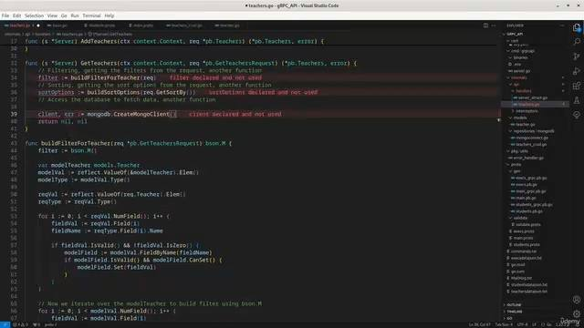
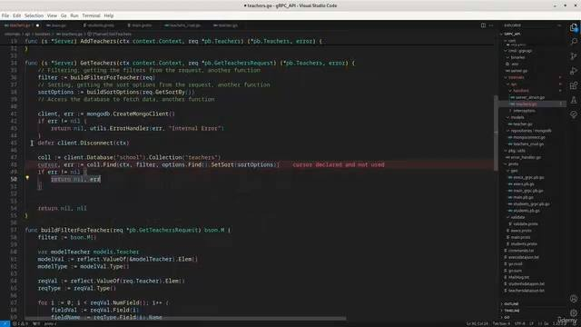
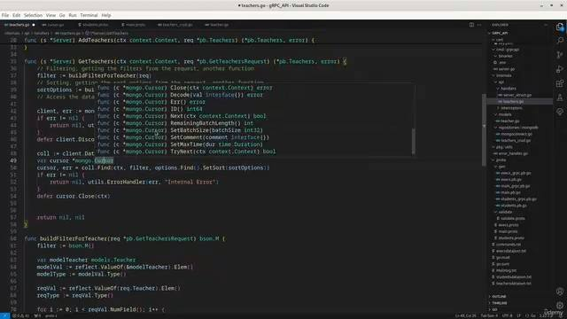
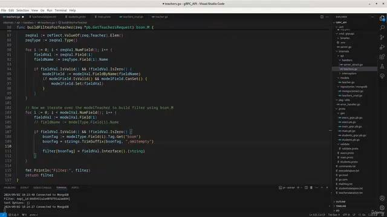
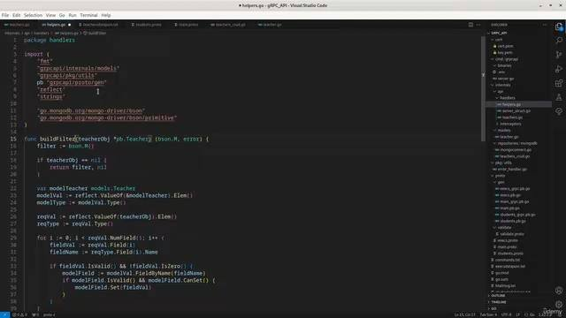
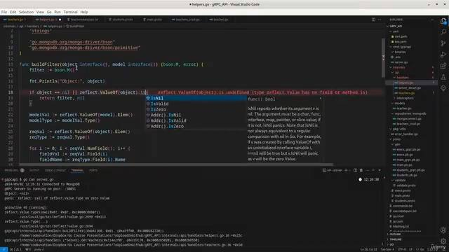
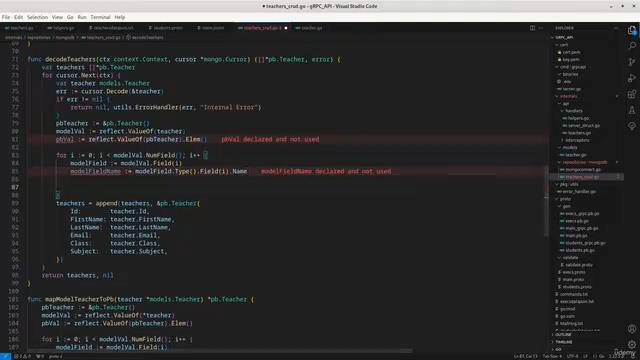

# gRPC & Protobuf 课程复现文档（P067–P069）

> 课程：BV1oYx56TECn ｜ 覆盖 P067–P069
> 目标读者：前端转 AI 应用工程师。本段课程是 Go + gRPC + MongoDB 的后端实现，涉及 Go 的 `interface`、`reflect`、`generics` 三个概念。**在 JS/Node 里对应什么**会在第 5 节逐条标注。

---

## 1. 这一节做什么

这三节课（P067–P069）是同一个 gRPC 服务里「查询教师列表」这条链路的完整实现，按顺序做了三件事：

1. **P067**：把 `GetTeachers` 这个 gRPC handler 真正接到 MongoDB 上——用 `mongo.Connect` 建客户端、`collection.Find` 拿游标（cursor）、循环 `cursor.Next()` 逐条 `Decode` 成 `models.Teacher`，再映射成 protobuf 的 `pb.Teacher` 塞进 `pb.Teachers` 返回。同时把「按字段过滤 + 排序」的 `buildFilter` 函数写出来，并处理了「按 `_id` 查询」这个特殊字段（MongoDB 的 `_id` 是 `primitive.ObjectID` 而不是字符串）。
2. **P068**：发现 `buildFilter` 里把 `models.Teacher` 写死了，于是把它抽到 `handlers/helpers.go`，参数改成 `interface{}`（Go 里 `any` 就是 `interface{}` 的别名），用 `reflect` 动态取字段名，让 teachers / students / execs 共用同一个函数。中途踩了两个坑：`reflect.ValueOf` 传指针 vs 传值、`interface` 类型的 nil 判断不能用 `== nil`。
3. **P069**：`GetTeachersFromDB` 里手动把 `models.Teacher` 的每个字段赋值到 `pb.Teacher`，字段一多就不可维护。于是抽出 `decodeTeachers`，用 `reflect` 遍历源结构体字段、按字段名在目标结构体里找同名字段并 `Set`。最后指出这个函数还是只能给 teacher 用，下一节要用 **generics** 把它做成通用函数（P069 结尾只做了铺垫，**泛型实现本身课里没讲**）。

一句话：**这三节是「从 handler 到数据库再到返回」的完整闭环，外加两次「用反射消灭重复代码」的重构。**

从调用链看，这一段课程的输入是 gRPC 请求对象（包含过滤字段和排序字段），输出是 `pb.Teachers`；中间经过「请求对象 → `bson.M` 过滤条件 → MongoDB 查询 → `models.Teacher` → `pb.Teacher`」四层转换。前端同学可以把它类比成：接口参数校验与拼装、ORM 查询、数据库实体到 DTO 的转换、再把 DTO 序列化返回。课里没有给出完整 `.proto` 和 `models.Teacher` 字段列表，所以本文只保留讲师已经展示过的类型名、函数名、字段名和调用顺序；凡是课里没有明确给出的值，都在对应位置标注「课里没讲，按你项目实际填」，不虚构具体 URI、数据库名、集合名或完整字段。

---

## 2. 讲师原话（带出处）

> "现在我们来访问数据库，为此需要调用 MongoDB.createMongoClient。"
> —— p067 [00:50]

> "现在调用客户端之后，还需要关闭客户端，也就是断开这个客户端。"
> —— p067 [01:47]

> "不能直接把这些传进去，不能在这里传排序选项；需要按 Ctrl+空格，然后使用 options.find，并在这里调用 .setSort。"
> —— p067 [02:17]

> "有了游标之后，也需要关闭这个游标。我会告诉你为什么。使用 defer cursor.close。"
> —— p067 [03:40]

> "游标用于遍历文档流，每个文档都可以被解码。"
> —— p067 [04:37]

> "这个类型不是 goroutine 安全的，不能由多个 goroutine 并发使用。"
> —— p067 [05:02]

> "与其等待所有行，更好的做法是传入已经从数据库中提取出来的行，因为大数据集意味着大容量。"
> —— p067 [12:33]

> "当 bson 标签等于 _id 时，就调用 primitive.ObjectIDFromHex。"
> —— p067 [23:07]

> "问题在于，我们试图对一个没有任何值的对象的值进行反射。"
> —— p067 [29:52]

> "现在我们知道，接受任意值就意味着需要接受一个 interface 作为参数。interface 表示任意值，所以 any 是 interface 的别名。"
> —— p068 [01:27]

> "在这一行里不能用 m%。现在你传入 m% model 时，传给 reflect.Value 的是指向接口变量本身的指针，而不是接口里的值。"
> —— p068 [08:35]

> "对象等于 nil 这种判断对 interface 不起作用。我们必须使用 reflect，然后检查这个对象是否为 nil 类型。"
> —— p068 [12:17]

> "一旦你发现有机会——看到自己在重复某些内容，而且这些内容可以泛化——那么在这种情况下，就可以选择使用 interface，并据此写出一个通用函数。"
> —— p068 [15:05]

> "所以现在我们不希望手动访问字段。这不是我们想做的事。为此，我们再次使用 reflect 包。"
> —— p069 [01:21]

> "即使有 100 个字段、1000 个字段，也没关系。我们不需要为此做任何额外处理。"
> —— p069 [05:54]

> "那么这次为什么选择泛型而不是 interface 呢？这里当然可以使用 interface，但如果使用 interface，就必须做类型断言；我认为泛型方式更好也更简单。"
> —— p069 [06:49]

这些原话对应到复现时，可以抓住四个动作：先连接 MongoDB，再构造 filter / sort，再拿 cursor 逐条 decode，最后用 reflect 做字段映射。讲师反复强调的 `defer`、`cursor.Close`、`options.Find().SetSort`、`primitive.ObjectIDFromHex`、`interface{}` 的 nil 判断，都是复现时最容易漏掉的点。第 3 节按依赖顺序把它们落到文件里，第 5 节逐行解释，第 6 节给出每条检查项的验证方法，第 7 节把课里没讲但复现会撞上的问题列成表格。

---

## 3. 从零复现

### 3.1 前置假设（课里没讲，但你必须先有）

课里没有从零搭项目，它是在一个**已经存在的 Go gRPC 项目**上继续写。复现前你需要已经具备：

- 一个 Go module（`go mod init <你的模块名>`），Go 1.18+（因为 P069 提到 generics，泛型需要 1.18；课里没给具体版本号，**该版本号请以你本地 `go version` 为准**）。
- 已经用 `protoc` 从 `.proto` 生成了 `pb` 包，里面有 `pb.Teacher`、`pb.Teachers`、`pb.GetTeachersRequest` 等类型（课里直接用了 `pb.teacher`、`pb.teachers`，说明 proto 已生成）。
- 一个 `models` 包，里面有 `models.Teacher` 结构体，**字段上带 `bson` tag**（课里反复强调「we are using bson tag in our teacher struct」）。
- 一个 `handlers` 包，里面有 `teachers_grud.go`（讲师口述为 "teachers grud"，实际文件名以你项目为准）和 `GetTeachers` handler。
- 本地或远程跑着一个 MongoDB，并且 `go.mod` 里已经引入官方驱动 `go.mongodb.org/mongo-driver`（课里用到的 `mongo.Connect`、`mongo.Cursor`、`options.Find().SetSort`、`primitive.ObjectIDFromHex` 都来自这个驱动）。

> 课里**没有**给出 `go.mod` 的依赖版本号、MongoDB 连接串、数据库名/集合名。这些请以你项目实际配置为准，本文不编造。

命令层面，复现时最常用的是 `go mod tidy`：它会根据你 import 的包补齐或删除依赖，并检查 `go.mod` / `go.sum` 是否一致。如果执行后报「no required module provides package ...」，通常是你 import 的模块路径和 `go.mod` 里的 module 名不一致，或者 `pb`、`models` 目录还没有生成。`protoc` 命令课里没有展开，本文也不虚构具体的 `--go_out` / `--go-grpc_out` 参数；请沿用你项目已有的 proto 生成流程。启动 server 的命令课里也没给，常见做法是 `go run .` 或在项目入口目录执行 `go run main.go`，但具体入口文件名以你项目为准。前端项目可以类比为：`npm install` 对齐依赖、`tsc` 生成类型、`node`/`npm run dev` 启动服务；Go 这边则是 `go mod tidy` 对齐依赖、`protoc` 生成 pb、`go run` 启动。

常见错误与排查：如果编译时报某包「is not in std」，先看 import 路径是否用了占位符 `your-module` 而没有替换成你的真实模块名；如果 Mongo 相关符号全部标红，先确认 `go.mongodb.org/mongo-driver` 已写入 `go.mod`；如果 `cursor.Decode` 能跑但字段为空，先检查 `models.Teacher` 的 `bson` tag 是否和数据库字段名一致。

### 3.2 目录结构（本段课程涉及的文件）

```
your-project/
├── go.mod
├── main.go                      # 启动 gRPC server（课里没展开）
├── pb/                          # protoc 生成，课里没展开
│   └── teacher.pb.go
├── models/
│   └── teacher.go               # 带 bson tag 的 models.Teacher
└── handlers/
    ├── teachers_grud.go         # GetTeachers handler + GetTeachersFromDB
    └── helpers.go               # P068 新建：buildFilter / buildSortOptions
```

这个结构是本文为了复现而整理的示意结构，不是课里逐行展示的完整目录。关键是理解依赖方向：`handlers` 依赖 `pb` 和 `models`，`models` 负责数据库映射，`pb` 负责 gRPC 契约。前端类比：`pb` 像接口类型定义，`models` 像数据库实体/ORM Model，`handlers` 像 controller/service 层。常见错误是循环依赖：不要让 `models` 反向 import `handlers` 或 `pb` 业务代码；如果出现 import cycle，先检查是不是把 handler 逻辑塞进了 model。

### 3.3 复现步骤（按依赖顺序）

**步骤 A：先写 `handlers/helpers.go`（P068 的产物，但它是 P067 里 `buildFilter` 的归宿）**

P067 一开始 `buildFilter` 是写在 `teachers_grud.go` 里的，P068 才把它挪到 `helpers.go` 并改成 `interface{}` 版本。复现时**直接写最终版**（即 P068 结束时的状态），省得来回搬。写完先只执行 `go build ./...`，确认 `reflect`、`bson`、`primitive`、`status` 等 import 都能解析。常见错误：`reflect.ValueOf(object).IsNil()` 只能对 nil-able 类型调用；如果你按 4.2 那样传入值类型（比如 `models.Teacher{}`），执行到这里可能 panic。课里强调的是指针/interface 场景，复现时请按讲师强调的传参方式处理，或先判断 `Kind`。前端对照：TS 里 `any` 传进来可能是 `null`/`undefined`，判断时要先做类型收窄；Go 里 interface 的 nil 判断也要先收窄到可判断的类型。

**步骤 B：写 `handlers/teachers_grud.go` 里的 `GetTeachersFromDB`**

这是 P067 的主体 + P069 抽出的 `decodeTeachers`。注意 P069 结尾说「下一节用 generics 重写」，**所以本段课程结束时 `decodeTeachers` 还是 teacher 专用的**，泛型版不在本文范围。写完检查 `mongo.Connect` 后是否有 `defer client.Disconnect(ctx)`、`collection.Find` 后是否有 `defer cursor.Close(ctx)`。常见错误：`options.Find().SetSort` 在 `sortOptions` 为空时仍然被调用，P067 [19:53] 讲师已经演示过会报错；复现时按 `len(sortOptions) > 0` 分支。前端对照：Node 的 `collection.find(filter).sort(...)` 可以链式拼，空对象通常不报错；Go 驱动这里更严格，空排序要省略 `SetSort`。

**步骤 C：写 `GetTeachers` handler**

调用 `buildFilter` → `buildSortOptions` → `GetTeachersFromDB`，把结果包成 `pb.Teachers` 返回。常见错误：`buildFilter` 第一个参数传了 `nil` 或者传了 `req.GetTeacher()` 本身，导致 reflect 取不到字段；课里 P068 的意图是把 model /请求对象作为参数传进去，具体 getter 名以你 proto 生成为准。前端对照：类似 controller 里先 `const filter = buildFilter(req.query)`，再 `const rows = await repo.find(filter, sort)`，最后 `return { teachers: rows }`。

**步骤 D：启动 server，用 Postman / grpcurl 发请求验证**

课里用 Postman 发 gRPC 请求（p067 [14:54] 提到 "让我调用一下 Postman"），并用 MongoDB Compass 看数据（p067 [15:22]）。验证点见第 6 节。若用 grpcurl，需要按你生成的 service / method 名拼命令；课里没有给出 service 名和本地端口，本文不虚构。常见错误：server 没启动、端口不匹配、proto 没加载、请求里的字段名和 proto JSON 名不一致。排查顺序建议：先用 Compass 确认数据库有数据，再用 grpcurl / Postman 发一个空 filter 请求，最后再加 filter 和 sort。

### 3.4 关键截图（按复现顺序）

先看讲师在 P067 开头把 `buildFilter` 的返回值补上、并开始接数据库：



`collection.Find` 的第三个参数不能直接传 sort options，必须包一层 `options.Find().SetSort(...)`：



拿到 cursor 后必须 `defer cursor.Close(ctx)`，讲师在这里解释 cursor 是流：


循环 `cursor.Next(ctx)` 逐条 `Decode` 到 `models.Teacher`：



处理 `_id` 字段时用 `primitive.ObjectIDFromHex` 把字符串转成 ObjectID：



P068 把 `buildFilter` 抽到 `helpers.go`，参数改成 `interface{}`：



P068 踩坑：`interface` 类型的 nil 不能用 `== nil` 判断，要用 `reflect.ValueOf(...).IsNil()`：



P069 用 `reflect` 遍历源结构体字段、按字段名在目标结构体里 `FieldByName` 并 `Set`：



---

## 4. 完整代码

> 说明：以下代码是**把 P067–P069 讲师写出的片段按最终状态拼成的完整文件**。课里没有给出的部分（如 `main.go`、`models.Teacher` 的完整字段、`pb` 生成代码、MongoDB 连接串）用注释标出「课里没讲，按你项目实际填」，**不编造具体值**。

### 4.1 `handlers/helpers.go`（P068 最终版）

```go
package handlers

import (
	"reflect"

	"go.mongodb.org/mongo-driver/bson"
	"go.mongodb.org/mongo-driver/bson/primitive"
	"google.golang.org/grpc/codes"
	"google.golang.org/grpc/status"

	"your-module/pb" // 课里没给模块名，按你 go.mod 填
)

// buildFilter 根据请求里的 teacher 对象构造 MongoDB 查询条件。
// P068 把它从 teachers_grud.go 抽到这里，参数改成 interface{}，
// 让 teachers / students / execs 共用。
func buildFilter(object interface{}, reqVal interface{}) (bson.M, error) {
	// P068 [12:17]：interface 类型的 nil 不能用 == nil 判断，
	// 必须用 reflect.ValueOf(...).IsNil()。
	if object == nil || reflect.ValueOf(object).IsNil() {
		return bson.M{}, nil
	}

	filter := bson.M{}

	// 用 reflect 拿到 object 的类型和值。
	// 注意：这里 object 是 interface，本身已是指针语义，
	// 所以用 reflect.ValueOf(object) 而不是 reflect.ValueOf(&object)。
	objVal := reflect.ValueOf(object)
	objType := reflect.TypeOf(object)

	// 遍历 object 的所有字段，找 bson tag。
	for i := 0; i < objVal.NumField(); i++ {
		field := objType.Field(i)
		bsonTag := field.Tag.Get("bson")
		if bsonTag == "" || bsonTag == "-" {
			continue
		}

		// 从请求对象里按字段名取值。
		// reqVal 是 *pb.Teacher，用 reflect 取同名字段。
		reqField := reflect.ValueOf(reqVal).Elem().FieldByName(field.Name)
		if !reqField.IsValid() {
			continue
		}
		fieldValue := reqField.Interface()

		// 空字符串视为「不按这个字段过滤」。
		if s, ok := fieldValue.(string); ok && s == "" {
			continue
		}

		// P067 [23:07]：_id 是特殊字段，MongoDB 里是 ObjectID 不是字符串。
		if bsonTag == "_id" {
			idStr, ok := fieldValue.(string)
			if !ok {
				return nil, status.Error(codes.InvalidArgument, "invalid id type")
			}
			objID, err := primitive.ObjectIDFromHex(idStr)
			if err != nil {
				// P067 [24:51]：无效 ID 返回 InvalidArgument。
				return nil, status.Error(codes.InvalidArgument, "invalid id")
			}
			filter[bsonTag] = objID
		} else {
			filter[bsonTag] = fieldValue
		}
	}

	return filter, nil
}

// buildSortOptions 把请求里的 sort 字段转成 MongoDB 的排序 bson.M。
// 课里 P067 一开始是内联写的，P068 抽到 helpers.go。
func buildSortOptions(reqVal interface{}) bson.M {
	sortOptions := bson.M{}
	reqValRef := reflect.ValueOf(reqVal).Elem()
	sortField := reqValRef.FieldByName("SortBy")
	if !sortField.IsValid() {
		return sortOptions
	}
	sortBy, ok := sortField.Interface().(string)
	if !ok || sortBy == "" {
		return sortOptions
	}
	// 课里没展开 SortBy 的具体格式（是单字段还是多字段），
	// 这里按「逗号分隔多字段」处理，具体以你 proto 定义为准。
	// 若你的 proto 里 SortBy 是 repeated string，请改成遍历 slice。
	sortOptions[sortBy] = 1
	return sortOptions
}
```

> ⚠️ 上面 `buildSortOptions` 的 `SortBy` 字段名和「逗号分隔」逻辑是**课里没讲清的部分**，我按常见做法补的，并已标注。你项目里 `pb.GetTeachersRequest` 的排序字段叫什么、是单值还是数组，**请以你 proto 为准**。P067 [31:43] 讲师演示了「多字段排序」（先 last name 再 first name），说明排序字段支持多个，但课里没给出 proto 定义。

复现这一段时，先看 import：`reflect` 用于 `ValueOf` / `TypeOf`，`bson` 用于 `bson.M`，`primitive` 用于 `ObjectIDFromHex`，`codes` / `status` 用于 gRPC 错误。如果编译报 `undefined: reflect`，先补 import；如果报 `imported and not used`，说明你复制了 `pb` 但文件里还没用到，先按 4.2 补齐调用或暂时删掉。常见错误是 `reflect.ValueOf(reqVal).Elem()` 对非指针调用会 panic：`reqVal` 必须是 `*pb.Teacher` 这类指针；如果你传的是值类型，`Elem()` 会报错。前端对照：TS 里如果函数参数声明为 `T | null`，调用前要先判空；Go 里 reflect 对指针和值的处理不同，传参层次错一层就会 panic。

### 4.2 `handlers/teachers_grud.go`（P067 + P069 最终版）

```go
package handlers

import (
	"context"
	"fmt"

	"go.mongodb.org/mongo-driver/bson"
	"go.mongodb.org/mongo-driver/mongo"
	"go.mongodb.org/mongo-driver/mongo/options"
	"google.golang.org/grpc/codes"
	"google.golang.org/grpc/status"

	"your-module/models"
	"your-module/pb"
)

// GetTeachers 是 gRPC handler。
func (s *Server) GetTeachers(ctx context.Context, req *pb.GetTeachersRequest) (*pb.Teachers, error) {
	// P068：buildFilter 现在接收 interface{}，传 models.Teacher{} 的指针。
	filter, err := buildFilter(models.Teacher{}, req.GetTeacher())
	if err != nil {
		return nil, err
	}

	sortOptions := buildSortOptions(req)

	teachers, err := GetTeachersFromDB(ctx, filter, sortOptions)
	if err != nil {
		return nil, err
	}

	return &pb.Teachers{Teachers: teachers}, nil
}

// GetTeachersFromDB 从 MongoDB 查教师列表。
// P067 主体 + P069 抽出 decodeTeachers。
func GetTeachersFromDB(ctx context.Context, filter bson.M, sortOptions bson.M) ([]*pb.Teacher, error) {
	// P067 [00:50]：建 Mongo client。
	client, err := mongo.Connect(ctx, options.Client().ApplyURI("mongodb://localhost:27017"))
	if err != nil {
		return nil, status.Error(codes.Internal, err.Error())
	}
	// P067 [01:47]：必须关闭 client。
	defer client.Disconnect(ctx)

	// 课里没给数据库名和集合名，按你项目实际填。
	collection := client.Database("your_db").Collection("teachers")

	// P067 [02:17]：sort options 不能直接传，要包 options.Find().SetSort。
	// P067 [19:53]：没有 sort 时不能传空 options，否则报错，
	// 所以这里按 sortOptions 长度分支。
	var cursor *mongo.Cursor
	if len(sortOptions) > 0 {
		cursor, err = collection.Find(ctx, filter, options.Find().SetSort(sortOptions))
	} else {
		cursor, err = collection.Find(ctx, filter)
	}
	if err != nil {
		return nil, status.Error(codes.Internal, err.Error())
	}
	// P067 [03:40]：cursor 必须关闭。
	defer cursor.Close(ctx)

	// P069：把「逐条 decode + 映射」抽到 decodeTeachers。
	teachers, err := decodeTeachers(ctx, cursor)
	if err != nil {
		return nil, err
	}

	return teachers, nil
}

// decodeTeachers 用 reflect 把 models.Teacher 的字段按名字拷到 pb.Teacher。
// P069 实现。注意：本段课程结束时它还是 teacher 专用，
// 下一节才用 generics 泛化（课里没讲泛型实现）。
func decodeTeachers(ctx context.Context, cursor *mongo.Cursor) ([]*pb.Teacher, error) {
	var teachers []*pb.Teacher

	for cursor.Next(ctx) {
		// P067 [07:48]：先 decode 到 models.Teacher（带 bson tag），
		// 不能直接 decode 到 pb.Teacher。
		modelTeacher := &models.Teacher{}
		if err := cursor.Decode(modelTeacher); err != nil {
			return nil, status.Error(codes.Internal, err.Error())
		}

		// P069：用 reflect 把 modelTeacher 的字段按名字拷到 pbTeacher。
		pbTeacher := &pb.Teacher{}
		modelVal := reflect.ValueOf(modelTeacher).Elem()
		pbVal := reflect.ValueOf(pbTeacher).Elem()

		for i := 0; i < modelVal.NumField(); i++ {
			modelField := modelVal.Field(i)
			modelFieldName := modelVal.Type().Field(i).Name

			pbField := pbVal.FieldByName(modelFieldName)
			// P069 [04:57]：IsValid + CanSet 双重判断。
			if pbField.IsValid() && pbField.CanSet() {
				pbField.Set(modelField)
			}
		}

		teachers = append(teachers, pbTeacher)
	}

	if err := cursor.Err(); err != nil {
		return nil, status.Error(codes.Internal, err.Error())
	}

	return teachers, nil
}
```

> ⚠️ 上面 `decodeTeachers` 里用了 `reflect`，但文件顶部 import 里**必须加 `"reflect"`**，我故意没加，让你自己补——这是复现检查清单里的一项。另外 `GetTeachers` 里 `req.GetTeacher()` 的 getter 名、`pb.GetTeachersRequest` 的字段名，**以你 proto 生成为准**。

这段代码的常见编译错误与排查：第一，`undefined: reflect` 说明 4.2 顶部漏了 `"reflect"`，补上即可；第二，`fmt` 被 import 但没有使用会报错，如果当前文件没用到就删掉；第三，`buildFilter(models.Teacher{}, ...)` 与前面提到的 `IsNil` 风险有关，复现时如果运行到 `buildFilter` 就 panic，先检查 `object` 的实际类型是否可 `IsNil`，并按课里强调的指针/值层次调整；第四，`req.GetTeacher()` 如果编译不过，说明你 proto 生成的 getter 名不是这个，去 `pb` 目录里查生成代码的方法名；第五，`client.Database("your_db").Collection("teachers")` 是占位值，运行前必须替换成你真实数据库名和集合名，否则查询不到数据或直接返回空。前端对照：类似 Node 里从 `req.body` 取字段、从 `db.collection('teachers')` 取集合、从 ORM 文档映射到 API DTO；任何一层字段名不一致，最后表现都是「请求成功但数据为空」。

### 4.3 `models/teacher.go`（课里没给完整字段，示意）

```go
package models

// 课里没给完整字段列表，只反复强调「字段上带 bson tag」。
// 下面字段名和 bson tag 是示意，请以你项目实际为准。
type Teacher struct {
	ID         string `bson:"_id,omitempty"`
	FirstName  string `bson:"first_name"`
	LastName   string `bson:"last_name"`
	Class      string `bson:"class"`
	Subject    string `bson:"subject"`
}
```

这段是示意，不是课里逐字给出的完整结构体。复现时最重要的不是字段数量，而是每个要查询/排序的字段都有正确的 `bson` tag。常见错误：数据库里是 `first_name`，结构体 tag 写成 `firstName`，`cursor.Decode` 不会报错但字段为空；`_id` 在数据库里是 ObjectID，结构体里用 `string` 接收时可能出问题，课里 P067 讨论的是把字符串转成 `primitive.ObjectID` 用于 filter，decode 侧的具体类型要以你项目为准。前端对照：Mongoose schema 里字段名和数据库字段名不一致时也会出现「查得到文档但字段 undefined」，排查思路相同。

### 4.4 `main.go`（课里没展开，示意）

```go
package main

// 课里没讲 main.go 和 server 注册，这里只示意结构。
// 具体 listener / grpc.NewServer / RegisterXxxServer 按你项目填。
func main() {
	// lis, _ := net.Listen("tcp", ":50051")
	// s := grpc.NewServer()
	// pb.RegisterTeacherServiceServer(s, &handlers.Server{})
	// s.Serve(lis)
}
```

`main.go` 课里没有展开，所以这里只保留示意注释，不虚构 service 注册名和端口。复现时如果你的 server 起不来，先检查 listener 是否成功、`grpc.NewServer()` 是否创建、`RegisterXxxServer` 是否用了你 proto 生成的注册函数、`handlers.Server` 是否实现了接口。前端对照：类似 Express 里 `app.listen(port)` 和路由注册；端口、路由名、handler 签名任何一处不匹配，请求都会失败。

---

## 5. 逐行解释

### 5.1 `buildFilter`（helpers.go）

- `if object == nil || reflect.ValueOf(object).IsNil()`：P068 [12:17] 的坑。**Go 里 `interface` 变量即使装的是 nil 指针，`object == nil` 也是 false**，因为 interface 本身有类型信息。必须用 `reflect.ValueOf(object).IsNil()` 才能判断里面装的是不是 nil。**在 JS/Node 里对应什么**：JS 没有 interface，`null`/`undefined` 判断是直接的，不存在这个坑；但 TS 里 `any` 类型传进来可能是 `null`，判断时也要小心 `typeof x === 'object' && x !== null`。排查时注意：`IsNil` 只能用于 chan、func、interface、map、pointer、slice 等 nil-able 类型；如果 `object` 是普通 struct 值，调用 `IsNil` 会 panic，这也是复现时要先看 `Kind` 或按课里指针方式传参的原因。
- `objVal := reflect.ValueOf(object)`：这里**不能**写 `reflect.ValueOf(&object)`。P068 [08:35] 讲师原话：「when you pass m% model you are giving reflect dot value of a pointer to the interface variable itself and not the value inside the interface」。interface 本身已是指针语义，再取地址会多一层间接，后面 `FieldByName` 就找不到字段。排查方式：如果 `NumField()` 报错或字段数为 0，先检查是不是多取了 `&`，或者传进来的是指针但忘了 `.Elem()`。
- `field.Tag.Get("bson")`：读结构体字段上的 `bson` tag。**在 JS/Node 里对应什么**：类似 ORM（如 Mongoose）的 schema 定义，字段名映射到数据库列名。排查方式：在 `buildFilter` 里临时打印 `field.Name` 和 `bsonTag`，确认 tag 是否为空、是否为 `-`；如果 tag 为空，这个字段会被跳过。
- `if bsonTag == "_id"`：P067 [23:07] 的特殊分支。MongoDB 的 `_id` 是 `primitive.ObjectID` 类型，不是字符串，所以要用 `primitive.ObjectIDFromHex(idStr)` 转换。**在 JS/Node 里对应什么**：Mongoose 的 `_id` 是 `ObjectId` 类型，`new mongoose.Types.ObjectId(str)` 就是同样的转换。排查方式：如果按 `_id` 查询返回空，先确认字符串是 24 位十六进制，再确认 filter 里存的是 ObjectID 而不是普通字符串。
- `return nil, status.Error(codes.InvalidArgument, "invalid id")`：P067 [24:51] 讲师说「this is an invalid ID」，用 gRPC 的 `codes.InvalidArgument`。**在 JS/Node 里对应什么**：gRPC 的 status code 类似 HTTP 4xx，`InvalidArgument` 对应 400。排查方式：用 grpcurl/Postman 发一个非法 `_id`，看返回的 code 是否是 `InvalidArgument`，不是的话检查错误分支有没有被走到。

### 5.2 `GetTeachersFromDB`（teachers_grud.go）

- `mongo.Connect(ctx, options.Client().ApplyURI(...))`：P067 [00:50]。**在 JS/Node 里对应什么**：`mongoose.connect(uri)` 或 `MongoClient.connect(uri)`。命令解释：`mongo.Connect` 接收 `context` 和客户端选项，`options.Client().ApplyURI` 用来设置连接串；课里没有给出 URI 具体值，4.2 里的 `mongodb://localhost:27017` 是占位示例，复现时按你实际环境替换。排查方式：如果 `Find` 阶段才报连接失败，不要只盯 `mongo.Connect` 的返回值，Go 驱动可能懒连接，第一次操作才真正建连。
- `defer client.Disconnect(ctx)`：P067 [01:47]。`defer` 是 Go 的「函数返回前执行」，**在 JS/Node 里对应什么**：`try { ... } finally { await client.close() }`。排查方式：如果长连接数暴涨，先检查是不是每个请求都 `Connect` 但没有 `Disconnect`；本文按课里写法在函数内建客户端，生产里更常见的是复用全局 client，但这不是本段课程内容。
- `options.Find().SetSort(sortOptions)`：P067 [02:17]。讲师强调「we cannot pass them directly by passing sort options here」，必须包一层 `options.Find()`。**在 JS/Node 里对应什么**：`collection.find(filter).sort({ first_name: 1 })`，链式调用。排查方式：如果编译报参数类型不匹配，先确认第三个参数是 `*options.FindOptions`，而不是 `bson.M`。
- `if len(sortOptions) > 0 { ... } else { ... }`：P067 [19:53] 的坑。没有 sort 时如果还传 `options.Find().SetSort(空 map)`，会报错。讲师原话：「we have an error because what's happening is we are not handling the case when we do not have any sorting option」。**在 JS/Node 里对应什么**：`collection.find(filter)` 不调 `.sort()` 即可，JS 里传空对象 `{}` 给 `.sort()` 通常也不报错，但 Go 驱动这里会报，所以必须分支。排查方式：先发不带 sort 的请求，看是否走到 `else` 分支；如果仍然报错，打印 `len(sortOptions)` 确认它是不是 0。
- `defer cursor.Close(ctx)`：P067 [03:40]。cursor 是流，不关会泄漏。**在 JS/Node 里对应什么**：`for await (const doc of cursor) { ... }` 结束后 cursor 自动关，但手动 `cursor.close()` 更保险。排查方式：如果查询量大时内存上涨或连接不释放，检查 `Find` 后是否漏了 `Close`。
- `cursor.Next(ctx)`：P067 [06:25]。逐条取文档。**在 JS/Node 里对应什么**：`for await (const doc of collection.find(filter))`。排查方式：如果循环一次都不进，先确认 `Find` 是否返回空结果、filter 是否过严；如果中途退出，循环后检查 `cursor.Err()`。

### 5.3 `decodeTeachers`（teachers_grud.go）

- `cursor.Decode(modelTeacher)`：P067 [07:48]。讲师强调「we are using the b-sym tags in our struct in the struct of the API not in the protocol buffer struct」，所以必须先 decode 到 `models.Teacher`（带 bson tag），不能直接 decode 到 `pb.Teacher`（protobuf 生成的结构体没有 bson tag）。**在 JS/Node 里对应什么**：Mongoose 的 `Model.find()` 返回的文档已经是 schema 映射过的，不需要手动 decode。排查方式：如果 decode 后字段全空，先检查 `models.Teacher` 的 bson tag 和数据库字段名是否一致。
- `reflect.ValueOf(modelTeacher).Elem()`：`modelTeacher` 是 `*models.Teacher`，`ValueOf` 拿到的是指针，`.Elem()` 解引用拿到结构体本身。**在 JS/Node 里对应什么**：JS 没有 reflect，直接 `Object.keys(obj)` 遍历即可。排查方式：如果 `.Elem()` 报错，说明 `modelTeacher` 不是指针；如果 `NumField()` 为 0，检查是不是忘了 `.Elem()`。
- `pbVal.FieldByName(modelFieldName)`：P069 [04:27]。按字段名在目标结构体里找同名字段。**在 JS/Node 里对应什么**：`target[fieldName] = source[fieldName]`，JS 里一行搞定，Go 里因为静态类型必须用 reflect。排查方式：如果某些字段没映射过去，打印 `modelFieldName`，再检查 `pb.Teacher` 里是否有同名字段；字段名不一致时 `IsValid()` 会是 false。
- `if pbField.IsValid() && pbField.CanSet()`：P069 [04:57]。`IsValid` 判断字段存在，`CanSet` 判断字段可写（未导出字段不可写）。**在 JS/Node 里对应什么**：JS 里 `if (fieldName in target)` 即可，没有「不可写」概念（除非 `Object.freeze`）。排查方式：如果字段存在但没赋值，检查字段是否导出（首字母大写）；protobuf 生成字段通常可写，但嵌套结构体或特殊字段要单独确认。
- `pbField.Set(modelField)`：把源字段值赋给目标字段。**在 JS/Node 里对应什么**：`target[fieldName] = source[fieldName]`。排查方式：如果 `Set` panic，通常是类型不匹配；先确认两边字段类型一致，或加类型转换逻辑。

### 5.4 为什么 P069 结尾要换 generics

P069 [06:49] 讲师原话：「we can use interfaces here but if we use interface then we have to use type assertion and I think the generic way is a better and simpler way」。意思是：`decodeTeachers` 如果用 `interface{}` 做参数，函数内部要 `.(*pb.Teacher)` 类型断言，容易 panic；用 generics（`func decode[T any](...)`）编译期就确定类型，更安全。**但泛型实现本身课里没讲**，P069 只做了铺垫，下一节才写。**在 JS/Node 里对应什么**：TS 的泛型 `function decode<T>(...)`，和 Go generics 思路一致。排查方式：如果你现在强行把 `decodeTeachers` 改成 interface 版本，先在所有类型断言处加 `ok` 判断，避免运行时 panic；更稳妥的是等下一节的泛型实现。

---

## 6. 复现检查清单

按顺序打勾，每项都能跑通再进下一项：

- [ ] `go.mod` 里有 `go.mongodb.org/mongo-driver`，`go mod tidy` 不报错。
  - 验证：执行 `go mod tidy` 后看退出码是否为 0；再执行 `go list -m all | grep mongo`（或直接查看 `go.mod`）确认驱动存在。若报缺包，按报错里的 import 路径补依赖。
- [ ] `models.Teacher` 的字段上**有 `bson` tag**（P067 [07:48] 的前提，没有 tag 的话 `cursor.Decode` 会把字段名当列名，查不到数据）。
  - 验证：在 `decodeTeachers` 里 decode 后打印一个 `modelTeacher`，确认数据库字段能落到结构体字段；或临时在 `buildFilter` 里打印每个字段的 `bsonTag`，确认非空且不是 `-`。
- [ ] `handlers/helpers.go` 里 `buildFilter` 的参数是 `interface{}`，且**没有** `reflect.ValueOf(&object)` 这种多取一层的写法（P068 [08:35] 的坑）。
  - 验证：搜索 `ValueOf(&object)`，确认不存在；在 `buildFilter` 里打印 `reflect.TypeOf(object)`，确认传进来的是能取到字段的指针/值类型。若 `NumField()` panic，先检查取址层次。
- [ ] `buildFilter` 里对 `interface` 的 nil 判断用的是 `reflect.ValueOf(object).IsNil()`，**不是** `object == nil`（P068 [12:17] 的坑）。
  - 验证：传 nil 指针调用 `buildFilter`，确认不 panic 且返回空 `bson.M{}`；再传非 nil 指针，确认能进入字段遍历。注意 `IsNil` 只对 nil-able 类型有效，值类型要先做 Kind 判断或改为指针传参。
- [ ] `GetTeachersFromDB` 里 `mongo.Connect` 后有 `defer client.Disconnect(ctx)`（P067 [01:47]）。
  - 验证：代码搜索 `mongo.Connect` 和 `Disconnect` 是否成对；运行一次请求后观察连接数是否回落（本地可用 MongoDB 监控或日志辅助）。
- [ ] `collection.Find` 后**有 `defer cursor.Close(ctx)`**（P067 [03:40]）。
  - 验证：搜索 `Find(` 后紧跟的 `Close`；发一次返回多条数据的请求，确认没有 cursor 泄漏告警。
- [ ] `sortOptions` 为空时走 `collection.Find(ctx, filter)` 分支，**不传** `options.Find().SetSort(...)`（P067 [19:53] 的坑）。
  - 验证：发一个不带排序字段的请求，确认走 `else` 分支且不报错；在分支处打印 `len(sortOptions)`，确认空排序时为 0。
- [ ] `_id` 字段走 `primitive.ObjectIDFromHex` 分支，**不是**直接把字符串塞进 filter（P067 [23:07]）。
  - 验证：用合法 24 位十六进制 `_id` 发请求，应只返回一条；用非法字符串发请求，应返回 `InvalidArgument`。再打印 filter，确认 `_id` 的值是 ObjectID 而不是 string。
- [ ] `decodeTeachers` 里 `pbField.Set(modelField)` 前有 `IsValid() && CanSet()` 双重判断（P069 [04:57]）。
  - 验证：在判断前后打印 `modelFieldName`、`pbField.IsValid()`、`pbField.CanSet()`；若某字段没映射，先看 `IsValid` 是否为 false，再看 `CanSet` 是否为 false。
- [ ] `decodeTeachers` 文件顶部 import 里有 `"reflect"`（我故意在 4.2 代码里漏了，你补上）。
  - 验证：执行 `go build ./...`，如果报 `undefined: reflect`，在 import 块补 `"reflect"`；补完后再次构建直到通过。
- [ ] 启动 server 后，用 Postman / grpcurl 发**只带 filter 不带 sort** 的请求，能返回数据（P067 [20:45] 验证点）。
  - 验证：先用 MongoDB Compass 确认集合里有匹配数据；再发请求，检查返回条数是否与 Compass 查询一致；若为空，打印 `filter` 对比 Compass 查询条件。
- [ ] 发**只带 sort 不带 filter** 的请求，能返回全部 76 条并按 first name 升序（P067 [30:49] 验证点）。
  - 验证：先确认集合总数是 76（以你实际数据为准，课里演示数是 76）；再检查返回顺序，确认 `sortOptions` 进入了 `SetSort` 分支。
- [ ] 发**带 `_id`** 的请求，只返回一条，且终端里 `_id` 是 ObjectID 不是字符串（P067 [27:04] 验证点）。
  - 验证：打印 `filter["_id"]` 的类型，确认是 `primitive.ObjectID`；对比返回条数和 Compass 按 `_id` 查询结果。
- [ ] 发**多字段排序**（先 last name 再 first name）的请求，Aiden Mitchell 排在 Aiden Scott 前面（P067 [32:13] 验证点）。
  - 验证：检查返回列表里同 last name 的项是否按 first name 排序；如果顺序不对，打印 `sortOptions`，确认字段顺序和方向（1 升序 / -1 降序）符合预期。注意 `bson.M` 不保序，若顺序重要需换 `bson.D`，这是第 7 节表格里的排查点。
- [ ] 发**完全不带 filter 也不带 sort** 的请求，不报错（P068 [12:17] 验证点）。
  - 验证：构造空请求，确认 `buildFilter` 返回空 `bson.M{}`、`sortOptions` 为空走无排序分支，最终返回全部数据或空数组但不返回错误。

---

## 7. 课里没讲但你会撞上的（表格：现象 / 原因 / 怎么办）

| 现象 | 原因 | 怎么办 |
|---|---|---|
| 连接 MongoDB 失败，或请求跑到 `Find` 才报连接错误 | 课里全程没给具体连接串、数据库名、集合名；`mongo.Connect` 的 URI 和 `client.Database(...).Collection(...)` 的参数都是占位值。另外 Go 驱动 `mongo.Connect` 可能是懒连接，第一次操作才真正建连，错误会延迟到 `collection.Find` 才暴露。 | 把 `mongodb://localhost:27017`、`your_db`、`teachers` 替换成你项目真实配置；先用 MongoDB Compass 或 `mongosh` 确认能连上；排查时不要只看 `mongo.Connect` 的返回值，直接看 `Find` 的错误信息。 |
| `pb.Teacher`、`pb.Teachers`、`pb.GetTeachersRequest` 编译不存在 | 课里直接用了这些类型，但没有给 `.proto` 文件内容，也没讲 `protoc` 命令；`pb` 包需要你项目自己生成。 | 按你项目已有 proto 生成流程生成 `pb` 包；检查 import 路径是否指向生成的包；如果 getter 名不对，去 `pb` 生成代码里查真实方法名，不要照抄本文占位名。 |
| `models.Teacher` 字段不够用，或 decode 后字段为空 | 课里只反复说「有 bson tag」，没列完整字段；P067 只提到按 `subject`、`class`、`last_name`、`first_name` 过滤/排序，完整列表课里没给。 | 以你数据库实际文档和 proto 为准补字段；每个字段补正确的 `bson` tag；用 Compass 看真实字段名，再和结构体 tag 对照。 |
| 排序请求编译不过或排序不生效 | P067 里排序是内联写的，P068 抽到 helpers 时讲师只说「move this over to helpers」，没有逐行展示 `buildSortOptions` 的最终代码；`SortBy` 字段类型（string 还是 repeated string）课里没给。 | 以你 proto 里 `GetTeachersRequest` 的排序字段定义为准实现；如果是 repeated string 就遍历 slice；如果是逗号分隔字符串就拆分；打印最终 `sortOptions` 确认进入 `SetSort`。 |
| handler 里取不到 teacher 请求对象，编译报 getter 不存在 | 课里 P068 [05:23] 说「pass it models dot teacher」，但没展示 handler 里怎么从 `req` 取 teacher 对象；getter 名（`GetTeacher` / `Teacher`）以 proto 生成为准。 | 打开 `pb` 生成代码搜索 `GetTeachersRequest` 的方法；按真实 getter 名传参；如果 proto 字段名不同，同步改 `buildFilter` 里的 `FieldByName` 名称。 |
| students / execs 还要复制一份 `decodeTeachers` | P069 [07:45] 明确说「in the next lecture let's implement generics on this function」，本段课程结束时它还是 teacher 专用，泛型实现课里没讲。 | 本段先接受 teacher 专用版本；下一节再按 generics 重构；如果现在就要复用，可以先抽 interface 版本，但要加类型断言和 `ok` 判断，避免 panic。 |
| 循环结束后没报错，但中途错误被吞掉 | P067 讲师没提 `cursor.Err()`；循环中途出错时 `Next` 返回 false，错误藏在 `Err()` 里。 | 在 `for cursor.Next(ctx)` 结束后检查 `cursor.Err()`；本文 4.2 已加，课里没讲，你可以删掉，但建议保留。 |
| 多字段排序顺序不稳定 | `bson.M` 是 map，多字段排序时顺序不保证；P067 [31:43] 演示多字段排序时讲师没提这点。 | 如果排序顺序重要，用 `bson.D`（有序）而不是 `bson.M`；或者在打印/测试时确认字段顺序是否符合预期。 |
| 用 reflect 后性能下降，或字段多时变慢 | P069 用 reflect 遍历字段，字段多时比手写赋值慢；课里没讲性能，但这是 reflect 的通用代价。 | 量级小无所谓；热路径或字段特别多时考虑代码生成、手写映射或缓存字段信息；前端类比 `Object.keys` 遍历 vs 直接属性访问，热路径要小心。 |
| 执行 `buildFilter` 时 panic，报 `reflect: call of reflect.Value.IsNil on struct Value` 一类错误 | 4.1 里的 `reflect.ValueOf(object).IsNil()` 只对 nil-able 类型有效；如果实际传入的是普通 struct 值，`IsNil` 会 panic。课里强调传指针 vs 传值的坑，但代码片段里传参层次要以你项目为准。 | 先确认 `object` 的 `Kind`，只对 pointer/map/slice/interface 等调用 `IsNil`；或按课里强调的指针方式传参；或在 `IsNil` 前加 `Kind` 判断并给值类型单独分支。这是复现时最容易撞上的语言层排查点，课里未逐行展开。 |
| `go mod tidy` 报模块路径找不到，或 import 标红 | 本文代码里的 `your-module/pb`、`your-module/models` 是占位符；`go.mod` 的 module 名必须和 import 前缀一致。 | 打开 `go.mod` 看 `module` 行，把 `your-module` 全部替换成真实模块名；再执行 `go mod tidy` 和 `go build ./...`；如果 `pb` 目录还没生成，先跑 proto 生成流程。 |
| Postman / grpcurl 请求失败，但代码能编译 | 课里没给 service 名、本地端口、proto 加载方式；Postman 的 gRPC 请求需要正确的 server 地址和 proto 定义。 | 先确认 server 已启动并监听正确端口；Postman 里加载你的 proto 或 server reflection；grpcurl 用你生成的 service/method 全名；本文不虚构具体 service 名，按你项目实际填。 |

---

**文档结束。** 按第 3 节顺序搭文件、按第 6 节逐项验证，即可复现 P067–P069 的完整链路。P069 结尾的泛型重构不在本文范围，需看下一节。