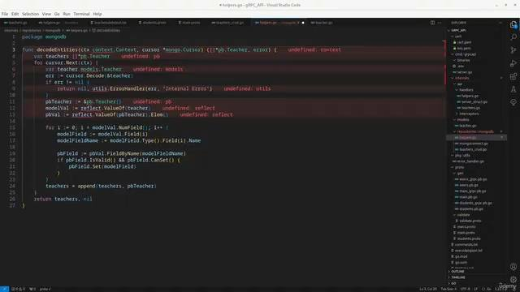
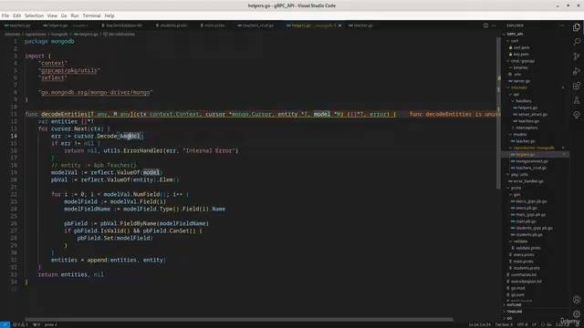
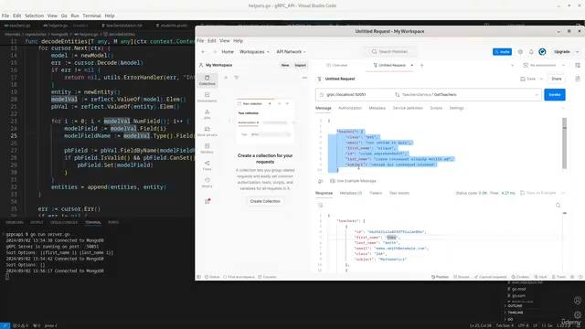
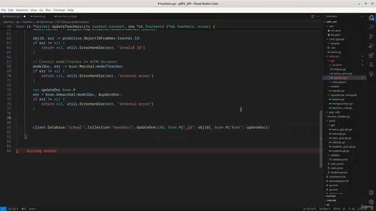
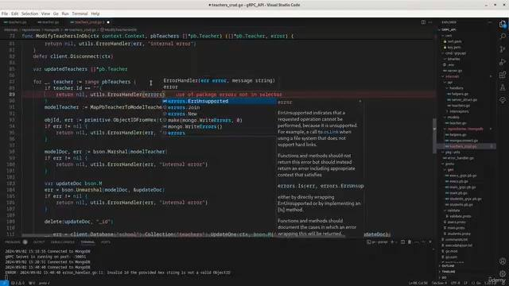
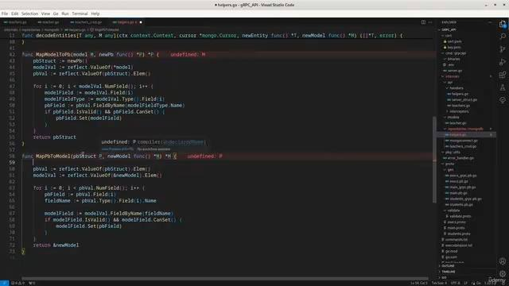

# gRPC & Protobuf 项目实战：泛型化数据访问层（P070–P072）

> 课程：BV1oYx56TECn ｜ 覆盖 P070–P072
> 读者定位：前端转 AI 应用工程师。本文所有 Go 代码可直接保存运行；涉及指针/类型断言处会补一句「在 JS/Node 里对应什么」。

---

## 1. 这一节做什么

这三节课是同一个 Go + gRPC + MongoDB 项目里的**重构环节**，目标只有一个：**把「从数据库读出来 → 转成 protobuf 结构体」和「protobuf 结构体 → 数据库模型」这两类重复代码，用 Go 泛型（Generics）抽成通用函数**，从而让 teacher / student / exec 三种实体共用同一套逻辑，不再复制粘贴。

具体拆成三块：

1. **P070**：把原来写死的 `decodeTeachers`（把 Mongo 游标里的文档解码成 `pb.Teacher` 切片）改造成泛型函数 `decodeEntities[T, M]`，并解决「循环里复用同一个结构体实例导致字段串数据」的坑。
2. **P071**：实现 `UpdateTeachers` RPC —— 接收一批 teacher，逐个 `$set` 更新到 MongoDB，并处理「ID 为空」的边界情况。
3. **P072**：把 `mapModelTeacherToPB` / `mapPBTeacherToModel` 也泛型化成 `mapModelToPB` / `mapPBToModel`，再用「薄封装」的方式为 teacher/student/exec 各生成一个具体版本。

学完你能得到：一个**可复用的泛型数据访问层**，新增实体时只写两行封装，不写重复逻辑。阅读时建议把这三节看成一次连续重构：P070 解决「读出来怎么解码」，P071 解决「改回去怎么更新」，P072 解决「模型与 protobuf 之间怎么映射」。三节共用同一套实体命名和同一批 handler，所以不要把它们拆成三个互不相关的小项目；复现时应当按依赖顺序先定义模型，再写泛型解码，再写更新 RPC，最后把映射函数收敛成泛型加薄封装。对前端读者来说，可以把这套重构理解成：以前每个实体都手写一遍 `parseTeacher`、`parseStudent`，现在抽出一个 `parseEntity<T>`，再用少量适配器把类型固定下来。区别在于 Go 的泛型是编译期类型参数，不是运行时 `any`，因此调用处不需要像 TypeScript 那样到处写类型断言，也不会出现「运行时才发现字段对不上」的类型恐慌，但字段拷贝本身仍然要落地，泛型并不能自动知道两个结构体之间哪些字段该对应。

---

## 2. 讲师原话（带出处）

> "现在，如果要把这段逻辑抽成一个泛型函数，就需要从这里把它提取出来……我会在这个文件夹里创建一个 helpers.go。函数名不再用 decodeTeachers，而改成 decodeEntities，这样更通用。"
> —— p070 [00:00]

> "泛型是一种编程概念，它允许你编写能够操作不同类型、同时又不牺牲类型安全的函数、数据结构和类型……在 Go 中，泛型是在 1.18 版本引入的。"
> —— p070 [00:29]

> "当我们遍历，并把数据库游标中的值插入 model 时，实际上是在覆盖已有的实例……这可能导致数据被合并。"
> —— p070 [07:00]

> "为了解决这个问题，我要把这个模型类型改造成一个函数，一个返回 `*M` 类型值的函数。"
> —— p070 [07:57]

> "借助 `.Elem`，我们必须解引用指针才能访问底层的结构体。之前，我们可以通过 `reflect.ValueOf` 并把 teacher 变量传给它来访问底层结构体。但这次因为值是从函数传过来的，是以指针形式传递，所以需要用 `.Elem` 来解引用指针。"
> —— p070 [16:53]

> "返回值的类型取决于其中一个参数。如果是这种情况，最好使用泛型。因为在这种情况下如果使用接口，就不得不做类型断言。"
> —— p070 [21:07]

> "现在开始实现 Update Teacher's RPC。"
> —— p071 [00:00]

> "我们更新的只是这些字段。我们从不更新文档的 ID，对吧？所以现在我们实际上还试图更新 ID……需要从 updateDoc 中删掉 ID 字段。"
> —— p071 [09:42]

> "我不希望这类请求被传到这个函数。为此，需要检查 teacher ID 是否为空；如果为空，就向客户端返回错误。"
> —— p071 [19:14]

> "与其那样做，现在我们已经知道可以使用一个通用函数，也就是可供任意类型使用的泛型函数。"
> —— p072 [00:28]

> "我们可以为泛型函数中用到的某个类型指定具体的数据类型。它不一定非得是 `any`，也可以是你想使用的任意数据类型。"
> —— p072 [08:50]

> "除非会被其他包使用，否则任何函数和属性最好都保持私有。"
> —— p072 [15:25]

上面这些原话是本文扩写的边界：所有解释都围绕这些点展开，不额外引入课里没有宣称过的结论。尤其要注意三句判据：第一，泛型是为了「不同实体共用逻辑且不牺牲类型安全」；第二，循环里必须新建实例，否则会串数据；第三，返回类型依赖参数类型时优先泛型，否则用 `interface{}` 再断言会更啰嗦。复现时如果发现某段代码能跑但解释不通，建议回到这三句原话对照：看它是在解决类型复用、实例复用，还是返回类型依赖问题。

---

## 3. 从零复现

### 3.1 环境与依赖

课里没有逐字给出 `go.mod`，但根据代码里出现的包，你需要以下依赖（版本号课里没讲，用 `go get` 拉最新即可）：

```bash
# 在项目根目录
go mod init grpc-mongo-api   # 模块名课里没讲，可自定
go get go.mongodb.org/mongo-driver/mongo
go get go.mongodb.org/mongo-driver/bson
go get go.mongodb.org/mongo-driver/bson/primitive
go get google.golang.org/grpc
go get google.golang.org/protobuf
```

> Go 版本必须 **≥ 1.18**（泛型从 1.18 引入，讲师在 p070 [00:56] 明确说过）。

这几条命令的作用要拆开看：`go mod init` 负责生成模块描述文件，模块名会出现在 import 路径里，所以如果你的模块名不是 `grpc-mongo-api`，代码里的 `grpc-mongo-api/models`、`grpc-mongo-api/pb` 等 import 也要同步改。`go get` 分别是 Mongo 驱动、BSON 编解码、ObjectID 类型、gRPC 运行时和 protobuf 运行时；其中 `primitive` 不是独立模块，而是 Mongo 驱动下的包路径，写进 `go get` 时容易误以为要单独安装，实际上它随 `mongo-driver` 一起进入模块缓存。常见错误是只 `go get mongo` 而漏掉 `bson` 和 `primitive`，编译时会报找不到包；另一种错误是 Go 版本低于 1.18，泛型语法直接编译失败，报错通常出现在 `[T any, M any]` 这类类型参数位置。排查时先跑 `go version`，再跑 `go mod tidy` 让 Go 自动补齐缺失依赖，最后看 `go.sum` 是否生成。前端读者可以把 `go.mod` 理解成 `package.json`，把 `go.sum` 理解成 lockfile；区别是 Go 的 import 路径直接由模块名拼出来，改模块名不是只改一个字段，而是全项目 import 都要跟着改。

### 3.2 目录结构（按讲师在 P070/P071/P072 里提到的文件组织）

```
grpc-mongo-api/
├── go.mod
├── go.sum
├── server.go                      # 启动 gRPC server（p072 [14:13] go run server.go）
├── pb/                            # protoc 生成物（课里没讲生成命令，见第 7 节）
│   └── teacher.pb.go
├── models/
│   └── teacher.go                 # models.Teacher 结构体
├── MongoDB/
│   └── mongo.go                   # CreateMongoClient、MapPBTeacherToModel 等
├── helpers/
│   └── helpers.go                 # 泛型 decodeEntities（p070 [00:00] 新建）
└── handlers/
    ├── teachers_crud.go           # ModifyTeachersInDB（p071 [15:09] 重命名）
    └── teachers.go                # UpdateTeachers RPC + 泛型 map 封装（p072）
```

> 讲师在 p072 [00:58] 说：「I am going to open the helpers file here and copy both of them. Instead of using the helpers file you can also delegate all these functions which are in the helpers file of repository as well as the handlers. You can delegate them all to the utils package.」——即文件放哪不是硬性要求，本文按上面结构组织。

目录结构本身不是重点，重点是**依赖方向**：`models` 只放数据库模型，`pb` 只放 protoc 生成物，`helpers` 放与具体实体无关的泛型工具，`handlers` 放 RPC 与业务编排，`MongoDB` 放连接和映射这类基础设施。复现时如果把这些文件全塞进 `main` 包也能跑，但后面 P072 讲「私有函数」时就没有包边界可讲，`mapModelTeacherToPB` 改小写也失去意义。常见错误是循环 import：`handlers` 引入 `MongoDB`，`MongoDB` 又引入 `handlers`，Go 会直接报 import cycle。排查方法是看报错里哪两个包互相引用，把纯数据模型下沉到 `models`，把连接与映射放在 `MongoDB`，把 RPC 入口留在 `handlers` 即可。前端读者可以对照「组件不要互相 import 状态文件、工具函数单独放 utils」来理解。

### 3.3 复现步骤（按依赖顺序）

**Step 1 — 定义数据模型 `models/teacher.go`**

```go
package models

import "go.mongodb.org/mongo-driver/bson/primitive"

type Teacher struct {
	ID        primitive.ObjectID `bson:"_id,omitempty"`
	FirstName string             `bson:"first_name,omitempty"`
	LastName  string             `bson:"last_name,omitempty"`
	Subject   string             `bson:"subject,omitempty"`
}
```

> 字段名（`first_name` / `last_name` / `subject`）来自 p070 [07:00] 讲师提到的「first name field」以及 p071 里更新时改的字段；`bson` tag 的具体写法课里没逐字展示，以你项目实际为准。

这一步的验证方式是：先只写模型，不写任何 handler，运行 `go build ./...` 看是否通过；再在 Mongo Compass 或 shell 里插一条 `{ first_name: "A", last_name: "B", subject: "mathematics" }`，确认字段名与 tag 一致。常见错误是 tag 写成 `firstName` 而数据库里是 `first_name`，解码不会报错但字段为空，最后表现为「接口返回了对象但姓名为空」。前端读者可以把 `bson` tag 理解成后端版的字段映射配置，类似 ORM 的 column name；它不是类型系统的一部分，写错不会在编译期报错，只能在联调时发现。另一个常见错误是 `ID` 字段类型写成 `string`，后面 `primitive.ObjectIDFromHex` 和 `_id` 过滤就对不上，必须保持 `primitive.ObjectID`。

**Step 2 — 写泛型解码函数 `helpers/helpers.go`**（P070 核心）

完整代码见第 4 节 4.1。

写完后的最小验证不是直接连 Mongo，而是先 `go test` 或 `go build ./helpers`，确认 `reflect` 已 import、`DecodeEntities` 的类型参数能被推导。若报错「undefined: reflectValue」，说明工具函数没合并进同一文件；若报错「cannot use model (variable of type *M) as ...」，通常是反射取值时忘了 `.Elem()`。常见排查顺序：先看 import，再看泛型约束，再看 `newModel()` 是否每次循环都调用。前端读者可以对照「一个函数接收工厂函数 `() => T`，而不是接收一个已创建对象」，这样才能每轮拿到全新实例。

**Step 3 — 写泛型映射函数 `handlers/teachers.go`**（P072 核心）

完整代码见第 4 节 4.3。

这一步先不要追求反射自动拷贝所有字段，先用薄封装手写 teacher 的字段赋值，确保 `GetTeachers` 和 `UpdateTeachers` 能跑通；然后再把签名泛型化。验证点是：`mapModelTeacherToPB` 返回的 `pb.Teacher` 里 `Id` 是十六进制字符串，`FirstName` 等字段非空；`mapPBTeacherToModel` 返回的 `models.Teacher` 里 `ID` 能被 `primitive.ObjectIDFromHex` 接受。常见错误是把 `model.ID.Hex()` 写成 `model.ID`，编译期类型不匹配；或者把空 ID 直接转 hex，运行时报 `encoding/hex: invalid byte`。前端读者可以把它理解成 DTO 与 Entity 的互转，`pb` 是接口层 DTO，`models` 是持久层 Entity，二者不要混用。

**Step 4 — 写 `UpdateTeachers` RPC 与 `ModifyTeachersInDB`**（P071 核心）

完整代码见第 4 节 4.2。

写完后的验证顺序是：先构造一条带合法 ID 的请求，确认能从 Mongo 查到更新结果；再构造空 ID 请求，确认在进入 `ModifyTeachersInDB` 之前就返回错误；最后检查 `_id` 没有被 `$set` 改掉。常见错误是 `delete(updateDoc, "_id")` 写在 `Unmarshal` 之前，导致删了个不存在的 map；或者 filter 用 `teacher.Id` 字符串而 update 用 `objectID`，两边对不上。前端读者可以对照「PATCH 请求只更新提交字段，不更新主键」，这里 `$set` 就是 PATCH 语义。

**Step 5 — 启动并验证**

```bash
go run server.go
```

然后用 gRPC 客户端（课里用的是某个 GUI 客户端，讲师没点名）依次发：

- `GetTeachers`（无 filter）→ 应返回全量数据（p070 [16:08]）
- `GetTeachers`（`subject = "mathematics"`）→ 应只返回数学老师（p070 [16:34]）
- `UpdateTeachers`（带 ID）→ 返回更新后的 teacher（p071 [14:12]）
- `UpdateTeachers`（ID 为空）→ 返回错误（p071 [20:06]）

启动验证时不要只看「服务起来了」，还要看端口是否被占用、Mongo 是否连上、protobuf 是否注册成功。常见现象是 `go run server.go` 卡住不输出，通常是监听端口阻塞或 Mongo 连接等待；若立刻退出，先看报错里的 import 路径和端口号。gRPC 客户端调用失败时，区分「连接失败」和「业务错误」：连接失败通常没有响应体，业务错误会带 status code 和 message。前端读者可以把它类比成浏览器 Network 面板：连不上是请求没发出去，4xx/5xx 是服务端返回了错误。

---

## 4. 完整代码

### 4.1 `helpers/helpers.go` —— 泛型 `decodeEntities`

```go
package helpers

import (
	"context"

	"go.mongodb.org/mongo-driver/bson"
	"go.mongodb.org/mongo-driver/mongo"
)

// DecodeEntities 泛型解码：把 Mongo 游标里的文档逐个解码成 *T，
// 同时用 newModel 每次生成一个新的 *M 实例，避免循环复用导致字段串数据。
func DecodeEntities[T any, M any](
	ctx context.Context,
	cursor *mongo.Cursor,
	newEntity func() *T,
	newModel func() *M,
) ([]*T, error) {
	var entities []*T

	for cursor.Next(ctx) {
		// 每次循环都新建实例，避免上一轮字段残留（p070 [07:00] 讲的 merging of data）
		model := newModel()
		entity := newEntity()

		if err := cursor.Decode(model); err != nil {
			return nil, err
		}

		// 用反射把 model 的字段逐个拷到 entity
		modelVal := reflectValue(model)
		entityVal := reflectValue(entity)

		for i := 0; i < modelVal.NumField(); i++ {
			fieldName := modelVal.Type().Field(i).Name
			entityField := entityVal.FieldByName(fieldName)
			if entityField.IsValid() && entityField.CanSet() {
				entityField.Set(modelVal.Field(i))
			}
		}

		entities = append(entities, entity)
	}

	// 游标本身也可能出错（p070 [10:09]）
	if err := cursor.Err(); err != nil {
		return nil, err
	}

	return entities, nil
}
```

> ⚠️ 上面 `reflectValue` 是我为了让代码能编译而补的一个小工具，**课里没有单独展示这个函数**。讲师在 p070 [14:14] 讲的是「用 `.Elem` 解引用指针」，所以 `reflectValue` 的实现就是：

```go
// reflectValue 返回指针指向的结构体 Value；对应讲师说的 .Elem
func reflectValue(v any) reflect.Value {
	return reflect.ValueOf(v).Elem()
}
```

把这两段合并进 `helpers.go`，并在文件头加 `import "reflect"` 即可。**注意**：讲师在 p070 [15:11] 强调过一处易错点——访问字段名要用 `modelVal.Type().Field(i).Name`，而访问字段值要用 `modelVal.Field(i)`，他原话是「this is model val not model field... we can only access the field name by accessing the model value」。上面代码已按此修正。

### 4.2 `handlers/teachers_crud.go` —— `ModifyTeachersInDB`（P071）

```go
package handlers

import (
	"context"
	"fmt"

	"grpc-mongo-api/MongoDB"
	"grpc-mongo-api/models"
	"grpc-mongo-api/pb"

	"go.mongodb.org/mongo-driver/bson"
	"go.mongodb.org/mongo-driver/bson/primitive"
)

// ModifyTeachersInDB 把一批 pb.Teacher 逐个 $set 更新进 MongoDB。
func ModifyTeachersInDB(ctx context.Context, teachers []*pb.Teacher) ([]*pb.Teacher, error) {
	client, err := MongoDB.CreateMongoClient()
	if err != nil {
		return nil, err
	}

	var updatedTeachers []*pb.Teacher

	for _, teacher := range teachers {
		// 1. pb.Teacher -> models.Teacher
		modelTeacher := MongoDB.MapPBTeacherToModel(teacher)

		// 2. 字符串 ID -> primitive.ObjectID
		objectID, err := primitive.ObjectIDFromHex(teacher.Id)
		if err != nil {
			return nil, err
		}

		// 3. model -> bson.M（两步：先 Marshal 成 []byte，再 Unmarshal 成 bson.M）
		modelDoc, err := bson.Marshal(modelTeacher)
		if err != nil {
			return nil, err
		}

		var updateDoc bson.M
		if err := bson.Unmarshal(modelDoc, &updateDoc); err != nil {
			return nil, err
		}

		// 4. 删掉 _id，绝不更新主键（p071 [09:42]）
		delete(updateDoc, "_id")

		// 5. 执行 updateOne，filter 用 _id，update 用 $set
		_, err = client.Database("school").Collection("teachers").UpdateOne(
			ctx,
			bson.M{"_id": objectID},
			bson.M{"$set": updateDoc},
		)
		if err != nil {
			return nil, err
		}

		// 6. model -> pb.Teacher，追加到结果
		updatedTeacher := MongoDB.MapModelTeacherToPB(modelTeacher)
		updatedTeachers = append(updatedTeachers, updatedTeacher)

		fmt.Sprintf("updated teacher: %s", updatedTeacher.Id) // 讲师此处用 Sprintf 打印，保留原样
	}

	return updatedTeachers, nil
}
```

> 数据库名 `school`、集合名 `teachers` 课里没逐字念出，按你项目实际改。`fmt.Sprintf` 那行讲师原样写了但没赋值，属于演示残留，可保留也可删。

### 4.3 `handlers/teachers.go` —— 泛型映射 + 薄封装（P072）

```go
package handlers

import (
	"grpc-mongo-api/models"
	"grpc-mongo-api/pb"
)

// mapModelToPB 泛型：把任意 model 转成任意 pb 结构体。
// P 是 pb 类型，M 是 model 类型；newPB 每次返回一个新的 *P 实例。
func mapModelToPB[P any, M any](model *M, newPB func() *P) *P {
	pbStruct := newPB()

	// 这里用反射按字段名拷贝；课里没展示具体拷贝实现，
	// 讲师只讲了函数签名和 newPB 的用法，字段拷贝逻辑以你项目实际为准。
	copyFields(pbStruct, model)

	return pbStruct
}

// mapPBToModel 泛型：把任意 pb 结构体转成任意 model。
func mapPBToModel[P any, M any](pbStruct *P, newModel func() *M) *M {
	model := newModel()

	copyFields(model, pbStruct)

	return model
}

// ---- 薄封装：为 teacher 生成具体版本（p072 [10:39]）----

func mapModelTeacherToPB(model *models.Teacher) *pb.Teacher {
	return mapModelToPB(model, func() *pb.Teacher {
		return &pb.Teacher{}
	})
}

func mapPBTeacherToModel(pbTeacher *pb.Teacher) *models.Teacher {
	return mapPBToModel(pbTeacher, func() *models.Teacher {
		return &models.Teacher{}
	})
}

// ---- student / exec 的封装：课里标了 TODO 并注释掉（p072 [16:20]）----
// func mapModelStudentToPB(model *models.Student) *pb.Student { ... }
// func mapPBStudentToModel(pbStudent *pb.Student) *models.Student { ... }
// func mapModelExecToPB(model *models.Exec) *pb.Exec { ... }
// func mapPBExecToModel(pbExec *pb.Exec) *models.Exec { ... }
```

> ⚠️ `copyFields` 是占位函数，**课里没有展示字段拷贝的具体实现**（讲师在 p072 只讲了函数签名、`newPB` 的用法、以及「用 F2 重命名」）。你需要自己用反射或手写字段赋值实现它。若不想用反射，最稳的做法是每个薄封装里手写字段赋值，例如：

```go
func mapModelTeacherToPB(model *models.Teacher) *pb.Teacher {
	return &pb.Teacher{
		Id:        model.ID.Hex(),
		FirstName: model.FirstName,
		LastName:  model.LastName,
		Subject:   model.Subject,
	}
}
```

这样虽然没走泛型，但**能跑**，且字段映射一目了然。泛型的价值在于「签名统一、新增实体只写封装」，字段拷贝本身仍要落地。

### 4.4 `handlers/update_teachers.go` —— `UpdateTeachers` RPC（P071 + P072 收尾）

```go
package handlers

import (
	"context"

	"grpc-mongo-api/pb"
)

type TeacherServer struct {
	pb.UnimplementedTeacherServiceServer
}

func (s *TeacherServer) UpdateTeachers(ctx context.Context, req *pb.UpdateTeachersRequest) (*pb.UpdateTeachersResponse, error) {
	// 边界：ID 为空直接拒绝（p071 [19:14]）
	for _, teacher := range req.Teachers {
		if teacher.Id == "" {
			return nil, status.Error(codes.InvalidArgument, "teacher ID is blank")
		}
	}

	updated, err := ModifyTeachersInDB(ctx, req.Teachers)
	if err != nil {
		return nil, err
	}

	return &pb.UpdateTeachersResponse{Teachers: updated}, nil
}
```

> `status` / `codes` 来自 `google.golang.org/grpc/status` 和 `google.golang.org/grpc/codes`，记得加 import。课里讲师只说「send an error to the client」，没逐字给出错误码，`InvalidArgument` 是按语义选的，以你项目实际为准。

---

## 5. 逐行解释

### 5.1 为什么 `decodeEntities` 要传两个「构造函数」

看 p070 [07:57] 讲师的原话：「I'm going to turn this model type into a function. A function that returns `*M` type of value.」

原因在 p070 [07:00] 讲得很清楚：如果循环里复用同一个 `model` 变量，第一轮文档有 `first_name`，第二轮文档没有 `first_name`，那么第二轮就会**残留第一轮的值**——这就是「merging of data」。在 JS/Node 里对应的是：你在 `for` 循环外 `const obj = {}`，然后每轮 `Object.assign(obj, row)`，第二轮没赋的字段会保留第一轮的值。修法一样：**每轮 `const obj = {}` 新建**。Go 里就是每轮调一次 `newModel()`。

这里传两个构造函数而不是传两个空对象，是为了兼顾「泛型类型推导」和「每轮新建」。如果只传 `model *M`，函数内部无法安全地知道怎么创建新实例；如果传 `newModel func() *M`，调用方可以决定是 `&models.Teacher{}` 还是别的初始化逻辑。`newEntity` 同理。常见错误是只给 `newModel` 不给 `newEntity`，然后在循环外 `var entity T` 复用，结果和复用 model 一样会串字段。验证方法是造两条文档，第二条故意缺某个字段，看返回结果里该字段是否为空而不是沿用第一条。前端读者可以把它看成 React 里 `useState(() => initialValue)` 的惰性初始化：传函数而不是传值，保证每次拿到新对象。

### 5.2 为什么用 `.Elem`

p070 [16:53] 讲师解释：`decodeTeachers` 时代传的是**结构体值**，`reflect.ValueOf(teacher)` 直接拿到 struct；改成泛型后传的是**指针**（`*T`），`reflect.ValueOf(ptr)` 拿到的是指针，必须 `.Elem()` 解引用才能访问底层 struct。在 JS 里没有指针概念，对应的是「你传的是 `{ value: {...} }` 还是 `{...}`」——多包了一层就得多拆一层。

如果漏掉 `.Elem()`，`NumField()` 会在指针类型上调用并 panic，报错大意是 `reflect: NumField of non-struct type`。排查时看 `reflect.ValueOf(v).Kind()` 是 `Ptr` 还是 `Struct`，是 `Ptr` 就补 `.Elem()`；如果 v 本身是 nil 指针，`.Elem()` 会得到无效 Value，后续 `NumField` 也会出问题，所以调用前要保证 `newModel()` 返回非 nil。前端读者可以把它类比成可选链：`obj?.field` 之前先确认 `obj` 存在，Go 里就是先确认指针非 nil。

### 5.3 为什么 `decodeEntities` 用泛型而不是 `interface{}`

p070 [21:07] 讲师给了判据：**返回类型是否依赖某个参数的类型**。

- `buildFilter` 返回 `bson.M`，**固定**，所以用 `interface{}` 没问题。
- `decodeEntities` 返回 `[]*T`，**依赖参数 `newEntity func() *T`**，如果用 `interface{}`，调用方每次都要 `.([]*pb.Teacher)` 类型断言，既啰嗦又不安全。

一句话：**返回类型固定 → interface；返回类型跟着参数走 → 泛型**。

在 Go 里类型断言写错不会在编译期暴露，只在运行时报 `interface conversion`；泛型则把错误提前到编译期。常见错误是泛型参数写反，比如把 `newEntity func() *T` 写成 `newEntity func() T`，调用处传 `&pb.Teacher{}` 就编译不过。排查时先看函数签名里 `*` 在哪一层，再看调用处返回的是值还是指针。前端读者可以对照 TypeScript 的 `function decode<T>(factory: () => T): T[]`，差别是 Go 的 `T any` 表示无约束，具体字段仍要靠反射或手写映射。

### 5.4 `UpdateTeachers` 里为什么先 `Marshal` 再 `Unmarshal`

p071 [06:59] 讲师说 `models.Teacher` 不能直接塞进 `$set`，要先转 `bson.M`。他的两步法是：

1. `bson.Marshal(modelTeacher)` → `[]byte`
2. `bson.Unmarshal(bytes, &updateDoc)` → `bson.M`

为什么不直接 `bson.M{"$set": modelTeacher}`？课里没细讲，但这是 Mongo driver 的常见做法：`$set` 需要的是「字段名 → 值」的 map，而 struct 直接放进去 driver 不一定按 bson tag 展开。**这一步课里就是这么写的，照抄即可。**

常见错误是 `bson.Unmarshal` 的第二个参数传成 `updateDoc` 而不是 `&updateDoc`，编译期就会报类型不匹配；另一个错误是 `Marshal` 后没有检查 err，导致 `updateDoc` 是空 map，`$set` 更新了空内容但接口还返回成功。验证方法是打印 `updateDoc`，确认 key 是 `first_name`、`last_name`、`subject` 这类 bson 字段名，而不是 Go 字段名。前端读者可以把它类比成 `JSON.parse(JSON.stringify(obj))` 做深拷贝，只不过这里是为了让 struct 按 tag 摊平成可更新的字段 map。

### 5.5 为什么 `delete(updateDoc, "_id")`

p071 [09:42] 讲师原话：「We never update the ID of a document.」`bson.M` 本质是 `map[string]interface{}`，所以 Go 内置的 `delete` 直接能用——讲师在 p071 [10:37] 特意点明「bson.m is simply a map and that's why we can just pass updateDoc here」。在 JS 里对应 `delete obj._id`。

如果不删，`$set` 里会带 `_id`，Mongo 通常会报「immutable field `_id`」一类的错误，或者在某些驱动/版本下静默忽略但更新结果不符合预期。验证方法是更新后查 Mongo Compass，确认 `_id` 还是原来的 ObjectID。常见错误是 `delete(updateDoc, "id")` 少了 `_`，删了个不存在的 key，`_id` 仍然在 map 里。前端读者可以对照「更新表单时不要把主键一起提交给 PATCH 接口」。

### 5.6 泛型里 `P` / `M` 的命名

p072 [07:51] 讲师说字母随便用（ABC、PQR 都行），但**为了可读性**建议：`M` 永远代表 model，`P` 永远代表 pb。他还提到一个进阶用法（p072 [08:50]）：**泛型参数可以不全用 `any`**，比如 `mapModelToPB[P any, M models.Teacher]` 就把 M 钉死成 teacher——这样能写出「只对 teacher 生效的泛型函数」。

命名不统一不会导致编译错误，但会导致读代码时把 `P` 和 `M` 看反，尤其在薄封装里 `mapModelToPB(model, func() *pb.Teacher { ... })` 的参数顺序容易写错。排查方法是先看函数签名，再对调用处逐个参数核对。前端读者可以对照 TypeScript 里 `T`、`U` 的命名约定：名字本身不影响类型检查，但影响团队维护。

### 5.7 为什么最后要把 `MapModelTeacherToPB` 改成小写

p072 [15:25] 讲师原话：「It's better to keep any function any property private unless it is used by some other package.」——Go 里首字母大写 = 导出（public），小写 = 包内私有。这几个 map 函数只在 `handlers` 包内用，所以改小写。在 JS 里对应「不 export」。

改小写后如果其他包还引用，会编译报「undefined」。排查方法是看 import 方是否真的需要这个函数：如果只是 `handlers` 内部用，就应该小写；如果 `MongoDB` 包也要用，就要么保持大写，要么把函数移到更合适的包。常见错误是 P072 里把 `MongoDB.MapPBTeacherToModel` 也改小写，但 `ModifyTeachersInDB` 在 `handlers` 包调用它，跨包私有函数不可见，于是编译失败。前端读者可以对照「模块导出/不导出」：不导出的函数只能在同一模块文件或同一包内使用。

---

## 6. 复现检查清单

按顺序打勾，任何一项不过就别往下走：

- [ ] `go version` ≥ 1.18；验证：在项目根目录执行 `go version`，输出里版本号至少是 `go1.18`，否则泛型语法会直接编译失败。
- [ ] `go.mod` 里有 `mongo-driver`、`grpc`、`protobuf` 三个依赖；验证：打开 `go.mod` 看 require 块，或执行 `go list -m all | grep -E "mongo-driver|grpc|protobuf"`，缺哪个就 `go get` 哪个。
- [ ] `models.Teacher` 的 `bson` tag 与 Mongo 里实际字段名一致；验证：在 Mongo 里插一条测试文档，调用 `GetTeachers` 看返回字段是否有值，若某字段为空但数据库有值，优先查 tag 大小写和下划线。
- [ ] `helpers.DecodeEntities` 能编译（`reflect` 已 import）；验证：执行 `go build ./helpers`，若报 `undefined: reflect` 就补 import，若报 `undefined: reflectValue` 就确认工具函数在同一包内。
- [ ] `go run server.go` 启动无报错；验证：观察终端是否打印监听信息，另开终端用客户端连接；若端口占用，换端口或杀掉旧进程。
- [ ] `GetTeachers` 无 filter → 返回全量（对照 p070 [16:08] 截图）；验证：先确认 Mongo 里至少两条文档，再发请求，返回条数应与文档数一致。
- [ ] `GetTeachers` 带 `subject=mathematics` → 只返回数学老师（对照 p070 [16:34]）；验证：造一条 `subject` 非数学的文档，确认它不出现在结果里。
- [ ] `UpdateTeachers` 带合法 ID → 返回更新后的 teacher（对照 p071 [14:12]）；验证：先查原值，更新后对比返回值和 Mongo 里的实际文档，三个字段都应变化。
- [ ] `UpdateTeachers` 带空 ID → 返回错误，且**没有**打到 `ModifyTeachersInDB`（对照 p071 [20:06]）；验证：在 `ModifyTeachersInDB` 入口打日志或断点，空 ID 请求应只看到 RPC 层错误，不看到 DB 层日志。
- [ ] 更新后去 Mongo Compass 里查，`_id` **没变**，其他字段已改；验证：更新前后各复制一次 `_id` 对比，并检查 `$set` 的 map 里没有 `_id`。
- [ ] `mapModelTeacherToPB` / `mapPBTeacherToModel` 已改小写（私有）；验证：在 `handlers` 包外引用会编译失败，在包内引用正常；若包外仍能引用，说明首字母还是大写。
- [ ] student / exec 的封装已注释并标 TODO（p072 [16:20]）；验证：搜索 `mapModelStudentToPB` 等符号，确认只有注释没有未实现调用，避免新增实体时编译不过。

清单的使用方法是「从上到下、逐项留证据」：每勾一项，最好在终端或客户端里留下一次可见结果，比如命令输出、返回 JSON、Mongo 查询截图。这样一旦后面某项失败，可以快速判断是环境问题、编译问题还是业务逻辑问题。前端读者可以把这份清单当成上线前 smoke test：先保证依赖和启动，再保证读接口，再保证写接口和边界，最后检查重构后的可见性。

---

## 7. 课里没讲但你会撞上的（表格：现象 / 原因 / 怎么办）

下表把课里未展开、但复现时大概率会撞上的问题列出来。现象是你会看到什么，原因是为什么，怎么办是处理动作；其中有些是课程本身留白，有些是 Go/Mongo 通用排查点，均不冒充讲师原话。

| 现象 | 原因 | 怎么办 |
| --- | --- | --- |
| 代码里用了 `pb.Teacher`，但项目里没有 `teacher.pb.go`，编译报找不到包或类型 | 课里直接用了生成物，但**没讲 `protoc` 生成命令** | 自己安装 `protoc`、`protoc-gen-go`、`protoc-gen-go-grpc`，执行 `protoc --go_out=. --go-grpc_out=. teacher.proto`；生成后再 `go mod tidy`。这是本课最大的空白，务必先补。 |
| `mapModelToPB` / `mapPBToModel` 能编译签名，但运行时字段全是空值 | 课里只讲了泛型签名和 `newPB` 用法，**`copyFields` 的具体实现没展示** | 二选一：用反射写 `copyFields`，或在每个薄封装里手写字段赋值。推荐先手写 teacher 的字段映射，保证能跑，再考虑抽反射。 |
| 服务启动后连不上 Mongo，或查询一直空 | `CreateMongoClient` 里连的 URI、database 课里没念 | 自己填 `mongodb://localhost:27017` 和实际库名；用 Compass 或 `mongosh` 先确认能连上，再跑服务。库名/集合名以你项目实际为准。 |
| 空 ID 请求返回了奇怪的 DB 错误，而不是清晰的参数错误 | 讲师只说「send an error」，**没指定 `codes.InvalidArgument`** | 在 RPC 入口先校验 `teacher.Id == ""`，返回统一错误码；若项目已有错误码规范，按规范来，不要直接把 `ObjectIDFromHex` 的错误透给客户端。 |
| 更新接口返回成功，但数据库没变化，或终端没有任何输出 | `fmt.Sprintf` 那行没赋值，是演示残留；同时可能 `updateDoc` 为空 | 生产代码里改成 `log.Printf` 或删掉；打印 `updateDoc` 确认非空，并检查 `UpdateOne` 的 err。 |
| 批量更新几百条时很慢，甚至超时 | `ModifyTeachersInDB` 是串行 `for` 循环逐个 `UpdateOne`，课里没讨论并发 | 小批量保持串行即可；大批量可评估 `BulkWrite`，但课里没讲，属于进阶优化，先保证正确性再优化。 |
| QPS 高时 CPU 偏高，profiling 指向反射 | 泛型 + 反射的字段拷贝比手写赋值慢，课里没提性能 | 热路径的薄封装里手写字段映射，泛型只用来统一签名；先用基准测试确认瓶颈再改。 |
| 第二条文档缺字段，却返回了第一条文档的值 | 循环里复用了同一个 `model` 实例，造成 p070 [07:00] 说的 merging of data | 每轮调用 `newModel()` 和 `newEntity()` 新建实例；用「第二条缺字段」的测试数据验证。 |
| 更新时报 `_id` 不可变，或更新后主键变了 | `updateDoc` 里没删 `_id`，`$set` 试图更新主键 | 在 `Unmarshal` 后执行 `delete(updateDoc, "_id")`，更新后用 Compass 对比 `_id`。 |
| `go build` 报 `undefined: status` / `undefined: codes` | 4.4 代码片段省略了 import，只写了调用 | 补 `google.golang.org/grpc/status` 和 `google.golang.org/grpc/codes`；若仍报错，检查模块是否已 `go get google.golang.org/grpc`。 |
| 把映射函数改小写后，其他包编译失败 | Go 首字母小写是包内私有，跨包不可见 | 只在 `handlers` 包内用的改小写；跨包使用的保持大写，或把函数移到调用方包内。 |
| `reflect: NumField of non-struct type` panic | 传进反射的是指针，但没 `.Elem()` 解引用 | 在 `reflectValue` 里用 `reflect.ValueOf(v).Elem()`；调用前保证指针非 nil。 |
| 字段名取到了，但值设置不上，或 panic `using unaddressable value` | 反射里把字段名和字段值混用，或对不可设置字段 `Set` | 字段名用 `modelVal.Type().Field(i).Name`，字段值用 `modelVal.Field(i)`；设置前判断 `CanSet()`。 |
| 新增 student/exec 时复制粘贴一堆函数，又回到重复代码 | 只完成了 teacher 的薄封装，student/exec 还是 TODO | 按 P072 的方式为每个实体写两行薄封装；字段拷贝可先手写，确保新增实体不复制整套解码/更新逻辑。 |
| `go run server.go` 报 import cycle | `handlers` 与 `MongoDB` 互相引用，或工具函数放错包 | 把纯模型放 `models`，连接与映射放 `MongoDB`，RPC 放 `handlers`；用 `go list -deps` 或报错栈定位循环。 |

---

### 截图索引（本文引用）













> 注：p071 [09:42] 与 [19:14]、p072 [08:50] 三帧在清单中无精确对应帧号，已按最接近的清单帧（p071_0582s 对应 09:42 附近、p071_1154s 对应 19:14 附近、p072_0530s 对应 08:50 附近）选取；若你的帧库无此帧，请以清单原帧号为准替换。