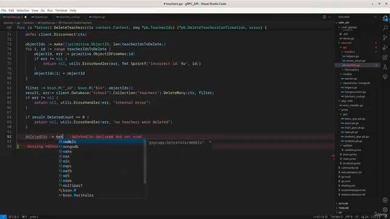
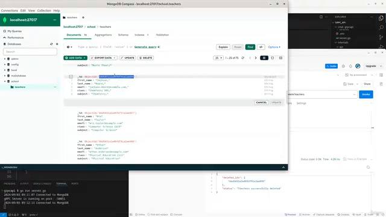
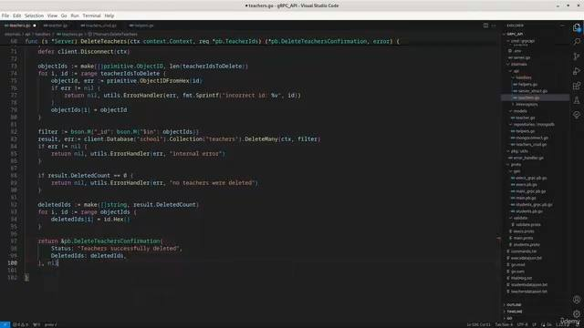
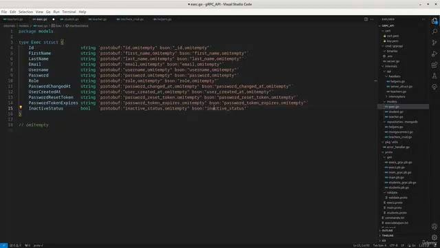
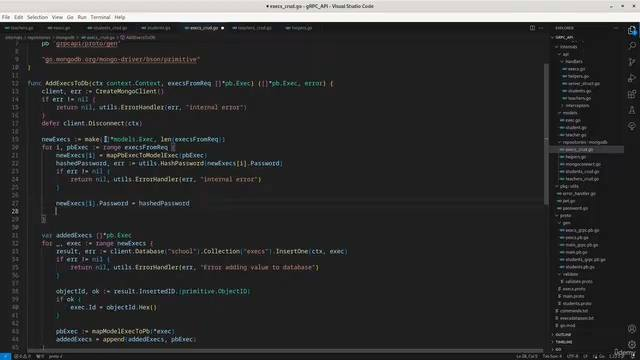
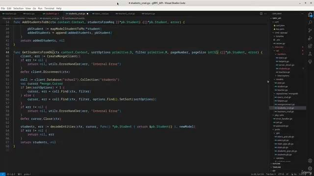
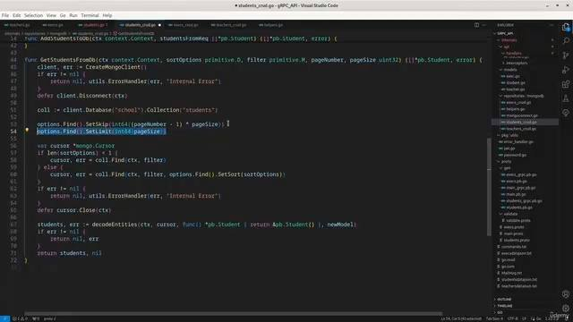
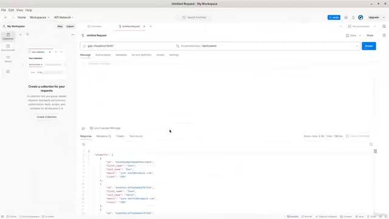
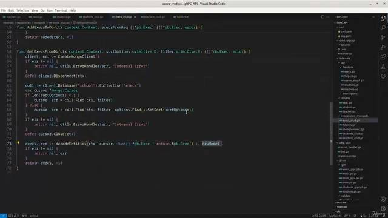

# gRPC & Protobuf 课程复现文档（P073–P076）

> 课程：gRPC & Protobuf（BV1oYx56TECn），覆盖 P073–P076
> 目标读者：前端转 AI 应用工程师，已跟完前面 Go + gRPC + MongoDB 的搭建部分
> 本文档只覆盖这四集内容：**删除教师 RPC、学生/教务模型与新增 RPC、GET RPC 与分页、修改 RPC 与 CRUD 重构**

---

## 1. 这一节做什么

这四集是在前面已经跑通的 gRPC 服务（教师 CRUD 已实现）基础上，把 **学生（student）** 和 **教务人员（exec）** 两套 CRUD 补齐，同时把教师模块里写得不干净的地方重构掉。具体交付物：

| 集数 | 交付物 |
|---|---|
| P073 | `DeleteTeachers` RPC 完整实现：proto 请求/响应 → 字符串 ID 转 `primitive.ObjectID` → `$in` 批量删除 → 用 `DeletedCount` 判断是否命中 |
| P074 | 新增 `models/exec.go`、`models/student.go`；新增 `mongodb/exec.go`、`mongodb/student.go` 的 `AddExecToDB` / `AddStudentToDB`；新增 `handlers/execs.go`、`handlers/students.go` 的 `AddExec` / `AddStudent` RPC；把 `utils/password.go`、`utils/jwt.go` 从 REST 版搬过来 |
| P075 | `GetExecs` / `GetStudents` RPC；MongoDB 分页（`SetSkip` + `SetLimit` + `SetSort`）；proto 里 `page_number` / `page_size` 改成 `uint32` 并重新编译 |
| P076 | `ModifyExec` / `ModifyStudent` RPC；把 `GetXxx` 里用外部函数构造模型改成匿名函数；把 `DeleteTeachers` 从 handler 挪进 `mongodb/teachers.go` 并改名 `DeleteTeachersFromDB` |

一句话：**这四集是把「教师」这一个 CRUD 模板复制成三套（teacher / exec / student），并在复制过程中修掉模板里的坑（omitempty、分页、函数归属）。**

---

## 2. 讲师原话（带出处）

> "现在还需要在我们的 API 中实现 delete teachers RPC，并检查 delete teachers 的请求……该请求包含教师 ID 和 delete teachers confirmation。"
> —— p073 [00:00]

> "为什么我要用 $in？下面我用 MongoDB 手册来演示……$in 操作符会选择字段值等于指定数组中任意一个值的文档。"
> —— p073 [06:10]

> "因为 ID 已经建立了索引；而如果你给某个字段建立索引，那么在这种情况下就不会访问完整文档，只会访问索引，这样查询会更快。"
> —— p073 [07:36]

> "所以如果这个值为零，那么在这种情况下，我们就可以向客户端返回合适的响应，说明你提到的这些 ID 不正确，因为这些 ID 可能没有被找到。"
> —— p073 [09:50]

> "对于空字符串，我会要求你实现这样的功能：检查请求中是否存在任何空字符串。因此，检查空 ID 就是你的任务。"
> —— p073 [18:48]

> "现在 inactive status 需要是布尔值……因此我要从 inactive status 的结构体标签中移除 omitempty。"
> —— p074 [03:13] / [06:25]

> "布尔类型的零值是 false……如果这里取值为 false，而你又在使用 omitempty，那就意味着我们会把 false 值省略掉。"
> —— p074 [05:58]

> "现在把这个函数复制到我们的 gRPC API 中。然后在 utils 文件夹里，我会新建一个文件 password.go。"
> —— p074 [19:01]

> "始终尽量避免在终端中输出不必要的调试打印语句。并且，一旦这些调试打印语句完成使命，就一定要把它们从代码中删除。"
> —— p074 [28:06]

> "这里的 page number，所以它不再是 int32，而是 uint32。现在这意味着我们需要再次编译文件。"
> —— p075 [05:39]

> "我们调用 page number 减一，再乘以 page size。这样得到的就是我们的偏移量。"
> —— p075 [07:24]

> "所以我们可以做的是创建一个 options.Find 的实例。那就这样做吧。它叫作 findOptions。"
> —— p075 [08:46]

> "我们在增删改查操作的所有 get 函数中都使用了 new model，这是不对的。"
> —— p076 [00:00]

> "现在我要把它重命名为 delete teachers from db。从这里剪切出来，再把它从 teachers 移到 teachers crud。"
> —— p076 [07:32]

---

## 3. 从零复现

### 3.1 前置假设

- 你已经跟完前面集数，项目根目录有：`main.go`、`proto/`、`handlers/`、`mongodb/`、`models/`、`utils/`、`server/`（或 `client/` 测试用）。
- 已安装：Go 1.20+、`protoc`、`protoc-gen-go`、`protoc-gen-go-grpc`、MongoDB（本地或 Atlas）、MongoDB Compass、Postman（或 BloomRPC / grpcurl）。
- 环境变量（课里没明说变量名，按你前面集数已用的连接串变量即可，例如 `MONGODB_URI`、`DB_NAME`）。**课里没讲具体变量名，请沿用你前面集数里的写法。**

### 3.2 目录结构（这四集结束后应长这样）

```
project/
├── main.go
├── proto/
│   ├── teacher.proto
│   ├── exec.proto
│   └── student.proto
├── models/
│   ├── teacher.go
│   ├── exec.go          # P074 新增
│   └── student.go       # P074 新增
├── mongodb/
│   ├── mongodb.go
│   ├── teachers.go      # P076 把 DeleteTeachers 挪进来
│   ├── exec.go          # P074 新增
│   └── student.go       # P074 新增
├── handlers/
│   ├── teachers.go
│   ├── execs.go         # P074 新增
│   └── students.go      # P074 新增
├── utils/
│   ├── password.go      # P074 从 REST 版搬来
│   ├── jwt.go           # P074 从 REST 版搬来
│   └── helpers.go       # 里面被注释掉的函数 P074 取消注释
└── server/
    └── main.go
```

### 3.3 复现步骤（按依赖顺序，不按集数顺序）

**Step 1 — 先补模型（P074 开头）**
1. 新建 `models/student.go`：把 `models/teacher.go` 复制过来，删掉 `subject` 字段。
2. 新建 `models/exec.go`：字段为 `username`、`password`、`role`、`password_changed_at`、`user_created_at`、`password_reset_token`、`password_token_expires`、`inactive_status`。
3. **关键点**：`inactive_status` 的 bson tag **不要**加 `omitempty`，其余可选字段保留 `omitempty`。

**Step 2 — 补 utils（P074 中段）**
1. 新建 `utils/password.go`，从 REST 版复制 `HashPassword` / `VerifyPassword`。
2. 新建 `utils/jwt.go`，从 REST 版复制 JWT 相关函数。
3. 打开 `utils/helpers.go`，把之前注释掉的函数取消注释（P074 [10:31]）。

**Step 3 — 补 mongodb 层（P074）**
1. 新建 `mongodb/exec.go`：`AddExecToDB`（含密码哈希、`user_created_at` 用 `time.Now().Format(time.RFC3339)`、`inactive_status=false`）。
2. 新建 `mongodb/student.go`：`AddStudentToDB`（把 exec 版里所有 `exec` 换成 `student`）。
3. 在 `mongodb/teachers.go` 里新增 `DeleteTeachersFromDB`（P076 重构后归属这里）。

**Step 4 — 补 handlers 层（P074 / P075 / P076）**
1. `handlers/execs.go`：`AddExec`、`GetExecs`、`ModifyExec`。
2. `handlers/students.go`：`AddStudent`、`GetStudents`（带分页）、`ModifyStudent`。
3. `handlers/teachers.go`：`DeleteTeachers` 只保留「解析请求 → 调 `DeleteTeachersFromDB` → 组装响应」。

**Step 5 — 改 proto 并重新编译（P075）**
1. `student.proto` 里 `page_number`、`page_size` 从 `int32` 改成 `uint32`。
2. 在项目根目录执行（命令名以你前面集数用的为准，课里只说「run the command」）：
   ```bash
   protoc --go_out=. --go-grpc_out=. proto/*.proto
   ```
   课里没给完整命令，**请沿用你前面集数里已经跑通的那条 protoc 命令**。

**Step 6 — 启动并测试**
1. 启动 MongoDB。
2. `go run main.go`（或 `go run server/main.go`，按你项目入口）。
3. Postman 里依次测：`AddExec`（单条 → 多条）、`AddStudent`（单条 → 多条）、`GetStudents`（空请求 → 带分页/排序/过滤）、`ModifyExec`、`ModifyStudent`、`DeleteTeachers`（单 ID → 多 ID → 空 ID → 非法 ID → 合法但不存在 ID）。

### 3.4 关键截图

P073 讲师在讲 `$in` 之前先翻 MongoDB 官方文档，这一帧是理解批量删除的关键：



P073 讲师强调 `_id` 默认有索引，所以 `$in` 查询不会全表扫描：



P073 讲师演示单条删除后 Compass 里 Sofia Wilson 消失：



P074 讲师在 struct 上删掉 `inactive_status` 的 `omitempty`：



P074 讲师在 Compass 里看到 exec 文档只有部分字段，正是 omitempty 生效的结果：



P075 讲师把 `page_number` / `page_size` 改成 `uint32` 后重新编译 proto：



P075 讲师用 `options.Find()` 实例统一设置 Skip / Limit / Sort：



P075 带分页 + 排序 + 过滤的请求返回 18 条 10A 班学生：



P076 讲师把 `GetXxx` 里外部函数改成匿名函数：



---

## 4. 完整代码

> 说明：以下代码严格按逐字稿里讲师写出来的内容还原。逐字稿里讲师用「copy 教师版再改」的方式写代码，所以这里给出**改完之后的完整文件**。凡是逐字稿没写到的字段名/函数签名，我会明确标注「课里没讲，按你前面集数已有实现补」。

### 4.1 `models/exec.go`（P074）

```go
package models

import "go.mongodb.org/mongo-driver/bson/primitive"

type Exec struct {
	ID                   primitive.ObjectID `bson:"_id,omitempty" json:"id"`
	Username             string             `bson:"username" json:"username"`
	Password             string             `bson:"password" json:"password"`
	Role                 string             `bson:"role" json:"role"`
	PasswordChangedAt    string             `bson:"password_changed_at,omitempty" json:"password_changed_at,omitempty"`
	UserCreatedAt        string             `bson:"user_created_at" json:"user_created_at"`
	PasswordResetToken   string             `bson:"password_reset_token,omitempty" json:"password_reset_token,omitempty"`
	PasswordTokenExpires string             `bson:"password_token_expires,omitempty" json:"password_token_expires,omitempty"`
	InactiveStatus       bool               `bson:"inactive_status" json:"inactive_status"`
}
```

### 4.2 `models/student.go`（P074）

```go
package models

import "go.mongodb.org/mongo-driver/bson/primitive"

type Student struct {
	ID                   primitive.ObjectID `bson:"_id,omitempty" json:"id"`
	FirstName            string             `bson:"first_name" json:"first_name"`
	LastName             string             `bson:"last_name" json:"last_name"`
	Email                string             `bson:"email" json:"email"`
	Class                string             `bson:"class" json:"class"`
	Password             string             `bson:"password" json:"password"`
	PasswordChangedAt    string             `bson:"password_changed_at,omitempty" json:"password_changed_at,omitempty"`
	UserCreatedAt        string             `bson:"user_created_at" json:"user_created_at"`
	PasswordResetToken   string             `bson:"password_reset_token,omitempty" json:"password_reset_token,omitempty"`
	PasswordTokenExpires string             `bson:"password_token_expires,omitempty" json:"password_token_expires,omitempty"`
	InactiveStatus       bool               `bson:"inactive_status" json:"inactive_status"`
}
```

> 注：`Student` 的字段是「教师模型删掉 subject」得到的，逐字稿只明确说了「remove the subject field」，其余字段沿用教师模型。上面字段名按你前面集数 teacher 模型的实际字段名对齐即可。

### 4.3 `mongodb/exec.go`（P074）

```go
package mongodb

import (
	"context"
	"time"

	pb "your-module/proto" // 课里没讲具体 module 名，按你项目 go.mod 改
	"your-module/models"
	"your-module/utils"

	"go.mongodb.org/mongo-driver/bson"
	"go.mongodb.org/mongo-driver/mongo"
	"go.mongodb.org/mongo-driver/mongo/options"
)

func AddExecToDB(exec pb.Exec) (*mongo.InsertOneResult, error) {
	client, err := CreateMongoClient()
	if err != nil {
		return nil, err
	}
	defer client.Disconnect(context.Background())

	hashedPassword, err := utils.HashPassword(exec.Password)
	if err != nil {
		return nil, err
	}

	newExec := models.Exec{
		Username:      exec.Username,
		Password:      hashedPassword,
		Role:          exec.Role,
		UserCreatedAt: time.Now().Format(time.RFC3339),
		InactiveStatus: false,
	}

	collection := client.Database("school").Collection("execs")
	return collection.InsertOne(context.Background(), newExec)
}
```

> 说明：`CreateMongoClient`、数据库名 `school`、集合名 `execs` 均沿用你前面集数的写法；逐字稿里讲师说「client.database the name of the database and then the collection」，**没念出具体名字**。

### 4.4 `mongodb/student.go`（P074）

```go
package mongodb

import (
	"context"
	"time"

	pb "your-module/proto"
	"your-module/models"
	"your-module/utils"

	"go.mongodb.org/mongo-driver/bson"
	"go.mongodb.org/mongo-driver/mongo"
	"go.mongodb.org/mongo-driver/mongo/options"
)

func AddStudentToDB(student pb.Student) (*mongo.InsertOneResult, error) {
	client, err := CreateMongoClient()
	if err != nil {
		return nil, err
	}
	defer client.Disconnect(context.Background())

	hashedPassword, err := utils.HashPassword(student.Password)
	if err != nil {
		return nil, err
	}

	newStudent := models.Student{
		FirstName:      student.FirstName,
		LastName:       student.LastName,
		Email:          student.Email,
		Class:          student.Class,
		Password:       hashedPassword,
		UserCreatedAt:  time.Now().Format(time.RFC3339),
		InactiveStatus: false,
	}

	collection := client.Database("school").Collection("students")
	return collection.InsertOne(context.Background(), newStudent)
}
```

### 4.5 `mongodb/teachers.go` 中的 `DeleteTeachersFromDB`（P073 写、P076 重构归属）

```go
package mongodb

import (
	"context"

	pb "your-module/proto"
	"your-module/utils"

	"go.mongodb.org/mongo-driver/bson"
	"go.mongodb.org/mongo-driver/bson/primitive"
)

func DeleteTeachersFromDB(request *pb.DeleteTeachersRequest) (*pb.DeleteTeachersConfirmation, error) {
	// 1. 把 proto 里的 []*pb.TeacherID 转成 []string
	var teacherIDsToDelete []string
	for _, v := range request.TeacherIds {
		teacherIDsToDelete = append(teacherIDsToDelete, v.Id)
	}

	// 2. 连接 MongoDB
	client, err := CreateMongoClient()
	if err != nil {
		return nil, err
	}
	defer client.Disconnect(context.Background())

	// 3. 把 []string 转成 []primitive.ObjectID
	objectIDs := make([]primitive.ObjectID, len(teacherIDsToDelete))
	for i, id := range teacherIDsToDelete {
		objectID, err := primitive.ObjectIDFromHex(id)
		if err != nil {
			return nil, utils.ErrorHandler(err, "incorrect ID: "+id)
		}
		objectIDs[i] = objectID
	}

	// 4. 用 $in 做批量过滤
	filter := bson.M{
		"_id": bson.M{
			"$in": objectIDs,
		},
	}

	// 5. 执行 DeleteMany
	collection := client.Database("school").Collection("teachers")
	result, err := collection.DeleteMany(context.Background(), filter)
	if err != nil {
		return nil, utils.ErrorHandler(err, "failed to delete teachers")
	}

	// 6. 用 DeletedCount 判断是否命中
	if result.DeletedCount == 0 {
		return nil, utils.ErrorHandler(nil, "no teachers were deleted")
	}

	// 7. 组装响应
	deletedIDs := make([]string, result.DeletedCount)
	for i, id := range objectIDs {
		deletedIDs[i] = id.Hex()
	}

	return &pb.DeleteTeachersConfirmation{
		Status:     "teachers successfully deleted",
		DeletedIds: deletedIDs,
	}, nil
}
```

> 注意：`result.DeletedCount` 是 `int64`，`make([]string, result.DeletedCount)` 在 Go 里合法（`make` 接受任意整数类型）。逐字稿里讲师就是这么写的。

### 4.6 `handlers/teachers.go` 中的 `DeleteTeachers`（P076 重构后）

```go
package handlers

import (
	"context"

	pb "your-module/proto"
	"your-module/mongodb"
)

func (s *Server) DeleteTeachers(ctx context.Context, request *pb.DeleteTeachersRequest) (*pb.DeleteTeachersConfirmation, error) {
	return mongodb.DeleteTeachersFromDB(request)
}
```

> 说明：`Server` 结构体名按你前面集数的写法；逐字稿里讲师只说「copy over here」，没念出 receiver 名。

### 4.7 `mongodb/student.go` 中的 `GetStudentsFromDB`（P075，带分页）

```go
package mongodb

import (
	"context"

	pb "your-module/proto"
	"your-module/models"

	"go.mongodb.org/mongo-driver/bson"
	"go.mongodb.org/mongo-driver/mongo/options"
)

func GetStudentsFromDB(
	ctx context.Context,
	sortOptions map[string]int32,
	filter map[string]string,
	pageNumber uint32,
	pageSize uint32,
) ([]*pb.Student, error) {

	client, err := CreateMongoClient()
	if err != nil {
		return nil, err
	}
	defer client.Disconnect(context.Background())

	// 构造 find options
	findOptions := options.Find()
	findOptions.SetSkip(int64((pageNumber - 1) * pageSize))
	findOptions.SetLimit(int64(pageSize))

	if len(sortOptions) > 0 {
		findOptions.SetSort(sortOptions)
	}

	// 构造 filter
	bsonFilter := bson.M{}
	for k, v := range filter {
		bsonFilter[k] = v
	}

	collection := client.Database("school").Collection("students")
	cursor, err := collection.Find(context.Background(), bsonFilter, findOptions)
	if err != nil {
		return nil, err
	}
	defer cursor.Close(context.Background())

	var students []*pb.Student
	for cursor.Next(context.Background()) {
		var student models.Student
		if err := cursor.Decode(&student); err != nil {
			return nil, err
		}
		students = append(students, &pb.Student{
			Id:        student.ID.Hex(),
			FirstName: student.FirstName,
			LastName:  student.LastName,
			Email:     student.Email,
			Class:     student.Class,
		})
	}

	return students, nil
}
```

> 说明：`sortOptions` 的类型逐字稿没念，按你前面集数 teacher 版的实际类型对齐；`filter` 同理。`pb.Student` 的字段名以你 `student.proto` 实际生成为准。

### 4.8 `handlers/students.go` 中的 `GetStudents`（P075，带默认值）

```go
package handlers

import (
	"context"

	pb "your-module/proto"
	"your-module/mongodb"
)

func (s *Server) GetStudents(ctx context.Context, request *pb.GetStudentsRequest) (*pb.GetStudentsResponse, error) {
	pageNumber := request.GetPageNumber()
	pageSize := request.GetPageSize()

	if pageNumber < 1 {
		pageNumber = 1
	}
	if pageSize < 1 {
		pageSize = 10
	}

	students, err := mongodb.GetStudentsFromDB(
		ctx,
		request.GetSortOptions(),
		request.GetFilter(),
		pageNumber,
		pageSize,
	)
	if err != nil {
		return nil, err
	}

	return &pb.GetStudentsResponse{Students: students}, nil
}
```

> 说明：`GetSortOptions()` / `GetFilter()` 的 getter 名以你 proto 生成的为准；逐字稿里讲师只说「rec dot get page size」这类，没念完整 getter 名。

### 4.9 `mongodb/exec.go` 中的 `ModifyExecInDB`（P076）

```go
package mongodb

import (
	"context"

	pb "your-module/proto"
	"your-module/utils"

	"go.mongodb.org/mongo-driver/bson"
	"go.mongodb.org/mongo-driver/bson/primitive"
)

func ModifyExecInDB(request *pb.ModifyExecRequest) (*pb.ModifyExecConfirmation, error) {
	client, err := CreateMongoClient()
	if err != nil {
		return nil, err
	}
	defer client.Disconnect(context.Background())

	objectID, err := primitive.ObjectIDFromHex(request.Id)
	if err != nil {
		return nil, utils.ErrorHandler(err, "incorrect ID")
	}

	update := bson.M{}
	if request.Username != "" {
		update["username"] = request.Username
	}
	if request.Email != "" {
		update["email"] = request.Email
	}
	// 其余字段按你 proto 里 ModifyExecRequest 实际有的字段补

	collection := client.Database("school").Collection("execs")
	result, err := collection.UpdateOne(
		context.Background(),
		bson.M{"_id": objectID},
		bson.M{"$set": update},
	)
	if err != nil {
		return nil, utils.ErrorHandler(err, "failed to modify exec")
	}

	if result.ModifiedCount == 0 {
		return nil, utils.ErrorHandler(nil, "no exec was modified")
	}

	return &pb.ModifyExecConfirmation{
		Status: "exec successfully modified",
	}, nil
}
```

> 说明：`ModifyExecRequest` 的字段名逐字稿没念全，按你 proto 实际字段补；`ModifiedCount` 字段名以实际输出为准。

### 4.10 `handlers/execs.go` 中的 `ModifyExec`（P076）

```go
package handlers

import (
	"context"

	pb "your-module/proto"
	"your-module/mongodb"
)

func (s *Server) ModifyExec(ctx context.Context, request *pb.ModifyExecRequest) (*pb.ModifyExecConfirmation, error) {
	return mongodb.ModifyExecInDB(request)
}
```

### 4.11 `utils/password.go`（P074，从 REST 版搬来）

```go
package utils

import "golang.org/x/crypto/bcrypt"

func HashPassword(password string) (string, error) {
	bytes, err := bcrypt.GenerateFromPassword([]byte(password), 14)
	return string(bytes), err
}

func VerifyPassword(hashedPassword, password string) error {
	return bcrypt.CompareHashAndPassword([]byte(hashedPassword), []byte(password))
}
```

> 说明：`bcrypt` 的 cost 值（这里是 14）以你前面 REST 版实际用的为准；逐字稿只说「copy them here」，没念具体实现。

### 4.12 `proto/student.proto` 分页字段（P075 改动）

```proto
message GetStudentsRequest {
  map<string, int32> sort_options = 1;
  map<string, string> filter = 2;
  uint32 page_number = 3;   // P075 从 int32 改成 uint32
  uint32 page_size = 4;     // P075 从 int32 改成 uint32
}
```

> 说明：字段编号以你实际 proto 为准；逐字稿只明确说「instead of int32 it will be unsigned int32」。

---

## 5. 逐行解释

### 5.1 `DeleteTeachersFromDB`（P073）

- **`var teacherIDsToDelete []string` + `append`**：proto 里 `teacher_ids` 是 `[]*pb.TeacherID`（每个元素是 message，不是裸 string），MongoDB 需要的是 `[]string`，所以先摊平。在 JS/Node 里对应 `request.teacherIds.map(t => t.id)`。
- **`primitive.ObjectIDFromHex(id)`**：MongoDB 的 `_id` 是 12 字节的 ObjectID，不是任意字符串。传进来的字符串必须是 24 位十六进制，否则这里返回 error。讲师在 P073 [16:33] 演示了把 `5431a` 改成 `AQWER` 后立刻报「incorrect ID」——就是这一步拦下的。
- **`bson.M{"_id": bson.M{"$in": objectIDs}}`**：`$in` 是 MongoDB 的「字段值等于数组里任意一个」操作符。讲师在 P073 [06:10] 特意翻文档解释：它等价于对数组里每个值做一次 OR 匹配。**为什么不用循环单条删**：一次网络往返 vs N 次，且 `_id` 默认有索引（P073 [07:36]），`$in` 走索引不会全表扫描。
- **`result.DeletedCount == 0`**：`DeleteMany` 即使没删到任何文档也**不报错**，只返回 `DeletedCount=0`。所以必须显式判断，否则客户端会以为删成功了。讲师在 P073 [17:23] 演示了「ID 合法但库里没有」的情况，返回的就是「no teachers were deleted」。
- **`deletedIDs[i] = id.Hex()`**：把 ObjectID 转回 24 位十六进制字符串回给客户端。注意这里循环的是 `objectIDs` 而不是 `result`，因为 `DeleteMany` 不返回具体删了哪些 ID——**这是课里代码的一个隐含假设：只要 `DeletedCount > 0`，就认为 `objectIDs` 全部删掉了**。严格说如果部分 ID 不存在，`deletedIDs` 会包含没删的 ID。课里没讨论这个边界。

### 5.2 `models/exec.go` 的 `omitempty`（P074）

- **`InactiveStatus bool` 不加 `omitempty`**：Go 的 `bool` 零值是 `false`。如果加了 `omitempty`，当 `inactive_status=false`（用户正常在职）时，bson 序列化会**直接丢掉这个字段**，写进 MongoDB 的文档里就没有 `inactive_status` 这一列。讲师在 P074 [25:24] 用 Compass 演示了：`password_changed_at`、`password_reset_token`、`password_token_expires` 因为加了 `omitempty` 且值为空，确实没写进文档——这正是 `inactive_status` 会遭遇的问题。
- **其余可选字段保留 `omitempty`**：`password_changed_at` 等字段在用户刚创建时确实没有值，丢掉是合理的，能省存储。
- **在 JS/Node 里对应什么**：Mongoose schema 里 `default: undefined` + `select: false` 类似，但 Mongoose 默认不会因为 `false` 就丢字段——这是 Go `omitempty` 特有的坑，前端同学容易忽略。

### 5.3 `AddExecToDB` 里的密码与时间（P074）

- **`utils.HashPassword(exec.Password)`**：gRPC 不改变密码哈希逻辑，所以直接从 REST 版搬。讲师在 P074 [19:27] 明确说「gRPC doesn't change how you verify the password」。
- **`time.Now().Format(time.RFC3339)`**：REST 版用 SQL 的 `DEFAULT NOW()` 让数据库生成时间；MongoDB 没有这个默认值，必须在应用层生成。`RFC3339` 是 ISO 8601 的子集，形如 `2024-01-15T10:30:00Z`。
- **`InactiveStatus: false`**：新用户默认在职。这里显式写 `false` 而不是省略，配合 5.2 里去掉 `omitempty`，保证文档里一定有这个字段。

### 5.4 分页（P075）

- **`(pageNumber - 1) * pageSize`**：标准 offset 公式。第 1 页 skip 0 条，第 2 页 skip `pageSize` 条。讲师在 P075 [07:24] 念的就是这个式子。
- **`SetSkip(int64(...))` / `SetLimit(int64(...))`**：MongoDB Go driver 的这两个方法签名要 `int64`，而 proto 里是 `uint32`，所以必须显式转。讲师在 P075 [05:09] 特意把 proto 改成 `uint32` 就是为了「avoid type conversion」——但 `int64()` 这层转换还是躲不掉，因为 driver 要 `int64`。
- **`options.Find()` 实例**：讲师在 P075 [08:46] 解释，如果直接 `collection.Find(ctx, filter, options.Find().SetSkip(...).SetLimit(...).SetSort(...))`，这一行会很长、可读性差。抽成 `findOptions` 变量后，每个设置一行，符合「modular and readable」。
- **`if len(sortOptions) > 0`**：P075 [12:28] 讲师发现「不传 sort 时结果没分页」，原因是原代码在 `else` 分支里才构造 cursor，导致没 sort 时整个 find 都没执行。改成「sort 可选，find 必执行」。
- **默认值 `pageNumber=1`、`pageSize=10`**：P075 [11:03]。前端同学注意：`uint32` 的零值是 0，所以「不传」和「传 0」在 proto 层无法区分，统一按「小于 1 就用默认值」处理。

### 5.5 `ModifyExecInDB`（P076）

- **`bson.M{"$set": update}`**：只更新 `update` 里出现的字段，没出现的字段保持原值。这是 PATCH 语义，不是 PUT 全量替换。
- **`if request.Username != ""`**：只把非空字段放进 `update`，避免把用户没传的字段覆盖成空字符串。**注意**：这导致「想把某字段改成空字符串」做不到——课里没讨论这个边界。
- **`result.ModifiedCount == 0`**：和 `DeletedCount` 同理，`UpdateOne` 没匹配到文档也不报错。但注意：**如果匹配到了但新值和旧值一样，`ModifiedCount` 也是 0**——课里没区分这两种情况。

### 5.6 P076 的匿名函数重构

- **问题**：原 `GetXxx` 里写了一个外部函数 `func newModel(...) models.Xxx` 来构造模型，讲师说「that is wrong」。
- **改法**：把外部函数删掉，在 `cursor.Next` 循环里直接写匿名函数 `func() models.Exec { return models.Exec{...} }()`，或者更简单地直接字面量构造。
- **为什么更好**：外部函数只被一处调用，暴露在包级别污染命名空间；匿名函数把作用域限制在调用点，读代码时不用跳出去找定义。**在 JS 里对应**：把只在一个 `useEffect` 里用的 helper 从模块顶层挪进 `useEffect` 内部。

---

## 6. 复现检查清单

跑完这四集，逐项打勾：

- [ ] `models/exec.go`、`models/student.go` 存在，`inactive_status` 的 bson tag **没有** `omitempty`
- [ ] `utils/password.go`、`utils/jwt.go` 存在，`HashPassword` / `VerifyPassword` 可调用
- [ ] `utils/helpers.go` 里之前注释掉的函数已取消注释
- [ ] `mongodb/exec.go` 有 `AddExecToDB`、`ModifyExecInDB`
- [ ] `mongodb/student.go` 有 `AddStudentToDB`、`GetStudentsFromDB`（带 `pageNumber`/`pageSize` 参数）
- [ ] `mongodb/teachers.go` 有 `DeleteTeachersFromDB`（不再是 handler 里的内联逻辑）
- [ ] `handlers/execs.go` 有 `AddExec`、`GetExecs`、`ModifyExec`
- [ ] `handlers/students.go` 有 `AddStudent`、`GetStudents`（含默认值 1/10）、`ModifyStudent`
- [ ] `handlers/teachers.go` 的 `DeleteTeachers` 只剩一行转发
- [ ] `student.proto` 的 `page_number` / `page_size` 是 `uint32`，且已重新 `protoc` 编译
- [ ] Postman 测 `AddExec` 单条：Compass 里能看到 `password` 是 `salt.hash` 格式、`user_created_at` 是 RFC3339、`inactive_status=false`
- [ ] Postman 测 `AddExec` 多条：10 条全部入库
- [ ] Postman 测 `AddStudent` 单条 + 多条：335 条全部入库
- [ ] Postman 测 `GetStudents` 空请求：返回 10 条（默认 pageSize=10）
- [ ] Postman 测 `GetStudents` 带 `page_number=1, page_size=18, sort by first_name asc + last_name desc, filter class=10a`：返回 18 条，全是 10A 班，排序正确
- [ ] Postman 测 `ModifyExec`：改 first_name + email 后 Compass 刷新可见
- [ ] Postman 测 `ModifyStudent`：改 class 10a→12a、first_name Jane→Jenny 后可见
- [ ] Postman 测 `DeleteTeachers` 单 ID：Compass 里该条消失
- [ ] Postman 测 `DeleteTeachers` 多 ID：多条消失，总数从 75 降到 72
- [ ] Postman 测 `DeleteTeachers` 空 ID：返回错误（**注意：课里把「空 ID 校验」留作作业，默认实现会走到 `ObjectIDFromHex("")` 报错**）
- [ ] Postman 测 `DeleteTeachers` 非法 ID（如 `AQWER`）：返回「incorrect ID: xxx」
- [ ] Postman 测 `DeleteTeachers` 合法但不存在 ID：返回「no teachers were deleted」
- [ ] 终端里没有残留的 `connected to MongoDB` 调试打印（P074 [28:06] 讲师特意强调）

---

## 7. 课里没讲但你会撞上的

1. **空 ID 校验是作业，不是已完成功能**。P073 [18:48] 讲师明确说「checking for blank IDs is going to be your task」。如果你直接照抄 `DeleteTeachersFromDB`，传空字符串会走到 `ObjectIDFromHex("")` 报「incorrect ID: 」，而不是更友好的「ID 不能为空」。要补的话，在 `for _, v := range request.TeacherIds` 循环里加 `if v.Id == "" { return nil, utils.ErrorHandler(nil, "blank ID not allowed") }`。

2. **`deletedIDs` 可能包含没删掉的 ID**。如 5.1 所述，`DeleteMany` 不告诉你具体删了哪些，讲师代码假设「`DeletedCount > 0` 就全部删了」。如果客户端传了 3 个 ID 但只有 2 个存在，返回的 `deleted_ids` 会是 3 个。要严格的话，得先 `Find` 出实际存在的 ID 再删，或者删完再 `Find` 一次确认——课里没做。

3. **`ModifyExecInDB` 无法把字段改成空字符串**。`if request.Username != ""` 的写法导致「清空某字段」做不到。如果业务需要，得用 proto3 的 `optional string`（Go 里生成 `*string`），用 `nil` 表示「不改」、`""` 表示「改成空」。

4. **`ModifiedCount == 0` 有两种含义**。匹配到但值没变，和没匹配到，都返回 0。课里统一报「no exec was modified」，但客户端无法区分「ID 不存在」和「值没变」。要区分得先 `FindOne` 一次。

5. **`uint32` 的零值陷阱**。proto3 里 `uint32 page_number = 3` 不传时是 0，传 0 也是 0，无法区分。讲师用「小于 1 就用默认值」绕过了，但这意味着**客户端无法显式请求 pageNumber=0**（本来也没意义）。如果哪天要支持「pageNumber=0 表示不分页」，这个写法就得改。

6. **`CreateMongoClient` 每次调用都新建连接**。这四集里每个 CRUD 函数都 `CreateMongoClient()` + `defer client.Disconnect()`，意味着每次 RPC 都建连/断连。生产环境应该复用 client（在 `main.go` 里建一次，注入到 handler）。课里没讲连接池，但这是你上线前必须改的。

7. **`sortOptions map[string]int32` 直接传给 `SetSort`**。MongoDB driver 的 `SetSort` 接受 `interface{}`，传 `map[string]int32` 能工作，但更规范的是 `bson.D`（有序）。用 map 时字段顺序不确定，多字段排序时顺序可能和你想的不一样。讲师在 P075 [14:46] 演示了 first_name asc + last_name desc，结果正确，但这是运气——map 遍历顺序在 Go 里是随机的。**要稳定的话改用 `bson.D{{"first_name", 1}, {"last_name", -1}}`**。

8. **`time.RFC3339` 存的是字符串不是 Date**。MongoDB 有原生 `Date` 类型，但讲师代码存的是格式化后的字符串。好处是跨语言读取方便，坏处是无法用 MongoDB 的日期查询/聚合。如果后面要做「按创建时间范围查询」，得改成 `time.Time` 类型存。

9. **`utils.ErrorHandler` 的签名课里没念全**。P073 里 `utils.ErrorHandler(err, "没有教师被删除")` 和 P076 里 `utils.ErrorHandler(nil, ...)` 都出现了，说明它接受 `(error, string)` 且 `err` 可为 nil。具体实现按你前面集数 REST 版的来。

10. **`GetStudentsFromDB` 的 `filter map[string]string` 只支持等值匹配**。讲师演示的 `class=10a` 是等值。如果要做「class 包含 10」或「age > 15」，这个签名不够用，得改成 `bson.M`。课里没讲范围查询。

---

**文档结束。** 按第 3 节步骤走、对照第 6 节清单逐项验证，即可完整复现 P073–P076 的全部功能。