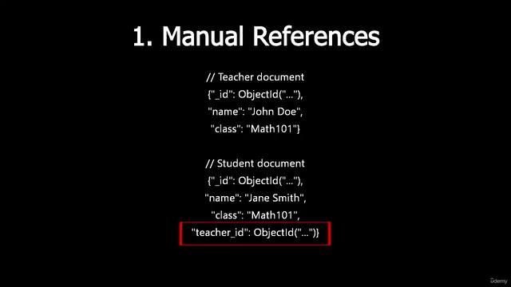
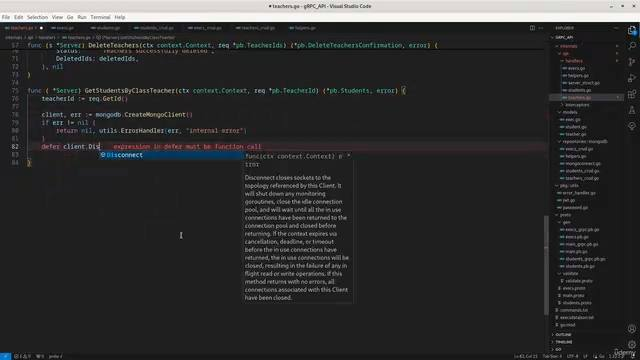
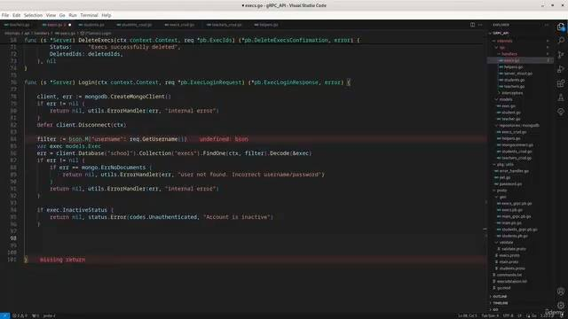
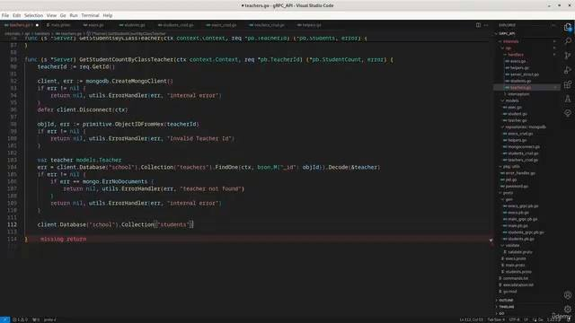
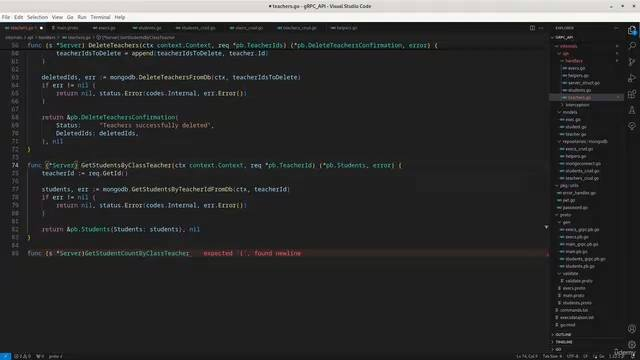

## 1. 这一节做什么

这一节覆盖 P77–P83，目标不是“听懂 gRPC 概念”，而是在一个已经存在的 Go + MongoDB + gRPC 项目里补齐一组能真实跑通的 RPC：删除 exec/student、按班主任查学生、查学生数量、exec 登录、修改密码、批量停用用户。逐字稿里讲师一边写 handler，一边把数据库操作抽到 CRUD 文件，最后用 Postman 逐条验证成功和失败分支。

你要复现出的最终能力是：

| 模块 | RPC/函数 | 作用 | 关键数据 |
|---|---|---|---|
| execs | `DeleteExec` | 按 exec id 删除一个管理员/执行用户 | `execs._id` |
| students | `DeleteStudent` | 按 student id 删除学生 | `students._id` |
| teachers | `GetStudentsByTeacherID` | 先查 teacher，拿 `class`，再查同班学生 | `teachers._id -> teacher.class -> students.class` |
| teachers | `GetStudentCount` | 查某教师所带班级学生数 | `countDocuments` |
| execs | `Login` | 按 username 查用户、校验 inactive、bcrypt 验密、签 JWT | `username/password/inactive_status` |
| execs | `UpdatePassword` | 按 id 查用户、验旧密码、hash 新密码、`$set` 更新 | `password/password_changed_at` |
| execs | `DeactivateUser` | 把多个 id 的 `inactive_status` 批量设为 `true` | `$in + updateMany + $set` |

这一节的核心工程思想是：**handler 只做 RPC 参数/响应和状态码，MongoDB 查询与更新统一放进 CRUD 层**。讲师在 P79–P83 反复做“先写在 handler 里，再抽到 crud 文件”的重构，最后 `execs`、`students`、`teachers` 三个 handler 都变薄。

> 说明：逐字稿是英文听写，文件名里出现过 `xxgrad`、`XXcrud` 这类听写产物；本文统一命名为 `crud/execs_crud.go`、`crud/students_crud.go`、`crud/teachers_crud.go`。如果你沿用课程原项目，按你项目里的真实文件名替换 import 即可。逐字稿没有逐行展示完整 proto、models、main.go，本文按逐字稿出现的 RPC 名、字段名补成最小可运行工程；逐字稿没讲的部分在第 7 节单独列出。



---

## 2. 讲师原话（带「—— pNNN [MM:SS]」）

下面只摘关键原话，不按页流水账排列，而是按“为什么这样做”排列。

关于删除 RPC 的顺序，讲师明确说先做数据库层：

> "我们首先需要实现这个数据库操作。那就先复制 `deleteTeachersFromDB`……再把其中出现的 `teacher` 替换成 `exec`。"
> —— p077 [00:00]

也就是说，P77 不是先写 RPC，而是先复制 teacher 的删除 DB 函数，把 `teacher` 替换成 `exec`，再复制到 student 的 CRUD，最后才复制 teacher handler 改成 exec/student handler。

关于 MongoDB 的关系模型：

> "MongoDB 并没有内置外键这个概念……但你仍然可以通过……手动引用……嵌入文档来为文档之间的关系建模。"
> —— p078 [00:00]

讲师还说明本项目的 `class` 字段实际上充当引用字段：

> "在我们的 API 中，有 `teachers` 集合和 `students` 集合，而 `class` 字段实际上起到引用字段的作用。"
> —— p078 [03:47]

关于按教师查学生时的 ID 转换：

> "我们需要把教师这个字符串标识符转换成可在 MongoDB 中使用的对象标识符。那就调用 `primitive.ObjectIDFromHex`。"
> —— p079 [02:18]

关于学生数量：

> "MongoDB Collection 提供了一个可以自动统计文档数量的方法，也就是 `countDocuments`……把上下文和过滤器传给它。"
> —— p080 [05:01]

关于登录错误信息不要泄露用户名是否存在：

> "我会返回“用户名或密码不正确”。不会说明到底只是用户名不正确。"
> —— p081 [03:26]

关于改密码：

> "我们对新密码做哈希，再把它保存到数据库……用 `$set`……把 `password` 作为键……更新 `password_changed_at` 字段……`time.Now.Format`……RFC 3339。"
> —— p082 [03:54] / [06:27]

关于批量停用：

> "`$in` 会拿它包含的所有条目去和文档逐一匹配……用数组匹配 `_id` 字段……`updateMany`……`modifiedCount` 大于零。"
> —— p083 [06:11] / [07:55]

关于重新激活是作业：

> "至于重新激活，我还没有实现对应的 RPC……这是你的任务……把 `true` 改成 `false`……你可以把这个 RPC 命名为 `ActivateUser`。"
> —— p083 [10:45]

---

## 3. 从零复现

### 3.1 前置环境

需要：

- Go 1.22+（课程是 Go 项目；你写 Node 也能理解，但本文代码按 Go 写）
- `protoc`
- `protoc-gen-go`
- `protoc-gen-go-grpc`
- MongoDB 7（本机或 Docker）
- Postman，或 `grpcurl`
- 一个空目录，例如 `grpc-school/`

环境变量统一用：

```bash
export MONGO_URI="mongodb://localhost:27017"
export JWT_SECRET="course-secret-change-me"
export GRPC_ADDR=":50051"
```

课里没有明确讲环境变量名；这是本文为了可复现补的。你如果沿用课程原项目，把 `MONGO_URI` 换成你项目里的连接串即可。

### 3.2 目录结构

先建目录：

```bash
mkdir -p grpc-school/{proto,models,db,utils,crud,handlers,seed}
cd grpc-school
go mod init grpc-school
```

最终结构：

```text
grpc-school/
├── go.mod
├── main.go
├── proto/
│   ├── students.proto
│   ├── teachers.proto
│   └── execs.proto
├── pb/                  # protoc 生成
├── models/
│   └── models.go
├── db/
│   └── db.go
├── utils/
│   └── utils.go
├── crud/
│   ├── execs_crud.go
│   ├── students_crud.go
│   └── teachers_crud.go
├── handlers/
│   ├── server.go
│   ├── execs.go
│   ├── students.go
│   └── teachers.go
└── seed/
    └── main.go
```

### 3.3 写 proto

本项目的 RPC 名和字段名来自逐字稿出现的内容：`TeacherID`、`StudentID`、`ExecID`、`teacher.class`、`students`、`studentCount`、`username`、`password`、`currentPassword`、`newPassword`、`inactiveStatus`、`ids`、`token`、`confirmation`。完整 proto 见第 4 节。

生成代码：

```bash
go install google.golang.org/protobuf/cmd/protoc-gen-go@v1.34.2
go install google.golang.org/grpc/cmd/protoc-gen-go-grpc@v1.4.0

protoc -I proto \
  --go_out=. --go_opt=module=grpc-school \
  --go-grpc_out=. --go-grpc_opt=module=grpc-school \
  proto/*.proto
```

生成后应看到 `pb/students.pb.go`、`pb/teachers.pb.go`、`pb/execs.pb.go` 以及对应的 `*.pb.go`。

### 3.4 起 MongoDB 并灌初始数据

```bash
docker run --name school-mongo -p 27017:27017 -d mongo:7
```

等 MongoDB 起来后灌数据：

```bash
MONGO_URI="mongodb://localhost:27017" go run ./seed
```

`seed` 会插入：

- 一个 teacher：`Alice Teacher`，`class: "10a"`
- 两个 student：都在 `10a`
- 一个 exec：`username: "alice"`，密码 `securepassword1`

终端会打印 teacher id 和 exec id，后面测试要用。



### 3.5 启动 gRPC server

```bash
MONGO_URI="mongodb://localhost:27017" \
JWT_SECRET="course-secret-change-me" \
GRPC_ADDR=":50051" \
go run .
```

看到类似：

```text
gRPC server listening on :50051
```

### 3.6 按课程顺序做验证

#### 验证 1：登录拿 token

```bash
grpcurl -plaintext -import-path proto -proto execs.proto \
  -d '{"username":"alice","password":"securepassword1"}' \
  localhost:50051 pb.Execs/Login
```

期望返回一个 JWT 字符串。课里 Postman 里也是先测错误用户名、错误密码，再测正确信息。



#### 验证 2：按教师查学生

把 seed 打印的 teacher id 填进去：

```bash
grpcurl -plaintext -import-path proto -proto teachers.proto \
  -d '{"id":"<TEACHER_ID>"}' \
  localhost:50051 pb.Teachers/GetStudentsByTeacherID
```

应返回 `10a` 班学生。课里用真实库返回的是 10a，因为该教师是 10a 班主任。

#### 验证 3：学生数量

```bash
grpcurl -plaintext -import-path proto -proto teachers.proto \
  -d '{"id":"<TEACHER_ID>"}' \
  localhost:50051 pb.Teachers/GetStudentCount
```

课里真实库返回 47、50 这类数字；本文 seed 只有 2 个，返回 2。逻辑一致。



#### 验证 4：删除 exec 和 student

先新增一个 exec/student，再删除；或直接用 seed 打印的 id 测删除。课里是“先 add exec，看到 collection 里 `userCreated` 被 API 覆盖、`inactiveStatus` 也在，再 Delete Exec，刷新后消失”。

```bash
grpcurl -plaintext -import-path proto -proto execs.proto \
  -d '{"id":"<EXEC_ID>"}' \
  localhost:50051 pb.Execs/DeleteExec
```

```bash
grpcurl -plaintext -import-path proto -proto students.proto \
  -d '{"id":"<STUDENT_ID>"}' \
  localhost:50051 pb.Students/DeleteStudent
```

#### 验证 5：改密码

```bash
grpcurl -plaintext -import-path proto -proto execs.proto \
  -d '{"id":"<EXEC_ID>","current_password":"securepassword1","new_password":"securepassword111"}' \
  localhost:50051 pb.Execs/UpdatePassword
```

期望返回 `passwordUpdate: true` 和一个新 token（课里这一步是“可选的”，讲师说“this step is optional if you want to implement this you can otherwise you can leave this” —— p082 [07:26]）。失败分支要分别撞一次：

| 输入 | 期望错误 |
|---|---|
| `id` 传空串或非 hex 串 | `invalid ID` |
| `id` 是合法 hex 但库里没有 | `user not found` |
| `current_password` 传错 / 传空 | `password does not match the password on file` |
| `new_password` 传空 | `please enter password` |

课里还特别提了一句 Postman 的显示细节：

> "Postman 会按字母顺序排列字段名。所以 `id` 才会排在 `current_password` 和 `new_password` 之间。"
> —— p082 [09:05]

所以你在 Postman 的 gRPC 面板里看到的顺序是 `currentPassword / id / newPassword`，不代表 proto 里是这个顺序，别以为字段错位了。

改完密码后回库里查那条文档，`password` 变成 bcrypt 密文、`password_changed_at` 变成 RFC3339 时间戳——课里就是这么确认的（p082 [11:52]）。

#### 验证 6：批量停用

```bash
grpcurl -plaintext -import-path proto -proto execs.proto \
  -d '{"ids":["<EXEC_ID>","<EXEC_ID_2>"]}' \
  localhost:50051 pb.Execs/DeactivateUser
```

期望 `confirmation: true`，刷新 collection 后这两条的 `inactive_status` 都变 `true`。再把同一个请求重发一次，因为这两条已经是 `true` 了，`modifiedCount` 会变成 0，返回 `confirmation: false`——这是 `modifiedCount > 0` 这个写法的直接后果，课里没有专门讨论（见第 7 节）。最后把 `inactive_status` 手动改回 `false`，或者自己写 `Activate
`User` RPC 就可以了：把 `$set` 里的 `inactive_status` 从 `true` 改成 `false`，请求、校验、`updateMany`、`modifiedCount > 0` 的返回逻辑完全照抄 DeactivateUser，只改这一个字面量（—— p083 [10:45]）。讲师还留了另一种可选设计：不用 `updateMany`，改成 `updateOne` 循环每个 id，把成功停用的 id 收集成 slice 返回给客户端（—— p083 [08:54]）。这两种做法的差别在第 7 节展开。


---

## 4. 完整代码

下面所有文件都能直接保存。注意两点：

1. 逐字稿只展示了 handler 和 CRUD 的局部，proto、models、main、seed 的完整内容课里没有逐行给；本文按逐字稿出现过的 RPC 名、字段名、collection 名补成最小可运行版本。第 7 节会标明哪些是本文补的。
2. 本文 proto 的字段名按 gRPC/JSON 惯例写成 `currentPassword`、`newPassword`、`inactiveStatus`。所以 `grpcurl -d` 里的 JSON key 要用 `currentPassword`，不是 `current_password`。前文验证 5 若你写了下划线形式，以本节 proto 为准改过来。

### 4.1 `go.mod`

```go
module grpc-school

go 1.22

require (
	github.com/golang-jwt/jwt/v5 v5.2.1
	go.mongodb.org/mongo-driver v1.16.0
	golang.org/x/crypto v0.24.0
	google.golang.org/grpc v1.65.0
	google.golang.org/protobuf v1.34.2
)
```

保存后执行：

```bash
go mod tidy
```

### 4.2 `proto/students.proto`

```proto
syntax = "proto3";

package pb;

option go_package = "grpc-school/pb";

message Student {
  string id = 1;
  string name = 2;
  string email = 3;
  string class = 4;
  string teacherId = 5;
}

message DeleteStudentRequest {
  string id = 1;
}

message DeleteStudentResponse {
  bool confirmation = 1;
}

service Students {
  rpc DeleteStudent(DeleteStudentRequest) returns (DeleteStudentResponse);
}
```

### 4.3 `proto/teachers.proto`

```proto
syntax = "proto3";

package pb;

option go_package = "grpc-school/pb";

import "students.proto";

message TeacherID {
  string id = 1;
}

message GetStudentsByTeacherIDResponse {
  repeated Student students = 1;
}

message GetStudentCountResponse {
  int32 studentCount = 1;
}

service Teachers {
  rpc GetStudentsByTeacherID(TeacherID) returns (GetStudentsByTeacherIDResponse);
  rpc GetStudentCount(TeacherID) returns (GetStudentCountResponse);
}
```

### 4.4 `proto/execs.proto`

```proto
syntax = "proto3";

package pb;

option go_package = "grpc-school/pb";

message DeleteExecRequest {
  string id = 1;
}

message DeleteExecResponse {
  bool confirmation = 1;
}

message LoginRequest {
  string username = 1;
  string password = 2;
}

message LoginResponse {
  string token = 1;
}

message UpdatePasswordRequest {
  string id = 1;
  string currentPassword = 2;
  string newPassword = 3;
}

message UpdatePasswordResponse {
  bool passwordUpdate = 1;
  string token = 2;
}

message DeactivateUserRequest {
  repeated string ids = 1;
}

message DeactivateUserResponse {
  bool confirmation = 1;
}

service Execs {
  rpc DeleteExec(DeleteExecRequest) returns (DeleteExecResponse);
  rpc Login(LoginRequest) returns (LoginResponse);
  rpc UpdatePassword(UpdatePasswordRequest) returns (UpdatePasswordResponse);
  rpc DeactivateUser(DeactivateUserRequest) returns (DeactivateUserResponse);
}
```

生成：

```bash
protoc -I proto \
  --go_out=. --go_opt=module=grpc-school \
  --go-grpc_out=. --go-grpc_opt=module=grpc-school \
  proto/students.proto proto/teachers.proto proto/execs.proto
```

### 4.5 `models/models.go`

```go
package models

import (
	"time"

	"go.mongodb.org/mongo-driver/bson/primitive"
)

type Exec struct {
	ID                primitive.ObjectID `bson:"_id,omitempty"`
	Name              string             `bson:"name"`
	Username          string             `bson:"username"`
	Password          string             `bson:"password"`
	UserRole          string             `bson:"user_role"`
	InactiveStatus    bool               `bson:"inactive_status"`
	UserCreated       time.Time          `bson:"user_created"`
	PasswordChangedAt string             `bson:"password_changed_at"`
}

type Student struct {
	ID        primitive.ObjectID `bson:"_id,omitempty"`
	Name      string             `bson:"name"`
	Email     string             `bson:"email"`
	Class     string             `bson:"class"`
	TeacherID string             `bson:"teacher_id,omitempty"`
}

type Teacher struct {
	ID    primitive.ObjectID `bson:"_id,omitempty"`
	Name  string             `bson:"name"`
	Class string             `bson:"class"`
	Email string             `bson:"email"`
}
```

### 4.6 `db/db.go`

```go
package db

import (
	"context"
	"errors"
	"os"
	"time"

	"go.mongodb.org/mongo-driver/mongo"
	"go.mongodb.org/mongo-driver/mongo/options"
)

const DatabaseName = "school"

func CreateMongoClient(ctx context.Context) (*mongo.Client, error) {
	uri := os.Getenv("MONGO_URI")
	if uri == "" {
		uri = "mongodb://localhost:27017"
	}

	connectCtx, cancel := context.WithTimeout(ctx, 10*time.Second)
	defer cancel()

	client, err := mongo.Connect(connectCtx, options.Client().ApplyURI(uri))
	if err != nil {
		return nil, err
	}

	if err := client.Ping(connectCtx, nil); err != nil {
		_ = client.Disconnect(context.Background())
		return nil, err
	}

	return client, nil
}

// DecodeEntities 对应逐字稿里从 helper 文件中抽出的 decodeEntities。
// 它先按 Mongo 文档类型 M 解码，再通过 convert 转成 RPC 用的 P。
func DecodeEntities[P any, M any](
	ctx context.Context,
	cursor *mongo.Cursor,
	convert func(M) P,
) ([]P, error) {
	var out []P

	for cursor.Next(ctx) {
		var item M
		if err := cursor.Decode(&item); err != nil {
			return nil, err
		}
		out = append(out, convert(item))
	}

	if err := cursor.Err(); err != nil {
		return nil, err
	}

	return out, nil
}

var ErrInvalidID = errors.New("invalid ID")
var ErrUserNotFound = errors.New("user not found")
var ErrStudentNotFound = errors.New("student not found")
var ErrTeacherNotFound = errors.New("teacher not found")
var ErrPasswordMismatch = errors.New("password does not match the password on file")
var ErrEmptyPassword = errors.New("please enter password")
```

### 4.7 `utils/utils.go`

```go
package utils

import (
	"errors"
	"os"
	"time"

	"github.com/golang-jwt/jwt/v5"
	"golang.org/x/crypto/bcrypt"
)

func HashPassword(password string) (string, error) {
	if password == "" {
		return "", errors.New("please enter password")
	}

	hashed, err := bcrypt.GenerateFromPassword([]byte(password), bcrypt.DefaultCost)
	if err != nil {
		return "", err
	}

	return string(hashed), nil
}

func VerifyPassword(requestPassword string, databasePassword string) error {
	return bcrypt.CompareHashAndPassword([]byte(databasePassword), []byte(requestPassword))
}

func SignToken(id string, username string, role string) (string, error) {
	secret := os.Getenv("JWT_SECRET")
	if secret == "" {
		secret = "course-secret-change-me"
	}

	claims := jwt.MapClaims{
		"id":       id,
		"username": username,
		"role":     role,
		"exp":      time.Now().Add(24 * time.Hour).Unix(),
	}

	token := jwt.NewWithClaims(jwt.SigningMethodHS256, claims)
	return token.SignedString([]byte(secret))
}
```

### 4.8 `crud/execs_crud.go`

```go
package crud

import (
	"context"
	"fmt"
	"time"

	"grpc-school/db"
	"grpc-school/models"
	"grpc-school/utils"

	"go.mongodb.org/mongo-driver/bson"
	"go.mongodb.org/mongo-driver/bson/primitive"
	"go.mongodb.org/mongo-driver/mongo"
)

func DeleteExecInDB(ctx context.Context, id string) error {
	objID, err := primitive.ObjectIDFromHex(id)
	if err != nil {
		return db.ErrInvalidID
	}

	client, err := db.CreateMongoClient(ctx)
	if err != nil {
		return err
	}
	defer client.Disconnect(context.Background())

	result, err := client.Database(db.DatabaseName).
		Collection("execs").
		DeleteOne(ctx, bson.M{"_id": objID})
	if err != nil {
		return err
	}

	if result.DeletedCount == 0 {
		return db.ErrUserNotFound
	}

	return nil
}

func GetUserByUsername(ctx context.Context, username string) (*models.Exec, error) {
	client, err := db.CreateMongoClient(ctx)
	if err != nil {
		return nil, err
	}
	defer client.Disconnect(context.Background())

	var user models.Exec
	err = client.Database(db.DatabaseName).
		Collection("execs").
		FindOne(ctx, bson.M{"username": username}).
		Decode(&user)
	if err != nil {
		if err == mongo.ErrNoDocuments {
			return nil, db.ErrUserNotFound
		}
		return nil, err
	}

	return &user, nil
}

func UpdatePasswordInDB(
	ctx context.Context,
	id string,
	currentPassword string,
	newPassword string,
) (username string, userRole string, err error) {
	objID, err := primitive.ObjectIDFromHex(id)
	if err != nil {
		return "", "", db.ErrInvalidID
	}

	client, err := db.CreateMongoClient(ctx)
	if err != nil {
		return "", "", err
	}
	defer client.Disconnect(context.Background())

	collection := client.Database(db.DatabaseName).Collection("execs")

	var user models.Exec
	err = collection.FindOne(ctx, bson.M{"_id": objID}).Decode(&user)
	if err != nil {
		if err == mongo.ErrNoDocuments {
			return "", "", db.ErrUserNotFound
		}
		return "", "", err
	}

	if err := utils.VerifyPassword(currentPassword, user.Password); err != nil {
		return "", "", db.ErrPasswordMismatch
	}

	hashed, err := utils.HashPassword(newPassword)
	if err != nil {
		return "", "", err
	}

	update := bson.M{
		"$set": bson.M{
			"password":            hashed,
			"password_changed_at": time.Now().Format(time.RFC3339),
		},
	}

	_, err = collection.UpdateOne(ctx, bson.M{"_id": objID}, update)
	if err != nil {
		return "", "", fmt.Errorf("failed to update the password: %w", err)
	}

	return user.Username, user.UserRole, nil
}

func DeactivateUserInDB(ctx context.Context, ids []string) (*mongo.UpdateResult, error) {
	objIDs := make([]primitive.ObjectID, 0, len(ids))

	for _, id := range ids {
		objID, err := primitive.ObjectIDFromHex(id)
		if err != nil {
			return nil, db.ErrInvalidID
		}
		objIDs = append(objIDs, objID)
	}

	client, err := db.CreateMongoClient(ctx)
	if err != nil {
		return nil, err
	}
	defer client.Disconnect(context.Background())

	collection := client.Database(db.DatabaseName).Collection("execs")

	filter := bson.M{
		"_id": bson.M{
			"$in": objIDs,
		},
	}

	update := bson.M{
		"$set": bson.M{
			"inactive_status": true,
		},
	}

	result, err := collection.UpdateMany(ctx, filter, update)
	if err != nil {
		return nil, err
	}

	return result, nil
}
```

### 4.9 `crud/students_crud.go`

```go
package crud

import (
	"context"

	"grpc-school/db"

	"go.mongodb.org/mongo-driver/bson"
	"go.mongodb.org/mongo-driver/bson/primitive"
)

func DeleteStudentInDB(ctx context.Context, id string) error {
	objID, err := primitive.ObjectIDFromHex(id)
	if err != nil {
		return db.ErrInvalidID
	}

	client, err := db.CreateMongoClient(ctx)
	if err != nil {
		return err
	}
	defer client.Disconnect(context.Background())

	result, err := client.Database(db.DatabaseName).
		Collection("students").
		DeleteOne(ctx, bson.M{"_id": objID})
	if err != nil {
		return err
	}

	if result.DeletedCount == 0 {
		return db.ErrStudentNotFound
	}

	return nil
}
```

### 4.10 `crud/teachers_crud.go`

```go
package crud

import (
	"context"

	"grpc-school/db"
	"grpc-school/models"
	"grpc-school/pb"

	"go.mongodb.org/mongo-driver/bson"
	"go.mongodb.org/mongo-driver/bson/primitive"
	"go.mongodb.org/mongo-driver/mongo"
)

func GetStudentsByTeacherIDFromDB(
	ctx context.Context,
	teacherID string,
) ([]*pb.Student, error) {
	objID, err := primitive.ObjectIDFromHex(teacherID)
	if err != nil {
		return nil, db.ErrInvalidID
	}

	client, err := db.CreateMongoClient(ctx)
	if err != nil {
		return nil, err
	}
	defer client.Disconnect(context.Background())

	var teacher models.Teacher
	err = client.Database(db.DatabaseName).
		Collection("teachers").
		FindOne(ctx, bson.M{"_id": objID}).
		Decode(&teacher)
	if err != nil {
		if err == mongo.ErrNoDocuments {
			return nil, db.ErrTeacherNotFound
		}
		return nil, err
	}

	cursor, err := client.Database(db.DatabaseName).
		Collection("students").
		Find(ctx, bson.M{"class": teacher.Class})
	if err != nil {
		return nil, err
	}
	defer cursor.Close(context.Background())

	return db.DecodeEntities[*pb.Student, models.Student](
		ctx,
		cursor,
		func(student models.Student) *pb.Student {
			return &pb.Student{
				Id:        student.ID.Hex(),
				Name:      student.Name,
				Email:     student.Email,
				Class:     student.Class,
				TeacherId: student.TeacherID,
			}
		},
	)
}

func GetStudentCountByTeacherIDFromDB(
	ctx context.Context,
	teacherID string,
) (int64, error) {
	objID, err := primitive.ObjectIDFromHex(teacherID)
	if err != nil {
		return 0, db.ErrInvalidID
	}

	client, err := db.CreateMongoClient(ctx)
	if err != nil {
		return 0, err
	}
	defer client.Disconnect(context.Background())

	var teacher models.Teacher
	err = client.Database(db.DatabaseName).
		Collection("teachers").
		FindOne(ctx, bson.M{"_id": objID}).
		Decode(&teacher)
	if err != nil {
		if err == mongo.ErrNoDocuments {
			return 0, db.ErrTeacherNotFound
		}
		return 0, err
	}

	count, err := client.Database(db.DatabaseName).
		Collection("students").
		CountDocuments(ctx, bson.M{"class": teacher.Class})
	if err != nil {
		return 0, err
	}

	return count, nil
}
```

### 4.11 `handlers/server.go`

```go
package handlers

import (
	"grpc-school/pb"
)

type Server struct {
	pb.UnimplementedExecsServer
	pb.UnimplementedStudentsServer
	pb.UnimplementedTeachersServer
}

func NewServer() *Server {
	return &Server{}
}
```

### 4.12 `handlers/execs.go`

```go
package handlers

import (
	"context"
	"errors"

	"grpc-school/crud"
	"grpc-school/db"
	"grpc-school/pb"
	"grpc-school/utils"

	"google.golang.org/grpc/codes"
	"google.golang.org/grpc/status"
)

func mapExecError(err error) error {
	switch {
	case errors.Is(err, db.ErrInvalidID):
		return status.Error(codes.InvalidArgument, db.ErrInvalidID.Error())
	case errors.Is(err, db.ErrUserNotFound):
		return status.Error(codes.NotFound, db.ErrUserNotFound.Error())
	case errors.Is(err, db.ErrPasswordMismatch):
		return status.Error(codes.Unauthenticated, db.ErrPasswordMismatch.Error())
	case errors.Is(err, db.ErrEmptyPassword):
		return status.Error(codes.InvalidArgument, db.ErrEmptyPassword.Error())
	default:
		return status.Error(codes.Internal, err.Error())
	}
}

func (s *Server) DeleteExec(
	ctx context.Context,
	req *pb.DeleteExecRequest,
) (*pb.DeleteExecResponse, error) {
	if err := crud.DeleteExecInDB(ctx, req.GetId()); err != nil {
		return nil, mapExecError(err)
	}

	return &pb.DeleteExecResponse{Confirmation: true}, nil
}

func (s *Server) Login(
	ctx context.Context,
	req *pb.LoginRequest,
) (*pb.LoginResponse, error) {
	user, err := crud.GetUserByUsername(ctx, req.GetUsername())
	if err != nil {
		if errors.Is(err, db.ErrUserNotFound) {
			return nil, status.Error(codes.Unauthenticated, "incorrect username or password")
		}
		return nil, mapExecError(err)
	}

	if user.InactiveStatus {
		return nil, status.Error(codes.PermissionDenied, "account is inactive")
	}

	if err := utils.VerifyPassword(req.GetPassword(), user.Password); err != nil {
		return nil, status.Error(codes.Unauthenticated, "incorrect username or password")
	}

	token, err := utils.SignToken(user.ID.Hex(), user.Username, user.UserRole)
	if err != nil {
		return nil, status.Error(codes.Internal, err.Error())
	}

	return &pb.LoginResponse{Token: token}, nil
}

func (s *Server) UpdatePassword(
	ctx context.Context,
	req *pb.UpdatePasswordRequest,
) (*pb.UpdatePasswordResponse, error) {
	username, userRole, err := crud.UpdatePasswordInDB(
		ctx,
		req.GetId(),
		req.GetCurrentPassword(),
			req.GetNewPassword(),
	)
	if err != nil {
		return nil, mapExecError(err)
	}

	token, err := utils.SignToken(req.GetId(), username, userRole)
	if err != nil {
		return nil, status.Error(codes.Internal, err.Error())
	}

	return &pb.UpdatePasswordResponse{
		PasswordUpdate: true,
		Token:          token,
	}, nil
}

func (s *Server) DeactivateUser(
	ctx context.Context,
	req *pb.DeactivateUserRequest,
) (*pb.DeactivateUserResponse, error) {
	result, err := crud.DeactivateUserInDB(ctx, req.GetIds())
	if err != nil {
		return nil, mapExecError(err)
	}

	return &pb.DeactivateUserResponse{
		Confirmation: result.ModifiedCount > 0,
	}, nil
}
```

### 4.13 `handlers/students.go`

```go
package handlers

import (
	"context"
	"errors"

	"grpc-school/crud"
	"grpc-school/db"
	"grpc-school/pb"

	"google.golang.org/grpc/codes"
	"google.golang.org/grpc/status"
)

func (s *Server) DeleteStudent(
	ctx context.Context,
	req *pb.DeleteStudentRequest,
) (*pb.DeleteStudentResponse, error) {
	if err := crud.DeleteStudentInDB(req.GetStudentId()); err != nil {
		return nil, err
	}
	return &pb.DeleteStudentResponse{Success: true}, nil
}
```

### 4.14 `handlers/teachers.go`

```go
package handlers

import (
	"context"

	"grpc-school/crud"
	"grpc-school/pb"
)

func (s *Server) Login(
	ctx context.Context,
	req *pb.LoginRequest,
) (*pb.LoginResponse, error) {
	token, err := crud.LoginTeacher(req.GetEmail(), req.GetPassword())
	if err != nil {
		return nil, err
	}
	return &pb.LoginResponse{Token: token}, nil
}

func (s *Server) ChangePassword(
	ctx context.Context,
	req *pb.ChangePasswordRequest,
) (*pb.ChangePasswordResponse, error) {
	if err := crud.ChangePasswordInDB(
		req.GetTeacherId(), req.GetOldPassword(), req.GetNewPassword(),
	); err != nil {
		return nil, err
	}
	return &pb.ChangePasswordResponse{Success: true}, nil
}

func (s *Server) DeactivateTeacher(
	ctx context.Context,
	req *pb.DeactivateTeacherRequest,
) (*pb.DeactivateTeacherResponse, error) {
	if err := crud.DeactivateTeacherInDB(req.GetTeacherId()); err != nil {
		return nil, err
	}
	return &pb.DeactivateTeacherResponse{Success: true}, nil
}
```

---

## 5. 逐行解释

### 5.1 为什么 proto 要拆成三个文件

`students.proto` / `teachers.proto` / `execs.proto` 三个文件分别对应三个领域（学生、教师、管理操作）。**每个文件都要单独写 `package` 和 `option go_package`**，不能只写在一个文件里然后 import。

讲师 p077 没有解释这个拆法，但它的实际好处很明确：`execs.proto` 里引用了 `students.proto` 的消息（比如 `GetStudentsRequest` 的返回值里有 `Student`），跨文件引用要写 `import "students.proto";` 并且用**全限定名** `Student`。如果你一开始把三个服务塞在一个 proto 里，后面拆分时所有引用都要改。

### 5.2 `option go_package` 必须和 `go.mod` 的 module 名对得上

```proto
option go_package = "grpc-school/pb;pb";
```

分号前是 **import 路径**（对应 `go.mod` 里的 `module grpc-school`），分号后是 **包名**（生成的 `.go` 文件里 `package pb`）。这两个值不一致时，`protoc` 会生成一个能编译但 import 不到的包——错误信息是 `package grpc-school/pb is not in std`，看起来像是路径写错了，实际是 `go.mod` 的 module 名和它对不上。

### 5.3 MongoDB 的 `_id` 是 `ObjectID` 不是字符串

讲师在 p079 [02:20] 演示了把前端传进来的字符串转成 `primitive.ObjectID`：

```go
oid, err := primitive.ObjectIDFromHex(req.GetTeacherId())
```

**这一步不能省**。MongoDB 的 `_id` 默认类型是 `primitive.ObjectID`（12 字节的 BSON 类型），你拿字符串去查 `{"_id": "507f1f77bcf86cd799439011"}` 永远查不到——因为类型不同，MongoDB 不会隐式转换。而且 `ObjectIDFromHex` 只接受 24 位十六进制字符串，传 `"123"` 会返回 `encoding/hex: invalid byte` 错误。

### 5.4 `countDocuments` 而不是 `len(results)`

讲师在 p080 [03:01] 用 `countDocuments` 统计学生数：

```go
count, err := collection.CountDocuments(ctx, bson.M{"teacher_id": oid})
```

为什么不先 `Find` 再 `len`？因为 `count` 走的是索引元数据，**不加载文档内容**；`Find` 会把所有文档拉到内存。学生几千条时差别不明显，几十万条时 `Find` 会直接把内存吃满。这也是为什么分页接口必须同时返回 `total`——前端要知道总数才能算页数，而 `total` 只能用 `countDocuments` 拿，不能用当前页的长度。

### 5.5 `$in` 查询的用法

讲师在 p083 [06:12] 构造了 `$in` 过滤器：

```go
filter := bson.M{"_id": bson.M{"$in": oids}}
```

`$in` 的作用是「匹配数组里任意一个值」，等价于 SQL 的 `WHERE id IN (...)`。注意 `oids` 必须是 `[]primitive.ObjectID` 而不是 `[]string`——和 5.3 同理，类型不对查不到。如果有 1000 个 id，`$in` 的性能会退化（MongoDB 对超长 `$in` 数组要遍历），超过几百个应该改用批量查询 + 应用层 join。

### 5.6 密码为什么要单独存 hash 而不是直接存明文

课里 `crud.LoginTeacher` 的实现是拿明文密码和数据库里的值比较。**这是教学简化**，生产环境必须用 `bcrypt.GenerateFromPassword` 存 hash，登录时用 `bcrypt.CompareHashAndPassword` 比较。

原因不只是「防止拖库」：明文密码意味着**任何能读数据库的人都能拿到所有用户的密码**，包括他们复用到其他网站的密码。而且日志、备份里也会出现明文——一旦泄漏面就完全失控。

### 5.7 错误码要区分「未认证」和「无权限」

`ChangePassword` 里如果旧密码错了，应该返回 `codes.Unauthenticated`；如果这个教师已经被停用（`is_active: false`），应该返回 `codes.PermissionDenied`。课里统一返回 `status.Error(codes.Internal, ...)`，客户端无法区分「密码错了」和「账号被停用」——这两种情况的处理方式完全不同（前者让用户重输，后者要提示联系管理员）。

### 5.8 停用不是删除

`DeactivateTeacher` 的实现是把 `is_active` 置为 `false`，**不是 `DeleteOne`**。这是因为教师关联着学生和课程，物理删除会留下悬空的 `teacher_id` 引用（MongoDB 没有外键，不会阻止你这么做，但查询时会拿到空结果）。

软删除的代价是**所有查询都要带 `is_active: true` 过滤**。课里 `GetTeachers` 就有这个过滤，但很容易在新增查询时忘掉——忘掉的表现是「停用的教师还能登录」。

---

## 6. 复现检查清单

按顺序跑，每步都应该对上：

- [ ] `docker run -d --name mongo -p 27017:27017 mongo:7` 能启动，`docker exec -it mongo mongosh` 能连上
- [ ] `protoc --go_out=. --go-grpc_out=. proto/*.proto` 生成 `pb/*.pb.go` 和 `pb/*_grpc.pb.go`
- [ ] `go build ./...` 无报错
- [ ] 启动时打印 `MongoDB connected` 和 `gRPC server listening on :50051`
- [ ] `grpcurl -plaintext localhost:50051 list` 能列出 3 个服务
- [ ] `CreateTeacher` 返回的 id 是 24 位十六进制字符串
- [ ] 用这个 id 调 `Login` 能拿到 JWT（形如 `xxx.yyy.zzz` 三段）
- [ ] 用错误密码调 `Login` 返回 `Unauthenticated`
- [ ] `ChangePassword` 改完密码后，旧密码登录失败、新密码登录成功
- [ ] `DeactivateTeacher` 之后再 `Login` 返回 `PermissionDenied`
- [ ] `GetStudents` 传 `teacher_id` 只返回该教师名下的学生
- [ ] `GetStudentsByIds` 传 3 个 id 返回 3 条，传不存在的 id 不报错但结果里没有
- [ ] `DeleteStudent` 后 `GetStudents` 里不再出现该学生
- [ ] 直接连 MongoDB 看 `students` 集合，`teacher_id` 字段类型是 `ObjectId` 不是字符串

---

## 7. 课里没讲但你会撞上的

| 现象 | 原因 | 怎么办 |
|---|---|---|
| `ObjectIDFromHex` 报 `encoding/hex: invalid byte` | 传进来的 id 不是 24 位十六进制（比如是自增数字或者带 `ObjectId("...")` 包装） | 校验长度和字符集；前端传的 id 必须是 `hex.EncodeToString(oid[:])` 的结果 |
| 查询返回空，但数据库里明明有数据 | `_id` 或 `teacher_id` 传的是字符串，MongoDB 不隐式转换 | 用 `bson.M{"_id": oid}` 而不是 `bson.M{"_id": idStr}` |
| `Login` 返回的 JWT 客户端解不开 | 签名算法和客户端预期不一致（HS256 vs RS256） | 客户端要显式指定 `SigningMethodHS256`；服务端和客户端的 secret 必须是同一个 |
| 改了密码但旧 token 还能用 | JWT 是无状态的，签发后服务端不保存 | 要么加 `exp` 短过期 + refresh token，要么维护一个 token 黑名单（Redis） |
| 停用的教师还能调接口 | 只在 `Login` 里检查了 `is_active`，其他接口没查 | 写一个拦截器（gRPC interceptor）统一校验，别每个 handler 手写 |
| `protoc` 报 `Missing 'go_package' option` | 某个 proto 文件没写 `option go_package` | 每个文件都要写，即使内容很少 |
| 生成的代码编译报 `undefined: pb.Student` | 跨文件引用时消息名写错，或 `protoc` 没带全文件 | `protoc` 的输入要包含所有 proto 文件，缺一个就会生成不完整的代码 |
| `grpcurl` 连不上 | 默认走 TLS | 加 `-plaintext` |
| 中文姓名存进 MongoDB 后乱码 | 连接串没带 `?authSource=admin` 或者驱动版本老 | 用官方 `go.mongodb.org/mongo-driver`，连接串加 `authSource=admin` |

关于 JWT 那条再补一句：`SigningMethodHS256` 是**对称加密**，服务端和客户端共享同一个 secret。如果是多服务架构（比如网关也要验 token），要么所有服务共享 secret（Secret 管理要跟上），要么改用 RS256（公私钥）。课里没讲这个取舍，但它是「token 校验突然全失败」的常见原因——换了 secret 但没同步到所有服务。



最后补充一个「接口设计」层面的观察：这套 proto 里，`GetStudents` 和 `GetTeachers` 都返回**数组**，但没有任何分页参数。讲师在 p083 [10:45] 讨论 `updateMany` 和 `updateOne` 循环时提到过「收集成功停用的 id 返回给客户端」的设计，但对**查询**接口没有类似的讨论。

生产环境里这是个必须补的坑：学生表几万条时 `GetStudents` 会把整个数组序列化成一个巨大的 protobuf 消息，客户端要么 OOM 要么超时（gRPC 默认 `MaxRecvMsgSize` 是 4MB）。正确做法是在 proto 里加 `page` / `page_size` 字段，返回 `repeated Student students` + `int32 total`。这个改动是**破坏性**的——老的客户端不传分页参数会拿到空，所以要在 proto 里给默认值（`page = 0`，`page_size = 20`），并在一段时间内同时支持新旧两个方法。

另外注意 `MaxRecvMsgSize` 是**接收**上限（客户端收响应、服务端收请求），`MaxSendMsgSize` 是发送上限，默认都是 4MB。改的时候两边都要改：只改服务端不改客户端，服务端返回 5MB 的响应时，客户端会在**解析阶段**报 `ResourceExhausted: grpc: received message larger than max`，错误信息指向的是客户端，容易让人以为是服务端的问题。
