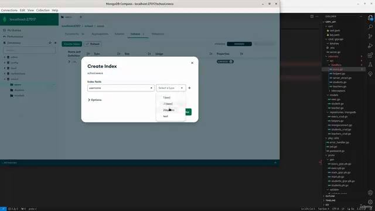
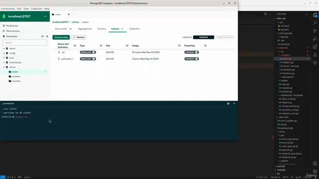
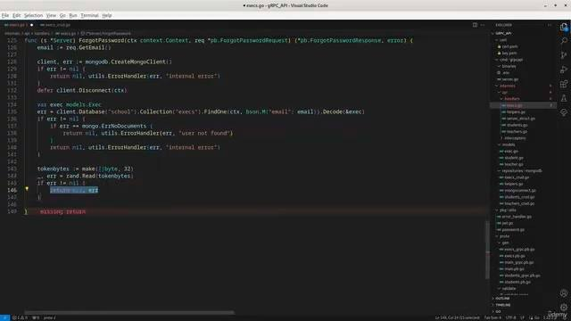
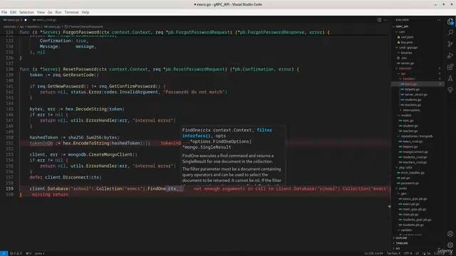
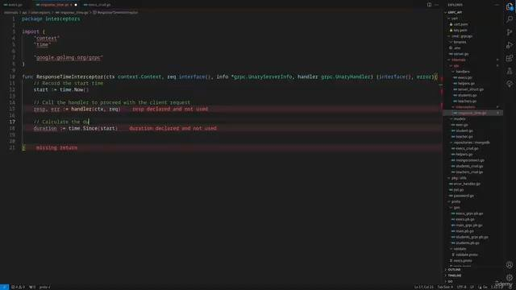
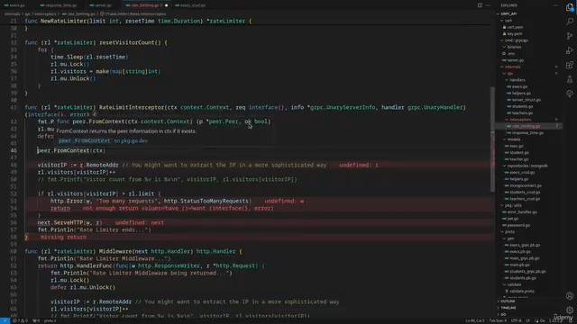
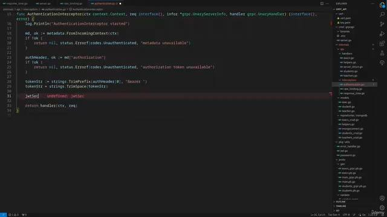
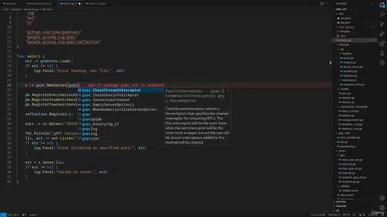
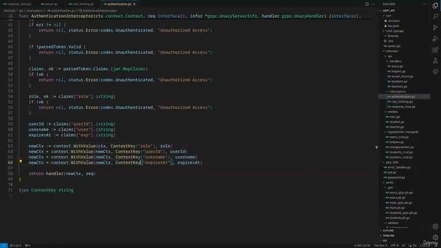

# gRPC & Protobuf（P084–P088）复现文档：忘记密码 / 重置密码 / 拦截器

> 课程：BV1oYx56TECn，覆盖 P084–P088。
> 读者定位：前端转 AI 应用工程师。本课是 Go 语言写的 gRPC 服务端，Go 语法只需「知道即可」，重点是**请求怎么走、数据怎么存、拦截器怎么串**——这些概念在 Node/Express 里都有对应物，文中会随时对照。
> 说明：逐字稿里讲师大量口述「let's do that」「you」等，代码细节靠画面补全。凡是逐字稿没明确讲、只能从上下文推断的地方，本文会标注「课里没讲，按实际输出为准」。

---

## 1. 这一节做什么

这五集把「用户忘记密码 → 收邮件拿 token → 用 token 重置密码」这条链路在 gRPC 服务端完整跑通，并给 gRPC 服务装上三层拦截器（interceptor，等价于 Express 的 middleware）：

| 集数 | 交付物 | 一句话 |
|---|---|---|
| P084 | `ForgotPassword` RPC + MongoDB 唯一索引 | 用 email 查用户，生成随机 token，存哈希+过期时间，发邮件 |
| P085 | `ResetPassword` RPC | 用 token 查用户（且未过期），校验两次密码一致，写新密码哈希，清空 token 字段 |
| P086 | `responseTimeInterceptor` | 记录每个 RPC 耗时，写进响应 metadata 的 `x-response-time` |
| P087 | `rateLimitInterceptor` | 按客户端 IP 限流，超限返回 `ResourceExhausted` |
| P088 | `authenticationInterceptor` | 从 metadata 取 Bearer JWT，校验后把 role/userId/username 塞进 context 传给下游 RPC，并支持跳过登录/忘记密码/重置密码这几个 RPC |

最终状态：Postman 里能依次调通 `Login` → `ForgotPassword` → `ResetPassword` → 用新密码 `Login`，MailHog 里能看到两封重置邮件，终端能看到拦截器的耗时日志和限流日志。

从整体调用链看，客户端发起的每个 unary RPC 都会先进入 `grpc.ChainUnaryInterceptor` 串起来的拦截器链，再到达真正的业务 RPC；业务 RPC 返回后，响应又会沿着拦截器链反向返回。也就是说，请求方向是 responseTime → rateLimit → authentication → 业务 RPC，响应方向则相反。这个顺序和 Express 里 `app.use(responseTime)`、`app.use(rateLimit)`、`app.use(auth)`、最后到路由处理函数是同一类模型。前端同学可以把 gRPC 的 `metadata` 理解成 HTTP header，把 `context` 理解成一次请求的上下文容器，把 `peer.FromContext` 理解成拿 `req.socket.remoteAddress` 这一类连接信息。区别在于 gRPC 没有 `req.ip` 这种直接字段，客户端地址要从连接层的 peer 取；gRPC 也没有 `res.setHeader` 这种自由写法，响应 metadata 要用 `grpc.SetHeader` 写。

这一节的学习重点不是 Go 语法本身，而是三件事：第一，忘记密码链路里 token 只发原始值、数据库只存哈希值，且带过期时间；第二，重置密码时查询条件必须同时包含 token 哈希和过期时间，否则过期 token 仍可能被使用；第三，拦截器链的顺序会直接影响限流、认证和日志的行为，挂错顺序或把限流器实例 new 错位置，都会出现「看起来写了但没生效」的问题。

---

## 2. 讲师原话（带出处）

> "现在开始处理忘记密码 RPC。"
> —— p084 [00:00]

> "因为我们用 email 字段在集合中查找文档，所以最好给 email 字段建立索引；与我们的 SQL 数据库类似，email 字段应当唯一……我们也用 username 字段在集合中查找文档。和我们的 SQL 数据库一样，这两个字段都应该建立索引，并且都应当唯一。"
> —— p084 [00:58]

> "我会先用图形界面创建第一个索引，然后用 Mongo shell 创建第二个索引，这样你就能熟悉这两种方式。"
> —— p084 [01:55]

> "那么，我们创建一个长度为 32 的空字节切片……把随机字节读入这个空字节切片……这里应当使用 crypto-rand。"
> —— p084 [08:43]

> "我们还需要用同一个字节切片生成哈希后的令牌……为此我们会使用 SHA256。"
> —— p084 [10:27]

> "reset token expiration 已经保存在 .env 文件中……当我们从环境变量中取出数据时，它会是字符串，现在需要把它转换成整数。"
> —— p084 [11:17]

> "我们需要使用 1025 端口发送这条消息。那么，调用 mail.NewDialer。"
> —— p084 [22:11]

> "如果出现错误，那么在这种情况下我们需要再次访问数据库，并清理 password reset token 和 password token expires 字段。"
> —— p084 [23:26]

> "现在开始处理重置密码 RPC。"
> —— p085 [00:00]

> "如果新密码和确认密码相同；如果不同，那么在这种情况下，我们需要返回一个错误，并附带一条“密码不匹配”的消息。"
> —— p085 [00:47]

> "我们不仅要根据数据库中的令牌值过滤文档，还要确保 password token expiry 早于当前时间，也就是我们还没有超过 password token expires 时间。"
> —— p085 [04:01]

> "现在开始介绍 gRPC 的中间件，也就是所谓的拦截器。它们其实是同一回事、同一个概念、同一种功能、同一个目的，只是术语不同、名称不同。"
> —— p086 [00:00]

> "每个拦截器都会接收一个 context 和一个请求作为参数，而请求的类型是 interface，因为在 gRPC 中请求类型多种多样。"
> —— p086 [00:57]

> "我们可以给这个新服务器添加一些选项……我们要用的是 ChainUnaryInterceptor，并把我们的拦截器传给它。"
> —— p086 [09:38]

> "现在来处理我们的限流拦截器，我们要实现与 REST API 中相同的功能。"
> —— p087 [00:00]

> "访客 IP 不能这样获取。我们需要做的是调用 peer.FromContext，并把 context 传进去。"
> —— p087 [02:34]

> "如果客户端超过了速率限制，那么在这种情况下我们要发送一个错误，而且错误码会有所不同，应当使用 ResourceExhausted。"
> —— p087 [04:51]

> "现在开始处理认证拦截器。在这个拦截器中，我们会解码 JWT，并检查 JWT 令牌的有效性。"
> —— p088 [00:00]

> "我们需要跳过一些路由。在 REST API 中应用认证时，需要跳过一些路由；而在 gRPC 中应用认证时，需要跳过一些 RPC。"
> —— p088 [24:54]

> "我们也不希望在重置密码 RPC 中检查 JWT，因为在这两种情况下用户都还没有登录。"
> —— p088 [28:08]

这些原话对应本课的几个关键决策点：email 和 username 都要建唯一索引；随机 token 用 `crypto/rand` 生成，再对同一份字节做 SHA256；重置 token 的过期分钟数来自 `.env`，取出来是字符串，要 `strconv.Atoi`；发邮件用 1025 端口；发信失败要回数据库清理 token 字段；gRPC 的 middleware 叫 interceptor，请求类型是 `interface{}`，所以拦截器签名固定；限流取 IP 不能用 HTTP 那套，要用 `peer.FromContext`；认证要跳过 Login、ForgotPassword、ResetPassword 这几个 RPC。下面的复现步骤就是按这些原话展开的。

---

## 3. 从零复现

### 3.1 前置条件

- 已完成本课前序章节：MongoDB 已连上、`models.Exec` 已定义、`utils.HashPassword` 已存在、`Login` RPC 已能返回 JWT、MailHog 已安装。
- 环境变量文件 `.env` 里至少要有：
  - `JWT_SECRET`
  - `RESET_TOKEN_EXPIRATION`（单位：分钟，字符串，代码里 `strconv.Atoi` 转 int）
- MailHog 监听 `1025`（SMTP）与 `8025`（Web UI）。
- 目录结构（本课新增/改动的部分）：

```
.
├── .env
├── main.go
├── server/
│   └── server.go              # grpc.NewServer 在这里，拦截器在这里挂
├── interceptors/
│   ├── responseTime.go        # P086 新建
│   ├── rateLimiting.go        # P087 新建
│   └── authentication.go      # P088 新建
├── crud/
│   └── crud.go                # ForgotPasswordDB / ResetPasswordDB 放这里
├── models/
│   └── exec.go                # 已有
├── utils/
│   └── hash.go                # 已有 HashPassword
└── proto/                     # 已有生成的 pb 代码
```

这里的目录结构建议先对照一遍：拦截器文件统一放在 `interceptors/` 下，数据库读写统一放在 `crud/` 下，RPC 方法放在 `server/` 下。前端项目里常见的分层是 `middleware/`、`services/`、`routes/`，本课只是 Go 项目里的对应分法。`go.mod` 里需要能解析 `google.golang.org/grpc`、`github.com/golang-jwt/jwt/v5`、`go.mongodb.org/mongo-driver`、`gopkg.in/mail.v2`（或课程中使用的 gomail 包）等依赖。如果 `go build ./...` 报找不到包，先在项目根目录执行 `go mod tidy`，再确认 import 路径和课程代码一致。常见错误是把 `jwt` 包写成旧版 `github.com/dgrijalva/jwt-go`，而代码里用的是 `github.com/golang-jwt/jwt/v5`，二者 API 有差异，按你项目已有的版本统一。

### 3.2 第一步：给 MongoDB 建两个唯一索引（P084）

讲师用两种方式各建一个，目的是让你两种都会。

**方式 A：MongoDB Compass（GUI）建 username 唯一索引**

1. 打开 Compass，选中 `school` 库 → `execs` 集合。
2. 点 `Indexes` 标签页 → `Create Index`。
3. Field 选 `username`，Type 选 `1`（ascending）。
4. 点 `Options` → 勾选 `Create unique index`，其他保持不勾。
5. 点 `Create Index`。

> 讲师提醒：如果集合里已有重复的 username，这一步会失败。本课数据没有重复，所以能成功。



**方式 B：Mongo Shell 建 email 唯一索引**

```javascript
use school
db.execs.createIndex(
  { email: 1 },
  { unique: true }
)
```

- `1` 表示升序（和 GUI 里选 ascending 是一回事）。
- 第二个参数对象里 `unique: true` 就是唯一约束。
- 想一次建多个索引用 `createIndexes`（复数），GUI 里对应的是 `+` 按钮。

建完回 Compass 的 Indexes 页刷新，应该能看到 `_id`、`username`、`email` 三个索引，后两个带 unique 标记。



这一步的完整解释是：`createIndex({ email: 1 }, { unique: true })` 中第一个参数是索引键模式，`1` 表示按 email 升序建立 B-tree 索引；第二个参数是索引选项，`unique: true` 表示数据库层面拒绝重复 email。对前端来说，这相当于在数据库层做了一次「唯一性校验」，而不是只靠业务代码先查再插。常见错误有两个：一是集合里已有重复 email 或 username，建索引会直接报 duplicate key 错误，需要先清理重复数据；二是索引建在了错误的数据库或集合上，比如在 `test` 库执行了 `use school` 之前就建索引，结果 Compass 里看不到。排查时可以在 shell 里执行 `db.execs.getIndexes()`，确认 `key`、`unique` 字段是否符合预期。还有一个容易忽略的点：唯一索引对大小写是否敏感取决于字段值和排序规则，本课默认按原值比较，前端传 email 时最好统一小写，避免 `A@x.com` 和 `a@x.com` 被当成两个值。

### 3.3 第二步：实现 ForgotPassword RPC（P084）

流程（讲师口述顺序）：

1. 从 request 取 `Email`。
2. 建 Mongo client，`FindOne` 按 email 查文档，解码到 `models.Exec`。
3. 处理 `mongo.ErrNoDocuments` 这个边界情况。
4. 生成 32 字节随机串（`crypto/rand`）→ 原始 token（发给用户）。
5. 对同一份字节做 SHA256 → 哈希 token（存库）。
6. 从 `.env` 读 `RESET_TOKEN_EXPIRATION`（字符串）→ `strconv.Atoi` 转 int → 分钟数。
7. `time.Now().Add(minutes * time.Minute)` 算过期时间。
8. `UpdateOne` 按 email 写入 `password_reset_token`（哈希）和 `password_token_expires`（过期时间）。
9. 拼 reset URL 和邮件正文，用 `gomail` 通过 `1025` 端口发信。
10. **发信失败要回滚**：把两个字段清成 nil。
11. 成功则返回响应（响应里带 token，讲师说明这是为了纯 gRPC 场景也能用）。



这一步可以按「查用户 → 生成 token → 存哈希和过期时间 → 发邮件 → 失败回滚」来理解。`FindOne` 按 email 查不到用户时要单独处理 `mongo.ErrNoDocuments`，否则会把「用户不存在」当成普通数据库错误返回。生成 token 时用 `crypto/rand` 而不是 `math/rand`，因为前者是密码学安全随机源，后者可预测。32 字节转成十六进制字符串后就是发给用户的原始 token，而数据库里存的是同一份字节的 SHA256 哈希。这样即使数据库泄露，攻击者也不能直接从哈希反推出邮件里的 token。`strconv.Atoi` 的作用是把环境变量里的字符串分钟数转成整数，前端可对照 `parseInt(process.env.RESET_TOKEN_EXPIRATION, 10)`。常见错误包括：忘记 import `crypto/rand` 导致编译失败；把原始 token 直接存库导致哈希校验对不上；`RESET_TOKEN_EXPIRATION` 没配置导致 `Atoi` 返回错误；邮件发送失败后没有清理 token 字段，导致用户重试时旧 token 仍留在库里。排查时先看终端错误，再看 MailHog 的 8025 页面有没有收到信，最后用 Compass 查该用户的 `password_reset_token` 和 `password_token_expires` 是否已写入。

### 3.4 第三步：实现 ResetPassword RPC（P085）

流程：

1. 从 request 取 `ResetCode`、`NewPassword`、`ConfirmPassword`。
2. 若 `NewPassword != ConfirmPassword` → 返回错误「passwords do not match」。
3. 把 `ResetCode` 字符串转回字节 → SHA256 → 得到「库里的 token」。
4. `FindOne` 过滤条件两个：
   - `password_reset_token == 哈希后的 token`
   - `password_token_expires > time.Now()`（用 `$gt`）
5. 找到后：`utils.HashPassword(NewPassword)` → `UpdateOne` 用**同一个 filter** 写入新密码哈希，同时把 `password_reset_token`、`password_token_expires` 置 nil。
6. 返回成功响应。

讲师特别解释为什么能复用同一个 filter：因为前面 `FindOne` 已经用这个 filter 命中了文档，`UpdateOne` 再用一次必然命中同一条。



这里的核心是「两次密码一致性校验」和「token + 过期时间双条件查询」。前端表单里通常会做一次「两次密码是否一致」的校验，但服务端不能信任前端，所以 RPC 里还要再判一次。`ResetCode` 是用户从邮件链接里带回来的原始 token，服务端要把它重新 SHA256 后去和数据库里的哈希值比较。过期条件必须用 `$gt: time.Now()`，表示「过期时间大于当前时间」才有效；如果写成 `$lt`，逻辑就反了。`UpdateOne` 复用 `FindOne` 的 filter 是安全的，因为 filter 里包含一次性 token 哈希，命中后马上把 token 置空，后续再用同一个 token 就查不到了。常见错误：只按 token 查、忘了加过期条件，导致过期 token 仍能重置；两次密码字段名写错，导致比较永远不相等；哈希算法不一致，比如 ForgotPassword 存的是十六进制字符串，ResetPassword 比较时用了原始字节；更新时只改了 password，没有清空 token 字段，导致 token 可重复使用。排查时先用正确 token 调一次，再用同一个 token 调第二次，第二次应该失败；再把 `password_token_expires` 手动改成过去时间，确认过期 token 会被拒绝。

### 3.5 第四步：写 responseTimeInterceptor（P086）

1. 新建 `interceptors/responseTime.go`。
2. 函数签名固定四参：`ctx context.Context`、`req interface{}`、`info *grpc.UnaryServerInfo`、`handler grpc.UnaryHandler`，返回 `(interface{}, error)`。
3. 记录 `start := time.Now()`。
4. 调 `handler(ctx, req)` 拿 `resp, err`。
5. `duration := time.Since(start)`。
6. 用 `status.FromError(err)` 拿状态码（第二个返回值 bool 丢弃）。
7. 打印 `info.FullMethod`、状态码、duration。
8. 构造 `metadata.Pairs("x-response-time", duration.String())`，`grpc.SetHeader(ctx, md)`。
9. 返回 `resp, err`。



这个拦截器相当于 Express 里的 `responseTime` middleware：进入时记开始时间，`next()` 返回后算耗时，再塞响应头。区别是 gRPC 里「下一个处理者」是 `handler(ctx, req)`，响应头用 `grpc.SetHeader` 写 metadata。`status.FromError(err)` 的作用是把业务返回的 error 转成 gRPC 状态码；如果 err 为 nil，它通常返回 `OK`。常见错误：在 `handler` 之前就调 `SetHeader`，导致时机不对；忘记返回 `resp, err`，导致下游响应丢失；`info.FullMethod` 拼错或日志没打出来，后面配 skipMethods 时无法核对。前端对照：这就像在 Axios 拦截器里记录 `performance.now()`，不同的是服务端拦截器对每个 RPC 统一生效。

### 3.6 第五步：写 rateLimitInterceptor（P087）

1. 把 REST API 版 `ratelimiter.go` 整个复制到 `interceptors/rateLimiting.go`，删掉 HTTP 相关 import。
2. `RateLimiter` 结构体和它的方法（allow/记录访问等）保持不变。
3. 新增 `RateLimitInterceptor` 方法，签名同 P086 的四参。
4. 取 IP 的方式变了：`peer.FromContext(ctx)` 返回 `(p, ok)`，`ok` 为 false 时返回 `codes.Unauthenticated`。
5. `p.Addr.String()` 得到 visitor IP。
6. 超限时返回 `codes.ResourceExhausted` + 「too many requests」。
7. 未超限时 `return handler(ctx, req)`（不是 `next.ServeHTTP`）。
8. 加一条 `log.Printf` 打印 visitor count。



限流器的逻辑和 REST 版一致：按 IP 记录访问时间戳，窗口内超过次数就拒绝。gRPC 里没有 `req.ip`，客户端地址在连接层的 peer 里，所以必须用 `peer.FromContext(ctx)`。`p.Addr.String()` 拿到的可能是 `127.0.0.1:端口` 这样的字符串，本课按这个值做 key 已经够用；如果部署在反向代理后面，真实客户端 IP 可能在 metadata 里，但课里没讲，按实际输出为准。超限状态码用 `codes.ResourceExhausted`，对应 HTTP 429。常见错误：把 `RateLimitInterceptor` 写成普通函数但每次请求都 `NewRateLimiter()`，导致计数每次归零；用 HTTP 的 `req.RemoteAddr` 思路找不到字段；忘记 `sync.Mutex`，并发下 map 读写 panic。前端对照：这等价于 Express 里的 `rateLimit({ windowMs, max })`，只是 gRPC 返回的是状态码而不是 HTTP 响应体。

### 3.7 第六步：写 authenticationInterceptor（P088）

1. 新建 `interceptors/authentication.go`。
2. 定义 `type ContextKey string`（自定义 key 类型，避免 string key 冲突）。
3. 函数签名同前四参。
4. `metadata.FromIncomingContext(ctx)` 拿 `(md, ok)`，`ok` 为 false → `codes.Unauthenticated` + 「metadata unavailable」。
5. `md["authorization"]` 拿 `(values, ok)`，`ok` 为 false → `status.Error(codes.Unauthenticated, "authorization token unavailable")`。
6. `strings.TrimPrefix(authHeader, "Bearer ")` 去前缀，再 `strings.TrimSpace`。
7. `os.Getenv("JWT_SECRET")`。
8. `jwt.Parse(tokenStr, func(token *jwt.Token) (interface{}, error) { ... })`：
   - 断言 `token.Method` 是 `*jwt.SigningMethodHMAC`，不是则返回 error。
   - 是则返回 `[]byte(jwtSecret)`。
9. `parsedToken.Valid` 为 false → `codes.Unauthenticated`。
10. `parsedToken.Claims.(jwt.MapClaims)` 拿 claims map。
11. 从 claims 里取 `role`、`userId`、`username`、`exp`，每个都做 `.(string)` 类型断言。
12. 用 `context.WithValue` 逐层把值塞进新 context（父 context 是上一次的 newCtx）。
13. **跳过名单**：`skipMethods := map[string]bool{ info.FullMethod: true }`，命中则直接 `return handler(ctx, req)`，不做 JWT 校验。
14. 最终 `return handler(newCtx, req)`。



认证拦截器相当于 Express 里的 `authMiddleware`：从 `Authorization` 头拿 Bearer token，校验 JWT，再把用户信息挂到 `req.user` 上。gRPC 里没有 `req.user`，所以要把值塞进 `context`，下游 RPC 再用同一个自定义 key 取出来。`skipMethods` 对应 Express 里的白名单路由，比如 `/login`、`/forgot-password`、`/reset-password` 不要求登录。常见错误：`info.FullMethod` 字符串猜错导致白名单不生效；`md["authorization"]` 的 key 大小写不对，gRPC metadata 通常是小写；`Bearer` 后面少空格或多空格，`TrimPrefix` 后还要 `TrimSpace`；断言签名方法时忘记判断 `*jwt.SigningMethodHMAC`，留下 `none` 算法风险；`claims["exp"]` 按 string 断言但实际是 float64。前端对照：这就像在 Axios 请求拦截器里加 `Authorization: Bearer ...`，服务端用 `jwt.verify` 校验后在 `req.user` 上挂信息，只是 gRPC 用 context 传递。

### 3.8 第七步：在 server.go 挂三个拦截器

```go
grpcServer := grpc.NewServer(
    grpc.ChainUnaryInterceptor(
        interceptors.ResponseTimeInterceptor,
        interceptors.NewRateLimiter().RateLimitInterceptor,
        interceptors.AuthenticationInterceptor,
    ),
)
```

顺序即执行顺序：请求进来先过 responseTime → rateLimit → authentication → 最终 RPC；响应反向回来。



这里要注意 `interceptors.NewRateLimiter().RateLimitInterceptor` 是在 server 启动时求值一次，得到的是绑定在同一个 `RateLimiter` 实例上的方法值，所以计数能在多次请求间共享。如果你在拦截器函数内部每次 new 一个 limiter，计数就会每次重置，限流看起来「写了但永远不触发」。顺序上，responseTime 放最外层能统计包括限流和认证在内的总耗时；rateLimit 放在认证前可以先挡住超量请求，避免无效 JWT 也去查库；authentication 放最后，业务 RPC 拿到的 context 已经带好用户信息。常见错误：`grpc.NewServer` 里用了 `grpc.UnaryInterceptor` 又用 `grpc.ChainUnaryInterceptor`，导致只生效一个或启动报错；拦截器方法签名不匹配，`go build` 直接失败；rateLimit 实例在每次请求时重新创建。排查时看启动日志和第一次请求日志，确认三个拦截器的 `log.Println` 是否都按顺序出现。

### 3.9 第八步：跑通验证

1. 启动 MailHog（`1025` SMTP、`8025` Web）。
2. 启动 gRPC server。
3. Postman 依次发：
   - `Login`（拿 JWT）
   - `ForgotPassword`（传 email）→ 响应里带 token，MailHog 收到邮件
   - `ResetPassword`（传 token + 新密码 + 确认密码）→ 成功
   - `Login`（用新密码）→ 成功
4. 观察终端：responseTime 日志、rateLimit 的 visitor count、authentication 的 context 打印。
5. 连发 6 次请求，第 6 次应收到 `ResourceExhausted`。



验证时建议按链路顺序排错：先确认 `Login` 能返回 JWT，再调 `ForgotPassword` 看 MailHog 是否有邮件、Compass 里 token 字段是否写入；然后从邮件或响应里复制 token 调 `ResetPassword`，成功后再用新密码登录；最后单独测拦截器，连发请求看第 6 次是否返回 `ResourceExhausted`，并检查响应 metadata 里有没有 `x-response-time`。如果 `ForgotPassword` 报错，先看 `.env` 里的 `RESET_TOKEN_EXPIRATION` 和 MongoDB 连接；如果 `ResetPassword` 报错，先确认 token 是否已经 SHA256 后存库、是否过期；如果认证拦截器把 Login 也拦了，先打印 `info.FullMethod` 核对白名单字符串。

---

## 4. 完整代码

> 以下代码按逐字稿口述 + 画面还原。逐字稿没念到的具体字段名（如 `models.Exec` 的字段名、`utils.HashPassword` 的签名）以你项目里已有的为准；不确定处已标注。

### 4.1 `interceptors/responseTime.go`

```go
package interceptors

import (
	"context"
	"log"
	"time"

	"google.golang.org/grpc"
	"google.golang.org/grpc/metadata"
	"google.golang.org/grpc/status"
)

// ResponseTimeInterceptor 记录每个 unary RPC 的耗时，
// 写进响应 metadata 的 x-response-time，并打印到终端。
func ResponseTimeInterceptor(
	ctx context.Context,
	req interface{},
	info *grpc.UnaryServerInfo,
	handler grpc.UnaryHandler,
) (interface{}, error) {
	log.Println("response time interceptor ran")
	start := time.Now()

	// 调用下一个 handler（可能是下一个拦截器，也可能是最终 RPC）
	resp, err := handler(ctx, req)

	duration := time.Since(start)

	// 从 error 里取 gRPC 状态码；第二个返回值 bool 丢弃
	st, _ := status.FromError(err)

	log.Printf(
		"method=%s code=%s duration=%s",
		info.FullMethod,
		st.Code().String(),
		duration.String(),
	)

	// 把耗时写进响应头 metadata
	md := metadata.Pairs("x-response-time", duration.String())
	if setErr := grpc.SetHeader(ctx, md); setErr != nil {
		log.Printf("failed to set header: %v", setErr)
	}

	log.Println("sending response from response time interceptor")
	return resp, err
}
```

### 4.2 `interceptors/rateLimiting.go`

```go
package interceptors

import (
	"context"
	"log"
	"sync"
	"time"

	"google.golang.org/grpc"
	"google.golang.org/grpc/codes"
	"google.golang.org/grpc/peer"
	"google.golang.org/grpc/status"
)

// RateLimiter 与 REST API 版保持一致：按 IP 记录访问时间戳。
type RateLimiter struct {
	mu       sync.Mutex
	visitors map[string][]time.Time
	limit    int
	window   time.Duration
}

func NewRateLimiter() *RateLimiter {
	return &RateLimiter{
		visitors: make(map[string][]time.Time),
		limit:    5,               // 课里演示是 1 分钟 5 次
		window:   time.Minute,
	}
}

// allow 判断该 IP 在窗口内是否还有配额
func (r *RateLimiter) allow(ip string) (bool, int) {
	r.mu.Lock()
	defer r.mu.Unlock()

	now := time.Now()
	cutoff := now.Add(-r.window)

	// 清理窗口外的记录
	var kept []time.Time
	for _, t := range r.visitors[ip] {
		if t.After(cutoff) {
			kept = append(kept, t)
		}
	}
	r.visitors[ip] = kept

	if len(kept) >= r.limit {
		return false, len(kept)
	}
	r.visitors[ip] = append(r.visitors[ip], now)
	return true, len(r.visitors[ip])
}

func (r *RateLimiter) RateLimitInterceptor(
	ctx context.Context,
	req interface{},
	info *grpc.UnaryServerInfo,
	handler grpc.UnaryHandler,
) (interface{}, error) {
	// gRPC 里取客户端 IP 用 peer.FromContext
	p, ok := peer.FromContext(ctx)
	if !ok {
		return nil, status.Error(codes.Unauthenticated, "unable to get client IP")
	}
	visitorIP := p.Addr.String()

	allowed, count := r.allow(visitorIP)
	if !allowed {
		return nil, status.Error(codes.ResourceExhausted, "too many requests")
	}

	log.Printf("+++++ visitor count from IP %s: %d", visitorIP, count)
	return handler(ctx, req)
}
```

> 说明：`RateLimiter` 内部字段名（`visitors`/`limit`/`window`）逐字稿没念，是按 REST API 版逻辑还原的；你项目里 REST 版叫什么就沿用。

### 4.3 `interceptors/authentication.go`

```go
package interceptors

import (
	"context"
	"log"
	"os"
	"strings"

	"github.com/golang-jwt/jwt/v5"
	"google.golang.org/grpc"
	"google.golang.org/grpc/codes"
	"google.golang.org/grpc/metadata"
	"google.golang.org/grpc/status"
)

// ContextKey 自定义 key 类型，避免与其他包的 string key 冲突
type ContextKey string

const (
	RoleKey     ContextKey = "role"
	UserIDKey   ContextKey = "userId"
	UsernameKey ContextKey = "username"
	ExpKey      ContextKey = "exp"
)

func AuthenticationInterceptor(
	ctx context.Context,
	req interface{},
	info *grpc.UnaryServerInfo,
	handler grpc.UnaryHandler,
) (interface{}, error) {
	log.Println("authentication interceptor ran")

	// 跳过名单：登录、忘记密码、重置密码不需要 JWT
	skipMethods := map[string]bool{
		"/your.package.AuthService/Login":          true,
		"/your.package.AuthService/ForgotPassword": true,
		"/your.package.AuthService/ResetPassword":  true,
	}
	if skipMethods[info.FullMethod] {
		return handler(ctx, req)
	}

	md, ok := metadata.FromIncomingContext(ctx)
	if !ok {
		return nil, status.Error(codes.Unauthenticated, "metadata unavailable")
	}

	values, ok := md["authorization"]
	if !ok || len(values) == 0 {
		return nil, status.Error(codes.Unauthenticated, "authorization token unavailable")
	}

	authHeader := values[0]
	tokenStr := strings.TrimPrefix(authHeader, "Bearer ")
	tokenStr = strings.TrimSpace(tokenStr)

	jwtSecret := os.Getenv("JWT_SECRET")

	parsedToken, err := jwt.Parse(tokenStr, func(token *jwt.Token) (interface{}, error) {
		// 断言签名方法是 HMAC
		if _, ok := token.Method.(*jwt.SigningMethodHMAC); !ok {
			return nil, status.Error(codes.Unauthenticated, "invalid token")
		}
		return []byte(jwtSecret), nil
	})
	if err != nil {
		return nil, status.Error(codes.Unauthenticated, "invalid token")
	}
	if !parsedToken.Valid {
		return nil, status.Error(codes.Unauthenticated, "invalid token")
	}

	claims, ok := parsedToken.Claims.(jwt.MapClaims)
	if !ok {
		return nil, status.Error(codes.Unauthenticated, "invalid token")
	}

	role, ok := claims["role"].(string)
	if !ok {
		return nil, status.Error(codes.Unauthenticated, "invalid token")
	}
	userID, _ := claims["userId"].(string)
	username, _ := claims["username"].(string)
	exp, _ := claims["exp"].(string)

	// 逐层把值塞进 context
	newCtx := context.WithValue(ctx, RoleKey, role)
	newCtx = context.WithValue(newCtx, UserIDKey, userID)
	newCtx = context.WithValue(newCtx, UsernameKey, username)
	newCtx = context.WithValue(newCtx, ExpKey, exp)

	log.Printf("original context: %v", ctx)
	log.Printf("new context: %v", newCtx)

	return handler(newCtx, req)
}
```

> 注意：`skipMethods` 里的 `"/your.package.AuthService/Login"` 是占位，**必须换成你 proto 里真实的 `info.FullMethod` 值**。讲师的做法是先 `log.Println(info.FullMethod)` 打出来再抄进去（p088 [25:51]）。`claims["exp"]` 在 JWT 里通常是 float64 而不是 string，讲师这里按 string 断言，若你的 token 里 exp 是数字，这里会拿到空串——课里没细究，按实际输出为准。

### 4.4 `crud/crud.go` 里新增的两个函数

```go
package crud

import (
	"context"
	"errors"
	"os"
	"strconv"
	"time"

	"go.mongodb.org/mongo-driver/bson"
	"go.mongodb.org/mongo-driver/mongo"
	"go.mongodb.org/mongo-driver/mongo/options"

	"yourmodule/models"
	"yourmodule/utils"
)

// ForgotPasswordDB 生成 token、存哈希+过期时间，返回原始 token 给上层发邮件
func ForgotPasswordDB(email string) (string, error) {
	ctx, cancel := context.WithTimeout(context.Background(), 10*time.Second)
	defer cancel()

	client, err := mongo.Connect(ctx, options.Client().ApplyURI(os.Getenv("MONGO_URI")))
	if err != nil {
		return "", err
	}
	defer client.Disconnect(ctx)

	collection := client.Database("school").Collection("execs")

	var user models.Exec
	err = collection.FindOne(ctx, bson.M{"email": email}).Decode(&user)
	if err != nil {
		if errors.Is(err, mongo.ErrNoDocuments) {
			return "", errors.New("no user found with that email")
		}
		return "", err
	}

	// 32 字节随机串
	byteSlice := make([]byte, 32)
	if _, err := rand.Read(byteSlice); err != nil {
		return "", err
	}

	token := fmt.Sprintf("%x", byteSlice) // 原始 token 发给用户
	hashedToken := sha256.Sum256(byteSlice)
	hashedTokenStr := fmt.Sprintf("%x", hashedToken)

	// 从 .env 读过期分钟数
	minutesStr := os.Getenv("RESET_TOKEN_EXPIRATION")
	minutes, err := strconv.Atoi(minutesStr)
	if err != nil {
		return "", errors.New("failed to send password reset email")
	}
	expiry := time.Now().Add(time.Duration(minutes) * time.Minute)

	update := bson.M{
		"$set": bson.M{
			"password_reset_token":   hashedTokenStr,
			"password_token_expires": expiry,
		},
	}
	_, err = collection.UpdateOne(ctx, bson.M{"email": email}, update)
	if err != nil {
		return "", err
	}

	return token, nil
}

// ResetPasswordDB 用 token 查用户（未过期），写新密码哈希，清空 token 字段
func ResetPasswordDB(resetCode, newPassword string) error {
	ctx, cancel := context.WithTimeout(context.Background(), 10*time.Second)
	defer cancel()

	client, err := mongo.Connect(ctx, options.Client().ApplyURI(os.Getenv("MONGO_URI")))
	if err != nil {
		return err
	}
	defer client.Disconnect(ctx)

	collection := client.Database("school").Collection("execs")

	// token 字符串 → 字节 → SHA256 → 十六进制字符串
	hashed := sha256.Sum256([]byte(resetCode))
	hashedTokenStr := fmt.Sprintf("%x", hashed)

	filter := bson.M{
		"password_reset_token": hashedTokenStr,
		"password_token_expires": bson.M{
			"$gt": time.Now(),
		},
	}

	var user models.Exec
	err = collection.FindOne(ctx, filter).Decode(&user)
	if err != nil {
		return err
	}

	hashedPassword, err := utils.HashPassword(newPassword)
	if err != nil {
		return err
	}

	update := bson.M{
		"$set": bson.M{
			"password":               hashedPassword,
			"password_reset_token":   nil,
			"password_token_expires": nil,
		},
	}
	_, err = collection.UpdateOne(ctx, filter, update)
	return err
}
```

> 上面 `rand.Read` 需要 `crypto/rand`，`sha256` 需要 `crypto/sha256`，`fmt` 需要 `fmt`——import 块里按需补。`models.Exec` 的字段名（`Password`、`PasswordResetToken` 等）以你项目已有定义为准，课里没念字段名。

### 4.5 RPC 层（`server/` 下）

```go
func (s *Server) ForgotPassword(ctx context.Context, req *pb.ForgotPasswordRequest) (*pb.ForgotPasswordResponse, error) {
	token, err := crud.ForgotPasswordDB(req.Email)
	if err != nil {
		return nil, status.Error(codes.Internal, err.Error())
	}

	resetURL := "http://localhost:3000/reset-password?token=" + token
	message := "Click the link to reset your password: " + resetURL
	subject := "Password Reset"

	d := gomail.NewDialer("localhost", 1025, "", "")
	m := gomail.NewMessage()
	m.SetHeader("From", "noreply@example.com")
	m.SetHeader("To", req.Email)
	m.SetHeader("Subject", subject)
	m.SetBody("text/plain", message)

	if err := d.DialAndSend(m); err != nil {
		// 发信失败，回滚 token 字段
		_ = crud.CleanupResetToken(req.Email)
		return nil, status.Error(codes.Internal, "failed to send password reset email")
	}

	return &pb.ForgotPasswordResponse{Message: "reset email sent", Token: token}, nil
}

func (s *Server) ResetPassword(ctx context.Context, req *pb.ResetPasswordRequest) (*pb.ResetPasswordResponse, error) {
	if req.NewPassword != req.ConfirmPassword {
		return nil, status.Error(codes.InvalidArgument, "passwords do not match")
	}
	if err := crud.ResetPasswordDB(req.ResetCode, req.NewPassword); err != nil {
		return nil, status.Error(codes.Internal, err.Error())
	}
	return &pb.ResetPasswordResponse{Message: "password reset successful"}, nil
}
```

> `CleanupResetToken` 是 P084 [23:56] 讲师说的「cleanup」逻辑，把两个字段置 nil；课里是内联写的，这里抽成函数方便复用。`pb.ForgotPasswordResponse` 里带 `Token` 字段是讲师明确说的（p084 [19:46]「we are still sending the token in this message」）。

---

## 5. 逐行解释

**`make([]byte, 32)` + `rand.Read`**：32 字节 = 256 bit 随机数，够防猜测。在 Node 里对应 `crypto.randomBytes(32)`。用 `crypto/rand` 而不是 `math/rand`，因为后者是伪随机、可预测——讲师在 p084 [09:07] 特意纠正了 import。如果这里误用 `math/rand`，生成的 token 可能被预测，重置链接就不安全了。

**为什么存哈希不存原始 token**：和存密码一个道理。数据库泄露时，攻击者拿到哈希也反推不出原始 token，没法伪造重置链接。原始 token 只出现在邮件里，一次性。前端同学可以把它类比成「服务端只存验证码的哈希，不存验证码明文」。

**`strconv.Atoi`**：环境变量永远是字符串，`time.Duration(minutes) * time.Minute` 需要 int。Node 里对应 `parseInt(process.env.RESET_TOKEN_EXPIRATION, 10)`。如果 `Atoi` 报错，说明 `.env` 没配或配了非数字，代码会返回错误，不会静默当成 0。

**`$gt: time.Now()`**：Mongo 的查询操作符，等价 SQL 的 `password_token_expires > NOW()`。讲师在 p085 [04:30] 明确说「this time we are going to use the greater than key dollar GT」。注意方向：是「过期时间 > 现在」才算有效，不是「<」。如果方向写反，过期 token 会被当成有效 token。

**`UpdateOne` 复用同一个 filter**：p085 [08:16] 讲师解释——`FindOne` 已经用这个 filter 命中过，`UpdateOne` 再用必然命中同一条。这是安全的，因为 filter 里含 token 哈希，token 是一次性的。更新时把 token 字段置 nil，后续同一个 token 就查不到了。

**`peer.FromContext(ctx)`**：gRPC 没有 `req.IP` 这种字段，客户端信息在连接层的 peer 里。Node 里对应 `req.socket.remoteAddress`。返回 `(p, ok)`，`ok` 为 false 说明拿不到——讲师选择返回 `codes.Unauthenticated`。常见排查：如果 `ok` 一直是 false，先确认请求确实走了 gRPC 连接，而不是 HTTP 网关转发时丢失了 peer 信息。

**`codes.ResourceExhausted`**：gRPC 标准状态码，对应 HTTP 429。讲师在 p087 [04:51] 明确说「it's going to be resource exhausted」。前端收到这个码时应提示「请求太频繁，稍后再试」，不要当成普通 500。

**`grpc.ChainUnaryInterceptor`**：把多个拦截器串成链，参数顺序即执行顺序。Node/Express 里对应 `app.use(a); app.use(b); app.use(c)`。注意它只处理 unary RPC，流式 RPC 要用 stream interceptor，本课不涉及。

**`metadata.FromIncomingContext`**：从 context 里取请求头。Node 里对应 `req.headers`。注意是 `FromIncomingContext`（服务端收）不是 `FromOutgoingContext`（客户端发）。如果写错，会一直拿不到 authorization。

**`strings.TrimPrefix(authHeader, "Bearer ")`**：Postman 的 Authorization 标签选 Bearer Token 时，实际发出去的是 `Bearer <token>`，要剥掉前缀。讲师在 p088 [00:28] 特意说明过。剥完再 `TrimSpace`，避免 token 前后有空格导致解析失败。

**`token.Method.(*jwt.SigningMethodHMAC)`**：类型断言，防止攻击者用 `none` 算法伪造 token。这是 JWT 校验的标准防御。第二个返回值 `ok` 为 false 说明类型不对，直接拒绝。如果只校验 `parsedToken.Valid` 而不校验算法，安全性不够。

**`context.WithValue` 逐层嵌套**：每次 `WithValue` 都基于上一次的 `newCtx`，不是原始 `ctx`。这样原始信息保留、新信息叠加。讲师在 p088 [19:08] 强调「for the subsequent statements the parent context is going to be the new context」。如果每次都基于原始 `ctx`，后面塞的值会覆盖前面的。

**`type ContextKey string`**：Go 的 context key 官方建议用自定义类型，避免不同包用同一个 string key 互相覆盖。讲师在 p088 [20:53] 说「we need to create a custom type」。下游 RPC 取 context 值时也要用同一个 `ContextKey`，不能直接用字符串。

**`skipMethods` map**：登录/忘记密码/重置密码这三个 RPC 用户还没登录，不能要求 JWT。讲师在 p088 [28:08] 明确列了这三个。`info.FullMethod` 的格式是 `/包名.服务名/方法名`，必须打出来抄准。map 查找是 O(1)，slice 也能用，但 RPC 多起来后 map 更清晰。

---

## 6. 复现检查清单

- [ ] MongoDB `execs` 集合有 3 个索引：`_id`、`username`（unique）、`email`（unique）。验证：在 Compass 的 Indexes 页刷新查看，或 shell 执行 `db.execs.getIndexes()`，确认后两项带 `unique: true`。
- [ ] `.env` 里有 `JWT_SECRET` 和 `RESET_TOKEN_EXPIRATION`（分钟数，字符串）。验证：启动服务前用 `grep` 或编辑器确认键名没有拼错，`RESET_TOKEN_EXPIRATION=15` 这种纯数字格式能被 `strconv.Atoi` 解析。
- [ ] MailHog 在 `1025`（SMTP）和 `8025`（Web）监听。验证：浏览器打开 `http://localhost:8025`，再调一次 `ForgotPassword`，看收件箱是否出现邮件。
- [ ] `interceptors/responseTime.go` 编译通过，`grpc.SetHeader` 能设 `x-response-time`。验证：`go build ./...` 无报错；调任意 RPC 后用 Postman 看响应 metadata，或看终端日志是否打印 `duration=`。
- [ ] `interceptors/rateLimiting.go` 用 `peer.FromContext` 取 IP，超限返回 `ResourceExhausted`。验证：连续快速发 6 次请求，第 6 次响应码应为 `ResourceExhausted`，终端日志能看到 visitor count 递增。
- [ ] `interceptors/authentication.go` 的 `skipMethods` 里三个 `FullMethod` 字符串和实际一致（先 log 再抄）。验证：在拦截器入口打印 `info.FullMethod`，分别调 Login、ForgotPassword、ResetPassword、任意需登录 RPC，核对四个字符串是否和白名单一致。
- [ ] `server.go` 里 `grpc.ChainUnaryInterceptor` 按 responseTime → rateLimit → authentication 顺序挂。验证：启动后发一次请求，终端日志应按 response time、visitor count、authentication 的顺序出现；如果顺序不对，检查参数顺序。
- [ ] `ForgotPassword` 调用后 MailHog 收到邮件，响应里有 token。验证：Postman 响应 JSON 里找 `token` 字段；MailHog 里打开邮件，确认正文含 reset URL；Compass 里该用户 `password_reset_token` 不为空。
- [ ] `ResetPassword` 用错误 token 返回错误，用正确 token 成功。验证：先拿一个随便写的 token 调一次应失败；再用邮件里的 token 调一次应成功；成功后 Compass 里两个 token 字段应变为 null。
- [ ] 重置后用新密码 `Login` 成功，用旧密码失败。验证：连续调两次 Login，一次传新密码应拿到 JWT，一次传旧密码应返回认证错误。
- [ ] 连发 6 次请求，第 6 次收到 `ResourceExhausted`。验证：把请求间隔控制在 1 分钟内，观察第 6 次响应码；如果一直不触发，检查 `RateLimiter` 实例是否在 server 启动时只创建了一次。
- [ ] 终端能看到 responseTime 的 `method=... code=... duration=...` 日志。验证：每次请求后看终端是否有这一行，`method` 是否是你调用的 RPC 全名。
- [ ] 终端能看到 authentication 打印的 original context 和 new context。验证：调一个需登录 RPC，看日志里 `original context` 和 `new context` 是否都出现；如果只有 original，说明请求在白名单里被跳过了。

---

## 7. 课里没讲但你会撞上的

下表把常见问题按「现象 / 原因 / 怎么办」拆开，便于复现时逐项排查：

| 现象 | 原因 | 怎么办 |
|---|---|---|
| `skipMethods` 明明写了 Login，但 Login 仍被要求 JWT；或某个该拦截的 RPC 没被拦截 | `info.FullMethod` 的准确字符串和手写值不一致。它通常是 `/包名.服务名/方法名`，猜 `"/AuthService/Login"` 很容易少包名或服务名 | 在 authentication 拦截器入口先 `log.Println(info.FullMethod)`，把实际值抄进 `skipMethods`，改完重启服务再测 |
| 认证拦截器里取 `claims["exp"]` 拿到空串，日志里 exp 为空 | JWT 标准里 `exp` 是数字（Unix 时间戳），`jwt.MapClaims` 解出来常是 `float64`；讲师代码里按 `.(string)` 断言会失败 | 如果你的项目需要 exp，改成 `float64` 断言并转换；不需要就干脆不取 exp。课里没细究，按实际输出为准 |
| 每个请求都变慢，MongoDB 连接数偏高 | `ForgotPasswordDB`/`ResetPasswordDB` 里每次请求都 `mongo.Connect` + `defer Disconnect`，生产环境应复用全局 client | 教学复现可以照抄；生产环境把 client 初始化放到启动阶段，crud 函数复用同一个 client |
| 限流看起来写了但永远不触发，或并发时报 map 读写 panic | `RateLimiter` 实例在每次请求时重新创建，计数每次归零；或没有用 `sync.Mutex` 保护 map | 像 3.8 那样在 `grpc.NewServer` 启动时 `NewRateLimiter()` 一次，把实例方法传进 `ChainUnaryInterceptor`；并发访问 map 必须加锁 |
| 下游 RPC 里再调 `grpc.SetHeader` 报错或被覆盖 | `grpc.SetHeader` 必须在 handler 返回前调用，且同一个响应头多次设置会冲突；responseTime 拦截器已经设过 `x-response-time` | 每个 header 只在一个地方设置；需要多个 header 时用一次 `metadata.Pairs` 合并，或明确约定由最外层拦截器统一写 |
| MailHog 收不到邮件，或邮件进了奇怪状态 | `gomail` 的 `SetHeader("From", ...)` 填的域名 MailHog 不认，或 SMTP 端口/地址不对 | 本地测试用 `noreply@example.com` 这类简单地址；确认 `gomail.NewDialer("localhost", 1025, "", "")` 的端口和 MailHog SMTP 一致；看终端 `DialAndSend` 的报错 |
| 以为 token 过期逻辑没生效，等了很久 token 还能用 | `RESET_TOKEN_EXPIRATION` 单位是分钟，不是秒；填 `15` 表示 15 分钟 | 测试时把值改小（如 `1`）并等 1 分钟以上再试；或手动把数据库里的 `password_token_expires` 改成过去时间验证 `$gt` 条件 |
| `skipMethods` 用 map 还是 slice 纠结 | 讲师说「can be a map or a slice depends on your choice」，他用了 map；map 查找 O(1)，slice 要遍历 | RPC 数量少时两者差别不大；想查得快、语义清晰就用 map，想保持顺序或做前缀匹配再用 slice |
| 用户重置密码后，旧 JWT 在过期前仍然能登录 | 课里没讲 token 吊销；JWT 是无状态的，重置密码不会让已签发的 JWT 失效 | 生产环境需要额外机制，比如 token 黑名单、用户 token 版本号、或短期 access token + refresh token；本课不涉及 |
| 极少数容器里 `crypto/rand` 阻塞，服务启动或请求卡住 | 精简容器（如 scratch）熵池不足时 `rand.Read` 可能阻塞 | 本地开发一般不会遇到；部署时确保宿主机/容器有足够熵源，或按运行环境评估是否需要调整 |

以上表格中的第 1、2 条最容易在复现时先撞上：先打 `info.FullMethod`，再核对 `claims` 类型，基本能排掉大半认证拦截器的问题。第 3、4 条属于「课里为了教学清晰简化、生产要改」的点，照抄能跑通，但要知道原因。第 5 到第 10 条则是联调阶段常见的边界情况，按「现象 → 原因 → 怎么办」逐项对照即可。