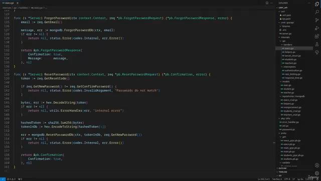
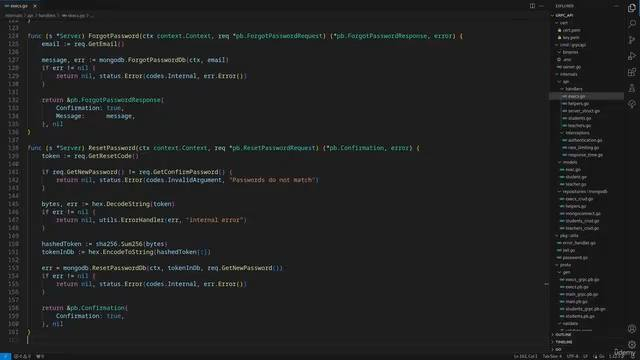
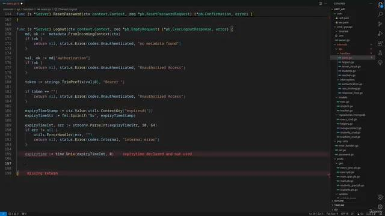
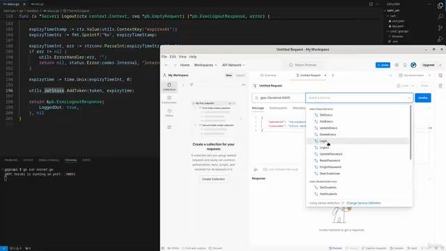
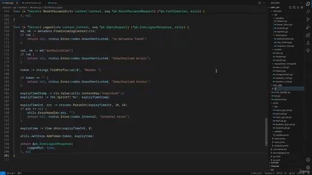
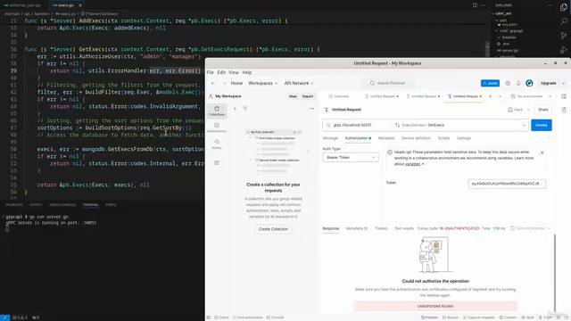
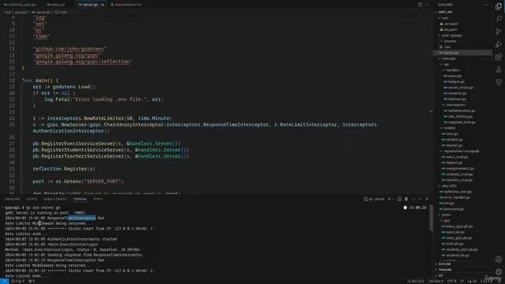
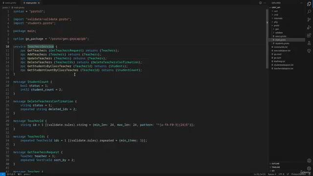
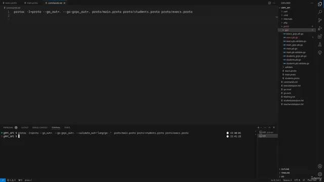
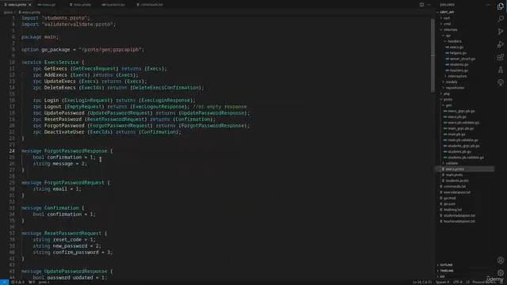

# gRPC & Protobuf 实战：Logout RPC、角色鉴权、拦截器顺序与 Proto 校验（P089–P093）

> 适用读者：前端转 AI 应用工程师。本课是 Go 语言写的 gRPC 服务端，Go 语法只需「知道即可」，重点看**流程与设计取舍**。涉及并发/锁的地方会补一句「在 JS/Node 里对应什么」。

---

## 1. 这一节做什么

这五集（P089–P093）是在一个已经跑起来的 gRPC 服务上做**收尾加固**，一共四件事：

1. **P089 — 实现 Logout RPC**：gRPC 没有浏览器 cookie 可删，所以改用「**失效 JWT 内存黑名单**」的思路：登出时把 token + 过期时间塞进一个带互斥锁的 map，并起一个后台循环定期清理过期项；再让认证拦截器在放行前查这个黑名单，登出过的 token 一律拒绝。
2. **P090 — 角色鉴权**：新增 `AuthorizedUser(ctx, allowedRoles...)` 工具函数，从 context 里取角色，和允许的角色列表比对，不匹配就返回错误。在 `GetExeces` 里演示：executive 被拒、admin 放行。
3. **P091 — 纯讲解**：为什么 gRPC 不需要 HPP/sanitize、压缩中间件、HTTP header、CORS。
4. **P092 — 拦截器执行顺序**：看日志发现请求先进 response-time 拦截器再到 rate-limiter，于是把 rate-limiter 提到最前面。
5. **P093 — Proto 层数据校验**：用 `protoc-gen-validate` 插件，在 `.proto` 里写校验规则，编译生成 `*.pb.validate.go`，RPC 开头调 `req.Validate()` 即可。

最终产物：一个「能登出、能按角色授权、请求先过限流、入参在 proto 层就被校验」的 gRPC 服务。

把这五集连起来看，它们不是五个孤立技巧，而是在补一条完整的服务端请求链路：请求先经过拦截器链，拦截器里先做限流、再做耗时统计、再做认证；认证通过后把角色和过期时间写进 context；handler 里先做角色授权，再做 proto 层参数校验，最后才进入业务逻辑。登出则是在认证链路上加了一个「失效 token 查询」的额外判断。对前端读者来说，可以把它类比成 Express/Koa 的 middleware 链：只是 gRPC 的 middleware 不叫 `next()`，而是由 `grpc.ChainUnaryInterceptor` 按注册顺序串起来；context 也不叫 `req.user`，而是通过 `context.WithValue` 往 handler 里传。学完这一节，你应当能手工走通「登录 → 带 token 调接口 → 登出 → 同 token 再调接口被拒」这条闭环，并能解释每一步失败时应该看哪个拦截器或哪个生成文件。

---

## 2. 讲师原话（带出处）

- 关于为什么 gRPC 的登出不能像 REST 那样删 cookie：
  > "in our REST API we accessed the cookie in the browser and then we deleted the authorization from the browser. So what are we going to do this time because in gRPC we cannot delete something on the client end."
  > —— p089 [00:57]

- 关于黑名单的核心设计：
  > "we can implement a list of invalidated JWTs... the key will be JWT and the value will be the expiry time. And what we are going to do is we are going to check periodically if the time has passed the current time."
  > —— p089 [01:27] / [02:51]

- 关于为什么必须加锁：
  > "there will be many requests from many users that will try to access this map at the same time... we need to ensure data integrity and that is why we need to use mutex."
  > —— p089 [15:53]

- 关于 int64 与 `strconv.Atoi` 的坑：
  > "you may be inclined to use strconv.Atoi... but what it returns is an int type value... we need the value in int64 format because the time value that is stored in a JWT is in Unix format."
  > —— p089 [11:09]

- 关于角色鉴权函数签名：
  > "the first argument is going to be the context... the next argument is going to be a variadic parameter of the allowed roles and this function is going to return just an error."
  > —— p090 [00:28]

- 关于 gRPC 不需要 CORS/header：
  > "we don't also have HTTP headers to use in GRPC API and we also don't need to use cores... gRPC lacks the functionality to interact with browsers and that's why we don't use HTTP headers or cores."
  > —— p091 [00:00] / [00:28]

- 关于拦截器顺序：
  > "Ideally what we want is the rate limiting interceptor to run first. So let's bring it before the response time interceptor."
  > —— p092 [00:55]

- 关于 proto 校验的收益：
  > "rec.validate calls the pb.validate.go file and that file contains the logic that was generated automatically... we didn't have to go through coding the complex validation logic for our input validation from client."
  > —— p093 [14:51]

这些原话对应的实现点很明确：P089 解决「登出后 token 还能不能用」；P090 解决「认证通过后角色够不够」；P091 解释 gRPC 与浏览器 REST 的边界；P092 解决「多个拦截器谁先谁后」；P093 解决「参数格式在进业务前就拦住」。复现时如果某一步效果不对，先回到对应原话找设计意图，再查代码位置，不要一上来就改业务逻辑。

---

## 3. 从零复现

### 3.1 前置条件

- 已有可运行的 gRPC 服务（本课前面集数搭好的），目录大致为：
  ```
  project/
  ├── cmd/server/main.go
  ├── interceptors/
  │   ├── authentication.go
  │   ├── ratelimit.go
  │   └── responsetime.go
  ├── utils/
  │   └── jwt.go
  ├── handlers/  (teachers.go, execs.go ...)
  └── proto/     (main.proto, execs.proto, students.proto ...)
  ```
- 已装好 `protoc`、`protoc-gen-go`、`protoc-gen-go-grpc`，以及本集要新增的 **`protoc-gen-validate`**。
- Postman 或任意 gRPC 客户端（本课用 Postman 发 gRPC 请求）。

### 3.2 步骤总览

| 步骤 | 做什么 | 涉及文件 |
|---|---|---|
| 1 | 在 `utils/jwt.go` 里加 `JWTStore` 结构体 + `AddToken` + `CleanupExpiredTokens` + `IsLoggedOut` + 全局实例 `JWT` | `utils/jwt.go` |
| 2 | 把 `ContextKey` 从拦截器挪到 `utils`（P089 挪到 jwt.go，P090 再挪到 authorized_user.go） | `utils/*.go` |
| 3 | 实现 `Logout` RPC：从 metadata 取 token、从 context 取过期时间、写入黑名单 | `handlers/execs.go`（或对应 handler） |
| 4 | 认证拦截器里调 `utils.JWT.IsLoggedOut(token)`，命中就拒绝 | `interceptors/authentication.go` |
| 5 | 新增 `utils/authorized_user.go`，实现 `AuthorizedUser` | `utils/authorized_user.go` |
| 6 | 在 `GetExeces` 里调用 `utils.AuthorizedUser(ctx, "admin", "manager")` | `handlers/execs.go` |
| 7 | 调整 `main.go` 里拦截器注册顺序：rate-limit 放最前 | `cmd/server/main.go` |
| 8 | 在 `.proto` 里写 `(validate.rules)`，跑 `protoc` 生成 `*.pb.validate.go` | `proto/*.proto` |
| 9 | 每个 RPC 开头加 `if err := req.Validate(); err != nil { ... }` | `handlers/*.go` |

### 3.3 关键命令

**生成带校验的 pb 文件**（P093 [01:55] 讲师原话：每个插件要自己的 flag，`lang=go` 到 `.` 之间用双引号）：

```bash
protoc \
  --go_out=. --go_opt=paths=source_relative \
  --go-grpc_out=. --go-grpc_opt=paths=source_relative \
  --validate_out="lang=go,paths=source_relative:." \
  proto/*.proto
```

跑完会在 proto 目录下多出 `*.pb.validate.go`。讲师把这条命令也存进了 `commands.txt`。

**命令解释**：这条命令一次跑三个插件。`--go_out` 生成普通 protobuf 消息代码；`--go-grpc_out` 生成 gRPC 客户端/服务端接口代码；`--validate_out` 生成校验代码。`paths=source_relative` 表示生成文件放在与 `.proto` 相同的相对目录，而不是按包名重新拼目录。`lang=go` 是 `protoc-gen-validate` 自己的参数，告诉它生成 Go 语言校验代码；`:` 后面是输出目录，这里用 `.` 表示当前目录。常见错误是漏掉 `import "validate/validate.proto";`，此时 `protoc` 会报找不到 `validate.proto` 或无法识别 `(validate.rules)`；另一个常见错误是 `--validate_out` 的引号写错，把 `lang=go` 和路径拆开，导致插件参数解析失败。排查时先 `which protoc-gen-validate` 确认插件在 PATH 里，再确认 `.proto` 顶部有 import，最后看生成目录里有没有 `*.pb.validate.go`。

**启动服务**：

```bash
go run ./cmd/server
```

**用 Postman 验证登出流程**（P089 [23:53] 起）：
1. 先调 Login 拿 JWT；
2. 把 JWT 填进 gRPC metadata 的 `authorization: Bearer <token>`；
3. 调 `GetExeces` 应成功；
4. 调 `Logout`；
5. 再用**同一个 token** 调 `GetExeces` → 应返回 Unauthorized。

**与前端的对照**：REST 里登出常常是 `document.cookie = ...; expires=...` 或前端删 localStorage，服务端并不一定知道 token 失效；gRPC 没有浏览器 cookie 这一层，客户端可能仍然持有 token，所以服务端必须自己记录「这个 token 已经作废」。Postman 的 gRPC metadata 相当于 HTTP header，但写法是 key-value 列表；测试时不要把 `Bearer` 前缀漏掉，否则拦截器 trim 后拿到空串或错误 token。

---

## 4. 完整代码

> 说明：以下代码按逐字稿里讲师展示的逻辑还原成**可直接保存运行**的完整文件。变量名、字段名严格对齐逐字稿里出现过的（`JWTStore`、`Tokens`、`AddToken`、`CleanupExpiredTokens`、`IsLoggedOut`、`AuthorizedUser`、`ContextKey`、`RoleKey`）。逐字稿没展示到的部分（如 import 的具体包路径、proto 的 package 名）按 Go 常规写法补全，并在注释里标注「课里未展示」。

### 4.1 `utils/jwt.go`

```go
package utils

import (
	"context"
	"sync"
	"time"
)

// ContextKey 用于在 context 中存放 JWT 过期时间戳（P089 从拦截器挪到这里）
// P090 又把它挪到了 authorized_user.go，见 4.3
type contextKey string

const (
	ContextKey contextKey = "expiry"
	RoleKey    contextKey = "role"
)

// JWTStore 是一个内存中的失效 JWT 黑名单
// key = JWT 字符串, value = 该 JWT 的过期时间
type JWTStore struct {
	mu     sync.Mutex
	Tokens map[string]time.Time
}

// 全局实例，供 handler 和 interceptor 共用（P089 [23:25] 从 handler 挪到这里）
var JWT = &JWTStore{
	Tokens: make(map[string]time.Time),
}

// AddToken 把登出的 token 及其过期时间写入黑名单
func (s *JWTStore) AddToken(token string, expiry time.Time) {
	s.mu.Lock()
	defer s.mu.Unlock()
	s.Tokens[token] = expiry
}

// CleanupExpiredTokens 后台循环，每 2 分钟清理一次已过期的 token
func (s *JWTStore) CleanupExpiredTokens() {
	for {
		time.Sleep(2 * time.Minute)

		s.mu.Lock()
		for token, expiry := range s.Tokens {
			if time.Now().After(expiry) {
				delete(s.Tokens, token)
			}
		}
		s.mu.Unlock()
	}
}

// IsLoggedOut 判断 token 是否在黑名单里
func (s *JWTStore) IsLoggedOut(token string) bool {
	s.mu.Lock()
	defer s.mu.Unlock()
	_, ok := s.Tokens[token]
	return ok
}
```

### 4.2 `handlers/execs.go` 中的 Logout RPC（片段，需并入你已有的 execs handler 文件）

```go
package handlers

import (
	"context"
	"fmt"
	"strconv"
	"strings"
	"time"

	"google.golang.org/grpc/metadata"

	"yourmodule/utils"
	pb "yourmodule/proto" // 课里未展示具体包名，按你项目实际改
)

func (s *Server) Logout(ctx context.Context, req *pb.LogoutRequest) (*pb.LogoutResponse, error) {
	// 1. 从 metadata 取 authorization
	md, ok := metadata.FromIncomingContext(ctx)
	if !ok {
		return nil, status.Error(codes.Unauthenticated, "metadata not found")
	}

	values := md.Get("authorization")
	if len(values) == 0 {
		return nil, status.Error(codes.Unauthenticated, "authorization not found")
	}

	// 2. 去掉 "Bearer " 前缀
	token := strings.TrimPrefix(values[0], "Bearer ")
	if token == "" {
		return nil, status.Error(codes.Unauthenticated, "token is blank")
	}

	// 3. 从 context 取过期时间（认证拦截器写入的）
	expiryVal := ctx.Value(utils.ContextKey)
	if expiryVal == nil {
		return nil, status.Error(codes.Unauthenticated, "expiry not found in context")
	}

	// 4. 逐字稿里踩坑：值实际是 float64，不是 int
	//    先断言成 float64，再类型转换（不是断言）成 int64
	f64, ok := expiryVal.(float64)
	if !ok {
		return nil, status.Error(codes.Internal, "expiry is not float64")
	}
	expiryInt := int64(f64)

	// 5. 转成 time.Time
	expiryTime := time.Unix(expiryInt, 0)

	// 6. 写入黑名单
	utils.JWT.AddToken(token, expiryTime)

	return &pb.LogoutResponse{Success: true}, nil
}
```

> 逐字稿 P089 [10:19]–[13:35] 里讲师先尝试用 `fmt.Sprintf` + `strconv.ParseInt` 把 context 里的值转成 int64，结果运行时报错「it is float 64」，最后改成先断言 `float64` 再 `int64(f64)`。上面代码是**修正后**的最终版。`status`/`codes` 的 import 路径课里没展示，按 `google.golang.org/grpc/status`、`google.golang.org/grpc/codes` 补。

### 4.3 `utils/authorized_user.go`

```go
package utils

import (
	"context"
	"errors"
)

// AuthorizedUser 检查当前用户角色是否在允许列表中
func AuthorizedUser(ctx context.Context, allowedRoles ...string) error {
	roleVal := ctx.Value(RoleKey)
	if roleVal == nil {
		return errors.New("role not found in context")
	}

	userRole, ok := roleVal.(string)
	if !ok {
		return errors.New("role is not a string")
	}

	for _, r := range allowedRoles {
		if r == userRole {
			return nil
		}
	}
	return errors.New("user not authorized for access")
}
```

### 4.4 `interceptors/authentication.go`（关键改动）

```go
package interceptors

import (
	"context"
	"strings"

	"google.golang.org/grpc"
	"google.golang.org/grpc/codes"
	"google.golang.org/grpc/metadata"
	"google.golang.org/grpc/status"

	"yourmodule/utils"
)

func AuthenticationInterceptor(
	ctx context.Context,
	req interface{},
	info *grpc.UnaryServerInfo,
	handler grpc.UnaryHandler,
) (interface{}, error) {
	md, ok := metadata.FromIncomingContext(ctx)
	if !ok {
		return nil, status.Error(codes.Unauthenticated, "metadata not found")
	}

	values := md.Get("authorization")
	if len(values) == 0 {
		return nil, status.Error(codes.Unauthenticated, "authorization not found")
	}

	token := strings.TrimPrefix(values[0], "Bearer ")
	if token == "" {
		return nil, status.Error(codes.Unauthenticated, "token is blank")
	}

	// 校验 JWT 本身（你项目里已有的逻辑，课里未展示细节）
	claims, err := utils.ValidateJWT(token) // 课里未展示函数名，按你项目实际改
	if err != nil {
		return nil, status.Error(codes.Unauthenticated, err.Error())
	}

	// P089 新增：查黑名单
	if utils.JWT.IsLoggedOut(token) {
		return nil, status.Error(codes.Unauthenticated, "token has been logged out")
	}

	// 把过期时间和角色写进 context，供 Logout 和 AuthorizedUser 使用
	ctx = context.WithValue(ctx, utils.ContextKey, claims["exp"])
	ctx = context.WithValue(ctx, utils.RoleKey, claims["role"])

	return handler(ctx, req)
}
```

### 4.5 `handlers/execs.go` 中 `GetExeces` 加角色校验

```go
func (s *Server) GetExeces(ctx context.Context, req *pb.GetExecesRequest) (*pb.GetExecesResponse, error) {
	// P090：角色校验
	if err := utils.AuthorizedUser(ctx, "admin", "manager"); err != nil {
		return nil, status.Error(codes.PermissionDenied, err.Error())
	}

	// P093：proto 层校验（见 4.7）
	if err := req.Validate(); err != nil {
		return nil, status.Error(codes.InvalidArgument, err.Error())
	}

	// ... 原有业务逻辑
	return &pb.GetExecesResponse{}, nil
}
```

### 4.6 `cmd/server/main.go` 拦截器顺序（P092）

```go
package main

import (
	"google.golang.org/grpc"

	"yourmodule/interceptors"
)

func main() {
	server := grpc.NewServer(
		grpc.ChainUnaryInterceptor(
			interceptors.RateLimitInterceptor,      // 先限流
			interceptors.ResponseTimeInterceptor,   // 再计时
			interceptors.AuthenticationInterceptor, // 最后认证
		),
	)
	// ... 注册服务、监听端口
	_ = server
}
```

> 逐字稿 P092 只展示了「把 rate limiter 挪到 response time 前面」这个结论，`ChainUnaryInterceptor` 的具体写法课里没展示，按 gRPC-Go 常规写法补。拦截器函数名（`RateLimitInterceptor` 等）也按你项目实际改。

### 4.7 `proto/main.proto` 校验规则（P093 讲师展示的部分）

```protobuf
syntax = "proto3";

package main;

import "validate/validate.proto";

message Teacher {
  string id = 1 [(validate.rules).string = {
    min_len: 24,
    max_len: 24,
    pattern: "^[a-fA-F0-9]{24}$"
  }];

  string first_name = 2 [(validate.rules).string = {
    pattern: "^[a-zA-Z ]+$"
  }];

  string last_name = 3 [(validate.rules).string = {
    pattern: "^[a-zA-Z ]+$"
  }];

  string email = 4 [(validate.rules).string = {
    email: true
  }];

  string class = 5 [(validate.rules).string = {
    pattern: "^[a-zA-Z ]+$"
  }];

  string subject = 6 [(validate.rules).string = {
    pattern: "^[a-zA-Z0-9 ]+$"
  }];
}

message GetTeachersRequest {
  repeated string teacher_ids = 1 [(validate.rules).repeated = {
    min_items: 1
  }];
}
```

### 4.8 `proto/execs.proto` 校验规则（P093 讲师展示的部分）

```protobuf
syntax = "proto3";

package execs;

import "validate/validate.proto";

message LoginRequest {
  string username = 1 [(validate.rules).string = {
    pattern: "^[a-zA-Z0-9_.@]+$",
    ignore_empty: false
  }];

  string password = 2 [(validate.rules).string = {
    pattern: "^[a-zA-Z0-9_.@#$%^&*]+$",
    ignore_empty: false
  }];
}

message AddExecRequest {
  string first_name = 1 [(validate.rules).string = {
    pattern: "^[a-zA-Z ]+$"
  }];

  string last_name = 2 [(validate.rules).string = {
    pattern: "^[a-zA-Z ]+$"
  }];

  string email = 3 [(validate.rules).string = {
    email: true
  }];

  // 注意：这里 username/password 允许为空，所以不写 ignore_empty: false
  string username = 4 [(validate.rules).string = {
    pattern: "^[a-zA-Z0-9_.@]+$"
  }];

  string password = 5 [(validate.rules).string = {
    pattern: "^[a-zA-Z0-9_.@#$%^&*]+$"
  }];
}
```

> 逐字稿 P093 [06:06]–[07:29] 明确说了：`LoginRequest` 里 username/password 用 `ignore_empty: false`（空就报错），而 `AddExecRequest` 里同样的字段**不设** `ignore_empty: false`（因为有时可以为空）。正则的具体字符集讲师口述为「字母、数字、这些特殊字符、不含空格」，上面按口述还原，实际以你项目为准。

---

## 5. 逐行解释

### 5.1 `JWTStore` 为什么这么设计

- **为什么用 map 而不是 Redis**：讲师原话「for our use, we are going to create a struct... a kind of in-memory database by ourself」（p089 [02:25]）。生产环境该用 Redis，但本课为了不引入外部依赖，自己用 struct + map 模拟。**在 Node 里对应**：一个模块级 `const tokens = new Map()`。
- **为什么 value 存过期时间而不是 bool**：如果只存 `true`，map 会无限增长。存过期时间才能让后台循环知道「什么时候可以删」。这是「**TTL 黑名单**」的标准做法。
- **`sync.Mutex` 保护什么**：gRPC 服务端每个请求一个 goroutine，多个请求同时读写 `Tokens` map 会 data race。Go 的 map 并发写会直接 panic。**在 Node 里对应**：Node 单线程事件循环天然没有这个问题，但如果你用 worker_threads 共享内存就要自己加锁。
- **`AddToken` 里 `defer s.mu.Unlock()`**：保证即使中间 panic 也能解锁，避免死锁。**在 Node 里对应**：`try/finally`。
- **`CleanupExpiredTokens` 的 `time.Sleep(2 * time.Minute)`**：讲师原话「we are going to give it a break of two minutes」（p089 [18:56]）。注意这个函数是**阻塞的无限循环**，调用时要 `go utils.JWT.CleanupExpiredTokens()` 起一个 goroutine，否则会卡住主线程。**在 Node 里对应**：`setInterval(fn, 2 * 60 * 1000)`。
- **`time.Now().After(expiry)`**：判断「现在是否晚于过期时间」，即已过期。讲师原话「if time dot now dot after timestamp is true that means the timestamp is past the current time」（p089 [19:50]）。
- **`IsLoggedOut` 用 `_, ok := s.Tokens[token]`**：只关心 key 是否存在，不关心 value。讲师原话「discard the returned value associated with the token and only accept the Boolean value」（p089 [29:44]）。

### 5.2 Logout RPC 里几个坑

- **`metadata.FromIncomingContext` 而不是 `FromOutgoingContext`**：服务端读客户端发来的 metadata 用 Incoming。讲师特意提醒「be careful to use Metadata package from GRPC Metadata and not GRPC internal Metadata」（p089 [05:44]）。
- **`md.Get("authorization")` 返回 slice**：gRPC metadata 的 value 是 `[]string`，因为同名 key 可以有多个值。所以要先判 `len(values) == 0` 再取 `values[0]`。
- **`strings.TrimPrefix(values[0], "Bearer ")`**：客户端发的是 `Bearer eyJ...`，要剥掉前缀才是纯 token。讲师原话「the value will also contain a prefix bearer and a space. So we need to trim that」（p089 [07:26]）。
- **为什么最后没用 `strconv.ParseInt`**：讲师一开始想用 `fmt.Sprintf` + `strconv.ParseInt` 把 context 里的值转 int64，运行时发现值实际是 `float64`（JSON 数字反序列化的默认类型），于是改成 `f64, ok := expiryVal.(float64)` 再 `int64(f64)`。讲师原话「it is float 64... let's convert this to float 64... then convert this to int64 by using type conversion not by type assertion」（p089 [25:12]–[26:33]）。**类型断言 vs 类型转换**：`x.(T)` 是断言（带 ok 布尔），`T(x)` 是转换（不带 ok）。讲师特意强调了这个区别。
- **`time.Unix(expiryInt, 0)` 第二个参数是纳秒**：讲师原话「The second argument to time dot unix is nanoseconds... We are going to pass zero」（p089 [14:03]）。

### 5.3 认证拦截器里的黑名单检查

- 位置很关键：**必须在 JWT 本身校验通过之后**再查黑名单。因为黑名单只存「曾经合法但已登出」的 token，如果 token 本身签名就不对，查黑名单没意义。
- 命中黑名单返回 `codes.Unauthenticated`，讲师原话「if okay is true that means the token has logged out and it means that we cannot let that token log back in again」（p089 [31:04]）。

### 5.4 `AuthorizedUser` 的设计

- **为什么用 variadic `...string`**：一个 RPC 可能允许多个角色，调用方写 `AuthorizedUser(ctx, "admin", "manager")` 比传 slice 更顺手。讲师原话「a variadic parameter of the allowed roles」（p090 [00:28]）。
- **为什么返回 `error` 而不是 `bool`**：调用方拿到 error 直接 `return nil, status.Error(codes.PermissionDenied, err.Error())`，比 bool 多带了原因信息。
- **角色从哪来**：认证拦截器解析 JWT 后把 role 写进 context（`context.WithValue(ctx, utils.RoleKey, claims["role"])`），`AuthorizedUser` 再从 context 读。这是 gRPC 拦截器向 handler 传值的标准套路。**在 Node/Express 里对应**：middleware 里 `req.user = decoded`，handler 里读 `req.user.role`。
- **`ContextKey` 挪了两次家**：P089 从拦截器挪到 `utils/jwt.go`（讲师原话「accessing the context key from interceptor actually feels a little odd... I'm going to move the context key in the utils package」p089 [09:05]）；P090 又从 jwt.go 挪到 `authorized_user.go`（讲师原话「context key is relevant in this file of the utils folder」p090 [02:35]）。最终位置在 `authorized_user.go`。

### 5.5 拦截器顺序（P092）

讲师看日志发现请求先进 response-time 再到 rate-limiter，认为不合理——**限流应该最先挡**，被限流的请求根本不该进入计时逻辑。所以把 rate-limiter 提到最前。最终顺序：

```
RateLimit → ResponseTime → Authentication → RPC handler
```

响应回来时反向经过：ResponseTime 最后结束（因为它要算总耗时）。讲师原话「the response goes to the response time interceptor first」（p092 [00:28]）——注意这里说的是响应**回到** response-time 拦截器，因为它在链上包着后面的拦截器。

### 5.6 Proto 校验（P093）

- **为什么要 `import "validate/validate.proto"`**：不 import 的话 `protoc` 不认识 `(validate.rules)` 这个 option，编译直接报错。讲师原话「we need to import the validate.proto file so that our validation logic will automatically be generated」（p093 [00:59]）。
- **`--validate_out="lang=go,paths=source_relative:."`**：`protoc-gen-validate` 是独立插件，要自己的 flag。讲师原话「every plugin requires its own flag... make sure that the part from lang to the dot is between double quotes」（p093 [01:55]）。
- **MongoDB ID 为什么是 24 位**：讲师原话「MongoDB IDs have fixed character length and it is 24」（p093 [03:15]）。所以 `min_len: 24, max_len: 24` 加 `pattern: "^[a-fA-F0-9]{24}$"`。
- **`ignore_empty: false` 的含义**：默认情况下 proto 校验对空字符串**跳过**校验（认为「没填就不校验」）。设 `ignore_empty: false` 表示「空也要校验，空就报错」。讲师原话「if we mark ignore empty true or if we don't do anything here then empty field will also be passed to our API」（p093 [07:02]）。
- **同一个 message 被多个 RPC 复用时的坑**：讲师原话「when you are sharing the same message between different RPCs and those different RPCs may have different validation requirements... you may want to create separate message for separate RPCs」（p093 [07:57]）。比如 `LoginRequest` 要求 username 非空，但 `AddExecRequest` 里 username 可空，就不能复用同一个 message。
- **RPC 里怎么调**：`if err := req.Validate(); err != nil { return nil, status.Error(codes.InvalidArgument, err.Error()) }`。讲师原话「this is the code snippet that we need to implement in all the RPCs right at the beginning」（p093 [09:20]）。
- **验证效果**：讲师用 `>` 号测 username，`pb.validate.go` 报错；用 `@` 号测，通过了 proto 校验但业务层报「user not found」。讲师原话「if you are using at the rate hash or dollar then in that case the error comes from our code not from the PB dot validate dot go code」（p093 [13:07]）。

---

## 6. 复现检查清单

按顺序打勾，任何一步不过就别往下走：

- [ ] `utils/jwt.go` 里 `JWTStore` 的 `Tokens` 字段是**大写开头**（导出），否则 handler 访问不到（P089 [21:12] 踩过这个坑）。验证：在 handler 里写 `utils.JWT.Tokens`，如果编译报「cannot refer to unexported field」，说明字段大小写不对。
- [ ] `utils.JWT` 是**包级变量**（`var JWT = &JWTStore{...}`），不是 handler 里的局部变量（P089 [22:56] 讲师特意挪出来）。验证：Logout handler 和认证拦截器都 import `utils` 并引用同一个 `utils.JWT`，登出后拦截器能查到。
- [ ] `CleanupExpiredTokens` 用 `go utils.JWT.CleanupExpiredTokens()` 启动，不是直接调用（否则阻塞）。验证：启动服务后主线程能继续监听端口；如果卡在启动阶段，检查是不是漏了 `go`。
- [ ] Logout RPC 里 context 取出的过期时间先断言 `float64` 再 `int64()`，不是直接 `int64(expiryVal)`（会 panic）。验证：用合法 token 调 Logout，服务不崩且返回成功；若日志出现 interface conversion panic，按 5.2 改断言。
- [ ] 认证拦截器里 `IsLoggedOut` 检查在 JWT 校验**之后**。验证：伪造一个签名错误的 token，应返回 JWT 校验错误；登出过的合法 token 才返回「token has been logged out」。
- [ ] `AuthorizedUser` 的 `ContextKey`/`RoleKey` 定义在 `utils` 包，handler 和 interceptor 都能 import。验证：拦截器写入 `utils.RoleKey` 后，`GetExeces` 里 `AuthorizedUser` 能读到角色，不返回「role not found in context」。
- [ ] `main.go` 里拦截器顺序是 RateLimit → ResponseTime → Authentication。验证：看启动日志或临时在拦截器里打日志，确认限流最先打印；被限流的请求不应出现 response-time 结束日志。
- [ ] `.proto` 文件顶部有 `import "validate/validate.proto";`。验证：运行 `protoc` 不报找不到 `validate.proto`；若报错，检查 `-I` 路径或插件安装目录。
- [ ] `protoc` 命令带 `--validate_out="lang=go,paths=source_relative:."`，跑完能看到 `*.pb.validate.go`。验证：`ls proto/*.pb.validate.go` 有输出；没有则检查命令引号和插件 PATH。
- [ ] 每个用了校验规则的 RPC 开头都有 `req.Validate()` 调用。验证：用不符合正则的入参请求，应返回 `InvalidArgument` 且错误来自 `pb.validate.go`；若进了业务层才报错，说明漏调 `Validate()`。
- [ ] Postman 测试：Login → GetExeces（成功）→ Logout → GetExeces（Unauthorized）。验证：第二次 GetExeces 的错误信息应包含「token has been logged out」或等价认证失败，而不是业务错误。
- [ ] Postman 测试：executive 角色调 GetExeces → PermissionDenied；admin 调 → 成功。验证：切换不同角色登录拿 token，分别请求，确认错误码是 `PermissionDenied` 而非 `Unauthenticated`。
- [ ] Postman 测试：username 带 `>` → 校验错误；带 `@` → 通过校验进业务层。验证：前者错误应来自 `Validate()`，后者错误应是「user not found」等业务信息，说明校验层已放行。

---

## 7. 课里没讲但你会撞上的

| 现象 | 原因 | 怎么办 |
|---|---|---|
| `CleanupExpiredTokens` 的 goroutine 泄漏 | 课里没讲怎么优雅停止这个无限循环；服务关闭时 goroutine 还在跑，生产环境会积累。 | 生产环境应该用 `context.Context` + `select` 监听退出信号，否则服务关闭时 goroutine 还在跑。**在 Node 里对应**：`setInterval` 返回的 handle 要 `clearInterval`。复现时可先接受这个简化，但部署前要补退出逻辑。 |
| 多实例部署时黑名单不共享 | 课里是单机内存 map，如果你部署 3 个 pod，用户在 pod A 登出，pod B 不知道。 | 生产必须换 Redis。课里没讲这个限制；本地复现单实例没问题，多副本部署前要把 `JWTStore` 的读写换成共享存储。 |
| `claims["exp"]` 的实际类型不对 | 课里没展示 JWT 解析库（可能是 `golang-jwt/jwt`），不同库把 `exp` 解析成 `float64` 还是 `json.Number` 不一样。 | 如果断言 `float64` 失败，先 `fmt.Printf("%T", expiryVal)` 看实际类型，再按实际类型做断言或转换；不要直接 `int64(expiryVal)`。 |
| `protoc-gen-validate` 已停止维护 | 课里没提，但该项目官方已归档，社区推荐迁移到 `protovalidate`。 | 本课代码仍可用；新项目建议评估 `protovalidate` 或其他校验方案。复现时先保证插件版本能跑通，再考虑迁移。 |
| `status.Error` 的 import 路径写错 | 课里没展示，是 `google.golang.org/grpc/status` 和 `google.golang.org/grpc/codes`。 | 别写成 `status.New` 忘了 `.Err()`；编译报 undefined 时先检查这两个 import。复现时把 `status.Error(codes.Unauthenticated, ...)` 作为标准写法。 |
| proto 正则的转义报错 | `.proto` 里写 `pattern: "^[a-zA-Z ]+$"` 时，反斜杠要双写（`\\d`），否则 protoc 解析报错。 | 课里用的都是字符类没涉及 `\d`，你扩展时会撞上；写 `\\d`、`\\s` 等转义时先在最小 proto 文件里试编译。 |
| `GetExeces` 的拼写被「纠正」 | 课里 RPC 名就是 `GetExeces`（不是 `GetExecs`），proto 生成代码后方法名以此为准。 | 别自己「纠正」拼写；调用方、handler、proto 三处必须一致，否则编译或运行时报找不到方法。 |
| 限流 50 req/min 会卡住测试 | 讲师 P089 [31:29] 提到他把限流调到 50 就是为了测试不被卡。 | 你复现时如果还是默认值，测登出流程可能中途被限流，记得临时调高；验证时看错误是不是 rate limit 相关，再决定是否调整。 |

---

## 附：关键截图



















