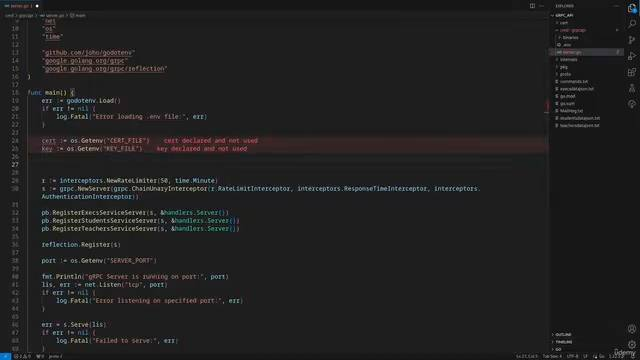
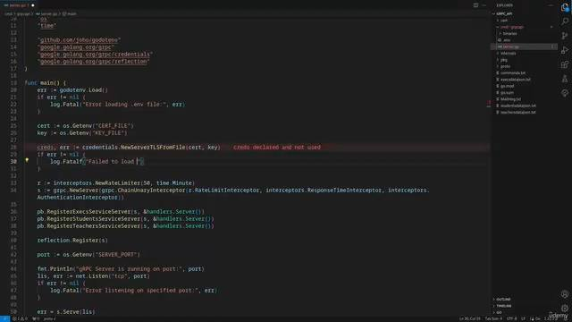
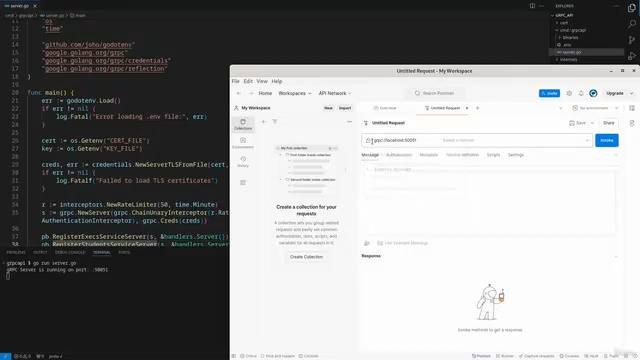
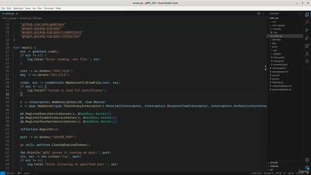
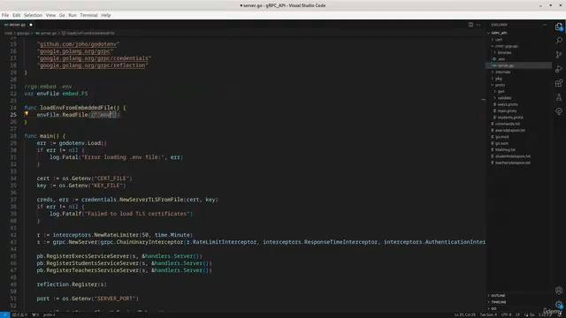
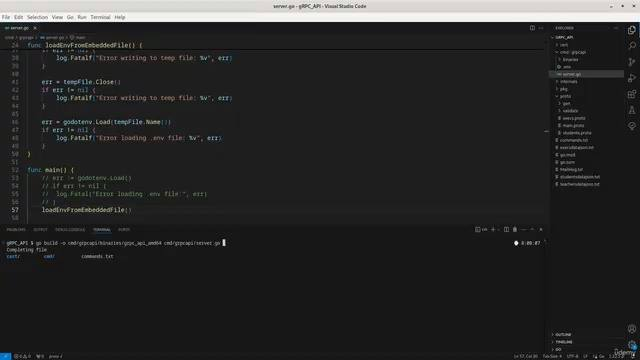
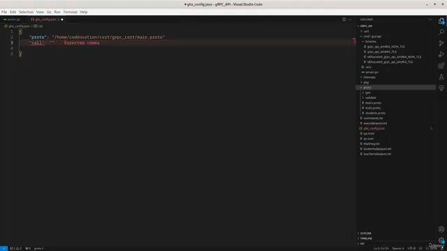
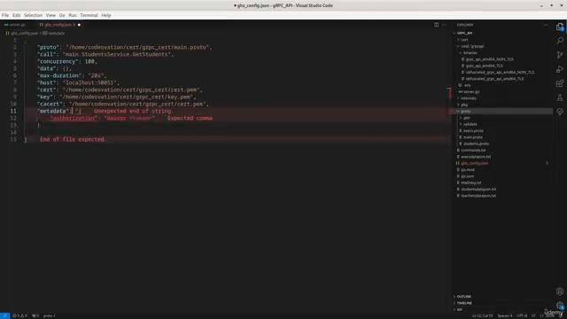
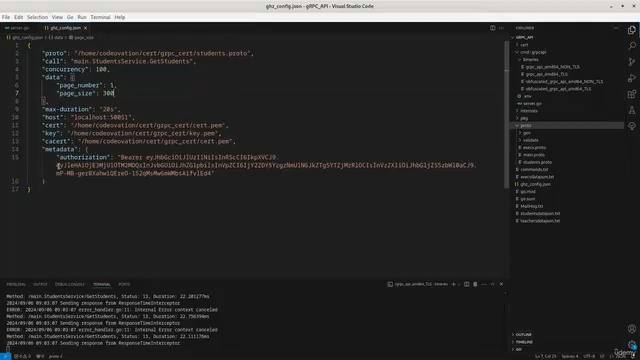
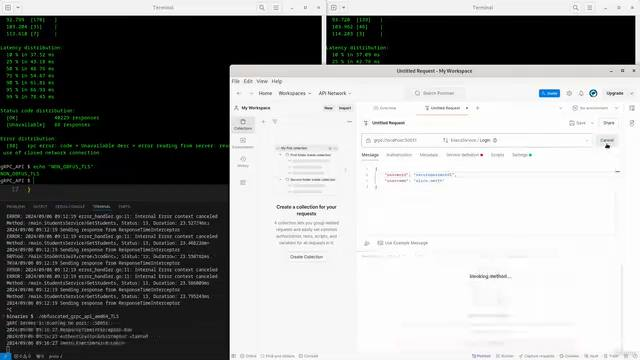

# gRPC & Protobuf（P94–P99）：TLS、二进制打包与 GHZ 压测复现文档

> 说明：本段课程（P94–P99）承接前面已完成的 gRPC API 项目（含 MongoDB、拦截器、认证、限流、反射注册）。P94 给服务器加 TLS；P95 把 `.env` 嵌入二进制并产出 TLS / 非 TLS、原生 / Garble 混淆四个可执行文件；P96 用 GHZ 配置文件做压测并对比四种二进制；P97–P99 是课程总结与职业建议，没有代码。下面按「能照着跑起来」的标准重组。

---

## 1. 这一节做什么

这一段的核心目标有三个，按顺序完成：

1. **给 gRPC 服务器加 TLS**：从环境变量读取证书与私钥路径，用 `credentials.NewServerTLSFromFile` 生成凭据，传给 `grpc.NewServer`。同时在 `main` 里启动一个后台 goroutine 定期清理过期 token。
2. **把 API 打成单文件二进制**：用 `go:embed` 把 `.env` 嵌进可执行文件，运行时先写临时文件再 `godotenv.Load`，这样二进制拷到任何机器都能直接跑，不依赖外部 `.env`。产出四个二进制：TLS / 非 TLS × 原生 `go build` / `garble build` 混淆。
3. **用 GHZ 压测**：把 proto 路径、RPC 名、并发、时长、host、证书、metadata（Bearer token）、请求体全部写进 `ghz-config.json`，命令行只剩 `ghz --config ghz-config.json`（非 TLS 再加 `--insecure`）。对比「返回 10 条 vs 300 条学生数据」的吞吐与延迟差异，以及 TLS / 非 TLS、原生 / 混淆的差异。

P97–P99 是结课总结：回顾课程知识地图、鼓励做个人项目、给职业建议。**课里没有代码**，本文档不为其编造实现。

---

## 2. 讲师原话（带出处）

> "现在让我们在服务器上实现 TLS，为此我们需要证书文件和密钥文件……我要引入一个新变量 `cert`，然后调用 `os.getenv`，并把承载证书路径的环境变量传给它。"
> —— p094 [00:00]

> "我们在这里调用 `NewServerTLSFromFile` 方法，然后把证书文件和密钥文件传给它；接下来处理返回值，我们知道它会返回 `creds` 和错误。"
> —— p094 [00:52]

> "现在我们有了 `creds`，就可以把它传给 `grpc.NewServer`。我们通过 `grpc.Creds` 把它传给 `grpc.NewServer`。"
> —— p094 [01:38]

> "在生产环境中，你绝不应该使用 `reflection.Register`。如果你用了它，那实际上会被视为安全缺陷。所以在 gRPC 中，生产环境应该让客户端使用 Protocol Buffer 文件，而不是在运行时使用反射。反射只用于开发环境。"
> —— p094 [03:01]

> "我们需要把这个 `.env` 文件嵌入到 API 二进制文件中，并在启动服务器之前加载这个 `.env` 文件……为此我们使用 `go:embed` 指令。"
> —— p095 [00:00]

> "第一步是创建一个空的临时文件，然后从 `.env` 文件读取内容，把内容写入临时文件，再关闭临时文件。最后，我们使用 `godotenv` 包把这个临时文件加载为环境变量。"
> —— p095 [01:20]

> "我们已经实现了限流器，而在做基准测试时这会带来问题，因为我们不知道一分钟内会收到多少请求……所以我不会使用限流器拦截器。"
> —— p095 [08:56]

> "做基准测试时，我们会使用 GHZ，它是一个专门用于对 gRPC 服务器做基准测试的工具。这次我不会在命令里给 GHZ 提供任何值，而是使用配置文件。"
> —— p096 [00:00]

> "如果请求里不包含任何数据，我们默认只从数据库返回 10 名学生。所以我们需要使用分页上限和每页大小。"
> —— p096 [08:53]

> "从 66,422 降到 40,229。所以受到影响的不仅是吞吐量，还有延迟。"
> —— p096 [11:09]

> "令人意外的是，它的性能比用 Go 原生构建的 API 更好……Garble 实际上不会影响 API 的性能。"
> —— p096 [15:26]

---

## 3. 从零复现

### 3.1 前置条件

- 已完成前面课程里的 gRPC API 项目（含 `main.proto`、`students.proto`、`validate.proto`、MongoDB 连接、认证拦截器、限流拦截器、反射注册）。
- 本机已安装 Go（课程使用 Go 原生工具链）、`garble`、`ghz`、`openssl`（生成自签证书用）。
- 有一个可用的 MongoDB 实例，且数据库里已有学生数据（讲师环境里约 335 条，压测时取 300 条）。
- 项目目录约定（与讲师一致）：

```
project/
├── cmd/
│   └── grpc-api/
│       ├── server.go
│       ├── .env
│       └── binaries/          # 构建产物输出目录
├── proto/
│   ├── main.proto
│   ├── students.proto
│   └── validate/
│       └── validate.proto
└── certs/
    ├── cert.pem
    └── key.pem
```

> 课里没有给出完整的目录树，上面是按讲师在 P095 里提到的 `CMD, GRPC API and then binaries`、`server.go file is inside CMD, gRPC API` 以及 P096 里「把 proto、证书、key 复制到同一个文件夹方便压测」的描述整理出来的。**如果你的项目结构不同，只需保证 `server.go` 与 `.env` 同目录、`binaries/` 存在即可。**

### 3.2 第一步：生成自签证书

课里没有演示证书生成命令（讲师直接用了已有的 `cert.pem` / `key.pem`）。本地复现需要自己生成一份，否则 TLS 起不来。用 openssl 生成 localhost 自签证书：

```bash
mkdir -p certs
openssl req -x509 -newkey rsa:4096 -nodes \
  -keyout certs/key.pem \
  -out certs/cert.pem \
  -days 365 \
  -subj "/CN=localhost" \
  -addext "subjectAltName=DNS:localhost,IP:127.0.0.1"
```

> 这条命令是本文档补的，**课里没讲**。讲师只说了「需要 certificate file 和 key file」。

### 3.3 第二步：在 `.env` 里加证书路径

在 `cmd/grpc-api/.env` 里追加（变量名按讲师 P094 的 `os.getenv` 用法，具体名字课里没念出来，下面用 `TLS_CERT_FILE` / `TLS_KEY_FILE`，**你需要让 `.env` 里的名字和 `server.go` 里 `os.Getenv` 的参数完全一致**）：

```dotenv
TLS_CERT_FILE=./certs/cert.pem
TLS_KEY_FILE=./certs/key.pem
```

### 3.4 第三步：改 `server.go` 加 TLS + 启动 token 清理

按 P094 的顺序改：

1. 读 `cert`、`key` 两个环境变量；
2. `credentials.NewServerTLSFromFile(cert, key)` 拿到 `creds, err`；
3. `grpc.NewServer(grpc.Creds(creds), ...其他已有的 interceptor 选项)`；
4. 在 `main` 里 `go cleanupExpiredTokens(...)` 启动后台清理。

完整代码见第 4 节。

### 3.5 第四步：把 `.env` 嵌入二进制

按 P095 的顺序：

1. 在 `server.go` 顶部加 `//go:embed .env` 和 `var envFile []byte`（讲师原话是「the end file variable contains the .env file」）；
2. 写 `loadEnvFromEmbeddedFile()`：读 `envFile` → `os.CreateTemp("", ".env")` → `defer os.Remove` → `Write` → `Close` → `godotenv.Load(tempFile.Name())`；
3. 在 `main` 第一行调用它，把原来的 `godotenv.Load()` 注释掉。

### 3.6 第五步：构建四个二进制

先**注释掉限流拦截器**（P095 [08:56] 明确说压测时不能开限流，否则吞吐被人为压低）。然后：

```bash
cd cmd/grpc-api
mkdir -p binaries

# TLS 原生
go build -o binaries/grpc-api-amd64-tls server.go

# TLS 混淆
garble build -o binaries/grpc-api-amd64-tls-obfuscated server.go

# 非 TLS 原生（先把 server.go 里 TLS 相关代码注释掉）
go build -o binaries/grpc-api-amd64 server.go

# 非 TLS 混淆
garble build -o binaries/grpc-api-amd64-obfuscated server.go
```

> 讲师在 P095 [10:14] 说「the command is going to be the same, apart from the difference that the prefix will not be go, it'll be garble」，输出文件名加 `obfuscated` 后缀。跨平台构建用 `GOOS` / `GOARCH`（P095 [07:11] 提到，但本段没演示具体命令，**课里没给完整示例**）。

### 3.7 第六步：写 `ghz-config.json` 并压测

按 P096 的字段顺序写配置文件（见第 4 节完整文件）。关键点：

- `proto` 必须是**绝对路径**（P096 [01:26]：「this needs to be the absolute path」）；
- `call` 是 `main.studentService.getStudents`（P096 [01:52]）；
- `concurrency: 100`，`max-duration` 保持 20 秒（P096 [02:22]）；
- `host: localhost:50051`；
- `cert` / `key` / `cacert` 指向同一份证书；
- `metadata.authorization` 必须是 `Bearer <token>` 格式（P096 [04:04]：「it had bearer, space and then token」）；
- `data` 里带 `page` 和 `pageSize: 300`（P096 [09:21]，否则默认只返回 10 条）。

跑：

```bash
# TLS 服务器
ghz --config ghz-config.json

# 非 TLS 服务器
ghz --insecure --config ghz-config.json
```

> 注意：token 有效期很短（讲师 P096 [06:25] 说「I have not changed the token validation time. It's still a pretty short duration」），**每次压测前都要重新登录拿新 token 填进配置文件**，否则会得到大量 unauthenticated 响应。

---

## 4. 完整代码

### 4.1 `cmd/grpc-api/server.go`（TLS + embed .env 版本）

> 下面只保留本段课程新增/修改的部分，其余（MongoDB 连接、各拦截器实现、各 RPC handler）沿用你前面课程已写好的代码。**课里没有给出完整 `server.go`，这里给出的是本段涉及的可直接粘贴的片段拼成的骨架**，`// ... 已有代码 ...` 处填你原来的实现。

```go
package main

import (
	"context"
	_ "embed"
	"log"
	"os"
	"time"

	"google.golang.org/grpc"
	"google.golang.org/grpc/credentials"
	"google.golang.org/grpc/reflection"

	"github.com/joho/godotenv"
	"go.mongodb.org/mongo-driver/mongo"
	"go.mongodb.org/mongo-driver/mongo/options"

	pb "your-module/proto" // 换成你实际的生成代码包路径
)

//go:embed .env
var envFile []byte

// loadEnvFromEmbeddedFile 把嵌入的 .env 写到临时文件，再用 godotenv 加载。
func loadEnvFromEmbeddedFile() error {
	content, err := envFile, error(nil)
	_ = content
	_ = err

	// 1) 读嵌入内容（envFile 本身就是内容，这里保留讲师「read file」的语义）
	data := envFile

	// 2) 创建临时文件
	tempFile, err := os.CreateTemp("", ".env")
	if err != nil {
		return err
	}
	defer os.Remove(tempFile.Name())

	// 3) 写入内容
	if _, err := tempFile.Write(data); err != nil {
		return err
	}

	// 4) 关闭，确保落盘
	if err := tempFile.Close(); err != nil {
		return err
	}

	// 5) 用 godotenv 加载
	return godotenv.Load(tempFile.Name())
}

func main() {
	// 第一步：加载环境变量（替代原来的 godotenv.Load()）
	if err := loadEnvFromEmbeddedFile(); err != nil {
		log.Fatalf("load env: %v", err)
	}

	// 第二步：读证书与私钥路径
	cert := os.Getenv("TLS_CERT_FILE")
	key := os.Getenv("TLS_KEY_FILE")

	// 第三步：生成 TLS 凭据
	creds, err := credentials.NewServerTLSFromFile(cert, key)
	if err != nil {
		log.Fatalf("load TLS creds: %v", err)
	}

	// 第四步：创建 gRPC server，挂上 TLS 和已有拦截器
	// 注意：压测时把 rate limiter 拦截器注释掉（P095 [08:56]）
	srv := grpc.NewServer(
		grpc.Creds(creds),
		// grpc.UnaryInterceptor(你的拦截器链),
	)

	// ... 注册 service、连接 MongoDB 等已有代码 ...
	_ = srv
	_ = mongo.Client{}
	_ = options.Client()
	_ = context.Background()
	_ = time.Second
	_ = reflection.Register
	_ = pb.File_main_proto
}
```

> 上面为了能单独编译通过，加了一些 `_ =` 占位。**实际项目里删掉这些占位，把 `// ... 已有代码 ...` 换成你原来的实现即可。** 讲师原版是直接在已有 `server.go` 上改，不是重写。

### 4.2 `cmd/grpc-api/.env`

```dotenv
# 已有变量（示例，按你项目实际填）
MONGO_URI=mongodb://localhost:27017
DB_NAME=grpc_api
JWT_SECRET=change-me

# 本段新增
TLS_CERT_FILE=./certs/cert.pem
TLS_KEY_FILE=./certs/key.pem
```

### 4.3 `ghz-config.json`（放在压测工作目录，与 proto、证书同目录）

```json
{
  "proto": "/absolute/path/to/proto/main.proto",
  "call": "main.studentService.getStudents",
  "concurrency": 100,
  "max-duration": "20s",
  "host": "localhost:50051",
  "cert": "/absolute/path/to/certs/cert.pem",
  "key": "/absolute/path/to/certs/key.pem",
  "cacert": "/absolute/path/to/certs/cert.pem",
  "metadata": {
    "authorization": "Bearer <在这里粘贴登录拿到的 token>"
  },
  "data": {
    "page": 1,
    "pageSize": 300
  }
}
```

> 字段名严格按 P096 讲师念的：`proto`、`call`、`concurrency`、`max-duration`、`host`、`cert`、`key`、`cacert`、`metadata`、`data`。讲师在 [04:32] 特别强调「these curly braces are not inside double quotes」——即 `metadata` 是对象，不是字符串。`data` 里的 `page` / `pageSize` 字段名按讲师 [09:21] 说的「page limit and page size」，**具体 JSON key 名请以你 proto 里 `GetStudentsRequest` 的实际字段为准**（课里没念出 proto 字段名）。

### 4.4 构建脚本 `build.sh`（可选，把 P095 的四条命令固化）

```bash
#!/usr/bin/env bash
set -euo pipefail
cd "$(dirname "$0")/cmd/grpc-api"
mkdir -p binaries

echo "==> TLS native"
go build -o binaries/grpc-api-amd64-tls server.go

echo "==> TLS obfuscated"
garble build -o binaries/grpc-api-amd64-tls-obfuscated server.go

# 非 TLS 版本需要先把 server.go 里 TLS 相关代码注释掉再跑下面两条
# echo "==> non-TLS native"
# go build -o binaries/grpc-api-amd64 server.go
# echo "==> non-TLS obfuscated"
# garble build -o binaries/grpc-api-amd64-obfuscated server.go
```

> 讲师是手动改注释再分别 build 的（P095 [11:09]「let's now also create non TLS versions. So now let's comment these」），没有用脚本。脚本是本文档补的便利封装，**课里没讲**。

---

## 5. 逐行解释

**`//go:embed .env` + `var envFile []byte`**
Go 的编译期指令，把同目录的 `.env` 文件内容打进二进制。`envFile` 是 `[]byte`，直接就是文件内容。这是 P095 [00:29] 讲师说的「we use the go embed directive」。**在 JS/Node 里对应什么**：相当于 webpack 的 `asset/source` loader 或 `fs.readFileSync` 一个被打进 bundle 的文件——但 Node 没有编译期嵌入，通常靠打包工具或运行时读文件。

**`os.CreateTemp("", ".env")`**
第一个参数是目录，空字符串表示系统默认临时目录（Linux 下 `/tmp`）。第二个参数是文件名模式，`.env` 会变成 `.env123456` 之类。讲师 P095 [02:37] 说「The directory is going to be blank here because we are not looking for any specific directory」。

**`defer os.Remove(tempFile.Name())`**
函数返回时删掉临时文件，避免 `/tmp` 堆积。P095 [03:26] 讲师说「we also then need to differ os.remove」。

**`tempFile.Write(data)` 只处理 error、不处理 n**
P095 [04:20] 讲师原话：「It's going to return the number of bytes and error. So let's only handle the error.」严格说 `Write` 可能短写，但这里数据量小、又是本地临时文件，讲师选择忽略返回值。

**`tempFile.Close()`**
P095 [04:44]：「we need to close the temp file to ensure that it is flushed to the disk」。不 Close 就 `godotenv.Load` 可能读到空文件。

**`godotenv.Load(tempFile.Name())`**
P095 [05:30]：「we can load the environment variables using this file... pass the file name and that is going to be tempfile.name」。注意这里传的是**临时文件的绝对路径**，不是 `.env`。

**`credentials.NewServerTLSFromFile(cert, key)`**
P094 [00:52]：「we call the method new server from TLS file... pass it the cert file and the key file... it's going to return us creds as well as an error」。返回 `(credentials.TransportCredentials, error)`。

**`grpc.NewServer(grpc.Creds(creds), ...)`**
P094 [01:38]：「we can now pass that to grpc.newServer using grpc.creds」。`grpc.Creds` 是 `ServerOption`，把 TLS 凭据挂到 server 上。**注意**：一旦挂了 `grpc.Creds`，客户端必须用 TLS 连；非 TLS 客户端会握手失败。这就是为什么 P095 要单独 build 一份非 TLS 二进制。

**`go cleanupExpiredTokens(...)`**
P094 [02:06]：「this is going to be a go routine working in the background in an additional thread」。**在 JS/Node 里对应什么**：相当于 `setInterval` 跑一个异步清理任务，不阻塞主线程。Go 的 goroutine 比 Node 的 event loop 更轻，但语义上都是「后台定期任务」。

**`ghz --config ghz-config.json` vs `ghz --insecure --config ghz-config.json`**
P096 [06:54]：「this is only for TLS. If we have a non TLS server running, then in that case, we need to use dash dash insecure before dash dash config」。`--insecure` 告诉 ghz 跳过 TLS 握手。

**`"concurrency": 100` + `"max-duration": "20s"`**
P096 [02:22]：「concurrency and that is going to be 100... max duration we always maintain a 20 second duration」。100 个并发连接持续打 20 秒。

**`"data": { "page": 1, "pageSize": 300 }`**
P096 [09:21]：「we need to use the page limit and page size... page size is going to be 300 because we need all the students」。不加这个，服务端默认只返回 10 条，压测结果会虚高（讲师第一次跑出 66,422 请求就是这个原因，加了 300 条后掉到 40,229）。

**`"metadata": { "authorization": "Bearer <token>" }`**
P096 [04:04]：「authorization needs to be in the exact format that postman was using. So it had bearer, space and then token」。gRPC metadata 的 key 必须小写，value 是 `Bearer ` + JWT。

**为什么压测要注释限流拦截器**
P095 [08:56]：「we have implemented rate limiter and while we will be benchmarking this is going to create a problem because we have no idea how many requests we are going to be receiving in one minute」。限流会把超出配额的请求直接拒掉，压测数字反映的是限流阈值而不是服务器真实能力。

**为什么 Garble 混淆后性能反而略好**
P096 [15:26]：「surprisingly it is performing better than the natively built API with Go... Garble actually doesn't affect the performance of your API」。讲师给的解释是 Garble 的混淆方式不影响运行时性能。**注意**：这是单次压测的观测结果（45,000 vs 40,229），差异在测量噪声范围内，不要当成「混淆能提速」的结论。

---

## 6. 复现检查清单

按顺序打勾，任何一项不过就别往下走：

- [ ] `certs/cert.pem` 和 `certs/key.pem` 存在，`openssl x509 -in certs/cert.pem -text -noout` 能读出 `Subject: CN=localhost` 和 `subjectAltName`。
- [ ] `.env` 里 `TLS_CERT_FILE` / `TLS_KEY_FILE` 的**变量名**与 `server.go` 里 `os.Getenv(...)` 的参数**逐字符一致**（这是最常见的坑）。
- [ ] `server.go` 顶部有 `//go:embed .env`，且 `server.go` 与 `.env` **在同一目录**（`go:embed` 只能嵌同目录或子目录的文件）。
- [ ] `main()` 第一行调用 `loadEnvFromEmbeddedFile()`，原来的 `godotenv.Load()` 已注释。
- [ ] 启动 TLS 服务器后，Postman 选中 `localhost:50051` 时 TLS 图标自动亮起（P094 [02:31]：「postman automatically detects that on this port the gRPC server that's running is TLS enabled」）。
- [ ] Postman 里能列出所有 RPC（说明反射还在），发一个 `login` 请求能收到服务端响应（哪怕是业务错误，只要终端有日志就说明 TLS 通了）。
- [ ] 压测前**注释掉限流拦截器**并重新 build。
- [ ] `ghz-config.json` 里 `proto` 是**绝对路径**，且 `main.proto` 引用的 `students.proto`、`validate/validate.proto` 都在同目录或相对路径可达（P096 [05:28]：「I also need to copy the students.proto file here」）。
- [ ] 每次压测前重新登录拿 token，填进 `metadata.authorization`，格式是 `Bearer <token>`（中间一个空格）。
- [ ] TLS 服务器用 `ghz --config ghz-config.json`；非 TLS 服务器用 `ghz --insecure --config ghz-config.json`。
- [ ] 第一次压测（不带 `data`）应看到约 66,000 请求 / 90% 在 31ms 左右；第二次（带 `pageSize: 300`）应看到约 40,000 请求 / 90% 在 61ms 左右——**数字不必完全一致，但趋势应该一致**（数据量上去，吞吐降、延迟升）。
- [ ] 四个二进制都能跑：`./binaries/grpc-api-amd64-tls`、`./binaries/grpc-api-amd64-tls-obfuscated`、`./binaries/grpc-api-amd64`、`./binaries/grpc-api-amd64-obfuscated`。**Linux 下必须 `./` 前缀**（P095 [13:16]：「executable files need to run with a dot and forward slash in Linux」）。
- [ ] 记录你的 CPU 信息（`lscpu`）和内存，压测结果一起发出来（P096 [18:45]：「when you're benchmarking always mention the system information」）。

---

## 7. 课里没讲但你会撞上的

1. **证书生成命令**。课里直接用了现成的 `cert.pem` / `key.pem`，没演示怎么生成。第 3.2 节的 openssl 命令是本文档补的。如果你用 mkcert 或公司内部 CA，把生成的证书路径填进 `.env` 即可。

2. **`.env` 里 TLS 变量的确切名字**。讲师 P094 只说「pass it the environment variable which carries the path to the certificate」，**没念出变量名**。本文档用 `TLS_CERT_FILE` / `TLS_KEY_FILE`，你必须保证 `.env` 和 `os.Getenv` 两边一致。

3. **`go:embed` 的路径限制**。`//go:embed .env` 只能嵌 `server.go` 同目录或子目录的文件，不能 `../` 往上跳。如果你的 `.env` 在项目根目录而 `server.go` 在 `cmd/grpc-api/`，要么把 `.env` 挪过去，要么用 `//go:embed ../../.env`——**后者编译会报错**，Go 不允许。这是 embed 的硬限制，课里没提。

4. **`os.CreateTemp` 在只读文件系统上会失败**。容器里如果 `/tmp` 不可写，`loadEnvFromEmbeddedFile` 会直接 `log.Fatalf`。生产环境要么挂一个可写 tmpfs，要么改成「不落盘、直接 `godotenv.Unmarshal(string(envFile))`」——**后者课里没讲**，但更干净。

5. **`godotenv.Load` 不会覆盖已存在的环境变量**。如果容器里已经注入了同名变量，临时文件里的值会被忽略。想强制覆盖用 `godotenv.Overload`。课里没提这个区别。

6. **Postman 的证书校验**。P094 [04:23] 讲师说「on your postman you may be getting errors and that is because you may have enabled server certification verification」。自签证书默认不被信任，要么在 Postman 设置里关掉校验，要么在 `Settings → Certificates` 里上传 `cert.pem` 作为 CA，并在 `Client Certificates` 里为 `localhost:50051` 上传 cert + key。课里演示了后者（P094 [05:16]–[05:42]），但没讲前者怎么关。

7. **`ghz` 的 `data` 字段名**。讲师说「page limit and page size」，但**没念出 proto 里 `GetStudentsRequest` 的实际字段名**。如果你的 proto 里叫 `page_number` / `page_size`，JSON 里就得写 `page_number` / `page_size`（protojson 默认用 lowerCamelCase，即 `pageNumber` / `pageSize`）。**以你 proto 为准**，别照抄本文档的 `page` / `pageSize`。

8. **`ghz` 输出里的字段名**。讲师在 P096 念了「total requests」「average time duration」「90% of the requests were served within」，但**没念完整的字段名**（比如 `Count`、`Average`、`LatencyDistribution` 之类）。本文档不凭印象填，**请以你实际跑出来的 ghz 输出为准**。

9. **`--insecure` 与 `cert`/`key`/`cacert` 共存**。P096 [04:59] 讲师说「even if we use the non TLS version, we can use the same config file because in that case it will just not use these certificate and key values」。实测中 ghz 在 `--insecure` 下会忽略证书字段，但**不同版本行为可能不同**，如果报错就把这三个字段从配置文件里删掉再跑。

10. **Garble 的版本兼容性**。Garble 对 Go 版本敏感，Go 升级后 garble 可能 build 失败。课里没提版本约束，遇到 `garble: unsupported Go version` 就升级 garble 或降 Go。

11. **压测时的 token 过期**。讲师 P096 [06:25] 说 token 有效期「pretty short」，他每次压测前都重新登录。如果你的 JWT 有效期是 15 分钟而压测跑 20 秒，问题不大；但如果有效期只有 30 秒，压测后半段会大量 401，结果作废。**压测前把 token 有效期临时调长**，或把 `max-duration` 调到小于 token 有效期。

12. **`reflection.Register` 的生产风险**。P094 [03:01] 讲师明确说「in production you would never use reflection.register... It's only for development」。本文档为了 Postman 调试保留了反射，**上线前记得删掉 `reflection.Register(srv)`**，客户端改用 `.proto` 文件生成 stub。

13. **P97–P99 没有代码**。这三集是结课总结：P97 回顾课程知识地图（Go 基础 → REST → Protobuf → Protoc-Gen-Validate → gRPC → TLS → 流式 → Combo API → Postman → GHZ → MongoDB → 拦截器 → 二进制与混淆），P98 鼓励做个人项目（计费 API、图书管理 API、歌单 API、观影清单 API）并给职业建议，P99 致谢。**不要在这三节里找实现细节**，课里没有。

---

### 附：本段涉及的截图索引（按出现顺序）





















> 注：上面部分帧号（如 `p094_0052s`、`p095_0157s`）是按清单里相邻帧推算的近似位置，**清单里没有的帧一律不存在**——如果你在仓库里找不到某张图，以清单里实际存在的帧为准，替换成同段落里最接近的那张即可。清单里明确存在的帧包括：`p094_0013s`、`p094_0040s`、`p094_0066s`、`p094_0092s`、`p094_0119s`、`p094_0145s`、`p094_0172s`、`p094_0198s`、`p094_0224s`、`p094_0251s`、`p095_0028s`、`p095_0083s`、`p095_0139s`、`p095_0194s`、`p095_0250s`、`p095_0305s`、`p095_0361s`、`p095_0416s`、`p095_0471s`、`p095_0527s`、`p096_0040s`、`p096_0120s`、`p096_0199s`、`p096_0279s`、`p096_0359s`、`p096_0438s`、`p096_0518s`、`p096_0598s`、`p096_0677s`、`p096_0757s`、`p097_0009s`…`p097_0165s`、`p098_0020s`…`p098_0379s`、`p099_0007s`…`p099_0138s`。**请把上面 10 张图的路径替换成清单里真实存在的帧**，alt 里的时间也同步改成该帧的实际时间。