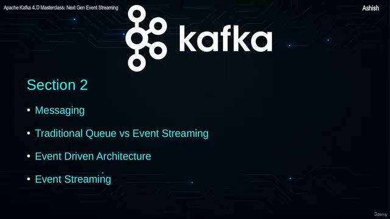
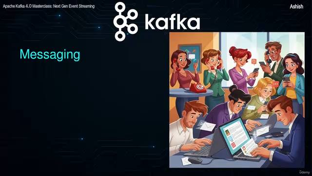
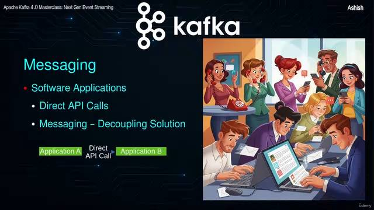
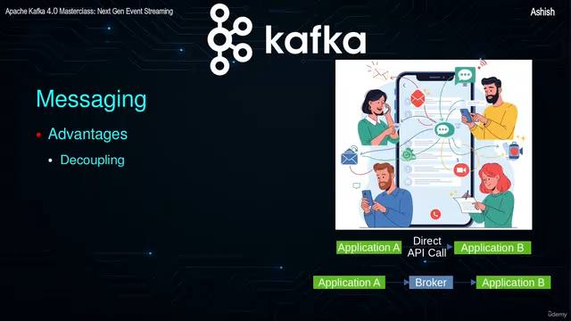
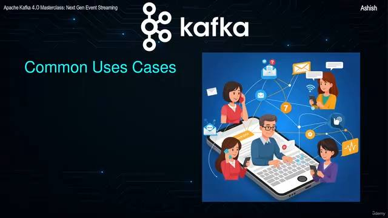
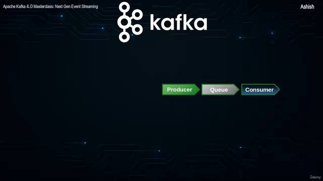
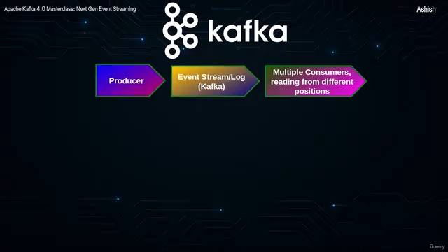
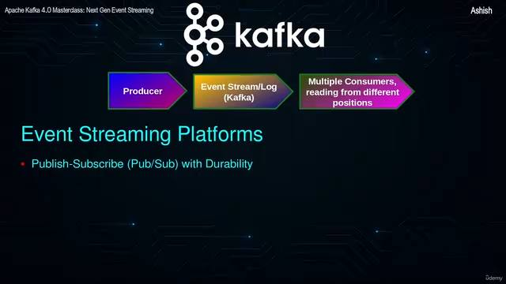
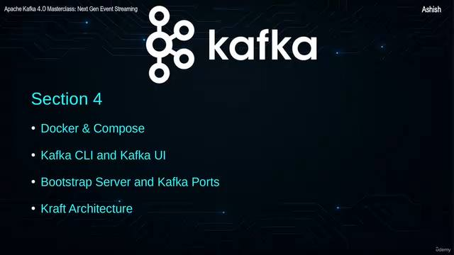

# Apache Kafka 4.0 精讲 · P001–P005 复现文档
**主题：导论、消息模型奠基、队列 vs 事件流**

---

## 1. 这一节做什么

这一节覆盖 `BV1iKNi6kEwT` 的 **P001–P005** 五集，全部是**导论与概念奠基**，不是实操集。

必须先说清楚一件事，否则后面会误导你：

> **P001–P005 的逐字稿里没有任何一行可运行代码。** 没有 `docker compose` 文件、没有任何 CLI 命令、没有端口号、没有配置项、没有 Go 代码。讲师在 P003 里明确「预告」第 4 节才会带你把 Kafka 4.0 集群跑在 Docker 上（"在第 4 节中，我们将带你一步步在自己的机器上启动并运行 Kafka 4.0 集群" —— p003 [02:16]），而**那个内容不在本节范围内**。

所以本节「跑起来」的不是一台 Kafka，而是**一套能让你后面不走弯路的判断框架**。具体产出是四样东西：

1. **一张同步 vs 异步的判据表** —— 什么时候该直接调 API，什么时候该上消息中间件（P004）。
2. **一张队列 vs 事件流的对比表** —— 这是本课程最重要的一次分水岭，因为选错了模型，后面所有 topic 设计、消费组配置、offset 策略都会跟着错（P005）。
3. **一份环境准备清单** —— 只包含讲师在 P003 里点过名的工具，不额外增加。
4. **一份术语对照** —— 把 Kafka 的概念映射到你作为前端已经熟悉的东西上（本文补充，非讲师内容，会明确标注）。

每集的定位：

| 集 | 内容 | 对项目的贡献 |
|---|---|---|
| P001 | 课程总览：从基础到 KRAFT、Streams、集群运维 | 建立「Kafka 不只是队列」的第一印象 |
| P002 | Udemy 平台功能（倍速、笔记、学习提醒） | 与项目无关，可跳过 |
| P003 | 课程路线图 + 工具链 + 最终能力清单 | **本节唯一的「可执行输入」：工具清单** |
| P004 | 什么是软件世界里的 messaging，为什么要它 | 决策框架第一半：同步 vs 异步 |
| P005 | 传统消息队列 vs 事件流平台的正面对比 | 决策框架第二半：队列 vs 流 |



---

## 2. 讲师原话

下面按主题归类摘录，每条都带集号与时间戳，你可以回原片核对。

**关于课程定位与最终目标**

> "这门课程旨在带你从“听说过 Kafka”进阶到“能够在 Kafka 4.0 上设计、运行并排查真实系统的问题”。课程注重实践、观点明确，并包含大量动手操作。你将使用 Docker 构建环境，通过命令行和界面探索消息代理，并用 Go 编写生产者和消费者。目标不只是会使用 Kafka，而是像 Kafka 工程师一样思考。"
> —— p003 [00:00]

> "本课程中，我们会反复使用的项目工具包括 Docker 和 Docker Compose；如果你用的是 Docker Desktop，也完全可以。我们需要用它们来搭建集群，这样你就能在几秒内重建环境。下一项工具是 Kafka CLI，用来查看真实状态。我们还会使用 Provectus 的 Kafka UI 和 Redpanda Console 来提升可见性。最后是 Go：用于编写快速、清晰的客户端代码，支撑手动提交、事务、再均衡演示，以及本课程中所有与编码相关的内容。"
> —— p003 [07:20]

**关于 Kafka 4.0 与 KRAFT（去 ZooKeeper）**

> "我们使用的是 Apache Kafka 4.0 的 KRaft 模式，它不再需要 ZooKeeper，因此你学到的是现代化方式。"
> —— p003 [00:57]

> "我们会超越基础知识，深入理解具有革命性的 Kafka Raft，也就是 KRaft 共识协议；它是 Kafka 4.0 的核心，移除了对 ZooKeeper 的依赖，从而简化运维并增强可扩展性。"
> —— p001 [01:45]

**关于「为什么需要 messaging」的推导起点**

> "要理解软件中的消息传递，我们先从熟悉的事物开始：日常沟通。假设你想告诉朋友一部你刚看过的精彩新电影。你会怎么做？第一种方式是直接对话——给朋友打电话。"
> —— p004 [00:54]

> "第二种方式是留张便条或发条消息。你可以给他们发短信、发邮件，甚至在门上贴一张便利贴。你把消息发出去，对方有空时再读。你不必等他们准备好，这就是异步。"
> —— p004 [01:23]

**关于直接 API 调用的五个缺点**

> "传统做法是直接发起 API 调用，这种方式本质上是同步的。这是应用之间最常见的通信方式……应用 A 直接向应用 B 发出请求，然后等待应用 B 响应。"
> —— p004 [02:15]

> "应用 A 了解应用 B 的存在，这意味着二者紧密耦合。若应用 B 发生变化，应用 A 可能也需要变化，它们彼此依赖过重。接着是可用性问题。如果应用 B 因维护而停机或负载过高怎么办？应用 A 的请求会失败，或者不得不无限期等待，从而可能拖慢甚至拖垮应用 A。再往下是可扩展性挑战。如果应用 A 过快发送过多请求，应用 B 可能难以跟上。另一个缺点是操作顺序问题。如果应用 A 需要把某件事通知给多个应用，它只能逐个调用。"
> —— p004 [02:41] 起

**关于 broker 的引入**

> "这正是消息传递发挥作用的地方。消息传递引入了中间层，也就是一个中间人，帮助应用在不必过多了解彼此的情况下进行通信。我们通常把这个中间层称为消息代理或消息系统。"
> —— p004 [03:37]

> "作为生产者的应用 A 把消息发送给消息代理。消息代理会安全地存储这条消息，随后作为消费者的应用 B 连接到消息代理，而不是直接连接生产者……关键在于，应用 A 不等待应用 B 响应，甚至不等待应用 B 准备好。"
> —— p004 [04:07]

**关于 messaging 的六大收益**

> "那么，这种消息传递方式究竟赋予了我们哪些强大的能力？"
> —— p004 [05:05]

> "第一个优势是解耦，也可以称为松耦合……应用就像相互独立的 LEGO 模块，通过统一接口或消息代理连接起来。"
> —— p004 [05:05] 后

> "下一个优势是可扩展性。想象一个快餐免下车取餐窗口，配有专门的接单员和独立的厨师。即使厨房因为订单堆积而忙碌，接单员仍然可以不断接单。软件中也是类似：生产者生产消息的速度可以快于消费者消费消息的速度，而消息代理则充当缓冲区。"
> —— p004 [06:30] 后

> "下一个优势是韧性和可靠性，也就是容错能力。想象一家邮局，即使收件人的住所暂时无法接收，信件也会被保留。在软件开发中，如果消费者应用宕机，生产者发送的消息不会丢失；它们会留在消息代理中，直到消费者重新上线。"
> —— p004 [07:23]

> "下一个优势是审计与可重放。这并非所有消息系统都具备，只有部分消息系统支持，尤其是 Kafka 这类系统。"
> —— p004 [08:21]

**关于队列与事件流的分水岭**

> "有多种系统面向不同目的而设计。传统上，你可能听说过消息队列，例如 RabbitMQ、ActiveMQ 等。"
> —— p004 [10:45]

> "Kafka 不只是一个消息队列，而是一个事件流平台。它当然可以像队列一样工作，但能提供的远不止于此。Kafka 处理的不只是消费后就消失的消息，而是事件，也就是对已发生之事的不可变事实或记录；这些事件存储在一个持久、有序且可重放的日志中。"
> —— p004 [11:13]

> "可以把它们想象成待办清单或任务队列。生产者把任务或工作项加入队列。队列按特定顺序存储这些消息，通常是先进先出。随后，消费者从队列前端取出一条消息，进行处理；关键在于，这条消息通常会被从队列中移除。"
> —— p005 [00:58]

> "这些事件会被写入一个不可变的有序日志。它们在被读取后不会被删除，而是会保留一段可配置的时间，例如几天、几周、几个月，甚至几年。"
> —— p005 [03:47]

> "决定性差异在于：在传统队列中，消息一旦被处理，通常就不存在了。而在事件流中，事件会保留下来，消费者只是沿着流移动自己的读取指针。可以想象 YouTube 视频上的进度条。"
> —— p005 [06:12]

**关于「Kafka 能不能当队列用」**

> "现在来看一个常见问题：Kafka 能否当作传统队列使用？答案是可以。如果你把一个 Kafka 主题配置为只有一个消费者组、较短的保留期，并确保消息只被处理一次，那么在特定场景下，它确实可以表现得像传统队列。不过，仅把 Kafka 当作传统队列使用，往往意味着没有充分利用它的全部能力。这就像买了一辆跑车，却只是每周开去一次杂货店。"
> —— p005 [08:21]

> "核心要点是：Kafka 是传统队列的超集。它既提供核心的队列功能，又增加了事件流平台的强大能力，例如持久性、可重放性、多消费者支持和高吞吐量。"
> —— p005 [09:05]

---

## 3. 从零复现

> **本节的「复现」对象是讲师的推理链，不是一台服务器。**
> 下面把 P004 → P005 的推导按「需求 → 约束 → 方案 → 取舍」重新走一遍。你在纸上或文档里跟着写一遍，就能独立复述出「为什么我的系统该用队列还是该用 Kafka」。

### 步骤 1：需求 —— 两个应用要说话，先看两种最原始的形态

讲师没有从技术名词开始，而是从**打电话 vs 发消息**开始（p004 [00:54]）。这一步的用意是：把「同步 / 异步」这个抽象词钉在一个你每天在做的事情上。

- **打电话**：实时、双方必须同时在线、没接就失败、必须重来 → **同步**
- **发短信 / 留便签**：发出去就结束、对方有空再看、可以放很久 → **异步**

这一步的产出不是结论，而是两个判定问题：

1. 我发出请求后，**能不能不等对方回应就继续干活**？
2. 对方**此刻不在线**时，这条信息**能不能先存着**？

只要有一个答案是「能」，你就已经站在异步这一侧了。

### 步骤 2：约束 —— 直接 API 调用会撞上的五堵墙

讲师把「传统做法 = 直接 API 调用」拆出五个缺点（p004 [02:11]–[03:37]）。这五个不是并列关系，而是**层层递进**的：

| # | 缺点 | 本质问题 | 前端视角的表现 |
|---|---|---|---|
| 1 | 强耦合 | A 必须知道 B 的地址、契约、状态 | 你在前端硬编码了某个后端接口的 URL 和字段名，后端改字段你就挂 |
| 2 | 可用性问题 | B 挂了 / 过载，A 跟着失败或无限等待 | `await fetch(...)` 卡住，页面白屏 |
| 3 | 扩展性挑战 | A 发得比 B 处理得快，B 被打穿 | 活动开始瞬间 QPS 打满，接口 502 |
| 4 | 操作顺序 | A 要通知多个应用，只能一个一个串行调用 | 一个下单要顺序调库存、支付、物流、邮件，总耗时是四段相加 |
| 5 | 耦合带来的连锁变更 | B 改，A 跟着改，A 改，C 跟着改 | 改一个字段，一周内改五个仓库 |

注意第 5 条其实和第 1 条同源，但讲师单独强调，因为它是**长期成本**：耦合的代价不在写代码那一刻，而在半年后改代码那一刻。



### 步骤 3：方案 —— 插入一个中间人（broker）

讲师的解法非常朴素：**加一层**。

> "Messaging introduces an intermediary, a middleman." —— p004 [03:37]

插入之后，拓扑从「A → B」变成「A → broker → B」。这一改，三个角色的职责立刻分离：

- **Producer**：只负责把事件交给 broker，**不等回应**，交完就继续干下一件事
- **Broker**：负责**存住**、**排队**、**分发**
- **Consumer**：自己连 broker 拉，**按自己的节奏**处理，处理不了就慢点，挂了就等它回来

关键在于讲师特别强调的一句：A「doesn't even wait for application B to be ready」（p004 [04:36]）。也就是说，**A 甚至不需要知道 B 现在存不存在**。这才是解耦的真正含义——不是「少写几行代码」，而是**A 的运行时行为不再依赖 B 的运行时状态**。



### 步骤 4：收益 —— 六个能力，各自对应步骤 2 的哪堵墙

这是本段最值得动手记的一张表，因为它把「收益」从口号变成了可验证的工程属性：

| 收益 | 讲师类比 | 消灭了步骤 2 的哪条约束 | 你能怎么验证它真的生效 |
|---|---|---|---|
| 解耦 / 松耦合 | 乐高积木 | #1、#5 强耦合 | 改 consumer 的消费逻辑，producer 不用重新部署 |
| 异步 | 发邮件 vs 打电话 | #2 可用性（部分） | 关掉 consumer，producer 依然能正常写入 |
| 可扩展 | 快餐店点单员 vs 厨师 | #3 扩展性 | 加一个 consumer 实例，积压下降 |
| 韧性 / 容错 | 邮局代收信件 | #2 可用性 | consumer 崩掉重启后，消息还在 |
| 负载均衡 / 工作分发 | 银行排队叫号 | #3 扩展性 | 多个 consumer 分到不同消息 |
| 审计与可重放 | 日志本 / 账本 | #4 顺序（部分）+ 事后追溯 | 从头再读一遍历史事件 |

讲师在这里有一句很重要的限定，别漏掉：

> "And this is not for all. This is for some messaging systems especially like Kafka." —— p004 [08:21]

**「可重放」不是消息系统的通用属性，是 Kafka 这类事件流平台的特有属性。** 这句话是 P005 整集的引子。



### 步骤 5：落到场景 —— 六个真实用例，验证这套框架

讲师给了六个场景（p004 [09:08] 之后）。我不复述，而是把它整理成「哪个收益在起作用」：

| 场景 | 主要吃到的收益 | 关键判断 |
|---|---|---|
| 电商下单 | 异步 + 解耦 | 库存、支付、物流、邮件四个下游，任何一个慢了都不能拖住下单 |
| 用户行为追踪 | 异步 + 缓冲 | 埋点不能影响页面性能 |
| 微服务通信 | 解耦 | 服务之间不互相知道地址 |
| IoT 传感器数据 | 缓冲 + 吞吐 | 设备持续高频上报 |
| 日志聚合 | 缓冲 + 多消费者 | 几百台机器的日志汇到一处 |
| 实时分析 | 低延迟 + 多消费者 | 同一份数据，分析系统也要读 |

**共同点：都是「一个生产者，多个互不相干的下游」。** 这就是为什么下一步必须讨论「多个消费者怎么共存」——也就是队列和事件流的根本分歧点。



### 步骤 6：队列模型 —— 消息是「待办事项」

进入 P005，讲师先讲传统队列（p005 [00:58]）。它的机制可以拆成四步：

1. Producer 把任务放进队列
2. 队列按顺序存（讲师点明是 **FIFO / FIVO**，首进先出）
3. Consumer 从队头取一条
4. **取走后，这条消息从队列里移除**

第 4 步是**定义性特征**（讲师原话："消费即删除消息。这是它的一项标志性特性。" —— p005 [01:55]）。由此推出三个必然结果：

- **点对点**：一条消息只给一个消费者（"消息一旦被消费，就会消失。"）
- **消息是短暂的**：消费即遗忘
- **不可重放**：消费完就没有了，想重来只能让生产者重发

讲师给的例子是 RabbitMQ、ActiveMQ、Amazon SQS、Azure Service Bus（p005 [02:24]）。他还额外补了一句：其中有些后来加了 pub-sub 能力（"尽管其中一些已经加入了发布/订阅功能" —— p005 [02:24]）——这句话说明分类不是绝对的，看的是**默认语义**。

**什么时候用队列？** 讲师给了三个条件（p005 [02:51]）：

1. 要把任务分发给一组 worker（图像处理、发邮件通知、后台任务）
2. 一条消息只需要被**一个**消费者处理一次
3. 消息是短命的，不需要重放



### 步骤 7：事件流模型 —— 事件是「已经发生的事实」

换模型。讲师的类比换成了完全不同的东西：**一本不断往下写的故事、一本连续账本、一卷永不停的录像带**（p005 [03:19]）。

机制也变了：

1. Producer **publish** 一个事件（注意用词：事件不是「任务」，是「发生了什么的记录」）
2. 事件写进一条**不可变的有序日志**（"不可变的有序日志" —— p005 [03:47]）
3. **读完不删除**，按可配置周期保留（天 / 周 / 月 / 年）
4. **多个消费者各自按自己的位置读**（"从它们在日志中各自特定的位置" —— p005 [04:14]）

第 3、4 步直接推翻了队列的两个前提：

- 消费不等于销毁 → 同一条事件可以被 N 个不同系统各读一遍，互不干扰
- 每个消费者有自己的读取位置 → 一个新上线的服务可以从头读全部历史

讲师的比喻非常精准，值得记住：**事件流就像 YouTube 的进度条**（p005 [06:12]）。视频（事件）一直在那里，你（消费者）只是移动自己的播放位置。



### 步骤 8：正面对比 + 「Kafka 能不能当队列」

讲师在屏幕上做了逐条对比（p005 [06:40]）。我把它整理成可执行的决策表：

| 判断维度 | 选**队列** | 选**事件流（Kafka）** |
|---|---|---|
| 消息消费后 | 应该消失 | 应该保留，供重读 |
| 消费者数量语义 | 多个消费者是**竞争**关系（分摊工作） | 多个消费者是**各自独立**关系（各读全量） |
| 是否需要重放历史 | 不需要 | 需要（新服务上线、排障、补算） |
| 是否需要审计追溯 | 不需要 | 需要 |
| 消息生命周期 | 短 | 长（天 / 周 / 月 / 年，可配） |
| 典型任务 | 发邮件、图片转码、后台任务分发 | 数据管道、事件溯源、实时分析、多下游同步 |

然后是最容易被问的那个问题：**Kafka 能不能当队列用？**

讲师的答案分三层，缺一层都会误用：

1. **能** —— "答案是肯定的，它可以。"
2. **条件是** —— 一个 topic + 只有一个消费者组 + 短保留期 + 保证只处理一次（p005 [08:21]）
3. **但这是浪费** —— "就像买一辆跑车，只是为了每周开它去一次杂货店"

结论句请原样记住：**Kafka 是传统队列的超集**（superset），队列能力只是它的一个子集（p005 [09:05]）。



### 步骤 9：环境准备清单（本节唯一「可执行」的部分）

讲师在 P003 里点名了后续要用的工具。以下是**逐字稿中出现过的**，一个不多一个不少：

| 工具 | 讲师原话的用途 | 本节能否开始装 |
|---|---|---|
| Docker / Docker Compose | "for clusters so you can rebuild in seconds" | 可以，但**没有 compose 文件**（第 4 节才有） |
| Docker Desktop | 装了 Docker Desktop 也行 | 可以 |
| Kafka CLI | "the Kafka CLI for truth" | 可以装，但**没有任何命令** |
| Provectus Kafka UI | 可视化查看集群 | 名称有，**镜像/端口课里没讲** |
| Redpanda Console | 可视化查看集群 | 名称有，**镜像/端口课里没讲** |
| Go | 写 producer / consumer | 可以装，**版本课里没讲** |

**注意：讲师把 Kafka UI 说成 "Provectus 的 Kafka UI" / "Provectors Kafka UI"，实际产品名是 Provectus Kafka UI；Redpanda Console 在逐字稿里写作 "Red Panda console"。以实际产品名为准。**

三个 UI 的定位讲师说得很清楚：**"把这些 UI 当作你的雷达"**（p003 [00:28]）——它们是雷达，不是真理来源；真理来源是 CLI。



---

## 4. 完整代码

> ### ⚠️ 本节没有代码
>
> P001–P005 的逐字稿中**不存在**任何 Dockerfile、docker-compose.yml、shell 命令、Kafka 配置文件或 Go 源码。讲师在 P003 只做了「预告」，真正的内容在第 4 节，**不在本文档覆盖范围内**。
>
> 任何在这里给出「看起来能跑」的 compose 文件，都是我编的，不是讲师讲的。按规矩不写。
>
> 下面是这一段**真正产出的、可以直接拿去用的产物**：决策表、职责表、数据模型草案、保留策略表。

### 4.1 设计决策表：队列 or 事件流

拿去放在你的技术选型文档里。**每一行都对应讲师在 P004/P005 的原话依据。**

```markdown
# 消息中间件选型决策表

## 第一层：我到底需不需要中间件？

| 问题 | 否 | 是 |
|---|---|---|
| 调用方能接受「对方此刻必须在线」吗？ | 直接 API 调用 | 继续往下 |
| 下游处理变慢时，上游能被拖住吗？ | 直接 API 调用 | 继续往下 |
| 同一件事有 ≥2 个互不相干的下游要处理吗？ | 直接 API 调用 | 继续往下 |
| 下游挂掉后，这段时间的消息需要补回来吗？ | 可以考虑直接调用 + 重试 | 上中间件 |

## 第二层：队列 还是 事件流？

| 问题 | 选队列 | 选事件流 |
|---|---|---|
| 一条消息被一个消费者处理后，还需要被另一个系统再读一次吗？ | 不需要 → 队列 | 需要 → 流 |
| 新服务上线时，需要回放历史数据吗？ | 不需要 → 队列 | 需要 → 流 |
| 需要「这一切发生过什么」的完整审计记录吗？ | 不需要 → 队列 | 需要 → 流 |
| 多个消费者之间是「分摊工作」还是「各读全量」？ | 分摊 → 队列 | 各读全量 → 流 |
| 消息保留周期 | 短（消费即删） | 可配（天/周/月/年） |
```

### 4.2 组件职责表

讲师在 P004 定义了三个角色，在 P005 补充了「日志」这个载体。职责边界如下：

| 组件 | 只负责 | **不**负责 | 讲师依据 |
|---|---|---|---|
| Producer | 把事件交给 broker，然后继续干下一件事 | 不等待消费者、不关心消费者是否在线 | p004 [04:07] |
| Broker | 安全存储、缓冲、按序保留、分发给消费者 | 不负责业务处理 | p004 [04:07]、p005 [03:47] |
| Consumer | 自己连 broker 拉取、按自己节奏处理 | 不直接连 producer | p004 [04:36] |
| Topic / 事件流 | 存放不可变、有序、可重放的事件日志 | 消费后不删除 | p005 [03:47] |
| 消费者读取位置 | 每个消费者各自的「进度」 | 不是全局共享的一个指针 | p005 [04:14] |

> **注意术语边界：** 讲师在 P005 说的是「consumer moves their reading pointer through the stream」（p005 [06:12]）。这个「reading pointer」在 Kafka 里的正式名字是 **offset**，但**讲师在 P001–P005 中并未使用 "offset" 这个词**——offset 的正式讲解在后面（P003 的路线图提到第 11 节会讲 manual offset commits）。这里先用「读取位置」理解即可。

### 4.3 事件数据模型草案

> **课里没有代码，以下为示意。** 讲师在 P001–P005 中**没有给出任何事件 schema**。下面这份是把你已经熟悉的 JSON 事件按 P004/P005 的概念要求整理出来的草案，用于你后续自己设计 topic 时作模板。

```json
{
  "event_id": "evt_01HQ8Z3K4M5N6P7Q8R9S0T",
  "event_type": "order.placed",
  "event_version": 1,
  "occurred_at": "2025-01-01T10:00:00.000Z",
  "producer": "order-service",
  "partition_key": "user_12345",
  "payload": {
    "order_id": "ord_98765",
    "user_id": "user_12345",
    "amount": 19900,
    "currency": "CNY",
    "items": [
      { "sku": "SKU-A", "qty": 2 }
    ]
  }
}
```

字段为什么这么设计（对应讲师的概念，**字段本身是本文补充**）：

| 字段 | 为什么需要 | 对应讲师概念 |
|---|---|---|
| `event_id` | 消费者可能重复收到同一条事件，需要幂等去重 | 「保证只处理一次」的前提（p005 [08:21]） |
| `event_type` | 一个 topic 里可能有多种事件，消费者要能分流 | 「事件是事实的记录」（p004 [11:13]） |
| `event_version` | 事件不可变，改结构只能加版本 | 「不可变的有序日志」（p005 [03:47]） |
| `occurred_at` | 事件发生的时间，不是写入的时间 | 「记录已经发生的事」 |
| `partition_key` | 同一个业务实体的相关事件要落在同一个分区、保持顺序 | 「有序」（p005 [03:47]）——分区细节讲师在 P003 提到第 3 节才讲 |
| `payload` | 业务数据本体 | — |

### 4.4 保留策略表

讲师在 p005 [03:47] 明确说保留期「for example days, weeks, months or even years」，并且是「配置在我们 Kafka broker 上的」（"取决于谁在配置这些设置，也就是我们 Kafka 代理的主配置"）。

| 保留期 | 适合的场景 | 代价 |
|---|---|---|
| 天级 | 纯转发管道，下游已有自己的存储 | 新服务无法回放太远的历史 |
| 周级 | 常规业务事件，需要短期排障 | 磁盘随吞吐线性增长 |
| 月级 | 需要跨月对账、审计 | 需要规划磁盘容量 |
| 年级 | 事件溯源、合规审计 | 存储成本成为主要成本项 |

> **课里没讲：** 具体的配置项名称、默认值、磁盘容量估算方法。讲师只说了「可配置」，没有给数值。

### 4.5 环境变量/配置文件清单

| 项 | 状态 |
|---|---|
| `docker-compose.yml` | **课里没给**（第 4 节内容） |
| Kafka 版本 | 讲师明确是 **Apache Kafka 4.0**（p003 [00:57]） |
| 是否需要 ZooKeeper | **不需要**，4.0 用 KRAFT（p003 [00:57]） |
| 端口号 | **课里没给**（第 4 节才会讲 port management，p003 [02:16]） |
| Kafka UI 镜像 / 端口 | **课里没给** |
| Redpanda Console 镜像 / 端口 | **课里没给** |
| Go 版本 / 客户端库 | **课里没给** |

---

## 5. 逐行解释

这一节解释「为什么这样定、不这样会怎样」。**每条都对应上面第 4 节的一个产物。**

### 5.1 为什么决策表的第一层是「要不要中间件」，而不是「选 Kafka 还是 RabbitMQ」

因为讲师在 P004 花了整整十分钟讲**同步通信的五个缺点**，才引出 broker（[02:11] → [03:37]）。这个顺序是刻意的：**中间件不是默认选项，它是为了解决特定问题才引入的组件**。

如果你跳过第一层直接选型，会出现两类典型错误：

- **过度设计**：一个只有两个服务、调用量极低、对方挂了可以直接报错的场景，上了 Kafka。结果你要维护集群、要处理 rebalance、要监控消费积压——**成本远大于收益**。
- **该用不用**：下单要通知四个下游，仍然串行 `await` 四个接口。总延迟 = 四段之和，且任一环节挂了整单失败。

### 5.2 为什么「解耦」排在收益列表第一位

因为它是**唯一一个能同时消掉其他问题的收益**。

- 解耦了（A 不知道 B 的地址和状态）→ B 挂了不影响 A → 可用性问题缓解
- 解耦了 → 可以随时加 B 的实例 → 扩展性问题缓解
- 解耦了 → 可以加一个新的 C 而不动 A → 新需求不用改老代码

反过来，如果只是「加了队列但 A 还是硬编码依赖 B 的处理结果」，那只是把同步调用换了个地方写，问题一个没解决。

### 5.3 为什么「异步」不等于「更快」

讲师从没说过异步更快。他说的是：

> "Your main application can respond quickly to users even if background tasks are lengthy." —— p004 [06:01] 附近

**异步改变的是「谁在等」，不是「总共花多久」。** 下单接口从 800ms 降到 50ms，是因为它不再等库存和邮件，但那两件事仍然要花 750ms，只是发生在别处。

**在 JS/Node 里对应什么**：这跟 `await fetch()` 换成 `someQueue.publish()` 是同一个道理。前者阻塞当前请求的响应，后者只等「写进队列」这一步。区别在于：`fetch` 失败你立刻知道，而 `publish` 之后对方处理失败，你**不会**收到通知——所以你必须另建一套失败处理机制（这就是后面课程里 dead letter queue 存在的原因，讲师在 P003 [04:12] 提过这个名词，但 P001–P005 未展开）。

### 5.4 为什么「韧性」的验证方式是「关掉 consumer」

讲师用邮局类比：收件人不在家，信在邮局等着（p004 [07:23]）。

这个类比可以被直接转成一条**验收标准**：

> 关掉所有 consumer，producer 连续写入 1 分钟，不报错；再启动 consumer，这 1 分钟的消息全部被处理。

如果做不到，说明你的「韧性」是假的——可能 producer 在等确认超时，也可能消息根本没落盘。

### 5.5 为什么「负载均衡」收益依赖「多个消费者是竞争关系」

讲师用银行叫号做类比（p004 [07:52]）：多个窗口服务同一个队列。

这里藏着一个**必须在 P005 才说得清的伏笔**：队列模型下，多个消费者是**分摊**同一批消息；事件流模型下，多个消费者**各读全量**。

同样是「加消费者」，两种模型的**效果完全相反**：

| | 加一个消费者 | 想达到的效果 |
|---|---|---|
| 队列 | 处理能力提升，消息被分摊 | 加速 |
| 事件流（同一消费者组内） | 处理能力提升，消息被分摊 | 加速 |
| 事件流（不同消费者组） | 多一个独立的全量读者 | 多一个下游系统 |

**所以「多个消费者」这句话本身是有歧义的，必须问「在不在同一个消费者组里」。** 消费者组这个正式概念讲师在 P003 [01:48] 的路线图里提到了，但 P001–P005 没有展开。

### 5.6 为什么「可重放」被讲师单独加了限定语

> "And this is not for all. This is for some messaging systems especially like Kafka." —— p004 [08:21]

这句话是整个 P004 里信息密度最高的一句。因为它把「消息系统」这个大类**劈成了两半**：

- 一半是「消息传递后即销毁」→ 天然不可重放
- 一半是「消息是持久的事实记录」→ 天然可重放

讲师完全可以不解释这句，直接进 P005。但他解释了，说明他希望你**在选型阶段就意识到这个差异**，而不是等系统上线后才发现「我想补算三个月前的数据，但数据已经没了」。

### 5.7 为什么队列的「消费即删除」被称为定义性特征

> "message deletion on consumption. This is a defining feature." —— p005 [01:55]

因为**删不删，决定了这个系统还能不能干别的事**。一旦消息被删：

- 无法回放 → 不能做事件溯源
- 无法给第二个下游读 → 不能做多系统同步
- 无法事后审计 → 不能做合规追溯

反过来说，如果业务上这三件事都不需要，那「删掉」反而是**优点**：存储不用无限增长，消费者不用管理读取位置。

**所以「删除」不是缺陷，是取舍。** 讲师把它叫 defining feature，而不是 disadvantage，就是这个意思。

### 5.8 为什么 Kafka 当队列用是「开跑车买菜」

因为你要为「跑车」的能力**持续付出成本**，却一个都没用上：

| 你付的成本 | 你获得的（如果你只当队列用） |
|---|---|
| 磁盘随保留期增长 | 用不上（你只想消费一次） |
| 管理消费者读取位置 | 用不上（你想消费完就丢） |
| 多消费者组的语义复杂度 | 用不上（你只有一个组） |
| 集群运维（broker、controller） | 用不上（队列系统通常更轻） |

**但注意讲师没说「不应该这样做」。** 他说的是「often means you are under utilizing its full power」——**你可能会这样做，因为系统里其他部分需要 Kafka**，这时复用同一个集群做队列是合理的。判断标准不是「Kafka 不该当队列」，而是「你有没有别的理由留着 Kafka」。

### 5.9 为什么说 Kafka 是「超集」而不是「替代品」

> "Kafka is a superset of a traditional queue." —— p005 [09:05]

超集的含义是：**队列能做的事，Kafka 都能做**（配置成单消费者组 + 短保留期即可）；**Kafka 能做的事，队列做不了**（多消费者独立读、历史重放）。

这个说法在工程上有一个直接推论：**如果你已经在用 Kafka，就不必为了「一个纯任务队列」再引入一套 RabbitMQ**——除非那套队列有 Kafka 不擅长的特性（讲师在 P003 [06:26] 提到后面会有 Kafka vs RabbitMQ 的对比，但 P001–P005 没有展开）。

---

## 6. 复现检查清单

按顺序勾。**每一项都是「你现在就能做」的，不需要 Kafka 集群。**

### A. 概念复现（不动电脑）

- [ ] 能不看稿，用「打电话 / 发短信」的例子讲清同步与异步的差别
- [ ] 能说出直接 API 调用的 **5 个**缺点，并各举一个你见过的真实例子
- [ ] 能画出 `A → broker → B` 的拓扑，并说明 A 为什么**不需要知道** B 是否在线
- [ ] 能说出 messaging 的 **6 个**收益，并各说出它消掉了上面 5 个缺点里的哪一个
- [ ] 能说出至少 **4 个**讲师给的场景，并指出每个场景主要吃到哪个收益
- [ ] 能说出队列的四步机制，并指出哪一步是「定义性特征」
- [ ] 能说出事件流的四步机制，并指出它推翻了队列的哪两个前提
- [ ] 能用「YouTube 进度条」解释多消费者各自读取
- [ ] 能完整复述「Kafka 能不能当队列用」的三层答案（能 / 条件是 / 但浪费）
- [ ] 能解释「Kafka 是队列的超集」这句话，并举出一个队列做不到、Kafka 做得到的事

### B. 产物复现（产出文档）

- [ ] 照 4.1 的格式，为你手上（或想象中的）一个系统写出选型决策表，**得出结论**
- [ ] 照 4.2 的格式，填出你系统中 producer / broker / consumer 的职责边界
- [ ] 照 4.3 的格式，为你系统中的**一个**核心事件写出一份 schema 草案
- [ ] 照 4.4 的格式，为这个事件选定一个保留期，并写出**理由**
- [ ] 回答一个问题：如果我的系统里「加一个消费者」的下游是新业务需求，我该加在同一个消费者组还是新组？（提示：看 5.5）

### C. 环境准备（可以开始装，但装完还没东西跑）

- [ ] Docker / Docker Desktop 已安装
- [ ] Docker Compose 可用
- [ ] Kafka CLI 已下载解压（注意：**还没有任何命令可执行**，见 4.5）
- [ ] 记下：Kafka UI 与 Redpanda Console 的**镜像名、端口课里没给**，等第 4 节
- [ ] 记下：**不需要**装 ZooKeeper（Kafka 4.0 用 KRAFT）

### D. 止损检查（如果下面任意一条答不上，回到对应的 §5）

- [ ] 我能分清「异步」和「更快」不是一回事 → §5.3
- [ ] 我能解释为什么队列「删消息」是取舍不是缺陷 → §5.7
- [ ] 我能解释「多个消费者」在两种模型下含义相反 → §5.5
- [ ] 我知道「可重放」不是所有消息系统都有 → §5.6

---

## 7. 课里没讲但你会撞上的

这一节全部是**讲师在 P001–P005 没有覆盖**的内容。写出来是为了让你在撞墙时知道「这不是我漏听了，是还没讲到」。

### 7.1 所有「跑起来」的东西都还没讲

| 你可能想找 | 状态 | 讲师原话里它属于哪 |
|---|---|---|
| `docker-compose.yml` | **没讲** | P003 [02:16] 预告在第 4 节 |
| Kafka 端口（9092 之类） | **没讲** | P003 [02:16] 只说会讲 "port management" |
| KRAFT 的具体配置项 | **没讲** | P003 [02:16] 只说会讲 "所有关键配置" |
| 创建 topic 的命令 | **没讲** | P003 路线图归在第 3 节 |
| 启动 producer / consumer 的命令 | **没讲** | 同上 |
| Kafka UI / Redpanda Console 的镜像与端口 | **没讲** | P003 [02:16] 只说会带你看 |
| Go 客户端库名与版本 | **没讲** | P003 [07:48] 只说 "追求快速、清晰的客户端代码" |

**结论：P001–P005 结束后，你的正确状态是「概念清楚 + 环境已装 + 一行 Kafka 命令都没跑过」。这是正常的。**

### 7.2 术语的正式名字，课里还没给

讲师在 P001–P005 用的是**白话描述**，不是术语。撞墙时你会搜不到：

| 讲师的说法（P001–P005） | 正式术语 | 讲师在哪提到会讲 |
|---|---|---|
| "their own specific positions in the log" | offset（偏移量） | P003 [05:59] 提 manual offset commits |
| "the master configuration of our Kafka broker" 里说的保留期 | retention 配置 | **课里没讲具体配置项名** |
| "Kafka is a superset of a traditional queue" 中隐含的「一组消费者分摊」 | consumer group | P003 [01:48]、P001 [02:15] 提过名字，未展开 |
| "processed once" | 幂等 / exactly-once semantics | P001 [02:15]、P003 [05:59] 提过，未展开 |
| "KRAFT consensus protocol" | KRaft（Kafka Raft） | P001 [01:45]、p003 [00:57]，本节仅点名 |
| "KIP 848" | 新消费者组协议 | P003 [02:44] 明确说第 5 节才首次看 |

### 7.3 前端视角会踩的三个坑

> 以下三条**不是讲师内容**，是给「前端转 AI 应用工程师」的补充。讲师没有讲 Node/JS 相关的东西。

**坑 1：把 broker 当成「进程内的 EventEmitter」**

Node 的 `EventEmitter` 是**同步 + 进程内 + 不持久**的：emit 的瞬间如果没监听者，事件就丢了。Kafka 的 broker 是**跨进程 + 持久 + 可重放**的。**不能把前者的心智模型套到后者上**，否则你会写出「发完就不管」的代码，然后在对方处理失败时完全无感。

**坑 2：把「异步」理解成 `Promise`**

`Promise` 只是「不阻塞当前调用栈」，它背后仍然是**同一个进程、同一次请求生命周期**。Kafka 的异步是**跨服务、跨时间**的：producer 发完 message，进程可能马上就退出了，consumer 五分钟后才起来处理。**这意味着错误处理的范式完全不同**——没有 `try/catch` 能捕获到下游的失败。讲师在 P003 [04:12] 提到 dead letter queues 就是为此存在的，但 P001–P005 没有展开。

**坑 3：以为「多消费者 = 更快」**

看 §5.5。同样是「加消费者」，如果加在**新的消费者组**里，你得到的是一个全新的全量读取者（可能让总处理量翻倍，但每个消费者读到的数据量不变）；如果加在**同一个消费者组**里，你才是分摊工作。前端熟悉的是「多开几个 worker 分担任务」，那是前者在 Kafka 里的对应物是**同组**，不是新组。

### 7.4 讲师明确提到但本节未展开的话题

按 P003 的路线图，下面这些都在后面，**不要以为本节讲完了**：

- Topic / partition / leader / follower 的具体机制 → 第 3 节
- 存储层：log / segment / index → 第 5 节
- at-most-once vs at-least-once → 第 5 节
- KIP-848 新消费者组协议 → 第 5 节
- 单条消息的端到端数据路径 → 第 6 节
- 复制与 ISR、leader 选举、故障恢复 → 第 6 节
- KRAFT controller 到底干什么 → 第 6 节
- Pub/Sub、request-reply、event sourcing、DLQ → 第 7 节
- Kafka Streams（KStream / KTable / GlobalKTable）→ 第 8 节、第 11 节
- Schema Registry / Avro / JSON Schema / Protobuf → 第 9 节
- Kafka Connect（standalone vs distributed）→ 第 10 节
- 安全：SASL 认证、listener → 第 12 节左右
- Kafka vs RabbitMQ 正面对比 → P003 [06:26] 提到

### 7.5 一句话总结这一段该带走什么

**不是「Kafka 很好用」，而是：Kafka 的定位是「不可变、有序、可重放的事件日志」，队列能力只是它的一个子集。** 当你下次面对一个「要不要上 Kafka」的决策时，问的不是「消息量够不够大」，而是——

**「这条消息被消费之后，还需要被再读一次吗？」**

需要，就是事件流；不需要，就是队列。这个判断，就是 P004 + P005 合计 25 分钟想让你建立的东西。