# Apache Kafka 4.0 核心概念与集群角色复现文档（P10–P13）

## 1. 这一节做什么

这四讲不是安装课，也不是 API 编码课，而是一段**把 Kafka 的核心词汇、三大能力、整体架构、Broker 与 Controller 角色串成一张脑图**的概念课。学完后你要能做到三件事：

1. 看到一个业务事件，能判断它的 key、value、timestamp、headers 应该怎么设计；
2. 看到“高吞吐、可扩展、不丢数据、故障自动切换”这些词，能说清楚它们分别落在 topic、partition、replication、leader election、consumer group 的哪个位置；
3. 看到 Kafka 4.0 的 KRaft 部署，能区分 broker 角色和 controller 角色，知道为什么开发环境可以 combined，生产环境更常见 dedicated。

课里没有给出可运行的安装命令和客户端代码，所以本文不会伪造命令输出。第 3 节按讲师的推导顺序复现“怎么想清楚一个 Kafka 设计”，第 4 节把讲师的方案落成可直接照着建 topic、写 producer/consumer 的设计产物。你如果是前端转 AI 应用工程师，可以先把 Kafka 当成“带分区顺序、可重放、可水平扩展的事件日志”，不要一上来把它当数据库。

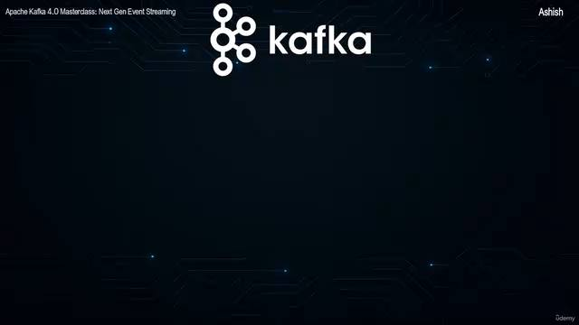

这一节最基础的单位是 event / record / message。讲师明确说，这三个词在课程语境里可以大体当成同一个东西：Kafka 处理的基本数据单位。更精确地说，Kafka 内部设计和 API 里常用 record；event 是高层概念，表示“发生了一件不可变的事实”；message 是消息系统里的通用叫法。你写业务代码时叫它事件没问题，但设计 Kafka 结构时要记住它最终会变成一条结构化 record。

---

## 2. 讲师原话（带「—— pNNN [MM:SS]」）

> “Event is the high-level conceptual term we have been using. It signifies something that happened and immutable fact. Record. This is the more precise term used within Kafka's internal design and APIs.”
>
> —— p010 [00:54]

> “If a key is provided, Kafka guarantees that all records with the same key will go to the same partition.”
>
> —— p010 [02:20]

> “Events within a single partition are always stored and read in the order they were produced.”
>
> —— p010 [06:28]

> “If a record has a key, Kafka guarantees that all records with the same key will always go to the same partition. That's a guarantee.”
>
> —— p010 [08:24]

> “Those three superpowers are scalability, durability and fault tolerance.”
>
> —— p011 [00:26]

> “It keeps multiple copies of every partition on different brokers. If one copy is destroyed, the data still exists safely on the other copies.”
>
> —— p011 [05:31]

> “Within a consumer group, each partition of a topic is assigned to exactly one consumer instance at a time.”
>
> —— p012 [06:39]

> “In a kraft cluster, there's always an actively elected controller leader among a set of designated controller eligible nodes.”
>
> —— p013 [05:01]

> “For large, high throughput and mission critical production Kafka clusters... the industry standard is to deploy separate dedicated controller nodes.”
>
> —— p013 [12:05]

这些原话基本覆盖了 P10–P13 的主线：record 是数据单位，topic 是逻辑分类，partition 是顺序和并行单位，key 决定同 key 同分区，consumer group 决定并行消费，broker 存数据，controller 管元数据，KRaft 让 Kafka 自己管理元数据。

---

## 3. 从零复现

这一节按“需求 → 约束 → 估算 → 方案 → 取舍”的顺序复现讲师的推导。注意：课里没有给具体安装命令，也没有给 producer/consumer 代码，所以这里复现的是**设计过程**，不是伪造终端输出。

### 3.1 先定义事件：一条 record 到底长什么样

讲师把 Kafka record 拆成四块：

| 字段 | 是否必填 | 作用 | 设计时要问的问题 |
|---|---|---|---|
| key | 可选 | 用于分组相关事件；有 key 时同 key 进同一 partition | 哪些事件必须按顺序处理？ |
| value | 必填 | 真正的业务负载，byte array | 传 JSON、文本还是二进制？ |
| timestamp | 自动添加 | 事件发生时间或 Kafka 摄入时间 | 业务时间够不够用？ |
| headers | 可选 | 附加元数据，key-value 对 | 是否需要追踪、路由、上下文？ |

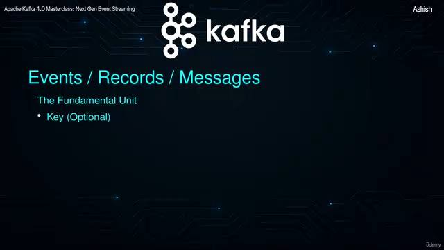

这里最关键的是 key。讲师举了 user ID、order ID 的例子：key 放在数据前面，数据可以变，但同一个业务实体的 key 不变，这样相关事件就会被 club 到同一个 partition。比如订单 `order-456` 的创建、支付、发货事件都应该带同一个 key，消费者才能按顺序看到它们。

在 JS/Node 里，你通常会把 key 写成字符串，把 value 写成 `Buffer` 或 JSON 字符串；但课里强调的是 Kafka 内部把它们当 byte array。具体客户端 API 怎么序列化，课里没讲，实际以你用的客户端为准。

### 3.2 选 topic：先有逻辑分类，再谈物理分布

topic 是逻辑分类，像文件夹、电视频道、数据库表。讲师说每个 topic 有唯一名字，比如 user signups、order events、sensor data；同一业务域的事件通常进同一个 topic；多个应用可以往同一个 topic 发布，也可以从同一个 topic 订阅；事件在 topic 里按可配置保留期保留，默认典型是 7 天，消费后不会立刻删除。

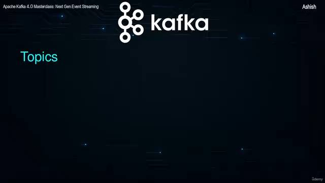

复现时你先别急着建分区，先回答：这个 topic 的边界是业务域还是数据格式？如果支付事件和传感器读数混在一起，后面分区 key 和消费者组都会很难设计。topic 是逻辑边界，partition 才是物理并行边界。

### 3.3 设计 partition：顺序、offset、并行都在这里

讲师说 partition 是 topic 物理上的切分，是一个不断追加的有序不可变日志。关键特征有三个：

1. **partition 内有序**：先发 A 再发 B 到 partition 0，消费者一定先看到 A 再看到 B；
2. **partition 间不保证顺序**：partition 0 的事件可能比 partition 1 的事件后产生，但同 topic 不保证跨分区顺序；
3. **offset 是分区内连续 ID**：消费者用 offset 记录自己读到哪，像视频进度条。

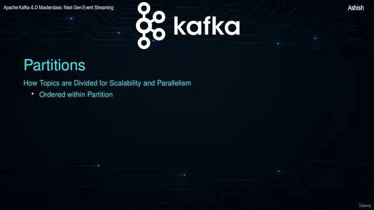

所以“Kafka 保证顺序”这句话必须加限定：**只保证单分区内顺序**。你要按用户、按订单、按设备保证顺序，就把这些实体 ID 设为 key。讲师说 Kafka 会对 key 做哈希再决定分区，不是 key 本身直接当分区号。没有 key 时通常 round robin 分散到各分区，保证负载均匀；也可以自己写分区逻辑，但课里只提到“可以”，没展开 API。

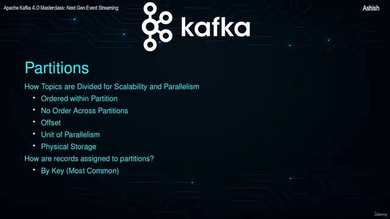

### 3.4 设计 producer：入口负责把业务数据包成 record

producer 是发布记录的客户端应用。它把业务数据包装成带 key、value 等字段的 Kafka record，发送到指定 topic；可以显式指定 partition，也可以更常见地依赖 key 的哈希逻辑；producer 通常异步发送，不等待 Kafka 完全确认存储就继续做下一件事，从而获得高吞吐；还可以配置重试来应对瞬时网络问题或 broker 故障。

复现时你要决定：**业务是否接受异步**？如果业务要求“发出去必须立刻知道结果”，那就要在 producer 侧处理返回结果和重试；如果只是日志、埋点、事件通知，异步更合适。课里没有讲事务和 exactly-once，所以本文不把它们安到讲师头上。

### 3.5 设计 consumer 与 consumer group：并行消费的关键

consumer 是订阅 topic 并处理记录的客户端应用。讲师强调 Kafka consumer 是 **pull** 模式：消费者按自己的节奏从 topic 拉记录，而不是被传统消息系统 push。consumer 读特定 partition，并维护自己的 offset；offset 存在 Kafka 内部一个特殊 topic 里，这样重启后知道从哪里继续。多个 consumer 可以读同一个 topic，各自维护自己的 offset，互不影响。

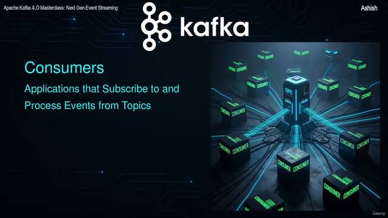

consumer group 是并行消费的核心。一个 group 内，每个 partition 同一时刻只分配给一个 consumer 实例；三个 partition 配三个 consumer，就一人一个；再加一个 consumer，Kafka 会自动重新分配，但多出来的实例可能没有 partition 可读。某个 consumer 挂了，它负责的 partition 会自动转给同组其他活跃 consumer。不同 consumer group 可以独立消费同一个 topic，各自维护 offset。

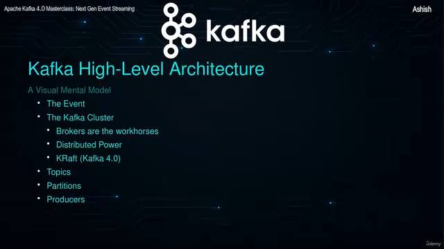

在 JS/Node 里，你可以把 consumer group 理解成“同一类 worker 的进程组”：并行度上限首先受 partition 数限制。一个 group 里开 10 个 Node 进程，但 topic 只有 3 个 partition，那最多 3 个进程在干活，其余空闲。offset 也不是锁，它只是消费者组的读取游标；课里没有讲锁和事务，别把 offset 当数据库行锁。

### 3.6 设计 broker 与 controller：数据面和控制面分开

broker 是 Kafka 集群里的单台服务器，主要负责数据面：存储 topic partition 和副本，接收 producer 写入，服务 consumer 读取，协调 leader 和 follower 复制，向客户端提供集群元数据。讲师用仓库类比 broker：收货、上架、取货、备份。

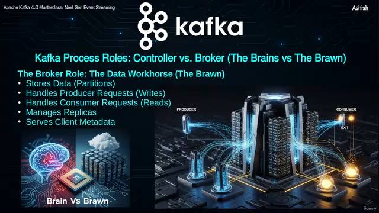

controller 是控制面的大脑或编排者。KRaft 模式下，一组 controller eligible 节点里会选出一个 active controller leader。它知道哪些 topic 存在、多少 partition、哪些 broker 活着、每个 partition 的 leader 是谁、consumer group 状态等；partition leader 失败时，它负责从 in-sync replicas 里快速选新 leader；集群变化时通知其他 broker；broker 加入或离开时管理注册和状态更新；broker 正常关闭时保证平滑交接。

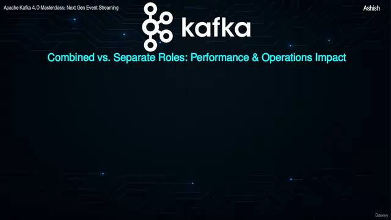

Kafka 4.0 的 KRaft 让 broker 自管理，不再需要外部 Zookeeper。controller 角色可以和数据角色合并在同一台机器上，也可以分开部署。讲师明确说：combined 适合开发、测试、小机场；dedicated 适合大型生产、国际枢纽。生产上常见 3 或 5 个专用 controller 节点，奇数是为了 Raft 多数派 quorum；这些 controller 通常不存 topic partition 数据，只做元数据管理。broker 节点则按数据量和吞吐横向扩展。

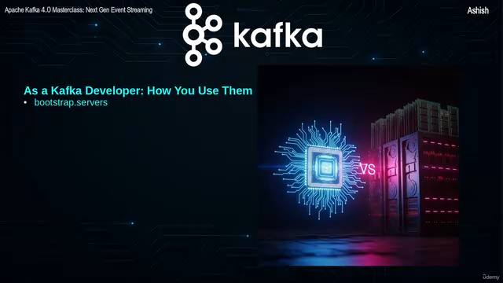

开发者平时主要接触 broker。配置客户端时填 `bootstrap.servers`，例如 `localhost:9092`，这是 broker 地址，不是 controller 地址。客户端连上一个 broker 后，broker 会告诉它整个集群拓扑：有哪些 topic、多少 partition、每个 partition 在哪、leader 是谁。这些拓扑由 controller 管理，但由 broker 提供给客户端。日常开发中 controller 操作是透明的；如果看到 leader not available 或 metadata 问题，才需要想到 controller quorum 或 broker 状态。

### 3.7 把整条链路串起来

现在按讲师 P12 的 mental model 串一遍：

1. 业务应用作为 producer 产生事件；
2. producer 把事件发到某个 topic；
3. Kafka 根据 key 哈希或 round robin 把事件放到某个 partition；
4. partition 和副本落在 broker 上；
5. consumer 属于某个 consumer group，拉取分配给自己的 partition；
6. consumer 按 offset 记录处理进度；
7. broker 故障时，副本和 leader election 保证可用；
8. consumer 故障时，同组其他 consumer 接管 partition。

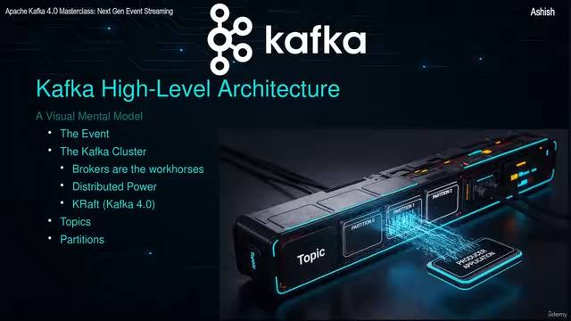

### 3.8 做一次容量估算

课里没有给单分区吞吐目标，所以不能硬算分区数。下面用“示例假设”演示公式，数字不是讲师给的。

| 项目 | 公式 | 示例假设 | 结果 |
|---|---|---|---|
| 原始写入带宽 | 事件/秒 × 单条字节 | 10,000 条/秒 × 1 KB | 10 MB/s |
| 含副本写入带宽 | 原始带宽 × 副本数 | 10 MB/s × 3 | 30 MB/s |
| 7 天保留量 | 含副本带宽 × 86400 × 7 | 30 MB/s × 604800 秒 | 18,144,000 MB ≈ 17.7 TB |
| 分区数下限 | 目标吞吐 ÷ 单分区吞吐 | 课里没给单分区吞吐 | 不能硬算，必须实测 |
| controller 节点 | 奇数 quorum | 3 或 5 | 3/5 |


这个估算的意义不是让你背 17.7 TB，而是让你知道：副本数会直接乘存储和网络；保留期会直接乘容量；分区数不能拍脑袋，必须结合单分区实测吞吐。讲师在 P11 用“魔法图书馆”讲得很清楚：拆章节是 partition，建多栋图书馆是 broker，复制是 replication，leader 选举是 fault tolerance。

---

## 4. 完整代码

本课是纯讲解课，讲师没有给出可运行代码，也没有给出安装命令。因此这一节不伪造代码，而是把讲师的概念落成可直接用于建 topic、写 producer/consumer 的设计产物。你后续无论用 Java、Go 还是 Node.js 客户端，都可以按这些表落地。

### 4.1 设计决策表：combined 还是 dedicated

| 方案 | 适用场景 | 优点 | 风险 | 建议 |
|---|---|---|---|---|
| combined：broker + controller 同节点 | 开发、测试、小集群 | 部署简单，节点少 | 数据面和控制面互相影响 | 本地实验可用 |
| dedicated：broker 与 controller 分开 | 生产、高吞吐、关键业务 | 隔离稳定，可独立扩展 | 运维复杂，节点更多 | 3 或 5 个专用 controller |

讲师的原话是：combined 像一个人既做空管又搬行李，小机场可以，大枢纽会乱；生产大型集群用 dedicated 更稳。

### 4.2 组件职责表

| 组件 | 职责 | 关键点 |
|---|---|---|
| event / record / message | Kafka 的基本数据单位 | 不可变事实，结构化 record |
| topic | 逻辑分类 | 唯一名字，按保留期保留，消费后不立即删除 |
| partition | 有序不可变日志 | 分区内有序，分区间不保证顺序，是并行单位 |
| offset | 分区内连续 ID | 消费者用 offset 记录读到哪里 |
| producer | 发布记录 | 可指定 partition，也可按 key 哈希；通常异步、可重试 |
| consumer | 拉取并处理记录 | pull 模式，维护自己的 offset |
| consumer group | 并行消费 | 一个 partition 同一时刻只给组内一个 consumer |
| broker | 数据面 | 存 partition 和副本，服务读写，提供元数据 |
| controller | 控制面 | 管理元数据、leader election、broker 注册、通知变更 |

### 4.3 事件数据模型草案

```json
{
  "key": "user-123",
  "value": {
    "eventType": "OrderCreated",
    "orderId": "order-456",
    "amount": 99.9
  },
  "timestamp": "2026-01-01T00:00:00Z",
  "headers": {
    "source": "checkout-service"
  }
}
```

说明：`timestamp` 通常由 Kafka 自动添加，这里只是展示结构；`value` 在 Kafka 内部是 byte array，JSON 只是可读表示；`headers` 可选，用于追踪、路由或上下文。

### 4.4 Topic 配置草案

| 配置 | 建议值 | 依据 |
|---|---|---|
| topic name | `sales-events` | 讲师举例 sales events |
| partitions | 按目标吞吐实测，课里没给固定数 | partition 是并行单位 |
| replication.factor | 3（常见，最好奇数） | p011 讲师说常见 3，最好奇数 |
| retention | 7 天（默认典型） | p010 讲师说默认典型 7 天 |
| key | `orderId` 或 `userId` | 同 key 同分区，保证相关事件顺序 |
| headers | 可选，如来源、追踪 ID | 讲师说用于 tracing、routing、context |

### 4.5 容量估算表

| 项目 | 公式 | 示例假设 | 结果 |
|---|---|---|---|
| 原始写入带宽 | 事件/秒 × 单条字节 | 10,000 × 1 KB | 10 MB/s |
| 含副本写入带宽 | 原始 × 副本数 | 10 MB/s × 3 | 30 MB/s |
| 7 天保留量 | 含副本带宽 × 86400 × 7 | 30 MB/s × 604800 秒 | ≈17.7 TB |
| 分区数 | 目标吞吐 ÷ 单分区吞吐 | 课里没给单分区吞吐 | 需实测 |
| controller 数 | 奇数 quorum | 3 或 5 | 3/5 |

---

## 5. 逐行解释

这一节逐条解释第 4 节每个决策为什么这样定，不这样会怎样。

**key 为什么可选但重要？** 因为 key 决定“相关事件是否进同一分区”。如果订单支付和发货事件不带同一个 orderId，它们可能被分到不同 partition，消费者就无法保证先支付后发货。反过来，如果所有事件都带同一个 key，所有流量会挤到一个 partition，并行度就没了。所以 key 要选“需要顺序的业务实体”，不要选“全局常量”。

**value 为什么是 byte array？** 讲师说 Kafka 不关心你传文本、JSON、Avro、protobuf，它只存字节。这样 Kafka 可以通用地处理各种格式。但代价是序列化/反序列化由客户端负责。课里没讲 Schema Registry，所以本文不展开；你实际做 AI 应用时，如果事件结构经常变，要自己考虑 schema 管理。

**timestamp 为什么自动添加？** 因为 Kafka 需要记录事件时间或摄入时间，方便保留、切分、追踪。讲师说它自动添加，所以设计时不要把它当成必须手填字段。但业务上如果你需要“事件真正发生时间”，可能还要在 value 里放业务时间；课里没讲两者差异，实际以你的场景为准。

**headers 为什么可选？** 它用于附加元数据，不修改主 value。比如追踪、路由、上下文。它像 HTTP header，但课里只提到这些用途，没有展开具体协议。

**topic 为什么先定逻辑边界？** 因为 topic 是分类，partition 是物理并行。如果 topic 边界乱了，后面 key 和 consumer group 都会乱。讲师用文件夹、频道、数据库表类比，就是让你先按业务域分。

**partition 为什么是顺序单位？** 因为 Kafka 只保证单分区内追加顺序。跨分区没有全局顺序。你要顺序，就把相关事件放同一分区；你要吞吐，就多分区。两者要取舍。

**offset 为什么不是全局 ID？** 因为 offset 是分区内连续 ID。不同分区各有自己的 offset。消费者组按“分区 + offset”记录进度。课里说 offset 存在特殊 Kafka topic 里，说明它是 Kafka 自己管理的消费位点。

**producer 为什么通常异步？** 因为等待每条消息完全确认会降低吞吐。异步发送可以让 producer 继续处理下一件事，再通过回调或配置处理失败重试。课里说 producer 可以重试，但没讲具体重试参数。

**consumer 为什么是 pull？** 因为消费者可以按自己的处理能力拉取，不会被 push 压垮。讲师说这给消费者更多控制。代价是消费者要自己管理 offset 和拉取节奏。

**consumer group 为什么一个 partition 只能给一个 consumer？** 为了保证同组内每条记录只被处理一次。如果两个 consumer 同时读一个 partition，组内就会重复处理。不同 group 可以独立读同一个 topic，因为它们是不同业务团队，各自维护 offset。讲师用新闻社类比：A 组更新网站，B 组归档，C 组做情感分析，互不影响。

**broker 和 controller 为什么要分？** broker 是数据面，负责存数据、服务读写；controller 是控制面，负责元数据、leader election、broker 注册。合在一起开发方便，但生产高负载时数据面可能拖慢控制面。讲师说 dedicated 把关键元数据操作和高体积数据操作隔离，控制面更稳定。

**controller 为什么用奇数？** 因为 Raft quorum 需要多数派。3 个节点容忍 1 个故障，5 个容忍 2 个。偶数不会增加容错，反而浪费。讲师明确说 3 或 5 个专用 controller 是常见做法。

**bootstrap.servers 为什么填 broker 地址？** 因为客户端先连 broker，broker 再告诉它集群拓扑。controller 地址不直接给客户端。课里说日常开发 controller 透明，就是这个意思。

**容量估算为什么不能直接算分区数？** 因为课里没给单分区吞吐目标。你只能先估总带宽和存储，再用实测单分区吞吐反推分区数。副本数会乘网络和存储，保留期会乘容量，这两个是硬成本。

---

## 6. 复现检查清单

你可以用下面清单检查自己是否真的理解了 P10–P13。

- [ ] 我能说出 event、record、message 在课程语境里大体是同一条数据。
- [ ] 我能画出 record 的 key、value、timestamp、headers 四个部分。
- [ ] 我知道 key 可选，但有 key 时同 key 进同一 partition。
- [ ] 我知道没有 key 时通常 round robin 分散。
- [ ] 我能解释 topic 是逻辑分类，partition 是物理并行单位。
- [ ] 我知道 partition 内有序，partition 间不保证顺序。
- [ ] 我知道 offset 是分区内连续 ID，像视频进度条。
- [ ] 我能说出 producer 通常异步发送，并可配置重试。
- [ ] 我能说出 consumer 是 pull 模式，自己维护 offset。
- [ ] 我知道 consumer group 内一个 partition 同一时刻只给一个 consumer。
- [ ] 我知道 consumer 故障后 partition 会转给同组其他 consumer。
- [ ] 我知道不同 consumer group 可以独立消费同一 topic。
- [ ] 我能说出 broker 是数据面，controller 是控制面。
- [ ] 我知道 KRaft 让 Kafka 自管理元数据，不需要外部 Zookeeper。
- [ ] 我知道 controller leader 从 controller eligible 节点中选举。
- [ ] 我知道生产常见 3 或 5 个专用 controller，奇数为了 quorum。
- [ ] 我知道 combined 适合开发测试，dedicated 适合大型生产。
- [ ] 我知道客户端配置 `bootstrap.servers` 填的是 broker 地址。
- [ ] 我能用“事件/秒 × 字节 × 副本 × 保留时间”估算存储。
- [ ] 我知道课里没给单分区吞吐，所以分区数不能拍脑袋。

---

## 7. 课里没讲但你会撞上的

下面这些是实际落地时常见、但 P10–P13 没有展开的内容。这里只提醒，不冒充讲师讲过。

1. **Kafka 4.0 的安装与启动命令**：课里没有给。你实际会需要下载发行版、配置 KRaft、格式化存储目录、启动 broker/controller。具体命令以官方文档和你用的发行版为准。
2. **创建 topic 的 CLI**：讲师提到过 `kafka-topics.sh`，但没有给完整参数。你实际会用到 `--create`、`--topic`、`--partitions`、`--replication-factor` 等，具体以 `kafka-topics.sh --help` 为准。
3. **producer/consumer 客户端代码**：课里没有代码。你实际要选 Java、Go、Node.js 客户端，并处理序列化、反序列化、错误回调、关闭钩子。
4. **序列化格式与 Schema 管理**：讲师提到 JSON、Avro、protobuf，但没讲 Schema Registry。事件结构频繁变时，这是你会撞上的问题。
5. **consumer rebalance 细节**：课里说 consumer 故障会重新分配 partition，但没讲 rebalance 协议、超时、静态成员、协作式重平衡。实际调优要看客户端版本。
6. **offset 提交策略**：课里说 offset 存在特殊 topic，但没讲自动提交、手动提交、提交时机。处理失败时这会影响重复消费。
7. **事务与 exactly-once**：课里没有讲。不要因为 Kafka 有名就默认它默认 exactly-once；这是另一个话题。
8. **监控与告警**：课里没有讲 broker、controller、consumer lag 的监控指标。生产上你会需要看磁盘、网络、请求延迟、under-replicated partition 等。
9. **安全**：课里没有讲 SASL、SSL、ACL。实际多团队集群一定会遇到。
10. **磁盘与网络规划**：副本数会乘存储和网络，保留期会乘容量。课里给了概念，但没给硬件选型。
11. **controller quorum 配置**：课里说 3 或 5 个 controller，但没给具体配置文件。实际要配 `controller.quorum.voters` 等，具体字段名以你的 Kafka 版本为准。
12. **combined 模式的边界**：课里说开发测试可用 combined，生产用 dedicated。但“多小算小”没有绝对数字，要按吞吐、稳定性要求、团队运维能力判断。

最后再强调一次：这份文档没有伪造任何终端输出。课里出现的字段和概念，比如 key、value、timestamp、headers、offset、partition、replication、leader election、`bootstrap.servers`、`kafka-topics.sh`，都在逐字稿里有依据；课里没出现的工具名和配置项，本文只作为“你会撞上的问题”提醒，不归到讲师头上。