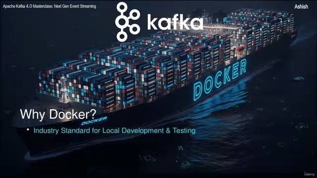
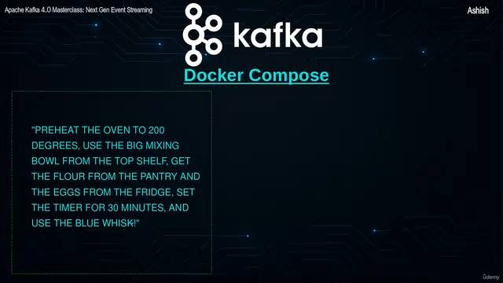
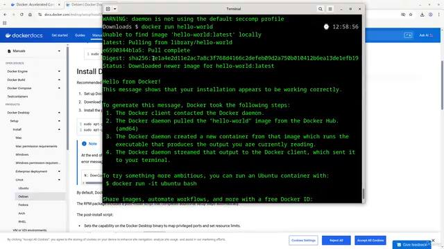
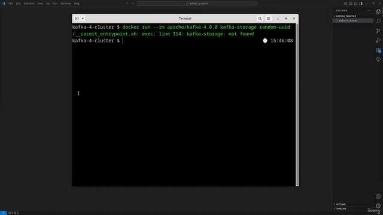
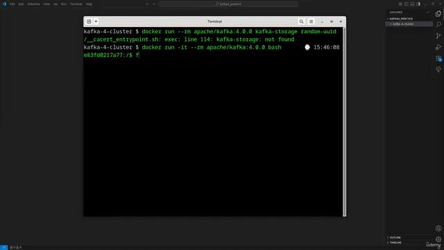
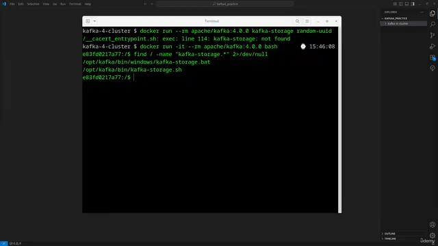

# Apache Kafka 4.0 复现笔记（P14–P19）：从消息队列概念到 Docker 里的第一个 Cluster ID

## 1. 这一节做什么

这一段课程不是一上来就写 Producer / Consumer 代码，而是先把两个容易混淆的东西分开：**传统消息队列**和**Kafka 事件日志**。随后课程把本地实验环境统一到 Docker，并开始第一次动手：从 Docker Hub 找 Kafka 镜像、创建练习目录、在 `apache/kafka:4.0.0` 容器里生成 Kafka 集群需要的 **cluster ID**。

本段真正的可复现终点是：

```text
Docker 安装完成并可运行
  -> 拉取 apache/kafka:4.0.0
  -> 进入镜像找到 /opt/kafka/bin/kafka-storage.sh
  -> 执行 random-uuid
  -> 得到一个 cluster ID
```

注意：**P14–P19 还没有给出 `docker-compose.yaml` 的完整内容，也没有启动 Kafka broker、创建 topic、发送消息**。所以照着本文复现时，最后 `docker ps` 里没有 Kafka broker 是正常的。不要在本文里臆造一个 compose 文件假装是课程内容；后续课程才会继续写。本文第 4 节给出的完整脚本，是把本段逐字稿里实际出现的命令整理成可直接保存执行的文件。

先记住本段的核心对比：

| 维度 | 传统消息队列，如 RabbitMQ / ActiveMQ | Kafka |
|---|---|---|
| 设计目标 | 把任务可靠地投递给一个消费者去做 | 把发生的事实追加到可重放日志 |
| 读完是否消失 | 消费者确认后，消息通常从队列删除 | 消息不因读取而删除，按配置保留 |
| broker 角色 | broker 较“聪明”，负责路由、分发 | broker 主要追加日志，consumer 自己记 offset |
| 典型场景 | 发邮件、缩图、后台任务 | 事件流、实时分析、事件溯源、多消费方回放 |

如果你是从前端转过来，可以先把这两个模型做一个粗略对照：传统消息队列更像“一次性任务清单”，任务被某个 worker 取走后完成并删除；Kafka 更像“可回放的事件日志”，记录不会因为你读过一次就消失，谁要读谁自己记住读到哪里。`consumer offset` 可以类比成阅读位置或游标，但关键区别是：Kafka 不会因为某个消费者读过了就把消息删掉。前端里常见的本地任务队列、重试队列，更接近传统队列；而“保留事件记录、允许不同订阅方各自回放”的思路，更接近 Kafka。


本段还要建立另一个边界：Docker 安装、镜像拉取、进入容器查找命令，都属于“环境准备和工具确认”，不是 Kafka 业务代码。你要先确认 Docker daemon 可用、镜像能拉取、容器里能执行命令，后面写 compose、启动 broker、创建 topic 才不会把环境问题误判成 Kafka 配置问题。

## 2. 讲师原话

下面只摘录与本节复现直接相关的原话。英文为逐字稿原句，后面带对应时间。

> "Kafka 不只是一个消息队列，它还是一个分布式流处理平台。"
> —— p014 [03:00]

讲师在这里把 Kafka 和传统队列的定位区分开：Kafka 不是单纯“送完就完”的队列，而是分布式流平台。对前端同学来说，不要把它理解成浏览器里的一个事件总线或一次性任务数组；Kafka 的重点是日志、分区、保留和可回放，消费者只是按自己的 offset 去读。

> "Kafka 代理就像图书管理员，职责很简单：把数据追加到日志中。消费者则像读者，它很聪明，负责记录自己的书签；在 Kafka 中，这个书签叫作消费者偏移量。"
> —— p014 [04:55]

这段是后面理解 Kafka 消费模型的关键：读消息不会让消息从日志里消失，消费者要自己维护读取位置。可以把 offset 想成“书签”，但不要想成“读完就撕掉书页”。传统队列里消费者确认后消息通常被删除；Kafka 里 broker 主要负责追加日志，读取进度由 consumer 侧维护。


> "Docker Compose 把它简化为一条 docker compose up -d 命令，我们在课程中会经常使用这条命令。"
> —— p015 [01:16]

课程后面会大量使用 Docker Compose，因为 Kafka 集群通常不止一个容器，手写一长串 `docker run` 很容易出错。Compose 的价值在于把多容器应用的启动方式写进文件，避免每个人本地环境不一致。前端项目里常用 `package.json` 的 scripts 统一启动命令，Compose 在这里起的是类似“项目级启动配方”的作用，只不过它管理的是容器。

> "Docker Compose 就像我们多容器应用的配方卡。"
> —— p017 [02:20]

讲师把 `docker-compose.yaml` 比作配方卡：可读、可共享、可版本控制，避免每个人本地环境不一致。配方卡这个类比很重要：文件里写清楚用哪个镜像、怎么启动、需要什么端口和环境变量，别人拿到仓库后不需要凭记忆重敲命令。本段还没有给出这张“配方卡”的完整内容，所以复现时只做到生成 cluster ID，不要提前假装 broker 已经配置好。



> "生成集群 ID 的命令实际上是 kafka-storage.sh random-uuid。"
> —— p019 [05:34]

这里说的是 Kafka 自带的 `kafka-storage` 工具，用来生成集群随机 UUID。`random-uuid` 是它的子命令。最终要调用的是容器里的脚本文件，而不是宿主机上安装的 Kafka 命令。

> "我们遇到了这个错误：cacert-entrypoint.sh，具体是第 114 行：找不到 kafka-storage。"
> —— p019 [06:57]

第一次直接执行 `kafka-storage` 会失败，因为命令不在容器的 `PATH` 里。这个错误是本节最重要的排错场景。看到 `not found` 时，先不要怀疑镜像损坏，也不要急着重装 Docker；先确认命令名、命令所在目录和容器 PATH。

> "只是可惜，它不在容器的 PATH 环境变量中。"
> —— p019 [11:03]

讲师进入容器后找到 `kafka-storage.sh`，确认文件存在，只是没有加入 PATH。这个排查顺序很值得记住：先确认文件是否存在，再确认调用方式。不要在没有查找文件之前就猜路径。

> "我们不要只输入 kafka-storage，而要在 Docker 容器内提供 kafka-storage.sh 脚本的完整绝对路径。"
> —— p019 [17:23]

最终修复方法不是改镜像，而是用绝对路径调用脚本。对前端同学来说，这有点像终端里直接敲一个本地依赖的 bin 命令却找不到，因为它的目录不在 PATH；这时可以用完整路径，或者通过项目脚本间接调用。



## 3. 从零复现

### 3.1 复现边界与环境

本段环境按逐字稿整理如下：

- 操作系统：讲师使用 **Debian Linux**。本文以 Debian / Ubuntu 系 Linux 为主。Windows / macOS 讲师没有展开，不能假装课程讲了。
- Docker：需要 Docker Engine / Docker CLI。课里没有锁定具体 Docker 版本，以你机器上 `docker --version` 实际输出为准。
- Kafka 镜像：`apache/kafka:4.0.0`。讲师明确说为了稳定，使用 `4.0.0`，不是 `latest`。
- 自定义环境变量：**本段没有使用任何自定义环境变量**，不需要 `.env`。
- 端口映射：**本段没有启动 broker，也没有端口映射**。课里没讲。
- 最终产物：一个 `cluster ID`，可保存到 `cluster-id.txt`。

目录结构建议如下：

```text
kafka_for_practice/
└── kafka_cluster/
    ├── 01-check-docker.sh
    ├── 02-inspect-kafka-image.sh
    ├── 03-wrong-generate-cluster-id.sh
    ├── 04-generate-cluster-id.sh
    └── cluster-id.txt        # 运行 04 后生成
```

这里的目录结构是为了复现方便，不是课程要求你必须使用这些脚本名。关键是保持命令来源一致：Docker 检查、镜像检查、故意失败一次、绝对路径生成 cluster ID。不要把本段误解成“已经搭好 Kafka 集群”，它只是集群 ID 的生成练习。

### 3.2 安装 Docker 并验证

讲师演示了两条路：下载 `.deb` 安装 Docker Desktop，或者用 apt repository 只安装 Docker Engine / CLI。逐字稿没有完整保留 apt repository 的每一行命令，所以这里不编造。你按 Docker 官网 Debian 页面复制命令即可。

如果走 `.deb` 路线，讲师实际做的是：

```bash
cd ~/Downloads
ls
sudo apt-get update
sudo apt-get install ./docker-desktop-*.deb
```

课里没有逐字保留 `.deb` 文件名的完整版本号，所以用通配符或替换成你实际下载的文件名。安装后从应用列表启动 Docker Desktop。

如果走 apt repository 路线，讲师说明是到 Docker 官网复制命令，分步执行。课里没有在逐字稿里保留每条 repo 命令，因此不要照抄网上过期脚本；以 Docker 官网当前 Debian 页面为准。

安装后验证：

```bash
docker --version
docker info
docker run --rm hello-world
docker image ls
docker ps
```

如果 `docker` 必须加 `sudo` 才能运行，讲师给的处理是：

```bash
sudo groupadd docker
sudo usermod -aG docker "$USER"
```

然后**注销并重新登录**。之后：

```bash
docker run --rm hello-world
```

不再需要 `sudo`。如果 `docker group` 已存在，`groupadd` 报 already exists 可以忽略。

常见错误与排查：如果 `docker --version` 有输出但 `docker info` 报 “Cannot connect to the Docker daemon”，说明 CLI 在，但 daemon 没启动或当前用户无权连接。Linux 上先确认 Docker 服务或 Docker Desktop 已启动；权限问题则按上面的用户组处理并重新登录。`docker run --rm hello-world` 如果卡在拉取，先检查网络、代理和镜像源，不要急着怀疑 Kafka 镜像。`docker image ls` 只是列出本地镜像，不能证明容器能运行；`docker ps` 只列出正在运行的容器，本段没有 broker，所以它为空是正常的。



### 3.3 创建练习目录

讲师创建的是 `kafka_for_practice`，里面再建 `kafka_cluster`。逐字稿说预览里看起来是大写，但实际文件系统是小写。本文统一用小写：

```bash
mkdir -p ~/kafka_for_practice/kafka_cluster
cd ~/kafka_for_practice/kafka_cluster
```

`mkdir -p` 的好处是父目录不存在时一起创建，目录已存在时也不报错。复现时建议保持这个目录，因为后面保存 `cluster-id.txt` 和脚本都在这里，路径清楚，出问题时容易定位。

### 3.4 第一次生成 cluster ID：预期失败

讲师先直接调用：

```bash
docker run --rm apache/kafka:4.0.0 kafka-storage random-uuid
```

这条命令会拉取镜像，然后报错。逐字稿里能确认的输出关键信息是：

```text
... CA cert entry point ...
... line 114: kafka-storage: not found
```

完整输出以你实际终端为准。失败原因不是镜像坏了，而是 `kafka-storage` 这个命令不在容器默认 `PATH` 环境变量里。

从命令结构看，`docker run --rm IMAGE COMMAND` 里的 `kafka-storage random-uuid` 是容器启动后要执行的命令。容器里的 shell 会按 PATH 查找 `kafka-storage`，找不到就报 `not found`。所以这次失败是“调用方式不对”，不是“镜像里没有这个工具”。如果你看到的不是 `not found`，而是镜像拉取失败、架构不匹配或权限错误，那要先解决环境问题，再继续后面的查找。



### 3.5 进入容器查找 kafka-storage

用交互式 shell 进入容器：

```bash
docker run -it --rm apache/kafka:4.0.0 bash
```

进入后执行：

```bash
find / -name "kafka-storage*" 2>/dev/null
```

会看到类似两个结果：一个 `.sh`，一个给 Windows 的 `.bat`。逐字稿里确认了 `kafka-storage.sh` 文件存在。然后：

```bash
cd /opt/kafka/bin
ls
exit
```

在 `/opt/kafka/bin` 下能看到 Kafka 的一组命令脚本，例如 `kafka-storage.sh`、`kafka-topics.sh`、`kafka-console-producer.sh`、`kafka-console-consumer.sh` 等。它们只是没有直接进入 PATH。

这里 `find /` 表示从根目录开始找；`-name "kafka-storage*"` 表示名字以 `kafka-storage` 开头；`2>/dev/null` 表示把标准错误丢掉，避免大量 `Permission denied` 干扰结果。`cd /opt/kafka/bin` 进入 Kafka 脚本目录，`ls` 只是确认文件存在，`exit` 退出交互容器。注意 `--rm` 会让退出后的临时容器被删除，这是预期的，不会影响镜像本身。



### 3.6 用绝对路径生成 cluster ID

修正后的命令：

```bash
docker run --rm apache/kafka:4.0.0 /opt/kafka/bin/kafka-storage.sh random-uuid
```

终端会输出一个 UUID。为后续使用方便，可以保存：

```bash
docker run --rm apache/kafka:4.0.0 /opt/kafka/bin/kafka-storage.sh random-uuid | tee cluster-id.txt
```

`tee` 是本文为了方便保存输出加上的，不是讲师逐字稿里强调的课程内容；核心命令仍是 `kafka-storage.sh random-uuid`。

常见错误是只进入 `/opt/kafka/bin` 后直接敲 `kafka-storage.sh`。在 Linux 中当前目录通常不在 PATH，直接敲脚本名仍可能找不到，通常要写 `./kafka-storage.sh` 或绝对路径。本段最终采用绝对路径，最稳。换用其他 Kafka 镜像时，也不要假设路径一定是 `/opt/kafka/bin`，先用 `find` 找，再按实际路径调用。



## 4. 完整代码

以下脚本是把逐字稿里的命令整理成可直接保存运行的完整文件。**不是讲师逐行写出的脚本**，但命令来源都在 P14–P19 的讲解中。保存后执行 `chmod +x *.sh`。

### 4.1 `01-check-docker.sh`

```bash
#!/usr/bin/env bash
set -euo pipefail

echo "== docker version =="
docker --version

echo "== docker info =="
docker info >/dev/null
echo "docker daemon OK"

echo "== hello-world =="
docker run --rm hello-world

echo "== images =="
docker image ls

echo "== running containers =="
docker ps
```

### 4.2 `02-inspect-kafka-image.sh`

```bash
#!/usr/bin/env bash
set -euo pipefail

IMAGE="apache/kafka:4.0.0"

echo "== find kafka-storage* =="
docker run --rm "$IMAGE" bash -lc 'find / -name "kafka-storage*" 2>/dev/null'

echo "== list /opt/kafka/bin =="
docker run --rm "$IMAGE" bash -lc 'ls -la /opt/kafka/bin'
```

### 4.3 `03-wrong-generate-cluster-id.sh`

这个脚本是故意复现失败的，方便你亲眼看到 `kafka-storage not found`。执行失败是预期结果。

```bash
#!/usr/bin/env bash
set -euo pipefail

IMAGE="apache/kafka:4.0.0"

docker run --rm "$IMAGE" kafka-storage random-uuid
```

### 4.4 `04-generate-cluster-id.sh`

```bash
#!/usr/bin/env bash
set -euo pipefail

IMAGE="apache/kafka:4.0.0"
OUT_FILE="cluster-id.txt"

docker pull "$IMAGE"

CLUSTER_ID="$(docker run --rm "$IMAGE" /opt/kafka/bin/kafka-storage.sh random-uuid)"

printf '%s\n' "$CLUSTER_ID" | tee "$OUT_FILE"
```

### 4.5 执行方式

```bash
cd ~/kafka_for_practice/kafka_cluster
chmod +x 01-check-docker.sh 02-inspect-kafka-image.sh 03-wrong-generate-cluster-id.sh 04-generate-cluster-id.sh

./01-check-docker.sh
./02-inspect-kafka-image.sh
./03-wrong-generate-cluster-id.sh || true
./04-generate-cluster-id.sh
```

执行完成后查看：

```bash
cat cluster-id.txt
```

执行顺序有含义：先确认 Docker，再检查镜像里的命令位置，然后故意复现一次失败，最后用绝对路径生成 ID。`|| true` 只用于让故意失败的脚本不中断你的手动执行流程，不代表错误可以忽略；你仍应观察它是否输出了 `not found`，从而确认问题复现。`04` 中的 `tee` 会默认覆盖 `cluster-id.txt`，如果你已经生成过一次并想保留旧值，先备份或在确认要更换集群 ID 时再覆盖。

## 5. 逐行解释

### 5.1 `01-check-docker.sh`

`#!/usr/bin/env bash`：指定用环境里的 bash 执行脚本。你保存成 `.sh` 后可以直接 `./01-check-docker.sh`。

`set -euo pipefail`：让脚本更严格。`-e` 表示命令失败就退出；`-u` 表示使用未定义变量报错；`pipefail` 表示管道中任一命令失败都算失败。对初学者来说，这能避免“前面失败了后面还在跑”。

`docker --version`：确认 Docker CLI 存在。

`docker info >/dev/null`：确认 Docker daemon 真的能连上。只看到 `docker --version` 不代表 daemon 启动了，Docker Desktop 没启动时 `docker info` 会报连接失败。这里把正常输出丢到 `/dev/null`，只看是否成功。

`docker run --rm hello-world`：拉取并运行官方 `hello-world` 镜像。讲师口述里像 “hello world”，实际镜像名是 `hello-world`。这是 Docker 安装后的经典验证。

`docker image ls`：列出本地镜像。对应讲师在命令行安装 Docker 后查看 `Hello World` 镜像的操作。

`docker ps`：列出正在运行的容器。本段还没有启动 Kafka broker，所以这里为空或只有别的容器都正常。

常见错误：如果 `docker info` 失败，先看 daemon 是否运行；如果 `hello-world` 拉取失败，先检查网络；如果 `docker ps` 报 permission denied，按 3.2 处理用户组并重新登录。不要用 `docker ps -a` 来判断本段是否成功，因为 `-a` 会把已经退出的容器也列出来，容易误判。

### 5.2 `02-inspect-kafka-image.sh`

`IMAGE="apache/kafka:4.0.0"`：固定镜像名和 tag。讲师强调用 `4.0.0` 而不是 `latest`，避免版本漂移。

`docker run --rm "$IMAGE" bash -lc 'find / -name "kafka-storage*" 2>/dev/null'`：启动临时容器，运行 bash，再执行单条命令。`--rm` 表示命令结束后删除容器，不留下垃圾容器。`find /` 从根目录开始找；`-name "kafka-storage*"` 按名字匹配；`2>/dev/null` 把权限不足等标准错误丢掉，避免输出被大量 `Permission denied` 淹没。`bash -lc` 里的 `-c` 表示执行后面的命令字符串，`-l` 表示用登录 shell 的方式加载环境；这里主要目的是在容器内非交互地执行查找命令。

`docker run --rm "$IMAGE" bash -lc 'ls -la /opt/kafka/bin'`：列出 Kafka 命令目录。逐字稿里确认命令在 `/opt/kafka/bin`，包括 `kafka-storage.sh`、`kafka-topics.sh` 等。`ls -la` 比普通 `ls` 多显示权限、所有者、隐藏文件和修改时间，方便确认文件确实存在。

这里和讲师的操作有一点形式差异：讲师是 `docker run -it --rm ... bash` 进入交互 shell，再手动 `find`、`cd`、`ls`、`exit`。脚本版改成 `bash -lc` 非交互执行，命令内容一致，适合重复跑。

### 5.3 `03-wrong-generate-cluster-id.sh`

`docker run --rm "$IMAGE" kafka-storage random-uuid`：把 `kafka-storage` 当作容器启动后的命令直接执行。因为该命令不在容器 PATH 中，所以会失败。这个脚本的价值是证明错误可复现：如果它不失败，说明镜像版本或 PATH 与课程不同，后续路径要以你实际查找结果为准。

常见错误：如果你执行这个脚本没有失败，先不要直接认为“课程错了”。检查 `IMAGE` 是否真的是 `apache/kafka:4.0.0`，以及镜像是否被其他本地标签覆盖。排错时仍以 `02` 查到的实际路径为准。

### 5.4 `04-generate-cluster-id.sh`

`docker pull "$IMAGE"`：显式拉取镜像。第一次执行 `docker run` 也会自动拉，但单独 pull 更容易看清网络问题。

`CLUSTER_ID="$(docker run --rm "$IMAGE" /opt/kafka/bin/kafka-storage.sh random-uuid)"`：用绝对路径执行脚本。`$(...)` 是命令替换，把容器输出的 UUID 捕获到 shell 变量 `CLUSTER_ID`。`random-uuid` 是子命令，表示生成随机 UUID。

`printf '%s\n' "$CLUSTER_ID" | tee "$OUT_FILE"`：把 UUID 打印到屏幕，同时写入 `cluster-id.txt`。后续配置 Kafka 集群时会用到这个 ID；具体怎么放进 compose 文件，P14–P19 没讲，不能在这里假装写出来。`printf` 比直接 `echo` 更可控，能明确输出一个换行；`tee` 同时负责屏幕输出和文件写入，默认是覆盖写入。

常见错误：如果 `CLUSTER_ID` 为空，通常是容器命令失败但你没有观察到，或者输出被其他提示信息污染。先单独运行 `docker run --rm apache/kafka:4.0.0 /opt/kafka/bin/kafka-storage.sh random-uuid` 看原始输出，再检查 `cluster-id.txt` 是否非空。

### 5.5 为什么 Docker 镜像里命令找不到

Docker 容器本质上是一个小型 Linux 环境。你在容器里执行 `kafka-storage` 时，系统会去 `PATH` 环境变量列出的目录里找同名可执行文件。`apache/kafka:4.0.0` 把 Kafka 脚本放在 `/opt/kafka/bin`，但没有把这个目录加进默认 PATH，所以直接写命令名找不到；写绝对路径 `/opt/kafka/bin/kafka-storage.sh` 就能找到。这个排查方法对别的镜像也适用：先 `find`，再确认绝对路径。讲师也提醒，以后可能遇到 Segment IO、Confluent 等不同 Kafka 镜像，路径不一定相同，以实际查找为准。

前端对照：`PATH` 很像你在终端里直接执行本地依赖命令时遇到的情况。项目依赖装在 `node_modules/.bin` 下，如果没有通过 `npx`、`npm run` 或完整路径调用，直接敲命令也可能找不到。Kafka 脚本在 `/opt/kafka/bin` 但不在 PATH，本质上是同一类问题。解决思路也一样：先确认文件在哪，再用可执行路径调用，而不是凭感觉改镜像或重装环境。

## 6. 复现检查清单

照着下面逐项打勾，并尽量按“验证方式”实际执行一遍：

- [ ] `docker --version` 有输出。验证：终端应出现 `Docker version ...`；若提示 `command not found`，说明 Docker CLI 未安装或 PATH 未生效。
- [ ] `docker info` 不报 “Cannot connect to the Docker daemon”。验证：直接执行 `docker info`，能读到 Server 信息即通过；若报连接错误，先启动 Docker Desktop 或 daemon。
- [ ] `docker run --rm hello-world` 成功打印 Hello from Docker。验证：观察输出中是否有 “Hello from Docker!”；若卡在拉取，检查网络和镜像源。
- [ ] `docker` 不需要每次都加 `sudo`；如果还需要，确认已执行 `sudo usermod -aG docker "$USER"` 并重新登录。验证：新开终端执行 `docker ps`，不报 permission denied 即通过。
- [ ] 已创建 `~/kafka_for_practice/kafka_cluster`。验证：执行 `pwd` 和 `ls -la`，确认当前目录正确且可写。
- [ ] `docker pull apache/kafka:4.0.0` 成功。验证：执行 `docker image ls`，能看到 `apache/kafka` 和 `4.0.0` 标签。
- [ ] 执行错误命令 `docker run --rm apache/kafka:4.0.0 kafka-storage random-uuid` 时，能看到 `kafka-storage: not found` 类似的错误。完整输出以实际为准。验证：重点看错误是否指向命令找不到；若不是，先排查镜像拉取或容器启动问题。
- [ ] `./02-inspect-kafka-image.sh` 能找到 `/opt/kafka/bin/kafka-storage.sh`，并且 `/opt/kafka/bin` 下有 Kafka 命令脚本。验证：脚本输出中应出现 `kafka-storage.sh`，`ls -la` 能看到该文件及同类脚本。
- [ ] `./04-generate-cluster-id.sh` 输出一个 UUID，并生成 `cluster-id.txt`。验证：终端有 UUID 输出，执行 `ls -l cluster-id.txt` 文件存在。
- [ ] `cat cluster-id.txt` 能看到同一个 UUID。验证：把 `cat` 输出与脚本屏幕输出对比，确认一致且文件非空。
- [ ] `docker ps` 里没有 Kafka broker，这是正常的；P14–P19 还没启动 broker。验证：用 `docker ps` 看运行中容器即可，不要用 `docker ps -a` 把已退出容器误当成 broker。

## 7. 课里没讲但你会撞上的（表格：现象 / 原因 / 怎么办）

| 现象 | 原因 | 怎么办 |
|---|---|---|
| Docker Desktop 没启动，`docker info` 连不上 daemon | Linux 上装了 Docker Desktop 后，如果没启动应用，daemon 可能不可用 | 先启动 Docker Desktop，再跑 `docker info` 和后续命令 |
| `docker ps` 报 permission denied | 当前用户不在 `docker` 组 | 执行 `sudo groupadd docker`、`sudo usermod -aG docker "$USER"` 后必须注销重登；课里讲了这个处理 |
| 分不清 `hello world` 与 `hello-world` | 讲师口述是 hello world，实际官方镜像名是 `hello-world` | 用 `docker run --rm hello-world`，不要照口述写成带空格的镜像名 |
| apt repository 的完整命令课里没有保留 | 逐字稿只说明去 Docker 官网复制 Debian 安装命令，没有逐条展示 repo 命令 | 不要从旧博客抄过期的 GPG / source list 命令，按官网当前页面来 |
| `find /` 输出很多权限错误 | 从根目录查找时会碰到当前用户无权限读取的目录 | 这是正常的，`2>/dev/null` 就是把标准错误丢掉；`2>` 是标准错误重定向，`/dev/null` 是黑洞 |
| 换镜像后路径可能不同 | 本段用的是 `apache/kafka:4.0.0`，路径是 `/opt/kafka/bin`；Docker Hub 上还有 Segment IO、Confluent 等镜像 | 换镜像后不要假设路径一样，先用 `find` 找，再按实际路径调用 |
| `-it` 在非交互脚本里可能失败 | 讲师用 `docker run -it --rm ... bash` 进入交互终端；CI 或没有 TTY 的环境里 `-it` 可能报错 | 交互学习时仍可用讲师的 `-it`；脚本里改用 `bash -lc` 非交互执行 |
| 本段没有 compose 文件内容 | P15、P17 讲了为什么用 Docker Compose，P19 也提到后面会把版本写进 compose 文件，但 P14–P19 逐字稿没有给出 `docker-compose.yaml` 的完整配置 | 不要为了“跑起来”随便抄一个 Kafka compose 文件冒充课程内容；那会跳过后续课要讲的 broker、controller、端口、网络和环境变量配置 |
| cluster ID 只是开始 | 生成 UUID 后，本段就结束了；这个 ID 后面怎么用于 Kafka 集群，P14–P19 没讲 | 现在只需要把它保存好，不要把它当成 broker 已经启动 |
| Windows / macOS 差异 | 讲师演示的是 Debian Linux；Windows 的 Docker Desktop、WSL、路径挂载、权限模型都可能不同，课里没展开 | 如果你不是 Linux，先保证 `docker run --rm hello-world` 能跑，再复现本段命令 |