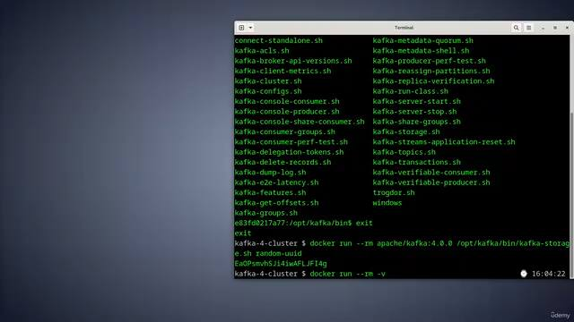
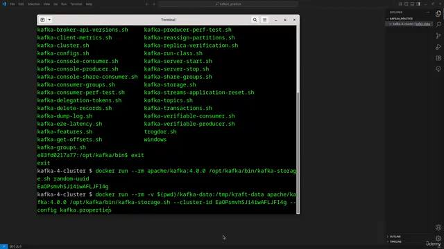
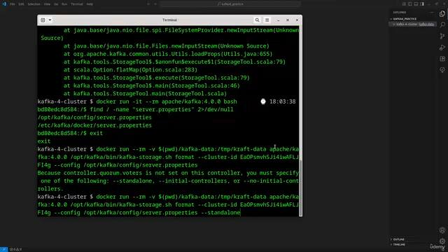
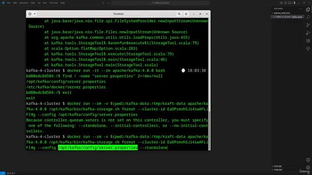
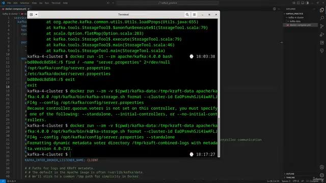
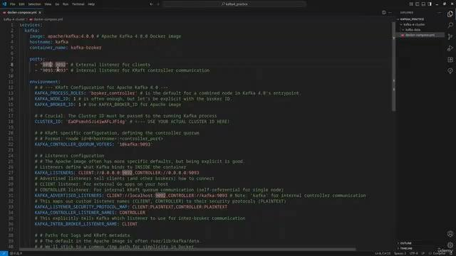
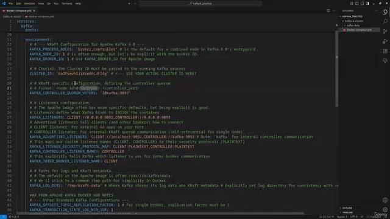
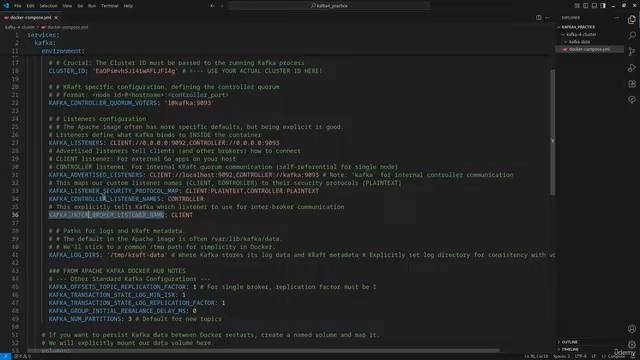

# Apache Kafka 4.0 KRaft 单节点本地集群：从格式化存储到 Docker Compose 启动

## 1. 这一节做什么

这一节的目标很明确：在本地用 Docker 跑起一个 **Apache Kafka 4.0 的 KRaft 单节点集群**，并且让它的元数据和消息数据持久化到宿主机的 `kafka-data` 目录里。完成后，你会得到三样东西：

1. 一个已经用 `kafka-storage.sh format` 初始化过的 Kafka 存储目录；
2. 一个可以直接 `docker compose up -d` 启动的 `docker-compose.yml`；
3. 一个名为 `kafka-broker` 的容器，日志里能看到 Kafka 4.0 KRaft 启动成功的确认。

这一节不是“讲 Kafka 是什么”，而是把 P20–P21 里讲师实际敲过的命令、遇到的报错、修正方式，按可复现的顺序整理出来。最终目录结构建议如下：

```text
kafka-4-practice/
└── kafka-4-cluster/
    ├── docker-compose.yml
    ├── format-storage.sh
    └── kafka-data/
```

其中 `kafka-data` 是宿主机目录，会被挂载到容器内的 `/tmp/kraft-data`。讲师在 P20 一开始就强调，生成 cluster ID 之后要格式化 Kafka 的存储目录，这是 KRaft 模式下初始化 broker 元数据的一次性操作：



从复现角度看，本节的重点不是“把容器跑起来”这一个动作，而是把三个容易出错的地方串起来：第一，cluster ID 必须固定并贯穿格式化命令与 Compose 配置；第二，KRaft 存储目录必须先在宿主机上完成格式化，再交给容器复用；第三，宿主机目录权限必须让容器内 Kafka 进程可写。对前端或 Node 服务来说，Kafka 通常不是浏览器直接访问的对象，而是后端服务、网关或任务服务去连接的中间件；因此本节虽然只启动 broker，但监听地址、广告地址和宿主机端口会直接影响后续 Node 客户端能否连上。你在本地调试时，可以把这一节看成“先把后端消息队列服务跑通”，再考虑前端通过后端 API 间接使用它。

---

## 2. 讲师原话（带「—— pNNN [MM:SS]」）

下面这些原话是这一节的关键决策点，后面的复现步骤都围绕它们展开。

> "集群 ID 已经生成，现在我们需要为 KRAFT 模式格式化 Kafka 存储目录。这会初始化 Kafka 代理的元数据。对于新集群来说，这是一次性操作。"
> —— p020 [00:00]

> "Kafka 存储报了无法识别的参数……这个参数不对，因为我需要在这里指定 format。"
> —— p020 [03:38]

> "由于这个控制器上没有设置 controller.quorum.voters，你必须指定以下选项之一……我们将选择独立模式。"
> —— p020 [05:51]

> "这样可确保格式化后的元数据持久保存在宿主机系统上。"
> —— p020 [06:49]

> "我们 Docker 配置的核心是 docker-compose.yml 文件。"
> —— p021 [00:00]

> "Kafka listeners 是 Kafka 在容器内部绑定的地址；而 Kafka advertised listeners 是 Kafka 告诉客户端用于连接的地址。"
> —— p021 [19:01]

> "如果不使用卷，那么每次停止并删除容器时，所有主题和数据都会丢失。"
> —— p021 [19:30]

> "核心问题是用户 ID 不匹配，UID……"
> —— p021 [24:03]

> "sudo chown -R 1000:1000 kafka-data"
> —— p021 [26:24]

这些原话对应了三个核心动作：**格式化存储 → 写 Compose 文件 → 处理宿主机目录权限**。下面按这个顺序从零复现。阅读这些原话时要注意，讲师不是在罗列概念，而是在解释报错出现的原因：漏掉 `format` 会导致命令参数无法识别；缺少 controller quorum 配置会触发 `--stand-alone` 的选择；挂载目录写入失败则要回到宿主机权限层排查。对前端开发者而言，可以把这几步类比为“初始化数据库目录、写服务启动配置、修正本地目录权限”，只是这里初始化的是 Kafka 的 KRaft 元数据目录。

---

## 3. 从零复现

### 3.1 准备目录

先进入你存放练习的目录，创建 `kafka-4-cluster` 和 `kafka-data`：

```bash
mkdir -p kafka-4-practice/kafka-4-cluster
cd kafka-4-practice/kafka-4-cluster
mkdir -p kafka-data
pwd
```

`pwd` 的输出应该是类似 `/Users/你的用户名/kafka-4-practice/kafka-4-cluster` 的路径。后面 `docker run -v "$PWD/kafka-data:/tmp/kraft-data"` 会用到当前目录。这里的 `mkdir -p` 带有“目录已存在也不报错”的含义，适合反复执行；`cd` 之后的 `mkdir -p kafka-data` 是在集群目录内单独创建数据目录。执行 `pwd` 不是形式步骤，而是为了确认你后续的 `$PWD` 指向正确位置。如果当前目录不对，`-v` 挂载就可能把数据写到另一个目录，容器看起来启动了，但你在预期位置找不到格式化后的文件。对前端项目来说，这类似确认 `.env` 和后端服务目录没有放错位置。

### 3.2 确定 cluster ID

讲师在 P20 开头说“cluster ID 已经生成”，但这一段的逐字稿没有给出生成 UUID 的具体命令。为了文档可以直接跑，下面用一个**示例 cluster ID**：

```bash
export CLUSTER_ID="4L6gQ0m2Q1u8Xy7Z9w3V2A"
echo "$CLUSTER_ID"
```

注意：这个值只是示例。实际使用时，你可以换成自己上一步生成的 UUID，但必须保证**格式化命令和 `docker-compose.yml` 里的 `CLUSTER_ID` 完全一致**。讲师在 P21 也强调，Compose 文件里必须填同一个 cluster ID：

> "我们需要使用与之前运行命令时相同的集群 ID。"
> —— p021 [00:56]

`export` 的作用是把 `CLUSTER_ID` 放进当前 shell 的环境变量里，后续命令可以用 `"$CLUSTER_ID"` 引用；`echo "$CLUSTER_ID"` 是一次自检，确认变量没有被拼错、没有多余空格。需要注意，`export` 只对当前终端会话有效；如果你关掉终端再开一个窗口，这个变量不会自动保留，届时要么重新导出，要么在命令中直接写同一个固定值。排查 cluster ID 问题时，最直接的方法是把格式化命令里的值和 `docker-compose.yml` 中的 `CLUSTER_ID` 并排核对。

### 3.3 第一次格式化：先认识 `format` 子命令

KRaft 模式下，`kafka-storage.sh` 需要 `format` 子命令。讲师第一次执行时漏了 `format`，终端报 `unrecognized argument`：



正确的命令骨架是：

```bash
docker run --rm \
  -v "$PWD/kafka-data:/tmp/kraft-data" \
  apache/kafka:4.0.0 \
  /opt/kafka/bin/kafka-storage.sh format \
  --cluster-id "$CLUSTER_ID" \
  --config /opt/kafka/config/server.properties
```

这里先不要急着加 `--stand-alone`。讲师第二次执行时，终端又报了 `controller.quorum.voters is not set`，于是才补上 `--stand-alone`。这个错误说明：KRaft 格式化时，Kafka 需要知道这个节点在初始 controller quorum 里是什么角色。`docker run --rm` 表示运行一个一次性容器，命令结束后自动删除容器；真正需要保留的是通过 `-v` 挂载到宿主机的 `kafka-data` 目录。换句话说，容器可以是一次性的，数据目录不能是一次性的。常见排查是看报错里有没有 `unrecognized argument`：如果有，先检查 `kafka-storage.sh` 后面是否紧跟着 `format`，而不是直接跟 `--cluster-id`。

### 3.4 找到容器里的 `server.properties`

讲师在遇到 `server.properties` 相关错误后，进入容器执行了 `find`：

```bash
docker run --rm apache/kafka:4.0.0 \
  find / -name server.properties 2>/dev/null
```

逐字稿里讲师找到的路径在 `config` 目录下，并选择使用 `config` 目录里的 `server.properties`。如果你实际输出不同，以你的输出为准；本文使用：

```text
/opt/kafka/config/server.properties
```



`--config` 的作用不是“启动 broker 的完整配置”，而是给 `kafka-storage.sh format` 这个工具提供一份配置上下文。讲师在 P20 后段解释得很清楚：这个参数让格式化工具能加载必要的配置属性，避免出现 `--config is required` 或 `no such file exception`。命令里的 `2>/dev/null` 是把 `find` 在无权访问目录时产生的错误输出暂时丢弃，避免大量无关报错淹没真正的路径结果；它不是删除错误，而是让终端更干净。若 `find` 没有任何输出，先确认镜像 tag 是否正确，再确认命令是否在 `apache/kafka:4.0.0` 容器内执行。

### 3.5 加上 `--stand-alone` 再格式化

单节点 KRaft 集群里，这个节点同时充当 broker 和 controller，所以格式化时要加 `--stand-alone`：

```bash
docker run --rm \
  -v "$PWD/kafka-data:/tmp/kraft-data" \
  apache/kafka:4.0.0 \
  /opt/kafka/bin/kafka-storage.sh format \
  --cluster-id "$CLUSTER_ID" \
  --config /opt/kafka/config/server.properties \
  --stand-alone
```

成功时，终端会出现类似下面的输出：

```text
Formatting dynamic metadata voter directory /tmp/kraft-data...
metadata.version 4.0-IV3
```

讲师在 P20 里把这条输出称为成功消息，并解释 `4.0-IV3` 表示 Kafka 4.0 的元数据格式版本：



这一步完成后，`kafka-data` 目录里应该已经有格式化生成的元数据文件。你可以用：

```bash
ls -la kafka-data
```

确认目录不再为空。这里的 `ls -la` 同时看普通文件和隐藏文件，适合确认格式化是否真的落到了宿主机目录；如果目录仍然是空的，优先检查 `-v` 的左边路径是否是你以为的 `kafka-data`，以及格式化命令是否在当前目录执行。对后续 Node 客户端来说，这一步相当于“消息队列服务端的数据目录已经初始化完成”，还没有开始对外提供连接。

### 3.6 写 `docker-compose.yml`

接下来是 P21 的核心：`docker-compose.yml`。讲师说这个文件描述了服务、网络和卷，并且这一门课后面会大量使用它：



在 `kafka-4-cluster` 目录下创建 `docker-compose.yml`，内容如下。注意把 `CLUSTER_ID` 换成你 3.2 里用的同一个值：

```yaml
services:
  kafka:
    image: apache/kafka:4.0.0
    hostname: kafka
    container_name: kafka-broker
    ports:
      - "9092:9092"
      - "9093:9093"
    environment:
      KAFKA_PROCESS_ROLES: "broker,controller"
      KAFKA_NODE_ID: 1
      KAFKA_BROKER_ID: 1
      CLUSTER_ID: "4L6gQ0m2Q1u8Xy7Z9w3V2A"
      KAFKA_CONTROLLER_QUORUM_VOTERS: "1@kafka:9093"
      KAFKA_LISTENERS: "CLIENT://0.0.0.0:9092,CONTROLLER://0.0.0.0:9093"
      KAFKA_ADVERTISED_LISTENERS: "CLIENT://localhost:9092,CONTROLLER://kafka:9093"
      KAFKA_LISTENER_SECURITY_PROTOCOL_MAP: "CLIENT:PLAINTEXT,CONTROLLER:PLAINTEXT"
      KAFKA_CONTROLLER_LISTENER_NAMES: "CONTROLLER"
      KAFKA_INTER_BROKER_LISTENER_NAME: "CLIENT"
      KAFKA_LOG_DIRS: "/tmp/kraft-data"
      KAFKA_OFFSETS_TOPIC_REPLICATION_FACTOR: 1
      KAFKA_TRANSACTION_STATE_LOG_MIN_ISR: 1
      KAFKA_TRANSACTION_STATE_LOG_REPLICATION_FACTOR: 1
      KAFKA_GROUP_INITIAL_REBALANCE_DELAY_MS: 0
      KAFKA_NUM_PARTITIONS: 3
    volumes:
      - ./kafka-data:/tmp/kraft-data
    networks:
      - kafka-net

networks:
  kafka-net:
    name: KafkaNet
    driver: bridge
```

讲师在 P21 里特别提醒：新版 Docker Compose 不再需要顶部的 `version:` 字段，写了也只会收到提示。所以这里直接从 `services:` 开始。`environment:` 下的 `KAFKA_` 前缀是官方镜像常用的配置映射方式，用来把 Compose 环境变量转成 Kafka broker 配置；排查时不要只看变量名像不像，而要看容器日志里最终加载的 listener、log dirs 和 quorum 配置是否符合预期。`ports:` 把宿主机端口映射到容器端口；`volumes:` 把宿主机目录挂进容器；`networks:` 让后续同网络内容器可以用服务名互相访问。

### 3.7 启动并验证

在 `kafka-4-cluster` 目录下执行：

```bash
docker compose up -d
```

然后检查容器：

```bash
docker ps
```

你应该能看到 `kafka-broker` 正在运行。接着看日志：

```bash
docker logs kafka-broker
```

讲师在 P21 里通过日志确认启动成功，日志里会出现类似 `Kafka Server started` 以及 `KafkaRaftServer nodeId=1` 的确认信息。具体字段名请以你实际输出为准。



`docker compose up -d` 的 `-d` 是后台运行，避免终端被容器日志占住；`docker ps` 看的是“当前正在运行的容器”，不是镜像列表；`docker logs kafka-broker` 才是排查启动失败的主要入口。若 `docker ps` 没有看到容器，不要先怀疑 Compose 文件整体写错，先看日志里第一处异常，因为 Kafka 启动失败时后面常会跟一串连锁报错。对前端/Node 调试来说， broker 日志能启动成功只是第一步，后面还要用客户端实际连接 `localhost:9092` 验证广告地址是否可达。

### 3.8 如果 `docker ps` 是空白：修权限

如果你执行 `docker ps` 看不到 `kafka-broker`，先不要慌，直接看日志：

```bash
docker logs kafka-broker
```

讲师在 P21 里演示过一种常见错误：Kafka 容器内的进程没有权限往挂载目录写 `meta.properties`，日志里会出现 `AccessDeniedException` 或 `Error while writing meta.properties`。原因是宿主机 `kafka-data` 目录的 UID/GID 和容器内 Kafka 进程的 UID/GID 不匹配。讲师说容器内 Kafka 以 UID 1000、GID 1000 的非 root 用户运行：



修复方式是在宿主机、`kafka-data` 的父目录下执行：

```bash
sudo chown -R 1000:1000 kafka-data
```

然后重新启动：

```bash
docker compose down
docker compose up -d
docker ps
docker logs kafka-broker
```



如果日志里出现 `Kafka Server started`，并且能看到 KRaft 相关启动信息，就说明单节点 Kafka 4.0 已经跑起来了。`chown -R` 会递归修改目录及其内部已有文件的属主和属组，这里的 `1000:1000` 对应 UID 和 GID；执行前确认自己在 `kafka-data` 的父目录中，避免对错误路径递归改权限。若当前环境是 Docker Desktop 或其他文件共享方案，权限表现可能不同，仍应以日志中的实际报错为准。对前端开发者来说，这相当于本地后端服务目录“当前用户可写”的问题；权限不对时，服务进程会启动到一半就失败。

---

## 4. 完整代码

### 4.1 `docker-compose.yml`

```yaml
services:
  kafka:
    image: apache/kafka:4.0.0
    hostname: kafka
    container_name: kafka-broker
    ports:
      - "9092:9092"
      - "9093:9093"
    environment:
      KAFKA_PROCESS_ROLES: "broker,controller"
      KAFKA_NODE_ID: 1
      KAFKA_BROKER_ID: 1
      CLUSTER_ID: "4L6gQ0m2Q1u8Xy7Z9w3V2A"
      KAFKA_CONTROLLER_QUORUM_VOTERS: "1@kafka:9093"
      KAFKA_LISTENERS: "CLIENT://0.0.0.0:9092,CONTROLLER://0.0.0.0:9093"
      KAFKA_ADVERTISED_LISTENERS: "CLIENT://localhost:9092,CONTROLLER://kafka:9093"
      KAFKA_LISTENER_SECURITY_PROTOCOL_MAP: "CLIENT:PLAINTEXT,CONTROLLER:PLAINTEXT"
      KAFKA_CONTROLLER_LISTENER_NAMES: "CONTROLLER"
      KAFKA_INTER_BROKER_LISTENER_NAME: "CLIENT"
      KAFKA_LOG_DIRS: "/tmp/kraft-data"
      KAFKA_OFFSETS_TOPIC_REPLICATION_FACTOR: 1
      KAFKA_TRANSACTION_STATE_LOG_MIN_ISR: 1
      KAFKA_TRANSACTION_STATE_LOG_REPLICATION_FACTOR: 1
      KAFKA_GROUP_INITIAL_REBALANCE_DELAY_MS: 0
      KAFKA_NUM_PARTITIONS: 3
    volumes:
      - ./kafka-data:/tmp/kraft-data
    networks:
      - kafka-net

networks:
  kafka-net:
    name: KafkaNet
    driver: bridge
```

### 4.2 `format-storage.sh`

这个脚本把 P20 的格式化命令固定下来，避免手敲漏参数：

```bash
#!/usr/bin/env bash
set -euo pipefail

CLUSTER_ID="${CLUSTER_ID:-4L6gQ0m2Q1u8Xy7Z9w3V2A}"
KAFKA_IMAGE="apache/kafka:4.0.0"
KAFKA_DATA_DIR="$(pwd)/kafka-data"
CONFIG_PATH="/opt/kafka/config/server.properties"

mkdir -p "$KAFKA_DATA_DIR"

docker run --rm \
  -v "$KAFKA_DATA_DIR:/tmp/kraft-data" \
  "$KAFKA_IMAGE" \
  /opt/kafka/bin/kafka-storage.sh format \
  --cluster-id "$CLUSTER_ID" \
  --config "$CONFIG_PATH" \
  --stand-alone
```

使用方式：

```bash
chmod +x format-storage.sh
./format-storage.sh
```

如果你机器上的 `server.properties` 不在 `/opt/kafka/config/server.properties`，先执行：

```bash
docker run --rm apache/kafka:4.0.0 \
  find / -name server.properties 2>/dev/null
```

把 `CONFIG_PATH` 换成实际路径。脚本里的 `set -euo pipefail` 表示命令失败就退出、引用未定义变量时报错、管道中任一段失败也返回失败，适合把一次性格式化步骤固定住；`CLUSTER_ID` 支持外部传入，未传入时使用默认示例值。执行前应确认当前目录就是 `kafka-4-cluster`，否则 `$(pwd)/kafka-data` 会指向别处。

### 4.3 启动与停止命令

```bash
# 启动
docker compose up -d

# 查看容器
docker ps

# 查看日志
docker logs kafka-broker

# 停止并删除容器，但保留 kafka-data 卷目录
docker compose down

# 重新启动
docker compose up -d
```

---

## 5. 逐行解释

### 5.1 `docker run --rm -v ...`

`--rm` 表示这个临时容器退出后自动删除，不留下垃圾容器。`-v "$PWD/kafka-data:/tmp/kraft-data"` 把宿主机当前目录下的 `kafka-data` 挂到容器内的 `/tmp/kraft-data`。讲师在 P20 里解释过，这样做是为了让格式化后的元数据留在宿主机上，容器重启后还能复用：

> "这样可确保格式化后的元数据持久保存在宿主机系统上。"
> —— p020 [06:49]

这里的冒号左边是宿主机路径，右边是容器路径；日常排查时先确认左边目录存在、右边目录与 `KAFKA_LOG_DIRS` 一致。对前端/Node 项目而言，这类似把本地开发数据库的数据文件挂到固定目录，容器重建后仍然能复用同一份数据。

### 5.2 `kafka-storage.sh format`

`kafka-storage.sh` 是 Kafka 的存储工具，`format` 是它的子命令。讲师第一次漏了 `format`，所以终端报 `unrecognized argument`。加上 `format` 后，工具才会去初始化 KRaft 的元数据目录。这个子命令不是启动 broker，也不是创建 topic，而是对存储目录做一次性初始化；如果目录已格式化过，重复执行可能报错或需要清理，因此本地练习时要明确区分“第一次格式化”和“后续复用”。

### 5.3 `--cluster-id`

这个参数把 cluster ID 写进元数据。讲师在 P20 里说，cluster ID 用来保证集群唯一性，即使当前是单节点，也需要它，因为后面可能扩展成多节点集群。排查时最怕“格式化用一个值、Compose 用另一个值”；出现元数据与配置不一致的报错时，先把两处字符串逐字比对。

### 5.4 `--config /opt/kafka/config/server.properties`

这个参数给格式化工具提供配置文件。它不是启动 broker 的完整配置，而是让 `kafka-storage.sh` 有配置上下文可加载。讲师在 P20 后段解释：`--config` 是 Kafka 命令行工具的通用参数，用来告诉工具从哪个文件加载配置属性。若路径写错，常见表现是提示配置文件不存在或无法读取；此时应回到容器里用 `find` 确认实际路径，而不是凭记忆猜测。

### 5.5 `--stand-alone`

单节点 KRaft 集群里，这个节点同时是 broker 和 controller，所以格式化时要加 `--stand-alone`。讲师在 P20 里解释，如果不加，Kafka 会问 `controller.quorum.voters` 怎么设置；`--stand-alone` 就是告诉 Kafka：这个节点自己构成初始 controller quorum。多节点场景不应照搬这个参数，本地单节点练习可以先用它降低配置复杂度。

### 5.6 `KAFKA_PROCESS_ROLES: "broker,controller"`

这个环境变量让同一个节点同时承担 broker 和 controller 角色。broker 负责处理客户端请求和存数据，controller 负责管理集群元数据。讲师在 P21 里说，本地开发用这种合并角色没问题；生产环境多 broker 时，可能会拆出单独的 controller-only 节点。排查时如果角色配置和 quorum voters 对不上，日志里常会出现 controller 相关异常，应先检查这两个配置是否表达同一种集群形态。

### 5.7 `KAFKA_NODE_ID` 和 `KAFKA_BROKER_ID`

这两个都指向同一个逻辑节点 ID。讲师在 P21 里解释，官方 Apache Kafka 镜像的 entrypoint 在 `process.roles` 包含 broker 时，更偏好用 `KAFKA_BROKER_ID` 表达；但两者本质上是同一个节点 ID。单节点写 `1` 即可。若 quorum voters 写的是 `1@kafka:9093`，节点 ID 也应是同一个值，否则容易出现“配置里引用了不存在的节点”的排查困难。

### 5.8 `CLUSTER_ID`

这个值必须和 P20 格式化时用的 cluster ID 完全一致。讲师在 P21 里强调，这是运行集群的关键，不能随便换。换了之后，容器会认为这是另一个集群，和已经格式化好的元数据对不上。实际排查时，可以先 `echo` 格式化脚本里的变量，再在 Compose 文件里搜索 `CLUSTER_ID`，确认两者没有大小写、空格或字符差异。

### 5.9 `KAFKA_CONTROLLER_QUORUM_VOTERS: "1@kafka:9093"`

这告诉 Kafka：初始 controller quorum 里有哪些节点。单节点就是 `1@kafka:9093`，其中 `1` 是 node ID，`kafka` 是 hostname，`9093` 是 controller 端口。多节点时用逗号分隔多个 `id@host:port`。对本地 Compose 来说，`kafka` 能和 `hostname`、服务名以及网络内容器解析配合使用；如果改成不可解析的主机名，controller 通信会失败。

### 5.10 `KAFKA_LISTENERS` 和 `KAFKA_ADVERTISED_LISTENERS`

`KAFKA_LISTENERS` 是 Kafka 在容器内绑定的地址，这里用 `0.0.0.0` 绑定所有网卡，CLIENT 用 9092，CONTROLLER 用 9093。`KAFKA_ADVERTISED_LISTENERS` 是 Kafka 告诉客户端“你应该用这个地址连我”。讲师在 P21 里专门区分过：

> "Kafka listeners 是 Kafka 在容器内部绑定的地址；而 Kafka advertised listeners 是 Kafka 告诉客户端用于连接的地址。"
> —— p021 [19:01]

这里 CLIENT 对外广告 `localhost:9092`，适合宿主机上的客户端；CONTROLLER 广告 `kafka:9093`，适合容器网络内部通信。前端开发者可以把 advertised listeners 类比为后端 API 返回给客户端的 base URL：服务实际监听什么地址是一回事，客户端被告知去连什么地址是另一回事。若 Node 服务也跑在容器里，就不能简单用 `localhost:9092`，而应使用容器网络里可达的 `kafka:9092` 一类地址。

### 5.11 `KAFKA_LISTENER_SECURITY_PROTOCOL_MAP`

这里把自定义 listener 名 `CLIENT` 和 `CONTROLLER` 映射到 `PLAINTEXT`。讲师在 P21 里解释，`CLIENT` 和 `CONTROLLER` 只是逻辑名字，真正协议是 `PLAINTEXT`，也就是不加密的明文协议，适合本地开发。后面课程才会涉及 SSL/SASL。排查连接失败时，先确认客户端使用的协议与这个映射一致；本地开发通常先用明文把链路跑通。

### 5.12 `KAFKA_CONTROLLER_LISTENER_NAMES: "CONTROLLER"`

这明确告诉 Kafka：controller 内部通信使用名为 `CONTROLLER` 的 listener。讲师说这是 KRaft 设置里为了清晰而保留的好习惯。这个名字要和 `KAFKA_LISTENERS`、`KAFKA_LISTENER_SECURITY_PROTOCOL_MAP` 中的名字保持一致，否则配置看起来都有值，但实际没有对应到同一个 listener。

### 5.13 `KAFKA_INTER_BROKER_LISTENER_NAME: "CLIENT"`

broker 之间通信使用 `CLIENT` listener。讲师在 P21 里解释，controller 通信和 inter-broker 通信不是一回事；当前配置下，inter-broker 用 `CLIENT`，因为 `CONTROLLER` 只给 controller 用。单节点时这项不容易暴露问题，但一旦扩展到多节点，listener 名称不一致会直接影响 broker 间复制和元数据同步。

### 5.14 `KAFKA_LOG_DIRS: "/tmp/kraft-data"`

这是容器内 Kafka 存数据日志和 KRaft 元数据的目录。它必须和卷挂载的容器路径一致，也就是 `./kafka-data:/tmp/kraft-data` 里的 `/tmp/kraft-data`。讲师在 P21 里说，这个目录会被映射到宿主机，保证数据持久化。排查时如果日志说写入某个目录失败，先检查这个路径与 `volumes:` 右侧路径是否完全一致。

### 5.15 三个复制因子和 ISR 配置

`KAFKA_OFFSETS_TOPIC_REPLICATION_FACTOR: 1`、`KAFKA_TRANSACTION_STATE_LOG_MIN_ISR: 1`、`KAFKA_TRANSACTION_STATE_LOG_REPLICATION_FACTOR: 1` 都是单 broker 场景下的必要值。讲师在 P21 里解释：单 broker 复制因子只能是 1；多 broker 集群通常会用 3。这里的事务状态日志不是让你写数据库事务，而是 Kafka 内部事务 topic 的复制配置；从 JS/Node 视角看，可以先把它理解成“Kafka 自己内部用的 topic 配置”，本课不写事务代码。若单 broker 却设置了大于 1 的复制因子，常见结果是内部 topic 无法满足副本要求，启动或创建 topic 时出现异常。

### 5.16 `KAFKA_GROUP_INITIAL_REBALANCE_DELAY_MS: 0`

消费者组 rebalance 前的延迟设为 0，开发环境里让 rebalance 立即发生，方便频繁启动、停止消费者。生产环境可能会设一个小延迟，避免不必要的 rebalance。对前端联调来说，这意味着你反复重启本地 Node 消费服务时，不必等太久才看到消费组重新分配；但不要把这个开发便利直接当成生产参数。

### 5.17 `KAFKA_NUM_PARTITIONS: 3`

新建 topic 时如果没有显式指定分区数，默认用 3 个分区。讲师在 P21 里说，这不是 broker 本身的分区数，而是 topic 的默认分区数。排查“为什么创建 topic 后是 3 个分区”时，应看这个默认值，而不是误以为 broker 只能有 3 个分区。

### 5.18 `volumes` 和 `networks`

`volumes: - ./kafka-data:/tmp/kraft-data` 是持久化的关键。讲师在 P21 里说得很直接：不用 volume，每次停止并删除容器，所有 topic 和数据都会丢。`networks` 里创建 `KafkaNet` 自定义 bridge 网络，方便以后加 Kafka UI 或其他 Kafka 节点时互相通信。对前端/Node 服务来说，网络名称和容器名会决定服务间能否用 `kafka` 这样的主机名互相访问；调试连接问题时要把“宿主机访问”和“容器内访问”分开验证。

---

## 6. 复现检查清单

- [ ] 已创建 `kafka-4-practice/kafka-4-cluster/kafka-data` 目录。验证：在当前集群目录执行 `ls -la`，确认 `kafka-data` 存在，并确认 `pwd` 指向 `kafka-4-cluster`。
- [ ] 已确定一个 cluster ID，并保证格式化和 Compose 文件里用的是同一个值。验证：执行 `echo "$CLUSTER_ID"`，再检查 `docker-compose.yml` 中的 `CLUSTER_ID`，逐字比对。
- [ ] 已执行 `kafka-storage.sh format`，终端出现 `metadata.version 4.0-IV3` 或类似成功输出。验证：回看格式化命令输出；若命令失败，先检查是否漏了 `format` 或 `--stand-alone`。
- [ ] `kafka-data` 目录里已经生成元数据文件，不再是空目录。验证：执行 `ls -la kafka-data`，确认目录内容发生变化，而不是只有 `.` 和 `..`。
- [ ] `docker-compose.yml` 中 `CLUSTER_ID` 与格式化时一致。验证：用编辑器或 `grep CLUSTER_ID docker-compose.yml` 查看配置值，并与终端变量对照。
- [ ] `docker compose up -d` 执行成功。验证：命令退出后执行 `docker compose ps`，确认服务状态不是反复重启或退出。
- [ ] `docker ps` 能看到 `kafka-broker` 容器。验证：执行 `docker ps --filter name=kafka-broker`，确认容器处于运行状态。
- [ ] `docker logs kafka-broker` 能看到 Kafka 启动成功信息。验证：执行 `docker logs kafka-broker`，重点搜索 `Kafka Server started` 和 KRaft 相关启动行，具体字段以实际输出为准。
- [ ] 如果 `docker ps` 空白，已用 `docker logs kafka-broker` 查看错误。验证：日志中是否出现权限、配置路径、cluster ID 或 listener 相关异常，并据此回到对应步骤排查。
- [ ] 如果出现 `AccessDeniedException`，已在宿主机执行 `sudo chown -R 1000:1000 kafka-data`。验证：执行后重新 `docker compose down` 和 `docker compose up -d`，再看日志是否仍有写入失败。
- [ ] 修复权限后执行过 `docker compose down` 和 `docker compose up -d`。验证：执行 `docker compose ps` 和 `docker logs kafka-broker`，确认容器重新运行且日志中出现启动成功信息。
- [ ] 重启容器后 `kafka-data` 里的数据仍然存在。验证：重启前后分别执行 `ls -la kafka-data`，确认目录中的元数据文件仍在，而不是因容器删除而消失。

---

## 7 课里没讲但你会撞上的

表格列：现象 / 原因 / 怎么办。

| 现象 | 原因 | 怎么办 |
|---|---|---|
| 执行 `docker compose up -d` 直接报错，提示找不到 Docker 命令或守护进程未运行 | Docker 没装、没启动，或当前用户没有可用 Docker 环境 | 先执行 `docker version` 和 `docker compose version` 确认能正常输出；对前端/Node 本地联调来说，Docker 没起来时后端消息队列服务根本不会启动 |
| 终端提示 `docker compose` 不存在，但机器上有旧的 `docker-compose` | 新旧两代 Compose 命令不同，课里使用的是 `docker compose` | 先确认本机安装的是哪一代；不要在不确认版本的情况下混用命令，排查时把完整报错保留下来 |
| 容器启动失败，日志或系统提示端口 9092、9093 被占用 | 本机已有 Kafka、其他服务或残留容器占用端口 | 用 `lsof -i :9092` 或 `lsof -i :9093` 查占用；先停止冲突服务或调整 Compose 端口映射，再重新启动 |
| 格式化时报 `server.properties` 不存在或路径无法读取 | 镜像版本不同，配置文件路径与本文示例不一致 | 按前文在容器内执行 `find / -name server.properties 2>/dev/null`，把 `--config` 或脚本里的 `CONFIG_PATH` 换成实际路径 |
| 执行 `docker compose down -v` 后担心 `kafka-data` 被清掉 | `-v` 会删除 Compose 管理的卷；本文当前用的是宿主机 bind mount，但误用其他卷配置仍有数据风险 | 本地练习先分清 bind mount 和命名卷；不要随意加 `-v`，需要保留数据时先确认 `volumes:` 写法和目录内容 |
| 宿主机上的 Node 客户端能写 `localhost:9092`，但容器内客户端连不上 | `KAFKA_ADVERTISED_LISTENERS` 中 CLIENT 广告的是 `localhost:9092`，容器内 `localhost` 指向容器自身 | 宿主机客户端继续用 `localhost:9092`；容器内客户端应使用容器网络可达的 `kafka:9092` 一类地址，并把“宿主机访问”和“容器内访问”分开测试 |
| 日志出现 `AccessDeniedException` 或写 `meta.properties` 失败 | 宿主机挂载目录的 UID/GID 与容器内 Kafka 进程不匹配 | 在 `kafka-data` 父目录执行 `sudo chown -R 1000:1000 kafka-data`，再 `docker compose down`、`docker compose up -d` 并复查日志；macOS/Windows 文件共享或 SELinux 环境要结合实际报错处理 |
| 容器启动后报元数据或集群配置不一致 | `docker-compose.yml` 里的 `CLUSTER_ID` 与格式化时使用的值不一致，或中途重新生成过 cluster ID | 固定一个 cluster ID，格式化命令和 Compose 配置全部复用同一个值；排查时用 `echo "$CLUSTER_ID"` 与 `grep CLUSTER_ID docker-compose.yml` 对照 |
| 单节点格式化时提示 quorum 相关配置缺失 | 单节点 KRaft 需要明确初始 controller quorum 形态，格式化命令缺少 `--stand-alone` | 按本节命令加上 `--stand-alone`；但要注意它只适合单节点，多节点场景不能照搬，应使用 `--initial-controllers` 指定初始 controller 列表 |
| 看到 `metadata.version 4.0-IV3` 后误以为它是 Kafka 镜像版本 | `4.0-IV3` 是元数据格式版本，`IV3` 是内部修订号，不是普通版本号 | 把它当作元数据格式确认信息；镜像版本仍看 `apache/kafka:4.0.0`，排查时不要把两者混为一谈 |