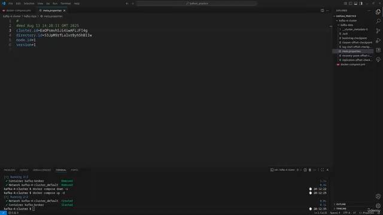
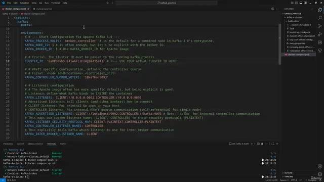
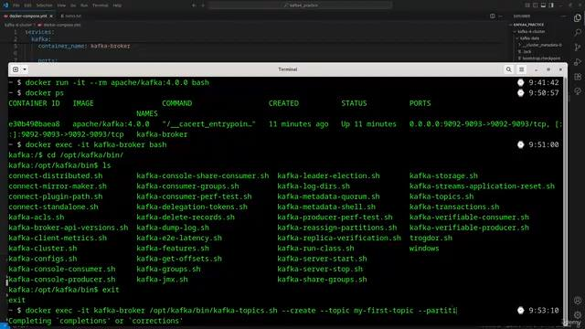
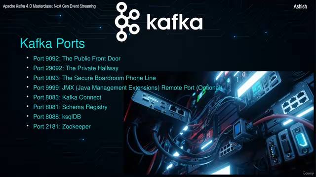
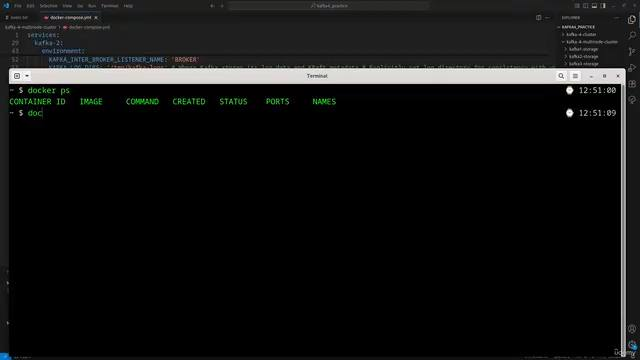
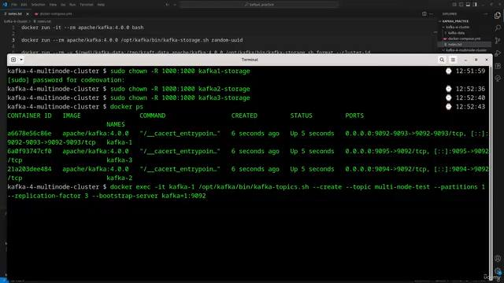
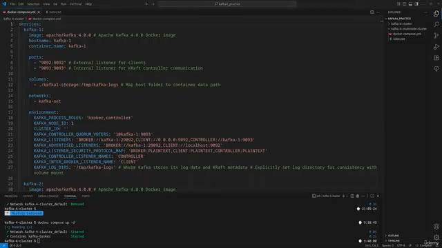

# Apache Kafka 4.0 多节点集群搭建（P22–P25）复现文档

> 适用读者：前端转 AI 应用工程师。本文档覆盖 P22–P25 四节课：集群 ID 与存储格式化原理、创建第一个 topic、Kafka 端口体系、三节点 KRaft 集群搭建与故障演练。所有命令、配置、代码均按讲师演示顺序整理，可直接照做。

---

## 1. 这一节做什么

这四节课把「单节点 Kafka 跑起来」推进到「一个能扛住节点宕机的三节点 KRaft 集群」。具体产出：

1. **理解并验证 cluster ID 机制**：为什么 `kafka-storage.sh random-uuid` 生成的 ID 要同时写进磁盘（`meta.properties`）和 `docker-compose.yaml` 环境变量，两者不一致时 broker 会拒绝启动——讲师现场演示了这个报错。你需要亲手做一次「改错 ID → 启动失败 → 看日志 → 改回 ID → 恢复」的闭环，而不是只看结论。
2. **创建第一个 topic**：用 `docker exec` 在运行中的容器里执行 `kafka-topics.sh --create`，并观察 `kafka-data` 目录下出现的 topic 文件夹。这里要同时理解「命令在容器内执行」和「数据目录挂载到宿主机」两件事，否则你会误以为 topic 只存在于 Kafka 进程内存里。
3. **搞清 Kafka 的端口分工**：9092（外部客户端）、29092（broker 间通信）、9093（controller 通信）、9999（JMX，未启用）、2181（ZooKeeper，4.0 已不用）。端口表不是背下来的，而是要和 `LISTENERS`、`ADVERTISED_LISTENERS`、`ports` 三处配置互相对照，知道哪个端口给谁用、从宿主机能不能连。
4. **搭三节点集群**：node 1 兼任 controller + broker，node 2/3 只做 broker；用 `--replication-factor 3` 建 topic，然后 `docker stop kafka-2` 验证 leader 自动切换、ISR 收缩，再 `docker start` 验证恢复。故障演练是本节的验收动作，只看 `docker ps` 三个容器都在，并不能证明复制和选主真的生效。

最终你会得到：一个 `docker-compose.yaml` 文件 + 三个数据目录（`kafka-1-storage` / `kafka-2-storage` / `kafka-3-storage`）+ 一个复制因子为 3 的 topic，并且亲手验证过故障转移。对前端转 AI 应用工程师来说，这一节的价值不只是记命令，而是建立一套排障顺序：先确认 cluster ID 是否一致，再确认容器是否真的启动，再确认 topic 的副本和 ISR，最后才做停节点演练。这个顺序和排查前端「构建失败 → 容器没起来 → 接口不通 → 网关路由错」的思路是一样的，只是对象从 Node 服务换成了 Kafka broker。

---

## 2. 讲师原话

> "Kafka 集群标识符是分配给特定 Kafka 集群的全局唯一标识符，即 UUID。可以把它看作整个 Kafka 部署的独一无二的基因或指纹。"
> —— p022 [00:57]

> "如果某个代理尝试使用集群标识符不同的数据目录启动，它会拒绝启动，从而防止意外数据丢失或数据混用。"
> —— p022 [02:39]

> "这并不是在启动 Kafka。这个区别很关键。KafkaStorage.sh format 是一次性的预检步骤，用于准备存储。"
> —— p022 [06:09]

> "如果这两个标识符不匹配……Kafka 代理就会拒绝启动。我们实际来试一下。"
> —— p022 [08:00]

> "我们不必进入代理的终端再运行命令，而是可以从外部运行命令，把 bash 替换成我们想要运行的具体命令。"
> —— p023 [02:51]

> "主题一创建，Kafka 数据目录里就生成了一个文件夹。"
> —— p023 [05:42]

> "端口号 9092 是公开的前门，也就是外部客户端监听器。"
> —— p024 [01:54]

> "29092 是私有走廊，也就是内部代理间监听器。这个端口不向外界暴露。"
> —— p024 [03:18]

> "9093 只供控制器使用，不供代理使用。它是某些充当控制器的重要服务器的安全电话线。"
> —— p024 [05:11]

> "在我们这个简单的类生产设置中，我们会把第一个节点配置为同时充当控制器和代理，而另外两个节点将作为专用代理。"
> —— p025 [02:18]

> "领导者已经自动切换。集群检测到故障，并从可用副本中选举出新的领导者。这证明了容错能力。"
> —— p025 [43:10]

以上英文原话保留原样，方便你回看课程时对照时间点。本文第 5 节会把这些原话落到具体配置项上：cluster ID 对应「磁盘和运行时双向校验」，`format` 对应「一次性预检而不是启动 Kafka」，9092/29092/9093 分别对应客户端、broker 间、controller 三类通信。阅读时不要把原话里的比喻当成额外配置，比喻只是帮助记忆，实际生效的仍然是 compose 里的环境变量和 Kafka 启动日志。

---

## 3. 从零复现

### 3.1 环境前提

- 已安装 Docker 与 Docker Compose（v2，命令为 `docker compose`，不是老的 `docker-compose`）。开始前建议先执行 `docker version` 和 `docker compose version`，确认 Docker daemon 正在运行、Compose 是 v2。很多「容器起不来」其实不是 Kafka 配置问题，而是 Docker Desktop 没启动或当前用户没有权限。
- 宿主机为 Linux 或 macOS；**Windows 用户注意**：后面 `chown` 那一步在 Windows 上行为不同，课里没讲 Windows 方案。Windows 上不要直接照抄 `sudo chown`，应优先使用 Docker Desktop 的文件共享设置，或者把项目放在 Docker Desktop 已共享的目录下再试。
- 工作目录结构（讲师在 P25 里从单节点目录 `cd ..` 切到多节点目录，说明两个项目是平级目录）：

```
~/kafka/
├── kafka-single-node/          # P22–P24 用的单节点项目
│   ├── docker-compose.yaml
│   └── kafka-data/             # 单节点数据目录（容器内 /tmp/kraft-data 映射出来）
└── kafka-multi-node-cluster/   # P25 新建的三节点项目
    ├── docker-compose.yaml
    ├── kafka-1-storage/
    ├── kafka-2-storage/
    └── kafka-3-storage/
```

目录结构要提前建好。单节点和多节点是两个平级项目，不要把三节点 compose 直接覆盖到单节点目录里，否则旧 `kafka-data` 里的 `meta.properties` 可能继续带着旧 cluster ID，和新 compose 里的 `CLUSTER_ID` 冲突。前端同学可以把它类比成两个独立的 `.env` 项目：单节点项目有自己的实例 ID，多节点项目也应有自己的实例 ID，混用配置就会出现「明明改了环境变量但启动还是报旧 ID」的错觉。

### 3.2 第一步：生成 cluster ID（P22）

在任意目录执行（讲师用的是容器内的 `kafka-storage.sh`，这里给出宿主机通过临时容器执行的等价写法；如果你已有单节点容器在跑，也可以 `docker exec` 进去执行）：

```bash
docker run --rm apache/kafka:4.0.0 \
  /opt/kafka/bin/kafka-storage.sh random-uuid
```

输出是一串 22 字符的 base64 风格 UUID，例如（**每次运行都不同，不要照抄**）：

```
4O1rXyZ9Q2mK7vB3nW8pLg
```

> 课里没讲镜像 tag 具体是哪个版本号，讲师只提到 "Kafka 4.0"。上面 `apache/kafka:4.0.0` 是官方镜像的常见写法，实际拉取时请以 Docker Hub 上 `apache/kafka` 的 4.0.x tag 为准。

这一步要理解的是：`random-uuid` 只负责生成一个字符串，并不会启动 Kafka，也不会写你的宿主机目录。`docker run --rm` 表示临时容器跑完就删除，`/opt/kafka/bin/kafka-storage.sh` 是镜像内自带的存储管理脚本，`random-uuid` 是它的子命令。常见错误是复制输出时带上了空格、引号或换行，导致 compose 里的 `CLUSTER_ID` 实际值和磁盘里的不一致。验证方法是：把输出原样复制到 compose 后，再执行一次 `docker exec` 或临时容器命令对比；如果你已经有容器，也可以进入容器查看 `meta.properties` 里的 `cluster.id`，确认和 compose 中一致。前端对照：这很像给本地 IndexedDB 或 SQLite 生成一个 `instanceId`，生成动作本身不打开数据库，只有应用启动时才拿它和文件里的值比对。



### 3.3 第二步：单节点 compose 文件（P22–P24 的基线）

这是 P22–P24 一直在用的单节点配置。注意 `CLUSTER_ID` 环境变量必须和上一步生成的值一致。

`kafka-single-node/docker-compose.yaml`：

```yaml
services:
  kafka:
    image: apache/kafka:4.0.0
    container_name: kafka-broker
    hostname: kafka
    ports:
      - "9092:9092"
      - "9093:9093"
    environment:
      CLUSTER_ID: "4O1rXyZ9Q2mK7vB3nW8pLg"
      KAFKA_NODE_ID: 1
      KAFKA_PROCESS_ROLES: "broker,controller"
      KAFKA_CONTROLLER_QUORUM_VOTERS: "1@kafka:9093"
      KAFKA_LISTENERS: "PLAINTEXT://kafka:29092,CONTROLLER://kafka:9093,CLIENT://0.0.0.0:9092"
      KAFKA_ADVERTISED_LISTENERS: "PLAINTEXT://kafka:29092,CLIENT://localhost:9092"
      KAFKA_LISTENER_SECURITY_PROTOCOL_MAP: "CONTROLLER:PLAINTEXT,PLAINTEXT:PLAINTEXT,CLIENT:PLAINTEXT"
      KAFKA_INTER_BROKER_LISTENER_NAME: "PLAINTEXT"
      KAFKA_CONTROLLER_LISTENER_NAMES: "CONTROLLER"
      KAFKA_OFFSETS_TOPIC_REPLICATION_FACTOR: 1
    volumes:
      - ./kafka-data:/tmp/kraft-data
```

> 说明：讲师在 P24 明确承认单节点这份文件里 `KAFKA_INTER_BROKER_LISTENER_NAME` 写成了 `client` 是**错的**（"我们犯了一个错误，正在从中吸取教训。"），因为单节点没有 broker 间通信所以没暴露问题。上面这份已经按 P25 的修正写成 `PLAINTEXT`。其余环境变量（如 `KAFKA_OFFSETS_TOPIC_REPLICATION_FACTOR`）课里没逐个念，属于让单节点能正常启动的必要项，请以实际镜像文档为准。

这份 compose 里，`ports` 把宿主机 9092 和 9093 映射到容器；`volumes` 把宿主机 `./kafka-data` 映射到容器内 `/tmp/kraft-data`；`KAFKA_NODE_ID: 1` 是这个节点的编号；`KAFKA_PROCESS_ROLES: "代理、控制器"` 表示单节点同时承担两种角色；`KAFKA_CONTROLLER_QUORUM_VOTERS: "1@kafka:9093"` 表示 controller 名单只有 node 1。常见错误有三个：一是 `CLUSTER_ID` 和磁盘旧数据不一致，日志报 `Invalid cluster.id`；二是宿主机 9092 已被别的进程占用，容器启动失败；三是 `KAFKA_ADVERTISED_LISTENERS` 写成容器内地址却从宿主机连，客户端会拿到不可达地址。验证时先 `docker compose up -d`，再 `docker ps` 看容器是否稳定运行，最后 `docker logs kafka-broker` 看有没有异常堆栈。前端对照：`LISTENERS` 像 Node 服务的 `server.listen`，`ADVERTISED_LISTENERS` 像返回给浏览器的公开 API 地址，监听地址和对外公布地址不是一回事。

### 3.4 第三步：验证 cluster ID 不一致会拒绝启动（P22 现场实验）

讲师把 compose 里的 `CLUSTER_ID` 改成一个随便的数字，`docker compose up -d` 后 `docker ps` 看不到容器，`docker logs` 里出现：

```
Exception: Invalid cluster.id
```



改回正确 ID 后 `docker compose up -d` 恢复正常。这一步建议你亲手做一遍，比看十遍文字都记得牢。操作时注意：改错后如果 `docker ps` 看不到容器，不要急着重装镜像，先执行 `docker compose logs kafka` 或 `docker logs kafka-broker` 看日志；如果日志里不是 `Invalid cluster.id`，而是权限、端口或镜像拉取错误，那说明你撞上的是别的问题，不要误判成 cluster ID 问题。改回正确 ID 后，如果仍然起不来，检查是否还有旧容器或旧卷残留，必要时先 `docker compose down -v` 再启动。这个实验的验证方法是：错误 ID 时日志必须出现 `Invalid cluster.id`，正确 ID 时容器能出现在 `docker ps` 且日志无该异常，两个状态能稳定复现，才算真正理解双向校验。

### 3.5 第四步：创建第一个 topic（P23）

容器跑起来后，**不用进容器**，直接从宿主机执行：

```bash
docker exec -it kafka-broker \
  /opt/kafka/bin/kafka-topics.sh \
  --create \
  --topic my-first-topic \
  --partitions 1 \
  --replication-factor 1 \
  --bootstrap-server kafka:9092
```

输出：

```
Created topic my-first-topic.
```

然后 `ls kafka-data/`，会看到多出一个 `my-first-topic-0` 目录——这就是讲师说的「topic 一创建，数据目录里就出现文件夹」。



这条命令拆开看：`docker exec -it kafka-broker` 表示在已运行的 `kafka-broker` 容器里执行命令；`/opt/kafka/bin/kafka-topics.sh` 是 topic 管理脚本；`--create` 表示创建；`--topic my-first-topic` 是 topic 名；`--partitions 1` 是分区数；`--replication-factor 1` 是副本数，单节点只能为 1；`--bootstrap-server kafka:9092` 是告诉脚本连哪个 broker。常见错误包括：topic 已存在时报 `Topic 'my-first-topic' already exists`，此时改用 `--describe` 查看或换一个 topic 名；`bootstrap-server` 写成宿主机地址导致容器内解析不到；忘记 `--replication-factor` 或写成大于 broker 数量的值导致创建失败。验证方法是：创建成功后执行 `--describe` 确认 `PartitionCount` 和 `ReplicationFactor`，再到宿主机 `ls kafka-data/` 看目录是否出现。前端对照：这像用 CLI 在数据库里建一张表，建表成功后磁盘上会出现对应文件或目录，命令返回成功只是第一步，最好再用 describe 或文件系统确认一次。

### 3.6 第五步：端口分工（P24）

| 端口 | 角色 | 是否暴露到宿主机 | 用途 |
|---|---|---|---|
| 9092 | CLIENT | 是 | 外部客户端（Go 应用、Kafka UI、你本机的 producer/consumer） |
| 29092 | PLAINTEXT（broker 间） | 否（单节点）/ 是（多节点内部） | broker 之间复制数据 |
| 9093 | CONTROLLER | 是（便于调试） | controller quorum 内部通信 |
| 9999 | JMX | 否 | 监控，课里明确说没启用 |
| 2181 | ZooKeeper | 否 | Kafka 4.0 已不用 |
| 8083 / 8081 / 8088 | Connect / Schema Registry / ksqlDB | 否 | 生态组件，课里没展开 |



看这张表时要结合 compose 的 `ports`、`LISTENERS`、`ADVERTISED_LISTENERS` 三处一起看。`ports` 决定宿主机能不能访问容器端口；`LISTENERS` 决定 Kafka 进程在容器内监听哪些地址；`ADVERTISED_LISTENERS` 决定 Kafka 告诉客户端「你应该用哪个地址来找我」。常见错误是只在 `ports` 里映射了 9092，却把 advertised 写成容器内 hostname，结果宿主机客户端拿到 `kafka:9092` 这种本机无法解析的名字。验证方法是：单节点时从宿主机用 `localhost:9092` 连；三节点时从宿主机用 `localhost:9092`、`localhost:9094`、`localhost:9095` 分别试；broker 间通信则看 `PLAINTEXT://kafka-1:29092` 是否在容器网络内可解析。前端对照：这类似开发环境里 `vite` 监听 `0.0.0.0`，但 HMR 或 API 地址必须告诉浏览器 `localhost`，监听地址和浏览器访问地址不能混为一谈。

### 3.7 第六步：三节点 compose 文件（P25 核心产出）

先停掉单节点（讲师强调要 `-v` 清掉卷，否则旧数据会干扰）：

```bash
cd ~/kafka/kafka-single-node
docker compose down -v
```

再生成一个**新的** cluster ID（讲师明确说"我们不会使用同一个集群 ID。"）：

```bash
docker run --rm apache/kafka:4.0.0 \
  /opt/kafka/bin/kafka-storage.sh random-uuid
```

假设新 ID 为 `Xk9mP2vQ7rT4wY6nB8cL1a`（**你的输出一定不同**）。

`kafka-multi-node-cluster/docker-compose.yaml`：

```yaml
services:
  kafka-1:
    image: apache/kafka:4.0.0
    container_name: kafka-1
    hostname: kafka-1
    ports:
      - "9092:9092"
      - "9093:9093"
    networks:
      - kafka-net
    volumes:
      - ./kafka-1-storage:/tmp/kafka-logs
    environment:
      CLUSTER_ID: "Xk9mP2vQ7rT4wY6nB8cL1a"
      KAFKA_NODE_ID: 1
      KAFKA_PROCESS_ROLES: "broker,controller"
      KAFKA_CONTROLLER_QUORUM_VOTERS: "1@kafka-1:9093"
      KAFKA_LISTENERS: "PLAINTEXT://kafka-1:29092,CONTROLLER://kafka-1:9093,CLIENT://0.0.0.0:9092"
      KAFKA_ADVERTISED_LISTENERS: "PLAINTEXT://kafka-1:29092,CLIENT://localhost:9092"
      KAFKA_LISTENER_SECURITY_PROTOCOL_MAP: "CONTROLLER:PLAINTEXT,PLAINTEXT:PLAINTEXT,CLIENT:PLAINTEXT"
      KAFKA_INTER_BROKER_LISTENER_NAME: "PLAINTEXT"
      KAFKA_CONTROLLER_LISTENER_NAMES: "CONTROLLER"
      KAFKA_OFFSETS_TOPIC_REPLICATION_FACTOR: 3

  kafka-2:
    image: apache/kafka:4.0.0
    container_name: kafka-2
    hostname: kafka-2
    ports:
      - "9094:9092"
    networks:
      - kafka-net
    volumes:
      - ./kafka-2-storage:/tmp/kafka-logs
    environment:
      CLUSTER_ID: "Xk9mP2vQ7rT4wY6nB8cL1a"
      KAFKA_NODE_ID: 2
      KAFKA_PROCESS_ROLES: "broker"
      KAFKA_CONTROLLER_QUORUM_VOTERS: "1@kafka-1:9093"
      KAFKA_LISTENERS: "PLAINTEXT://kafka-2:29092,CLIENT://0.0.0.0:9092"
      KAFKA_ADVERTISED_LISTENERS: "PLAINTEXT://kafka-2:29092,CLIENT://localhost:9094"
      KAFKA_LISTENER_SECURITY_PROTOCOL_MAP: "CONTROLLER:PLAINTEXT,PLAINTEXT:PLAINTEXT,CLIENT:PLAINTEXT"
      KAFKA_INTER_BROKER_LISTENER_NAME: "PLAINTEXT"
      KAFKA_CONTROLLER_LISTENER_NAMES: "CONTROLLER"
      KAFKA_OFFSETS_TOPIC_REPLICATION_FACTOR: 3

  kafka-3:
    image: apache/kafka:4.0.0
    container_name: kafka-3
    hostname: kafka-3
    ports:
      - "9095:9092"
    networks:
      - kafka-net
    volumes:
      - ./kafka-3-storage:/tmp/kafka-logs
    environment:
      CLUSTER_ID: "Xk9mP2vQ7rT4wY6nB8cL1a"
      KAFKA_NODE_ID: 3
      KAFKA_PROCESS_ROLES: "broker"
      KAFKA_CONTROLLER_QUORUM_VOTERS: "1@kafka-1:9093"
      KAFKA_LISTENERS: "PLAINTEXT://kafka-3:29092,CLIENT://0.0.0.0:9092"
      KAFKA_ADVERTISED_LISTENERS: "PLAINTEXT://kafka-3:29092,CLIENT://localhost:9095"
      KAFKA_LISTENER_SECURITY_PROTOCOL_MAP: "CONTROLLER:PLAINTEXT,PLAINTEXT:PLAINTEXT,CLIENT:PLAINTEXT"
      KAFKA_INTER_BROKER_LISTENER_NAME: "PLAINTEXT"
      KAFKA_CONTROLLER_LISTENER_NAMES: "CONTROLLER"
      KAFKA_OFFSETS_TOPIC_REPLICATION_FACTOR: 3

networks:
  kafka-net:
    driver: bridge
```

> 关键点（讲师逐条讲过）：
> - `KAFKA_PROCESS_ROLES`：kafka-1 是 `broker,controller`，kafka-2/3 只有 `broker`。
> - `KAFKA_CONTROLLER_QUORUM_VOTERS`：三个服务**都写同一行** `1@kafka-1:9093`，因为只有一个 controller。如果以后把 kafka-3 也设成 controller，就要写成 `1@kafka-1:9093,3@kafka-3:9093`。
> - kafka-2/3 的 `KAFKA_LISTENERS` 里**没有 CONTROLLER 行**，`ports` 里也**没有 9093**，因为它们不是 controller。
> - 宿主机端口：kafka-1 用 9092，kafka-2 用 9094，kafka-3 用 9095（讲师原话："我们只剩下 9094 了。"、"9095"）。
> - `KAFKA_ADVERTISED_LISTENERS` 里 CLIENT 用 `localhost:9094/9095`，因为宿主机客户端要从本机连。

三节点 compose 与单节点最大的区别不是多复制了两段 YAML，而是每个节点都要有稳定的 `KAFKA_NODE_ID`、同一个 `CLUSTER_ID`、同一个 `KAFKA_CONTROLLER_QUORUM_VOTERS`，并且 broker 间监听和客户端监听要分开。常见错误包括：三个服务复制后忘记改 `KAFKA_NODE_ID`，导致节点 ID 冲突；kafka-2/3 也写了 `CONTROLLER://...:9093` 但 `PROCESS_ROLES` 没有 controller，配置自相矛盾；`KAFKA_CONTROLLER_QUORUM_VOTERS` 写成 `2@kafka-2:9093` 但 kafka-2 并不是 controller；宿主机 `9094` 或 `9095` 被其他项目占用。验证方法是：先 `docker compose config` 检查 YAML 展开是否正确，再 `docker compose up -d`，然后 `docker ps` 看三个容器是否都在运行，最后分别 `docker logs kafka-1`、`docker logs kafka-2`、`docker logs kafka-3` 看有没有 `Invalid cluster.id`、`AccessDeniedException`、连接拒绝等异常。前端对照：三个 broker 像三个同构 Node 实例，`NODE_ID` 像实例编号，`QUORUM_VOTERS` 像集群选主配置，`ADVERTISED_LISTENERS` 像服务注册中心里公布的访问地址。

### 3.8 第七步：修目录权限（P25 现场踩坑）

第一次 `docker compose up -d` 后 `docker ps` 看不到容器，`docker logs kafka-1` 报 `AccessDeniedException`。原因是容器内 Kafka 进程对挂载出来的宿主机目录没有写权限。讲师的处理：

```bash
cd ~/kafka/kafka-multi-node-cluster
sudo chown -R 1000:1000 kafka-1-storage kafka-2-storage kafka-3-storage
docker compose down -v
docker compose up -d
docker ps
```



> `1000:1000` 是容器内 Kafka 用户的 uid/gid。课里没讲这个数字怎么来的，只说"更改所有权"。如果你宿主机用户 uid 不是 1000，请以镜像内实际用户为准（可 `docker run --rm apache/kafka:4.0.0 id` 查）。

这一步的验证方法是：`chown` 后先 `docker compose down -v` 清掉旧容器和卷，再 `docker compose up -d`，然后 `docker ps` 必能看到三个容器；如果仍然看不到，继续 `docker logs kafka-1`，看报错是否从 `AccessDeniedException` 变成了别的问题。常见错误是只 `chown` 了 kafka-1-storage，漏了 kafka-2-storage 或 kafka-3-storage，结果 kafka-1 起来了，kafka-2/3 仍然挂；或者在 macOS 上照抄 Linux 的 chown 思路，发现行为不同。前端对照：这类似 Node 进程对挂载卷没有写权限，容器里的用户 uid 和宿主机目录 owner 不匹配，应用就无法写日志或数据库文件；解决方式不是改代码，而是对齐运行用户和目录权限。

### 3.9 第八步：验证集群 + 故障演练（P25）

创建复制因子 3 的 topic（注意 bootstrap 用 **29092**，因为这次是 broker 间通信场景，讲师原话："既然我们已经有了代理间通信，就用 29092 吧。"）：

```bash
docker exec -it kafka-1 \
  /opt/kafka/bin/kafka-topics.sh \
  --create \
  --topic multi-node-test \
  --partitions 1 \
  --replication-factor 3 \
  --bootstrap-server kafka-1:29092
```

描述 topic：

```bash
docker exec -it kafka-1 \
  /opt/kafka/bin/kafka-topics.sh \
  --describe \
  --topic multi-node-test \
  --bootstrap-server kafka-1:29092
```

输出形如（**字段名以你实际输出为准**，下面按讲师念到的字段整理）：

```
Topic: multi-node-test  TopicId: <一串ID>  PartitionCount: 1  ReplicationFactor: 3
  Topic: multi-node-test  Partition: 0  Leader: 2  Replicas: 2,3,1  Isr: 2,3,1  Elr:   LastKnownElr:
```



停掉 leader（假设 leader 是 2）：

```bash
docker stop kafka-2
docker ps
docker exec -it kafka-1 /opt/kafka/bin/kafka-topics.sh \
  --describe --topic multi-node-test --bootstrap-server kafka-1:29092
```

讲师现场看到：`Leader` 变成 3，`Isr` 从 `2,3,1` 收缩为 `3,1`，`Replicas` 仍是 `2,3,1`（2 还在副本列表里但不在 ISR）。



恢复：

```bash
docker start kafka-2
docker exec -it kafka-1 /opt/kafka/bin/kafka-topics.sh \
  --describe --topic multi-node-test --bootstrap-server kafka-1:29092
```

`Isr` 恢复为 `3,1,2`（顺序可能不同），`Leader` 仍是 3——讲师解释："本来没有必要更换领导者。"。

故障演练时要看懂三个字段：`Leader` 是当前负责读写的副本；`Replicas` 是这个 partition 的完整副本集合，不会因为节点停了就从列表里消失；`Isr` 是当前保持同步的副本集合，节点停掉后会收缩。常见错误是停掉 kafka-2 后立刻 describe，发现还没切换就以为失败；可以等几秒再查，或者多看几次。另一个常见错误是实际 leader 不是 2，却照抄 `docker stop kafka-2`，这时你停的是 follower，leader 不会切换，ISR 只会少一个。验证方法是：停之前记下 `Leader` 和 `Isr`，停之后确认 `Leader` 是否变成另一个存活副本、`Isr` 是否少了故障节点、`Replicas` 是否保持不变；启动 kafka-2 后再确认 `Isr` 是否恢复。前端对照：这类似三副本服务里停掉主实例，注册中心把流量切到从实例，故障实例仍在服务列表里但健康检查不过；恢复后从实例重新加入健康集合，但不一定立刻抢回主。

---

## 4. 完整代码

上面 3.3 和 3.7 已经给出两份完整的 `docker-compose.yaml`。这里再补一个**验证脚本**，把 P25 的故障演练自动化（课里是手动敲的，脚本是本文档额外提供的便利，非讲师原话）：

`kafka-multi-node-cluster/verify.sh`：

```bash
#!/usr/bin/env bash
set -euo pipefail

BOOTSTRAP="kafka-1:29092"
TOPIC="multi-node-test"
KT="/opt/kafka/bin/kafka-topics.sh"

describe() {
  docker exec -it kafka-1 "$KT" --describe --topic "$TOPIC" --bootstrap-server "$BOOTSTRAP"
}

echo "=== 1. 初始状态 ==="
describe

echo "=== 2. 停掉 kafka-2（模拟宕机） ==="
docker stop kafka-2
sleep 5
describe

echo "=== 3. 恢复 kafka-2 ==="
docker start kafka-2
sleep 10
describe
```

执行：

```bash
chmod +x verify.sh
./verify.sh
```

脚本里 `set -euo pipefail` 表示任何命令失败就退出，`BOOTSTRAP`、`TOPIC`、`KT` 只是把重复出现的值抽成变量，`describe()` 函数封装了同一条 describe 命令。它的作用是把「初始状态 → 停 kafka-2 → 恢复」三步固定下来，避免你手敲时漏看某一次输出。注意脚本里的 `docker exec -it` 在本地终端可用，在 CI 或无 TTY 环境可能报错，此时把 `-it` 改成 `-i` 或去掉 `-t`。验证方法是：执行脚本后对照三次输出，第一次 `ReplicationFactor: 3` 且 `Isr` 有三个节点，第二次 `Isr` 少一个，第三次 `Isr` 恢复三个；如果第二次没有变化，检查你停的节点是不是当前 `Leader`，或者等待时间是否太短。这个脚本不替代对 compose 的理解，只是把故障演练变成可重复的检查动作。

---

## 5. 逐行解释

**`CLUSTER_ID` 环境变量 vs `meta.properties` 里的 `cluster.id`**
Kafka 启动时做双向校验：磁盘上 `meta.properties` 里记的 `cluster.id`，和运行时配置（来自 compose 环境变量）里的 `cluster.id`，必须一致，否则抛 `Invalid cluster.id` 拒绝启动。这是 P22 的核心。**在 JS/Node 里对应什么**：类似你给一个本地 SQLite 文件加一个 `instanceId` 字段，应用启动时比对「文件里的 instanceId」和「环境变量里的 instanceId」，不一致就拒绝打开——防止你把 dev 的 db 文件挂到 prod 进程上。常见排查是：先看 compose 里的 `CLUSTER_ID` 有没有复制错，再看数据目录里旧的 `meta.properties` 是否还残留旧 ID，必要时 `down -v` 清掉旧数据再启动。

**`KAFKA_PROCESS_ROLES: "broker,controller"`**
KRaft 模式下每个节点可以扮演 broker（存数据）和 controller（管元数据）两种角色。kafka-1 兼任，kafka-2/3 只做 broker。**为什么不全设成 controller**：controller 需要 quorum 多数派存活才能工作，3 个 controller 要 2 个活着；只设 1 个 controller 时它一挂集群就失去元数据管理能力（但数据读写可能还能撑一会儿）。讲师选 1 controller 是为了简化，生产环境通常 3 或 5 个 controller。验证方法是看每个服务的 `KAFKA_PROCESS_ROLES` 是否和端口、listener 行一致：controller 才需要 9093 和 CONTROLLER listener。

**`KAFKA_CONTROLLER_QUORUM_VOTERS: "1@kafka-1:9093"`**
格式是 `nodeId@host:port`。三个服务写同一行，因为整个集群只有一个 controller（node 1）。**注意**：这行不是"我这个节点是谁"，而是"整个集群的 controller 名单"，所以 kafka-2/3 也要写。常见错误是把 kafka-2 写成 `2@kafka-2:9093`，但 kafka-2 的 `PROCESS_ROLES` 没有 controller，集群就会因为 quorum 配置和实际角色不一致而起不来。前端对照：这像微服务里所有实例都配置同一份注册中心地址，而不是各自填自己的地址。

**`KAFKA_LISTENERS` vs `KAFKA_ADVERTISED_LISTENERS`**
- `LISTENERS`：我这张网卡监听哪个地址端口（`0.0.0.0` 表示所有网卡）。
- `ADVERTISED_LISTENERS`：我告诉客户端"你应该用这个地址来找我"。**这是 Kafka 最容易踩的坑**：容器内监听 `0.0.0.0:9092`，但如果 advertised 也写 `0.0.0.0`，宿主机客户端拿到这个地址会连不上。所以 kafka-1 的 CLIENT advertised 写 `localhost:9092`（宿主机视角），PLAINTEXT advertised 写 `kafka-1:29092`（容器网络视角）。验证方法是分别从宿主机和容器内连接，确认客户端拿到的地址在对应网络里可解析。

**`KAFKA_INTER_BROKER_LISTENER_NAME: "PLAINTEXT"`**
broker 之间复制数据走哪个 listener。P24 里单节点写成 `client` 是错的，P25 修正为 `PLAINTEXT`（对应 29092 端口）。**在 JS/Node 里对应什么**：类似微服务里区分「内网 service mesh 地址」和「公网 ingress 地址」，broker 间通信用内网名，客户端用公网名。排查时如果 broker 间复制不正常，先看这个值是否指向了实际存在的 listener 名。

**`--replication-factor 3`**
每个 partition 存 3 份，分布在 3 个 broker 上。单节点时只能写 1（写 3 会报错，因为凑不齐 3 个 broker）。**为什么 leader 挂了还能读**：ISR（in-sync replicas）里还有其他副本，controller 从 ISR 里选新 leader。验证方法是 describe 看到 `ReplicationFactor: 3`、`Isr` 有三个节点；停掉 leader 后 `Isr` 收缩但 `Replicas` 不变。

**`Elr` / `LastKnownElr` 为什么是空的**
讲师解释：ELR = eligible leader replicas，只在启用 tiered storage（把老数据卸载到 S3 之类）时才有意义。没开 tiered storage 时所有 ISR 的数据都在本地盘，ELR 集合等于 ISR 集合，Kafka 就不重复显示。**字段名以你实际输出为准**，不同版本可能显示为 `Elr:` 或省略。排查时不要把空字段当成错误，核心看 `Leader`、`Replicas`、`Isr` 三个字段。

**`docker compose down -v` 里的 `-v`**
删掉匿名卷和命名卷。讲师在切多节点前特意 `down -v`，因为单节点的 `kafka-data` 里已经有旧 cluster ID 的 `meta.properties`，不清掉会和新的 cluster ID 冲突。验证方法是 down 后确认旧容器消失，必要时检查宿主机数据目录是否还在；如果你希望保留旧数据，就不要随手 `-v`，但在本复现流程里讲师明确要求清掉旧数据。

**`docker exec` 与 `docker logs` 的关系**
`docker exec` 是在运行中的容器里执行命令，`docker logs` 是看容器主进程输出。topic 创建用 `exec`，启动失败用 `logs`，两者解决不同问题。常见错误是容器根本没运行时还 `exec`，会报 `No such container` 或 `is not running`；此时应先 `docker ps -a` 看容器状态，再用 `docker logs` 看退出原因。前端对照：`exec` 像进入运行中的 Node 进程执行一条 CLI，`logs` 像看进程 stdout/stderr，一个用于操作，一个用于排障。

---

## 6. 复现检查清单

按顺序打勾，任何一步失败先看下一步的排查提示：

- [ ] `docker run --rm apache/kafka:4.0.0 /opt/kafka/bin/kafka-storage.sh random-uuid` 输出 22 字符 ID。验证：把输出复制到 compose 后，确认没有多余空格、引号或换行；如果长度明显不对，重新执行生成，不要手工改字符。
- [ ] 单节点 compose 里 `CLUSTER_ID` 与上一步一致，`docker compose up -d` 后 `docker ps` 看到 `kafka-broker`。验证：`docker ps` 中状态应为 `Up`，不是 `Restarting` 或 `Exited`；如果看不到，立刻看 `docker compose logs kafka`。
- [ ] 故意改错 `CLUSTER_ID`，`docker logs kafka-broker` 出现 `Invalid cluster.id`（P22 实验）。验证：错误 ID 时必须出现该异常，且容器退出；如果日志是端口占用或权限错误，说明实验条件不对。
- [ ] 改回正确 ID，容器恢复。验证：再次 `docker ps` 能看到容器，`docker logs` 不再出现 `Invalid cluster.id`；必要时先 `down -v` 清旧数据。
- [ ] `docker exec -it kafka-broker /opt/kafka/bin/kafka-topics.sh --create ...` 输出 `Created topic my-first-topic.`。验证：命令返回成功只是第一步，紧接着执行 `--describe --topic my-first-topic` 确认 topic 存在。
- [ ] `ls kafka-data/` 看到 `my-first-topic-0` 目录。验证：目录应出现在宿主机映射目录下；如果没有，检查 compose 的 `volumes` 映射是否和当前工作目录一致。
- [ ] 单节点 `docker compose down -v` 清干净。验证：`docker ps -a` 看不到旧容器，旧数据目录不再干扰新 cluster ID；如果仍保留旧目录，确认你是否真的执行了 `-v`。
- [ ] 生成**新** cluster ID，写进三节点 compose 的三个服务。验证：三个服务的 `CLUSTER_ID` 必须完全相同，且与单节点旧 ID 不同；逐个搜索 compose 确认没有漏改。
- [ ] 三节点 compose 里 kafka-2/3 的 `ports` 没有 9093，`LISTENERS` 没有 CONTROLLER 行。验证：用 `docker compose config` 或肉眼检查 kafka-2/3 的 `KAFKA_PROCESS_ROLES` 只有 `broker`，listener 只有 PLAINTEXT 和 CLIENT。
- [ ] 首次 `up -d` 若报 `AccessDeniedException`，`sudo chown -R 1000:1000 kafka-*-storage` 后 `down -v` 再 `up -d`。验证：chown 后三个目录 owner 正确，重新启动后 `docker ps` 三个容器都能稳定运行。
- [ ] `docker ps` 看到 kafka-1、kafka-2、kafka-3 三个容器。验证：三个容器状态都应为 `Up`，不是反复重启；分别看 `docker logs` 确认没有 cluster ID、权限、端口冲突错误。
- [ ] `--replication-factor 3` 建 `multi-node-test` 成功。验证：创建后立刻 `--describe`，确认 `ReplicationFactor: 3`，不是默认 1。
- [ ] `--describe` 看到 `ReplicationFactor: 3`、`Isr` 有三个节点。验证：`Isr` 数量应等于 3，`Replicas` 也应包含三个节点；如果 ISR 不足，等待同步或检查 kafka-2/3 是否真的在运行。
- [ ] `docker stop kafka-2` 后 `--describe` 看到 `Leader` 变了、`Isr` 少一个。验证：停之前记下 leader，停之后等几秒再查；如果 leader 没变，确认你停的是不是当前 leader，而不是 follower。
- [ ] `docker start kafka-2` 后 `Isr` 恢复三个。验证：启动后等待一段时间再 describe，确认故障节点重新加入 ISR；`Leader` 可能仍是切换后的节点，这是讲师说过的正常现象。

---

## 7. 课里没讲但你会撞上的

下表保留原文第 7 节的全部风险点，仅按「现象 / 原因 / 怎么办」整理成表格。表格里的命令和结论不改变前文事实，遇到时按「先看现象、再定位原因、最后执行怎么办」的顺序排查。

| 现象 | 原因 | 怎么办 |
|---|---|---|
| `docker pull` 某个 `apache/kafka:4.0.x` tag 返回 404，或不知道应该拉哪个 4.0 版本 | 讲师全程只说 "Kafka 4.0"，没有念出 `apache/kafka:4.0.0` 这个具体 tag；Docker Hub 上 4.0.x 的实际 tag 需要核对 | 去 Docker Hub 查 `apache/kafka` 的 4.0.x 实际 tag，再替换本文命令与 compose 中的镜像名；不要凭记忆写 tag，也不要把本文示例 tag 当成唯一正确答案 |
| 三节点集群跑起来后，宕机时 consumer group 状态可能丢失，内部 topic 复制因子仍为 1 | 三节点集群如果不设 `KAFKA_OFFSETS_TOPIC_REPLICATION_FACTOR: 3`，`__consumer_offsets` 这类内部 topic 还是复制因子 1；课里没有展开内部 topic | 在 compose 里把 `KAFKA_OFFSETS_TOPIC_REPLICATION_FACTOR` 设为 3；启动后自行用 describe 核对内部 topic 的复制因子，确认不是只改了业务 topic |
| Linux 上启动报 `AccessDeniedException`；Windows 上执行 `chown` 提示命令不存在或行为不同 | 容器内 Kafka 进程对挂载出来的宿主机目录没有写权限；课里只说 "更改所有权"，没说 1000 是容器内 Kafka 用户 uid；macOS 和 Windows 的卷权限行为与 Linux 不同 | Linux 上按讲师做法 `sudo chown -R 1000:1000 kafka-*-storage`；macOS 上先确认 Docker Desktop 卷权限行为，可能不需要 chown；Windows 上不要直接照抄 chown，改用 Docker Desktop 文件共享设置或把项目放到已共享目录 |
| 不执行 `kafka-storage.sh format` 容器也能启动；换用 `bitnami/kafka` 等其他镜像却可能起不来 | P22 讲师演示了 `format` 写 `meta.properties`，但 P25 明确说 "我们不会执行这一步……它不会影响我们的集群。"；官方 `apache/kafka` 镜像的 entrypoint 在容器启动时会自动 format，其他镜像行为不同 | 用官方镜像时可按 P25 不手动 format；换镜像时先读镜像文档，必要时手动 format，并保证手动写入的 cluster ID 与 compose 环境变量一致 |
| `--describe` 输出里看不到 `Elr` / `LastKnownElr`，或字段名和讲师念的不一样 | 讲师念的是 "ELR"、"last known ELR"，ELR 只在启用 tiered storage 时才有意义；实际 `--describe` 字段名可能因版本不同而省略或变化 | 以你终端实际输出为准，不要照抄字段名；核心看 `Leader`、`Replicas`、`Isr` 三个字段，空字段不要误判为故障 |
| `verify.sh` 在 CI 或无 TTY 环境报错、卡住，提示 input device is not a TTY | 脚本里用了 `docker exec -it`，其中 `-it` 需要交互式终端；CI 环境通常没有 TTY；课里是手动敲命令，没有涉及脚本化 | 把脚本里的 `-it` 改成 `-i` 或去掉 `-t`；本地手动执行不受影响，CI 中应使用非交互参数 |
| 三节点启动失败，日志提示端口已被占用，或 kafka-2/3 起不来 | 讲师假设你本机 9094/9095 空闲；如果被其他项目占用，容器无法绑定宿主机端口 | 改 compose 里的 `ports` 映射即可，但 `KAFKA_ADVERTISED_LISTENERS` 里的 `localhost:9094/9095` 要同步改；改完重新 `up -d` 并检查 `docker ps` |
| 想把 kafka-3 也扩成 controller，改完后集群起不来 | 课里只演示了单 controller；扩容 controller 要同时改三处：kafka-3 的 `PROCESS_ROLES` 加 `controller`、`LISTENERS` 加 CONTROLLER 行、`ports` 加 9093，以及三个服务的 `QUORUM_VOTERS` 都加上 `3@kafka-3:9093`；漏改任何一个，集群起不来 | 按三处一起改，并保证三个服务的 `KAFKA_CONTROLLER_QUORUM_VOTERS` 完全一致；改完先 `docker compose config` 检查，再启动并看三个节点日志 |
| Go 客户端连不上，或不知道 bootstrap 应该填什么 | P24 提到 "我们的 Go 应用。" 会连 `localhost:9092`，但课里没给 Go 代码；单节点和三节点的 advertised 地址不同，从宿主机连和从容器内连也不同 | 用 `github.com/segmentio/kafka-go` 或 `github.com/IBM/sarama`；bootstrap 单节点填 `localhost:9092`，三节点从宿主机填 `localhost:9092,localhost:9094,localhost:9095`；以 `ADVERTISED_LISTENERS` 中 CLIENT 公布的地址为准 |
| 照旧教程用 `/tmp/kraft-data` 也能跑，但和本文 P25 的 `/tmp/kafka-logs` 路径不同，担心配错 | 讲师把容器内挂载点从 `/tmp/kraft-data` 改成了 `/tmp/kafka-logs`（P25 [14:53]），说 "这是日志目录，这样好多了。"；这个路径是容器内路径，和宿主机 `./kafka-1-storage` 对应，改名不影响功能 | 保持 compose 中容器内路径和宿主机目录映射一致即可；用旧教程的 `kraft-data` 也能跑，但不要一半旧路径一半新路径，导致你以为数据在某个目录却找不到 |