# Apache Kafka 4.0 · P26–P30：用 CLI 和两个免费 GUI 操作你的三节点集群

> 本文覆盖 P26–P30。前置状态：你已经按前面的课搭好 `kafka-1 / kafka-2 / kafka-3` 三节点 KRaft 集群，工作目录叫 `kafka-for-multi-node`，三个节点共享一个 Docker 网络 `kafka-net`，节点之间用 `29092` 端口互通。
> 本文所有代码都可以直接保存 / 粘贴。凡是逐字稿没有讲到的内容，第 7 节会单独列出，不会混进正文。

---

## 1. 这一节做什么

这一段课解决的是「集群搭好了，然后呢？」这个问题。讲师把内容拆成两个互相独立、但配套使用的部分：

**第一部分（P26）：命令行三件套。** 学会用 Kafka 官方的 shell 脚本在集群上做三件事——管理 topic、发消息、读消息。这三个工具后面整门课都会反复用来验证你写的 Go 程序到底有没有把消息发出去、有没有把消息消费掉。

**第二部分（P27–P30）：两个免费的图形界面。** Kafka 本身不像 RabbitMQ 那样自带 GUI，所以讲师选了社区里最常用的两个：Provectus 的 Kafka UI（完全免费开源）和 Redpanda Console。这两个都用 Docker 跑，不装到本机。P29 把它们跑起来，P30 带你完整逛一遍 Provectus 的界面。

**中间还夹了一个必须修的问题（P028 开头）。** 讲师在配 Kafka UI 之前，先回头解释了为什么 `kafka-2` / `kafka-3` 的配置里也要写 controller listener 相关的环境变量，并且当场演示了「删掉会怎样」——结果 `kafka-2`、`kafka-3` 直接起不来。这个修复是本节唯一一处「改集群配置」，必须先做完再往下走。

本节结束后，你手上应该有：

| 产出物 | 位置 | 用途 |
|---|---|---|
| 三个可用 CLI 脚本 | 容器内 `/opt/kafka/bin/` | 建 topic、发消息、读消息、验证程序 |
| `kafka-ui` 服务 | `docker-compose.yml` | 浏览器 `http://localhost:8080` |
| `redpanda-console` 服务 | `docker-compose.yml` | 浏览器 `http://localhost:7070` |
| 修好的 controller 配置 | `kafka-2` / `kafka-3` 服务块 | 让三个节点都能正常起来 |

---

## 2. 讲师原话

> 「命令行工具其实就是 shell 脚本。是的，像 `kafka-topics.sh` 就是 shell 脚本，带 `.sh` 后缀，它们被设计成在 Linux 或类 Unix 环境里运行——而 Kafka 在生产环境里几乎总是跑在这类环境上。」—— p026 [00:29]

> 「它们在哪取决于你用的镜像。我们现在用的是 Apache Kafka 官方镜像，所有脚本都在 `/opt/kafka/bin` 目录下。这就是为什么我们所有命令都以 `docker exec -it` 开头，然后跟容器名，再跟 `/opt/kafka/bin`，最后是脚本名——因为必须给出脚本的完整路径。」—— p026 [01:24]

> 「shell 脚本本身只是一个包装器，真正干活的是强大的 Java 类。Kafka 是 Java 写的，所以内部一切都是 Java 类在执行。脚本的职责是准备好环境，然后执行 Java 代码。这样你两头的好处都拿到了。」—— p026 [03:09]

> 「Kafka 在本地跑会稍微慢一点，启动之后先给它 15、20、30 秒，再去跑你的命令。」—— p026 [04:34]

> 「`--from-beginning` 这个参数非常关键。它告诉消费者从 topic 日志的最开头读起。如果你不写它，它只会给你看消费者启动之后才到达的新消息。这个参数就是 Kafka 持久化、可重放日志的证明。」—— p026 [09:35]

> 「Kafka 不像 RabbitMQ 那样自带 GUI。因为不同的公司做了不同的 Kafka UI，他们要么卖 UI，要么卖云上的 Kafka 服务顺带把 UI 打包进去。」—— p027 [00:56]

> 「Provectus 的 Kafka UI 完全免费、开源。他们明确说明 UI for Apache Kafka 是一个由开源社区构建和支持的免费工具，由 Provectus 策划，将永远保持免费开源，不会加付费功能或订阅计划。」—— p027 [02:22]

> 「两个我都用。Provectus 是必须的，因为它完全免费；同时我们也用 Redpanda。你对几个 Kafka UI 熟练之后，其他任何 UI 都不会太复杂。」—— p027 [04:48]

> 「为什么 `kafka-2`、`kafka-3` 也要写 controller listener 的名字？因为集群里不只有 broker 跟 broker 通信、controller 跟 controller 通信——broker 需要跟 controller 通信，controller 也需要跟 broker 通信。controller 是大脑，broker 是手脚。」—— p028 [01:18]

> 「你现在引入了一个新服务，然后想 down 掉所有服务，它不会成功。你得先把新服务去掉——你的 `docker compose` 文件里应该只有你最初跑起来的那些服务，然后 `docker compose down` 才会工作。」—— p028 [10:40]

> 「这里显示两个 topic，但我们只建了一个。把 `show internal topics` 关掉，就只剩我们建的那个了。另一个是每个 Kafka 集群都会默认创建的内部 topic：`__consumer_offsets`。」—— p030 [01:25]

> 「Active Controller 会不断变化，它和我们在配置文件里指定的 controller 角色不是一回事。」—— p030 [03:41]

> 「lag 是一个关键指标，它告诉你这个消费者组还有多少消息没处理。lag 很高、或者持续增长，说明你的消费者出问题了。」—— p030 [09:50]

---

## 3. 从零复现

### 3.1 先确认你站在哪

所有命令都从宿主机执行，工作目录是上一节建的：

```bash
cd ~/kafka-for-multi-node
ls
# docker-compose.yml
```

`docker-compose.yml` 里应该已经有 `kafka-1`、`kafka-2`、`kafka-3` 三个服务和 `kafka-net` 网络。本节只往这个文件里**追加**两个服务，不重写三个 Kafka 节点（节点定义是上一节的产物，P26–P30 没有重新贴过）。

先确认一下容器名和网络名，后面所有命令都要用到：

```bash
docker ps -a --format '{{.Names}}\t{{.Status}}'
docker network ls | grep kafka
```

> **课里没细说但很重要**：后面的 `docker exec` 命令和 `bootstrap-servers` 里用的容器名、网络名，必须和你机器上实际的一模一样。讲师用的是 `kafka-1` / `kafka-2` / `kafka-3` 和 `kafka-net`，容器名可以自定义，但改了就下文一起改。

### 3.2 第一步：把 controller 配置补回去（P028）

这一段是整节的「前置修复」。讲师先解释了 `kafka-1` 为什么是 controller：它用了 `9093` 端口上的 controller listener，所以要把自定义的 controller 协议映射到 plaintext 安全协议，因此要写上 controller listener 的名字。

然后他提出一个常见疑问：`kafka-2`、`kafka-3` 明明只是 broker，为什么也要写这个？答案是——**broker 和 controller 之间是双向通信的**，不写就断链。

接着他当场演示后果：把 `kafka-2`、`kafka-3` 里的这两行注释掉，`docker compose up` 之后：

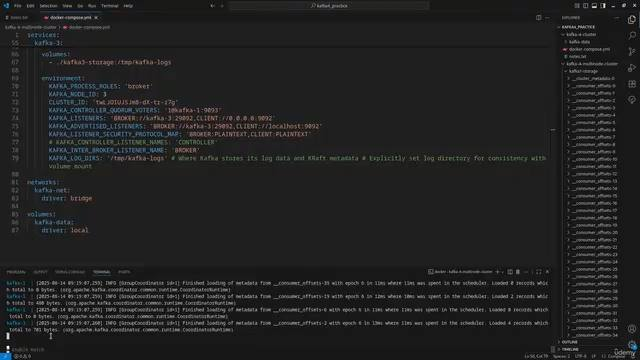

```bash
docker ps          # 只有 kafka-1 在跑
docker logs kafka-2
```

日志里报的是（讲师原话念出来的）：

```
IllegalArgumentException: Controller listener names must contain at least one value
```

也就是说 `controller.listener.names` 不能为空。修复方式是把两行环境变量补回去（下面 4.2 给了完整片段），然后重建：

```bash
docker compose down -v
docker compose up -d
docker ps
```

> 注意 `docker compose down -v` 里的 `-v`：讲师在演示中用的是带 `-v` 的版本，会一并删掉卷。你这套集群里如果已经有想保留的数据，先想清楚再执行。

### 3.3 第二步：等集群真的起来

讲师反复强调的一点：Kafka 本地启动慢，别急着敲命令。

```bash
sleep 20
docker ps --format '{{.Names}}\t{{.Status}}'
```

三个容器都 `Up` 之后，再进 CLI 环节。

### 3.4 第三步：命令行三件套（P26）

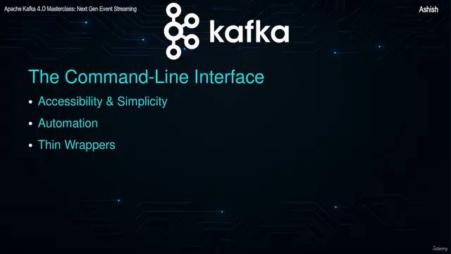

**（1）建 topic / 列 topic / 看 topic 详情 —— `kafka-topics.sh`**

```bash
docker exec -it kafka-1 /opt/kafka/bin/kafka-topics.sh \
  --bootstrap-server kafka-1:29092 \
  --list
```

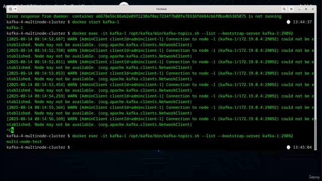

看某个 topic 的健康状况和状态：

```bash
docker exec -it kafka-1 /opt/kafka/bin/kafka-topics.sh \
  --bootstrap-server kafka-1:29092 \
  --describe \
  --topic multi-node-test
```

> 逐字稿里讲师说 `--describe` 能拿到「topic 的健康和状态」，但没念出具体输出字段，这里就不编了——你跑出来看到什么字段，就以那个为准。

**（2）发消息 —— `kafka-console-producer.sh`**

讲师特意换了一个容器来发消息，用来证明这是集群、不是单机：

```bash
docker exec -it kafka-3 /opt/kafka/bin/kafka-console-producer.sh \
  --topic multi-node-test \
  --bootstrap-server kafka-3:29092
```

回车后会出现一个 `>` 提示符，直接打字回车就是发一条消息：

```
> hello from CLI
> this is my second message
> just a simple message
```

按 `Ctrl+C` 退出。这三条消息已经进了集群。

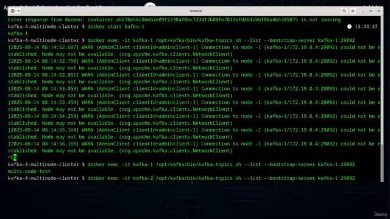

**（3）读消息 —— `kafka-console-consumer.sh`**

再开一个终端窗口，用**第三个**容器来读：

```bash
docker exec -it kafka-2 /opt/kafka/bin/kafka-console-consumer.sh \
  --topic multi-node-test \
  --bootstrap-server kafka-2:29092 \
  --from-beginning
```

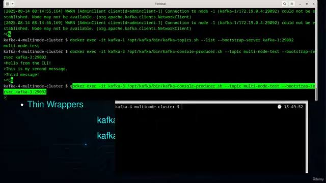

跑起来你会立刻看到刚才那三条，然后消费者会挂在那里等新消息。此时回到生产者窗口再发几条，消费者窗口会实时打印出来——讲师当场演示的就是这个「实时」。

`--from-beginning` 去掉会怎样？只会显示消费者启动之后到达的新消息，之前的历史读不到。

### 3.5 第四步：加 Provectus Kafka UI（P028 后半 + P029 开头）

在 `docker-compose.yml` 的 `services:` 下面追加 `kafka-ui` 服务（完整内容见 4.3）。关键点：

- 镜像 `provectuslabs/kafka-ui:latest`
- 挂到同一个 `kafka-net` 网络
- 本地 `8080` 映射到容器 `8080`
- `depends_on` 先只写 `kafka-1`（讲师故意先注释掉 `kafka-2`、`kafka-3`，跑通之后再取消注释）
- 环境变量只有两个：`KAFKA_CLUSTERS_0_NAME` 和 `KAFKA_CLUSTERS_0_BOOTSTRAPSERVERS`

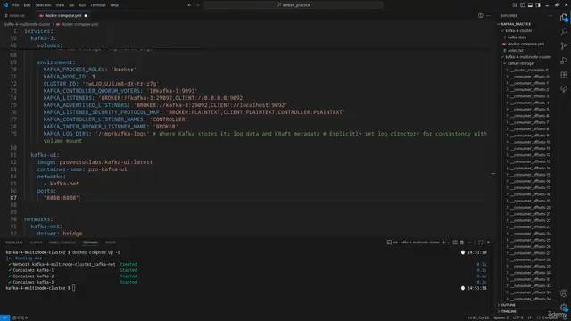

写的时候有两个坑，讲师自己都踩了并且当场改正：`ports` 前面必须有 `-`，冒号映射的字符串要加引号。

启动：

```bash
docker compose up -d
docker ps
```

浏览器打开 `http://localhost:8080`。

### 3.6 第五步：加 Redpanda Console（P029）

同样往 `services:` 里追加（完整内容见 4.4）。差异点：

- 镜像 `redpandadata/console:latest`
- 端口映射 **`7070:8080`**——因为 `8080` 已经被 Provectus 占了；讲师也明确说不用 `9000` 段，那些端口后面课程要留给 Kafka 服务
- 环境变量只有一个 `KAFKA_BROKERS`，值就是 Provectus 那个 `bootstrap-servers` 的同一串地址

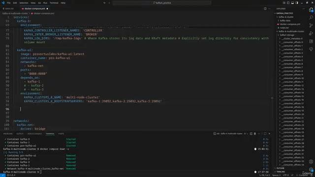

再 `docker compose up -d`：

```bash
docker ps
```

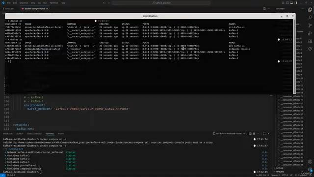

浏览器打开 `http://localhost:7070`，能看到 3 个 broker 全部在线，topic 列表默认只显示 1 个（`multi-node-test`），点开 `show internal topics` 才会多出 `__consumer_offsets`。

### 3.7 第六步：排掉那个会让你卡住的坑

讲师在 P028 里踩了一个很有代表性的坑：**你先 `up` 起来一套服务，然后往 compose 文件里加了一个新服务，再 `docker compose down -v`，会失败。**

原因他自己解释了：那个新服务压根没启动过，`down` 拿它没辙。解决办法是先把新加的服务整块注释掉，`down` 成功之后再取消注释、重新 `up`。

```bash
# 1) 临时注释掉刚加的 kafka-ui 整块
docker compose down -v

# 2) 取消注释
docker compose up -d
```

### 3.8 第七步：逛 UI（P030）

打开 `http://localhost:8080`，按讲师带你看的顺序过一遍：

**Dashboard** —— 左侧是集群列表（名字就是你配的 `multi-node-cluster`），主面板显示 broker 数、topic 数、partition 数。你会看到：

- brokers = 3
- topics = 2（其中一个是内部 topic）
- partitions = 51（你的 topic 1 个 + `__consumer_offsets` 50 个）

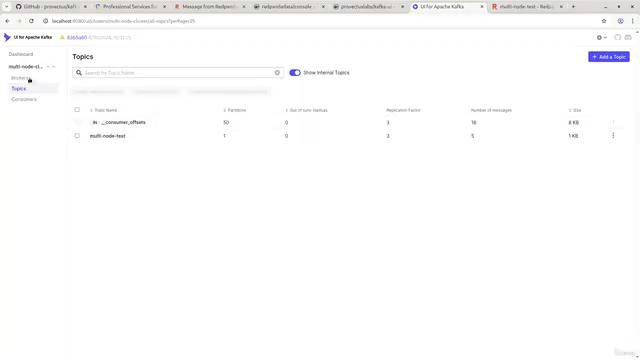

**Brokers 页** —— 三个节点 ID 1/2/3，显示地址、各自领导的 partition 数（51）、端口、hostname、同步副本数（51 × 3 = 153），以及一个 Active Controller ID。

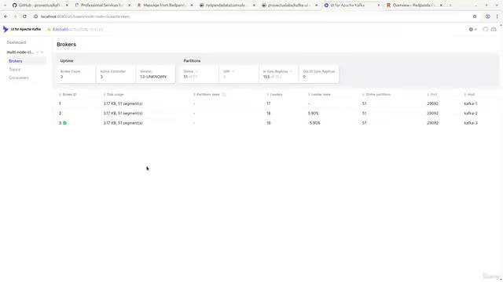

讲师在这里点了一个很重要的认知：**Active Controller 的 ID 会变**（他刷新了一下就从 3 变成 2），它和你在配置文件里给 `kafka-1` 指定的 controller 角色是两回事——前者是运行期选出来的，后者是静态声明。

**Topics 页** —— 可以在这里直接建 topic。讲师演示建了一个 3 分区 3 副本的 topic；而在同一个页面里看 `multi-node-test`，它的副本因子是 1（因为上一节建它的时候没指定 3）。点进 topic 详情，能看到 partition 数、副本因子、under-replicated partition（0）、同步副本 3/3、segment size、cleanup policy、message count。

**Messages 标签** —— 能看到具体消息内容，点开单条消息能看到 key、value、headers。讲师在这里解释了一个词：**ser/deser（serialization / deserialization）**，页面上的 key/value 序列化器选的就是这个。切到 `hex` 再提交，就能看到同一份数据以十六进制显示。

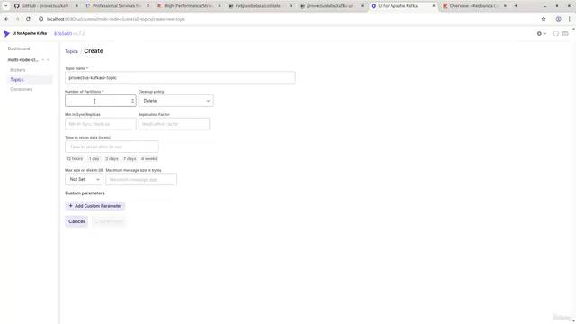

**在 UI 里直接发消息** —— 不用回命令行。讲师发了一条带 key 的消息（key=`test key`，value=`test value`），发完之后列表没变，因为**要手动点刷新**。

**Consumers 标签** —— topic 详情里的 consumers 页只列这个 topic 的消费者组；左侧导航的 Consumers 是全局视图。每个组显示 lag（还没处理的消息数），点进去能看 per-partition lag 和组成员分配。

---

## 4. 完整代码

### 4.1 `docker-compose.yml` 的目录与挂载位置

文件路径：

```
~/kafka-for-multi-node/docker-compose.yml
```

追加到 `services:` 下面的内容（4.3 + 4.4），缩进与已有的 `kafka-1` 等兄弟服务对齐；`kafka-net` 网络在上一节已经定义过，这里直接引用名字即可。

### 4.2 `kafka-2` / `kafka-3` 的 controller 配置（补回去的两行）

在这两个服务的 `environment:` 里加：

```yaml
      KAFKA_CONTROLLER_LISTENER_NAMES: CONTROLLER
      KAFKA_LISTENER_SECURITY_PROTOCOL_MAP: CONTROLLER:PLAINTEXT,PLAINTEXT:PLAINTEXT
```

> 如果上一节你的 `KAFKA_LISTENER_SECURITY_PROTOCOL_MAP` 里还有其它映射项（比如 host 侧监听），**别删**，把 `CONTROLLER:PLAINTEXT` 加进原有列表即可。这一行里除 `CONTROLLER:PLAINTEXT` 之外的内容，逐字稿没有逐字念，请以你上一节的文件为准。
>
> 只要 `KAFKA_CONTROLLER_LISTENER_NAMES` 为空，`kafka-2` / `kafka-3` 就会用 `Controller listener names must contain at least one value` 启动失败。

### 4.3 `kafka-ui` 服务（完整，可直接粘贴）

```yaml
  kafka-ui:
    image: provectuslabs/kafka-ui:latest
    container_name: pro-kafka-ui
    networks:
      - kafka-net
    ports:
      - "8080:8080"
    depends_on:
      - kafka-1
      # - kafka-2
      # - kafka-3
    environment:
      KAFKA_CLUSTERS_0_NAME: multi-node-cluster
      KAFKA_CLUSTERS_0_BOOTSTRAPSERVERS: 'kafka-1:29092,kafka-2:29092,kafka-3:29092'
```

跑通之后再把 `kafka-2`、`kafka-3` 两行 `depends_on` 的注释去掉。

### 4.4 `redpanda-console` 服务（完整，可直接粘贴）

```yaml
  redpanda-console:
    image: redpandadata/console:latest
    container_name: redpanda-console
    networks:
      - kafka-net
    ports:
      - "7070:8080"
    depends_on:
      - kafka-1
      # - kafka-2
      # - kafka-3
    environment:
      KAFKA_BROKERS: 'kafka-1:29092,kafka-2:29092,kafka-3:29092'
```

### 4.5 命令行三件套（完整命令）

```bash
# 0) 起集群，等它稳定
cd ~/kafka-for-multi-node
docker compose up -d
sleep 20
docker ps

# 1) 列 topic
docker exec -it kafka-1 /opt/kafka/bin/kafka-topics.sh \
  --bootstrap-server kafka-1:29092 \
  --list

# 2) 看 topic 详情
docker exec -it kafka-1 /opt/kafka/bin/kafka-topics.sh \
  --bootstrap-server kafka-1:29092 \
  --describe \
  --topic multi-node-test

# 3) 发消息（交互式，Ctrl+C 退出）
docker exec -it kafka-3 /opt/kafka/bin/kafka-console-producer.sh \
  --topic multi-node-test \
  --bootstrap-server kafka-3:29092

# 4) 读消息（另开终端，Ctrl+C 退出）
docker exec -it kafka-2 /opt/kafka/bin/kafka-console-consumer.sh \
  --topic multi-node-test \
  --bootstrap-server kafka-2:29092 \
  --from-beginning
```

### 4.6 排障时用的检查命令

```bash
# 某个容器起不来时看日志
docker logs kafka-2

# 看容器状态
docker ps -a --format '{{.Names}}\t{{.Status}}'

# compose 文件改动之后重建
docker compose down -v
docker compose up -d
```

---

## 5. 逐行解释

### 5.1 命令行部分

**`docker exec -it kafka-1 ...`**
`-i` 保持标准输入打开，`-t` 分配一个伪终端。生产者是交互式的（你要在 `>` 后面打字），所以 `-it` 两个都不能少。如果你只是在脚本里跑 `--list`，可以省掉 `-t`。

**`/opt/kafka/bin/kafka-topics.sh`**
这是容器**内**的绝对路径。为什么必须写全路径？因为脚本不在 `PATH` 里，你 `docker exec` 进去默认的 shell 找不到 `kafka-topics.sh`。讲师也说了：换个镜像（比如 Confluent 的）路径就不一样了，得用 `find` 去找。

**`--bootstrap-server kafka-1:29092`**
注意端口是 `29092`，不是宿主机的 `9092`。因为你现在是从**容器内部**去连集群，走的是 Docker 网络里的内部监听端口。这一点和你在宿主机上写 Go 程序时用的地址通常是不同的。

**`--list` vs `--describe`**
`--list` 只回一个 topic 名字清单，用来确认「topic 到底建没建成」。`--describe` 针对单个 topic，给你分区、副本、状态之类的细节，讲师把它叫做「topic 的健康和状态」。

**`--topic multi-node-test`**
生产者和消费者都必须显式指定 topic。这里用的 `multi-node-test` 是上一节已经建好的那个 topic；如果你的名字不一样，所有命令一起改。

**`--from-beginning`**
这是本节最重要的一行。Kafka 是持久化日志，消息落盘之后不会因为被读过就消失；消费者默认从「现在」开始读，你启动之前写进去的消息全看不见。加了 `--from-beginning` 才会从头读。这个参数是「日志可重放」这个特性最直观的证明。

> 前端视角的类比：它更像是你订阅一个 Redis Stream 时指定 `0` 作为起点，而不是订阅一个「只推未来事件」的广播。Kafka 的 consumer group 本身则有点像 Node 里的 worker pool —— 多个 worker 分摊 partition，互不重复。

### 5.2 `kafka-2` / `kafka-3` 的两行环境变量

**`KAFKA_CONTROLLER_LISTENER_NAMES: CONTROLLER`**
告诉这个 broker「集群里的 controller 是通过哪个 listener 名字暴露的」。即使是纯 broker，也必须能联系上 controller，所以这个名字不能空。空了就报 `Controller listener names must contain at least one value`。

**`KAFKA_LISTENER_SECURITY_PROTOCOL_MAP: CONTROLLER:PLAINTEXT,...`**
名字和协议是两套东西：`CONTROLLER` 只是你起的名字，协议得单独声明。这一行就是把 `CONTROLLER` 这个名字映射到 `PLAINTEXT`（明文、不加密）。少了这行，`CONTROLLER` 这个名字在协议层无法识别。

### 5.3 `kafka-ui` 服务

**`image: provectuslabs/kafka-ui:latest`**
讲师从 Docker Hub 上复制下来的镜像名。用 `latest` 他没有异议。这个镜像在 Hub 上的下载量比 Redpanda 高得多，原因是它完全免费、功能全。

**`container_name: pro-kafka-ui`**
容器名。讲师说名字随你起，他机器上 `docker ps` 出来的是 `pro-kafka-ui`。改成别的名字不影响功能，但如果后面有脚本按名字 `docker logs`，记得同步改。

**`networks: - kafka-net`**
这是关键。UI 必须和三个 Kafka 节点在同一个网络里，它才能用 `kafka-1` / `kafka-2` / `kafka-3` 这些主机名解析到容器。讲师原话：只要连上其中一个节点，就能通过那个节点看到整个集群。

**`ports: - "8080:8080"`**
`宿主:容器`。Provectus 的 UI 在容器里监听 `8080`，所以映射到宿主机的 `8080`。这里前导的 `- ` 和引号都是必须的，讲师第一次写漏了，当场改的。

**`depends_on: - kafka-1`**
先只声明依赖 `kafka-1`，另外两个先注释掉。讲师的意图是教学性的：先让你看到 UI 只连一个节点也能看到整个集群，再把依赖补全。`depends_on` 只保证启动顺序，不保证「被依赖的服务已经 ready」——这一点是本节的坑之一。

**`KAFKA_CLUSTERS_0_NAME: multi-node-cluster`**
Kafka UI 支持管理多个集群，所以配置是数组式的：`KAFKA_CLUSTERS_0_*`、`KAFKA_CLUSTERS_1_*`……`0` 就是第一个集群的名字下标。这个名字会原样显示在 UI 左侧的集群列表里。

**`KAFKA_CLUSTERS_0_BOOTSTRAPSERVERS: 'kafka-1:29092,kafka-2:29092,kafka-3:29092'`**
三个地址用逗号分隔，整体用单引号包起来（YAML 里带逗号的字符串必须处理）。为什么三个都写？因为客户端需要一个初始连接点列表，任何一个可用就能拉到整个集群的元数据。内网通信端口是 `29092`。

> 前端视角：这串值等价于 JS 里的 `['kafka-1:29092','kafka-2:29092','kafka-3:29092'].join(',')` —— 客户端内部会 split 成数组再逐个尝试。

### 5.4 `redpanda-console` 服务

**`image: redpandadata/console:latest`**
从 Docker Hub 搜 `redpanda data console` 找到的，超过一百万次拉取。讲师强调「这个 UI 很好用，但有些功能要订阅他们服务才有」；不过学习 Kafka 用到的功能它基本都有。

**`ports: - "7070:8080"`**
容器里同样是 `8080`，但宿主侧换成了 `7070`，因为 `8080` 被 Provectus 占了。讲师特意说不用 `9000` 段——那些端口后面课程里 Kafka 相关服务要用；`7070` 好记。

**`KAFKA_BROKERS`**
这是 Redpanda Console 的变量名，作用上跟 `KAFKA_CLUSTERS_0_BOOTSTRAPSERVERS` 一样，但**名字完全不同**。不能照抄。讲师原话：环境变量每个服务都不一样。

---

## 6. 复现检查清单

按顺序打勾，任何一项没通过就别往下走。

- [ ] `cd ~/kafka-for-multi-node` 成功，目录里有 `docker-compose.yml`
- [ ] `kafka-2`、`kafka-3` 的 `environment:` 里都补上了 `KAFKA_CONTROLLER_LISTENER_NAMES: CONTROLLER` 和 `KAFKA_LISTENER_SECURITY_PROTOCOL_MAP`（含 `CONTROLLER:PLAINTEXT`）
- [ ] `docker compose up -d` 之后，`docker ps` 里 **三个** Kafka 容器都是 `Up`；如果只有 `kafka-1`，去看 `docker logs kafka-2` 是不是 `Controller listener names must contain at least one value`
- [ ] 启动后等了至少 20 秒才跑 CLI 命令
- [ ] `kafka-topics.sh --list` 能列出 `multi-node-test`
- [ ] `kafka-topics.sh --describe --topic multi-node-test` 能打出分区/副本信息
- [ ] 在 `kafka-3` 里跑 producer，发出 3 条消息，`Ctrl+C` 能退出
- [ ] 另开终端在 `kafka-2` 里跑 consumer 加 `--from-beginning`，**立刻**看到那 3 条历史消息
- [ ] 保持 consumer 不退出，回 producer 再发一条，consumer 窗口实时打印出来
- [ ] `kafka-ui` 服务已追加，`docker ps` 里有 `pro-kafka-ui`
- [ ] `http://localhost:8080` 打得开，左侧能看到 `multi-node-cluster`，brokers 显示 3
- [ ] Dashboard 上 topics 显示 2，partitions 显示 51（1 + `__consumer_offsets` 的 50）
- [ ] Topics 页关掉 `show internal topics` 之后只剩 `multi-node-test`
- [ ] `redpanda-console` 服务已追加，`docker ps` 里有 `redpanda-console`
- [ ] `http://localhost:7070` 打得开，同样能看到 3 个 broker 在线
- [ ] 在 UI 的 Messages 页发一条带 key 的消息，点刷新后能看到
- [ ] （可选）验证过那个坑：加了新服务后直接 `docker compose down -v` 会失败，注释掉新服务后成功

---

## 7. 课里没讲但你会撞上的

**1）完整的三节点 `docker-compose.yml` 不在这一段里。**
P26–P30 只追加了两个 UI 服务，Kafka 三个节点的定义是上一节的产物，本节没有重新贴。所以本文只给了「要追加的两块」和「要补的两行环境变量」，没有伪造一份完整的三节点配置。

**2）`depends_on` 不保证被依赖的服务已经可用。**
它只保证容器启动顺序。Kafka 启动慢是讲师反复强调的，所以 `kafka-ui` 可能在 Kafka 还没 ready 的时候就起来了，表现为 UI 里集群短暂显示为不可用或报连接错误。等十几秒刷新一下通常就好了。课里没讲怎么加健康检查。

**3）宿主机访问和容器内访问的地址不一样。**
本文所有 `--bootstrap-server` 都是 `kafka-N:29092`，因为是从容器内部连。等你在宿主机上写 Go/Node 程序连这个集群时，用到的通常是上一节 `ports` 里映射出来的宿主端口和 `localhost`——具体是哪个端口，取决于上一节你怎么写的 `advertised.listeners`，**这段课没有涉及**，以你上一节的文件为准。

**4）`multi-node-test` 这个 topic 名是上一节建的。**
如果你的 topic 叫别的名字，第 4 节里所有 `--topic` 都要一起改。

**5）`__consumer_offsets` 的 50 个分区是默认值。**
讲师在 UI 里看到 51 个分区时解释了这一点，但没讲怎么改这个默认值（那是 `offsets.topic.num.partitions` 的事，本段课程没提）。

**6）Redpanda Console 里默认看不到内部 topic。**
P029 里讲师点开了 `show internal topics` 开关才看到 `__consumer_offsets`；不点开就只有 1 个。Provectus 的 UI 里对应的是 Topics 页的 `show internal topics` 开关，默认是开着的（所以 Dashboard 上直接显示 2）。

**7）`docker compose down` 失败的通用形态。**
不只是「新加服务」这一种情况——**任何**让 compose 文件里出现的服务与当前运行集合对不上的改动（改名、删服务、加服务）都可能触发。讲师给的处理思路是通用的：让文件先回到能对上当前运行状态的样子，`down` 掉，再改成新样子 `up`。

**8）两个 UI 只是「看」，不改变 Kafka 的语义。**
在 UI 里建 topic、发消息、看 lag，底层调用的还是同一套 Admin / Producer / Consumer API。所以 CLI 学扎实了，UI 换哪个都能上手——这正是讲师说「