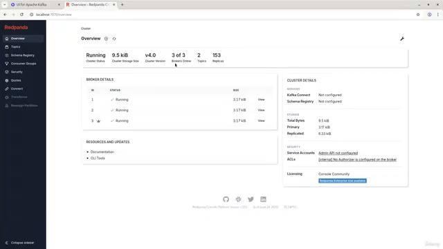
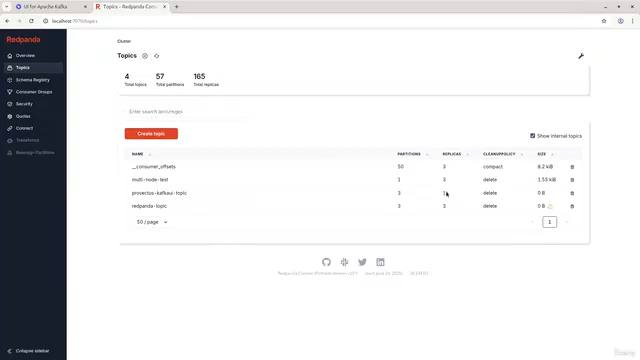
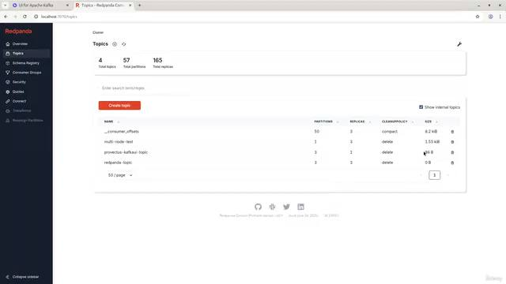
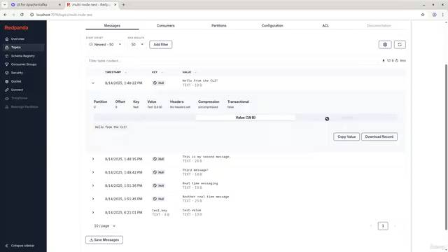
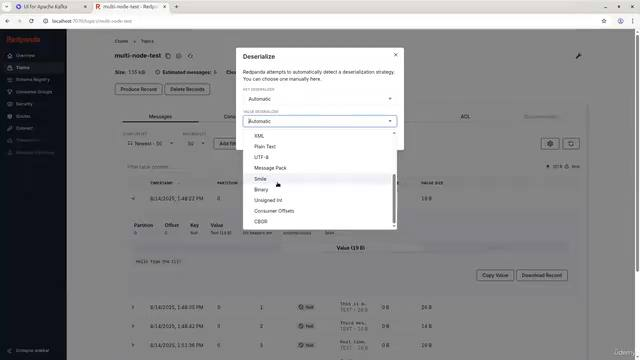
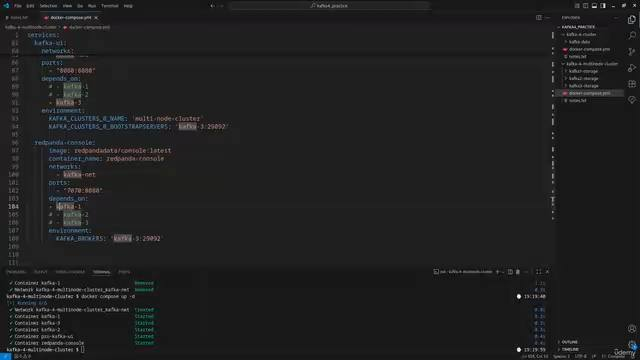
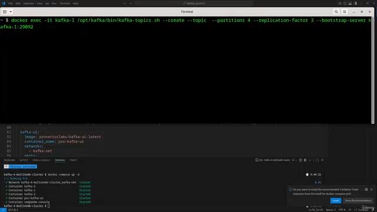

# Apache Kafka 4.0 实战文档：从 UI 观测到 Broker 存储与 Topic 设计（P031–P034）

> 读者定位：前端转 AI 应用工程师。本文所有命令、配置、代码均可直接复制执行。涉及并发/持久化概念时，会补一句「在 JS/Node 里对应什么」。Java 语法只标注「知道即可」。
>
> 前置条件：你已经按前面课程跑起了 3 节点 Kafka 集群（`kafka1` / `kafka2` / `kafka3`），并且已经用 Docker Compose 同时起了两套 UI：Provectus 的 **Kafka UI** 和 **Redpanda Console**（原名 Kowl/KAL）。本节 P031–P034 就是在这套环境上继续做实验。

---

## 1. 这一节做什么

这四集连起来是一条完整的「从会用 → 会看 → 会懂 → 会设计」的链路：

- **P031**：把 Redpanda Console 完整逛一遍，和 Kafka UI 对照。你会看到集群健康、broker 数、topic 列表、消息生产、消息反序列化（string→hex）、consumer group、ACL 等面板。结论是：两套 UI 功能高度重叠，Redpanda Console 更"顺手"，但后面会暴露一个致命差异。
- **P032**：做一次**故障实验**。把 `bootstrap.servers` 从「三个 broker 全列」改成「只写 kafka1」，再改成「只写 kafka3」，然后手动 `docker stop kafka3`。结果：Kafka UI 依旧可用（自动 failover 到已知的其他 broker），Redpanda Console 直接 500 崩溃。借此讲透 **bootstrap server 到底是什么**、`depends_on` 的 `started` vs `ready` 区别、以及 healthcheck 的写法。
- **P033**：打开 broker 这个"黑盒"，讲**物理存储**：partition = 磁盘上的一个目录；目录里不是一个巨型 log，而是切成 **log segment**（`.log`）；每个 segment 配两个索引（`.index` 偏移索引、`.timeindex` 时间索引）；用 **retention policy**（时间/大小）整段删除旧数据。
- **P034**：讲 **topic 设计**：partition 数 = 并行度上限；replication factor = 容错；**partition key** 决定消息落到哪个分区，从而决定顺序保证的边界（per-partition，不是 per-topic）。

一句话：**P031 学观测，P032 学连接语义，P033 学存储原理，P034 学建 topic 的决策。**

---

## 2. 讲师原话（带出处）

> "Provector CUI 使用我们提供的代理节点进行初始发现，然后智能地连接到整个集群；而 Red Panda 控制台则维持一条与我们所指定单个代理节点之间、可能更固定且容错性稍低的连接。"
> —— p032 [04:43]

> "客户端连接到该列表中的一个代理节点，然后询问它集群中都有哪些代理节点。这正是本讲的重点。"
> —— p032 [05:35]

> "关于 depends_on，最重要的一点是：它只等待依赖项进入**已启动**状态，而不等待该容器内的应用**已准备好**接受连接。"
> —— p032 [12:00]

> "假设你有一个名为 order events 的主题……在代理节点的磁盘上，每个分区都是各自独立的文件夹。"
> —— p033 [01:21]

> "Kafka 每创建一个 .log 段文件，也会创建两个小型索引文件。一个是偏移索引文件，也就是 .index 文件……另一个是时间索引文件，也就是 .timeindex 文件。"
> —— p033 [03:11]–[04:07]

> "关键在于，Kafka 以整个段为单位进行操作。它不会逐条删除消息，而是直接删除整个文件。"
> —— p033 [05:33]

> "黄金法则是：所有键完全相同的消息，始终会进入同一个分区。"
> —— p034 [06:28]

> "Kafka 保证每个分区内的消息顺序。如果主题有多个分区，它不保证整个主题范围内的顺序。"
> —— p034 [07:24]

> "副本因子为 3……这是行业标准。它让你能够承受一个代理节点完全故障，同时仍可将另一个代理节点停机维护，而不会损失可用性。"
> —— p034 [04:31]

---

## 3. 从零复现

下面按「先观测 → 再故障实验 → 再验证存储 → 最后建 topic」的顺序复现。每一步都给出可执行命令。

### 3.1 打开两套 UI，对照观测（对应 P031）

假设你的 compose 已经跑起来，两套 UI 分别映射到本机端口（课里没给具体端口号，以你 `docker-compose.yml` 里的 `ports` 为准，常见是 Kafka UI `8080`、Redpanda Console `8081`）。浏览器打开两个标签页：

- Kafka UI：`http://localhost:8080`
- Redpanda Console：`http://localhost:8081`

在 Redpanda Console 的 **Overview** 页，你会看到讲师截图里的这些字段（字段名以实际页面为准）：cluster health、cluster storage size、cluster version（本例是 `4.0`）、total brokers（`3 of 3 online`）、topics 数、replicas 数。



> 注意讲师踩过的一个坑：在 Kafka UI 里新建 topic 后，Redpanda Console 的 Overview **不会自动刷新**，topics 数还显示旧值，需要手动刷新。这是 UI 缓存问题，不是集群问题。

进入 **Topics** 页，两套 UI 都能看到 `multi-node-test` 和 `provector-kafka-ui-topic`。在 Redpanda Console 里点 **Create Topic**，填：

- Topic name：`redpanda-topic`
- Partitions：`3`
- Replication factor：`3`



创建后进入该 topic，点 **Produce Record**，key 填 `test key`，value 填 `test value`，发送。回到 Topics 列表，该 topic 的 size 从 `0` 变成 `86 bytes`（讲师原话数字，实际以你页面为准）。



再点进 `multi-node-test`（消息多，界面更满），展开一条消息可以看到 partition / offset / key / value / headers / compression / transactional 这些列。没有 key 的消息，`key` 列是 inactive（null）；带 key 的消息展开后 key 变 active。



点右上角齿轮图标 → **Column settings**，可以把额外列全部勾上显示；→ **Deserialization**，把 value deserializer 从 `Automatic` 改成 hex（和之前在 Kafka UI 里做的 string→hex 一致）。



> 课里没讲：Redpanda Console 的 Community 版免费，Enterprise 版是付费试用；Redpanda Cloud 也是付费服务。讲师明确说"你可以自己去探索"。

### 3.2 故障实验：bootstrap server 只写一个会怎样（对应 P032）

这是本节最重要的实验，务必亲手做一遍。

**步骤 A：先全部停掉**

```bash
docker compose down -v
```

**步骤 B：把 Kafka UI 的 bootstrap 只写 kafka1**

编辑 `docker-compose.yml`，找到 Kafka UI 服务的环境变量（课里叫 `KAFKA_CLUSTERS_0_BOOTSTRAPSERVERS`，字段名以你实际文件为准），改成只列一个：

```yaml
KAFKA_CLUSTERS_0_BOOTSTRAPSERVERS: kafka1:29092
```

保存，然后：

```bash
docker compose up -d
docker ps
```

确认 `kafka1` / `kafka2` / `kafka3` 和两套 UI 都在跑。刷新两个 UI：**两边都显示 3 of 3 brokers online**，brokers 列表里能看到 kafka1/kafka2/kafka3 及各自 host。这说明：只给一个 bootstrap，客户端照样能发现全集群。

**步骤 C：把 bootstrap 改成只写 kafka3**

```yaml
KAFKA_CLUSTERS_0_BOOTSTRAPSERVERS: kafka3:29092
```

`docker compose down -v` 再 `up -d`，刷新 UI，依旧 3 of 3 online。

**步骤 D：关键一击——停掉 kafka3**

```bash
docker stop kafka3
docker ps          # 应只剩 kafka1、kafka2 和两套 UI
```

现在刷新两个 UI：

- **Kafka UI**：正常，brokers 里只剩 kafka1、kafka2，标记 kafka3 离线，其余功能可用。
- **Redpanda Console**：**HTTP 500 Internal Server Error**，整个应用挂掉。



讲师解释（p032 [04:43]–[08:26]）：Kafka UI 是标准 Kafka 客户端行为——连上 bootstrap 后拿到全量 broker 列表，之后直接连其他 broker，所以 bootstrap 挂了不影响；Redpanda Console 在这个配置下对 kafka3 形成了"硬依赖"，kafka3 一没，它的内部连接进程抛未处理异常，导致负责跟 Kafka 通信的那部分崩了，页面 500。

**步骤 E：恢复**

```bash
docker start kafka3
docker ps
```

刷新两个 UI，都恢复。讲师还演示了"先全停再全起再停 kafka3"，Redpanda Console 依旧 500，说明这不是偶发。

> 结论（讲师原话 p032 [09:22]）："没有什么比 Kafka UI 更能搞垮我们的项目了。" 选 UI 要知道各自 pros/cons，不是谁好谁坏。

### 3.3 验证 broker 的磁盘存储结构（对应 P033）

P033 是原理讲解，没有给命令。但你可以用容器里的 shell 亲手验证讲师说的目录结构（**以下命令课里没讲，是按 P033 描述的目录布局给出的验证方法，路径以你实际镜像为准**）：

```bash
# 进入 kafka1 容器
docker exec -it kafka1 bash

# Kafka 数据目录（课里未给具体路径，常见为 /var/lib/kafka/data 或 /kafka/kafka-logs，以你 compose 的 volume 为准）
ls -la /var/lib/kafka/data/

# 进入某个 topic-partition 目录，例如 multi-node-test-0
ls -la /var/lib/kafka/data/multi-node-test-0/
```

你会看到类似：

```
00000000000000000000.log
00000000000000000000.index
00000000000000000000.timeindex
```

对应讲师说的：partition 是一个目录；目录里是**多个 segment**（每个 segment 一组 `.log` + `.index` + `.timeindex`）；正在写的那个叫 **active segment**。


### 3.4 建 topic 并验证 key 的分区行为（对应 P034）

讲师在 P034 现场建了一个 `user-profiles` topic，4 分区、3 副本：

```bash
docker exec -it kafka1 kafka-topics \
  --bootstrap-server kafka1:29092 \
  --create \
  --topic user-profiles \
  --partitions 4 \
  --replication-factor 3
```

> 注意：Kafka 4.0 里 CLI 脚本名可能是 `kafka-topics.sh` 或 `kafka-topics`，以你镜像内 `bin/` 为准；`--bootstrap-server` 的值用容器内可达的 `kafka1:29092`（不是宿主机端口）。

验证创建结果：

```bash
docker exec -it kafka1 kafka-topics \
  --bootstrap-server kafka1:29092 \
  --describe --topic user-profiles
```

输出会列出 4 个 partition，每个 partition 有 leader 和 3 个 replicas（字段名以实际输出为准）。



**验证「同 key 必落同分区」**：用 console producer 连发 3 条 key 都是 `alice` 的消息：

```bash
docker exec -it kafka1 kafka-console-producer \
  --bootstrap-server kafka1:29092 \
  --topic user-profiles \
  --property "parse.key=true" \
  --property "key.separator=:"
```

然后逐行输入（每行回车）：

```
alice:update-1
alice:update-2
alice:update-3
```

再用 console consumer 从**指定分区**读，确认三条都在同一分区（比如 partition 2）：

```bash
docker exec -it kafka1 kafka-console-consumer \
  --bootstrap-server kafka1:29092 \
  --topic user-profiles \
  --partition 2 \
  --from-beginning \
  --property "print.key=true"
```

如果三条都在 partition 2，说明 hash(key) 映射一致。换 `bob` 再发三条，会落到另一个分区。


---

## 4. 完整代码

下面给出本节涉及的**完整可保存文件**。目录结构：

```
kafka-lab/
├── docker-compose.yml
└── README.md
```

### 4.1 `docker-compose.yml`（完整文件，可直接 `docker compose up -d`）

> 说明：这是按 P031–P034 讲到的服务（3 broker + Kafka UI + Redpanda Console）拼出的完整 compose。镜像 tag、端口、volume 路径课里没逐一给全，下面用常见值；**若与你课程仓库里的 compose 不一致，以课程仓库为准**。`depends_on` 部分同时演示了 P032 讲的「简写（只保证 started）」和「长写 + healthcheck（保证 healthy）」两种写法，你可以按需切换。

```yaml
version: "3.8"

services:
  kafka1:
    image: apache/kafka:4.0.0
    container_name: kafka1
    hostname: kafka1
    ports:
      - "9092:9092"
    environment:
      KAFKA_NODE_ID: 1
      KAFKA_PROCESS_ROLES: broker,controller
      KAFKA_LISTENERS: PLAINTEXT://:29092,CONTROLLER://:29093,PLAINTEXT_HOST://:9092
      KAFKA_ADVERTISED_LISTENERS: PLAINTEXT://kafka1:29092,PLAINTEXT_HOST://localhost:9092
      KAFKA_CONTROLLER_LISTENER_NAMES: CONTROLLER
      KAFKA_LISTENER_SECURITY_PROTOCOL_MAP: CONTROLLER:PLAINTEXT,PLAINTEXT:PLAINTEXT,PLAINTEXT_HOST:PLAINTEXT
      KAFKA_CONTROLLER_QUORUM_VOTERS: 1@kafka1:29093,2@kafka2:29093,3@kafka3:29093
      KAFKA_INTER_BROKER_LISTENER_NAME: PLAINTEXT
      KAFKA_OFFSETS_TOPIC_REPLICATION_FACTOR: 3
      KAFKA_TRANSACTION_STATE_LOG_REPLICATION_FACTOR: 3
      KAFKA_TRANSACTION_STATE_LOG_MIN_ISR: 2
      CLUSTER_ID: "MkU3OEVBNTcwNTJENDM2Qk"
    volumes:
      - kafka1-data:/var/lib/kafka/data
    healthcheck:
      test: ["CMD-SHELL", "kafka-broker-api-versions --bootstrap-server localhost:29092 || exit 1"]
      interval: 5s
      timeout: 5s
      retries: 5

  kafka2:
    image: apache/kafka:4.0.0
    container_name: kafka2
    hostname: kafka2
    ports:
      - "9093:9092"
    environment:
      KAFKA_NODE_ID: 2
      KAFKA_PROCESS_ROLES: broker,controller
      KAFKA_LISTENERS: PLAINTEXT://:29092,CONTROLLER://:29093,PLAINTEXT_HOST://:9092
      KAFKA_ADVERTISED_LISTENERS: PLAINTEXT://kafka2:29092,PLAINTEXT_HOST://localhost:9093
      KAFKA_CONTROLLER_LISTENER_NAMES: CONTROLLER
      KAFKA_LISTENER_SECURITY_PROTOCOL_MAP: CONTROLLER:PLAINTEXT,PLAINTEXT:PLAINTEXT,PLAINTEXT_HOST:PLAINTEXT
      KAFKA_CONTROLLER_QUORUM_VOTERS: 1@kafka1:29093,2@kafka2:29093,3@kafka3:29093
      KAFKA_INTER_BROKER_LISTENER_NAME: PLAINTEXT
      KAFKA_OFFSETS_TOPIC_REPLICATION_FACTOR: 3
      KAFKA_TRANSACTION_STATE_LOG_REPLICATION_FACTOR: 3
      KAFKA_TRANSACTION_STATE_LOG_MIN_ISR: 2
      CLUSTER_ID: "MkU3OEVBNTcwNTJENDM2Qk"
    volumes:
      - kafka2-data:/var/lib/kafka/data
    depends_on:
      - kafka1

  kafka3:
    image: apache/kafka:4.0.0
    container_name: kafka3
    hostname: kafka3
    ports:
      - "9094:9092"
    environment:
      KAFKA_NODE_ID: 3
      KAFKA_PROCESS_ROLES: broker,controller
      KAFKA_LISTENERS: PLAINTEXT://:29092,CONTROLLER://:29093,PLAINTEXT_HOST://:9092
      KAFKA_ADVERTISED_LISTENERS: PLAINTEXT://kafka3:29092,PLAINTEXT_HOST://localhost:9094
      KAFKA_CONTROLLER_LISTENER_NAMES: CONTROLLER
      KAFKA_LISTENER_SECURITY_PROTOCOL_MAP: CONTROLLER:PLAINTEXT,PLAINTEXT:PLAINTEXT,PLAINTEXT_HOST:PLAINTEXT
      KAFKA_CONTROLLER_QUORUM_VOTERS: 1@kafka1:29093,2@kafka2:29093,3@kafka3:29093
      KAFKA_INTER_BROKER_LISTENER_NAME: PLAINTEXT
      KAFKA_OFFSETS_TOPIC_REPLICATION_FACTOR: 3
      KAFKA_TRANSACTION_STATE_LOG_REPLICATION_FACTOR: 3
      KAFKA_TRANSACTION_STATE_LOG_MIN_ISR: 2
      CLUSTER_ID: "MkU3OEVBNTcwNTJENDM2Qk"
    volumes:
      - kafka3-data:/var/lib/kafka/data
    depends_on:
      - kafka1

  kafka-ui:
    image: provectuslabs/kafka-ui:latest
    container_name: kafka-ui
    ports:
      - "8080:8080"
    environment:
      KAFKA_CLUSTERS_0_NAME: local
      # 故障实验时改成只写一个：kafka1:29092 或 kafka3:29092
      KAFKA_CLUSTERS_0_BOOTSTRAPSERVERS: kafka1:29092,kafka2:29092,kafka3:29092
    depends_on:
      - kafka1
      - kafka2
      - kafka3

  redpanda-console:
    image: redpandadata/console:latest
    container_name: redpanda-console
    ports:
      - "8081:8080"
    environment:
      KAFKA_BROKERS: kafka1:29092,kafka2:29092,kafka3:29092
    depends_on:
      - kafka1
      - kafka2
      - kafka3

volumes:
  kafka1-data:
  kafka2-data:
  kafka3-data:
```

> 关于 `depends_on` 的两种写法（P032 [10:12]–[16:07]）：
> - **简写**（上面用的）：只保证依赖容器**已启动**（started），不保证里面的应用**已就绪**（ready）。
> - **长写 + healthcheck**：保证依赖容器 `service_healthy` 才启动下游。讲师演示的写法大意如下（**这段是讲师在编辑器里现场敲的示意，不是本项目的最终配置**，且 `pg_isready` 是 Postgres 的检查命令，与 Kafka 无关，仅作语法示例）：
>
> ```yaml
> depends_on:
>   kafka3:
>     condition: service_healthy
> ```
>
> 配合被依赖服务上的：
>
> ```yaml
> healthcheck:
>   test: ["CMD-SHELL", "pg_isready -U user -d mydb"]
>   interval: 5s
>   timeout: 5s
>   retries: 5
> ```
>
> 讲师原话（p032 [12:00]）："depends_on 只等待 started 状态，不等待 ready 状态。started 是指容器进程已由 Docker 引擎启动，几乎瞬间完成；ready 是指容器内的应用完成初始化并开始监听网络，可能需要好几秒。" 所以如果你的 web 应用在数据库 ready 之前就去连，会连失败崩掉——这时才需要 healthcheck 版。

### 4.2 `README.md`（操作手册，可直接保存）

```markdown
# Kafka 4.0 Lab (P031–P034)

## 启动
docker compose up -d
docker ps

## UI
- Kafka UI:        http://localhost:8080
- Redpanda Console: http://localhost:8081

## 故障实验（P032）
1. 把 kafka-ui 的 KAFKA_CLUSTERS_0_BOOTSTRAPSERVERS 改成只写 kafka3:29092
2. docker compose down -v && docker compose up -d
3. docker stop kafka3
4. 刷新两个 UI：Kafka UI 正常，Redpanda Console 500
5. docker start kafka3 恢复

## 建 topic（P034）
docker exec -it kafka1 kafka-topics \
  --bootstrap-server kafka1:29092 \
  --create --topic user-profiles \
  --partitions 4 --replication-factor 3

## 验证同 key 同分区
docker exec -it kafka1 kafka-console-producer \
  --bootstrap-server kafka1:29092 --topic user-profiles \
  --property "parse.key=true" --property "key.separator=:"
# 输入 alice:update-1 / alice:update-2 / alice:update-3

docker exec -it kafka1 kafka-console-consumer \
  --bootstrap-server kafka1:29092 --topic user-profiles \
  --partition 2 --from-beginning --property "print.key=true"
```

---

## 5. 逐行解释

### 5.1 `docker-compose.yml` 关键行

- `KAFKA_PROCESS_ROLES: broker,controller`：Kafka 4.0 用 **KRaft** 模式（不再依赖 ZooKeeper），每个节点同时是 broker 和 controller。这是 4.0 的默认玩法。
- `KAFKA_CONTROLLER_QUORUM_VOTERS: 1@kafka1:29093,...`：controller 选举的 quorum 列表，三个节点互相投票。
- `KAFKA_LISTENERS` 里的 `PLAINTEXT://:29092` 是**容器内**监听地址，`PLAINTEXT_HOST://:9092` 是给**宿主机**用的。`KAFKA_ADVERTISED_LISTENERS` 决定客户端拿到的是哪个地址——这就是为什么容器内 CLI 要用 `kafka1:29092`，宿主机浏览器/工具用 `localhost:9092`。
- `KAFKA_OFFSETS_TOPIC_REPLICATION_FACTOR: 3`：内部 `__consumer_offsets` topic 的副本数，3 节点集群设 3 才安全。
- `depends_on: - kafka1`：简写，只保证 kafka1 容器**已启动**，不等它 ready。这正是 P032 强调的坑。
- `healthcheck.test` 用 `kafka-broker-api-versions --bootstrap-server localhost:29092`：这是**我按 P032 的 healthcheck 思路给 Kafka 写的检查命令**（课里演示的是 Postgres 的 `pg_isready`，不是 Kafka 的）。如果你要用 `condition: service_healthy`，被依赖服务必须有类似这样的 healthcheck。
- `KAFKA_CLUSTERS_0_BOOTSTRAPSERVERS`：Kafka UI 的 bootstrap 列表。故障实验就改这一行。
- `KAFKA_BROKERS`：Redpanda Console 的 bootstrap 列表（讲师原话 p032 [05:08]："将 Kafka 代理接入 Redpanda Console"）。

### 5.2 为什么 Kafka UI 能 failover、Redpanda Console 不能

- **Kafka 客户端协议**：连上 bootstrap 列表里任意一个 broker → 发 metadata 请求 → 拿到全量 broker 列表 → 之后直接连目标 broker。所以 bootstrap 只是"入口"，不是"唯一通道"。Kafka UI 实现了这套标准流程，kafka3 挂了它已经知道 kafka1/kafka2 的地址，继续用。
- **Redpanda Console 在这个配置下**：讲师观察（p032 [07:30]）是它对 kafka3 形成了硬依赖，kafka3 一没，内部连接进程抛未处理异常，负责 Kafka 通信的模块崩了 → HTTP 500。讲师明确说这是"这一具体配置"下的行为，不是绝对结论。
- **在 JS/Node 里对应什么**：Kafka 客户端（如 `kafkajs`）的 `brokers` 数组就是 bootstrap 列表；它内部同样会拉 metadata 再直连。所以你在 Node 里写 `brokers: ['kafka1:29092']` 只给一个，也能发现全集群——但**启动时**如果那一个正好挂了，就连不上。这就是讲师说的"为什么还要列多个"（p032 [19:55]）：为了**连接时的高可用**。

### 5.3 P033 存储结构逐条

- **partition = 目录**：`user-profiles-0/`、`user-profiles-1/`……每个分区一个文件夹。
- **segment = 一组文件**：`00000000000000000000.log`（数据）、`.index`（偏移索引）、`.timeindex`（时间索引）。文件名前缀是**该 segment 的起始 offset**。
- **active segment**：最新那个，producer 只往它写。达到 `segment.bytes`（默认 1GB 量级）或 `segment.ms` 时间阈值就滚动出新 segment。
- **`.index` 的作用**：offset → 文件内字节位置 的稀疏映射。consumer 要读 offset 580000，先查 index 跳到大致字节位置，再顺序扫一小段。**不用从头扫整个 log**。
- **`.timeindex` 的作用**：timestamp → offset。用于"给我最近一小时的消息"这类按时间消费。
- **两个索引都小到可以常驻内存**，所以查找是内存级速度，只有真正读数据才碰磁盘大文件。
- **retention**：`log.retention.hours=168`（7 天）按时间；或按大小超限删最旧 segment。**整段删文件**，不逐条删消息——这是磁盘操作高效的关键。
- **在 JS/Node 里对应什么**：你不需要自己管 segment；但你要知道"Kafka 对消息的保留受时间或大小上限限制，并非永久保留。"。消费端用 `fromBeginning` 也只能读到 retention 范围内的。

### 5.4 P034 topic 设计逐条

- **partition 数 = 并行度上限**：4 分区 → 同一 consumer group 最多 4 个 consumer 并行读。1 分区就是单车道。分区多吞吐高，但每分区有 broker 开销，几千分区会抬延迟。**只能加不能减**（Kafka 不支持减少分区），所以起步保守、按需加。
- **replication factor**：1 = 生产禁用（那台 broker 挂了数据永久丢）；3 = 行业标准，能扛 1 台完全挂掉 + 还能再拿 1 台做维护。
- **无 key → round-robin**：msg1→p0, msg2→p1, msg3→p2, msg4→p3, msg5→p0……均匀分布，不保证顺序。
- **有 key → hash(key) 映射分区**：同 key 必落同分区 → 该分区内顺序有保证。**注意是 hash(key) 映射，不是 key 本身**（讲师 p034 [06:28] 特意强调）。
- **顺序保证边界**：per-partition，不是 per-topic。多分区时跨分区无全局顺序。
- **`--config retention.ms=604800000`**：7 天（604800000 ms）。讲师在 GUI 里用 "time to retain" 字段演示，等价。
- **`--config min.insync.replicas=2`**：配合 `acks=all`，要求 leader + 至少 1 个 follower 确认才算写成功。数字**包含 leader**。RF=3 + minISR=2 = 能扛 1 台挂还保证不丢写。
- **在 JS/Node 里对应什么**：`kafkajs` 的 `producer.send({ topic, messages: [{ key: 'alice', value: '...' }] })`，给了 `key` 就走 hash 分区；不给就走轮询/粘性。顺序保证同样只在同分区内成立——所以如果你要"同一用户的事件有序"，key 就用 userId。

---

## 6. 复现检查清单

做完打勾：

- [ ] `docker compose up -d` 后 `docker ps` 看到 kafka1/kafka2/kafka3 + kafka-ui + redpanda-console 全在跑
- [ ] Kafka UI（:8080）和 Redpanda Console（:8081）都能打开，Overview 显示 **3 of 3 brokers online**、version **4.0**
- [ ] 在 Redpanda Console 建 `redpanda-topic`（3 分区 3 副本），Produce 一条 `test key`/`test value`，Topics 列表 size 从 0 变非 0
- [ ] 展开消息能看到 partition/offset/key/value/headers 列；无 key 消息 key 列 inactive
- [ ] 齿轮 → Column settings 能加列；Deserialization 能把 value 改成 hex
- [ ] **故障实验**：bootstrap 只写 kafka3 → `docker stop kafka3` → Kafka UI 正常、Redpanda Console 500
- [ ] `docker start kafka3` 后两个 UI 恢复
- [ ] 进 kafka1 容器 `ls` 某 partition 目录，看到 `.log` / `.index` / `.timeindex` 三类文件
- [ ] 建 `user-profiles`（4 分区 3 副本），`--describe` 看到 4 个 partition 各 3 replicas
- [ ] 发 3 条 key=alice 的消息，从指定 partition 消费能读到全部 3 条（同 key 同分区）
- [ ] 换 key=bob 再发，落到不同分区

---

## 7. 课里没讲但你会撞上的

1. **Kafka 4.0 的 CLI 脚本名**。课里用 `kafka-topics` / `kafka-console-producer` / `kafka-console-consumer`，但不同镜像里可能是 `.sh` 后缀或路径在 `/opt/kafka/bin/`。撞上就 `docker exec -it kafka1 ls /opt/kafka/bin` 或 `which kafka-topics` 确认。
2. **宿主机 vs 容器的 listener 地址**。课里 CLI 用 `kafka1:29092`（容器内），但你在宿主机跑工具要用 `localhost:9092/9093/9094`。搞混会 `Connection refused` 或拿到不可达的 advertised 地址。这是 `KAFKA_ADVERTISED_LISTENERS` 的经典坑。
3. **Redpanda Console 的 500 不是"集群坏了"**。是它自己进程崩了。`docker logs redpanda-console` 能看到异常栈。恢复 kafka3 后它不会自动重连，通常要 `docker restart redpanda-console`。
4. **`depends_on` 简写不保证 ready**。你的 Node 应用如果在 compose 里 `depends_on: kafka1` 就立刻连，可能连失败。要么加重试（`kafkajs` 的 `retry` 配置），要么用 healthcheck + `condition: service_healthy`。
5. **partition 只能加不能减**。`kafka-topics --alter --partitions N` 只能往上加。设计时宁少勿多，后期加。
6. **retention 删的是整段不是单条**。你以为"删了某条消息"，实际是等整个 segment 过期。要精确删某条得用 tombstone（key + null value + compaction），课里没讲 compaction。
7. **`min.insync.replicas` 和 `acks=all` 要配对**。只设 minISR 不设 acks=all 不生效；只设 acks=all 不设 minISR 默认是 1，容错弱。课里说"后面讲 acks"，这里先记住配对关系。
8. **Redpanda Console 的 Community vs Enterprise**。Overview 页有 licensing 信息，Enterprise 是付费试用。课里没讲具体功能差异，别假设 Community 版有全部功能。
9. **UI 缓存**。Kafka UI 建 topic 后 Redpanda Console Overview 不自动刷新（P031 讲师踩过）。看到数字对不上先手动刷新，别怀疑集群。
10. **`CLUSTER_ID` 三节点必须一致**。KRaft 模式下三个 broker 的 `CLUSTER_ID` 要相同才能组集群；不一致会启动失败。课里没提，但 compose 里必须写对。

---

**本节一句话总结**：P031 让你会用两套 UI 观测；P032 用一次 `docker stop kafka3` 让你彻底理解 bootstrap server 是"入口不是唯一通道"，以及 `depends_on` 的 started≠ready；P033 让你知道磁盘上是 partition 目录 + segment 文件 + 两个索引 + 整段 retention；P034 让你建 topic 时想清楚 partition 数（并行度）、RF（容错）、key（顺序边界）。