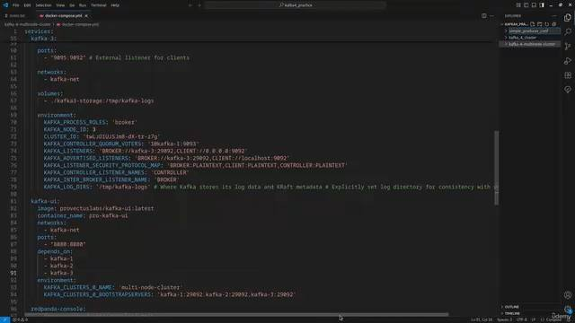
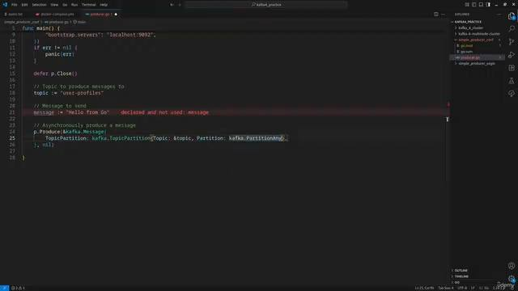
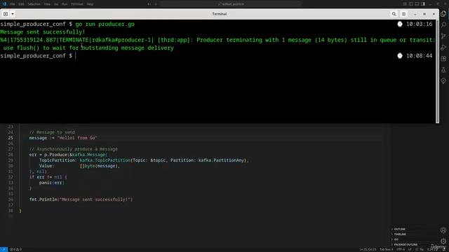
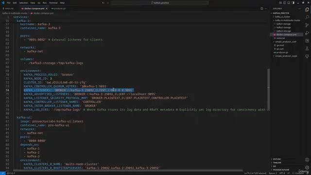
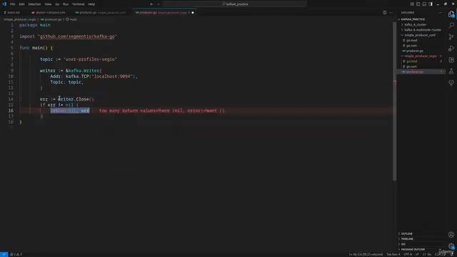
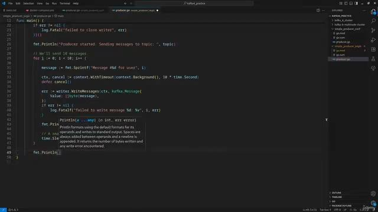

# Apache Kafka 4.0 课程文档：消息投递语义与 Go 生产者实战（P35–P36）

> 适用读者：前端转 AI 应用工程师。本文档按「照着做就能跑」的标准编写，所有代码均为完整文件，可直接保存运行。涉及 Java 语法处会标注「知道即可」；涉及并发/锁概念时会补充「在 JS/Node 里对应什么」。

---

## 1. 这一节做什么

这两节课（P35、P36）解决两个问题：

1. **P35：理解 Kafka 的两种投递语义**——`at most once`（至多一次）和 `at least once`（至少一次）。讲师用「待办清单打勾」的比喻讲清楚：自动提交 offset 会导致消息可能丢失（至多一次），手动提交 offset 会导致消息可能重复（至少一次）。这是后面写生产者、消费者时所有可靠性配置的理论基础。

   具体来说，P35 这一节并不涉及任何代码，全部是概念铺垫。讲师先给出两种语义的英文定义，再用「消费者处理消息 → 提交 offset」这个两步动作的**先后顺序**来解释语义是怎么产生的：如果先提交 offset 再处理消息，那么处理过程中崩溃就会丢消息（至多一次）；如果先处理消息再提交 offset，那么提交前崩溃就会重复处理（至少一次）。理解这个「先后顺序决定语义」的因果链，是后面看懂 `enable.auto.commit`、`enable.auto.commit=false`、`commitSync`、`commitAsync` 这些配置项的前提。本节还会顺带说明：Kafka 本身**不提供** exactly-once 的端到端语义（除非配合事务），所以实际工程里你只能在「可能丢」和「可能重」之间二选一，然后靠业务侧做幂等来兜底。

2. **P36：用 Go 写出第一个 Kafka 生产者**，并且**同时用两个主流客户端库各写一遍**：
   - `confluent-kafka-go`（Confluent 官方，C++ 库 librdkafka 的 Go 封装）
   - `segmentio/kafka-go`（纯 Go 实现，API 更 Go 风格）

   这一节的核心不是「写出能跑的代码」（代码本身只有二三十行），而是**理解生产者如何找到集群、如何把消息投递到正确分区、以及为什么「打印成功」不等于「broker 收到」**。讲师先讲 bootstrap server 列表和 metadata discovery 的流程，再分别用两个库实现，最后通过一个真实的配置错误（`advertised.listeners` 端口写错）演示了「假成功」是怎么发生的、怎么排查。

   过程中讲师踩了一个真实的坑：Docker Compose 里 `advertised.listeners` 端口配错，导致 Confluent 生产者发消息「假成功」（打印成功但 broker 没收到）。这个排错过程本身就是本节最有价值的部分之一——它把「异步发送 + 无回执 + 元数据错误」三个因素叠加在一起，正好是新手最容易掉进去的坑。

最终产出：两个能跑通的 Go 生产者程序 + 一份修正后的 `docker-compose.yaml`。

---

## 2. 讲师原话（带出处）

关于两种投递语义的定义：

> "“最多一次”和“至少一次”是消息系统中的投递保证，用于描述消费者在发生故障时会如何处理消息。"
> —— p035 [00:00]

> "这种保证意味着，一条消息要么被处理一次，要么完全不被处理，绝不会被处理多次。系统会优先防止消息重复，即使这意味着偶尔可能丢失一条消息。这种做法的主要风险是可能发生数据丢失。"
> —— p035 [00:26]

> "这种保证意味着，一条消息会被处理一次或多次，但绝不会一次都不处理。系统会优先确保每条消息都得到处理，即使这意味着某条消息偶尔可能被处理两次。这里的主要风险是可能出现重复处理。"
> —— p035 [01:45]

关于 Kafka 里怎么触发这两种语义：

> "当消费者被配置为自动提交偏移量时，就会出现这种情况。消费者取到一条消息后，客户端库在后台自动提交偏移量，相当于勾选了这条消息，随后应用还没处理完这条消息就崩溃了。应用重启后，会从新的偏移量开始，从而跳过那条从未处理过的消息。"
> —— p035 [01:22]

> "当消费者被配置为手动提交偏移量时，就会出现这种情况。应用取到一条消息并成功处理了它，例如写入了数据库，但随后在手动向 Kafka 提交偏移量之前崩溃了。应用重启后并不知道自己是否已经处理过那条消息，因此会从上次保存的偏移量重新取到同一条消息，并再次处理它。"
> —— p035 [03:10]

关于生产者如何找到集群：

> "生产者只需准备好一样东西即可开始：引导服务器列表。……第一步是初始连接。生产者会连接我们所提供引导列表中的任意一个代理节点。下一步是元数据发现。生产者随后向该代理节点询问集群元数据。代理节点会返回完整的集群映射，告诉生产者还有哪些代理节点在线，以及每个主题分区的领导者是哪个代理节点。"
> —— p036 [00:23]

关于两个客户端库的取舍：

> "最流行的两个库是 Confluent Kafka Go。它是围绕高度优化的 C++ 库 LibRD Kafka 的 Go 封装，以速度极快、可靠和功能完整而闻名。……接下来是 Segment IO Kafka Go。这是纯 Go 实现，常因更简单、更符合 Go 习惯的 API 而受到称赞。"
> —— p036 [02:43]

关于那个坑（端口配错）：

> "因为我们把 localhost 上的 9094 映射到了容器的 9092 端口。……对外通告的监听器，也就是用于向外部通告连接容器 9092 端口的监听器，是不一样的。所以这里应该填本地电脑上映射到容器 9092 端口的那个端口，也就是 9094。所以刚才那里写错了。"
> —— p036 [15:46]

> "这算是一种错误，因为生产者终止时还有一条消息留在队列中或传输途中，我们的集群还没有收到它。"
> —— p036 [13:59]

关于 `docker compose down -v`：

> "-v 是用于卷的参数。这是一个破坏性操作，会删除我们 Docker Compose 文件的 volumes 部分中声明的所有命名卷。"
> —— p036 [40:05]

---

## 3. 从零复现

### 3.1 前置条件

- 已按前面课程搭好 3 节点 Kafka 集群（Kafka1 为 controller，Kafka2/Kafka3 为 broker），用 Docker Compose 管理。
- 本机安装 Go（讲师未指定具体版本，建议 1.21+）。
- 已创建 topic `user-profiles`（4 个分区，前面课程创建）。
- 有 Kafka UI 或 Redpanda Console 任一 Web UI 可查看消息。

如果你是从零开始、前面课程没跟上，那么这一步之前你需要确认三件事：第一，`docker compose ps` 里三个容器都在 running 状态；第二，`docker compose logs kafka1` 里能看到 `Kafka Server started` 之类的启动日志；第三，Kafka UI 能打开并列出集群里的 broker 列表。任何一项不满足，先回去补前面的课，不要往下走——因为本节所有代码都依赖这个集群。

### 3.2 目录结构

在项目根目录下建两个并列的 Go module（讲师明确说「两个文件夹各一个 module」）：

```
simple-producer/
├── conf/
│   ├── go.mod
│   └── producer.go
└── segio/
    ├── go.mod
    └── producer.go
```

> 讲师原话里文件夹叫 `simple producer`（带空格）和 `conf` / `segment IO`。带空格的目录名在 shell 里要转义，建议按上面改成 `simple-producer/conf` 和 `simple-producer/segio`，功能完全一致。

为什么一定要分成两个 module 而不是一个？因为两个库的依赖树完全不同（Confluent 版依赖 CGO 和 librdkafka，segmentio 版是纯 Go），放在同一个 module 里 `go mod tidy` 会互相干扰，而且 `go run` 时你得指定具体文件。分成两个独立 module 是最省心的做法，代价只是多一份 `go.mod`。

### 3.3 第一步：修正 docker-compose.yaml 的 advertised.listeners

这是本节最关键的排错。**先修配置，再写代码**，否则你会遇到和讲师一样的「假成功」。

问题根源：Kafka2 容器内监听 9092，宿主机映射到 9094；但 `advertised.listeners` 里写的是 `localhost:9092`，导致客户端拿到元数据后去连 `localhost:9092`（那是 Kafka1 的端口），消息发错地方或发不出去。

这里需要展开解释一下 Kafka 的 listener 机制，因为这是新手最容易懵的地方。Kafka 的 broker 可以同时监听多个「listener」，每个 listener 有一个名字（比如 `CLIENT`、`CONTROLLER`、`EXTERNAL`）和一个协议（比如 `PLAINTEXT`、`SASL_PLAINTEXT`）。`KAFKA_LISTENERS` 决定 broker 在容器内**监听**哪些地址和端口；`KAFKA_ADVERTISED_LISTENERS` 决定 broker 在**返回给客户端元数据时**告诉客户端「你应该连这个地址」。这两个必须配对使用，而且 advertised 的地址必须是**客户端视角能访问到的地址**。

在 Docker Compose 场景下，容器内的 9092 被映射到宿主机的 9094，那么客户端（跑在宿主机上的 Go 程序）连 `localhost:9094` 才能到 Kafka2 的 9092。但 broker 返回元数据时如果告诉客户端「我在 localhost:9092」，客户端就会去连 9092——那是 Kafka1 的端口，消息就发错 broker 了。这就是「假成功」的根源：客户端以为连上了正确的 broker，实际上连的是另一个。

修正后的关键片段（只列 listeners 相关，其余保持你原有配置）：

```yaml
# Kafka1（controller）
kafka1:
  # ... 其他配置不变
  ports:
    - "9092:9092"
  environment:
    KAFKA_LISTENERS: CONTROLLER://:9093,CLIENT://:9092
    KAFKA_ADVERTISED_LISTENERS: CLIENT://localhost:9092
    KAFKA_LISTENER_SECURITY_PROTOCOL_MAP: CONTROLLER:PLAINTEXT,CLIENT:PLAINTEXT,EXTERNAL:PLAINTEXT

# Kafka2（broker）
kafka2:
  ports:
    - "9094:9092"
  environment:
    KAFKA_LISTENERS: CLIENT://:9092
    KAFKA_ADVERTISED_LISTENERS: CLIENT://localhost:9094   # 关键：宿主机端口
  depends_on:
    - kafka1

# Kafka3（broker）
kafka3:
  ports:
    - "9095:9092"
  environment:
    KAFKA_LISTENERS: CLIENT://:9092
    KAFKA_ADVERTISED_LISTENERS: CLIENT://localhost:9095   # 关键：宿主机端口
  depends_on:
    - kafka1
```

讲师还顺手做了两件事：
- 把协议名从 `client` 改成行业标准的 `external`（`KAFKA_LISTENER_SECURITY_PROTOCOL_MAP` 里对应改）。
- 给两个 broker 加 `depends_on: kafka1`，保证 controller 先起。

> 注意：讲师在 p036 [19:25] 提到 Kafka UI / Redpanda Console 的 bootstrap servers 里有个「点号写成了逗号」的小错，但因为列表里还有正确的 `kafka3:9092`，UI 仍能连上。**复制粘贴配置一定要逐行 review**——这是讲师反复强调的。

改完配置后，正确的重启方式是 `docker compose down && docker compose up -d`（不要加 `-v`，否则会删数据）。重启后建议用 `docker compose exec kafka2 kafka-broker-api-versions --bootstrap-server localhost:9092` 之类的命令验证 broker 能正常响应，或者直接在 Kafka UI 里看 broker 列表是否三个都在。

### 3.4 第二步：写 Confluent 版生产者

```bash
cd simple-producer/conf
go mod init producer
go get github.com/confluentinc/confluent-kafka-go/v2/kafka
```

然后写 `producer.go`（完整代码见第 4 节）。

这一步常见的坑：`go get` 时如果报 `pkg-config: executable file not found`，说明你的机器没装 `pkg-config` 和 `librdkafka`。macOS 上 `brew install pkg-config librdkafka`，Ubuntu/Debian 上 `sudo apt install pkg-config librdkafka-dev`。这是 Confluent 库依赖 CGO 的代价，segmentio 版没这个问题。

### 3.5 第三步：写 segmentio 版生产者

```bash
cd ../segio
go mod init producer
go get github.com/segmentio/kafka-go
```

先在 UI 里新建 topic `user-profiles-segio`（3 分区，replication factor 3，min in-sync replicas 2），再写 `producer.go`。

为什么这里要新建一个 topic 而不是复用 `user-profiles`？因为讲师想演示「不同分区数下 round-robin 的表现」。`user-profiles` 是 4 分区，`user-profiles-segio` 是 3 分区，3 分区下 round-robin 的 0,1,2,0,1,2 循环更直观。另外，新建 topic 也顺便验证了「topic 不存在时生产者会怎样」——Kafka 默认 `auto.create.topics.enable=true` 时会自动建 topic，但生产环境通常关掉这个选项，所以显式建 topic 是更稳妥的做法。

### 3.6 第四步：运行与验证

```bash
# 在 conf/ 下
go run producer.go
# 在 segio/ 下
go run producer.go
```

打开 Kafka UI → Topics → `user-profiles` / `user-profiles-segio`，看消息数和分区分布。

验证时注意两点：第一，Confluent 版只发一条消息，UI 里消息数应该 +1；第二，segmentio 版发 10 条，UI 里应该看到 10 条，且分区分布是 0,1,2,0,1,2,0,1,2,0（3 分区 round-robin）。如果 Confluent 版打印成功但 UI 没新消息，别慌，这是 5.3 节要讲的「假成功」，先按那一节排查。

---

## 4. 完整代码

### 4.1 `simple-producer/conf/producer.go`（Confluent 版）

```go
package main

import (
	"fmt"

	"github.com/confluentinc/confluent-kafka-go/v2/kafka"
)

func main() {
	// 1. 创建生产者实例，只需要 bootstrap.servers
	p, err := kafka.NewProducer(&kafka.ConfigMap{
		"bootstrap.servers": "localhost:9092",
	})
	if err != nil {
		panic(err)
	}
	defer p.Close()

	// 2. 目标 topic（前面课程已创建）
	topic := "user-profiles"

	// 3. 要发送的消息
	message := "hello from Go"

	// 4. 异步发送消息
	err = p.Produce(&kafka.Message{
		TopicPartition: kafka.TopicPartition{
			Topic:     &topic,
			Partition: kafka.PartitionAny,
		},
		Value: []byte(message),
	}, nil)
	if err != nil {
		panic(err)
	}

	// 5. 打印确认（注意：这里没有等待 broker ack）
	fmt.Println("message sent successfully")
}
```

### 4.2 `simple-producer/segio/producer.go`（segmentio 版）

```go
package main

import (
	"context"
	"fmt"
	"log"
	"time"

	"github.com/segmentio/kafka-go"
)

func main() {
	topic := "user-profiles-segio"

	// 1. 创建 writer 实例
	writer := &kafka.Writer{
		Addr:  kafka.TCP("localhost:9094"),
		Topic: topic,
		// Balancer 留空，默认 round-robin
	}

	// 2. 关闭 writer（Close 返回 error，需要处理）
	defer func() {
		if err := writer.Close(); err != nil {
			log.Fatal("failed to close writer:", err)
		}
	}()

	fmt.Println("producer started sending messages to topic", topic)

	// 3. 循环发送 10 条消息
	for i := 0; i < 10; i++ {
		message := fmt.Sprintf("message number %d for user %d", i, i)

		// 每条消息一个带超时的 context
		ctx, cancel := context.WithTimeout(context.Background(), 10*time.Second)

		err := writer.WriteMessages(ctx, kafka.Message{
			Value: []byte(message),
		})
		if err != nil {
			log.Fatalf("failed to write message %d: %v", i, err)
		}

		fmt.Printf("sent message: %s\n", message)

		// 小延迟，避免消息一股脑发出
		time.Sleep(500 * time.Millisecond)

		cancel()
	}
}
```

> 讲师原话里 `context.WithCancel` 和 `context.WithTimeout` 说混了一次（p036 [34:12] 自己纠正了「this actually needs to be timeout not with cancel」）。上面代码用的是正确的 `WithTimeout`。

---

## 5. 逐行解释

### 5.1 Confluent 版

- `kafka.NewProducer(&kafka.ConfigMap{"bootstrap.servers": "localhost:9092"})`：只给一个地址即可。讲师解释过：生产者连上任意一个 broker 后会拉取全集群元数据（metadata discovery），之后直接连分区 leader。**在 JS/Node 里对应什么**：类似 `kafkajs` 的 `new Kafka({ brokers: ['localhost:9092'] })`，同样只需 bootstrap 列表。注意这里传的是 `localhost:9092`，也就是 Kafka1 的端口——因为 Kafka1 是 controller，元数据最全，从它开始拉元数据最稳。
- `defer p.Close()`：Confluent 的 `Close()` 不返回 error，所以直接 defer。注意它和 segmentio 的 `Close()` 签名不同——这是两个库 API 差异的典型例子。`Close()` 内部会尝试 flush 未发送的消息，但 flush 的超时时间由 `delivery.timeout.ms` 等配置决定，默认值不一定够，所以「假成功」时它救不了你。
- `kafka.PartitionAny`：不指定分区，交给库决定。讲师说「any represents any partition or unspecified value」。实际行为是：如果消息有 key，按 key hash 选分区；没 key 时按库内部的 sticky partitioner 选（Confluent 库较新版本默认用 sticky，不是严格 round-robin，这也是为什么讲师在 UI 里没看到 0,1,2 均匀分布）。
- `p.Produce(..., nil)`：第二个参数是 delivery channel，讲师这里传 `nil`，意味着**不等待投递回执**。这正是后面「假成功」的直接原因——程序打印成功就退出了，消息可能还在队列里。如果传一个 `chan kafka.Event`，就能在 channel 里收到 `*kafka.Message`（成功）或 `kafka.Error`（失败），这是生产环境必须做的。
- `fmt.Println("message sent successfully")`：只是本地打印，**不代表 broker 收到了**。讲师在 p036 [13:59] 明确说：「we are not trying to receive any acknowledgement」。这句话是整个「假成功」现象的核心——你看到的「成功」只是 `Produce` 调用没报错，消息进本地队列就算成功。

### 5.2 segmentio 版

- `kafka.Writer{Addr: kafka.TCP("localhost:9094"), Topic: topic}`：`kafka.TCP` 是地址构造辅助函数。这里连的是 **9094**（Kafka2 的宿主机端口），讲师故意换一个端口验证多 broker 都能连。`Writer` 是并发安全的，多个 goroutine 可以同时调 `WriteMessages`，内部会做批处理。
- `Balancer` 字段留空：讲师说「let's not use any balancer at this point」，默认就是 round-robin。UI 里看到分区 0,1,2,0,1,2... 就是它。如果想按 key 分区，可以设 `&kafka.Hash{}`；想按固定分区，可以设 `&kafka.LeastBytes{}` 或自定义。
- `defer func(){ if err := writer.Close(); err != nil { log.Fatal(...) } }()`：因为 `Close()` 返回 error，不能直接 `defer writer.Close()`（那样 error 被丢弃）。用匿名函数包一层是 Go 的常见写法。**JS 类比**：类似 `try { await producer.disconnect() } catch(e) { ... }`。`Close()` 会 flush 所有缓冲消息并关闭底层连接，是优雅退出的关键。
- `context.WithTimeout(context.Background(), 10*time.Second)`：每条消息独立超时。讲师说「if the message doesn't go through within 10 seconds, then it's going to cancel」。**JS 类比**：`AbortController` + `setTimeout(() => controller.abort(), 10000)`。注意这里用的是 `WithTimeout` 不是 `WithCancel`，因为 `WriteMessages` 是同步阻塞的，必须有超时兜底，否则 broker 挂了你程序就卡死。
- `writer.WriteMessages(ctx, kafka.Message{Value: []byte(message)})`：同步写，返回 error 说明这条消息没写成功。和 Confluent 的异步 `Produce` 形成对比——这也是为什么 segmentio 版没出现「假成功」：`WriteMessages` 返回 nil 就代表 broker 真的 ack 了（默认 `RequiredAcks = RequireOne`，即 leader 写入成功即返回）。
- `time.Sleep(500 * time.Millisecond)`：讲师加的节流，方便在 UI 里肉眼观察消息逐条到达。生产环境当然不会这么写，但教学时这个延迟很有用——你能清楚看到消息一条一条出现在 UI 里，而不是瞬间刷出 10 条。
- `cancel()` 放在循环体末尾：每条消息用完立即释放 context，避免泄漏。注意这里其实有个小问题：如果 `WriteMessages` 返回 error 走了 `log.Fatalf`，`cancel()` 就不会被调用，context 会泄漏到进程退出。更稳妥的写法是 `defer cancel()` 放在循环体内（Go 1.22+ 支持循环内 defer 正确绑定），或者用 `func(){ ctx, cancel := ...; defer cancel(); ... }()` 包一层。

### 5.3 为什么 Confluent 版会「假成功」

讲师在 p036 [13:59] 的原话是「producer is terminating with one message still in queue or transit」。原因链：

1. `Produce` 是异步的，消息进本地队列就返回。
2. 没有 delivery channel，也没调 `p.Flush()`，`main` 直接结束。
3. `defer p.Close()` 会尝试 flush，但 `Close()` 的行为和超时设置有关，讲师这里没配，所以有时来不及。
4. 加上 `advertised.listeners` 端口错，消息根本到不了正确 broker。

讲师在 p036 [38:15] 说：「we need to use flush to wait for outstanding messages and we will take this up as we move forward」——**本节故意不修**，留到后续课程讲 `Flush` 和 delivery report。你复现时如果也想看到「假成功」，就保持原样；想立刻修好，在 `fmt.Println` 前加一行 `p.Flush(5000)`。

这里再展开一下「假成功」的完整排查思路，因为这是本节最有价值的工程经验：

- **第一步：确认消息真的没到 broker**。打开 Kafka UI，看 `user-profiles` 的消息数有没有 +1。如果 UI 里没有，但程序打印了成功，那就是假成功。
- **第二步：确认 producer 连的是哪个 broker**。在代码里加 `fmt.Printf("%+v\n", p)` 或者开 `debug` 配置（`"debug": "broker,topic,msg"`），看 producer 实际连的地址。如果连的是 `localhost:9092` 但你的 Kafka2 在 9094，那就是 advertised.listeners 配错了。
- **第三步：确认 topic 的 leader 在哪个 broker**。用 `kafka-topics --describe --topic user-profiles` 看每个分区的 leader。如果 leader 在 Kafka2 或 Kafka3，而 producer 连的是 Kafka1，那消息会被转发，但转发过程中如果元数据错就会丢。
- **第四步：加 delivery channel 看回执**。把 `Produce` 的第二个参数从 `nil` 改成 `make(chan kafka.Event)`，然后 `for e := range ch { fmt.Printf("%+v\n", e) }`，就能看到每条消息的真实投递结果。

这套排查思路不仅适用于本节，也适用于你以后所有「消息发了但没收到」的场景。

---

## 6. 复现检查清单

按顺序打勾，任何一项不过就别往下走：

- [ ] `docker compose up -d` 后，`docker compose ps` 显示 kafka1/kafka2/kafka3 都是 running。**怎么验证**：三个容器的 `STATUS` 列都应该是 `Up` 开头，不能有 `Restarting` 或 `Exited`。如果有，`docker compose logs kafka2` 看具体报错。
- [ ] Kafka UI 能打开，能看到 `user-profiles` 和 `user-profiles-segio` 两个 topic。**怎么验证**：浏览器打开 `http://localhost:8080`（或你配置的端口），左侧 Topics 列表里两个 topic 都在，点进去能看到分区数和消息数。
- [ ] `docker-compose.yaml` 里 kafka2 的 `KAFKA_ADVERTISED_LISTENERS` 是 `localhost:9094`，kafka3 是 `localhost:9095`（不是 9092）。**怎么验证**：`grep ADVERTISED docker-compose.yaml`，逐行核对端口号，特别注意别把 kafka2 写成 9095、kafka3 写成 9094。
- [ ] `conf/` 下 `go mod init producer` 成功，`go get github.com/confluentinc/confluent-kafka-go/v2/kafka` 无报错。**怎么验证**：`cat go.mod` 里能看到 `github.com/confluentinc/confluent-kafka-go/v2` 这一行，且 `go.sum` 文件存在。
- [ ] `segio/` 下 `go get github.com/segmentio/kafka-go` 无报错。**怎么验证**：`cat go.mod` 里能看到 `github.com/segmentio/kafka-go` 这一行。
- [ ] `go run producer.go`（conf）打印 `message sent successfully`。**怎么验证**：终端输出这一行，且没有 panic 或 error 堆栈。
- [ ] Kafka UI 的 `user-profiles` 消息数 +1，能看到 `hello from Go`。**怎么验证**：点进 topic，Messages 标签页，最新一条消息的 value 是 `hello from Go`。如果看不到，参考 5.3 节排查。
- [ ] `go run producer.go`（segio）打印 10 行 `sent message: ...`。**怎么验证**：终端输出 10 行，每行格式是 `sent message: message number X for user X`，X 从 0 到 9。
- [ ] Kafka UI 的 `user-profiles-segio` 消息数为 10，分区分布呈 0,1,2,0,1,2... 的 round-robin 形态。**怎么验证**：点进 topic，看每个分区的消息数，3 个分区应该大致均匀（3,3,4 或 4,3,3 这种）。
- [ ] 若 Confluent 版出现「打印成功但 UI 没新消息」，对照 5.3 节排查，这是预期内的已知问题。**怎么验证**：按 5.3 节的四步排查法走一遍，确认是 advertised.listeners 还是 flush 的问题。

---

## 7. 课里没讲但你会撞上的

| 现象 | 原因 | 怎么办 |
| --- | --- | --- |
| `go run` 报 `pkg-config: executable file not found` 或 `librdkafka` 相关错误 | `confluent-kafka-go` 依赖 CGO 和 librdkafka，你的机器没装 | macOS：`brew install pkg-config librdkafka`；Ubuntu/Debian：`sudo apt install pkg-config librdkafka-dev`；Alpine：`apk add pkgconfig librdkafka-dev`。segmentio 版是纯 Go，没这个问题 |
| 两个目录都 `go mod init producer`，担心冲突 | 两个独立 module 同名不冲突，Go 按目录隔离 | 课里就是这么做的，不用改。但如果你以后想把它们合并成一个 module，需要改 module 名并调整 import 路径 |
| topic 名带连字符，代码里写成空格 | Kafka topic 名不允许空格，讲师口述是「user profiles seg IO」，实际是 `user-profiles-segio` | 代码里必须用连字符版本，UI 里也是连字符。复制粘贴时特别注意别把连字符改成空格 |
| Confluent 版 UI 里分区分布不是 0,1,2 均匀 | Confluent 库较新版本默认用 sticky partitioner，不是严格 round-robin | 这是库实现差异，不是 bug。想强制 round-robin 可以设 `"partitioner": "roundrobin"` 配置，或者给消息加 key |
| `docker compose down -v` 后数据全没了 | `-v` 会删 named volumes，包括 Kafka 数据 | 开发期想保留数据别加 `-v`；`--remove-orphans` 是清理残留容器，可以常带。生产环境永远别对数据卷用 `-v` |
| `context.WithTimeout` 的 cancel 没调用，进程内存涨 | 循环里 `cancel()` 在 `log.Fatalf` 之后，error 时不会执行 | 用 `defer cancel()` 放在循环体内（Go 1.22+），或者用匿名函数包一层。生产代码建议用 `errgroup` 统一管理 |
| 消息没有 key，同一用户的消息乱序 | 无 key 消息按轮询分区，同一用户的消息可能落到不同分区 | 给消息加 `Key: []byte(userID)`，Kafka 会按 key hash 固定分区，保证同一用户消息有序。这是后面做「用户会话」类需求的基础 |
| `go get` 超时或拉不到包 | 国内网络访问 proxy.golang.org 慢 | 设 `GOPROXY=https://goproxy.cn,direct`（七牛）或 `https://mirrors.aliyun.com/goproxy/`（阿里），再 `go get` |
| Kafka UI 里看不到新 topic | topic 自动创建被关，或 UI 缓存没刷新 | 手动 `kafka-topics --create --topic xxx --partitions 3 --replication-factor 3 --bootstrap-server localhost:9092`，然后刷新 UI |
| `WriteMessages` 报 `context deadline exceeded` | 10 秒超时到了 broker 还没 ack，可能是 broker 挂了或网络问题 | 先 `docker compose ps` 看 broker 状态，再 `docker compose logs kafka2` 看有没有报错。生产环境建议把超时设长一点（30s+），并加重试 |

---

### 附：本节关键截图












