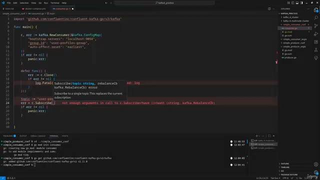
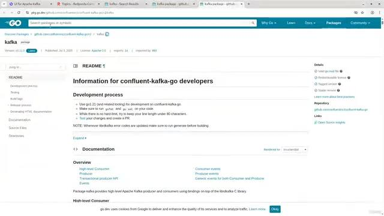
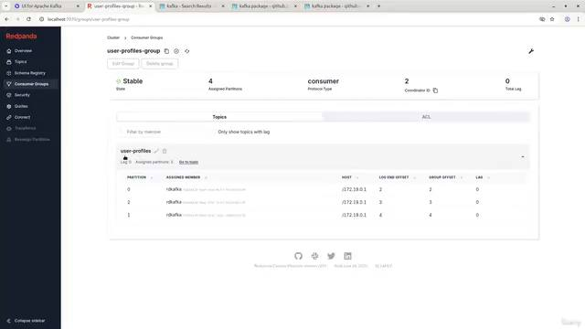
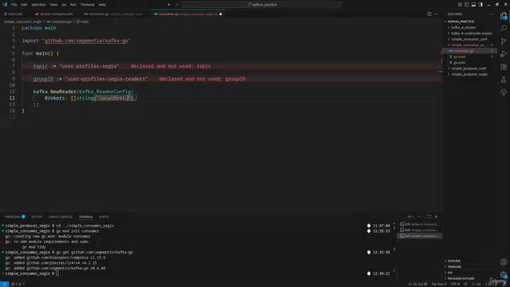
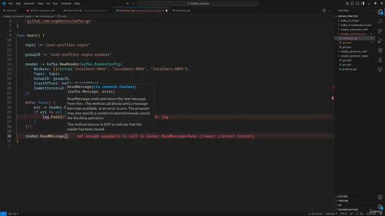
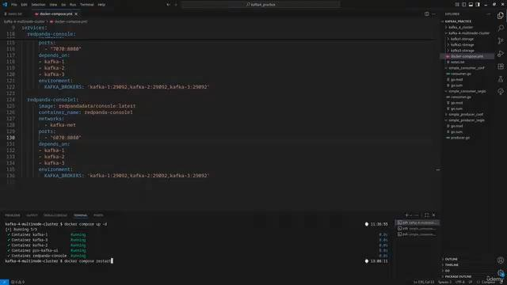
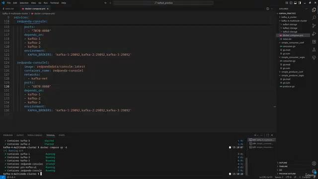
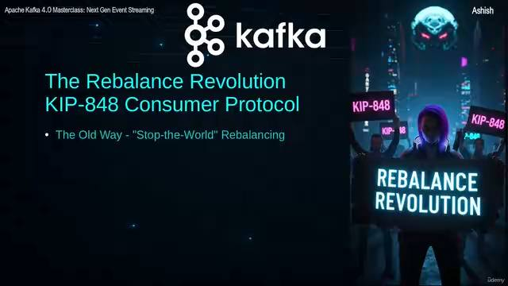
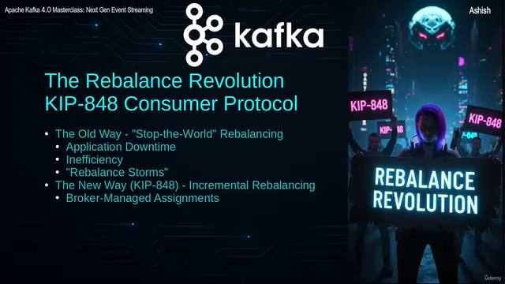
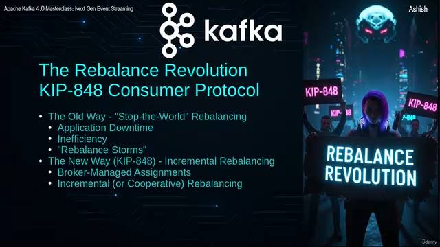

# Apache Kafka 4.0 消费者实战：Consumer Group、Offset、两种 Go Consumer 与 KIP-848

## 1. 这一节做什么

这一节要把 Kafka 的“消费端”真正跑起来。上一节已经有 Go producer 能往 topic 里发消息，这一节的目标是：

1. 用 **Confluent Kafka Go** 写第一个 consumer，订阅 `user-profiles`，观察 Consumer Group、partition、offset。
2. 用 **segmentio/kafka-go** 再写一个 consumer，订阅 `user-profiles-seg.io`，对比两个库的 API 和输出。
3. 在 UI 里观察 consumer group 的成员数、状态、consumer lag，验证“停掉 consumer 再发消息，lag 会涨；重新启动 consumer，lag 会降”。
4. 复现讲师补充的 Docker Compose 命令：`up`、`restart`、`--remove-orphans`、`--force-recreate`、`down` 的区别。
5. 理解 Kafka 4.0 的 KIP-848：从旧的 stop-the-world rebalance 变成 broker 管理的增量/合作式 rebalance。

这一节的重点不是把 consumer 写成生产级框架，而是先建立三个直观认识：第一，Consumer Group 是一组 consumer 用同一个 group ID 协作消费同一个 topic；第二，partition 是并行消费的基本单位，同一个 group 内一个 partition 只会分给一个 consumer；第三，offset 是 Kafka 帮这个 group 记录下来的“书签”，consumer 重启后通常从这里继续，而不是无条件从头读。两个 Go 客户端库的对比也不是为了比较优劣，而是让你看到同一套 Kafka 语义在不同 API 下的表现：Confluent 版本更贴近 Kafka 原生配置项，segmentio 版本把 reader、group ID、起始 offset 和提交间隔包装成了更 Go 风格的配置结构。

前置条件：你已经有上一节跑起来的 Kafka 4.0 集群，brokers 在 `localhost:9092`、`localhost:9094`、`localhost:9095`；有 Redpanda Console / Provector 之类的 UI；topic 已经由上一节 producer 创建并能发消息。课里没有在本节重新给完整 `docker-compose.yml`，所以不要在这里另编一个 Kafka 集群文件，直接沿用你上一节已经能发消息的环境。开始前建议先确认三件事：broker 端口是否仍能连接、UI 是否能打开、上一节 producer 使用的 topic 名到底是什么。因为 consumer 最常见的“看起来启动了但没消息”并不是代码错，而是 topic 名不一致、group 已经有旧 offset、或者连错了 broker 端口。

目录建议如下。课里口述的是 `simple consumer conf` 和 `simple consumer seg.io`，下面用不带空格的目录名，避免 shell 转义：

```text
kafka-course/
├── simple-consumer-confluent/
│   ├── go.mod
│   ├── go.sum
│   └── consumer.go
└── simple-consumer-segmentio/
    ├── go.mod
    ├── go.sum
    └── consumer.go
```

## 2. 讲师原话（带「—— pNNN [MM:SS]」）

> "消费者组就是一组消费者应用，它们作为一个团队协同工作，从某个主题读取数据。它们通过共享的组标识来标识。"
> —— p037 [00:58]

> "在组内，每个分区只会分配给一个消费者。"
> —— p037 [01:28]

> "对于每个消费者组，Kafka 都会为每个分区存储该组最后一条已成功处理消息的偏移量。"
> —— p037 [02:52]

> "自动提交……可能导致消息遗漏……也就是至多一次处理。"
> —— p037 [03:44]

> "手动提交……确保只有工作成功完成后才提交偏移量，从而保证至少一次处理。"
> —— p037 [04:13]

> "Docker Compose restart……不会读取 Docker Compose.yml 文件，也不会应用你最近的任何更改。"
> —— p038 [01:47]

> "Docker Compose up……是声明式的。它的作用是让你正在运行的服务与 Docker Compose.yml 文件中声明的状态保持一致。"
> —— p038 [00:28]

> "KIP 848……由代理管理的分配……增量式或协作式再均衡。"
> —— p039 [03:08] / [03:14] / [03:42]

> "这是一次全局停顿式再均衡。"
> —— p039 [01:23]

这些原话对应三个核心：**Consumer Group 负责并行消费，Offset 负责记录进度，Rebalance 负责成员变化时重新分配 partition**。进一步说，group ID 决定“谁和谁是一队”，partition 决定“队里每个人负责哪一段”，offset 决定“这一段读到哪儿了”。自动提交和手动提交的差别则决定“什么时候把读到的位置写成书签”：自动提交可能在工作还没完成时就把位置推进，手动提交强调先完成处理再提交。Docker Compose 的几条原话是在提醒你：`restart` 不是重新读文件，`up` 才是让运行状态向 compose 文件对齐。KIP-848 的原话则是在说 rebalance 的协调方式和影响范围发生了变化。下面按“能跑起来”的顺序复现。

## 3. 从零复现

### 3.1 建两个 consumer 目录

在课程项目根目录执行：

```bash
mkdir -p simple-consumer-confluent
mkdir -p simple-consumer-segmentio
```

先做 Confluent 版本：

```bash
cd simple-consumer-confluent
go mod init consumer
go get github.com/confluentinc/confluent-kafka-go/v2/kafka
```

说明：逐字稿只说了“run the go get command ... the same package for confluent Kafka go”，没有在字幕里报出完整模块路径和版本号。上面用 v2 导入路径；如果你的环境拉到的是 v1，把 import 里的 `/v2` 去掉即可。**版本不要凭记忆写死，执行 `go get` 后以生成的 `go.mod` / `go.sum` 为准**。`go mod init consumer` 的作用是给这个目录建立 Go module，模块名只影响本地编译，不影响 Kafka 连接；`go get` 的作用是下载依赖并写入 `go.mod`、`go.sum`。如果这一步网络超时，先确认 Go 代理和网络；如果编译时报 cgo 或 librdkafka 相关错误，说明这个客户端库在本机还需要系统依赖，处理方式以所用库的官方文档为准，不要靠改 Kafka 地址来绕过编译问题。



把第 4 节的 `consumer.go` 保存进去，然后运行：

```bash
go run consumer.go
```

终端应先看到：

```text
consumer started waiting for messages
```

如果 producer 已经发过消息，终端会打印类似：

```text
Received message from user-profiles[0]@0: hello
```

具体格式以实际输出为准。关键是你能从输出里看到 topic、partition、offset 和 value。课里在终端里看到的消息顺序是“按 partition 分组”的：partition 0 的消息先出现，然后 partition 2 的两条按顺序出现，再是 partition 1 的消息。Kafka 只保证**同一 partition 内有序**，不保证 topic 全局有序。常见错误是：终端只出现启动提示但一直没有消息。这时先检查 producer 是否真的发到了同一个 topic，再检查 consumer 的 `bootstrap.servers` 是否指向可用 broker，最后检查 UI 里这个 group 的 lag 和当前 offset。如果 UI 里 lag 为 0，说明消息已经被这个 group 消费过，可能是 group ID 复用了旧书签，不一定是代码没收到。



### 3.2 在 UI 里发消息，观察实时消费

打开 Redpanda Console / Provector，进入 `user-profiles` topic，点 “Produce message”，选择 partition 0，发送 `hello five`。终端应马上打印新消息。再到 Consumers 页面看 `user-profiles-group`：成员数应为 1，状态为 stable，lag 为 0 或接近 0。这里的“成员数”表示当前加入这个 group 的 consumer 实例数量；“状态 stable”表示当前分配已经稳定；“lag”表示某个 partition 上最新消息位置和这个 group 已提交位置之间的差距。lag 不是永远必须为 0，它只是一个观察窗口：consumer 处理得慢、consumer 停掉、或者刚发完消息但还没提交，都可能短暂看到非 0。



然后停掉 consumer，在 UI 里再发两条消息。刷新 Consumers，lag 会从 0 变成 2。重新 `go run consumer.go`，consumer 会从上次提交的 offset 继续读，lag 回到 0。课里就是用这个现象说明 offset 是“书签”。验证时不要只看终端有没有输出，还要同时看 UI 的 group 页面：停掉 consumer 后发消息，如果 lag 不变化，先刷新页面或等几秒；如果 group 状态不是 stable，先确认是不是还有旧 consumer 进程没有退出。排查时可以用一个很朴素的顺序：先看 topic 里有没有新消息，再看 group 的成员和状态，最后看 consumer 终端是否有超时以外的错误。

### 3.3 做 segmentio/kafka-go 版本

回到根目录：

```bash
cd ..
cd simple-consumer-segmentio
go mod init consumer
go get github.com/segmentio/kafka-go
```

保存第 4 节的第二个 `consumer.go`，运行：

```bash
go run consumer.go
```

它的输出字段更明确：

```text
Received message partition=0 offset=12 key= value=message number 10 for user
```

课里在读取循环里加了 `time.Sleep(500 * time.Millisecond)`，所以连续两条消息之间会有约半秒停顿。这个 sleep 只是为了让你肉眼看到“消息不是一次性全出来”，不是 Kafka 必需。和 Confluent 版本对照，segmentio 的 `ReaderConfig` 把 brokers、topic、group ID、起始 offset、提交间隔放在一个结构体里；Confluent 版本则用 `ConfigMap` 的字符串键。两者最终都在做同一件事：加入 group、订阅 topic、读取消息、记录 offset。常见错误是把 segmentio 的 topic 常量写成 Confluent 的 topic，或者把 group ID 写成和 Confluent 一样，导致你以为“两个 consumer 都在读”，实际上它们的行为受 group 和 topic 影响。排查时先打印或核对 `topic`、`groupID`、`Brokers` 三个值，再运行。





### 3.4 复现 Docker Compose 命令差异

课里先假设已有容器在跑。此时执行：

```bash
docker compose up
```

如果 `docker-compose.yml` 没改，它不会重启任何东西，只会确认服务在运行。

然后在 `docker-compose.yml` 里复制 `redpanda-console` 服务，改名成 `redpanda-console-1`，把宿主机端口从 `7070` 改成 `6070`。课里没有展示完整 YAML，所以这里不编造完整文件，只记改动点：**复制现有服务块，改服务名，改宿主机端口**。

接着执行：

```bash
docker compose restart
```

你会发现 `redpanda-console-1` 根本没启动。因为 `restart` 只停止并启动“已经存在的容器”，它不读取新的 compose 文件。再执行：

```bash
docker compose up
```

这次 `redpanda-console-1` 才会被创建并启动，其他没变化的服务不会被重建。这里的关键不是记命令，而是理解“声明式”和“命令式”的区别：`up` 会读 compose 文件并让运行状态向文件描述的目标状态靠拢；`restart` 只处理已经存在的容器，不会发现新服务。常见错误是改了 compose 文件后执行 `restart`，然后误以为 YAML 写错了。排查时先看 `docker compose ps` 里有没有新服务名，再看 `docker compose config` 是否能解析文件，最后再执行 `up`。





其他命令：

```bash
docker compose up --remove-orphans
docker compose up --force-recreate
docker compose down
docker compose up
```

`--remove-orphans` 会清理“这个项目以前启动过、但新 compose 文件里已经删除的服务”的容器。`--force-recreate` 会无条件停止并重建所有容器，但 named volume 里的持久数据会保留并重新挂载。`down` 再 `up` 是讲师说的“nuke and pave”，最干净但最慢。实际排查时，如果你发现一个服务名在 `ps` 里还在、但 compose 文件里已经删了，就考虑 orphan；如果你改了环境变量或镜像但容器没变化，就考虑 `--force-recreate`；如果你想彻底清掉容器和网络再重建，就用 `down` 再 `up`，但执行前要确认自己是否依赖卷里的数据。

### 3.5 KIP-848 怎么“复现”

KIP-848 不是一段本地代码，而是 Kafka 4.0 的 consumer group 协议变化。课里没有给开启它的客户端配置，也没有给协议字段，所以本节只能复现讲师的推导：

1. 旧协议：consumer 加入/离开 → 所有 consumer 撤销所有 partition → group leader 重新算全量分配 → 所有人重新开始。期间整个 group 停止消费，叫 stop-the-world。
2. 新协议变化一：分配计算从客户端 group leader 移到 broker 的 group coordinator。
3. 新协议变化二：增量/合作式 rebalance，只让部分 consumer 撤销需要移动的 partition，其他 consumer 继续消费。
4. 结果：滚动重启时 partition 逐个交接，整体流处理不会明显停顿；扩容时新 consumer 更快加入；单个 consumer 不稳定时不容易把整个 group 拖入反复 rebalance。

这里的“复现”不是让你写 KIP-848 代码，而是让你在观察 group 变化时能解释现象：旧协议下成员一变，整个 group 可能短暂停顿；新协议下目标是减少这种全局停顿。课里没有给开关参数，所以不要自己臆造一个配置名。你能做的是把原理和 UI 现象对应起来：看成员变化、看状态变化、看 lag 是否出现明显空窗，然后用“stop-the-world”和“broker 管理分配 + 增量/合作式”去解释。







## 4. 完整代码

### 4.1 目录结构

```text
kafka-course/
├── simple-consumer-confluent/
│   ├── go.mod        # 由 go mod init 生成
│   ├── go.sum        # 由 go get 生成
│   └── consumer.go
└── simple-consumer-segmentio/
    ├── go.mod
    ├── go.sum
    └── consumer.go
```

### 4.2 Confluent 版本：`simple-consumer-confluent/consumer.go`

```go
package main

import (
	"fmt"
	"time"

	"github.com/confluentinc/confluent-kafka-go/v2/kafka"
)

const (
	topic   = "user-profiles"
	groupID = "user-profiles-group"
)

func main() {
	c, err := kafka.NewConsumer(&kafka.ConfigMap{
		"bootstrap.servers": "localhost:9094",
		"group.id":          groupID,
		"auto.offset.reset": "earliest",
	})
	if err != nil {
		panic(err)
	}
	defer func() {
		if err := c.Close(); err != nil {
			fmt.Println("consumer close error:", err)
		}
	}()

	if err := c.SubscribeTopics([]string{topic}, nil); err != nil {
		panic(err)
	}

	fmt.Println("consumer started waiting for messages")

	for {
		msg, err := c.ReadMessage(5 * time.Second)
		if err != nil {
			if kafkaErr, ok := err.(kafka.Error); ok && kafkaErr.Code() == kafka.ErrTimedOut {
				continue
			}
			fmt.Println("consumer error:", err)
			continue
		}

		fmt.Printf("Received message from %s: %s\n",
			msg.TopicPartition,
			string(msg.Value),
		)
	}
}
```

运行命令：

```bash
cd simple-consumer-confluent
go mod init consumer
go get github.com/confluentinc/confluent-kafka-go/v2/kafka
go run consumer.go
```

这段代码的运行结果要以你本机实际 topic、partition、offset 为准。`go run` 每次启动都是一个新进程，但 group ID 相同且 offset 已提交时，它会延续这个 group 的书签；如果一直看不到消息，不要只怀疑 `ReadMessage`，先检查 topic 名、broker 端口、group lag 和 producer 是否发到了同一个 topic。

### 4.3 segmentio 版本：`simple-consumer-segmentio/consumer.go`

```go
package main

import (
	"context"
	"fmt"
	"log"
	"time"

	"github.com/segmentio/kafka-go"
)

const (
	topic   = "user-profiles-seg.io"
	groupID = "user-profiles-seg-io-readers"
)

func main() {
	reader := kafka.NewReader(kafka.ReaderConfig{
		Brokers:        []string{"localhost:9092", "localhost:9094", "localhost:9095"},
		Topic:          topic,
		GroupID:        groupID,
		StartOffset:    kafka.FirstOffset,
		CommitInterval: time.Second,
	})

	defer func() {
		if err := reader.Close(); err != nil {
			log.Println("could not close reader:", err)
		}
	}()

	for {
		msg, err := reader.ReadMessage(context.Background())
		if err != nil {
			log.Println("could not read message:", err)
			break
		}

		time.Sleep(500 * time.Millisecond)

		fmt.Printf("Received message partition=%d offset=%d key=%s value=%s\n",
			msg.Partition,
			msg.Offset,
			string(msg.Key),
			string(msg.Value),
		)
	}
}
```

运行命令：

```bash
cd simple-consumer-segmentio
go mod init consumer
go get github.com/segmentio/kafka-go
go run consumer.go
```

如果 `user-profiles-seg.io` 这个 topic 在你集群里名字不同，把常量改成你上一节 producer 实际使用的 topic 名。课里口述为 “user profiles seg IO”，UI 里显示为 `user profiles seg.io`；Kafka topic 名不能含空格，所以代码里用连字符和点号是合理复现，但**必须以你集群实际 topic 为准**。这段代码的错误处理是读不到就 `break`，所以一旦出现连接错误，进程会退出；排查时先看日志里的错误文本，再检查 brokers 列表、topic 和 group ID。不要把 `time.Sleep` 当成 Kafka 延迟，它只是示例中的观察手段。

### 4.4 Docker Compose 命令清单

```bash
# 1. 已有容器在跑，配置没变：声明式 up 不会重建
docker compose up

# 2. 改了 compose 文件，复制了一个新服务 redpanda-console-1，端口 6070
# 此时 restart 不会读取新文件，也不会启动新服务
docker compose restart

# 3. 用 up 让运行状态匹配 compose 文件，新服务被创建
docker compose up

# 4. 清理已经从 compose 文件删除的旧服务容器
docker compose up --remove-orphans

# 5. 无条件重建所有容器，但 named volume 数据保留
docker compose up --force-recreate

# 6. 讲师常用的 nuke and pave：先 down 再 up
docker compose down
docker compose up
```

执行这些命令时，建议每步都用 `docker compose ps` 观察容器列表变化：第 1 步不应该多出新服务；第 2 步之后新服务仍然不存在；第 3 步之后新服务才出现；第 4 步关注是否有旧服务容器被清理；第 5 步关注容器是否被重建但数据卷仍在；第 6 步关注整个项目是否被重新创建。这样你不是死记命令，而是能看到每条命令对运行状态的影响。

### 4.5 KIP-848 设计决策表（课里没有代码，以下为讲解整理）

| 维度 | 旧协议 | KIP-848 新协议 |
|---|---|---|
| 分配计算者 | 客户端侧的 group leader consumer | broker 上的 group coordinator |
| 分区撤销范围 | 所有 consumer 撤销所有 partition | 只让相关 consumer 撤销需要移动的子集 |
| 对处理的影响 | stop-the-world，整个 group 停顿 | incremental / cooperative，其他 consumer 继续处理 |
| 滚动重启 | 容易整体停顿 | partition 逐个交接，整体流继续 |
| 不稳定 consumer | 可能让整个 group 反复 rebalance | 更稳定、更少全局影响 |
| 扩容 | 新 consumer 加入成本高 | 新 consumer 更快融入，干扰更小 |

课里没有给 KIP-848 的客户端开关、协议字段或配置名，所以这里不要假装有一个“开启参数”。这一节是原理课，不是配置课。表格的作用是帮你在看到 rebalance 现象时有一个对照框架：先判断影响范围，再看分配计算在哪里发生，最后再判断是全局停顿还是增量交接。

## 5. 逐行解释

### Confluent 版本

- `kafka.NewConsumer(&kafka.ConfigMap{...})`：创建一个 consumer 实例。它本质上是打开到 Kafka 集群的连接，所以后面必须 `Close()`。
- `"bootstrap.servers": "localhost:9094"`：课里明确连的是 Kafka 2 节点 `9094`。你如果有三节点，也可以只写一个 bootstrap 地址，客户端会自己发现其他 broker。
- `"group.id": "user-profiles-group"`：Consumer Group 的共享 ID。同一 group 内的 consumer 一起分担 partition；不同 group 各自独立消费同一 topic。
- `"auto.offset.reset": "earliest"`：当这个 group 找不到已提交 offset，或者 offset 越界时，从最早的消息开始读。注意它**不是**“每次启动都从头读”。如果 group 已经有提交过的 offset，它会从书签继续。
- `defer c.Close()`：程序退出时关闭连接。课里从 segmentio producer 复制了 close 错误处理片段。
- `c.SubscribeTopics([]string{topic}, nil)`：订阅 topic。第二个参数是 rebalance callback，课里说现在不处理 rebalancing，所以传 `nil`。
- `c.ReadMessage(5 * time.Second)`：轮询消息，最多等 5 秒。没有新消息时会返回 timeout。
- `kafkaErr.Code() == kafka.ErrTimedOut`：如果是超时，继续循环，不退出。课里特别说“timeouts are expected when no new messages are available”。
- 其他错误：打印后继续。课里选择不因为一次中间错误就停止接收。
- `msg.TopicPartition`：包含 topic、partition、offset 信息。课里说输出里的 `user profiles zero`、`(2)` 就是 partition，`@` 后面是 offset。
- `string(msg.Value)`：Confluent 的 message value 是 byte slice，要转 string 才能打印。

### segmentio 版本

- `kafka.NewReader(kafka.ReaderConfig{...})`：segmentio 的高层 reader。课里说也可以用低层 connection API，但为了省时间用高层类型。
- `Brokers: []string{...}`：课里把 `9092`、`9094`、`9095` 都写进去了。Confluent 版本只写了一个 `9094`，这是两个例子的差异，不是谁对谁错。
- `Topic: "user-profiles-seg.io"`：segmentio producer 使用的 topic。
- `GroupID: "user-profiles-seg-io-readers"`：课里在原来的 group ID 后面加了 `readers`，用来区分不同 consumer group。
- `StartOffset: kafka.FirstOffset`：从 Kafka 里保存的第一个 offset 开始读。课里说 “the first offset that is stored in our Kafka cluster”。
- `CommitInterval: time.Second`：每隔 1 秒提交 offset。课里引用文档说：如果为 0 则同步提交；只有设置 GroupID 时才使用。这个参数决定“书签多久写一次”。
- `reader.ReadMessage(context.Background())`：读一条消息。课里说开发时先用 `context.Background()`，生产可以换成 `context.WithTimeout`。
- 错误处理：课里用 `log.Println("无法读取消息", err)`，然后 `break`。他也提到可以 `continue`，取决于你想不想在错误后继续尝试。
- `time.Sleep(500 * time.Millisecond)`：只是为了肉眼观察消息逐条出现，不是 Kafka 语义。
- 输出字段：`partition`、`offset`、`key`、`value`。`Key` 和 `Value` 都是 byte slice，所以用 `string()` 转。

### 在 JS/Node 里对应什么

Consumer Group 很像 Node 里起多个 worker 进程共同消费一个队列：Kafka 保证同一 group 内一个 partition 只分给一个 consumer，你不需要在 JS 里写锁。Offset 像“已处理到的数组下标/数据库 checkpoint”；自动提交像 `setInterval` 定时保存 checkpoint，手动提交像 `await db.write()` 成功后再保存 checkpoint。课里只讲了自动提交和手动提交的概念，**没有写手动提交代码**，所以生产项目里要 at-least-once 时，需要自己补 `CommitMessage` / `CommitOffsets` 一类逻辑，具体 API 以你用的库文档为准。和前端开发对照，还有一个容易理解的点：不要把 Kafka 的 partition 想成浏览器里的并发请求，它更像“分片队列”，同一个分片内顺序明确，不同分片之间不能假定先后。UI 里的 lag 也不是“页面加载进度”，而是服务端状态，刷新页面只是重新读取它，不会改变 consumer 的处理速度。

### Docker Compose 部分

- `docker compose up` 是声明式的：读 compose 文件，比较当前容器，只重建配置变化的服务。
- `docker compose restart` 不是声明式的：它只停止并启动已有容器，不读新文件，所以新加的服务不会出现。
- `--remove-orphans`：清理“以前属于这个项目、但新文件里已经不存在”的容器。
- `--force-recreate`：不检查是否变化，直接重建所有容器；named volume 数据保留。
- `down` 再 `up`：最干净，但最慢。课里说这是他习惯的 nuke and pave。

### KIP-848 部分

旧协议的问题不是“分配算法不对”，而是“分配过程会打断所有人”。只要有一个 consumer 加入或离开，所有 partition 都被撤销，所有 consumer 停下来等 group leader 重新算。新协议把算分配的人从客户端 leader 换成 broker coordinator，并且只撤销需要移动的 partition。对开发者的直接意义是：滚动重启时 partition 逐个交接，流处理不会出现明显空窗；扩容时新 consumer 更快融入；单个 consumer 不稳定时不容易拖垮整个 group。把这段和前端的发布过程对照，旧协议更像“每次上线所有人都必须先停服再重新分配流量”，新协议更像“只把需要迁移的流量逐步切走，其他人继续服务”。

## 6. 复现检查清单

- [ ] `go run consumer.go` 能启动，终端出现 `consumer started waiting for messages`。验证方式：在 `simple-consumer-confluent` 目录执行命令，看到启动提示后再发消息，而不是只看编译成功。
- [ ] 用 UI 往 `user-profiles` 发一条消息，Confluent consumer 能打印出来。验证方式：在 UI 选择明确 partition 发送一条带唯一内容的消息，再到终端核对 value。
- [ ] 输出里能看到 topic、partition、offset；同一 partition 内消息顺序稳定，不同 partition 之间不保证顺序。验证方式：连续发多条到同一 partition，观察 offset 递增；再发到不同 partition，不要用出现顺序判断全局顺序。
- [ ] UI 的 Consumers 页面能看到 `user-profiles-group`，成员数为 1，状态为 stable，lag 接近 0。验证方式：打开 group 详情，确认 group ID、成员数、状态和 lag 三处都对应上。
- [ ] 停掉 Confluent consumer，再发两条消息，UI 里 lag 变成 2；重新启动 consumer 后 lag 回到 0。验证方式：先确认 consumer 进程已退出，再发消息，刷新 group 页面观察 lag 变化，最后重启并再次刷新。
- [ ] segmentio consumer 能打印 `partition=... offset=... key=... value=...`。验证方式：确认 topic 是 `user-profiles-seg.io` 或你实际使用的 topic，发送消息后核对四个字段。
- [ ] segmentio 版本连续消息之间有约 500ms 停顿，这是代码里的 sleep，不是 Kafka 延迟。验证方式：看代码中的 `time.Sleep(500 * time.Millisecond)`，不要把它误判为 broker 性能问题。
- [ ] `docker compose restart` 后新加的 `redpanda-console-1` 没有启动。验证方式：执行后立刻 `docker compose ps`，确认服务列表中没有新服务。
- [ ] `docker compose up` 后 `redpanda-console-1` 启动，其他没变化的服务没有被重建。验证方式：执行前后各看一次 `docker compose ps`，关注新服务是否出现、旧服务是否保持运行。
- [ ] `docker compose up --remove-orphans` 能清理旧服务容器。验证方式：先制造一个已从 compose 文件删除但仍在运行的旧服务，再执行命令并观察容器列表。
- [ ] `docker compose up --force-recreate` 会重建容器，但 named volume 数据保留。验证方式：记录容器创建时间或数据卷内容，执行后确认容器重建、卷数据仍可读。
- [ ] 能用自己的话复述：旧协议 stop-the-world；KIP-848 是 broker 管理分配 + 增量/合作式 rebalance。验证方式：不看笔记，用“谁算分配、撤销多少 partition、对处理有什么影响”三点讲一遍。
- [ ] 如果你要改 topic 名，两个 consumer 的常量必须和实际 topic 完全一致。验证方式：分别在两个目录核对 `topic` 常量，并与 UI 中 topic 名逐字比较。

## 7. 课里没讲但你会撞上的

| 现象 | 原因 | 怎么办 |
|---|---|---|
| topic 名不一致，consumer 一直等消息或订阅报错 | 课里口述 `user profiles`、`user profiles seg.io`，但 Kafka topic 不能有空格，代码里用的是 `user-profiles` 和 `user-profiles-seg.io`，必须和上一节 producer 实际创建的名字对齐 | 到 UI 里复制真实 topic 名，逐个核对两个 consumer 的常量；改完后重新运行，不要只改一个地方 |
| Confluent 库编译失败，报版本、import 路径或 cgo / librdkafka 相关错误 | 逐字稿没有报完整模块路径和版本，上面用 v2 路径；本机可能拉到 v1，或缺少系统依赖 | 先看 `go.mod` 实际版本，v1 就去掉 import 里的 `/v2`；cgo / librdkafka 问题按所用库官方文档处理，不要靠改 Kafka 地址绕过编译问题 |
| 以为 `auto.offset.reset=earliest` 会每次从头读，结果没有 | 它只在没有已提交 offset 或 offset 越界时生效；如果 group 已有提交过的 offset，会从书签继续 | 确认当前 group ID 和 UI 里的 offset；想重新从头读，需要换 group ID 或重置 offset，课里没讲重置命令 |
| 生产项目只靠自动提交，担心丢消息 | 课里讲了手动提交可以保证 at-least-once，但没有写 `CommitMessage` / `CommitOffsets` 示例 | 生产项目不要只靠自动提交；先完成业务处理再提交，具体 API 以你用的库文档为准 |
| segmentio 的 `context.Background()` 在异常时可能一直阻塞 | 示例为了开发方便用了 Background，课里说可以用 `context.WithTimeout` | 真实服务加超时和退出信号，读循环要能被取消；排查时看进程是否卡在读取而不是 broker 没消息 |
| 想开启 KIP-848，却找不到课里给的开关 | 这一节只讲协议原理和收益，没有给客户端配置名、broker 配置名或版本兼容矩阵 | 不要把原理当成配置课；需要落地时查你所使用 Kafka 版本和客户端的官方文档，不要臆造参数 |
| `docker compose down` 后不确定数据是否还在 | 课里把 `down` + `up` 称为“nuke and pave”，但严格说 `down` 默认是否删除 named volume 取决于 compose 和参数，课里没有展开 `-v` | 执行前确认自己的命令和卷配置；要保留数据就不要随手加删除卷的参数，先看 `docker compose config` 和卷定义 |
| UI 的 lag 刷新有延迟，停掉 consumer 后发消息没有立刻变化 | UI 展示的是服务端状态，刷新和采集都可能有延迟；课里也出现了“Redpanda 需要更新”的提示 | 刷新页面或等几秒再看，同时确认 consumer 进程确实退出、消息确实发到了同一个 topic |
| 多 partition 下期待全局顺序，结果消息交错出现 | 课里反复演示：partition 2 的消息可能比 partition 1 先出现；Kafka 只保证单 partition 内有序 | 需要顺序时把相关消息放到同一 partition，并用 key 或明确分区策略控制；不要用不同 partition 的出现顺序推断业务顺序 |