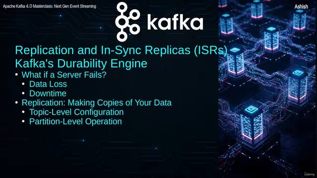
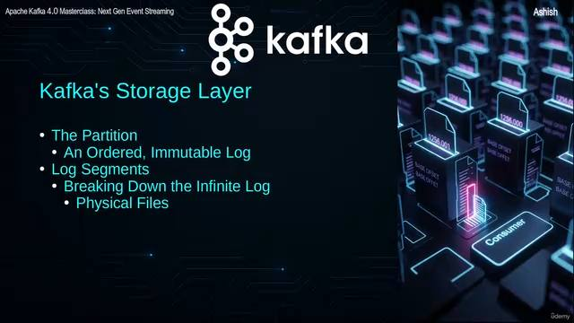
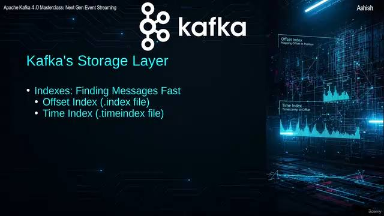
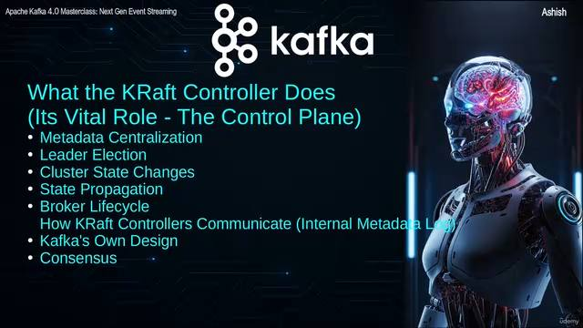
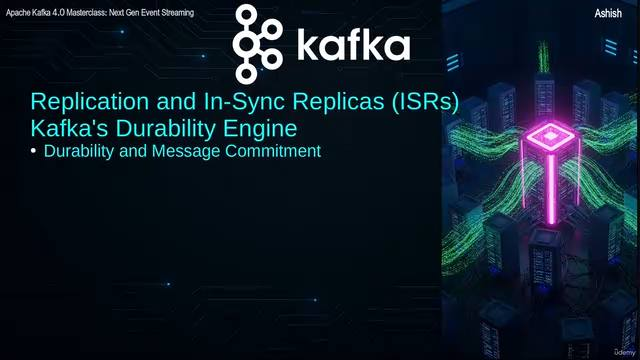
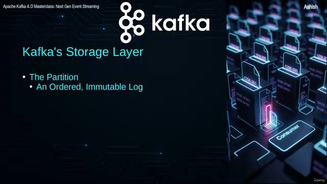

# Apache Kafka 4.0 消息全链路、复制机制、KRaft 与存储层（P40–P43）复现文档

> 适用读者：前端转 AI 应用工程师。本文档按「把课程里的东西跑起来」组织，不是知识点罗列。命令、配置、路径全部写全；课里没讲的内容会明确标注「课里没讲」。

---

## 1. 这一节做什么

P40–P43 这四集，讲师从「一条消息的一生」讲到「Kafka 4.0 的新心脏 KRaft」，再讲到「数据到底怎么落在磁盘上」。它不是纯理论课——讲师在 P40 里明确回指了前面已经跑过的实验（发 10 条无 key 消息、观察轮询分区；创建 topic 时指定 replication factor），P41 也回指了创建 topic 的命令。所以这四集是**在已有可运行集群上做验证与配置**的课。对前端转 AI 应用工程师来说，你可以把这四集理解成「从调用一个发送消息的 API，追到消息在队列、副本、磁盘文件里的实际位置」：前端平时关心的是请求有没有发出去、接口有没有返回；Kafka 这里要关心的是消息进了哪个分区、被几个副本确认、元数据由谁管理、最终落在哪个文件里。两者观察对象不同，但排查思路很像：先确认连接，再确认路由，再确认持久化，最后确认后台整理机制有没有生效。

这一节你要亲手完成的事，按依赖顺序是：

1. 确认本地有一个 Kafka 4.0 集群在跑（单 broker 即可，`--replication-factor 1`）。
2. 用带 key / 不带 key 两种方式发消息，验证**分区路由规则**（同 key 同分区、无 key 轮询）。
3. 用 `acks` 三个取值（`0` / `1` / `all`）分别发消息，理解**持久性档位**。
4. 创建一个 `replication-factor 2` 或 `3` 的 topic（需要多 broker），观察 **leader / follower / ISR**。
5. 确认集群是 **KRaft 模式**（无 ZooKeeper），找到 controller 的 listener 端口（课里举例 `9093`）。
6. 到 `log.dirs` 目录下**亲眼看到** `.log` / `.index` / `.timeindex` 三类文件，并触发一次 segment 滚动。
7. 配置一个 `cleanup.policy=compact` 的 topic，发同 key 多条消息 + 一条 tombstone，观察压缩效果。

下面每一节都对应上面的某一步。复现时建议按顺序做，因为第 2 步依赖 topic 已创建，第 4 步依赖多 broker 或至少理解单 broker 下副本数为什么只能为 1，第 6、7 步依赖你能找到实际的 `log.dirs`。如果某一步失败，先不要跳步；Kafka 的很多「看起来没生效」其实是前置条件没满足，例如 topic 没建、broker 数量不够、端口连错、路径不是你以为的 `log.dirs`。

---

## 2. 讲师原话（带出处）

> "我们将跟踪一个单独的事件，也就是一条消息从离开生产者应用开始，到被消费者处理为止，在 Kafka 中完整流转的全过程。"
> —— p040 [00:00]

> "如果提供了键，Kafka 保证所有具有相同键的记录始终进入同一个分区。这是通过对键做哈希来实现的。"
> —— p040 [03:13]

> "如果没有提供键，也就是键为 null，记录通常会以轮询方式分布到各个分区，以确保各分区之间的负载均衡。"
> —— p040 [03:13]

> "当我们在循环中发送 10 条消息时，由于这些消息没有附带键，它们会以轮询方式被发送到不同分区。"
> —— p040 [03:41]

> "如果 ACKs 为 0，生产者发送消息后不会等待代理节点返回任何确认。这种方式的数据丢失风险最高，但优势是能获得最高吞吐量和最低延迟。"
> —— p040 [05:35]

> "如果 ACK 的值为 1，生产者会等待该分区的领导者代理节点返回确认。如果领导者代理节点在消息复制到其跟随者之前发生故障，就可能丢失数据。"
> —— p040 [06:01]

> "如果 ACK 的值配置为 all 或 -1，生产者会等待领导者代理节点返回确认，并等待消息已成功复制到所有同步副本（ISR）的确认。"
> —— p040 [06:31]

> "已提交的偏移量由 Kafka 自身存储在一个特殊的内部主题中，该主题名为 `__consumer_offsets`。"
> —— p040 [12:26]

> "在 Kafka 4.0 中，使用 `--property group.protocol=consumer` 可以启用新的消费者再均衡协议。该协议由服务端驱动，更加增量式或协作式。"
> —— p040 [09:39]

> "Kafka 中的复制，就是把每个主题分区制作成多个副本，并将这些副本存储到集群内不同 Kafka 代理节点上的过程。"
> —— p041 [01:46]

> "`--replication-factor 1` 表示只有一个副本，没有复制，也没有容错能力。我们在本地开发时使用的就是这种配置。"
> —— p041 [02:07]

> "对于每个分区，会指定一个代理节点作为领导者。针对该分区的所有生产者写入和消费者读取都必须经过它的领导者。该分区在不同代理节点上的其他副本称为跟随者。"
> —— p041 [03:02]

> "同步副本（ISR）是一种跟随者副本，它已经完全追上领导者，并会主动发送心跳来确认自身健康状态。"
> —— p041 [04:20]

> "所谓健康，是指它没有落后超过配置的时间上限。这个上限可以通过 `replica.lag.time.max.ms` 配置，通常可以设为 10 到 30 秒。"
> —— p041 [05:14]

> "在 Kafka 中，只有当消息成功追加到领导者的日志，并成功复制到其所有同步副本后，才会被视为已提交。"
> —— p041 [06:40]

> "只有 ISR 才能成为领导者。如果某个分区的领导者代理节点发生故障，Kafka 的控制器会立即选出新的领导者。关键在于，新的领导者始终会从剩余的 ISR 中选出。"
> —— p041 [07:37]

> "KRAFT 代表 Kafka RAFT 元数据。这是由 KIP-500 驱动的一次根本性架构转变：Kafka 用自身内置的、基于 RAFT 的共识机制来管理元数据，从而取代 ZooKeeper。"
> —— p042 [02:46]

> "这种通信在我们的环境中通过一个专用监听端口进行，例如 9093，从而与客户端流量分开。"
> —— p042 [07:42]

> "每个日志段都是磁盘上 `KAFKA_LOG_DIRS` 下的一个目录，其中包含多个物理文件。最重要的有 `.log` 文件、`.index` 文件（即偏移量索引），以及随后的 `.timeindex` 文件（即时间戳索引）。"
> —— p043 [02:24]

> "当日志段达到一定大小（`log.segment.bytes`，默认 1 GB），或达到某个时间限制（例如 `log.roll.hours`，默认 7 天）时，Kafka 就会滚动该日志段。"
> —— p043 [02:53]

> "通过将 `log.cleanup.policy` 设置为 `compact`，可以为某个主题启用日志压缩。默认情况下，该策略为 `delete`。"
> —— p043 [09:53]

> "如果发送一条带有特定键但值为 null 的消息，它就会充当墓碑消息。之后，日志清理器会在可配置的宽限期结束后，彻底删除该键，包括它最后一个有效值。"
> —— p043 [08:58]

上面这些引用分别对应本文档后面的验证点：分区路由看 P40 的 key / no key 两段，持久性档位看 P40 的 acks 三段，消费者 offset 看 P40 的 consumer offsets 一段，复制与 ISR 看 P41，KRaft 看 P42，log segment 与 compaction 看 P43。复现时不用背英文原文，但要能用中文复述每段在验证什么现象。

---

## 3. 从零复现

### 3.0 前置：确认集群是 KRaft 模式

课里 P42 强调 Kafka 4.0 已经彻底移除 ZooKeeper，控制器走独立 listener（课里举例 `9093`）。先确认你手上的集群是 KRaft：

```bash
# 查看 broker 进程启动参数里是否带 process.roles
ps -ef | grep kafka.Kafka | grep -v grep
```

命令解释：`ps -ef` 列出当前机器上的进程，`grep kafka.Kafka` 过滤 Kafka 主类，`grep -v grep` 把「grep 自己」那一行排除掉，避免你误以为有一个 Kafka 进程。常见错误是这条命令没有任何输出：先别急着认定 Kafka 没启动，可能你用 Docker、systemd、不同用户或不同 Java 启动命令跑了集群，进程名不一定正好匹配 `kafka.Kafka`；这时用 `ss -tlnp | grep 9092` 看端口是否在听，或进入容器内再执行。前端对照：这类似你用 `ps` 查本地 Node 进程没查到，但 `localhost:3000` 还能访问，说明服务可能在容器或另一用户下。

如果你是用官方 tar 包起的，`config/kraft/server.properties` 里应能看到类似：

```properties
process.roles=broker,controller
node.id=1
controller.quorum.voters=1@localhost:9093
listeners=PLAINTEXT://:9092,CONTROLLER://:9093
controller.listener.names=CONTROLLER
log.dirs=/tmp/kraft-combined-logs
```

> 课里没讲具体怎么安装 Kafka 4.0 二进制包，也没给 `server.properties` 全文。上面这段是 KRaft 单节点 combined 模式的常见形态，**具体字段以你实际下载的发行包为准**。课里只明确说了「controller 通信走独立端口，例如 9093」。

看配置时重点盯三处：`process.roles` 决定这个节点是不是同时做 broker 和 controller；`listeners` 决定客户端和 controller 分别从哪个端口进来；`log.dirs` 决定第 3.4 步你该去哪个目录找 `.log` 文件。常见错误是只改了 `listeners` 却忘了 `controller.quorum.voters`，或者 `log.dirs` 还指向默认路径，导致你后面 `ls` 的目录和 broker 实际写入目录不是同一个。

### 3.1 验证分区路由：带 key vs 不带 key

**步骤 A：建一个 3 分区的 topic**

```bash
kafka-topics.sh --bootstrap-server localhost:9092 \
  --create --topic route-demo \
  --partitions 3 --replication-factor 1
```

> `--replication-factor 1` 对应讲师原话「This is what we use for local development」（p041 [02:07]）。

命令解释：`--bootstrap-server` 指定客户端先连接的 broker 地址；Kafka 4.0 不再需要 ZooKeeper 地址。`--partitions 3` 表示这个 topic 被切成 3 个分区，后续同 key 消息只能落在其中一个分区，无 key 消息才有轮询空间。`--replication-factor 1` 表示每个分区只有一份副本，适合本地开发，但没有任何 broker 故障容错。常见错误有两个：一是 topic 已存在时命令会报 topic 已存在，这时不要反复创建，先用 `kafka-topics.sh --bootstrap-server localhost:9092 --describe --topic route-demo` 看状态，或确认真要重建时再删除；二是单 broker 下把 replication factor 写成 2 或 3，会报可用 broker 数不足。前端对照：分区像前端的 shard / queue 分片，副本像备份节点；本地开发通常一份就够，线上才谈多副本。

**步骤 B：不带 key 发 10 条，观察轮询**

```bash
for i in $(seq 1 10); do
  echo "msg-$i"
done | kafka-console-producer.sh \
  --bootstrap-server localhost:9092 \
  --topic route-demo
```

讲师在 p040 [03:41] 明确说：「When we sent 10 messages in a loop, they were sent to different partitions in a round robin way because they did not have any accompanying key.」——这就是你刚才这一步应该看到的现象。命令解释：`for i in $(seq 1 10)` 生成 1 到 10，`echo` 每次输出一行，管道把 10 行标准输入交给 console producer，每一行就是一条 value。这里没有传 `parse.key=true`，所以 producer 认为 key 为 null，才会走轮询路由。常见错误是你在 producer 里误开了 `parse.key=true` 却没提供分隔符，结果整行被当成 key 或解析异常；另一种是 consumer 端没有加 `--from-beginning`，看到的不是刚发的 10 条。前端对照：这类似你连续调用 10 次「发送事件」API，但没有业务主键，服务端按轮询把请求分到不同 worker。

**步骤 C：带 key 发消息，验证同 key 同分区**

`kafka-console-producer.sh` 支持 `parse.key=true` 和 `key.separator`：

```bash
printf 'user-123\t{"email":"a@x.com"}\nuser-123\t{"email":"b@x.com"}\nuser-456\t{"email":"c@x.com"}\n' | \
kafka-console-producer.sh \
  --bootstrap-server localhost:9092 \
  --topic route-demo \
  --property parse.key=true \
  --property key.separator=$'\t'
```

命令解释：`printf` 里的 `\t` 是制表符，`$'\t'` 是 Bash 的 ANSI-C quoting，把 `key.separator` 设成真正的 Tab；`parse.key=true` 告诉 console producer 每行要拆成 key 和 value。两条 `user-123` 的 key 相同，Kafka 会对 key 做哈希后映射到同一个分区；`user-456` 是另一个 key，可能落在相同或不同分区，取决于哈希结果和分区数。常见错误：分隔符写成字面量 `\t` 而不是真实 Tab，导致 key 变成包含反斜杠的字符串；value 里本身含分隔符导致切分位置不对；在 zsh / PowerShell 下 `$'\t'` 语法不同，需要换成实际 Tab 或对应 shell 的写法。前端对照：这类似前端用 `userId` 做一致性哈希，保证同一个用户的事件进入同一个处理队列，避免同一用户的消息被并行乱序处理。

**步骤 D：用 `kafka-console-consumer.sh` 带 `--property print.partition=true` 验证落点**

```bash
kafka-console-consumer.sh \
  --bootstrap-server localhost:9092 \
  --topic route-demo \
  --from-beginning \
  --property print.partition=true \
  --property print.key=true \
  --property key.separator=$'\t'
```

预期：两条 `user-123` 落在**同一个** partition 号上（讲师 p040 [03:13]：「all records with the same key will always go to the same partition」）；`user-456` 可能落在别的分区。命令解释：`--from-beginning` 让没有已提交 offset 或新 group 从最早消息开始读；`print.partition=true` 把分区号打印出来；`print.key=true` 把 key 打印出来；`key.separator` 控制 key 和 value 的显示分隔。常见错误：如果使用了已有 consumer group 且该 group 已提交过 offset，`--from-beginning` 不一定让你从头看到所有消息；排查时先不要指定 `--group`，或换一个新 group。前端对照：这类似你在浏览器 Network 面板里看请求落在了哪个后端实例，分区号就是 Kafka 侧的「实例/分片编号」。


### 3.2 验证 acks 三档

`kafka-console-producer.sh` 通过 `--producer-property` 透传 `acks`：

```bash
# acks=0：fire and forget
echo "acks0-msg" | kafka-console-producer.sh \
  --bootstrap-server localhost:9092 --topic route-demo \
  --producer-property acks=0

# acks=1：leader 确认
echo "acks1-msg" | kafka-console-producer.sh \
  --bootstrap-server localhost:9092 --topic route-demo \
  --producer-property acks=1

# acks=all：所有 ISR 确认
echo "acksall-msg" | kafka-console-producer.sh \
  --bootstrap-server localhost:9092 --topic route-demo \
  --producer-property acks=all
```

> 单 broker + `replication-factor 1` 时，`acks=1` 和 `acks=all` 在行为上几乎无差别（ISR 只有 leader 自己）。要真正体会差异，需要 3.3 的多副本 topic。

命令解释：`--producer-property` 是 console producer 透传生产者配置的入口，`acks=0` 表示发送后不等 broker 确认；`acks=1` 表示等 leader 写入；`acks=all` 表示等所有 ISR 确认。常见错误是写成 `--property acks=0`，那是 console producer 自己的显示/解析属性，不一定按生产者配置生效；另外不要因为单 broker 下三条都成功就认为三档没区别，区别在故障语义和等待确认范围，不在「命令是否返回成功」。前端对照：类似前端调用接口时 `fire-and-forget`、等主接口返回、等所有备份节点返回三种确认级别；本地单实例看不出差别，线上多副本才有意义。

### 3.3 多副本 topic：看 leader / follower / ISR

**前提**：需要至少 2 个 broker 在跑。课里没讲怎么起多 broker，这里给一个最小做法（KRaft 单机多进程）：

```bash
# 复制一份配置，改 node.id、端口、log.dirs
cp config/kraft/server.properties config/kraft/server2.properties
# 编辑 server2.properties：
#   node.id=2
#   listeners=PLAINTEXT://:9094,CONTROLLER://:9095
#   controller.quorum.voters=1@localhost:9093,2@localhost:9095
#   log.dirs=/tmp/kraft-logs-2
# 注意：broker1 的 controller.quorum.voters 也要同步加上 2@localhost:9095
```

然后用 `kafka-storage.sh format` 分别格式化两个 `log.dirs`，再分别 `kafka-server-start.sh` 启动。**这一步课里没讲，属于复现必需但讲师未覆盖的内容**。常见错误：只改第二个节点配置，忘了改第一个节点的 `controller.quorum.voters`；两个节点用了同一个 `node.id`；两个节点 `log.dirs` 相同；端口冲突；格式化时用错配置文件。前端对照：类似本地起两个 Node 实例做负载均衡，必须让它们端口不同、实例 ID 不同，并且相互能发现。

**建多副本 topic 并查看副本状态**：

```bash
kafka-topics.sh --bootstrap-server localhost:9092 \
  --create --topic repl-demo \
  --partitions 3 --replication-factor 2

kafka-topics.sh --bootstrap-server localhost:9092 \
  --describe --topic repl-demo
```

`--describe` 的输出里你会看到每个 partition 一行，字段包含 `Leader`、`Replicas`、`Isr`。**具体列名以你实际输出为准**——课里没有逐字给出 `--describe` 的字段名，只讲了概念（leader / follower / ISR）。命令解释：`--replication-factor 2` 表示每个分区两份副本，必须至少有两个 broker；`--describe` 是查看 topic 元数据，不是消费消息。常见错误是只有单 broker 却创建 replication factor 2，命令会直接失败；如果创建成功但 `Isr` 少于 `Replicas`，说明某个 follower 没跟上，先看 broker 是否都活着、网络是否通、controller quorum 是否正常。前端对照：`Leader` 像主处理实例，`Replicas` 像备份实例列表，`Isr` 像「当前健康且在线的备份列表」；前端做多实例健康检查时也会区分「配置了几个实例」和「当前有几个健康实例」。



### 3.4 找到磁盘上的 log segment 文件

```bash
# 假设 log.dirs=/tmp/kraft-combined-logs
ls -l /tmp/kraft-combined-logs/route-demo-0/
```

你应该看到类似：

```
00000000000000000000.log
00000000000000000000.index
00000000000000000000.timeindex
leader-epoch-checkpoint
partition.metadata
```

- `00000000000000000000` 是**该 segment 的 base offset**（讲师 p043 [02:24]：「Each log segment file is named after its base offset」）。
- `.log` 存 payload，`.index` 是 offset 索引，`.timeindex` 是时间戳索引。

> 注意：课里说的是 `.time index`（带空格），实际文件名是 `.timeindex`（无空格）。以你 `ls` 看到的为准。

命令解释：`ls -l` 列出文件详情，目录名 `route-demo-0` 表示 topic 为 `route-demo`、partition 为 0。常见错误：你按 `log.dirs` 找却找不到，因为 broker 实际配置不是这个路径；或者你看的是另一个 topic 目录；或者容器内路径和宿主机路径不同。排查时先回到 `server.properties` 确认 `log.dirs`，再 `find` 或 `ls` 对应目录。前端对照：这类似你查前端构建产物，先确认 `dist` 目录配置，再去目录里看 `.js` / `.map` 文件；路径不对时不是「没生成」，而是你看错地方。

### 3.5 触发一次 segment 滚动

课里给的触发条件是 `log.segment.bytes`（默认 1GB）或 `log.roll.hours`（默认 7 天）。为了不用等，直接建一个**小 segment** 的 topic：

```bash
kafka-topics.sh --bootstrap-server localhost:9092 \
  --create --topic roll-demo \
  --partitions 1 --replication-factor 1 \
  --config segment.bytes=1024
```

然后发几条超过 1KB 的消息：

```bash
python3 -c "print('x'*2000)" | kafka-console-producer.sh \
  --bootstrap-server localhost:9092 --topic roll-demo
python3 -c "print('y'*2000)" | kafka-console-producer.sh \
  --bootstrap-server localhost:9092 --topic roll-demo
```

再 `ls /tmp/kraft-combined-logs/roll-demo-0/`，你会看到**不止一个** `.log` 文件，第二个的 base offset 不再是 0——这就是「rolls the segment」。命令解释：`--config segment.bytes=1024` 是 topic 级配置，把单个 segment 的目标大小设得很小，方便你快速观察滚动；`python3 -c "print('x'*2000)"` 生成约 2000 字节的一行消息。常见错误：消息太小或发送次数太少，segment 还没达到阈值；producer 批处理或发送太快导致你观察时机不对；某些版本对极小 `segment.bytes` 有约束，命令被拒绝时以实际版本提示为准，课里没讲这个最小值。前端对照：这像前端把大 bundle 拆成 chunk 文件，达到阈值就滚动生成下一个文件；base offset 就是每个 chunk 的起始编号。



### 3.6 配置 log compaction 并观察 tombstone

```bash
kafka-topics.sh --bootstrap-server localhost:9092 \
  --create --topic compact-demo \
  --partitions 1 --replication-factor 1 \
  --config cleanup.policy=compact \
  --config min.cleanable.dirty.ratio=0.01 \
  --config segment.bytes=1024
```

发同 key 多条 + 一条 tombstone（key 有值、value 为空）：

```bash
printf 'k1\tv1\nk1\tv2\nk1\tv3\nk2\tv1\nk1\t\n' | \
kafka-console-producer.sh \
  --bootstrap-server localhost:9092 --topic compact-demo \
  --property parse.key=true --property key.separator=$'\t'
```

> `min.cleanable.dirty.ratio` 和 `segment.bytes` 是为了让 cleaner 尽快动手，课里没讲这两个参数，属于复现加速手段。课里只讲了 `cleanup.policy=compact` 和 tombstone 概念（p043 [08:58]、[09:53]）。

等一会儿（cleaner 是后台进程，课里没给具体触发间隔），再消费：

```bash
kafka-console-consumer.sh --bootstrap-server localhost:9092 \
  --topic compact-demo --from-beginning \
  --property print.key=true --property key.separator=$'\t'
```

预期：`k1` 只剩最新值（或已被 tombstone 清掉），`k2` 保留。命令解释：`cleanup.policy=compact` 是 topic 级压缩策略，表示保留每个 key 的最新值而不是只按时间删除；tombstone 是 key 有值、value 为 null 的消息，用来告诉 cleaner「这个 key 可以删了」。常见错误：配完立刻消费发现旧值还在，以为没生效；实际上 cleaner 是后台异步过程，需要满足脏比例、segment 可清理等条件，等待时间受配置影响。前端对照：这像前端本地缓存按 key 保留最新版本，删除时先写一条 `null` 标记，等清理任务运行后再真正移除旧缓存。



### 3.7 确认 KRaft controller 端口

```bash
# 看 broker 监听端口
ss -tlnp | grep -E '9092|9093'
```

`9092` 是 client listener，`9093` 是 controller listener（课里 p042 [07:42] 举例的端口）。**如果你改过配置，以你的 `listeners` 为准**。命令解释：`ss` 用来查看 socket，`-t` 看 TCP，`-l` 只看监听状态，`-n` 显示数字端口，`-p` 显示进程；`grep -E` 同时过滤 9092 和 9093。常见错误：没有权限看到进程名；端口只出现 9092 没有 9093，说明 controller listener 没按你预期配置；Docker 场景宿主机端口和容器内端口可能不同。前端对照：这就像前端开发时确认 `3000`、`5173` 等 dev server 端口是否真的在监听，不要只看配置文件。



---

## 4. 完整代码

课里没有给出完整的 Java / Python 生产者消费者代码，全部用 CLI 演示。下面给一份**可直接保存运行的 Python 脚本**，把 P40 讲的分区路由、acks、手动提交 offset 三件事串起来。**注意：这段代码是本文档为复现而写，课里没有代码，以下为示意。**

依赖：

```bash
pip install kafka-python==2.0.2
```

文件：`kafka_demo.py`

```python
# kafka_demo.py
# 依赖：pip install kafka-python==2.0.2
# 运行前确保 localhost:9092 上有 route-demo 这个 3 分区 topic

from kafka import KafkaProducer, KafkaConsumer
from kafka.structs import TopicPartition
import json
import time

BOOTSTRAP = "localhost:9092"
TOPIC = "route-demo"


def produce_with_key():
    """带 key 发消息：同 key 必落同分区（p040 03:13）"""
    producer = KafkaProducer(
        bootstrap_servers=BOOTSTRAP,
        acks="all",                      # 对应 p040 06:31 的 acks=all
        key_serializer=lambda k: k.encode("utf-8"),
        value_serializer=lambda v: json.dumps(v).encode("utf-8"),
    )
    for i in range(3):
        future = producer.send(
            TOPIC,
            key="user-123",
            value={"seq": i, "email": f"u{i}@x.com"},
        )
        meta = future.get(timeout=10)
        # meta 里含 partition / offset，字段名以 kafka-python 实际返回为准
        print(f"[key=user-123] partition={meta.partition} offset={meta.offset}")
    producer.flush()
    producer.close()


def produce_without_key():
    """不带 key：轮询分区（p040 03:41）"""
    producer = KafkaProducer(
        bootstrap_servers=BOOTSTRAP,
        acks=1,                          # 对应 p040 06:01 的 acks=1
        value_serializer=lambda v: json.dumps(v).encode("utf-8"),
    )
    for i in range(10):
        future = producer.send(TOPIC, value={"seq": i})
        meta = future.get(timeout=10)
        print(f"[no key] seq={i} partition={meta.partition}")
    producer.flush()
    producer.close()


def consume_manual_commit():
    """手动提交 offset（p040 12:53 的 manual commit）"""
    consumer = KafkaConsumer(
        bootstrap_servers=BOOTSTRAP,
        group_id="demo-group",
        enable_auto_commit=False,        # 关闭自动提交
        auto_offset_reset="earliest",
        key_deserializer=lambda b: b.decode("utf-8") if b else None,
        value_deserializer=lambda b: json.loads(b.decode("utf-8")),
    )
    consumer.subscribe([TOPIC])

    processed = 0
    for record in consumer:
        print(
            f"consume partition={record.partition} "
            f"offset={record.offset} key={record.key} value={record.value}"
        )
        processed += 1
        if processed % 5 == 0:
            # 处理完再提交，对应 p040 12:53 的 commitSync
            consumer.commit()
            print(f"-- committed after {processed} records --")
        if processed >= 10:
            break

    consumer.commit()
    consumer.close()


if __name__ == "__main__":
    print("=== 1. 带 key 生产 ===")
    produce_with_key()
    time.sleep(1)

    print("=== 2. 不带 key 生产 ===")
    produce_without_key()
    time.sleep(1)

    print("=== 3. 手动提交消费 ===")
    consume_manual_commit()
```

运行：

```bash
python3 kafka_demo.py
```

> 说明：`kafka-python` 的 `send()` 返回的 `RecordMetadata` 里字段是 `partition` / `offset` / `topic`，**具体字段名以你安装的版本实际返回为准**。课里没有出现这个库，也没有出现 `RecordMetadata` 这个词。

运行前先确认 `route-demo` 已存在且是 3 分区；如果 topic 不存在，是否自动创建取决于 broker 的自动建 topic 配置，课里没讲，建议先按 3.1 手动建。常见错误：`NoBrokersAvailable` 表示 `BOOTSTRAP` 地址不对或 Kafka 没监听；`TopicAuthorizationException` 表示权限不足；反序列化报错通常是 producer 和 consumer 的 value 格式不一致；手动提交写在了处理消息之前，会放大丢消息风险。前端对照：`producer.send(...).get()` 类似前端 `await fetch` 等响应元数据；`enable_auto_commit=False` + 处理完再 `commit()` 类似前端先处理完业务再确认消费游标。

---

## 5. 逐行解释

**`acks="all"`**：对应讲师 p040 [06:31] 的「ACK's value is configured to be all or minus one … waits for an acknowledgement from the leader broker and confirmation that the message has been successfully replicated to all in sync replicas」。在单 broker 场景下它和 `acks=1` 行为接近，但语义上是「等所有 ISR」，一旦扩到多 broker 就拉开差距。观察方法是看多 broker 下 follower 是否在 ISR；排错时先确认 broker 数是否真的大于 1。

**`key="user-123"`**：对应 p040 [03:13]「all records with the same key will always go to the same partition. This is achieved by hashing the key」。所以脚本里三次 `send` 的 `partition` 打印出来应该**完全相同**。如果发现同 key 打印出不同 partition，先检查是不是 key 序列化前后不一致，或者你实际用了不同 topic / 不同分区数。

**不带 key 的 `send(TOPIC, value=...)`**：对应 p040 [03:41] 讲师回指的实验——「they were sent to different partitions in a round robin way」。10 条消息的 `partition` 打印应该呈现 0/1/2 循环。常见误区是认为「绝对严格 0、1、2 顺序循环」；实际上还要看 producer 批次、分区器实现和发送时机，你应以「分布到多个分区」为主要观察目标。

**`enable_auto_commit=False` + `consumer.commit()`**：对应 p040 [12:53]「Manual commit is where the application explicitly calls consumer.commit sync or consumer.commit async after successfully processing messages」。讲师强调这提供「stronger at least once or exactly once guarantees」——注意是 **at least once**，不是 exactly once；exactly once 需要 Kafka transactions，讲师在 p040 [14:44] 明确说「which is achieved with Kafka transactions … often used with Kafka streams」，本脚本没有用事务。前端对照：这像前端重试队列里「业务处理成功后再 ack」，如果在 ack 前崩溃，消息可能重复投递，所以是 at-least-once。

**`group_id="demo-group"`**：对应 p040 [09:39] 的 consumer group 概念。讲师提到 Kafka 4.0 里可以用 `--property group.protocol=consumer` 启用新的 server-driven rebalance 协议。**`kafka-python` 这个库是否支持该协议，课里没讲，请以库文档为准**；CLI 侧则是：

```bash
kafka-console-consumer.sh --bootstrap-server localhost:9092 \
  --topic route-demo --group demo-group \
  --property group.protocol=consumer
```

**`--config cleanup.policy=compact`**：对应 p043 [09:53]「You enable log compaction for a topic by setting log.cleanup.policy is equal to compact. And by default, this policy is equal to delete」。注意 CLI 里是 topic 级配置 `cleanup.policy`，broker 级默认值才叫 `log.cleanup.policy`——课里两个名字都出现过，别混。排错时先用 `kafka-configs.sh` 查 topic 实际配置，不要只看创建命令。

**`segment.bytes=1024`**：对应 p043 [02:53]「log.segment.bytes which is default to one GB」。topic 级覆盖时字段名是 `segment.bytes`（不带 `log.` 前缀），broker 级才是 `log.segment.bytes`。如果你设置的极小值被版本拒绝，以实际命令返回为准；课里没讲最小值约束。

**`replica.lag.time.max.ms`**：对应 p041 [05:14]「it can be configured via replica dot lag dot time dot max dot milliseconds. So we can typically define it to be 10 to 30 seconds」。这是 broker 级配置，不是 topic 级；超过这个时间没跟上 leader 的 follower 会被踢出 ISR。观察方法是在多 broker 下看 `--describe` 的 `Isr` 是否少于 `Replicas`。

**关于「锁/事务/并发」**：Kafka 的 offset 提交在语义上类似「游标推进」，不是数据库行锁。在 Node.js 里如果你用 `kafkajs`，对应的是 `consumer.commitOffsets([{ topic, partition, offset }])`，同样需要 `autoCommit: false`。课里没有涉及 Node 客户端，这段是给前端读者的类比。

---

## 6. 复现检查清单

按顺序打勾，任何一项不过就别往下走。每一项后面都给出验证方法；验证命令是复现手段，不改变课程原意。

- [ ] `ps -ef | grep kafka.Kafka` 能看到进程，且启动参数含 `process.roles`（KRaft 模式）。验证：执行命令后看输出里是否有 Kafka 主类；如果没有，再用 `ss -tlnp | grep 9092` 确认端口是否在听，以区分「进程名不匹配」和「真的没启动」。
- [ ] `ss -tlnp` 能看到 `9092`（client）和 `9093`（controller，或你配置的端口）。验证：执行 `ss -tlnp | grep -E '9092|9093'`；9093 没出现时回到 `server.properties` 看 `listeners` 和 `controller.listener.names`，不要只看默认值。
- [ ] `kafka-topics.sh --describe --topic route-demo` 显示 3 个 partition。验证：执行 `kafka-topics.sh --bootstrap-server localhost:9092 --describe --topic route-demo`，数 `PartitionCount` 或逐行 partition 行数；同时确认 `ReplicationFactor` 是 1。
- [ ] 不带 key 发 10 条，消费时 `print.partition=true` 输出覆盖了 0/1/2 三个分区。验证：按 3.1 步骤 B 发送，再按步骤 D 消费，观察输出中的 partition 字段；只出现一个分区时先检查是否误开了 `parse.key=true`。
- [ ] 带 key 发 3 条同 key，消费时三条 partition 号完全一致。验证：按 3.1 步骤 C 发送 `user-123`，消费时同时打印 key 和 partition；三条相同 key 的 partition 必须相同，不同则检查 key 分隔符和序列化。
- [ ] `acks=0` / `acks=1` / `acks=all` 三次发送都成功（单 broker 下行为差异不明显是正常的）。验证：分别执行 3.2 的三条命令，确认命令无报错；再消费确认三条消息可见。差异要看故障语义和多副本，不要用单 broker 成功与否判断。
- [ ] 多 broker 环境下 `--describe` 的 `Isr` 列长度等于 `Replicas` 列长度（否则有 follower 掉队）。验证：执行 `--describe --topic repl-demo`，逐 partition 对比 `Replicas` 和 `Isr`；不相等时先确认两个 broker 都活着、`controller.quorum.voters` 配置一致、网络端口互通。
- [ ] `ls /tmp/kraft-combined-logs/route-demo-0/` 能看到 `.log` / `.index` / `.timeindex` 三类文件。验证：先确认 `log.dirs` 实际值，再列出对应 topic-partition 目录；路径不对时不要怀疑 Kafka 没写盘，先怀疑你看了别的目录。
- [ ] `roll-demo` 目录下出现**两个及以上** `.log` 文件，第二个 base offset ≠ 0。验证：按 3.5 发送超过 1KB 的消息后 `ls` 目录，按文件名前缀比较 base offset；只有一个 `.log` 时继续发更多数据或多发几轮。
- [ ] `compact-demo` 消费结果里 `k1` 只剩最新值或已被 tombstone 清掉。验证：发送后等待 cleaner 运行，再 `--from-beginning` 消费；如果旧值还在，检查 topic 的 `cleanup.policy` 是否真的是 `compact`，以及 cleaner 是否已有机会运行。
- [ ] `kafka_demo.py` 跑通，三次 `send` 的 partition 打印符合预期。验证：先跑 3.1 的老命令确认 topic 存在，再运行脚本；带 key 的三次打印应同 partition，无 key 的 10 次应覆盖多个 partition，手动提交阶段应打印 committed 计数。

---

## 7. 课里没讲但你会撞上的

| 现象 | 原因 | 怎么办 |
|---|---|---|
| 想从零装 Kafka 4.0，不知道二进制包怎么解压、`server.properties` 怎么写、`kafka-storage.sh format` 什么时候执行。 | 课里默认你已经有集群（P41 结尾原话「Your Kafka cluster is already running」），安装与格式化步骤课里完全没提。 | 用官方发行包的 KRaft 示例配置起步；先 `random-uuid` 再按发行包方式 `format`，启动前核对 `log.dirs`、`node.id`、`listeners`、`controller.quorum.voters`。具体命令以你下载的版本为准，课里没讲。 |
| 只有单 broker，却想创建 `replication-factor 2` 或 `3` 的 topic，命令直接报可用 broker 数不足。 | 课里讲 replication factor 2/3 时假设你有多 broker，但没给单机多进程配置方法。 | 要么先用 `--replication-factor 1` 完成本地验证，要么按本文 3.3 起第二个 broker；重点同步改两个节点的 `node.id`、`listeners`、`log.dirs`、`controller.quorum.voters`，漏改 voters 会起不来。课里没讲。 |
| 在 CLI 用 `group.protocol=consumer` 可以，换到 `kafka-python` 或其他客户端库不生效或报错。 | 讲师 p040 [09:39] 只提到 Kafka 4.0 的这个 CLI 参数，没有讲各客户端库对全新 rebalance 协议的支持情况。 | 先查所用客户端库的 release notes 和文档；不确定时先用库默认协议跑通，别假设所有库都支持。课里没讲。 |
| `--describe` 输出的列名和文档里写的 `Leader` / `Replicas` / `Isr` 不完全一样，或者你想逐字对照却对不上。 | 课里只讲了 leader / replicas / ISR 三个概念，没有逐字给出 CLI 输出的字段名；不同版本列名可能不同。 | 以你实际输出为准，按「谁是 leader、副本列表是谁、ISR 列表是谁」的语义读；不要因为列名大小写或排版不同就认为环境错了。课里没讲具体列名。 |
| 配了 `cleanup.policy=compact` 后马上消费，旧 key 的旧值还在，甚至 tombstone 也还能看到。 | 课里说 log cleaner 是后台进程（p043 [08:30]），但没给触发间隔、`min.cleanable.dirty.ratio` 默认值、`min.compaction.lag.ms` 等参数。 | 等待 cleaner 运行；本文用 `min.cleanable.dirty.ratio=0.01`、`segment.bytes=1024` 加速观察。发现旧值先查 topic 配置和 broker 日志，不要立刻认定配错。课里没讲这些参数。 |
| 发了 tombstone，但 key 没有马上消失。 | 讲师 p043 [08:58] 说「after a configurable grace period」，但没给参数名和默认值；实际会涉及 `delete.retention.ms` 等保留期设置。 | 查 topic 的 `delete.retention.ms`，等 grace period 过去再观察；消费端要能处理 null value。课里没讲这个参数名。 |
| 想照 P40 手动提交实现 exactly once，但实际只能做到 at least once。 | 讲师 p040 [14:44] 说 exactly once「which is achieved with Kafka transactions … often used with Kafka streams」，但四集里没有事务代码。 | 本复现只把手动提交当作 at-least-once 练习；真要做 exactly once 需另学 `transactional.id`、`initTransactions`、`beginTransaction` / `commitTransaction`。这部分课里完全没讲。 |
| 前端 / Node 开发者不知道 CLI 里的生产消费对应什么客户端写法。 | 课里全程 Java/CLI 视角，没有 Node 内容。 | 可类比 `kafkajs`：`producer.send({ topic, messages: [{ key, value }] })` 对应本文的 `producer.send(TOPIC, key=..., value=...)`；`consumer.run({ eachMessage })` + `autoCommit: false` 对应手动提交。注意这是类比，不是讲师原话。 |

---





