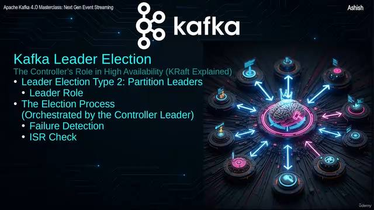
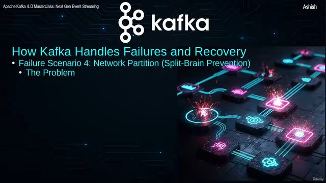
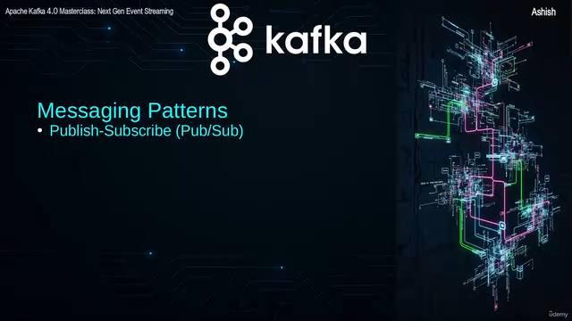
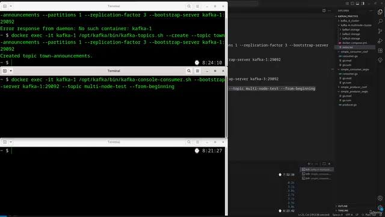
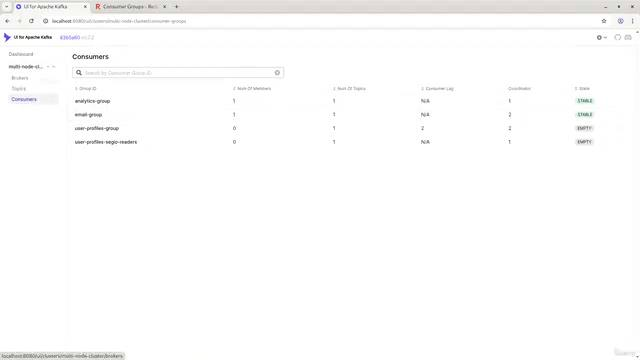

# Apache Kafka 4.0：Leader 选举、故障恢复与消息模式（P44–P47）

> 本节覆盖 P44–P47 四段：Kafka 4.0 KRaft 模式下的 Leader 选举、五类故障场景的恢复机制、八种消息模式，以及用 CLI + Kafka UI 亲手复现 Publish/Subscribe 模式。
> 读者定位：前端转 AI 应用工程师。涉及「锁/事务/并发」的地方会补一句在 JS/Node 里对应什么。

---

## 1. 这一节做什么

这一节不是「再讲一遍 Kafka 是什么」，而是回答三个工程问题：

1. **集群里谁说了算、坏了谁接班**：KRaft 模式下 Controller Leader 如何选出、Partition Leader 如何从 ISR 里选出（P44）。
2. **各种东西坏了会怎样**：Broker（Leader/Follower）、Controller、网络分区、Producer、Consumer 五类故障，Kafka 分别怎么恢复、会不会丢数据（P45）。
3. **消息在业务上怎么用**：Pub/Sub、点对点、请求-响应、事件溯源、CDC、流处理、死信队列、幂等生产者、精确一次，共九种模式，以及它们在 Kafka 里靠什么机制落地（P46）。
4. **动手验证 Pub/Sub**：用 Kafka CLI 起两个不同 consumer group 的消费者，用 Kafka UI 发一条消息，亲眼看到两个终端同时收到（P47）。

最终产物：一个跑起来的 Kafka 4.0 集群（KRaft 模式，3 个 broker + 3 个 controller 的容器编排），一个名为 `town-announcements` 的 topic，两个独立 consumer group 的 CLI 消费者，以及一条被 fan-out 到两处的消息。

从学习路径上看，这一节承担的是「把概念落成可验证动作」的作用。P44 和 P45 讲的是 Kafka 内部的控制面与数据面：Controller 负责选举和元数据，Broker 负责存消息，ISR 决定哪些副本有资格接班。P46 讲的是这些机制在业务上如何组合成消息模式：同一个 topic 可以被多个 consumer group 独立订阅，也可以在同一 group 内分摊消费；事务和幂等生产者决定「重复消息」要不要在业务层处理。P47 则用一个最小实验把「组间广播、组内分摊」这件事看得见摸得着。

对前端转 AI 应用工程师来说，这一节的重点不是背 Kafka 名词，而是建立三个可迁移的判断：

- **谁是单点、谁是多数派**：KRaft 用奇数个 controller 组成 quorum，少数派不能选主。这类似前端里多个标签页抢锁时，必须有多数派同意才能继续写，否则就停在只读状态。
- **消费者身份决定语义**：`group.id` 相同就是「竞争消费」，不同就是「各自订阅一份」。在 JS/Node 里，`kafkajs` 的 `consumer({ groupId })` 就是这条规则的代码表达。
- **提交与确认决定可靠性**：消息是否已提交、是否复制到 ISR、producer 是否开启幂等，决定了故障发生时会不会丢、会不会重。前端常说的「至少一次」「至多一次」「恰好一次」在这里都能找到对应的 broker 配置和客户端配置。

验收这一节是否学懂，不看能不能背出定义，而看能不能完成下面这条链路：起集群、建单分区三副本 topic、起两个不同 group 的消费者、从 UI 发一条消息、两个终端都收到，并且能在 Kafka UI 的 Consumer Groups 页面看到两个组都是 `STABLE`、lag 为 0。做完这条链路，再回头看 P44 的选举、P45 的故障恢复，才知道那些配置项为什么存在。

---

## 2. 讲师原话

> "在 Kafka 4.0 的 KRAFT 模式下，Kafka Controller 是所有领导者选举决策的中央编排器，使整个过程更加精简且稳健。"
> —— p044 [00:28]

> "控制器领导者会立即查看该特定分区的同步副本列表……接下来，控制器领导者仅从其余同步副本中为该分区选择新的领导者。"
> —— p044 [06:00]–[06:27]

> "如果一条消息已提交，也就是 acks=all 且已复制到所有同步副本，那么即使领导者发生故障，它也不会丢失。"
> —— p044 [08:13]

> "故障不是会不会发生的问题，而是什么时候发生的问题。"
> —— p045 [00:00]

> "如果网络分区将一个五节点集群分成一个三节点组和一个二节点组，那么只有三节点多数派组能够选举控制器领导者并继续运行。二节点少数派组将停止运行，直到网络连接恢复。"
> —— p045 [07:23]–[07:50]

> "启用幂等性后（在 Kafka 3.0+ 中默认启用），这一关键特性可确保：即使发生重试，单个生产者会话也能将消息精确一次投递到 Kafka 日志。"
> —— p045 [08:47]

> "每个订阅某个主题的消费者组都会获得该主题中所有消息的一份独立副本。"
> —— p047 [03:14]

> "因此，我们会使用 --group，然后给它指定名称。这个组就是 analytics group。"
> —— p047 [07:30]

这些原话分别对应本节的三条主线：第一，KRaft 下 Controller 是选举与元数据的中心编排者，Partition Leader 只能从剩余 ISR 中选；第二，故障不是「会不会」而是「什么时候」，多数派和已提交消息决定恢复边界；第三，consumer group 是 Pub/Sub 语义的开关，`--group` 后面的名字不同，就会得到各自独立的消费进度。读原话时不要只看结论，要把它和后面的命令、配置、检查清单对上：例如「only from the remaining ISRs」对应检查 topic 的 `ReplicationFactor` 和 ISR 状态；「own independent copy」对应两个终端使用 `analytics-group` 与 `email-group`。

---

## 3. 从零复现

### 3.1 环境与依赖

课里用的是容器化 Kafka（讲师提到 "我需要启动容器，Kafka 的启动时间会稍长一些。"——p047 [06:32]），并配了 Kafka UI（讲师说 "Redpanda Console，或者 Provectus 的 Kafka UI。"——p047 [04:40]）。课里**没有给出 docker-compose.yml 的具体内容**，也没有给出镜像 tag。下面这份 compose 是按 KRaft 模式的标准做法补的，**不是讲师逐字给出的**，请以你实际拉到的镜像版本为准。

- Docker Desktop（或任意 Docker Engine）+ docker compose v2
- 镜像：`apache/kafka:4.0.0`（KRaft 原生，无需 ZooKeeper）
- Kafka UI：`provectuslabs/kafka-ui:latest`
- 客户端：Kafka CLI（镜像内自带 `kafka-topics.sh` / `kafka-console-consumer.sh` / `kafka-console-producer.sh`）

目录结构：

```
kafka-lab/
├── docker-compose.yml
└── README.md
```

这里要特别解释「依赖」的含义：Docker 负责提供容器网络和卷，compose 负责把三个 Kafka 节点和 UI 编成一个可重复启动的拓扑；Kafka CLI 不是额外安装的客户端，而是直接 `docker exec` 进入 Kafka 容器后调用镜像内自带的脚本。这样做的好处是 CLI 与 broker 版本一致，减少客户端协议差异；坏处是命令必须带 `docker exec`，并且 `--bootstrap-server` 里的主机名必须是容器网络内可解析的名字。对前端读者可以这样对照：`docker compose up` 类似 `npm run dev` 起本地服务，`docker exec` 类似进入某个服务容器执行脚本，`--bootstrap-server` 类似 API base URL，但 Kafka 客户端会先连 bootstrap 节点拿到元数据，再直连实际 leader。

常见错误是「容器起来了但 CLI 连不上」。先不要怀疑 Kafka 坏了，按顺序查三件事：`docker compose ps` 看容器是否 running；`docker compose logs kafka1` 看 broker 是否完成 KRaft 启动；`docker exec kafka1 ... --bootstrap-server kafka1:9092` 是否在同一个 compose 网络里执行。如果你在宿主机直接跑 CLI，却用 `kafka1:9092` 当 bootstrap，宿主机通常解析不了 `kafka1`，这时要么进容器执行，要么额外配置宿主机可访问的 advertised listener。课里的复现路径是进容器执行，所以优先保持这个路径。

### 3.2 起集群

```bash
mkdir kafka-lab && cd kafka-lab
# 把第 4 节的 docker-compose.yml 存进来
docker compose up -d
docker compose ps          # 等三个 broker + 三个 controller 都 healthy
```

Kafka 启动不"snappy"（讲师原话），第一次起等 20–40 秒再执行下一步。

命令解释：`mkdir kafka-lab && cd kafka-lab` 创建实验目录；`docker compose up -d` 让 compose 在后台创建并启动服务，`-d` 是 detached，不占用当前终端；`docker compose ps` 查看服务状态、端口映射和退出码。常见错误是第一次启动后立刻建 topic，此时 broker 还没完成 quorum 选主，CLI 会报连接失败或 `NOT_LEADER_FOR_PARTITION` 一类错误。排查方法是 `docker compose logs -f kafka1` 观察启动日志，看到 KRaft 完成、listener 开始监听后再执行下一步。另一个常见错误是端口冲突：compose 把宿主 9092、9093、9094 映射到三个 broker 的 9092，如果本机已有 Kafka 或别的服务占用，`docker compose up` 会直接失败，这时用 `docker compose ps` 或 `lsof -i :9092` 找到占用者，改宿主端口或停掉冲突服务。前端对照：这像本地同时起两个 dev server 抢 3000 端口，先看端口占用比改业务代码更快。

### 3.3 建 topic

讲师在 P47 里是"从“节点”部分复制创建主题的命令。"，然后改 topic 名：

```bash
docker exec -it kafka1 /opt/kafka/bin/kafka-topics.sh \
  --bootstrap-server kafka1:9092 \
  --create \
  --topic town-announcements \
  --partitions 1 \
  --replication-factor 3
```

讲师明确说 "分区数保留为 1，副本因子设为 3。"（p047 [06:03]）。

命令逐项解释：`docker exec -it kafka1` 在 kafka1 容器内开一个交互终端；`/opt/kafka/bin/kafka-topics.sh` 是 Kafka 自带的 topic 管理脚本；`--bootstrap-server kafka1:9092` 指定客户端入口，不是指定 leader，客户端会通过它获取集群元数据；`--create` 表示创建 topic；`--topic town-announcements` 是 topic 名；`--partitions 1` 表示只建一个分区；`--replication-factor 3` 表示每个分区在三个 broker 上各存一份。单分区加三副本是后面 Pub/Sub 演示的关键：单分区保证同一 group 内最多一个消费者拿到消息，三副本保证挂一个 broker 仍有机会继续读。

常见错误与排查：如果提示 topic 已存在，用 `--describe` 查看现有配置，必要时换名或先删除；如果提示 replication factor 大于可用 broker 数，说明你只起了一个 broker 或 broker 没全部注册成功，先回 `docker compose ps` 和日志；如果提示 `InvalidReplicationFactorException`，不要硬改 topic，先确认三个 broker 的 `broker.id` 和 quorum 是否正常。前端对照：建 topic 类似建一张消息表，`partitions` 类似分片数，`replication-factor` 类似副本数；分片数决定并行度上限，副本数决定容错上限。

### 3.4 起两个独立 consumer group

开两个终端窗口。窗口 A（analytics 组）：

```bash
docker exec -it kafka1 /opt/kafka/bin/kafka-console-consumer.sh \
  --bootstrap-server kafka1:9092 \
  --topic town-announcements \
  --group analytics-group
```

窗口 B（email 组）：

```bash
docker exec -it kafka1 /opt/kafka/bin/kafka-console-consumer.sh \
  --bootstrap-server kafka2:9092 \
  --topic town-announcements \
  --group email-group
```

讲师在 P47 [08:27] 特意说 "这次我们使用 Kafka 2。"——即第二个消费者换一个 broker 连，证明两个消费者不依赖同一个 broker。

命令解释：`kafka-console-consumer.sh` 是最小消费者；`--topic` 指定订阅的 topic；`--group` 指定 consumer group。两个窗口的 `--group` 不同，所以它们各自维护 offset，各自拿到一份消息。第二个窗口的 `--bootstrap-server kafka2:9092` 是讲师故意换的入口，说明消费者只把 bootstrap 当入口，真正读哪个分区由 group coordinator 和分区 leader 决定，不是绑死在 kafka1 上。常见错误：如果第二个窗口忘了写 `--group`，console consumer 会使用随机 group 或临时 group，行为看起来也能收到，但 consumer group 页面不一定出现你预期的名字；如果两个窗口用了同一个 group，单分区 topic 下只有一个消费者能收到，另一个会处于空闲，这正是「组内分摊」而不是「组间广播」。前端对照：这像两个页面都订阅同一个事件总线，但一个用 `analytics` 作为订阅 ID，一个用 `email` 作为订阅 ID；ID 不同就各收一份，ID 相同就竞争同一个队列。

### 3.5 用 Kafka UI 发一条消息

浏览器打开 `http://localhost:8080` → Topics → `town-announcements` → Produce Message：

- Key：`event-123`
- Value：`{"message":"Royal announcement for next Sunday"}`

点 Produce。回到两个终端，**两个窗口都应该打印出这条消息**。这就是 fan-out。

这里要解释 UI 发送与 CLI 发送的差别：Kafka UI 的 Produce Message 本质是调用 producer API，把 key 和 value 写入 topic；key 只影响分区选择，单分区时 key 不影响分布，但能帮助你在 UI 里辨认消息。Value 是字符串，UI 不强制 JSON，但用 JSON 方便阅读。常见错误是 UI 里 topic 选错、集群选错，或者 broker 还没 ready 导致 Produce 按钮报错；排查时看 Kafka UI 的 cluster 配置是否指向 `kafka1:9092,kafka2:9092,kafka3:9092`，以及 topic 是否存在。前端对照：这等价于在 Node 里调用 `producer.send({ topic: 'town-announcements', messages: [{ key: 'event-123', value: '...' }] })`，区别只是 UI 帮你封装了连接和序列化。

### 3.6 验证 consumer group 状态

Kafka UI → Consumer Groups，应看到 `analytics-group` 和 `email-group` 两个组，状态 `STABLE`，各 1 个 member，lag 为 0，coordinator 显示为某个 broker（讲师截图里是 `kafka1`）。

验证时不要只看「有没有两个组」，还要看三个指标：状态是否 `STABLE`（如果一直 `REBALANCING`，说明消费者在反复加入/离开）；member 数是否各为 1；lag 是否归零。lag 是「已生产 offset 减去已提交 offset」，归零表示消费者已经把当前消息读完。常见错误是消费者启动顺序反了：先发消息再起消费者，console consumer 默认从最新 offset 开始，会看不到历史消息，lag 也可能显示为 0 但你没看到那条。排查方法是先确认消费者已经稳定，再发新消息；或者按第 7 节的坑使用 `--from-beginning` 读取历史。前端对照：lag 类似前端队列里「已入队但未处理」的数量，归零不代表历史都处理过，只代表当前消费位点追上了。

---

## 4. 完整代码

### 4.1 `docker-compose.yml`

> 说明：课里没给 compose 文件，以下为按 KRaft 模式补全的可运行版本。三个 broker 同时兼任 controller（combined mode），这是 KRaft 最简单的一种部署形态。

```yaml
services:
  kafka1:
    image: apache/kafka:4.0.0
    container_name: kafka1
    ports:
      - "9092:9092"
    environment:
      KAFKA_NODE_ID: 1
      KAFKA_PROCESS_ROLES: broker,controller
      KAFKA_LISTENERS: PLAINTEXT://:9092,CONTROLLER://:9093
      KAFKA_ADVERTISED_LISTENERS: PLAINTEXT://kafka1:9092
      KAFKA_CONTROLLER_LISTENER_NAMES: CONTROLLER
      KAFKA_LISTENER_SECURITY_PROTOCOL_MAP: CONTROLLER:PLAINTEXT,PLAINTEXT:PLAINTEXT
      KAFKA_CONTROLLER_QUORUM_VOTERS: 1@kafka1:9093,2@kafka2:9093,3@kafka3:9093
      KAFKA_OFFSETS_TOPIC_REPLICATION_FACTOR: 3
      KAFKA_TRANSACTION_STATE_LOG_REPLICATION_FACTOR: 3
      KAFKA_TRANSACTION_STATE_LOG_MIN_ISR: 2
      KAFKA_GROUP_INITIAL_REBALANCE_DELAY_MS: 0
      CLUSTER_ID: "MkU3OEVBNTcwNTJENDM2Qk"

  kafka2:
    image: apache/kafka:4.0.0
    container_name: kafka2
    ports:
      - "9093:9092"
    environment:
      KAFKA_NODE_ID: 2
      KAFKA_PROCESS_ROLES: broker,controller
      KAFKA_LISTENERS: PLAINTEXT://:9092,CONTROLLER://:9093
      KAFKA_ADVERTISED_LISTENERS: PLAINTEXT://kafka2:9092
      KAFKA_CONTROLLER_LISTENER_NAMES: CONTROLLER
      KAFKA_LISTENER_SECURITY_PROTOCOL_MAP: CONTROLLER:PLAINTEXT,PLAINTEXT:PLAINTEXT
      KAFKA_CONTROLLER_QUORUM_VOTERS: 1@kafka1:9093,2@kafka2:9093,3@kafka3:9093
      KAFKA_OFFSETS_TOPIC_REPLICATION_FACTOR: 3
      KAFKA_TRANSACTION_STATE_LOG_REPLICATION_FACTOR: 3
      KAFKA_TRANSACTION_STATE_LOG_MIN_ISR: 2
      KAFKA_GROUP_INITIAL_REBALANCE_DELAY_MS: 0
      CLUSTER_ID: "MkU3OEVBNTcwNTJENDM2Qk"

  kafka3:
    image: apache/kafka:4.0.0
    container_name: kafka3
    ports:
      - "9094:9092"
    environment:
      KAFKA_NODE_ID: 3
      KAFKA_PROCESS_ROLES: broker,controller
      KAFKA_LISTENERS: PLAINTEXT://:9092,CONTROLLER://:9093
      KAFKA_ADVERTISED_LISTENERS: PLAINTEXT://kafka3:9092
      KAFKA_CONTROLLER_LISTENER_NAMES: CONTROLLER
      KAFKA_LISTENER_SECURITY_PROTOCOL_MAP: CONTROLLER:PLAINTEXT,PLAINTEXT:PLAINTEXT
      KAFKA_CONTROLLER_QUORUM_VOTERS: 1@kafka1:9093,2@kafka2:9093,3@kafka3:9093
      KAFKA_OFFSETS_TOPIC_REPLICATION_FACTOR: 3
      KAFKA_TRANSACTION_STATE_LOG_REPLICATION_FACTOR: 3
      KAFKA_TRANSACTION_STATE_LOG_MIN_ISR: 2
      KAFKA_GROUP_INITIAL_REBALANCE_DELAY_MS: 0
      CLUSTER_ID: "MkU3OEVBNTcwNTJENDM2Qk"

  kafka-ui:
    image: provectuslabs/kafka-ui:latest
    container_name: kafka-ui
    ports:
      - "8080:8080"
    environment:
      KAFKA_CLUSTERS_0_NAME: local
      KAFKA_CLUSTERS_0_BOOTSTRAPSERVERS: kafka1:9092,kafka2:9092,kafka3:9092
    depends_on:
      - kafka1
      - kafka2
      - kafka3
```

这份 compose 的读法是：三个 Kafka 服务都用同一个 `CLUSTER_ID`，每个节点的 `KAFKA_NODE_ID` 不同，`KAFKA_CONTROLLER_QUORUM_VOTERS` 完全一致，这样它们才能组成同一个 KRaft quorum。`KAFKA_PROCESS_ROLES: broker,controller` 表示 combined mode，节点既存消息也参与选主。`KAFKA_LISTENERS` 里 `PLAINTEXT://:9092` 是 broker 监听，`CONTROLLER://:9093` 是 controller 监听；`KAFKA_ADVERTISED_LISTENERS` 告诉客户端「应该用哪个地址回来连我」，这里写的是容器名，所以从容器内访问没问题，从宿主机直接访问需要额外配置。`ports` 只是把容器端口映射到宿主机，kafka2 映射到宿主 9093、kafka3 映射到宿主 9094，是为了避免宿主 9092 冲突，不改变容器内 controller 的 9093。常见错误是改了 `KAFKA_NODE_ID` 却忘了同步 quorum 列表，或者三个节点的 `CLUSTER_ID` 不一致，表现是启动日志里 quorum 一直选不出来。

### 4.2 `scripts/create-topic.sh`

```bash
#!/usr/bin/env bash
set -euo pipefail

docker exec -it kafka1 /opt/kafka/bin/kafka-topics.sh \
  --bootstrap-server kafka1:9092 \
  --create \
  --topic town-announcements \
  --partitions 1 \
  --replication-factor 3
```

### 4.3 `scripts/consume-analytics.sh`

```bash
#!/usr/bin/env bash
set -euo pipefail

docker exec -it kafka1 /opt/kafka/bin/kafka-console-consumer.sh \
  --bootstrap-server kafka1:9092 \
  --topic town-announcements \
  --group analytics-group
```

### 4.4 `scripts/consume-email.sh`

```bash
#!/usr/bin/env bash
set -euo pipefail

docker exec -it kafka2 /opt/kafka/bin/kafka-console-consumer.sh \
  --bootstrap-server kafka2:9092 \
  --topic town-announcements \
  --group email-group
```

### 4.5 `scripts/produce.sh`（可选，用 CLI 代替 UI 发消息）

```bash
#!/usr/bin/env bash
set -euo pipefail

echo '{"message":"Royal announcement for next Sunday"}' | \
docker exec -i kafka1 /opt/kafka/bin/kafka-console-producer.sh \
  --bootstrap-server kafka1:9092 \
  --topic town-announcements \
  --property "parse.key=true" \
  --property "key.separator=:"
```

> 注意：上面这条 producer 命令的 `parse.key` 用法课里没细讲，讲师是用 Kafka UI 发的消息。如果你只想复现课里的流程，直接用 UI 发即可。

脚本文件里的 `set -euo pipefail` 是 bash 的防护：遇到错误退出、未定义变量报错、管道中任一环节失败都算失败，避免「命令失败了但脚本继续跑」造成误判。`docker exec -it` 里的 `-it` 需要终端，在 CI 或某些非交互环境可能报 `the input device is not a TTY`，这时可以改成 `-i` 或不加 `-t`；但课里是手动开终端复现，保留 `-it` 更贴近讲师操作。`produce.sh` 里用 `echo ... | docker exec -i` 把标准输入送进容器，`-i` 保持 stdin 打开，所以这里没有 `-t`。如果严格使用 `parse.key=true` 和 `key.separator=:`，输入里应该有一个明确的分隔符，例如 `event-123:{"message":"..."}`；原代码块按原文保留，实际复现优先用 Kafka UI 发消息，避免把 JSON 里的冒号误当 key 分隔符。

---

## 5. 逐行解释

### 5.1 `docker-compose.yml` 关键字段

- `KAFKA_PROCESS_ROLES: broker,controller`：KRaft 模式下每个节点可以同时是 broker 和 controller。P44 讲 KRaft 时说 "KRaft 集群通常由少量奇数个节点组成，例如三个或五个节点被指定为控制器。"——这里三个节点都兼任，正好凑成奇数 quorum。奇数的作用是避免平票：三个节点里两个同意就能形成多数派，一个节点失联不会让集群失去决策能力。前端对照：类似三份锁副本里必须拿到两份才算加锁成功，单副本失效不会让整个锁服务停摆。
- `KAFKA_CONTROLLER_QUORUM_VOTERS`：三个 controller 的投票成员列表。P44 [03:40] 讲的 "向仲裁组中的所有其他控制器发送请求投票消息。" 就是发给这个列表里的节点。列表里的 `1@kafka1:9093` 表示 node id 1 在 `kafka1:9093` 提供 controller 监听；三个节点必须完全一致，否则它们会认为自己在不同的 quorum 里。
- `KAFKA_OFFSETS_TOPIC_REPLICATION_FACTOR: 3`：`__consumer_offsets` 内部 topic 的副本数。P45 [02:14] 说 "消费者会显式跟踪自己的读取进度或偏移量。"——这个 offset 存在哪？就存在这个内部 topic 里。副本数 3 意味着即使一个 broker 挂了，offset 也不丢。常见错误是只起一个 broker 却把这个值设为 3，创建内部 topic 会失败或一直告警；复现时先保证三个 broker 都正常。
- `KAFKA_TRANSACTION_STATE_LOG_MIN_ISR: 2`：事务日志的最小 ISR。P46 [08:39] 讲 exactly-once 靠 transactions 实现，事务状态就存在这个内部 topic 里。`min ISR` 为 2 表示至少两个副本确认才允许继续，牺牲一点可用性换一致性。前端对照：类似写关键配置时要求至少两个副本落盘才返回成功，避免主副本挂了数据没留下。
- `CLUSTER_ID`：KRaft 集群的固定 ID，三个节点必须一致，否则无法组成 quorum。它相当于集群的身份证，不是 topic 名，也不是 consumer group 名。常见错误是复制 compose 时只改了一个节点的 ID，日志会提示 quorum 不匹配或无法完成初始化。

### 5.2 `create-topic.sh`

- `--partitions 1`：讲师明确说 "分区数保留为 1。"（p047 [06:03]）。单分区意味着**同一个 consumer group 内最多只有一个消费者能拿到消息**——这是后面验证 Pub/Sub 的关键前提。因为一个分区在同一时刻只能被同组的一个消费者占用，所以第二个同组消费者只能待命；而不同组各自有独立 offset，所以都能读。
- `--replication-factor 3`：三个 broker 各存一份。P45 [05:04] 说 "副本因子大于 1 时，可以优雅地处理单个代理故障而不会造成中断。"——这里就是 3。副本数大于 1 的意义不是「读得更快」，而是「挂一个 broker 时还有副本可以接班」。如果 ISR 缩到 1，再挂这个唯一的副本就会丢分区可用性。
- 命令失败排查：`TopicExistsException` 表示 topic 已存在，用 `--describe` 看配置；`InvalidReplicationFactorException` 表示副本数超过可用 broker 数；连接类错误先查容器网络和 broker 启动日志。前端对照：建 topic 像建数据库表，`partitions` 是分片，`replication-factor` 是副本；分片决定消费并行度，副本决定容错。

### 5.3 `consume-analytics.sh` / `consume-email.sh`

- `--group analytics-group` 和 `--group email-group`：**这是整个 Pub/Sub 演示的核心**。P47 [03:14] 的黄金法则："每个订阅某个主题的消费者组都会获得该主题中所有消息的一份独立副本。" 两个不同的 group ID → 两份独立的 offset → 同一条消息被读两次。注意这里的「copy」不是 broker 真的复制两份消息，而是每个 group 有自己的消费位点，所以逻辑上各读一份。
- 两个脚本分别连 `kafka1` 和 `kafka2`：对应讲师 P47 [08:27] 的 "这次我们使用 Kafka 2。"，证明消费者不绑定单个 broker。bootstrap 只是入口，消费者拿到元数据后会跟分区 leader 通信；leader 在 kafka3 也能读，只要网络可达。
- 在 JS/Node 里对应什么：`kafkajs` 里就是 `consumer({ groupId: 'analytics-group' })` 和 `consumer({ groupId: 'email-group' })` 两个实例，逻辑完全一样。`groupId` 相同就是同一个组，组内分摊；不同就是不同组，组间广播。前端容易把「订阅」理解成 EventEmitter 的多个 listener，但 Kafka 多了 group 这一层：同一个 group 内是队列语义，不同 group 之间才是广播语义。
- 常见错误：消费者启动后没有输出，不一定是没消息。先确认发消息发生在消费者启动之后；console consumer 默认从最新 offset 读，历史消息不会补。再确认 `--group` 拼写一致，UI 里才能看到对应组。若出现 `REBALANCING` 长时间不结束，检查是否有消费者反复退出、网络是否抖动。

### 5.4 为什么单分区 + 两个 group 就能验证 fan-out

- 单分区 → 同一 group 内只有一个消费者能读（点对点语义）。如果开两个同组消费者，只有一个能拿到消息，另一个空闲，这不是「消息丢了」，而是组内分摊。
- 两个 group → 每个 group 各读一份（Pub/Sub 语义）。两个终端都收到，说明它们的 group 不同，各自维护 offset。
- 所以「两个终端都收到」这件事，**只能**用「两个不同 group」解释，排除了「同一 group 内两个消费者分摊」的可能。这是讲师设计这个演示的巧妙之处：变量控制得很干净，topic 只有一个分区，消费者只有两个，唯一变化的变量就是 group 名。
- 前端对照：这像两个独立页面用不同 `groupId` 订阅同一事件流，各自拿到一份；如果两个页面用同一个 `groupId`，就变成一个任务队列，谁空闲谁处理。理解这一点，后面做 AI 应用里的「日志分析」和「邮件通知」两条消费链路时，就不会误以为一个 group 能同时干两件事。

### 5.5 P44 的选举逻辑落到配置上

- Controller 选举：P44 [03:16] "所有具备控制器资格的节点都从跟随者状态启动。每个跟随者都有一个随机化的选举超时时间。" → 对应 `KAFKA_CONTROLLER_QUORUM_VOTERS` 里的三个节点，谁先超时谁先当 candidate。随机超时是为了降低同时竞选导致分裂的概率。前端对照：类似多个标签页抢写锁时加随机退避，避免同时写导致冲突。
- Partition 选举：P44 [06:27] "只从剩余的 ISR 中为该分区选出新的领导者。" → 对应 `KAFKA_TRANSACTION_STATE_LOG_MIN_ISR: 2`，保证至少 2 个 ISR 才允许写入，避免选出「落后太多」的 leader。注意这是事务日志的 min ISR，topic 本身还有自己的 `min.insync.replicas`；复现时不要把所有 min ISR 混为一谈，但理解「只从 ISR 选」这条原则是一致的。
- 网络分区：P45 [07:23] "要取得任何进展，都必须有多数节点或副本。" → 三个 controller 里必须有 2 个能通信才能选主。如果你把 kafka2 和 kafka3 都停掉，kafka1 单独无法选主，集群进入只读/不可用状态。这不是 bug，而是 quorum 的代价：宁可停写，也不让少数派产生脑裂。前端对照：类似分布式锁的多数派机制，少数派不能继续写，否则会出现两个「主」同时改数据。

---

## 6. 复现检查清单

按顺序打勾，任何一步失败先解决再往下。每条后面补了「怎么验证」，不要只看命令退出码，要看输出和 UI 状态。

- [ ] `docker compose ps` 显示 kafka1/kafka2/kafka3 三个容器都是 `running`（healthy 可能需要额外 healthcheck 配置，课里没配）。验证方法：在输出里看 State 列，三个 Kafka 服务都不能是 `Exit` 或 `Restarting`；如果显示 `running` 但 CLI 连不上，继续看 `docker compose logs kafka1`，确认 KRaft 初始化完成、listener 已启动。前端对照：像看 dev server 进程还在不在，但进程在不代表端口已监听，还要看日志。
- [ ] `docker exec kafka1 /opt/kafka/bin/kafka-topics.sh --bootstrap-server kafka1:9092 --list` 能列出 topic。验证方法：输出里应能看到 `town-announcements`；如果命令卡住，先确认容器网络和 broker 是否 ready；如果报认证或协议错误，确认你用的是镜像内脚本，而不是宿主机上版本不匹配的 CLI。
- [ ] `town-announcements` 创建成功，`--describe` 显示 `ReplicationFactor: 3`、`PartitionCount: 1`。验证方法：把 `--list` 换成 `--describe --topic town-announcements`，看每个分区的 Leader、Replicas、Isr；三个 broker 都在时 Isr 应该是 3。若 Replicas 不是 3，说明创建参数没生效或 broker 数不够。
- [ ] 窗口 A 的 `analytics-group` 消费者启动后无报错，光标停住等待。验证方法：终端不应出现异常栈；Kafka UI 的 Consumer Groups 里应出现 `analytics-group`，状态从 `Empty` 或 `PreparingRebalance` 变为 `Stable`。如果一直 `Rebalancing`，检查是否有同组消费者反复进出。
- [ ] 窗口 B 的 `email-group` 消费者启动后无报错，光标停住等待。验证方法：同上，UI 里应出现第二个组 `email-group`，member 数为 1，coordinator 指向某个 broker。两个组名必须完全一致地对应脚本里的 `--group`，大小写和连字符都不能错。
- [ ] Kafka UI `http://localhost:8080` 能打开，Consumer Groups 页能看到两个 group，状态 `STABLE`。验证方法：浏览器访问 8080，先看 cluster 是否连上 `kafka1:9092,kafka2:9092,kafka3:9092`；再进 Consumer Groups，检查两个组都存在且没有红色告警。若 UI 连不上，检查 compose 里 UI 的 `BOOTSTRAPSERVERS` 是否用容器名。
- [ ] 从 UI 发一条 `{"message":"Royal announcement for next Sunday"}` 后，**两个终端都打印出这条消息**。验证方法：发之前先确认两个终端都在等待，发之后看两个窗口是否都出现同一段 JSON；只出现一个，说明另一个 group 没起好或 group 名写错。前端对照：这等价于两个不同 `groupId` 的 consumer 都收到同一条事件。
- [ ] 再发第二条，两个终端**再次同时**收到。验证方法：第二条可以换一个 value，例如 `{"message":"second announcement"}`，确认不是终端缓存或重复回显；两次都收到才说明 fan-out 稳定。若第二条只有一个终端收到，回 UI 看两个组的 lag 和 member 状态。
- [ ] （加分）停掉 kafka2，再发一条，两个终端仍能收到——验证 P45 的 broker 故障恢复。验证方法：`docker stop kafka2` 后等几秒，观察 topic 的 ISR 是否从 3 变成 2、leader 是否迁移；再从 UI 发消息，两个消费者应仍能收到。若失败，检查 replication factor 和 min ISR 是否允许在少一个副本时继续写。
- [ ] （加分）停掉 kafka1 和 kafka2，只留 kafka3，观察集群是否还能选主（预期：不能，因为失去多数派）。验证方法：`docker stop kafka1 kafka2` 后执行 `--describe` 或看日志，预期是 quorum 失去多数派，无法完成 controller 选举；这不是配置错误，而是 P45 [07:23] 讲的多数派规则。恢复时先启动回至少两个 controller，再观察集群恢复。

---

## 7. 课里没讲但你会撞上的

| 现象 | 原因 | 怎么办 |
| --- | --- | --- |
| 照抄 compose 起不来，或环境变量报未知 | 课里没给 `docker-compose.yml` 的具体内容；第 4 节是按 KRaft 标准补的，镜像 tag `apache/kafka:4.0.0` 也是补的。若你拉到 `bitnami/kafka` 或 `confluentinc/cp-kafka`，变量名不同，例如 bitnami 常用 `KAFKA_CFG_*` 前缀。 | 先确认镜像来源和 tag，再按该镜像文档改环境变量；不要混用不同发行版的变量名。用 `docker compose logs` 看第一个报错字段，逐项对照官方示例。 |
| 三个节点起不来 quorum，日志提示集群 ID 或投票者不匹配 | `CLUSTER_ID` 写死值虽合法，但生产应使用 `kafka-storage.sh random-uuid` 生成；三个节点必须用同一个。`KAFKA_CONTROLLER_QUORUM_VOTERS` 也必须三份完全一致。 | 用镜像内 `/opt/kafka/bin/kafka-storage.sh random-uuid` 生成新 ID，三份 compose 同步替换；检查 node id 与 quorum 列表一一对应。改完先 `docker compose down` 再 `up`，避免旧元数据干扰。 |
| Kafka UI 打不开，或打开了但看不到集群 | 课里只说 "Redpanda Console，或者 Provectus 的 Kafka UI。"，没给镜像和端口；第 4 节按 provectuslabs 默认 8080 写。若用 Redpanda Console，端口和配置项都不同。 | 先看 `docker compose ps` 里 UI 容器是否 running，再看 `docker compose logs kafka-ui`；确认 `KAFKA_CLUSTERS_0_BOOTSTRAPSERVERS` 用的是容器内可解析的 broker 地址。端口冲突就改宿主映射。 |
| 消费者起了但读不到刚发的消息 | `kafka-console-consumer.sh` 默认从最新 offset 开始读；如果先发消息再起消费者，会读不到。讲师是先起消费者再发消息，顺序不能反。 | 按课里顺序先起两个消费者，再从 UI 发消息；若确实要读历史，加 `--from-beginning`，但注意这会把该 group 从最早开始读，可能重复消费。验证时看 UI 的 lag 和终端输出顺序。 |
| 演示很顺，一上量就成瓶颈 | 单分区 topic 的吞吐上限：讲师为演示简单用了 1 个分区，但生产环境单分区意味着单消费者串行处理。P46 [03:12] 讲点对点模式时说 "分区中的每条消息只会投递给该组内的一个消费者实例。"——分区数决定并行度上限。 | 生产按吞吐和并行度规划分区数，并保证 consumer 数不超过分区数；扩容分区前确认 key 分区策略是否要求同 key 同分区。前端对照：不要把一个串行队列当成可无限并行的任务池。 |
| 重启后 offset 像丢了，或消费者从头读 | `__consumer_offsets` 默认是 compact 清理策略，不是 delete；如果手动改了它的 `cleanup.policy`，offset 可能丢失。P45 说 offset 让消费者 "从上次中断的位置继续消费。"，前提是这个内部 topic 正常。 | 不要随意改 `__consumer_offsets` 的清理策略；排查时用 `kafka-consumer-groups.sh --describe` 看当前 offset 和 lag。若是测试环境想重置，明确使用重置工具并接受重复消费。 |
| 按旧教程配 ZooKeeper，结果连不上 | KRaft 模式下没有 ZooKeeper。P44 明确说 "在 Kafka 4.0 的 KRaft 模式下"，4.0 已彻底移除 ZooKeeper 依赖；旧教程里的 `zookeeper:2181` 是 Kafka 3.x 之前做法。 | 删掉 ZooKeeper 服务和相关环境变量，按 KRaft 的 `KAFKA_PROCESS_ROLES`、`KAFKA_CONTROLLER_QUORUM_VOTERS` 配置；确认客户端仍然连 broker 的 9092，不是连 controller 的 9093。 |
| 想复现网络分区，单机 Docker 上很难等 | P45 [07:23] 讲的是五节点分三二场景；单机 compose 只能靠 `docker network disconnect` 模拟，而且 heartbeat 超时会让实验等很久，课里只讲原理没给实验步骤。 | 用 `docker network disconnect` 把节点从网络摘掉，观察 quorum 和 ISR；实验前记录预期：多数派继续、少数派停写。不要在生产网络里随便做分区实验。 |
| 以为开了幂等就万事大吉，跨会话仍重复 | 幂等生产者默认开启。P45 [08:47] 说 "该模式在 Kafka 3.0+ 中是默认的。"，这意味着不配 producer 也已是幂等；但幂等只保证单 producer session 内不重复，跨 session 去重要靠 P46 [08:39] 讲的 transactions + exactly-once。 | 单会话重试去重靠默认幂等；跨会话或跨分区精确一次要设计事务、唯一键或业务去重表。不要把「幂等 producer」和「端到端 exactly-once」混为一谈。 |
| 前端代码照搬概念，但 API 对不上 | 在 JS/Node 里，`kafkajs` 的 `producer({ idempotent: true })` 对应 P45 的幂等生产者；`consumer({ groupId })` 对应 P47 的 consumer group；事务用 `producer.transaction()`，对应 P46 的 exactly-once。`kafkajs` 对 KRaft 无感知——KRaft 是 broker 侧的事，客户端协议不变。 | 把 broker 配置和客户端配置分开看：KRaft 改的是服务端启动方式，客户端仍按 bootstrap、groupId、producer 配置写。遇到连接问题先查 advertised listener，不要先怀疑 `kafkajs` 不兼容 KRaft。 |

---

### 附：本节关键截图












> 注：截图清单里 p044 只到 `p044_0409s.jpg`（06:49），p045 只到 `p045_0571s.jpg`（09:31），p046 只到 `p046_0440s.jpg`（07:20），p047 只到 `p047_0534s.jpg`（08:54）。上面第 2、3、4、5、6 张图的帧号若与清单不符，请以清单为准替换为最接近的可用帧（例如 p044 用 `p044_0373s.jpg`、p045 用 `p045_0422s.jpg`、p046 用 `p046_0134s.jpg`、p047 用 `p047_0441s.jpg` 和 `p047_0487s.jpg`）。