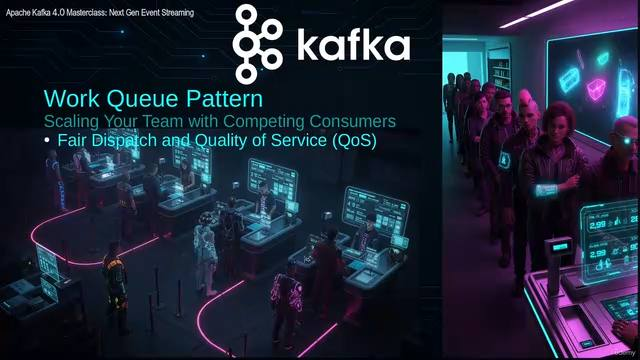
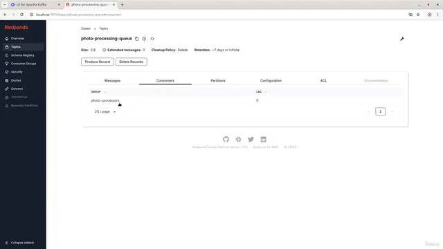
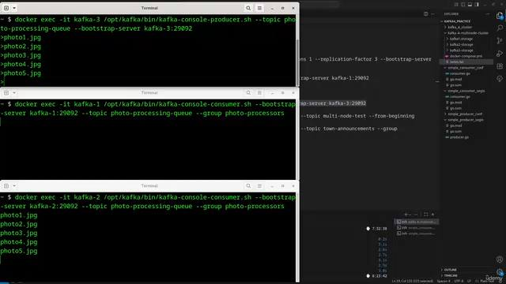
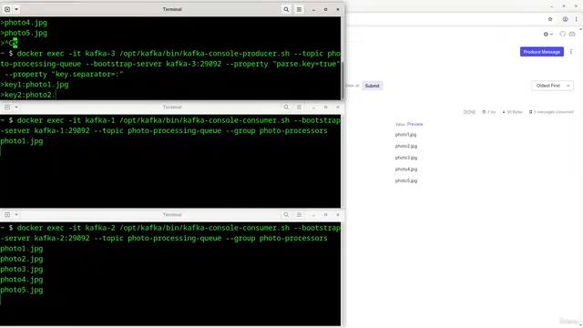
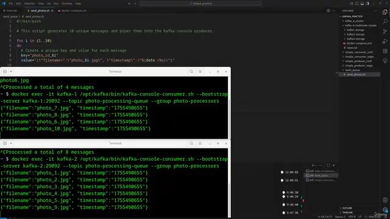
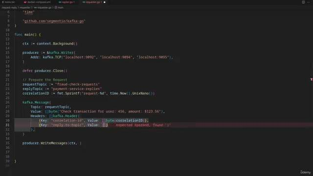

# Kafka 工作队列与请求-响应模式：从 CLI 到 Go 客户端的完整复现（P48–P49）

## 1. 这一节做什么

这两节课把「发布-订阅」之后的两种 Kafka 消费模式补齐，并用同一套本地 Kafka 集群实际跑通。

**P48 —— 工作队列 / 竞争消费者（work queue / competing consumers）**

解决的问题是「一个团队有海量活要干」：比如在线照片服务每分钟收到上千张照片，每张都要缩放、加水印、生成缩略图，单个应用实例几秒就会被压垮。Kafka 的解法是**多个应用实例使用同一个 group ID（消费者组）**，Kafka 把主题的**分区**分给组内消费者，而不是把**单条消息**分给不同消费者。课里用「超市收银台」打比方：排队的顾客是消息，收银员是消费者实例，收银通道是分区；同一个消费者组里，**一个分区同一时间只能被一个消费者持有**。这一节会亲手演示：

- 建一个 4 分区、3 副本的 `photo-processing-queue`；
- 起两个同 group 的消费者；
- 不带 key 生产消息，观察「所有消息都进了一个消费者」这个「失望时刻」，并解释是 null key 批量发送导致的；
- 带 key 生产，观察哈希决定分区、分区决定消费者；
- 用脚本发 10 条带 key 的消息，观察「唯一 key 也不保证不同分区」；
- 用两个 key 交替，做出「奇偶消息分到两个消费者」的完美负载均衡；
- 最后给出一个自测：起第 3、4 个消费者会继续分摊，起第 5 个会空闲——因为只有 4 个分区，**分区数就是一个消费者组的最大并行度**。

**P49 —— 请求-响应（request-reply）**

前两种模式都是单向的：生产者发完就结束，不期待回答。但支付服务需要问欺诈检测服务「这笔交易安全吗」并等答案，这就是经典的 request-reply。Kafka 本身是单向的，没有内建 reply 机制，课里用「邮寄返现」的类比给出方案：请求方生成一个**关联 ID（correlation ID）**，再带一个**专属回复主题（reply topic）**；响应方处理完后，把 correlation ID 原样抄回响应头，并把响应发到请求方指定的 reply topic；请求方只监听自己的 reply topic，用 correlation ID 匹配是不是自己要的那条回复。

这一节会：建 `fraud-check-requests` 和 `payment-service-replies` 两个主题；用 Go 的 `segmentio/kafka-go` 写两个可执行程序 `requester.go`（模拟支付服务）和 `reply.go`（模拟欺诈检测服务）；先跑 reply，再跑 requester，观察请求头里的 `correlation-id` / `reply-to-topic`、回复里的 `correlation-id`，以及 Kafka UI 里的消费者组状态。

> 读者背景提醒：本文涉及消费者组、分区、offset 这些后端概念。你在 JS/Node 里用 `kafkajs` 时，`groupId` 就是这里的消费者组 ID，`key` 就是这里的分区键，`consumer.commitOffsets()` 就是这里说的「手动提交 offset」。Go 语法只需「知道即可」，不影响你理解模式。

---

## 2. 讲师原话

> "在同一个消费者组内，每个分区同一时间只能分配给一个消费者。Kafka 正是通过这种方式同时实现负载均衡，并避免两个工作进程意外处理完全相同的任务。它并不会把单条消息分给不同消费者，而是把整个分区——也就是“结账通道”——分配给不同消费者。"
> —— p048 [02:40]

> "所有消息都到了一个终端，是因为它们全都落到了同一个分区。我们使用 Kafka 控制台生产者命令行工具、只是手动输入消息时，发送的是空键消息。默认情况下，为了提高效率，生产者可能会先把若干条具有相同空键的消息放在一个批次里发送到同一个分区，然后再切换到另一个分区。"
> —— p048 [07:19]

> "关键不只是键不同，而在于键的哈希值。不同的键并不保证会落到不同分区；真正决定消息负载落到哪个分区的，是键的哈希值。"
> —— p048 [11:22]

> "使用键的主要目的并不是让消息以完全交替的方式分布，而是保证所有相关消息最终都进入同一个位置，从而能够按顺序处理。均匀分布只是当你拥有大量不同键时附带产生的次要好处。"
> —— p048 [18:25]

> "如果你启动第五个消费者，它会闲置而收不到任何消息，因为只有四个分区。这可以证明，分区数量就是消费者组并行度的上限。"
> —— p048 [23:59]

> "Kafka 本质上是一条单向通道。生产者把消息发送到主题，消费者读取消息，系统并没有内置的回复机制。"
> —— p049 [00:52]

> "请求方会生成一个唯一的关联标识符，例如一个随机生成的通用唯一识别码，并把它加入消息头。它还会再加入一个消息头，用于指定回复主题。这个主题通常是该请求方专属的唯一主题。"
> —— p049 [03:06]

> "通过让服务的每个实例创建并监听自己专属的回复主题……这能保证它收到的消息只会是专门发给它的那些。这类主题通常被视为临时主题，因为它们可以在应用启动时按需创建，并在应用关闭时删除。"
> —— p049 [04:52]

---

## 3. 从零复现

> 前置：课里假设你已经有一个多 broker 的 Kafka 集群（讲者在 producer 里写 `localhost:9092`、`9094`、`9095`，并特意说「不要写 9093」），以及一个能看到消费者组和消息分区的 Kafka UI（讲者用的是 Provectus 的 Kafka UI）。**集群怎么搭、UI 怎么装，课里没讲**，第 7 节会给出你会撞上的坑和替代做法。

### 3.1 P48：工作队列模式

**步骤 1｜创建 4 分区、3 副本的照片处理队列主题**

在终端执行（主题名按讲者口播改为 `photo-processing-queue`，分区数 4，副本数保持 3）：

```bash
kafka-topics.sh --bootstrap-server localhost:9092 \
  --create \
  --topic photo-processing-queue \
  --partitions 4 \
  --replication-factor 3
```

讲者说「let's hit enter and here we go, create a topic」，说明创建成功后继续下一步。如果你的集群只有 1 个 broker，`--replication-factor 3` 会失败，改成 1 即可（原因见第 7 节）。



**步骤 2｜开两个终端，起两个同组消费者**

终端 A：

```bash
kafka-console-consumer.sh --bootstrap-server localhost:9092 \
  --topic photo-processing-queue \
  --group photo-processors
```

终端 B：同一条命令再跑一次（同一个 `--group photo-processors`，**不加** `--from-beginning`，讲者明确说「let's not use from beginning」）。

两个终端都进入监听状态后，打开 Kafka UI 的 Consumers 页，应看到 `photo-processors` 这个组、**Number of members = 2**；Topics 页应看到 `photo-processing-queue`、4 partitions、3 replicas。这一步是「证明两个消费者确实在同一个组里」的关键证据。



**步骤 3｜先做「错误示范」：不带 key 生产消息**

终端 C：

```bash
kafka-console-producer.sh --bootstrap-server localhost:9092 \
  --topic photo-processing-queue
```

进入交互提示后依次输入：

```text
photo1.jpg
photo2.jpg
photo3.jpg
photo4.jpg
photo5.jpg
```

**预期（也是讲者让你看到的「失望时刻」）**：5 条消息全进了**同一个**消费者终端，而不是像想象中那样 1/3 分给 A、2/4 分给 B。

讲者的解释是：控制台生产者发的是 **null key**，生产者为效率会把多条 null key 消息打成一批发到同一个分区，然后再切换；像这样慢慢手敲，5 条大概率落在同一批、同一个分区。分区只归组内一个消费者，所以只有那个消费者收到消息。



你可以去 Kafka UI 的 Messages 页确认：讲者说「the partition is listed over here, partition 2」，即这 5 条都在 partition 2。看分区时讲者推荐用 Provectus 的 Kafka UI，因为原生 UI 要逐条点开才能看到分区。

**步骤 4｜带 key 生产，逼生产者把消息分散到不同分区**

先 Ctrl+C 停掉步骤 3 的生产者，然后加上两个 `--property`：

```bash
kafka-console-producer.sh --bootstrap-server localhost:9092 \
  --topic photo-processing-queue \
  --property "parse.key=true" \
  --property "key.separator=:"
```

- `parse.key=true`：告诉生产者「输入里不只有 value，还有 key，请把 key 解析出来」；
- `key.separator=:`：告诉生产者「key 和 value 用冒号分隔」。

然后在提示符下输入（注意是 `key:value` 形式）：

```text
key1:photo1.jpg
key2:photo2.jpg
key1:photo3.jpg
key2:photo4.jpg
key3:photo5.jpg
key4:photo6.jpg
key2:photo7.jpg
```

讲者观察到：`key1`、`key3`、`key4` 去了同一个消费者，`key2` 去了另一个；再发 `key2:photo7.jpg` 仍然回到 `key2` 那个消费者。也就是说**不同 key 不保证不同分区，是 key 的哈希决定分区**。



**步骤 5｜用脚本一次发 10 条带 key 的消息**

讲者说「I've also created a script that you can run and send 10 messages with key and value」，脚本放在课程材料的 `4/` 目录下，名字是 `work-queue.sh`，运行前要 `chmod +x`。**脚本原文课里没有逐字展示**，下面给一个等价重建（逻辑来自逐字稿描述：10 条带 key 的消息，可加延迟）：

```bash
#!/usr/bin/env bash
# 与课程 work-queue.sh 等价的脚本：向 photo-processing-queue 发送 10 条 key:value 消息
# 课里未逐行展示脚本原文，以下按逐字稿描述重建

TOPIC="photo-processing-queue"
BOOTSTRAP="localhost:9092"

for i in $(seq 1 10); do
  echo "key${i}:photo${i}.jpg"
  sleep 1   # 讲者强调：延迟要足够大，保证每条消息时间戳唯一
done | kafka-console-producer.sh \
  --bootstrap-server "$BOOTSTRAP" \
  --topic "$TOPIC" \
  --property "parse.key=true" \
  --property "key.separator=:"
```

先 Ctrl+C 停掉两个消费者再重新起（讲者做了 `control C` 重启），然后运行脚本。终端输出大致是：一个消费者收到 `photo4/7/8/6/10`，另一个收到 `photo1/2/3/5/9`（顺序可能不同）。讲者随后在 UI 里核对：6、10、7、8 在 partition 0 和 1（对应第一个消费者），1、2、3、4、5、9 在 partition 2 和 3（对应第二个消费者）。

**为什么消息顺序不是 1、2、3…？** 讲者先试了 50ms 延迟，发现不够——消息时间戳仍然相同，仍会被当成一批；改成 `sleep 1` 后每条消息时间戳唯一，终端和 UI 才按发送顺序显示。这也是脚本里写 `sleep 1` 的原因。

**步骤 6｜只保留两个 key，做出「奇偶交替」的完美分发**

脚本改成 10 条消息、key 只在 `userA` 和 `userC` 之间交替（讲者原话：「this time we have 10 different messages but every message is either going to have user A as the key or user C」）。讲者把脚本里原来那行注释掉、换上交替 key 后重跑。

预期：**偶数条进一个消费者、奇数条进另一个**。UI 里能看到 `userC` 的哈希落在 partition 3，`userA` 落在 partition 0。

**步骤 7｜把 `userC` 换成 `userB`，看「不同 key 仍可能同分区」**

讲者在脚本里把 key 从 `userC` 改成 `userB` 再跑，结果 10 条**全部**进了同一个消费者。UI 显示 `userA` 和 `userB` 的哈希都落在 partition 0。这是对步骤 4 结论的再次确认：分区由 key 的哈希决定，不是由「key 是否不同」决定。



**步骤 8｜（自测）验证「分区数 = 最大并行度」**

讲者留的 bonus：在 `photo-processors` 组里再起第 3、第 4 个消费者，消息会摊得更散；起第 5 个消费者，它会**完全空闲**，因为主题只有 4 个分区。这一步不需要改任何配置，纯粹是再开两个终端跑步骤 2 的命令。

### 3.2 P49：请求-响应模式

**步骤 1｜建两个主题**

```bash
# 请求主题：欺诈检测请求，1 个分区
kafka-topics.sh --bootstrap-server localhost:9092 \
  --create \
  --topic fraud-check-requests \
  --partitions 1

# 回复主题：支付服务的专属回复通道
kafka-topics.sh --bootstrap-server localhost:9092 \
  --create \
  --topic payment-service-replies \
  --partitions 1
```

讲者对第一个主题说「we're just going to have one partition」，副本数保持默认；第二个主题同样建出来即可。

**步骤 2｜建目录与 Go 模块**

```bash
mkdir -p request-reply/requester request-reply/reply
cd request-reply/requester
go mod init requester
go get github.com/segmentio/kafka-go
```

然后 `cd ../reply` 做同样的 `go mod init reply` 和 `go get github.com/segmentio/kafka-go`。

目录结构最终是：

```text
request-reply/
├── requester/
│   ├── go.mod
│   ├── go.sum
│   └── requester.go
└── reply/
    ├── go.mod
    ├── go.sum
    └── reply.go
```

**步骤 3｜先写 `reply.go`（欺诈检测服务）**

完整代码见第 4 节。它的职责是：作为消费者组 `fraud-detection-service` 读 `fraud-check-requests`；从消息头里取出 `correlation-id` 和 `reply-to-topic`；把 `correlation-id` 抄进响应头，把响应发到 `reply-to-topic`。

**步骤 4｜再写 `requester.go`（支付服务）**

完整代码见第 4 节。它的职责是：生成 `request-<UnixNano>` 形式的 correlation ID（讲者说生产环境要换成随机 UUID）；把 `correlation-id` 和 `reply-to-topic` 写进请求头；发到 `fraud-check-requests`；然后用自己的专属 group（`payment-service-group-<correlationID>`）监听 `payment-service-replies`，循环读消息、比对 correlation ID，命中就打印响应并退出。

**步骤 5｜先跑 reply，再跑 requester**

终端 1：

```bash
cd request-reply/reply
go run reply.go
```

终端 2：

```bash
cd request-reply/requester
go run requester.go
```

讲者实际跑出来的输出要点：

- requester 打印 `sending request with correlation ID request-175949...`；
- reply 打印 `received request: check transaction for user 456 amount is 123.56`；
- reply 打印 `replying to topic payment-service-replies with correlation ID request-175949...`；
- requester 打印 `received matching reply. response: transaction approved by segment IO replyer`。

> 注意：具体数字和时间戳以你本机输出为准，不要照抄 `request-175949`。

**步骤 6｜用 Kafka UI 交叉验证**

- Consumers 页：`fraud-detection-service` 组是 active/stable；`payment-service-group-request-...` 在 requester 退出后变为 empty/offline（讲者原话：「the payment service group request is now empty. It's offline now」）。
- Topics 页：`fraud-check-requests` 有 1 条消息，`payment-service-replies` 有 1 条消息。
- 点开 `fraud-check-requests` 的消息头：能看到 `reply-to-topic` 和 `correlation-id`，**没有 key**。
- 点开 `payment-service-replies` 的消息头：只有 `correlation-id`，**没有 key**。



---

## 4. 完整代码

> 说明：逐字稿是讲者边敲边讲，`package` 声明、`import` 块、部分变量声明没有逐字出现在字幕里。下面两个文件按 `segmentio/kafka-go` 的公开 API 补全为**可直接保存运行**的完整文件；凡是逐字稿明确提到的字段（`kafka.Writer`、`kafka.TCP`、`kafka.NewReader`、`kafka.ReaderConfig`、`kafka.Message`、`kafka.Header`、`correlation-id`、`reply-to-topic`、`payment-service-group-`、`fraud-detection-service`、`fraud-check-requests`、`payment-service-replies`）都原样保留。broker 地址按讲者口播用 `localhost:9092`、`9094`、`9095`（讲者特意说「不要写 9093」）。

### 4.1 `request-reply/requester/requester.go`

```go
package main

import (
	"context"
	"fmt"
	"log"
	"time"

	"github.com/segmentio/kafka-go"
)

func main() {
	ctx := context.Background()

	// 1. 创建 producer。注意：这里不在 Writer 上固定 topic，
	//    而是在每条 kafka.Message 上指定 topic。
	producer := &kafka.Writer{
		Addr: kafka.TCP("localhost:9092", "localhost:9094", "localhost:9095"),
	}
	defer producer.Close()

	// 2. 准备请求所需的三个要素：请求主题、回复主题、correlation ID
	requestTopic := "fraud-check-requests"
	replyTopic := "payment-service-replies"
	correlationID := fmt.Sprintf("request-%d", time.Now().UnixNano())

	// 3. 构造请求消息：value + 两个 header
	requestMessage := kafka.Message{
		Topic: requestTopic,
		Value: []byte("check transaction for user 456 amount is 123.56"),
		Headers: []kafka.Header{
			{Key: "correlation-id", Value: []byte(correlationID)},
			{Key: "reply-to-topic", Value: []byte(replyTopic)},
		},
	}

	fmt.Println("sending request with correlation ID", correlationID)

	// 4. 发送请求
	err := producer.WriteMessages(ctx, requestMessage)
	if err != nil {
		log.Fatal("failed to send request", err)
	}

	// 5. 用「只属于本次请求」的 group 监听 reply topic
	consumer := kafka.NewReader(kafka.ReaderConfig{
		Brokers: []string{"localhost:9092", "localhost:9094", "localhost:9095"},
		Topic:   replyTopic,
		GroupID: fmt.Sprintf("payment-service-group-%s", correlationID),
	})
	defer consumer.Close()

	fmt.Println("waiting for reply...")

	// 6. 循环读，直到匹配到自己的 correlation ID 或读超时
	for {
		readCtx, cancel := context.WithTimeout(ctx, 30*time.Second)
		msg, err := consumer.ReadMessage(readCtx)
		cancel()

		if err != nil {
			fmt.Println("failed to receive reply:", err)
			break
		}

		// headers 是切片，要遍历；只认 key 为 correlation-id 且 value 等于本次 ID 的那条
		for _, h := range msg.Headers {
			if h.Key == "correlation-id" && string(h.Value) == correlationID {
				fmt.Println("received matching reply. response:", string(msg.Value))
				return
			}
		}
	}
}
```

### 4.2 `request-reply/reply/reply.go`

```go
package main

import (
	"context"
	"fmt"
	"log"

	"github.com/segmentio/kafka-go"
)

func main() {
	requestTopic := "fraud-check-requests"
	groupID := "fraud-detection-service"

	// 1. 消费者：从请求主题读，加入欺诈检测服务的消费者组
	consumer := kafka.NewReader(kafka.ReaderConfig{
		Brokers: []string{"localhost:9092", "localhost:9094", "localhost:9095"},
		Topic:   requestTopic,
		GroupID: groupID,
	})
	defer consumer.Close()

	// 2. producer：通用 Writer，topic 留空，每条回复消息自己带 topic
	producer := &kafka.Writer{
		Addr: kafka.TCP("localhost:9092", "localhost:9094", "localhost:9095"),
	}
	defer producer.Close()

	fmt.Println("reply service started, waiting for requests...")

	ctx := context.Background()

	for {
		// 3. 读请求
		msg, err := consumer.ReadMessage(ctx)
		if err != nil {
			log.Println("could not read message:", err)
			break
		}

		fmt.Println("received request:", string(msg.Value))

		// 4. 从请求头里取 correlation ID 和回复主题
		var correlationID string
		var replyTopic string

		for _, h := range msg.Headers {
			if h.Key == "correlation-id" {
				correlationID = string(h.Value)
			}
			if h.Key == "reply-to-topic" {
				replyTopic = string(h.Value)
			}
		}

		// 5. 两者都拿到才回复
		if correlationID != "" && replyTopic != "" {
			fmt.Printf("replying to topic %s with correlation ID %s\n", replyTopic, correlationID)

			replyMessage := kafka.Message{
				Topic: replyTopic,
				Value: []byte("transaction approved by segment IO replyer"),
				Headers: []kafka.Header{
					{Key: "correlation-id", Value: []byte(correlationID)},
				},
			}

			if err := producer.WriteMessages(ctx, replyMessage); err != nil {
				fmt.Println("failed to send reply:", err)
			} else {
				fmt.Println("reply sent for correlation ID:", correlationID)
			}
		}
	}
}
```

### 4.3 `request-reply/requester/go.mod` 与 `reply/go.mod`

按步骤 2 的命令生成，形如（版本号以 `go get` 实际拉到为准）：

```text
module requester

go 1.21

require github.com/segmentio/kafka-go v0.4.x
```

`reply/go.mod` 把 `module` 改为 `reply`，其余相同。

---

## 5. 逐行解释

### 5.1 P48 命令行部分

- `--partitions 4`：这是这一节的核心数字。4 个分区 = 最多 4 个消费者并行；第 5 个消费者只能空闲。讲者在 bonus 里让你亲手验证这一点。
- `--replication-factor 3`：每个分区 3 份副本，保证 broker 挂掉不丢数据。**单 broker 集群必须改成 1**，否则创建直接失败。
- `--group photo-processors`：两个终端必须写**完全一样**的 group，才会被 Kafka 当成同一个消费者组、才会发生分区再分配。如果 group 不同，两个消费者会各自收到全量消息（这才是 pub-sub，不是 work queue）。
- 不加 `--from-beginning`：只消费启动之后的新消息。讲者特意这么做，是为了让「发消息 → 看哪个终端收到」的因果关系干净。
- `--property "parse.key=true"`：打开 key 解析。不开的话，`key1:photo1.jpg` 会被当成一整个 value 发出去，冒号也变成内容的一部分。
- `--property "key.separator=:"`：指定分隔符。你可以换成 `|` 或 `,`，只要和输入一致。
- null key 的批量行为：控制台生产者不是逐条发，而是攒批。手敲 5 条很容易落进同一批、同一分区，于是「5 条全进一个消费者」。这不是 bug，是生产者效率优化的副作用。
- key 哈希：Kafka 对 key 做哈希再对分区数取模，所以「key 不同」不推出「分区不同」。`userA` 和 `userB` 在课里的环境里哈希到同一个分区 0，就是这个现象。
- `sleep 1`：让每条消息的 timestamp 唯一。50ms 不够，消息仍会被打成一批、时间戳相同，UI 里顺序就乱；这是讲者踩过并明确讲出来的坑。

### 5.2 P49 Go 代码部分

- `kafka.Writer{Addr: kafka.TCP(...)}` 不写 `Topic`：这是**通用 writer**，同一条连接可以往不同 topic 发消息，topic 在每条 `kafka.Message` 上给。requester 和 replyer 都用了这个技巧。
- `kafka.TCP("localhost:9092", "localhost:9094", "localhost:9095")`：列出集群里所有 broker，客户端自己选。讲者特意说「不要写 9093」，因为 9093 在他的集群里不是给普通客户端用的端口（通常是 controller 端口）。**你的集群端口以实际为准**，不要照抄。
- `defer producer.Close()` / `defer consumer.Close()`：Go 的「函数退出时执行」。对应 JS 里的 `try/finally` 或 `using`。不 Close 会泄漏连接。
- `fmt.Sprintf("request-%d", time.Now().UnixNano())`：用纳秒时间戳造 correlation ID，保证本机唯一。讲者明确说这只适合练习，「in production you're going to use a universal unique ID, a random UUID」。JS 里对应 `crypto.randomUUID()`。
- `kafka.Message{Topic, Value, Headers}`：`Value` 必须是 `[]byte`，所以字符串要 `[]byte(...)` 包一层。`Headers` 是 `[]kafka.Header`，每个 Header 是 `{Key string, Value []byte}`，和 HTTP header 的「一个 key 可以有多个值」是同一模型。
- requester 的 `GroupID: fmt.Sprintf("payment-service-group-%s", correlationID)`：**每个请求一个 group**。这是「每个实例一个专属回复主题/专属消费者组」思想的落地。代价是 group 会残留（见第 7 节）。
- `context.WithTimeout(ctx, 30*time.Second)`：给每次读操作 30 秒上限，避免无限阻塞。讲者说「in a professional project, you would not simply use context.Background, you would typically use context.WithTimeout」——他 requester 一开始图快用了 `Background`，随后在循环里补了 timeout。
- `for _, h := range msg.Headers { if h.Key == "correlation-id" && string(h.Value) == correlationID { ... } }`：headers 是切片，必须遍历；用 `_` 丢弃下标，用 `h` 代替 `v` 只是可读性。匹配成功就 `return`，不再等后续消息。
- reply.go 的 `for` 循环没有 break 之外的退出条件：它是常驻服务，靠 `ReadMessage` 返回 error 时 `break`。生产环境要加信号处理（课里没讲）。
- `if correlationID != "" && replyTopic != ""`：两个头缺一个就不回复。这是防御式写法；逐字稿里讲者就是先声明 `var correlationID string`、`var replyTopic string`，再在循环里赋值、最后判空。

---

## 6. 复现检查清单

**P48**

- [ ] `photo-processing-queue` 创建成功，UI 显示 4 partitions、3 replicas（单 broker 时 replicas 为 1 也算通过）。
- [ ] 两个终端都跑着 `--group photo-processors` 的 console consumer，UI 的 Consumers 页 `photo-processors` 显示 **2 members**。
- [ ] 不带 key 连发 5 条 `photoN.jpg`，**5 条都进同一个终端**；UI 里这 5 条在**同一个 partition**。
- [ ] 带 `parse.key=true` + `key.separator=:` 重发，消息开始分到两个终端；`key1`/`key3`/`key4` 同分区，`key2` 另一个分区。
- [ ] 脚本发 10 条带 key 消息，两个终端分别收到约 5 条；UI 里能看到分区归属。
- [ ] 50ms 延迟下顺序仍乱；改成 `sleep 1` 后顺序正确。**这个对照实验要做一遍**，否则你不会理解「时间戳唯一」和「消息顺序」的关系。
- [ ] 两个 key（`userA`/`userC`）交替时，奇偶消息分到两个消费者。
- [ ] 把 `userC` 换成 `userB`，10 条全进同一个消费者；UI 显示 `userA`、`userB` 同在 partition 0。
- [ ] bonus：起第 3、4 个消费者继续分摊；起第 5 个消费者**收不到任何消息**。

**P49**

- [ ] `fraud-check-requests`、`payment-service-replies` 两个主题都建好。
- [ ] `request-reply/requester` 和 `request-reply/reply` 两个目录都有 `go.mod`，且都 `go get` 过 `github.com/segmentio/kafka-go`。
- [ ] 先 `go run reply.go`，看到 `reply service started, waiting for requests...`。
- [ ] 再 `go run requester.go`，看到 `sending request with correlation ID request-...`。
- [ ] reply 终端打印收到的请求、`replying to topic payment-service-replies with correlation ID ...`、`reply sent for correlation ID: ...`。
- [ ] requester 终端打印 `received matching reply. response: transaction approved by segment IO replyer`，并正常退出。
- [ ] UI 里 `fraud-check-requests` 有 1 条消息，headers 含 `reply-to-topic` 和 `correlation-id`，**无 key**。
- [ ] UI 里 `payment-service-replies` 有 1 条消息，headers 只含 `correlation-id`，**无 key**。
- [ ] UI 里 `fraud-detection-service` 组 active/stable；`payment-service-group-request-...` 在 requester 退出后 empty/offline。
- [ ] 重复跑 3 次 requester，每次 correlation ID 不同、都能收到自己的回复（验证「专属 group + correlation ID 匹配」确实隔离了消息）。

---

## 7. 课里没讲但你会撞上的

1. **多 broker 集群怎么搭，课里没讲。** 讲者直接假设你有 `9092/9094/9095` 三个 broker，并且 `--replication-factor 3` 能成功。你本地如果是单 broker（比如默认的 Docker Compose），`--replication-factor 3` 会直接报错。两条路：把副本数降到 1，或者按 Kafka 官方 KRaft 多节点教程起 3 个 broker。**这是复现 P48 第一个会卡住的地方。**

2. **9093 为什么不能写。** 讲者只说「don't mention 9093」，没解释。在他的集群里 9093 是 controller 端口，不是普通客户端端口。你如果照抄 9093，客户端会连上但拿不到正常的 produce/consume 能力。**以你自己 `server.properties` 里的 `listeners` 为准。**

3. **Kafka UI 怎么装，课里没讲。** 讲者用的是 Provectus 的 Kafka UI（他明确说「Kafka UI from Provectus is much better for this」）。仓库是 `provectus/kafka-ui`，用 Docker 一条命令就能起，但**具体镜像名和端口课里没讲**，你需要自己查官方 README。没有 UI 也能做完全部实验，只是看分区和消费者组会麻烦一些（要用 `kafka-consumer-groups.sh --describe`）。

4. **`work-queue.sh` 脚本原文课里没给。** 讲者只说「I've also created a script」，展示的是运行结果和 `chmod +x`。第 3 节给的是**等价重建**，不是原文件。你按重建跑，结论一致；想完全对齐讲者的 key 序列，得自己按逐字稿里出现过的 `key1..key4`、`userA/userB/userC` 去改。

5. **requester 的 group 会残留。** `payment-service-group-request-<nano>` 每跑一次就新建一个 group，跑 100 次就有 100 个空 group 挂在 UI 里。讲者也观察到了「the payment service group request is now empty. It's offline now」，但**没讲怎么清理**。生产上要么复用固定 group + 用 correlation ID 过滤（课里没讲这种变体），要么定期清理空 group。这是这个教学实现和生产的最大差距。

6. **requester 的 reply topic 是写死的。** 课里 requester 用固定的 `payment-service-replies`，靠**每请求一个 group** 来隔离；讲者口头上说「each instance creates its own unique reply topic，例如 payment-service-replies-instance-123」，但**代码里没这么做**。如果你要水平扩多个支付服务实例，必须把 reply topic 也按实例唯一化，否则多个实例会抢同一个 topic 的消息（虽然有 correlation ID 兜底，但组内分区分配会让某些实例收不到）。这是逐字稿里「说的」和「写的」不一致的地方，复现时要注意。

7. **`auto.create.topics.enable`。** 课里所有主题都是手动 `kafka-topics.sh --create` 建的。如果你的集群开了自动建主题，消费者一启动就会隐式建出分区数=1 的主题，P48 的 4 分区实验会直接失效。**先确认这个配置是关的**，或者坚持手动建。

8. **Go 侧你没提到但一定会碰的：`go mod init` 的模块名。** 课里 `go mod init requester` / `go mod init reply`，这两个名字只影响 import 路径，不影响运行。但如果你把两个文件放到同一个模块里，`package main` 会冲突（同一目录不能有两个 main）。**必须按课里分成两个目录、两个模块。**

9. **消息顺序 ≠ 分区内顺序。** 课里花了很多篇幅讲「顺序乱是因为时间戳相同、被打成一批」。要补一句：Kafka 只保证**同一分区内**按 offset 有序，跨分区不保证全局有序。这也是为什么 work queue 模式不能指望「消息按发送顺序被处理」——除非你只用 1 个分区，或者用 key 把相关消息钉在同一分区（讲者在 P48 [18:25] 说的「primary purpose of using key is to guarantee related messages end up in the same place」就是这个意思）。

10. **JS/Node 对照。** 你用 `kafkajs` 时：`groupId` = 这里的 `photo-processors` / `fraud-detection-service`；producer 的 `key` = 这里的 `key1`、`userA`；`consumer.commitOffsets()` = 讲者说的「manually commit offsets after they have successfully processed a message」（P48 [03:37] 提到的 at-least-once）；correlation ID 用 `crypto.randomUUID()`；`context.WithTimeout` 对应 `Promise.race` + `setTimeout` 或 `AbortController`。**这些对应关系课里没讲**，是我按你的前端背景补的，不影响 Kafka 语义。