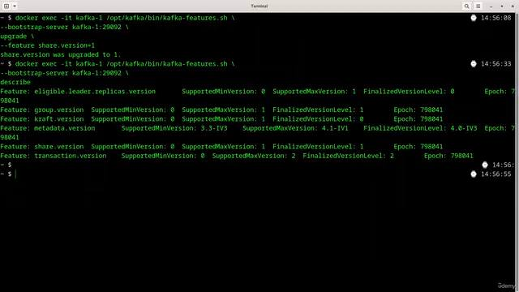
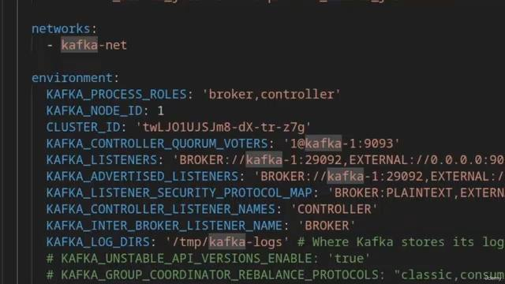
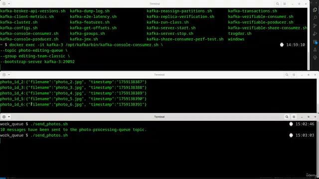
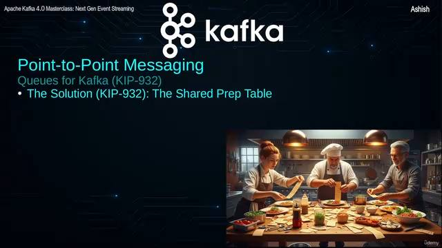
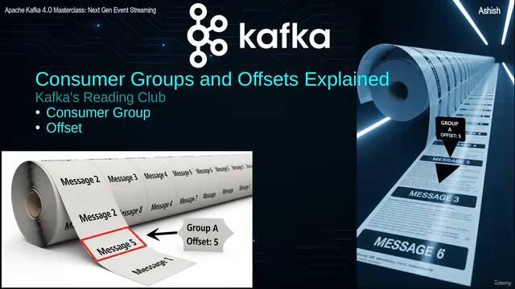
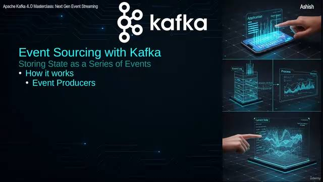

# Apache Kafka 4.0 实操文档（P50–P54）

**课程**：Apache Kafka 4.0（BV1iKNi6kEwT）
**覆盖**：P50 / P51 / P52 / P53 / P54
**最终环境**：Apache Kafka **4.1.0**（3 节点 KRaft 集群，Docker Compose）
**读者定位**：前端转 AI 应用工程师。文中涉及"锁 / 分区独占 / 顺序保证"的地方会补一句 JS/Node 里的对应物；Go 代码只做示意，语法"知道即可"。

> 说明：P50、P51、P53、P54 是概念课，P52 是唯一有实操的课（改 Compose、升镜像、建 topic、跑 share consumer）。所以本文的复现主线是 **P52 的操作链**，同时把 P50/P51/P53/P54 的概念落成**可执行、可观察、可验证**的步骤，而不是复述讲义。

---

## 1. 这一节做什么

这五节课连起来是一条完整的认知链：先纠正"Kafka 是视频平台"的误解（P50），再讲"消息总线可以变成实时数据处理管道"（P51），接着给出 Kafka 4.x 里最新的并行消费模型 Queues for Kafka / KIP-932（P52），然后回头把最基础也最容易含糊的 consumer group + offset 讲透（P53），最后落到一种以日志为唯一真相的架构模式——事件溯源（P54）。

按"能跑起来"的标准，这一节最终要交付这些东西：

| 产出物 | 来源 | 可验证方式 |
|---|---|---|
| 一个 3 节点 Kafka 4.1.0 集群 | P52（升级镜像 4.0.0 → 4.1.0） | `docker compose ps` 三个容器都 healthy |
| 一个 **只有 1 个分区** 的 topic `photo-editing-queue` | P52 | `kafka-topics.sh --describe` 显示 PartitionCount: 1 |
| KIP-932 特性开启 | P52（`Share.version was upgraded to 1`） | `kafka-features.sh --describe` 里能看到 share.version 的 finalized version 为 1 |
| 一个发消息脚本（10 条、每条间隔 1 秒、key/value 不拆） | P52（讲师用的 `send_photos.sh`） | 两个消费者终端里能看到分流差异 |
| 「经典 consumer group」与「share group」的对照实验 | P52 | 经典组：全部消息只进一个消费者；share 组：两个消费者都收到 |
| 一份 offset 观察方法（重放 / 提交位置） | P53 | 关掉消费者再启动，看是否从头读 |
| 一个 compacted topic 与"事件重放"演示 | P54 | 同 key 的旧事件被压实，`--from-beginning` 仍能读到新事件 |

必须先明确一件事，否则复现会走偏：**P52 里讲师在 Kafka 4.0.0 上没能跑起来 KIP-932**。原话是"我没能在 Kafka 4.0 上运行这个。"，然后他去翻文档，发现这个特性在 Kafka 4.1 的镜像里，于是把三个节点的镜像都改成 4.1.0，并且把之前在 4.0 上加的两个环境变量注释掉。所以**本文直接以 4.1.0 起步**，把那两个 4.0 专用的环境变量写成注释保留，用来对照理解"为什么要注释掉"。


---

## 2. 讲师原话

P50，纠正"Kafka = 视频流平台"的误解：

> "先把这件事说清楚：Kafka 并不用于传输视频。Apache Kafka 不是像 YouTube、Netflix、Twitch 或 Vimeo 那样的视频流平台。Kafka 是数据流平台，传输的是事件、日志、消息和数据，而不是 MP4 或直播流这类音视频内容。"
> —— p050 [01:31]

> "Kafka 借用了这些概念，但把它们应用到数据上。Kafka 会按顺序存储数据，消费者可以重新读取，也就是通过选择偏移量来重放消息，就像把视频倒回到某个特定时间点。"
> —— p050 [02:28]

> "视频流传输需要 CDN（内容分发网络）把视频分发到离用户更近的位置，还需要 Nginx、HLS 或 DASH 这类媒体服务器或自适应码率流传输机制。这些系统与 Kafka 完全不同。"
> —— p050 [03:17]

P51，流处理的定位与三条技术路线：

> "要回答这些问题，不能一次只看一条消息，而需要分析、转换并实时响应流动中的数据。这就是流处理的世界。"
> —— p051 [00:49]

> "首先是过滤：我们可以读取事件流，只让特定事件通过……接下来是映射或转换……然后是聚合。聚合在这里才真正强大起来。聚合是一种有状态操作，会随时间把来自许多事件的信息组合起来。"
> —— p051 [02:37]

> "在 Kafka 生态中，主要有三种方案。第一种是 Kafka Streams，也就是原生 Java 库……第二种是 KSQLDB，也就是 SQL 接口……最后一种是我们的 Go 方案。我们将采用这一方案。"
> —— p051 [03:35]

P52，KIP-932 的核心规则与代价：

> "这是一项早期访问功能。这意味着它已经可以供你试验，但仍然很新，其 API 或行为可能会在未来版本中发生变化。"
> —— p052 [00:56]

> "它引入了一种新的消费者组类型，称为共享组。这也是共享组带来的革命性新规则。共享组中的多个消费者可以同时从同一个分区拉取消息。"
> —— p052 [02:47]

> "在共享组中，由于多个消费者像从队列中一样从同一个分区获取消息，严格的顺序保证就不存在了。第 10 条消息可能会在第 9 条消息之前被处理。"
> —— p052 [05:07]

> "由于这仍是预览功能，我们必须通过类似 `unstable.api.version.enable=true` 的 Broker 配置项显式启用它。"
> —— p052 [06:32]

> "要启用 KIP 932 的功能，我们需要运行的命令是这个……好，现在开始。`Share.version` 已升级为 1。"
> —— p052 [10:46]

> "这里我们看到的是 console consumer，但我们还有另一个消费者，即 console share consumer。因此，这就是我们用来试验 Kafka 的 KIP 932 队列功能所需的消费者。"
> —— p052 [11:41]

P53，consumer group 与 offset：

> "消费者组的首要职责是作为一组消费者协同工作，共同处理某个主题的各个分区。Kafka 会自动把分区分配给组内成员。"
> —— p053 [01:26]

> "偏移量只是一个数字，用来标记消费者组在某个分区中的位置。分区中的每条消息都有一个唯一的顺序编号，就像页码一样。偏移量就是消费者接下来要读取的那条消息的页码。"
> —— p053 [02:50]

> "Kafka 会把这些已提交的偏移量存储在一个特殊的内部主题中，该主题名为 `__consumer_offsets`。"
> —— p053 [03:43]

P54，事件溯源：

> "事件溯源并不只存储最终状态，而是把实体状态的每一次变更都存储为带时间戳的不可变事件。"
> —— p054 [02:22]

> "实体 ID（例如用户 ID 或订单 ID）通常用作消息键，以确保该特定实体的所有事件都进入同一分区，从而保持顺序。"
> —— p054 [05:23]

> "对于只关心某个给定键最新状态的实体，例如用户资料更新，可以使用 Kafka 的日志压缩功能，高效地只保留每个键的最新事件。"
> —— p054 [04:39]

---

## 3. 从零复现

### 3.0 前置条件

| 项 | 要求 | 检查命令 |
|---|---|---|
| Docker | 20.10+ | `docker version` |
| Docker Compose | v2（用 `docker compose`，不是 `docker-compose`） | `docker compose version` |
| 空闲端口 | 9092、9095、9096、9093（内部） | `lsof -i :9092` |
| 磁盘 | ≥ 2 GB（三个 Kafka 容器 + 日志） | `df -h` |

### 3.1 目录结构

课里没有明确给出目录结构，本文统一用下面这套，后面所有命令都按这个路径写。你若换目录，把 `cd` 和脚本里的路径同步改掉即可。

```
kafka-course/
├── docker-compose.yml        # 3 节点 KRaft 集群，Kafka 4.1.0
├── scripts/
│   ├── send_photos.sh        # P52：发 10 条消息，每条间隔 1 秒，key/value 不拆
│   └── send_events.sh        # P54：带 key 发事件（key=实体ID），本文补充
├── run/
│   ├── classic-a.sh          # 经典 consumer 实例 A
│   ├── classic-b.sh          # 经典 consumer 实例 B（同 group）
│   ├── share-a.sh            # share consumer 实例 A
│   └── share-b.sh            # share consumer 实例 B（同 group）
└── go-demo/
    └── main.go               # P51 的 Go 方案骨架（示意，课里未给代码）
```

```bash
mkdir -p kafka-course/scripts kafka-course/run kafka-course/go-demo
cd kafka-course
```

### 3.2 第 1 步：写 Compose，直接上 4.1.0

把第 4 节「4.1 docker-compose.yml」的完整内容存成 `docker-compose.yml`。

> **课里过程的还原**：讲师原本在 4.0.0 上加了 `KAFKA_UNSTABLE_API_VERSIONS_ENABLE=true` 和 `KAFKA_GROUP_COORDINATOR_REBALANCE_PROTOCOLS=classic...` 两个变量，发现跑不通；查到 KIP-932 在 4.1 镜像里之后，把三个节点的 image 全改成 `4.1.0`，并且"把这两行注释掉。"——把这两个变量注释掉，因为"Apache Kafka 已经发生了很多变化。"。
> 我在下面的 Compose 里把这两行**保留为注释**，你可以取消注释，用来对照看 4.0 时代的配置长什么样。

### 3.3 第 2 步：启动集群

```bash
docker compose up -d
docker compose ps
```

三个容器都应该是 `running`。等到 `kafka-1` 的 healthcheck 变成 `healthy`（首次拉镜像 + KRaft 格式化大约 30–90 秒）：

```bash
docker compose ps kafka-1
```

### 3.4 第 3 步：确认版本是 4.1.0

```bash
docker exec -it kafka-1 /opt/bitnami/kafka/bin/kafka-broker-api-versions.sh \
  --bootstrap-server kafka-1:9094 | head -n 5
```

输出里每个 broker 那行会带版本号。看到 `4.1.0` 就说明镜像换对了。

### 3.5 第 4 步：启用 KIP-932 的 share 特性

这是 P52 最关键的一步。讲师在这里的原话是"要启用 KIP 932 特性，我们需要运行的是这条命令。"——**他没有把命令原文念出来**，只演示了结果。他只给了你两个可核对的事实：执行完之后终端打出 `Share.version was upgraded to 1`；以及之后用 describe 命令能看到 `share.version` 这一项。

Kafka 4.1 里特性开关走 `kafka-features.sh`，形态是"给某个 version 升级到某个级别"：

```bash
docker exec -it kafka-1 /opt/bitnami/kafka/bin/kafka-features.sh \
  --bootstrap-server kafka-1:9094 \
  --upgrade share.version=1
```

执行后应看到与讲师一致的一行：

```
Share.version was upgraded to 1.
```

（若你终端里的参数名报错，先跑 `kafka-features.sh --help` 确认该版本支持的写法；**这条命令的原文课里没有口述**，参数名请以你本地脚本的 help 输出为准。）

### 3.6 第 5 步：describe 验证特性已生效

讲师在 [11:14] 跑了 describe，并在 [11:41] 指着屏幕说"最终版本级别是 1……如果没有启用，这一行可能不会出现，或者最终版本级别会是 0。"。

```bash
docker exec -it kafka-1 /opt/bitnami/kafka/bin/kafka-features.sh \
  --bootstrap-server kafka-1:9094 --describe
```

你要在输出里找到 `share.version` 这一行，其 finalized version level 为 `1`。如果你看到的是 0，或者压根没有这一行，回到第 4 步。**具体表格的列名请以你终端的实际输出为准**（讲师在不同终端宽度下也遇到过"没有以正确的表格形式显示。"的排版问题）。



### 3.7 第 6 步：从二进制目录里认出 share consumer

讲师在 [11:41] 之后跑了 `ls` 看 bin 目录，目的是让你亲眼看到**两个不同的命令**：

```bash
docker exec -it kafka-1 ls /opt/bitnami/kafka/bin | grep -i consumer
```

你会看到两个东西：

```
kafka-console-consumer.sh
kafka-console-share-consumer.sh
```

讲师特意强调："好在两者使用不同的命令，我们不需要使用任何特殊属性或特殊标志；它们是两条不同的命令。" ——**跑 share 模式不需要给老命令加 flag，换命令就行**。这一点很重要，很多人会去翻 `--property` 找不到。



### 3.8 第 7 步：建一个只有 1 个分区的 topic

这一步是整个实验设计的核心。讲师原话："我们在该主题中只创建了一个分区。副本因子与分区没有任何关系。因此，把副本因子保留为 3 没问题，但分区必须为 1，因为这次我们要使用共享组。"

**为什么必须是 1 个分区**：在经典 consumer group 里，一个分区同一时刻只能被一个消费者读（"在同一个消费者组内，同一时间只能有一个消费者从单个分区读取。"）。只有把分区数压到 1，才能让"两个消费者在同一 group 里"这个条件下，经典组必然是"一个干活一个闲着"——差异才看得出来。如果建了 4 个分区，两个消费者各自分到 2 个，你根本看不出 share group 的意义。

topic 名讲师口述是 "照片编辑队列。"，脚本里写的是连字符形式。为了命令能直接跑，统一用 `photo-editing-queue`。

```bash
docker exec -it kafka-1 /opt/bitnami/kafka/bin/kafka-topics.sh \
  --bootstrap-server kafka-1:9094 \
  --create \
  --topic photo-editing-queue \
  --partitions 1 \
  --replication-factor 3
```

验证：

```bash
docker exec -it kafka-1 /opt/bitnami/kafka/bin/kafka-topics.sh \
  --bootstrap-server kafka-1:9094 --describe --topic photo-editing-queue
```

你要在输出里确认 `PartitionCount: 1`、`ReplicationFactor: 3`。（字段名以实际输出为准。）

### 3.9 第 8 步：写发消息脚本

把第 4 节「4.2 scripts/send_photos.sh」存盘并加执行权限：

```bash
chmod +x scripts/send_photos.sh
```

讲师对脚本行为的描述是三条：发 10 条消息、每条之后暂停 1 秒、**key 和 value 不做拆分、原样发送**（"我们不会把键和值分开，而是按原样发送。"）。

### 3.10 第 9 步：实验 A —— 经典 consumer group（对照组）

开两个终端，**分别在两个不同 broker 容器里**跑（讲师原话："在第一个终端中，我们使用的是三节点 Kafka，而这里使用的是两节点 Kafka。"），并且**用同一个 group id**（"这完全就是同一个组"）。

终端 1：

```bash
docker exec -it kafka-3 /opt/bitnami/kafka/bin/kafka-console-consumer.sh \
  --bootstrap-server kafka-1:9094 \
  --topic photo-editing-queue \
  --group classic-group
```

终端 2：

```bash
docker exec -it kafka-2 /opt/bitnami/kafka/bin/kafka-console-consumer.sh \
  --bootstrap-server kafka-1:9094 \
  --topic photo-editing-queue \
  --group classic-group
```

> 注意：讲师那次实验用的经典组名课里没念出来（他后面报错时只是说"这是针对经典消费者的。"）。`classic-group` 是我起的名字，你可以换成任何名字，只要两个终端一致。

然后第三个终端发消息：

```bash
./scripts/send_photos.sh
```

**预期结果（与讲师 [14:02] 观察一致）**：10 条消息**全部**落在其中一个消费者上，另一个终端一行都不动。讲师连着跑了两次，两次都是"消费者 A 全部消费，消费者 B 完全空闲。"。



### 3.11 第 10 步：实验 B —— share consumer group

把两个终端的命令**换成 share 版**，group id 也要换（讲师这里踩了一次坑：直接沿用经典组名，报 `Group ID not found`，然后把组名改成 `kip932` 才好）。

终端 1：

```bash
docker exec -it kafka-3 /opt/bitnami/kafka/bin/kafka-console-share-consumer.sh \
  --bootstrap-server kafka-1:9094 \
  --topic photo-editing-queue \
  --group kip932
```

终端 2：

```bash
docker exec -it kafka-2 /opt/bitnami/kafka/bin/kafka-console-share-consumer.sh \
  --bootstrap-server kafka-1:9094 \
  --topic photo-editing-queue \
  --group kip932
```

两个终端启动时都会打一行 **"这是一个预览功能。"** 的警告，这是正常的（讲师："我们会看到一个警告：这是一个预览功能，仅此而已。"）。

再发一次：

```bash
./scripts/send_photos.sh
```

**预期结果（与讲师 [15:59] 观察一致）**：两个终端**都收到**消息，但**分配并不均匀**。讲师那次是"一边 6 条一边 4 条"（他说"一、二、三、四、五、六、七、八、九，好，十。"上下文里是明显不平均的）。他还专门解释了为什么不均匀："Kafka 会发现，这个消费者处理消息的速度更快，下一条消息已经可用，并且同一个消费者可以接收下一条消息。" —— 谁处理快就继续给谁，所以小负载下不均匀是正常的；负载更重时才更接近平均。

**这一步是整个 P52 的唯一"眼见为实"**：同样的 topic、同样的 1 个分区、同样的两个消费者、同样的消息，只把命令从 `kafka-console-consumer.sh` 换成 `kafka-console-share-consumer.sh`，行为就从"独占"变成"共享"。



### 3.12 第 11 步：P53 —— 亲手验证 offset 的存在

P53 没有实操，但它的结论**可以用你刚建好的集群当场验证**，这比看讲义牢。

**(a) 证明 offset 是"分区内连续编号"**

```bash
docker exec -it kafka-1 /opt/bitnami/kafka/bin/kafka-console-consumer.sh \
  --bootstrap-server kafka-1:9094 \
  --topic photo-editing-queue \
  --from-beginning \
  --property print.offset=true \
  --property print.key=true \
  --max-messages 10
```

你会看到每条消息前面带一个从 0 开始递增的编号——这就是讲师说的"像页码一样。"。

**(b) 证明"提交位置"会被记住**

用 `kafka-consumer-groups.sh --describe` 看 `classic-group` 每个分区的已提交位置和积压量（**具体列名请以你终端实际输出为准**，这里不凭记忆填字段）。然后：

1. 停掉两个经典消费者（Ctrl+C）；
2. 不带 `--from-beginning` 重新启动一个同 group 的消费者；
3. 再跑 `send_photos.sh`。

你应该只能看到**新发的**消息，而不是从头重读——这就是讲师说的"它不会重新处理已经完成的 247 条消息。"。

**(c) 证明"换 group 就会从头读"**

用另一个全新的 group（例如 `classic-group-2`）不带 `--from-beginning` 启动，因为新组没有提交位置，它会按 auto-offset-reset 的默认策略回退——你会看到历史消息被重读。这一步就是把 P53 的"书签是按组记录的，不是按消费者实例记录的。"这件事做成了实验。



### 3.13 第 12 步：P54 —— 用 compacted topic 演示"事件重放 + 状态收敛"

P54 全是概念，但它的两个关键机制（**key = 实体 ID 保证同分区**、**log compaction 只留每个 key 的最新事件**）在 Kafka 里是一等公民，可以直接建 topic 验证。

建一个 compacted topic（**这条命令课里没给**，讲师只提到 "可以使用 Kafka 的日志压缩功能。"，命令是我按 Kafka 标准参数补的）：

```bash
docker exec -it kafka-1 /opt/bitnami/kafka/bin/kafka-topics.sh \
  --bootstrap-server kafka-1:9094 \
  --create \
  --topic user-events \
  --partitions 3 \
  --replication-factor 3 \
  --config cleanup.policy=compact
```

用第 4 节「4.3 scripts/send_events.sh」发同一用户的多次状态变更（`key=user-1`，value 依次是 `registered` → `address-updated` → `email-updated`）：

```bash
chmod +x scripts/send_events.sh
./scripts/send_events.sh
```

然后带 offset 从头读：

```bash
docker exec -it kafka-1 /opt/bitnami/kafka/bin/kafka-console-consumer.sh \
  --bootstrap-server kafka-1:9094 \
  --topic user-events \
  --from-beginning \
  --property print.key=true \
  --property print.offset=true
```

**你要理解的现象**：`--from-beginning` 一定读得到这些事件（它们是真相），而 compaction 是在**后台压实**——它不会让历史事件立刻消失，而是保证"同一个 key 的旧版本最终会被清理"。这就是 P54 里"事件日志是唯一可信来源，读模型是从它重放出来的。"这套话的物理基础。



### 3.14 第 13 步：P51 —— 用一段 Go 程序把 filter / map / aggregate 走一遍

P51 讲了三条路线（Kafka Streams / ksqlDB / 自己写 Go），并明确说本节不做 Kafka Streams 例子（"目前我们不会做任何 Kafka Streams 的示例，因为我们有一个专门讲 Kafka Streams 的独立章节。"）。本节要落地的是第三条：**一个既当消费者又当生产者的 Go 应用**。

课里**没有给出任何 Go 代码**，也没说用哪个客户端库。第 4 节「4.4 go-demo/main.go」是一段**示意代码**，只为让你看懂"消费 → 处理 → 生产"的形状，跑通需要你自己 `go mod init` 并选一个 Kafka 客户端库。

---

## 4. 完整代码

### 4.1 docker-compose.yml

> 课里**没有贴出完整 Compose 全文**，只讲了"每个 broker 都要加那两个环境变量 / 都要把镜像改 4.1.0"。下面是按讲师提到的镜像版本 + 环境变量还原出来的**可运行 3 节点 KRaft 集群**。三个节点都跑了 `broker,controller`（单机也能起，但本课后面要"分别从 kafka-2 / kafka-3 两个容器跑消费者"，所以必须是多节点）。

```yaml
services:
  kafka-1:
    image: bitnami/kafka:4.1.0
    container_name: kafka-1
    ports:
      - "9092:9092"     # EXTERNAL，给宿主机上的客户端用
    environment:
      - KAFKA_ENABLE_KRAFT=yes
      - KAFKA_KRAFT_CLUSTER_ID=MkU3OEVBNTcwNTJENDM2Qk
      - KAFKA_CFG_NODE_ID=1
      - KAFKA_CFG_PROCESS_ROLES=broker,controller
      - KAFKA_CFG_CONTROLLER_LISTENER_NAMES=CONTROLLER
      - KAFKA_CFG_LISTENERS=INTERNAL://:9094,CONTROLLER://:9093,EXTERNAL://:9092
      - KAFKA_CFG_ADVERTISED_LISTENERS=INTERNAL://kafka-1:9094,EXTERNAL://localhost:9092
      - KAFKA_CFG_INTER_BROKER_LISTENER_NAME=INTERNAL
      - KAFKA_CFG_LISTENER_SECURITY_PROTOCOL_MAP=CONTROLLER:PLAINTEXT,INTERNAL:PLAINTEXT,EXTERNAL:PLAINTEXT
      - KAFKA_CFG_CONTROLLER_QUORUM_VOTERS=1@kafka-1:9093,2@kafka-2:9093,3@kafka-3:9093
      - ALLOW_PLAINTEXT_LISTENER=yes
      - KAFKA_CFG_AUTO_CREATE_TOPICS_ENABLE=false
      - KAFKA_CFG_OFFSETS_TOPIC_REPLICATION_FACTOR=3
      - KAFKA_CFG_TRANSACTION_STATE_LOG_REPLICATION_FACTOR=3
      - KAFKA_CFG_TRANSACTION_STATE_LOG_MIN_ISR=2
      # ↓↓↓ 4.0.0 时代用的两个变量，升到 4.1.0 后按讲师做法注释掉
      # - KAFKA_UNSTABLE_API_VERSIONS_ENABLE=true
      # - KAFKA_GROUP_COORDINATOR_REBALANCE_PROTOCOLS=classic,share
    healthcheck:
      test: ["CMD-SHELL", "/opt/bitnami/kafka/bin/kafka-broker-api-versions.sh --bootstrap-server localhost:9092 > /dev/null 2>&1"]
      interval: 10s
      timeout: 5s
      retries: 20

  kafka-2:
    image: bitnami/kafka:4.1.0
    container_name: kafka-2
    ports:
      - "9095:9092"
    environment:
      - KAFKA_ENABLE_KRAFT=yes
      - KAFKA_KRAFT_CLUSTER_ID=MkU3OEVBNTcwNTJENDM2Qk
      - KAFKA_CFG_NODE_ID=2
      - KAFKA_CFG_PROCESS_ROLES=broker,controller
      - KAFKA_CFG_CONTROLLER_LISTENER_NAMES=CONTROLLER
      - KAFKA_CFG_LISTENERS=INTERNAL://:9094,CONTROLLER://:9093,EXTERNAL://:9092
      - KAFKA_CFG_ADVERTISED_LISTENERS=INTERNAL://kafka-2:9094,EXTERNAL://localhost:9095
      - KAFKA_CFG_INTER_BROKER_LISTENER_NAME=INTERNAL
      - KAFKA_CFG_LISTENER_SECURITY_PROTOCOL_MAP=CONTROLLER:PLAINTEXT,INTERNAL:PLAINTEXT,EXTERNAL:PLAINTEXT
      - KAFKA_CFG_CONTROLLER_QUORUM_VOTERS=1@kafka-1:9093,2@kafka-2:9093,3@kafka-3:9093
      - ALLOW_PLAINTEXT_LISTENER=yes
      - KAFKA_CFG_AUTO_CREATE_TOPICS_ENABLE=false
      - KAFKA_CFG_OFFSETS_TOPIC_REPLICATION_FACTOR=3
      - KAFKA_CFG_TRANSACTION_STATE_LOG_REPLICATION_FACTOR=3
      - KAFKA_CFG_TRANSACTION_STATE_LOG_MIN_ISR=2
      # - KAFKA_UNSTABLE_API_VERSIONS_ENABLE=true
      # - KAFKA_GROUP_COORDINATOR_REBALANCE_PROTOCOLS=classic,share

  kafka-3:
    image: bitnami/kafka:4.1.0
    container_name: kafka-3
    ports:
      - "9096:9092"
    environment:
      - KAFKA_ENABLE_KRAFT=yes
      - KAFKA_KRAFT_CLUSTER_ID=MkU3OEVBNTcwNTJENDM2Qk
      - KAFKA_CFG_NODE_ID=3
      - KAFKA_CFG_PROCESS_ROLES=broker,controller
      - KAFKA_CFG_CONTROLLER_LISTENER_NAMES=CONTROLLER
      - KAFKA_CFG_LISTENERS=INTERNAL://:9094,CONTROLLER://:9093,EXTERNAL://:9092
      - KAFKA_CFG_ADVERTISED_LISTENERS=INTERNAL://kafka-3:9094,EXTERNAL://localhost:9096
      - KAFKA_CFG_INTER_BROKER_LISTENER_NAME=INTERNAL
      - KAFKA_CFG_LISTENER_SECURITY_PROTOCOL_MAP=CONTROLLER:PLAINTEXT,INTERNAL:PLAINTEXT,EXTERNAL:PLAINTEXT
      - KAFKA_CFG_CONTROLLER_QUORUM_VOTERS=1@kafka-1:9093,2@kafka-2:9093,3@kafka-3:9093
      - ALLOW_PLAINTEXT_LISTENER=yes
      - KAFKA_CFG_AUTO_CREATE_TOPICS_ENABLE=false
      - KAFKA_CFG_OFFSETS_TOPIC_REPLICATION_FACTOR=3
      - KAFKA_CFG_TRANSACTION_STATE_LOG_REPLICATION_FACTOR=3
      - KAFKA_CFG_TRANSACTION_STATE_LOG_MIN_ISR=2
      # - KAFKA_UNSTABLE_API_VERSIONS_ENABLE=true
      # - KAFKA_GROUP_COORDINATOR_REBALANCE_PROTOCOLS=classic,share
```

### 4.2 scripts/send_photos.sh

> 课里只描述了行为（10 条、每条间隔 1 秒、key/value 不拆），**没有给出脚本内容**。这是按该行为写出的等价实现。

```bash
#!/usr/bin/env bash
# 复现 P052：向 photo-editing-queue 发送 10 条消息。
# 行为对齐讲师描述：
#   1) 共 10 条
#   2) 每条之间 sleep 1 秒
#   3) 不开启 parse.key —— key 和 value 原样作为一整个 value 发送
set -euo pipefail

CONTAINER="${CONTAINER:-kafka-1}"
BOOTSTRAP="${BOOTSTRAP:-kafka-1:9094}"
TOPIC="${TOPIC:-photo-editing-queue}"
KAFKA_BIN="/opt/bitnami/kafka/bin"

{
  for i in $(seq 1 10); do
    echo "photo-${i}:edit-request-${i}"
    sleep 1
  done
} | docker exec -i "${CONTAINER}" "${KAFKA_BIN}/kafka-console-producer.sh" \
      --bootstrap-server "${BOOTSTRAP}" \
      --topic "${TOPIC}"

echo "sent 10 messages to ${TOPIC}"
```

### 4.3 scripts/send_events.sh

> 课里没有这个脚本。P054 需要"key = 实体 ID"，所以要开启 `parse.key=true` 并指定分隔符。这里用 `:` 作为 key 分隔符。

```bash
#!/usr/bin/env bash
# 复现 P054 的"事件日志"写法：key = 实体 ID，value = 事件名。
# 开启 parse.key=true，让同 key 的事件由 Kafka 按 key 路由到同一分区。
set -euo pipefail

CONTAINER="${CONTAINER:-kafka-1}"
BOOTSTRAP="${BOOTSTRAP:-kafka-1:9094}"
TOPIC="${TOPIC:-user-events}"
KAFKA_BIN="/opt/bitnami/kafka/bin"

{
  echo "user-1:registered"
  sleep 1
  echo "user-1:address-updated"
  sleep 1
  echo "user-1:email-updated"
  sleep 1
  echo "user-2:registered"
  sleep 1
  echo "user-2:order-placed"
} | docker exec -i "${CONTAINER}" "${KAFKA_BIN}/kafka-console-producer.sh" \
      --bootstrap-server "${BOOTSTRAP}" \
      --topic "${TOPIC}" \
      --property parse.key=true \
      --property key.separator=:

echo "sent 5 events to ${TOPIC}"
```

### 4.4 go-demo/main.go（示意，课里没有代码）

> **课里没有代码，以下为示意。** 讲师只说了这条路线的形状：Go 应用"从源主题消费消息，执行过滤、转换或聚合等逻辑，然后把结果生产到新的目标主题。"。他也**没有指定客户端库**。下面用填词方式给出结构，`TODO` 处换成你选定的库（例如各主流 Go Kafka 客户端），逻辑与讲师描述一一对应。Go 语法"知道即可"。

```go
package main

// 课里没有代码，以下为示意：一个既是 Consumer 又是 Producer 的流处理骨架。
// 对应 P051 的"三个站台"：Filter -> Map -> Aggregate。
// 真实项目中需要你自己 go mod init + 选一个 Kafka Go 客户端库，
// 课里没有指定库名，也没有给出任何实现细节。

import (
	"fmt"
	"log"
)

type Event struct {
	UserID   string
	Type     string // "click" / "purchase" / ...
	PriceCents int
}

func main() {
	// ---- 1) 消费源 topic（对应讲师说的"consume from a source topic"）----
	// TODO: 用你选的客户端创建 Consumer，订阅 "raw-clicks"
	// 讲师没有给库名，这里不编造 API。
	var in <-chan Event
	_ = in

	// ---- 2) Filter：只放行 purchase ----
	// 讲师原话："consume a stream of all user clicks but only keep the
	// ones where the user clicked the Purchase button."
	// 在 JS/Node 里就是一个 array.filter，这里对应一个循环里的 if。
	filtered := make(chan Event)
	go func() {
		defer close(filtered)
		for e := range in {
			if e.Type == "purchase" {
				filtered <- e
			}
		}
	}()

	// ---- 3) Map/Transform + Aggregate：实时累加营收 ----
	// 讲师原话："consume a stream of order placed events and calculate
	// the total real-time revenue for the day."
	// 注意：aggregate 是 stateful 的，状态在进程内存里；
	// 进程重启后要么从 topic 重放重建，要么落库（P054 讲的就是这件事）。
	var totalCents int64
	for e := range filtered {
		totalCents += int64(e.PriceCents)
		fmt.Printf("running revenue: %.2f\n", float64(totalCents)/100)

		// ---- 4) 生产到目标 topic（对应"produce the results to
		// a new destination topic"）----
		// TODO: 用你选的客户端 Produce 到 "purchase-events"
		// key 建议用 UserID（P054：实体 ID 做 key 保证同分区有序）
	}

	log.Println("stream finished")
}
```

### 4.5 一次跑完全部实验的脚本（可选但推荐）

```bash
#!/usr/bin/env bash
# 仅做顺序说明用，不建议真的无人值守跑，因为消费者需要你眼睛看终端。
set -euo pipefail

docker compose up -d
sleep 45                                   # 等 KRaft 选主 + healthcheck

docker exec -it kafka-1 /opt/bitnami/kafka/bin/kafka-features.sh \
  --bootstrap-server kafka-1:9094 --upgrade share.version=1

docker exec -it kafka-1 /opt/bitnami/kafka/bin/kafka-features.sh \
  --bootstrap-server kafka-1:9094 --describe

docker exec -it kafka-1 /opt/bitnami/kafka/bin/kafka-topics.sh \
  --bootstrap-server kafka-1:9094 --create --topic photo-editing-queue \
  --partitions 1 --replication-factor 3

echo "现在手动开两个终端跑经典消费者，再跑 ./scripts/send_photos.sh"
```

---

## 5. 逐行解释

### 5.1 Compose 里每个关键行

- `image: bitnami/kafka:4.1.0` —— 这是 P52 的**结论行**。讲师在 4.0

## 6. 复现检查清单

- [ ] **集群三节点都起来了**：`docker compose ps` 三个容器状态为 `running`，`docker compose ps kafka-1` 的 healthcheck 显示 `healthy`。若 `kafka-1` 一直 `starting`，等 30–90 秒（首次拉镜像 + KRaft 格式化），仍不行看 `docker compose logs kafka-1`。
- [ ] **镜像确实是 4.1.0**：`docker exec -it kafka-1 /opt/bitnami/kafka/bin/kafka-broker-api-versions.sh --bootstrap-server kafka-1:9094 | head -n 5`，输出里能看到 `4.1.0`。看到 `4.0.0` 说明 Compose 里 image 没改全（三个节点都要改）。
- [ ] **两个 4.0 专用环境变量已注释**：打开 `docker-compose.yml` 确认 `KAFKA_UNSTABLE_API_VERSIONS_ENABLE` 和 `KAFKA_GROUP_COORDINATOR_REBALANCE_PROTOCOLS` 三处都是 `#` 开头。没注释会导致 4.1.0 上行为异常。
- [ ] **share 特性升级成功**：跑 `kafka-features.sh --upgrade share.version=1` 后终端打出 `Share.version was upgraded to 1.`。若报参数名错误，先 `kafka-features.sh --help` 确认写法（课里没口述命令原文）。
- [ ] **describe 里 share.version 为 1**：`kafka-features.sh --describe` 输出中找到 `share.version` 行，finalized version level 为 `1`。若是 `0` 或没有这一行，回到上一步重跑升级。
- [ ] **bin 目录里有两个 consumer 命令**：`docker exec -it kafka-1 ls /opt/bitnami/kafka/bin | grep -i consumer`，应同时看到 `kafka-console-consumer.sh` 和 `kafka-console-share-consumer.sh`。只有前者说明镜像不是 4.1.0。
- [ ] **topic 只有 1 个分区**：`kafka-topics.sh --describe --topic photo-editing-queue` 输出 `PartitionCount: 1`、`ReplicationFactor: 3`。分区数不是 1 的话，经典组实验看不出"一个干活一个闲着"的差异，删了重建。
- [ ] **发消息脚本可执行且能发 10 条**：`chmod +x scripts/send_photos.sh` 后跑一次，终端最后打出 `sent 10 messages to photo-editing-queue`，且过程中约 10 秒（每条间隔 1 秒）。
- [ ] **实验 A（经典组）结果符合预期**：两个终端用同一 `--group classic-group` 跑 `kafka-console-consumer.sh`，发消息后 **10 条全部进其中一个终端**，另一个终端一行不动。若两边都收到，检查是不是误用了 share 命令或 group id 不一致。
- [ ] **实验 B（share 组）结果符合预期**：两个终端用同一 `--group kip932` 跑 `kafka-console-share-consumer.sh`，启动时各打一行 "这是一个预览功能。" 警告（正常），发消息后 **两个终端都收到**，且分配不均匀（如 6/4）。若报 `Group ID not found`，说明沿用了经典组名，换成新组名。
- [ ] **offset 是分区内连续编号**：带 `--property print.offset=true --from-beginning --max-messages 10` 读 `photo-editing-queue`，每条消息前有从 0 开始递增的编号。
- [ ] **提交位置被记住**：停掉经典消费者后，不带 `--from-beginning` 重启同 group 消费者，再发消息，**只看到新消息**，不从头重读。用 `kafka-consumer-groups.sh --describe` 能看到该 group 的已提交位置（列名以实际输出为准）。
- [ ] **换 group 会从头读**：用全新 group（如 `classic-group-2`）不带 `--from-beginning` 启动，能看到历史消息被重读——证明 bookmark 是按 group 记的。
- [ ] **compacted topic 建成功**：`kafka-topics.sh --describe --topic user-events` 输出里 `cleanup.policy` 为 `compact`。
- [ ] **事件能带 key 读出**：跑 `send_events.sh` 后带 `--property print.key=true --from-beginning` 读 `user-events`，能看到 `user-1` 的多条事件（`registered` → `address-updated` → `email-updated`），key 与 value 正确分开。若 key 和 value 粘在一起，检查 producer 是否带了 `--property parse.key=true --property key.separator=:`。

## 7. 课里没讲但你会撞上的

| 现象 | 原因 | 怎么办 |
|---|---|---|
| `kafka-features.sh --upgrade share.version=1` 报参数名/语法错误 | 课里**没口述**这条命令原文，只演示了结果（`Share.version was upgraded to 1`），不同版本参数写法可能不同 | 先跑 `kafka-features.sh --help` 按本地脚本支持的写法调整；确认镜像确实是 4.1.0（4.0.0 上跑不通，讲师原话 "我没能在 Kafka 4.0 上运行这个。"） |
| 升级到 4.1.0 后集群起不来或行为异常 | 课里没讲：4.0 时代加的两个环境变量（`KAFKA_UNSTABLE_API_VERSIONS_ENABLE`、`KAFKA_GROUP_COORDINATOR_REBALANCE_PROTOCOLS`）在 4.1.0 上不再需要，讲师说 "把这两行注释掉……很多东西已经变了。" | 确认三个节点的这两行都已注释；`docker compose down` 后重新 `up -d` |
| share consumer 启动报 `Group ID not found` | 课里**踩过这个坑**：直接沿用经典组名，share 组不认 | 换一个新组名（讲师改成 `kip932`），两个 share 终端用同一个新组名 |
| share consumer 启动打 "这是一个预览功能。" 警告 | 课里讲了：KIP-932 是 early access 特性，警告正常 | 忽略即可，讲师原话 "我们会看到一个警告：这是一个预览功能，仅此而已。" |
| 两个 share 消费者收到的消息数不均匀（如 6/4） | 课里讲了：谁处理快就继续给谁，小负载下不均匀正常 | 不用修；负载更重时才更接近平均。讲师原话 "它不一定均匀分布。" |
| 经典组实验里两个消费者都收到消息 | 课里没讲：多半是 topic 分区数不是 1，或两个终端 group id 不一致 | `kafka-topics.sh --describe` 确认 `PartitionCount: 1`；确认两个终端 `--group` 完全相同 |
| `kafka-features.sh --describe` 输出排版错乱、看不到表格 | 课里**遇到过**：讲师说 "没有以正确的表格形式显示。"，换终端/调字体才好 | 换终端宽度或调小字体重跑；只要能在输出里找到 `share.version` 行且 finalized version 为 1 即可 |
| 宿主机上直接跑 `kafka-console-consumer.sh` 连不上 | 课里没讲：Compose 里 EXTERNAL listener 的 advertised 地址是 `localhost:9092/9095/9096`，容器内用的是 INTERNAL `kafka-1:9094` | 按文档用 `docker exec -it kafka-X ... --bootstrap-server kafka-1:9094` 在容器内跑；宿主机客户端则连 `localhost:9092` |
| `send_photos.sh` 报 permission denied | 课里提了 "你需要确保这是一个可执行文件。" | `chmod +x scripts/send_photos.sh` |
| compacted topic 建好后旧事件没立刻消失 | 课里没讲：compaction 是后台压实，不会让历史事件立即消失，只保证同 key 旧版本最终被清理 | 属正常现象；`--from-beginning` 仍能读到事件（它们是真相），不要期待立刻只剩最新一条 |
| `send_events.sh` 里 key/value 没分开 | 课里没讲：P54 需要 key=实体 ID，必须开 `parse.key=true` 并指定 `key.separator` | 确认 producer 带了 `--property parse.key=true --property key.separator=:`，且脚本里每行是 `key:value` 形式 |
| Go demo 跑不起来 | 课里**没给任何 Go 代码**，也没指定客户端库（"我们不会做任何 Kafka Streams 的示例。" 且 Go 路线只讲了形状） | 文档 4.4 是示意代码，`TODO` 处需自己 `go mod init` 并选一个 Kafka Go 客户端库实现，不能直接 `go run` |
