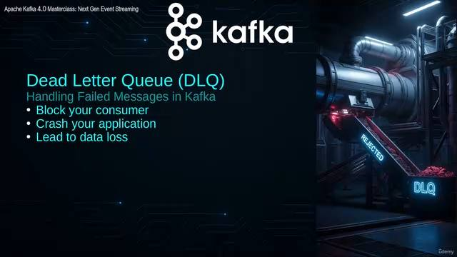
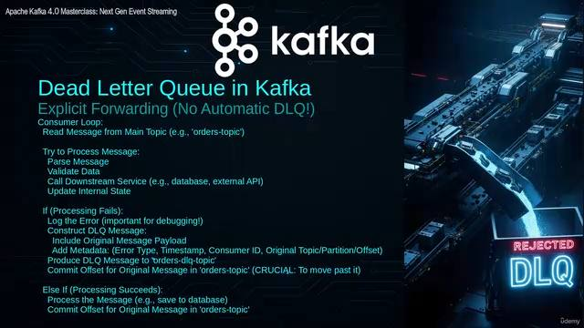
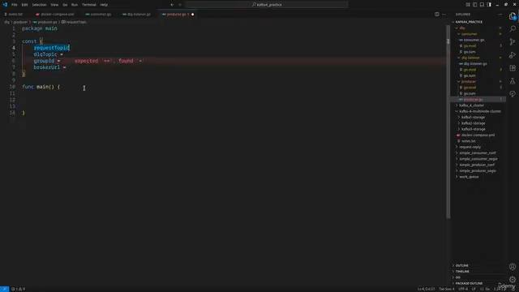
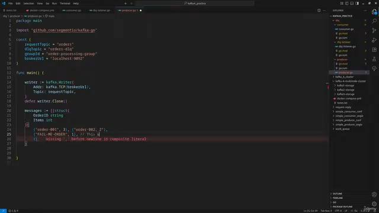
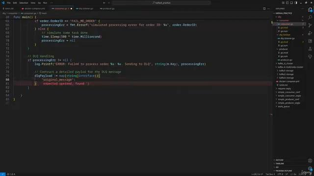
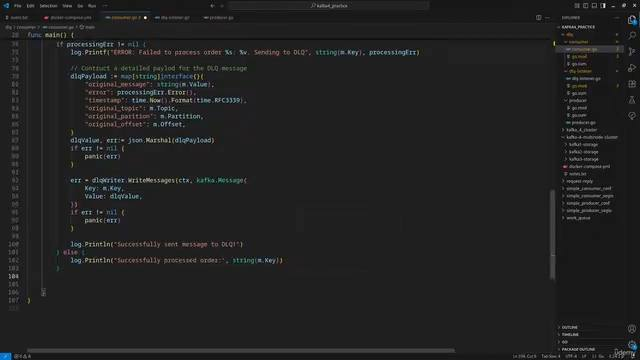

# Apache Kafka 4.0 · 死信队列（Dead Letter Queue）实战：用 Go 写一个「坏消息不阻塞」的订单处理链路

> 课程：BV1iKNi6kEwT ｜ 覆盖 P055（55–55）｜ 语言：Go（讲师用 Go，本文对 JS/Node 读者做对照说明）

---

## 1. 这一节做什么

这一节解决一个非常具体的问题：**当一条消息你的应用永远处理不了时，消费者的循环怎么才能不被它卡死。**

讲师一开场就把三种「不处理」的后果摆出来了：一条坏消息会把消费者堵住，反复重试它，导致后面正常消息全部排队；或者直接把应用搞崩，造成停机；或者你干脆把这条消息丢掉，造成数据丢失。这三种都不行。

于是这一节实现一个经典的容错模式——**死信队列（Dead Letter Queue，也叫 dead letter channel）**。做法是：

1. 在 Kafka 里建两个 topic：`orders`（主 topic）和 `orders-dlq`（死信 topic）；
2. 用 Go 写一个 producer，往 `orders` 里打 5 条订单，其中**故意混进 1 条会处理失败的**（`fail-me-order`）；
3. 用 Go 写一个 consumer，从 `orders` 读、反序列化、跑业务逻辑；一旦处理失败，它**自己充当 producer**，把这条坏消息（外加错误详情、时间戳、原 topic/分区/offset）写进 `orders-dlq`，然后**提交主 topic 上的 offset 并继续下一条**；
4. 用 Go 写一个 DLQ listener，单纯消费 `orders-dlq` 并打印，用来肉眼确认「坏消息确实落地了、而且没被丢」。

最后跑起来的效果是：控制台先看到 4 条正常订单被处理，中间那 1 条打印 `ERROR ... sending to DLQ`，接着第 5 条继续被处理——**主链路没有任何阻塞**。在 Kafka UI / Redpanda UI 里能看到 `orders` 有 5 条消息、`orders-dlq` 有 1 条消息。

这一节最重要的一句话，是讲师反复强调的：**Kafka 没有自动死信队列。** 对比 RabbitMQ 这类传统消息队列，broker 会在投递重试若干次失败后自动把消息转发到 DLQ；而 Kafka 是分布式日志，**broker 永远不会因为某个 consumer 处理失败就把消息从一个 topic 搬到另一个 topic**，消息会一直留在原 topic 直到 retention 过期。所以 DLQ 这件事必须由**你的消费端代码显式实现**。



---

## 2. 讲师原话（带时间戳）

几个关键的原文表述，后面所有实现都从这几句推导出来：

> "Kafka 中的死信队列需要显式转发，这意味着不会自动执行死信入队。Kafka 代理绝不会仅仅因为某个消费者处理失败，就自动把消息从一个主题移到另一个主题。消息会一直保留在原始主题中，直到保留期结束。因此，你的消费者应用需要自行显式实现死信队列模式。"
> —— p055 [03:11]

> "你可以指定一个单独的 Kafka 主题作为死信主题，例如服务专用的死信队列主题。当消费者应用在处理消息时遇到错误，它会主动捕获该错误。随后，消费者充当生产者，将出问题的消息（通常附带错误详情）显式发送到指定的死信主题。关键是，发送到死信队列后，消费者会提交主主题中原始消息的偏移量，从而继续处理下一条消息。"
> —— p055 [04:08]

> "如果 error 不等于 nil，就说明这里出现了一个处理错误……因此，只有处理错误不等于 nil 时，这个代码块才会执行。这个代码块专门用于处理死信队列。"
> —— p055 [30:14]

> "这一点很关键：无论消息处理成功，还是被发送到死信队列，我们都会提交它在主主题中的偏移量，这样就不会再次处理它。"
> —— p055 [37:26]

> "注意，我们的主消费者并没有因为坏消息而阻塞。它在收到坏消息后仍继续运行：记录错误，将消息移到死信队列，然后继续处理其余消息。出问题的消息没有丢失。"
> —— p055 [45:02]

以及关于「谁负责搬消息」的比喻：

> "这些工作进程可以看作你的消费者代码，它们会自行拾取有问题的条目，并主动将其扔进拒绝箱，也就是把它生产到死信队列主题中。"
> —— p055 [04:37]


---

## 3. 从零复现

下面是可以照着敲的完整步骤。**顺序很重要**：先有 topic，再有代码；先起 DLQ listener 和 consumer，最后才跑 producer，否则消息会被 consumer 一进来就吃掉，你还没来得及看 DLQ 的打印。

### 步骤 0：环境前提（课里没讲的部分我标出来了）

| 项 | 说明 |
|---|---|
| Kafka 集群 | 讲师环境里跑着**三个 broker 节点**（他在创建 topic 时说「we do see the three nodes running in a cluster」）。**课里没讲**这个集群是怎么起的（Docker Compose / KRaft / ZooKeeper 都没提），你只要有一个能连上的 Kafka 即可 |
| broker 地址 | 讲师用 `localhost`，端口他说「it could be anything 9092 or 4 or 5」，即按你集群实际暴露的端口填 |
| Go | **课里没讲** Go 版本，需要一个能正常 `go run` 的 Go 环境 |
| 可视化工具 | 讲师用了 **Kafka UI** 和 **Redpanda UI** 两个界面来核对消息条数，**课里没讲**它们怎么部署 |

### 步骤 1：创建两个 topic

先建主 topic `orders`：

```bash
kafka-topics.sh --create \
  --topic orders \
  --bootstrap-server localhost:9092 \
  --partitions 1 \
  --replication-factor 1
```

再建死信 topic `orders-dlq`——讲师的做法很直观：**在 `orders` 后面加一个 `-dlq` 后缀**：

```bash
kafka-topics.sh --create \
  --topic orders-dlq \
  --bootstrap-server localhost:9092 \
  --partitions 1 \
  --replication-factor 1
```

> ⚠️ 注意：逐字稿里**没有逐字念出创建命令的参数**，只说了「这是创建 orders topic 的命令，我们跑一下」。上面两条是可用的等价写法；`--partitions` / `--replication-factor` 的具体数字**课里没讲**，这里用 1 是为了保证你在单节点环境下也能建成功。
> 另外讲师执行时终端里出现了「node 2 和 node 3 不可用」的告警，他明确说这是集群内部的事、不影响 topic 创建，可以忽略。**你的实际输出里警告文案可能不同，请以实际输出为准。**



### 步骤 2：建目录结构

讲师在 VS Code 里新建了 `DLQ` 文件夹，里面三个子目录，每个目录一个 `.go` 文件：

```
DLQ/
├── consumer/
│   └── consumer.go
├── producer/
│   └── producer.go
└── dlqlistener/
    └── dlq_listener.go
```

三个文件各自是**独立的 `main` 包、各自独立运行**，不是同一个进程里的三个 goroutine——这一点很关键，运行时是三个终端并排跑。

### 步骤 3：初始化 Go module 并装依赖

讲师的说法是：「in the terminal we are going to initiate the module and then we are going to import the segment IO package」。也就是先 `go mod init`，再拉 `github.com/segmentio/kafka-go`：

```bash
cd DLQ
go mod init dlq
go get github.com/segmentio/kafka-go
```

> 模块名 `dlq` 是示例，可以随便取。**依赖版本课里没讲**（讲师只说「go get + segment IO 的包地址」），`go get` 不指定版本会拉最新版。

### 步骤 4：写 producer（`producer/producer.go`）

完整代码见第 4 节。写完 `cd producer && go build ./...` 确认能编译。

### 步骤 5：写 consumer（`consumer/consumer.go`）

完整代码见第 4 节。这个文件是全场最长的，包含 DLQ 的全部核心逻辑。

### 步骤 6：写 DLQ listener（`dlqlistener/dlq_listener.go`）

完整代码见第 4 节。它只是一段最简单的消费循环。

### 步骤 7：按顺序跑起来

开**三个终端**，顺序不能反：

```bash
# 终端 1：先把 DLQ 的消费者挂起来，等着接坏消息
cd DLQ/dlqlistener
go run dlq_listener.go
```

```bash
# 终端 2：再把主 consumer 挂起来，等着读 orders
cd DLQ/consumer
go run consumer.go
```

```bash
# 终端 3：最后才发消息
cd DLQ/producer
go run producer.go
```

### 步骤 8：观察结果

终端 3（producer）会依次打印 5 条 `produced message ...`，每条之间隔 1 秒，最后打印 `finished producing messages`。

终端 2（consumer）会打印 5 条 `received message at offset ...`，其中第 3 条会变成：

```
ERROR: failed to process order fail-me-order, error: simulated processing error for order ID fail-me-order, sending to DLQ
successfully sent message to DLQ
committed offset ...
```

然后第 4、5 条订单**继续被正常处理**——这就是讲师要的那个「不阻塞」的证明。

终端 1（DLQ listener）会打印一条 `DLQ received: ...`，payload 里能看到原始消息、错误原因、时间戳、原 topic / 分区 / offset。

最后打开 Kafka UI 或 Redpanda UI，进 Topics 页面：`orders` 是 5 条，`orders-dlq` 是 1 条；点开那条消息，key 是 `fail-me-order`，payload 就是上面那个 JSON。



---

## 4. 完整代码

以下三个文件都是**完整可保存运行**的。

### 4.1 `DLQ/producer/producer.go`

```go
package main

import (
	"context"
	"encoding/json"
	"log"
	"time"

	"github.com/segmentio/kafka-go"
)

const (
	requestTopic = "orders"
	dlqTopic     = "orders-dlq"
	groupID      = "order-processing-group"
	brokerURL    = "localhost:9092"
)

// Order 是我们要发到 orders topic 的订单结构。
// 字段首字母必须大写，否则 json.Marshal 拿不到它（导出的字段才会被序列化）。
type Order struct {
	OrderID string
	Items   int
}

func main() {
	writer := &kafka.Writer{
		Addr:  kafka.TCP(brokerURL),
		Topic: requestTopic,
	}
	defer writer.Close()

	messages := []Order{
		{OrderID: "order-001", Items: 3},
		{OrderID: "order-002", Items: 2},
		{OrderID: "fail-me-order", Items: 9999}, // 这条是我们的坏消息，消费端会处理失败
		{OrderID: "order-003", Items: 5},
		{OrderID: "order-004", Items: 9},
	}

	ctx := context.Background()

	for _, msg := range messages {
		payload, err := json.Marshal(msg)
		if err != nil {
			panic(err)
		}

		err = writer.WriteMessages(ctx, kafka.Message{
			Key:   []byte(msg.OrderID),
			Value: payload,
		})
		if err != nil {
			panic(err)
		}

		log.Println("produced message", msg.OrderID)

		time.Sleep(time.Second)
	}

	log.Println("finished producing messages")
}
```

### 4.2 `DLQ/consumer/consumer.go`（核心：DLQ 逻辑在这里）

```go
package main

import (
	"context"
	"encoding/json"
	"fmt"
	"log"
	"time"

	"github.com/segmentio/kafka-go"
)

const (
	mainTopic = "orders"
	dlqTopic  = "orders-dlq"
	groupID   = "order-processing-group"
	brokerURL = "localhost:9092"
)

func main() {
	reader := kafka.NewReader(kafka.ReaderConfig{
		Brokers: []string{brokerURL},
		Topic:   mainTopic,
		GroupID: groupID,
	})
	defer reader.Close()

	// ---- DLQ producer setup ----
	// 注意：consumer 自己也要能"生产"，才能把坏消息写进死信 topic。
	dlqWriter := &kafka.Writer{
		Addr:  kafka.TCP(brokerURL),
		Topic: dlqTopic,
	}
	defer dlqWriter.Close()

	log.Println("starting consumer for topic", mainTopic)

	ctx := context.Background()

	for {
		m, err := reader.FetchMessage(ctx)
		if err != nil {
			if ctx.Err() != nil {
				log.Println("context cancelled", err)
				break
			}
			log.Println("error fetching messages", err, "continuing")
			continue
		}

		log.Printf("received message at offset %d and the message %s", m.Offset, string(m.Value))

		var order struct {
			OrderID string
			Items   int
		}

		var processingError error

		if err := json.Unmarshal(m.Value, &order); err != nil {
			// 情况一：消息体本身就是坏的，反序列化都过不了
			processingError = fmt.Errorf("malformed message %v", err)
		} else {
			log.Printf("processing order %s with %d items", order.OrderID, order.Items)

			if order.OrderID == "fail-me-order" {
				// 情况二：JSON 合法，但违反了业务规则
				processingError = fmt.Errorf("simulated processing error for order ID %v", order.OrderID)
			} else {
				// 正常业务处理，用 500ms 模拟耗时
				time.Sleep(500 * time.Millisecond)
			}
		}

		if processingError != nil {
			// ---- DLQ handling ----
			log.Printf("ERROR: failed to process order %s, error: %v, sending to DLQ", string(m.Key), processingError)

			dlqPayload := map[string]interface{}{
				"originalMessage":   string(m.Value),
				"error":             processingError.Error(),
				"timestamp":         time.Now().Format(time.RFC3339),
				"originalTopic":     m.Topic,
				"originalPartition": m.Partition,
				"originalOffset":    m.Offset,
			}

			dlqValue, err := json.Marshal(dlqPayload)
			if err != nil {
				panic(err)
			}

			if err := dlqWriter.WriteMessages(ctx, kafka.Message{
				Key:   m.Key,
				Value: dlqValue,
			}); err != nil {
				panic(err)
			}

			log.Println("successfully sent message to DLQ")
		} else {
			log.Println("successfully processed order", string(m.Key))
		}

		// ---- offset committing ----
		// 关键：无论成功还是已经转投 DLQ，都要提交主 topic 的 offset，避免重复处理同一条。
		if err := reader.CommitMessages(ctx, m); err != nil {
			panic(err)
		}
		log.Println("committed offset", m.Offset)
	}
}
```

### 4.3 `DLQ/dlqlistener/dlq_listener.go`

```go
package main

import (
	"context"
	"fmt"
	"log"

	"github.com/segmentio/kafka-go"
)

const (
	dlqTopic   = "orders-dlq"
	dlqGroupID = "dlq-handler-group"
	brokerURL  = "localhost:9092"
)

func main() {
	reader := kafka.NewReader(kafka.ReaderConfig{
		Brokers: []string{brokerURL},
		Topic:   dlqTopic,
		GroupID: dlqGroupID,
	})
	defer reader.Close()

	log.Println("starting DLQ for topic", dlqTopic)

	ctx := context.Background()

	for {
		m, err := reader.FetchMessage(ctx)
		if err != nil {
			panic(err)
		}

		fmt.Printf("DLQ received: %s offset %d message payload %s\n", string(m.Key), m.Offset, string(m.Value))

		if err := reader.CommitMessages(ctx, m); err != nil {
			panic(err)
		}
	}
}
```

### 4.4 运行与自检命令

```bash
# 编译三份代码（在 DLQ/ 下分别执行更直观）
cd DLQ/producer    && go build ./...
cd ../consumer     && go build ./...
cd ../dlqlistener  && go build ./...

# 三个终端按顺序跑
cd DLQ/dlqlistener && go run dlq_listener.go
cd DLQ/consumer    && go run consumer.go
cd DLQ/producer    && go run producer.go

# 用命令行核对两个 topic 里各有几条（可选，课里是用 UI 看的）
kafka-run-class.sh kafka.tools.GetOffsetShell --bootstrap-server localhost:9092 --topic orders
kafka-run-class.sh kafka.tools.GetOffsetShell --bootstrap-server localhost:9092 --topic orders-dlq
```



---

## 5. 逐行解释

**为什么 producer 里 `dlqTopic` 常量定义了却不用？**
讲师自己也说了：「we are not using the group ID in producer. So if you want, you can just keep the relevant constants and remove the others」。producer 只管往 `orders` 发，**它完全不知道 DLQ 的存在**——「the producer has nothing to do with the dead letter Q」。把 DLQ 的职责收在消费端，是这套模式的基本分工。

**为什么 producer 用 `json.Marshal` 而不是直接转 `[]byte`？**
讲师在 [16:56] 解释得很清楚：之前的例子里消息就是字符串，`[]byte(str)` 就够了；这次是 struct 实例（对象），必须序列化。**对应到 JS：这就是 `JSON.stringify(order)`。**

**为什么 `Key: []byte(msg.OrderID)`？**
Key 决定消息落到哪个分区，同一个 orderId 会稳定进同一分区。讲师说「it automatically converts it to byte slice. And if it doesn't, we can do it ourselves」，显式写 `[]byte(...)` 更保险。

**为什么 `time.Sleep(time.Second)`？**
纯粹是为了让你能肉眼跟上节奏，一条一条地出现。

**consumer 为什么用 `kafka.NewReader` + `FetchMessage`，而不是一个 `ReadMessage` 一步到位？**
因为 DLQ 模式必须**精确控制提交 offset 的时机**：先处理 → 失败就先写 DLQ → 写完 DLQ 才提交。`FetchMessage` 只取消息不提交，`CommitMessages` 单独调用，把「取」和「提交」拆开。**对应到 Node/KafkaJS：就是关掉自动提交（`eachMessageAutoCommit: false`），在处理函数末尾手动 `commitOffsets`。** 只用自动提交的话，你没法保证「写 DLQ 成功」发生在「提交 offset」之前。

**为什么 consumer 里还要 new 一个 `kafka.Writer`？**
这是整个模式的核心：**消费者在处理失败时临时扮演生产者**。讲师原文「The consumer then acts as a producer」。这个 writer 指向 `dlqTopic`，`defer dlqWriter.Close()` 保证退出时刷盘关闭。

**`var processingError error` 这个变量为什么放在反序列化之前？**
因为讲师要统一**两类失败**：①`json.Unmarshal` 失败（消息体本身是垃圾）；②业务规则失败（`fail-me-order`）。用一个 `processingError` 变量承接，后面就只需要一个 `if processingError != nil` 分支，DLQ 逻辑只写一份。讲师在 [28:50] 明确说：「In practical scenario, you will not only send this message, the one that fails this logic, you will send anything that has error to a dead letter queue.」

**为什么 `json.Unmarshal` 之后要 `panic`？**
在改造成 DLQ 版本之前，讲师是 `panic` 的；改造后**反序列化错误不再 panic，而是转成 `processingError` 走 DLQ**。剩下的 `panic` 只在「连 DLQ 都写不进去」「offset 提交不了」这种基础设施级故障上——这类错误没法靠 DLQ 自愈。**生产环境里 `panic` 应该换成正经的错误上报 + 退出码**，这一点课里没讲。

**`if ctx.Err() != nil` 是什么意思？**
区分两种 fetch 失败：上下文被取消（正常退出），还是临时网络抖动（继续重试）。取消就 `break` 出循环，其他就 `continue`。

**DLQ payload 为什么放这六个字段？**
讲师在 [06:00] 就预告过：「It could be an error type or an additional message or the timestamp when the error was caught or the consumer ID if that is relevant or the original topic partition offset anything」。落地成：

| 字段 | 作用 |
|---|---|
| `originalMessage` | 原始消息体，修好后可以重放 |
| `error` | 失败原因，排查的第一线索 |
| `timestamp` | `time.Now().Format(time.RFC3339)`，出错时刻 |
| `originalTopic` | 来源 topic |
| `originalPartition` | 来源分区 |
| `originalOffset` | 来源 offset，能精确定位到主 topic 的那条 |

有了 topic + partition + offset 这三件套，你随时能回到原 topic 把那条消息捞出来对照。**字段名以你实际输出为准**（这些 key 是我们自己在 map 里定义的）。

**`Key: m.Key` 为什么原样透传？**
保持坏消息和原消息同一个 key，方便后续按 orderId 做重放或对账。

**最关键的 `CommitMessages`：为什么成功和失败都要提交？**
讲师 [37:26] 的原话：「this is crucial because whether the message succeeded or was sent to the dead letter queue we commit its offset in the main topic so we don't process it again」。如果不提交，下次重启 consumer 会重新读到它，坏消息又失败一次、又写一条 DLQ——**无限循环 + DLQ 爆炸**。提交了，主 topic 的游标就往前走，`orders` 这条消息在逻辑上「已处理完毕」（它的归宿是 DLQ）。这就是讲师说的「non-blocking error handling」。

**DLQ listener 为什么用另一个 group ID（`dlq-handler-group`）？**
讲师 [39:18] 说得很直接：「it's going to be a separate group ID for dead letter Q, because this is a separate consumer」。同一个 group 里的消费者是**分摊**消息的，如果和主消费者共用 group 但又订阅不同 topic，语义会混乱；分开 group，各管各的位点。

**DLQ listener 也调了 `CommitMessages`，为什么？**
和主消费者同理：确认处理完就推进位点，不然每次重启都会把历史 DLQ 消息全打一遍。课里这个 listener 本身就是「打印 + 提交」，非常克制，讲师的意图是「just focus on dead letter Q」。





---

## 6. 复现检查清单

跑之前、跑之后各过一遍：

- [ ] Kafka 集群能连上，`localhost:9092`（或你实际端口）可达
- [ ] `orders` 和 `orders-dlq` **两个** topic 都已创建成功（不是靠自动创建）
- [ ] `DLQ/` 下三个子目录各有一个 `.go` 文件，都是 `package main`
- [ ] `go mod init` 执行过，`go get github.com/segmentio/kafka-go` 拉到了依赖
- [ ] 三个文件都能 `go build ./...` 通过（没有未使用的 import）
- [ ] producer 里 5 条消息，第 3 条 OrderID 是 `fail-me-order`（**连字符，不是下划线**——讲师在 [42:08] 专门回头改过这个错）
- [ ] consumer 里 `order.OrderID == "fail-me-order"` 判断字符串和 producer **一字不差**
- [ ] consumer 里 `dlqWriter` 的 `Topic` 指向 `dlqTopic`，不是 `mainTopic`
- [ ] 启动顺序：dlq_listener → consumer → producer
- [ ] consumer 终端能看到 5 条 `received message`，其中 1 条 `ERROR ... sending to DLQ`
- [ ] consumer 终端在坏消息之后**继续**打印了 `order-003`、`order-004`（证明没阻塞）
- [ ] 每条消息都有对应的 `committed offset` 打印，包括坏消息那条
- [ ] dlq_listener 终端打印出 1 条 `DLQ received`
- [ ] Kafka UI / Redpanda UI 里 `orders` = 5 条、`orders-dlq` = 1 条
- [ ] 打开那条 DLQ 消息，key 是 `fail-me-order`，payload 里有 originalMessage / error / timestamp / originalTopic / originalPartition / originalOffset
- [ ] 停掉 consumer 再重新 `go run`，**不会**重新处理那 5 条（offset 已提交）

> 注意：`orders` 的条数是**追加**的。如果你反复跑 producer，条数会累加；想回到「5 条」的干净状态，需要重建 topic 或换一个 group ID 从头消费。这一点课里没讲。

---

## 7. 课里没讲但你会撞上的

**1）Kafka 集群怎么起，课里没讲。**
讲师一上来就有一个跑着三个 broker 的集群，还有 Kafka UI、Redpanda UI 两套可视化界面。这些全是「已就绪」状态。你要自己起一个 Kafka（Docker Compose / 单机脚本都行），这一节完全没覆盖。

**2）创建 topic 的具体参数，课里没讲。**
讲师只说「this is our command to create the orders topic」，命令行参数没逐字念。分区数、副本数、是否 `--if-not-exists`，都得你自己定。上面第 3 节给的参数是可用的等价写法，不是逐字稿原文。

**3）退出时终端里出现的节点告警，别慌。**
创建 topic 时会出现「node 2 / node 3 不可用」之类的警告，讲师明确说这是集群内部原因、不影响 topic 创建。**你的实际告警文案可能不一样，请以实际输出为准。**

**4）JSON 字段名是 Go 的字段名，不是 camelCase。**
讲师没有给 `Order` 加 `json` tag，所以序列化出来是 `{"OrderID":"order-001","Items":3}`，而不是前端习惯的 `{"orderId":...}`。反序列化能对上（Go 的 `encoding/json` 匹配 key 时忽略大小写），但如果你要让 **JS/Node 的消费者**来读这个 topic，就得在 Go 结构体上加 `` `json:"orderId"` `` 之类的 tag。课里没提 tag 这件事。

**5）`panic` 在这个 demo 里是「简化」，不是「正确」。**
讲师自己也说 DLQ listener 里 `panic` 是「just to keep things simple」。真上生产，`panic` 意味着进程直接挂掉——写 DLQ 失败、提交 offset 失败这类错误应该走错误上报 + 可控退出，而不是一崩了之。**对应到 Node：`panic` 约等于未捕获异常导致进程退出，你应该换成 `process.exitCode` + 日志上报。**

**6）先写 DLQ、后提交 offset，中间崩溃会重复。**
这是 at-least-once 语义：如果 DLQ 写成功了但 `CommitMessages` 之前进程挂了，重启后这条消息会被重新处理，于是 DLQ 里可能出现**两条一样的**。要去重得自己加幂等键（比如 `originalTopic + partition + offset` 做唯一键）。课里没讲。

**7）DLQ 写失败怎么办，课里没讲。**
当前实现是 `panic`。更稳的做法是：DLQ 写失败时**不要提交主 topic 的 offset**，让这条消息留在主 topic 里等下次重试——但这又会回到「阻塞」的老问题。这是 DLQ 模式本身的经典取舍，课里没展开。

**8）消费者组第一次从哪开始读，课里没讲。**
`kafka.NewReader` 的 `ReaderConfig` 里还有很多字段（起始 offset、最小/最大字节数、心跳间隔等），讲师只给了 `Brokers` / `Topic` / `GroupID` 三个。你如果发现消费者「读不到历史消息」或「每次都从头读」，大概率就是起始 offset 的默认行为，需要自己调。

**9）DLQ 里的消息怎么重放，课里只给了方向。**
讲师在管理策略部分列了三条路：transient 错误用自动化进程定期重试、复杂/格式错的人工修好后推回主 topic 或专门的 retry topic、DLQ topic 设置更长的 retention 便于排查。但**具体怎么重放、retry topic 怎么设计，课里没讲**，只说了个方向。

**10）监控告警，课里只提了一句。**
「A growing dead letter queue is a sign of underlying issues.」——DLQ 堆积就是出问题的信号，要设监控告警。用什么监控、阈值多少，课里没讲。

**11）Go 的 `for { ... }` 消费循环，在 Node 里长什么样。**
Go 这里是同步阻塞的无限循环，一条一条串行处理。KafkaJS 里对应的是 `consumer.run({ eachMessage: async ({ topic, partition, message }) => { ... } })`，框架帮你循环，你在 `eachMessage` 里做「处理 → 失败就 produce 到 DLQ → resolve（相当于提交）」。**关键差别：KafkaJS 里 `eachMessage` 正常返回就等于提交 offset，抛异常就不会提交**——所以你要「写 DLQ 成功后再正常返回」，而不是把异常抛出去，否则位点不推进，坏消息会被反复重投。这和讲师说的「whether the message succeeded or was sent to the dead letter queue we commit its offset」是同一个道理。

**12）并发。**
讲师这版是单线程串行消费，没有任何锁和并发控制。真要提高吞吐，consumer 通常要开多协程/多实例——那时「同一条消息被两个消费者同时处理」的问题才会浮现。**这一节完全没涉及锁和事务**（Kafka 的事务 API 也没提），所以你现在不用担心。在 JS/Node 里因为没有多线程共享内存，这类问题会以「多实例 + 消费者组」的形式出现，而不是语言级的锁。

**13）`m.Topic` / `m.Partition` / `m.Offset` 这些字段。**
我们从 `kafka.Message` 里取了 `Key`、`Value`、`Topic`、`Partition`、`Offset` 五个字段，这些都是讲师代码里亲手写出来的。除此之外的字段（比如 headers、时间戳）课里没用，**具体有哪些字段请以你实际运行时的输出 / 官方文档为准**。

---

**一句话总结这一节**：Kafka 不帮你搬坏消息，所以你的消费者必须在 `processingError != nil` 的时候，自己当一次 producer 把它写进 `xxx-dlq` topic，**然后提交主 topic 的 offset 继续往前走**——坏消息不丢、主链路不堵，这就是 DLQ 模式在 Kafka 上的全部要点。