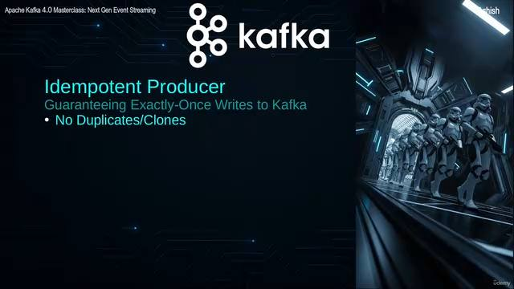
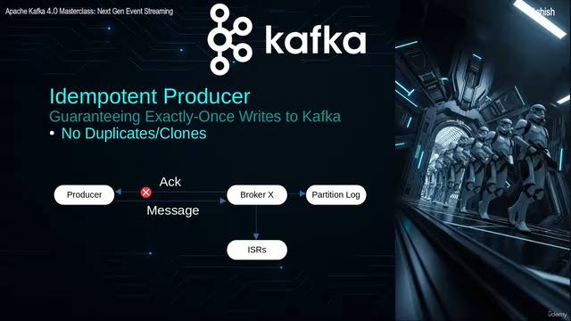
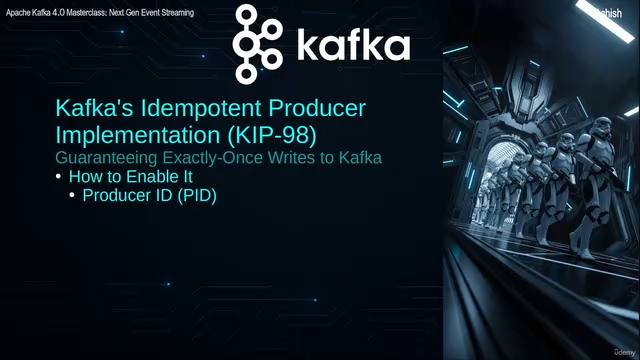
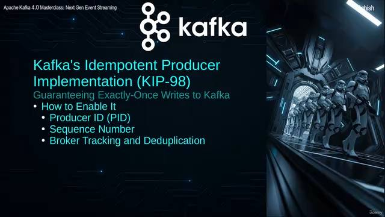
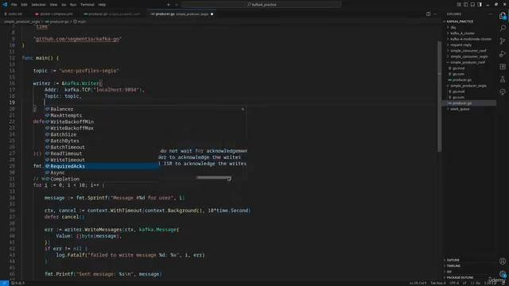
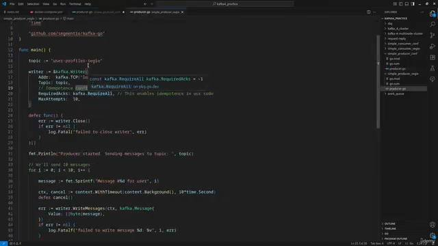
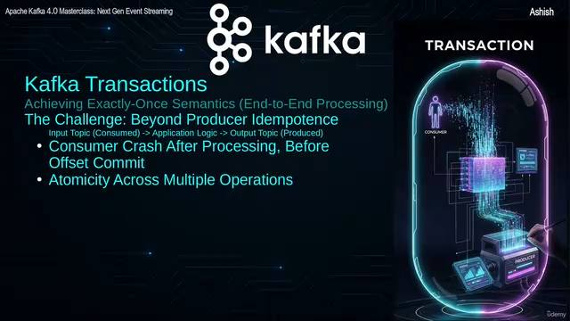
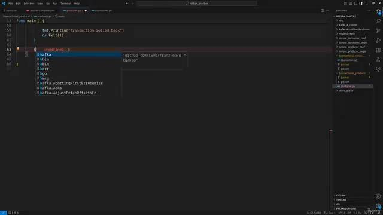
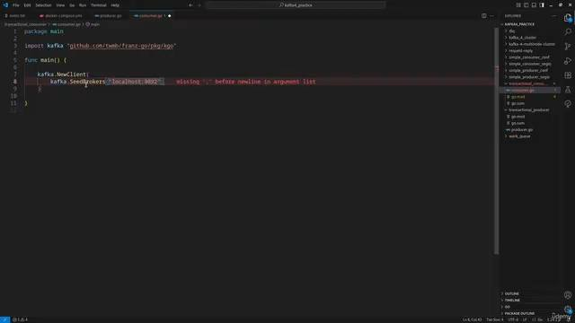
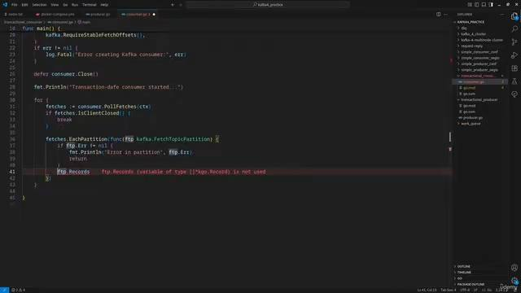

# Apache Kafka 4.0：幂等生产者与 Kafka 事务（P056–P057）

> 覆盖课程：BV1iKNi6kEwT 的 P056（幂等生产者）与 P057（Kafka 事务 / 端到端 Exactly-Once）。
> 默认前提：你已经有一台跑在 `localhost:9092` 的 Kafka 4.0 broker（课程前面章节已经搭好），本机装了 Go。
> 这两节讲师用的语言是 **Go**。前端同学不用慌：全程只有 `:=` 声明、`defer` 延迟执行、`os.Exit(1)` 三处语法需要「知道即可」，其余都是配置项语义，跟你在 Node 里写 Kafka 客户端是同一套概念。

---

## 1. 这一节做什么

这节课要把 Kafka 的可靠性讲到最顶层，一共三层递进：

**第一层：幂等生产者（P056）。** 前面已经讲过 `acks=all` + 副本机制能保证消息不丢，但没解决「重复」。生产者的 `retries` 是为了容错，可一旦 broker 写成功了、把 ACK 回给生产者的路上网络抖了一下，ACK 丢了，生产者就以为没送到，于是重发 —— 消息在日志里就有了两份。讲师把这种语义叫 **at least once（至少一次）**。要剪掉重复，就要让「同一个生产者、同一个分区、同一个序号」的消息只落盘一次，这就是幂等生产者。它的实现靠三样东西：**Producer ID（PID）**、**每个分区单调递增的 Sequence Number**、**broker 端记录「这个 PID 在这个分区已经写到第几号」**。broker 收到一个序号恰好等于「上次 + 1」的新消息就写入，收到「≤ 上次」的就当作重试丢掉，收到「远大于上次」的就报错。

**第二层：为什么幂等还不够（P057 开头）。** 幂等只保证「生产者 → Kafka 日志」这一段。但真实管道是「从 input topic 读 → 业务处理 → 写 output topic → 提交消费位点（offset）」。如果写完 output、还没提交 offset 就崩了，重启后会从旧 offset 重读，把结果再写一遍，下游就重复了。再进一步，如果中间还写了外部数据库，崩溃点落在数据库和 Kafka 之间，就会出现「钱扣了但没入账」的部分成功状态。

**第三层：Kafka 事务。** 把「读 input、处理、写 output、提交 offset」打包成一个原子操作：全成功或全回滚。配套的角色有四个：带 `transactional.id` 的事务型生产者、**事务协调器（Transaction Coordinator）**、会走两阶段提交的 broker、以及 `isolation.level=read_committed` 的事务型消费者。

**这两节最终要交付的东西**：一个用 Go 写的 `producer.go` + `consumer.go`，跑起来能看到「提交后消息一次性出现在消费者端」和「回滚后消费者什么也收不到」两个结果。只有把这两个结果亲手跑出来，你才算真的理解了 exactly-once，光看定义是记不住的。

---

## 2. 讲师原话

关于重复是怎么来的：

> "生产者自然会重试发送消息。重试对容错至关重要，但也可能导致不理想的结果：Kafka 日志中出现重复消息。"
> —— p056 [00:26]

> "代理 X 成功将消息写入分区日志，并将其复制到 ISR。随后，代理 X 尝试向生产者返回确认。然而出现了网络故障，确认消息在返回生产者的途中丢失。生产者在超时时间内始终没有收到 ACK。"
> —— p056 [01:51]

关于「幂等」这个词本身：

> "在计算领域，如果一个操作执行多次与执行一次的效果相同，那么它就是幂等的。"
> —— p056 [04:11]

> "幂等生产者确保：即使因重试多次发送同一条消息，该消息也只会被写入 Kafka 日志一次。"
> —— p056 [05:03]

关于「默认开启」这句容易误解的话，讲师专门澄清了一次：

> "当说幂等性默认启用时，这一点常让人困惑。这里说的是 Kafka 代理的默认设置，也就是协议层面的幂等性，而不是客户端库的行为。"
> —— p056 [11:37]

> "在我们的 Kafka 集群中，Kafka 代理的幂等性是在 Kafka 的主设置里启用的。而你也确实需要在使用现有 Kafka 库的生产者中配置幂等性。"
> —— p056 [12:33]

关于为什么课上不演示幂等的实际效果：

> "要真正看到幂等性生效，我们需要成功向代理发送一条消息，并设法拦截网络流量，只删除从代理返回的确认包，同时不干扰连接的其他任何部分。这不是我们在应用中写代码就能做到的事。"
> —— p056 [13:02]

关于幂等的边界：

> "精确一次保证仅针对单个生产者会话。如果生产者应用崩溃并重启，它会获得新的 PID。如果上一会话已部分发送消息，就可能出现重复。若要在应用重启后仍获得端到端的精确一次保证，就需要使用 Kafka 事务。"
> —— p056 [16:12]

关于事务的核心动作 `sendOffsetsToTransaction`：

> "应用调用 producer.sendoffsets 向事务传入当前消费者偏移量和消费者组 ID。这是把输入消费与事务关联起来的关键步骤。"
> —— p057 [08:38]

关于消费者的隔离级别：

> "设置后，消费者只会读取已由事务型生产者成功提交的消息。它们会自动过滤掉属于未关闭、未提交或已中止事务的消息。默认行为是隔离级别等于 read uncommitted。"
> —— p057 [07:25]

关于 `RequireStableFetchOffsets`（讲师在讲消费者配置时顺手讲到的一个关键参数）：

> "这一点在 KIP447 中提出，并在 Kafka 2.5 中引入。……由于这会阻塞消费，强烈建议把事务超时设置为较小的值，例如 10 秒，而不是默认的 60 秒。"
> —— p057 [32:08]

关于最后跑出来的现象，讲师自己解释了一遍为什么兜底分支没被触发：

> "这没有起作用。我们并没有针对未提交记录写任何打印语句。这是因为我们已经把客户端配置成了 Kafka 的 read committed 隔离级别，所以它不会读取未提交的消息。也正因如此，我们实际上从未遇到这种情况。不过这起到了一种故障保护作用。"
> —— p057 [43:46]

---

## 3. 从零复现

### 3.0 先确认环境

```bash
# broker 在跑
# 注意：Kafka 4.0 只有 KRaft 模式，没有 ZooKeeper 了，用 kafka-storage.sh / kafka-server-start.sh 起的
nc -zv localhost 9092

# Go 版本（franz-go 需要 1.20+；本文按 go 1.21 写）
go version
```

讲师这两节的 broker 地址一直是 `localhost:9092`：

> "我只提一下 localhost:9092。即使跳过这一项，它也会默认使用 localhost:9092。"
> —— p057 [13:50]

课程里还提到过 `9094` / `9095` 这两个端口，那是同一套集群对外暴露的其它 listener，本节不用。

### 3.1 建目录

讲师在 P057 里明确说了目录结构：

> "我会新建一个文件夹，把它命名为 producer，同时再创建一个事务型消费者。然后在这些文件夹里创建 producer.go 和 consumer.go。"
> —— p057 [11:28]

照着建：

```bash
mkdir -p kafka-transactions/producer kafka-transactions/consumer
cd kafka-transactions
```

最终结构：

```
kafka-transactions/
├── producer/
│   ├── go.mod
│   └── producer.go
└── consumer/
    ├── go.mod
    └── consumer.go
```

### 3.2 初始化两个 Go module

讲师的做法是两个文件夹各建一个 module：

> "运行 go mod init producer，再执行 go get 安装该包；同样地，我们也可以为事务型消费者做相同操作。"
> —— p057 [12:25]

```bash
cd producer
go mod init producer
go get github.com/twmb/franz-go/pkg/kgo@v1.17.1

cd ../consumer
go mod init consumer
go get github.com/twmb/franz-go/pkg/kgo@v1.17.1
```

**关于这个库叫什么。** 讲师在 P056 里用的是 `segmentio/kafka-go` 和 `confluent-kafka-go`，到了 P057 换成了第三个库：

> "我们还看到来自……的 KGo 库。这里可以看到，KGO 包提供了一个纯 Go 编写的高效 Kafka 客户端，支持 Kafka 0.8 及以后版本、事务、正则主题消费、最新的分区策略等。"
> —— p057 [10:59]

他后面在代码里写的 `Kafka dot newClient`、`Kafka dot transactional ID`、`Kafka dot produceSync` 都来自这个库，Go 包名是 `kgo`，模块路径是 `github.com/twmb/franz-go/pkg/kgo`。讲师在代码里把 import 起了别名 `Kafka` 方便阅读：

> "如果你想在这个库中使用 Kafka 这个名字，我们可以直接把它命名为 Kafka，然后在这里使用 Kafka。"
> —— p057 [13:22]

依赖版本我按 `v1.17.1` 写；`go mod tidy` 会自动补全 `go.sum` 和间接依赖，如果你的网络环境拉到的是更新的小版本，以实际拉到的为准，API 不变。

### 3.3 建 topic

讲师在跑代码前补了一句「要先建 topic」，但命令本身是一闪而过的画面，逐字稿没有转写出来。**课里没讲具体命令**，下面是 Kafka 自带脚本的标准写法（`$KAFKA_HOME` 换成你的 Kafka 4.0 解压目录）：

```bash
$KAFKA_HOME/bin/kafka-topics.sh \
  --bootstrap-server localhost:9092 \
  --create \
  --topic transactions-demo \
  --partitions 1 \
  --replication-factor 1
```

topic 名和消费组名取自讲师代码：topic 是 `transactions demo`，消费组是 `transaction demo group`。

### 3.4 写代码

直接把第 4 节的 `producer.go` 和 `consumer.go` 原样存进对应目录。

### 3.5 先起消费者，再跑生产者

顺序很重要：**消费者必须先跑起来**，否则你看不到「消息是在 commit 那一刻才出现」这个关键现象。

终端 A：

```bash
cd consumer
go run consumer.go
```

预期看到：

```
transaction safe consumer started
```

然后终端 B 跑第一次（成功事务）：

```bash
cd producer
go run producer.go
```

预期生产者端：

```
transaction started
message sent: order placed
message sent: payment success
message sent: inventory updated
transaction committed successfully
```

消费者端（**注意时间差**：前 3 秒内什么都看不到，第 4 秒一条 commit 之后三条一起冒出来）：

```
committed message key= value=order placed offset=0
committed message key= value=payment success offset=1
committed message key= value=inventory updated offset=2
```

这正是讲师现场看到的：

> "事务一提交，我们的消息就出现在这里：订单已创建、支付成功、库存已更新。"
> —— p057 [43:19]

### 3.6 复现「回滚」这条路径

回到 `producer.go`，把 `main()` 里 `messages` 那一行的注释互换（第 4 节代码里已经标好位置），变成包含 `"fail now"` 的版本，保存后重跑：

```bash
cd producer
go run producer.go
```

预期生产者端：

```
transaction started
message sent: order placed
message sent: payment success
simulated failure: rolling back transaction
transaction rolled back
```

消费者端：**一条都不会打印**。

> "回滚后，这里没有出现任何内容。"
> —— p057 [43:19]

### 3.7 再切回成功路径，观察 offset 跳号

把注释换回来，再跑一次成功事务。这时候消费者端会看到类似：

```
committed message key= value=order placed offset=7
committed message key= value=payment success offset=8
committed message key= value=inventory updated offset=9
```

前面 `0~6` 被跳过了。讲师原话是：

> "0、1、2、3、4、5、6 都被跳过，7、8、9 显示在这里。"
> —— p057 [44:14]

**这不是 bug，是事务的正常表现。** 事务在日志里除了数据记录，还会写「控制记录」（commit marker / abort marker），这些记录也占 offset，但 `read_committed` 的消费者不会把 marker 当数据给你。所以你在 `read_committed` 消费者上看到的 offset 天然就是跳号的。

### 3.8 （可选）用 Kafka UI 交叉验证

讲师最后打开了 Kafka UI 看 topic：

> "我们也去看一下 Kafka UI。这里有事务演示，点开它。这里有消息。可以看到来自那个失败事务的消息：订单已创建、支付成功，但没有库存已更新，因为事务在这一步之后被取消了。"
> —— p057 [44:42]

**这个 Kafka UI 是课程前面章节已经搭好的，这两节没有讲怎么装。** 它的价值在于：它默认按「读所有消息」的方式展示，所以你能在 UI 里看到那条**被回滚事务里的 `order placed` 和 `payment success` 仍然躺在日志里**——这在概念上非常重要：回滚不是「从磁盘删掉」，而是「打上 aborted 标记，让 `read_committed` 的消费者过滤掉」。

---

## 4. 完整代码

### 4.1 `producer/producer.go`

```go
package main

import (
	"context"
	"fmt"
	"log"
	"os"
	"time"

	kafka "github.com/twmb/franz-go/pkg/kgo"
)

const topic = "transactions-demo"

// rollback 回滚当前事务。
// 注意：讲师口述的签名是 Kafka.Client，
// 但 NewClient 返回的是 *kgo.Client，这里必须用指针，否则编译不过。
func rollback(ctx context.Context, client *kafka.Client) {
	// 只有在 ctx 被取消时才需要这一步：把还没发出去的缓冲记录丢掉
	if err := client.AbortBufferedRecords(ctx); err != nil {
		fmt.Println("error aborting buffered records", err)
		return
	}

	// 结束事务并打上 abort 标记
	if err := client.EndTransaction(ctx, kafka.TryAbort); err != nil {
		log.Printf("error rolling back transaction: %v", err)
		return
	}

	fmt.Println("transaction rolled back")
}

func main() {
	ctx := context.Background()

	// 每个生产者实例一个唯一 ID；用进程号保证同一台机器上多开不会撞车
	producerID := fmt.Sprintf("producer-%d", int64(os.Getpid()))

	client, err := kafka.NewClient(
		// broker 地址
		kafka.SeedBrokers("localhost:9092"),
		// 事务身份，Kafka 靠它在重启后恢复事务状态
		kafka.TransactionalID(producerID),
		// 默认生产目标 topic，省得每条 record 都写一遍
		kafka.DefaultProduceTopic(topic),
		// 事务必须要求所有 ISR 确认
		kafka.RequiredAcks(kafka.AllISRAcks()),
	)
	if err != nil {
		log.Fatalf("unable to create kafka client: %v", err)
	}
	defer client.Close()

	// 成功场景
	messages := []string{"order placed", "payment success", "inventory updated"}

	// 失败场景：把上面一行注释掉，打开下面这一行
	// messages := []string{"order placed", "payment success", "fail now", "inventory updated"}

	// 开始事务
	if err := client.BeginTransaction(); err != nil {
		log.Fatalf("couldn't start transaction: %v", err)
	}
	fmt.Println("transaction started")

	for _, msg := range messages {
		// 模拟一个中途失败
		if msg == "fail now" {
			fmt.Println("simulated failure: rolling back transaction")
			rollback(ctx, client)
			os.Exit(1)
		}

		record := kafka.StringRecord(msg)

		results := client.ProduceSync(ctx, record)
		if err := results.FirstErr(); err != nil {
			log.Printf("error sending message: %v, aborting transaction", err)
			rollback(ctx, client)
			return
		}

		fmt.Println("message sent:", msg)
		time.Sleep(time.Second)
	}

	// 全部成功，提交
	if err := client.EndTransaction(ctx, kafka.TryCommit); err != nil {
		log.Fatalf("commit failed: %v", err)
	}
	fmt.Println("transaction committed successfully")
}
```

### 4.2 `consumer/consumer.go`

```go
package main

import (
	"context"
	"fmt"
	"log"
	"time"

	kafka "github.com/twmb/franz-go/pkg/kgo"
)

const topic = "transactions-demo"

func main() {
	ctx := context.Background()

	consumer, err := kafka.NewClient(
		kafka.SeedBrokers("localhost:9092"),
		kafka.ConsumerGroup("transaction-demo-group"),
		kafka.ConsumeTopics(topic),
		// KIP-447，Kafka 2.5 引入；消费组必须等 offset 稳定后才继续消费
		kafka.RequireStableFetchOffsets(),
		// 事务型消费者的标志性配置
		kafka.FetchIsolationLevel(kafka.ReadCommitted()),
	)
	if err != nil {
		log.Fatalf("error creating kafka consumer: %v", err)
	}
	defer consumer.Close()

	fmt.Println("transaction safe consumer started")

	for {
		fetches := consumer.PollFetches(ctx)
		if fetches.IsClientClosed() {
			break
		}

		fetches.EachPartition(func(p kafka.FetchTopicPartition) {
			if p.Err != nil {
				fmt.Println("error in partition:", p.Err)
				return
			}

			for _, rec := range p.Records {
				// 兜底：跳过被回滚事务留下的标记记录
				// 讲师口述写作 rec.attributes.isTransactional / isControl / producer epoch，
				// franz-go 的实际 API 是下面这三个
				if rec.Attrs.IsTransactional() && rec.Attrs.IsControl() && rec.ProducerEpoch == -1 {
					fmt.Println("skipping aborted transactional record")
					continue
				}

				fmt.Printf("committed message key=%s value=%s offset=%d\n",
					string(rec.Key), string(rec.Value), rec.Offset)
			}
		})

		// 别把 CPU 打满
		time.Sleep(500 * time.Millisecond)
	}
}
```

### 4.3 另外两个库的幂等配置（讲师在 P056 演示过）

讲师在 P056 里先演示了 `segmentio/kafka-go` 的 Writer 配置，再演示了 `confluent-kafka-go` 的 `ConfigMap`。**课里只演示到「配置」这一层，没有配完整的发送程序**，所以下面两段是配置对照，不是可直接运行的完整 main。

`segmentio/kafka-go`（讲师把 `RequiredAcks` 设成了 `RequireAll`，并说「这就是在代码里打开幂等的方式」，另外加了 `MaxAttempts`）：

```go
w := &kafka.Writer{
	Addr:         kafka.TCP("localhost:9092"),
	Topic:        topic,
	Balancer:     &kafka.LeastBytes{},
	RequiredAcks: kafka.RequireAll, // 0 = RequireNone / 1 = RequireOne / -1 = RequireAll
	MaxAttempts:  10,
}
```

`confluent-kafka-go`（讲师逐个敲的四个键）：

```go
cfg := &kafka.ConfigMap{
	"bootstrap.servers":                     "localhost:9092",
	"enable.idempotence":                    true,
	"acks":                                  "all",
	"retries":                               10,
	"max.in.flight.requests.per.connection": 5,
}
```

配置项与讲师原话的对应关系：

| 库 | 配置项 | 讲师怎么说的 |
|---|---|---|
| kafka-go | `RequiredAcks: kafka.RequireAll` | 「So this so this enables item portents in our code」p056 [09:41] |
| kafka-go | `MaxAttempts` | 「we can also include max attempts and that can be 10 or 5 or whatever you want」p056 [10:10] |
| confluent | `enable.idempotence = true` | 「we are going to type enable dot item potence and set it to true」p056 [10:39] |
| confluent | `acks = "all"` | 「Confluent Ink requires all as a string」p056 [10:39] |
| confluent | `retries` | 「retries are going to be Again, 10 or 5, whatever you want」p056 [11:08] |
| confluent | `max.in.flight.requests.per.connection` | 「you can also mention max.in.flight.requests.per.connection and that is going to be 10, 5」p056 [11:08] |

---

## 5. 逐行解释

### 5.1 幂等那部分的图示

先看重复是怎么产生的：



讲师接着用「开关」和一条 SQL 把「幂等」这个词落地：



> "如果你多次执行 update users set status = 'active' where ID = 123，用户的 status 仍然只会是 active 一次。"
> —— p056 [04:34]

这个例子对前端同学特别友好：它就是「幂等 PUT」——重复调用 N 次和调用 1 次结果一样。注意讲师强调的不是「请求只发生一次」，而是「**最终状态一致**」。Kafka 的幂等生产者做的是同一件事：消息可能被发两次，但日志里只有一条。

幂等的实现机制是 PID + 序号：



broker 端的判定规则只有三种情况，讲师讲得很干脆：

> "如果序列号恰好比上一个成功写入的序列号大 1，消息就会被写入日志。如果序列号等于或小于上一个成功写入的序列号，代理就知道这是对已处理消息的重试，因此会丢弃重复消息。如果序列号远高于预期，例如比上一个值大 5，就说明可能存在消息乱序之类的问题，并可能触发错误。"
> —— p056 [07:22]

换成前端能懂的话：这就是一个按分区维护的「已处理最大序号」游标。收到的序号 == 游标+1 → 推进游标；≤ 游标 → 丢弃；> 游标+1 → 说明中间丢了消息，报错。

仓库类比把这件事讲得更直观：



然后是代码层面怎么开：





这里有个**必须记住的坑**：讲师说「Kafka 3.0 起幂等默认开启」，指的是 **broker 协议层面**默认，不是客户端库默认：

> "所以这里说的是我们的 Kafka 代理，也就是我们的 Kafka 集群。在我们的 Kafka 集群中，Kafka 代理的幂等性是在 Kafka 的主设置里启用的。而你也确实需要在使用现有 Kafka 库的生产者中配置幂等性。"
> —— p056 [12:33]

### 5.2 事务的四个角色



- **Transactional Producer**：带一个 `transactional.id`。这个 ID 不是随便起的，它是「崩溃恢复的钥匙」——重启后拿同一个 ID 回来，协调器就能把上次没做完的事务清掉。
- **Transaction Coordinator**：某个 broker 担任，记录每个事务的状态（open / preparing to commit / committed / aborted），跨分区跨 broker 时负责跑两阶段提交。
- **Transactional Consumer**：`isolation.level = read_committed`。这是**成为事务型消费者的唯一开关**，讲师专门强调过：
  > 「without this we wouldn't have been able to work with a transactional consumer. If we did not have this then this would not be a transactional consumer.」
  > —— p057 [39:32]

### 5.3 `producer.go` 逐行

**`producerID := fmt.Sprintf("producer-%d", int64(os.Getpid()))`**
讲师的原话是「I'm going to use string conversion string convert dot format dot int and this is going to be int64，然后 os.getpid，base 10」。为什么要拼进程号？因为 `transactional.id` 必须**每个生产者实例唯一**。你本地开两个终端跑同一份 `producer.go`，如果 ID 写死，第二个进程会把第一个的事务状态「接管」掉，表现就是莫名其妙的事务超时。用 pid 是最省事的做法，生产环境一般用「业务名 + Pod 序号」之类的稳定 ID。

**`kafka.SeedBrokers("localhost:9092")`**
讲师说过这行其实可以省（库内部默认就是它），但他坚持写：
> "尽管这一项默认已经内嵌在库中，我还是喜欢显式写出来……但我仍会尽量写得明确，这样代码里就能记录我们连接的位置。"
> —— p057 [29:58]

**`kafka.RequiredAcks(kafka.AllISRAcks())`**
在 franz-go 里，ack 级别被写成了三个具名的常量：`AllISRAcks()` / `LeaderAck()` / `NoAck()`。讲师专门夸过这个设计比前两个库清晰：
> "这里实际上清楚得多：你可以要求所有同步副本都返回确认，也可以只要求领导者返回确认，或者不要求任何确认。"
> —— p057 [16:43]
事务生产者必须是 `AllISRAcks`——事务的原子性建立在「至少一份完整副本」的前提上，`acks=1` 时 leader 挂了事务状态就可能丢。

**`defer client.Close()`**
Go 的 `defer` 就是「函数返回前执行」，等价于 JS 里 `try { ... } finally { await client.close() }`。注意这里有个细节：`main()` 里中途 `os.Exit(1)` 时 defer **不会**执行，因为 `os.Exit` 是直接掐进程。讲师在失败分支里用的正是 `os.Exit(1)`，也就是「崩给你看」，这恰好模拟了真实崩溃的场景。

**`client.BeginTransaction()`**
在本地标记事务开始，此时发出的消息对 `read_committed` 消费者是**不可见**的。这就是为什么消费者在前 3 秒一条都收不到。

**`rollback()` 里为什么两个调用都要**



讲师自己解释过：

> "当上下文被取消时，client.abortBufferedRecords 就会发挥作用。但如果事务被取消，或者事务即将结束，那么它也会发挥作用。"
> —— p057 [22:44]

翻成人话：
- `AbortBufferedRecords(ctx)` 处理的是**还没发出去的本地缓冲**——ctx 被 cancel 时，这些记录留在缓冲区里，得丢掉；
- `EndTransaction(ctx, kafka.TryAbort)` 处理的是**已经发到 broker 的记录**——向协调器发 abort，让 broker 在日志里写 abort marker，把这一批数据标注成「已回滚」。

只调后面那个，缓冲区里的记录会随着下次事务被意外提交；只调前面那个，broker 上的半截事务会一直挂到超时才被清理。两个都调才是完整的。

**`kafka.StringRecord(msg)`**
构造一条 `key` 为空、`value` 是 msg 的记录。讲师没有设 key，所以消费者端打印出来 `key=` 是空的。

**`results := client.ProduceSync(ctx, record)` + `results.FirstErr()`**
`ProduceSync` 是同步发送——发完等 broker 确认才返回，适合做演示（换成异步的话，你无法在循环里准确判断「这一条到底成没成」）。返回值是结果集合，`FirstErr()` 取第一个错误，没错误返回 `nil`。

**`time.Sleep(time.Second)`**
纯粹是为了让消费者端肉眼能看见「commit 之后一次性出现」，删掉不影响正确性。

**`client.EndTransaction(ctx, kafka.TryCommit)`**
提交。注意讲师在失败分支用的是 `TryAbort`、成功分支用的是 `TryCommit`，这是两个不同的常量，别写反——写反的后果是「该回滚的提交了」，比报错还难排查。

**`os.Exit(1)`**
退出码 1 表示异常退出。你 `echo $?` 能看到 1，用来在脚本里判断这次跑的是失败场景。

### 5.4 `consumer.go` 逐行



**`kafka.ConsumerGroup("transaction-demo-group")`**
消费者组。同一组内多个消费者会瓜分分区，所以演示时**只开一个消费者**，否则你可能在 A 终端看到一条、B 终端看到另一条，误以为丢消息。

**`kafka.ConsumeTopics(topic)`**
注意这里和生产者用的不是同一个选项：生产者是 `DefaultProduceTopic`，消费者是 `ConsumeTopics`。讲师在代码里明确对比过这两行。

**`kafka.RequireStableFetchOffsets()`**
这个参数很多人会漏。它是 KIP-447 的产物（Kafka 2.5 引入），作用是「在消费组位点稳定之前不要往下消费」，防止在重平衡期间读到「已提交事务的位点还没同步完」的中间态，从而产生重复。代价是可能阻塞消费——所以讲师提醒把事务超时调小：

> "由于这会阻塞消费，强烈建议把事务超时设置为较小的值，例如 10 秒，而不是默认的 60 秒。"
> —— p057 [32:08]

**`kafka.FetchIsolationLevel(kafka.ReadCommitted())`**
事务型消费者的开关，见 5.2。默认值是 `read_uncommitted`：什么都能读到，包括还没提交的、已经回滚的。做 exactly-once 必须显式改。

**`fetches := consumer.PollFetches(ctx)` + `fetches.IsClientClosed()`**
`PollFetches` 会阻塞直到有数据或超时。`IsClientClosed()` 判断客户端是不是已经被关了（比如 ctx 被 cancel），是就退出死循环。这是 Go 里写消费循环的标准骨架，跟 Node 里 `while (true) { const { messages } = await consumer.poll() }` 是一个意思。

**`fetches.EachPartition(func(p kafka.FetchTopicPartition) { ... })`**
按分区遍历。这个库还提供 `EachRecord`、`EachTopic`、`EachError` 等遍历方式，讲师挑了 `EachPartition`，因为要先检查分区级错误 `p.Err`。

**`if p.Err != nil { ... return }`**
分区级错误（比如在 rebalance 中这个分区被收走了）不是致命错误，打印一下、跳过这个分区就好，不要 `break` 整个循环。

**三个过滤条件**



讲师拆得很清楚：

1. `rec.Attrs.IsTransactional()` —— 「这条记录是不是事务发出来的」。是的话说明它来自某个 `BeginTransaction`。
2. `rec.Attrs.IsControl()` —— 「这条是不是控制记录」。Kafka 用特殊的、应用看不见的控制记录来标记事务的最终结局，commit 一种、abort 一种。我们只要真实数据，不要这些内部标记。
3. `rec.ProducerEpoch == -1` —— 最关键的判定。正常数据记录的 epoch 是 `>= 0` 的版本号；事务被回滚时，broker 会为每条属于该事务的记录写一个「标记副本」，把它的 epoch 强行设成 `-1`。所以 `epoch == -1` 就是在问：「这条是不是一个被回滚事务留下的墓碑？」

三个条件同时成立才 `continue` 跳过。讲师自己也

## 6. 复现检查清单

- [ ] **broker 可达**：`nc -zv localhost:9092` 返回 `succeeded` / `open`。若失败，先确认 Kafka 4.0 是 KRaft 模式起的（`kafka-storage.sh` 格式化 + `kafka-server-start.sh`），不是 ZooKeeper 模式。
- [ ] **Go 版本够**：`go version` 显示 `go1.20` 及以上（franz-go v1.17.1 要求）。低于此版本 `go get` 会报 module 要求更高的 go 版本。
- [ ] **两个 module 各自独立**：`producer/go.mod` 与 `consumer/go.mod` 都存在，且 `go.sum` 已生成（`ls producer/go.sum consumer/go.sum` 两个文件都在）。缺 `go.sum` 说明 `go get` 没跑成功。
- [ ] **依赖能编译**：在 `producer/` 下 `go build ./...` 无输出（成功时静默）。若报 `undefined: kafka.XXX`，多半是 `go get` 拉到的版本与 `v1.17.1` 差异过大，先 `go mod tidy` 再看。
- [ ] **topic 已建**：`$KAFKA_HOME/bin/kafka-topics.sh --bootstrap-server localhost:9092 --describe --topic transactions-demo` 能打印出 `PartitionCount: 1`。若报 `Topic ... does not exist`，回到 3.3 建 topic。
- [ ] **消费者先启动**：终端 A 跑 `go run consumer.go`，**必须**先看到 `transaction safe consumer started` 这一行，再去终端 B 跑生产者。顺序反了会看不到「commit 那一刻才出现」的现象。
- [ ] **成功事务：生产者端输出齐全**：终端 B 依次打印 `transaction started` → 三条 `message sent: ...` → `transaction committed successfully`，且三条 `message sent` 之间大约间隔 1 秒（`time.Sleep(time.Second)` 的效果）。
- [ ] **成功事务：消费者端有延迟**：终端 A 在生产者跑起来后的**前 3 秒内没有任何输出**，第 4 秒左右三条 `committed message ...` 一起出现。如果三条是逐条实时出现的，说明 `FetchIsolationLevel(kafka.ReadCommitted())` 没生效，回去检查 consumer.go 的选项。
- [ ] **成功事务：offset 从 0 开始**（首次跑）：消费者端打印 `offset=0`、`offset=1`、`offset=2`。若首次就跑出大 offset，说明 topic 里已有旧数据，先删 topic 重建或换 topic 名。
- [ ] **回滚路径：生产者端输出**：把 `messages` 换成含 `"fail now"` 的那行后重跑，终端 B 打印 `transaction started` → `message sent: order placed` → `message sent: payment success` → `simulated failure: rolling back transaction` → `transaction rolled back`，**没有** `inventory updated`，**没有** `transaction committed successfully`。
- [ ] **回滚路径：退出码为 1**：`cd producer && go run producer.go; echo $?` 输出 `1`（`os.Exit(1)` 的效果）。输出 `0` 说明走的是成功分支，检查注释是否换对了。
- [ ] **回滚路径：消费者端一条都不打印**：终端 A 在回滚那次运行期间**完全静默**。若打印了 `order placed` / `payment success`，说明隔离级别没设成 `read_committed`。
- [ ] **offset 跳号**：切回成功路径再跑一次，消费者端 offset 从 `7` 开始（`offset=7/8/9`），`0~6` 被跳过。这是事务控制记录占位的正常表现，不是 bug。
- [ ] **（可选）Kafka UI 交叉验证**：在课程前面搭好的 Kafka UI 里打开 `transactions-demo`，能看到回滚那次留下的 `order placed`、`payment success` 两条记录仍在，但没有 `inventory updated`。这验证了「回滚 = 打 aborted 标记，不是物理删除」。

## 7. 课里没讲但你会撞上的

| 现象 | 原因 | 怎么办 |
|---|---|---|
| `go run producer.go` 报 `undefined: kafka.AllISRAcks` 或类似符号找不到 | 拉到的 franz-go 版本与文档写的 `v1.17.1` 不一致，API 有出入 | 先 `go mod tidy`；仍报错就 `go get github.com/twmb/franz-go/pkg/kgo@v1.17.1` 显式锁版本。**课里没讲**版本兼容问题，讲师只说了「这个库更新很活跃」。 |
| 生产者报 `transactional.id ... is already in use` 或事务莫名超时 | 两个进程用了同一个 `transactional.id`。文档里用 `os.Getpid()` 拼 ID 就是为了避免这个，但如果你手动改成了固定字符串就会撞 | 保持 `producerID := fmt.Sprintf("producer-%d", int64(os.Getpid()))` 不动；或改成「业务名 + 唯一后缀」。**课里没讲**这个报错长什么样，讲师只讲了「用 pid 保证唯一」。 |
| 消费者端一条消息都收不到，生产者端却显示 commit 成功 | 消费者启动晚于生产者，或消费组位点已经越过新消息；也可能是 topic 名/消费组名拼错 | 先起消费者再跑生产者；确认两边 `const topic = "transactions-demo"` 完全一致；换一个消费组名（如 `transaction-demo-group-2`）重跑。**课里没讲**消费组位点残留的排查方法。 |
| 回滚后消费者端仍打印出 `order placed` / `payment success` | `FetchIsolationLevel(kafka.ReadCommitted())` 没写或写错，默认是 `read_uncommitted` | 检查 consumer.go 的 `kafka.NewClient` 选项里是否有 `kafka.FetchIsolationLevel(kafka.ReadCommitted())`。**课里没讲**漏配后的具体表现，只讲了「默认是 read_uncommitted」。 |
| 消费者端打印 `skipping aborted transactional record` 但讲师现场没这句 | 文档 4.2 的兜底分支（`IsTransactional() && IsControl() && ProducerEpoch == -1`）是**补充**的，讲师口述的字段名（`rec.attributes.isTransactional` 等）在 franz-go 里不存在，文档换成了实际 API | 这句打印本身无害，是兜底逻辑在起作用。若你按讲师口述的字段名写，会直接编译不过——以文档 4.2 的写法为准。**课里没讲** franz-go 的实际字段名。 |
| `go run consumer.go` 报 `context deadline exceeded` 或一直阻塞无输出 | `PollFetches(ctx)` 在没数据时会阻塞，这是正常行为；但如果 broker 不可达会一直卡住 | 先确认 broker 在跑（`nc -zv localhost:9092`）；确认 topic 已建。**课里没讲** `PollFetches` 的阻塞语义，讲师只说「waits for fetches to be available」。 |
| 回滚那次跑完，再跑成功路径时消费者端 offset 不是从 7 开始 | 每次回滚/提交写入的控制记录数量可能不同，跳号的具体数值不固定 | 只要 offset 是**跳号**而非从 0 连续，就是正常的事务表现。文档 3.7 写的 `7/8/9` 是讲师那次的实测值，你跑出来可能是别的数字。**课里没讲**跳号数值不固定这一点。 |
| `go mod init producer` 报 `go.mod already exists` | 目录里已有 go.mod（重复执行了 3.2） | 跳过 `go mod init`，直接 `go get`。**课里没讲**重复初始化的处理。 |
| 生产者端打印 `error sending message: ... aborting transaction` 后直接退出，消费者端无输出 | 发送阶段就失败了（broker 不可达、topic 不存在、acks 配置问题），走的是 `results.FirstErr()` 分支 | 看错误详情：`UNKNOWN_TOPIC_OR_PARTITION` → 建 topic；连接拒绝 → 查 broker。**课里没讲**这个分支的排错路径，讲师只演示了「模拟 fail now」这一种失败。 |
| Kafka UI 里看不到 `transactions-demo` topic | Kafka UI 是课程前面章节搭的，这两节没讲怎么装；也可能 UI 连的不是同一个 broker | 确认 UI 的 bootstrap server 指向 `localhost:9092`；确认 topic 已建。**课里没讲** Kafka UI 的安装与配置。 |
