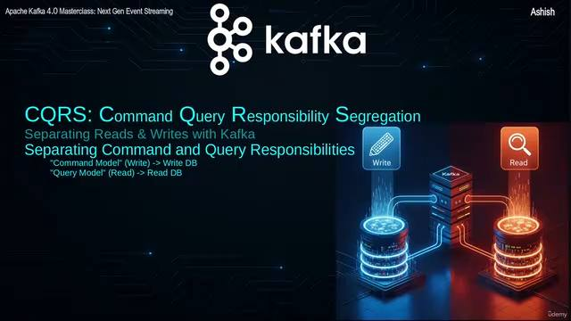
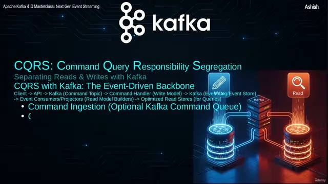
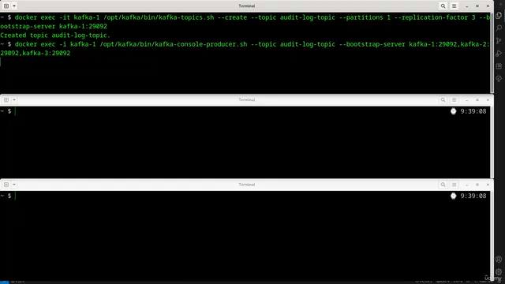
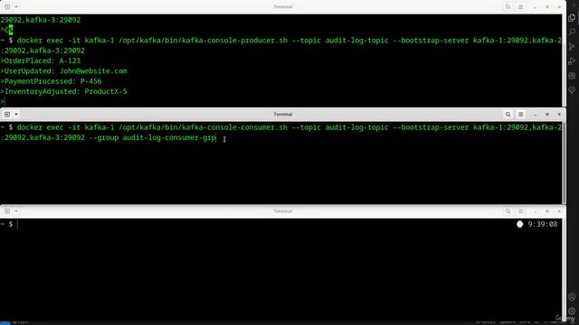
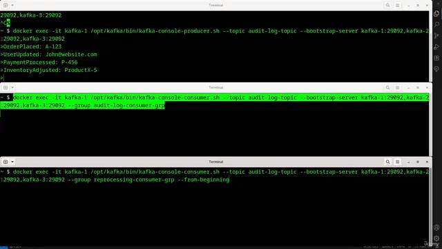
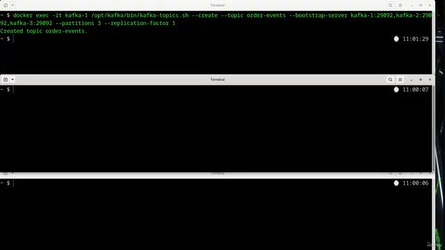
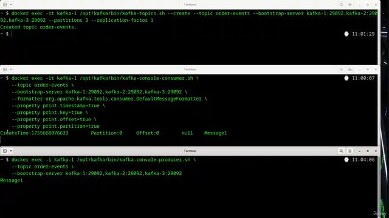
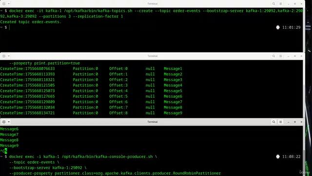
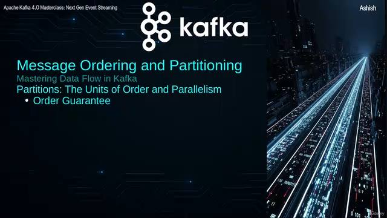

# Apache Kafka 4.0 · CQRS、日志型事件存储与分区顺序（P58–P60）

> 这三节的分工：**P58 是纯架构讲解（没有任何命令）**，讲 CQRS 以及 Kafka 在其中的位置；**P59 是 CLI 实操**，用控制台工具把 Kafka 当成审计日志做一次"重放/时间旅行"；**P60 还是 CLI 实操**，用三个分区把"分区内有序、同 key 同分区、粘性分区器"跑给你看。本文档的"可复现"部分集中在后两个实验，P58 的内容落成第 4 节末尾的一张职责表。

---

## 1. 这一节做什么

这三节课要把前面所有零散的知识点（分区、offset、副本、消费组、事件溯源）收束到三个结论上：

1. **CQRS**：把"改数据"（命令）和"读数据"（查询）拆成两套模型、两个数据存储，中间用 Kafka 这个不可变日志做桥。写入侧只管产生事件，读取侧订阅事件、各自构建自己需要的读模型。代价是最终一致性。
2. **Kafka 就是一个分布式的、不可变的提交日志**，因此它天然是一个事件存储（event store），而不是一个临时的消息队列。只要数据还在保留期内，你就能把消费位点倒回去重放。P59 用一个 `audit-log` 主题做了演示：一个消费组只看到启动之后的新消息，另一个消费组用 `--from-beginning` 把整段历史全部重放了一遍，随后新消息同时到达两边。
3. **顺序只在分区内保证**。P60 建了一个 3 分区的 `order-events` 主题，先验证了不带 key 的消息会被**粘性分区器**堆到一个分区（而不是教科书说的轮询），再强制 `RoundRobinPartitioner` 看到真正的轮询，最后用 `parse.key=true` 证明**同一个 key 的消息永远落在同一个分区**。

产出物：一套可以在本机跑起来的 shell 脚本，按顺序执行就能把上面三个结论亲眼看到一遍。

---

## 2. 讲师原话（带时间戳）

> "命令查询职责分离的核心在于将变更数据或命令的职责与读取数据或查询的职责分离。它是一种强有力的系统设计方式，能让系统具备高可扩展性、灵活性，并针对多样化需求进行优化。Kafka 在衔接这种职责分离方面发挥着关键作用。"
> —— p058 [00:00]

> "一个专门的服务——按事件溯源的说法就是命令处理器或聚合根——会从 Kafka 命令主题中消费命令。它执行业务逻辑、校验命令，并在成功时应用变更。关键在于，它不会直接更新传统数据库，而是发布一个或多个事件。"
> —— p058 [06:25]

> "从核心上看，Apache Kafka 是一个分布式、不可变的提交日志。这一简单却深刻的设计选择，为审计数据完整性以及通过数据进行“时间旅行”释放了强大的能力。"
> —— p059 [00:00]

> "由于事件日志不可变且持久，你可以有效地倒带，重新读取完整的事件历史或其任意部分。"
> —— p059 [04:10]

> "关键在于，不同消费者组彼此独立地消费。在一个组中重新处理数据不会影响其他消费者组。"
> —— p059 [05:05]

> "Kafka 只在单个分区内保证消息具有严格的全序。……同一主题的不同分区之间，消息顺序不受保证。"
> —— p060 [01:54]

> "当生产者发送带有非空键的消息时，Kafka 的默认分区器会取出该键，对其应用哈希函数，哈希结果决定消息被分配到哪个分区。"
> —— p060 [03:43]

> "出现这种现象，可能是因为 Kafka 控制台生产者正在使用 Kafka 新版默认分区策略，即 Sticky Partitioner，它并不是严格的轮询。"
> —— p060 [13:03]





---

## 3. 从零复现

### 3.0 前置环境

课里用的是一套**前置课程已经搭好的多节点 Docker 集群**（逐字稿里出现 `kafka1` / `kafka2` / `kafka3` 三个容器名，讲师说 "kafka1 或 kafka2，kafka3 也行，随你选。"）。**这三节逐字稿本身没有讲怎么搭集群**——如果那一节你没看，用下面这个单节点最小环境即可，所有命令都能跑通（只是 `--bootstrap-server` 只能写一个地址）。

```bash
docker compose up -d
docker compose ps        # 等 kafka1 状态变成 running 再继续
```

> 说明：`docker-compose.yml` 全文在第 4.1 节，**内容是本文档补充的，课里没有**。它用的是 Kafka 4.0 的 KRaft 模式（4.0 已经不再需要 ZooKeeper），所以下面所有命令里**都不会出现 `--zookeeper`**。如果你照老教程加 `--zookeeper localhost:2181`，在 4.0 上会直接报错退出。

准备好之后，把你的工作目录建出来：

```bash
mkdir -p kafka-cqrs-lab/scripts
cd kafka-cqrs-lab
# 把第 4.1 的 docker-compose.yml 和第 4.2 ~ 4.10 的脚本分别存进去
chmod +x scripts/*.sh
```

目录结构：

```
kafka-cqrs-lab/
├── docker-compose.yml
└── scripts/
    ├── 00-env.sh
    ├── 01-create-audit-topic.sh
    ├── 02-produce-audit-events.sh
    ├── 03-consume-live.sh
    ├── 04-consume-replay.sh
    ├── 05-create-order-events-topic.sh
    ├── 06-consume-with-metadata.sh
    ├── 07-produce-unkeyed.sh
    ├── 08-produce-roundrobin.sh
    ├── 09-produce-keyed.sh
    └── 99-cleanup.sh
```

环境变量集中在 `scripts/00-env.sh` 里，**只需要改这一个文件**：

| 变量名 | 默认值 | 含义 |
|---|---|---|
| `KAFKA_CONTAINER` | `kafka1` | 跑 CLI 的容器名；课里就是 kafka1/kafka2/kafka3 之一 |
| `BOOTSTRAP` | `localhost:9092` | 集群地址；课里讲的是"把所有节点都写上"，多节点时写成 `kafka1:9092,kafka2:9092,kafka3:9092` |
| `KAFKA_BIN` | `/opt/kafka/bin` | 官方镜像里 CLI 脚本所在目录，镜像不同要改 |

### 3.1 实验 A：把 Kafka 当审计日志（对应 P59）

**A-1 建主题。** 课里说的是 "audit log topic"，没念出精确的字符串，本文统一用 `audit-log`。

```bash
./scripts/01-create-audit-topic.sh
```



**A-2 灌入四条历史事件。** 注意生产者的输入是从 stdin 喂进去的，所以是 `docker exec -i`，**不带 `-t`**。讲师专门解释了这一点：加了 `-t` 会给你一个带 `>` 提示符的终端体验，两种都能用，只是观感不同。

```bash
./scripts/02-produce-audit-events.sh
```

四条消息的内容（原文从逐字稿里念出来的事件，字段写法本文做了规整，避免空格解析歧义）：

```
order-placed orderId=123A123
user-updated user=john@website.com
payment-processed paymentId=P456
inventory-adjusted product=Product-X units=5
```

**A-3 开"实时"消费者。** 开一个新终端，跑：

```bash
./scripts/03-consume-live.sh
```

这时**屏幕上应该什么都没有**——因为这个消费者没有 `--from-beginning`，它只关心自己启动之后的 offset。



**A-4 开"重放"消费者。** 再开一个终端：

```bash
./scripts/04-consume-replay.sh
```

它会**立刻把刚才那四条历史全部打印出来**。原因有两个，缺一不可：`--from-beginning` 让它从最早 offset 读；**消费组名换成了 `reprocessing-consumer-group`**，如果沿用 A-3 的组名，这个新消费者会接着 A-3 已提交的位点继续，什么都看不到。



**A-5 再发一条新消息**，验证两边都能收到：

```bash
./scripts/02-produce-one.sh   # 或用 02 脚本的追加模式，内容：order-finished orderId=123A123
```

预期：重放消费者打印 `order-finished ...`，实时消费者也打印同样的这一条。这就是课里说的 "两个消费者都能看到这条实时消息。"。

**A-6 收尾**（先别急着关，做实验 B 之前可以留着 A-3/A-4 的窗口继续观察）。

### 3.2 实验 B：分区与顺序（对应 P60）

**B-1 建 3 分区主题。** 讲师强调："确保创建多个分区……这个例子中重要的是分区，至少 3 个。复制因子在这个实验里无所谓。"

```bash
./scripts/05-create-order-events-topic.sh
```



**B-2 启动带元数据的消费者。** 讲师说要用 `--formatter` 加 `timestamp / key / offset / partition` 四个属性。实际的控制台消费者里，这四个开关对应的是 `--property print.timestamp=true`、`print.key=true`、`print.offset=true`、`print.partition=true`——**具体参数名以你本机 `kafka-console-consumer.sh --help` 的输出为准**，不同版本措辞可能不同。

```bash
./scripts/06-consume-with-metadata.sh
```

它会把每条消息打印成类似 `CreateTime:...-Partition:0-Offset:0-key:null-value:message-1` 的样子。**字段名的先后顺序和分隔符以你实际输出为准**，本文不硬编码。



**B-3 发 9 条不带 key 的消息。**

```bash
./scripts/07-produce-unkeyed.sh
```

**你看到的会和理论不一样**：9 条大概率全挤在同一个分区（课里是 partition 0，你跑可能是 0/1/2 任意一个）。这就是粘性分区器（Sticky Partitioner）：生产者不是一条一条轮着发，而是"粘"在一个分区上发一批，攒够了再换下一个。9 条太少，不够跨批。

**B-4 强制轮询。** 停掉 B-3 的生产者，用另一个 flag 重启：

```bash
./scripts/08-produce-roundrobin.sh
```

这次能看到分区号 0、1、2 交替出现。课里在发到 message 10 之后开始出现交错，message 10 → partition 1、message 11 → partition 0、message 12 → partition 2 之类。



**B-5 带 key 的生产者。**

```bash
./scripts/09-produce-keyed.sh
```

输入的是 `key:value` 形式（`parse.key=true` + `key.separator=:`）。预期：`user1` 的所有消息全在同一个分区，`user2` 和 `user3` 全在另一个分区（因为它们的哈希恰好撞到了同一分区）。**你本机跑出来的具体分区号会不同**——分区号取决于 key 的哈希对分区数取模，跟主题名、分区数都有关，别把课里的 "user1 → 分区 0" 当成固定答案。



**B-6 检查。** 课里说 "在我们的界面中也能看到同样的效果。"。如果你没有 UI，用 describe 看分区数就够了：

```bash
docker exec -it kafka1 /opt/kafka/bin/kafka-topics.sh \
  --bootstrap-server localhost:9092 \
  --describe --topic order-events
```

---

## 4. 完整代码

### 4.1 `docker-compose.yml`

> **课里没有这段**。课里假定你已经有前置课程搭好的多节点集群。这里给一个单节点 KRaft 最小环境，保证命令能跑。

```yaml
services:
  kafka1:
    image: apache/kafka:4.0.0
    container_name: kafka1
    ports:
      - "9092:9092"
    environment:
      KAFKA_NODE_ID: 1
      KAFKA_PROCESS_ROLES: broker,controller
      KAFKA_LISTENERS: PLAINTEXT://:9092,CONTROLLER://:9093
      KAFKA_ADVERTISED_LISTENERS: PLAINTEXT://localhost:9092
      KAFKA_CONTROLLER_QUORUM_VOTERS: 1@localhost:9093
      KAFKA_CONTROLLER_LISTENER_NAMES: CONTROLLER
      KAFKA_LISTENER_SECURITY_PROTOCOL_MAP: CONTROLLER:PLAINTEXT,PLAINTEXT:PLAINTEXT
      KAFKA_INTER_BROKER_LISTENER_NAME: PLAINTEXT
      KAFKA_OFFSETS_TOPIC_REPLICATION_FACTOR: 1
      KAFKA_TRANSACTION_STATE_LOG_REPLICATION_FACTOR: 1
      KAFKA_TRANSACTION_STATE_LOG_MIN_ISR: 1
      KAFKA_GROUP_INITIAL_REBALANCE_DELAY_MS: 0
```

### 4.2 `scripts/00-env.sh`

```bash
#!/usr/bin/env bash
# 所有实验脚本共用的环境变量与工具函数
set -euo pipefail

# ---- 按你的实际情况改这三行 ----
export KAFKA_CONTAINER="${KAFKA_CONTAINER:-kafka1}"
export BOOTSTRAP="${BOOTSTRAP:-localhost:9092}"
export KAFKA_BIN="${KAFKA_BIN:-/opt/kafka/bin}"
# --------------------------------

# 在容器里跑任意一个 kafka CLI 脚本，自动补上 --bootstrap-server
kcli() {
  local tool="$1"; shift
  docker exec -i "$KAFKA_CONTAINER" "$KAFKA_BIN/$tool" \
    --bootstrap-server "$BOOTSTRAP" "$@"
}
```

### 4.3 `scripts/01-create-audit-topic.sh`

```bash
#!/usr/bin/env bash
set -euo pipefail
source "$(dirname "$0")/00-env.sh"

kcli kafka-topics.sh \
  --create \
  --topic audit-log \
  --partitions 3 \
  --replication-factor 1 \
  --if-not-exists

echo "--- 创建结果 ---"
kcli kafka-topics.sh --describe --topic audit-log
```

### 4.4 `scripts/02-produce-audit-events.sh`

```bash
#!/usr/bin/env bash
set -euo pipefail
source "$(dirname "$0")/00-env.sh"

# 注意：-i 而不是 -it，与课里一致
docker exec -i "$KAFKA_CONTAINER" "$KAFKA_BIN/kafka-console-producer.sh" \
  --bootstrap-server "$BOOTSTRAP" \
  --topic audit-log <<'EOF'
order-placed orderId=123A123
user-updated user=john@website.com
payment-processed paymentId=P456
inventory-adjusted product=Product-X units=5
EOF

echo "已写入 4 条历史事件"
```

### 4.5 `scripts/03-consume-live.sh`

```bash
#!/usr/bin/env bash
set -euo pipefail
source "$(dirname "$0")/00-env.sh"

# 不带 --from-beginning：只看启动之后的新消息
docker exec -i "$KAFKA_CONTAINER" "$KAFKA_BIN/kafka-console-consumer.sh" \
  --bootstrap-server "$BOOTSTRAP" \
  --topic audit-log \
  --group audit-log-consumer-group
```

### 4.6 `scripts/04-consume-replay.sh`

```bash
#!/usr/bin/env bash
set -euo pipefail
source "$(dirname "$0")/00-env.sh"

# 关键：换一个新的消费组 + --from-beginning
docker exec -i "$KAFKA_CONTAINER" "$KAFKA_BIN/kafka-console-consumer.sh" \
  --bootstrap-server "$BOOTSTRAP" \
  --topic audit-log \
  --group reprocessing-consumer-group \
  --from-beginning
```

### 4.7 `scripts/05-create-order-events-topic.sh`

```bash
#!/usr/bin/env bash
set -euo pipefail
source "$(dirname "$0")/00-env.sh"

# 分区数必须 >= 3，否则看不到分区分布
kcli kafka-topics.sh \
  --create \
  --topic order-events \
  --partitions 3 \
  --replication-factor 1 \
  --if-not-exists

echo "--- 创建结果 ---"
kcli kafka-topics.sh --describe --topic order-events
```

### 4.8 `scripts/06-consume-with-metadata.sh`

```bash
#!/usr/bin/env bash
set -euo pipefail
source "$(dirname "$0")/00-env.sh"

# 打印 timestamp / key / partition / offset 四个字段
# 参数名以你本机 kafka-console-consumer.sh --help 输出为准
docker exec -i "$KAFKA_CONTAINER" "$KAFKA_BIN/kafka-console-consumer.sh" \
  --bootstrap-server "$BOOTSTRAP" \
  --topic order-events \
  --property print.timestamp=true \
  --property print.key=true \
  --property print.partition=true \
  --property print.offset=true
```

### 4.9 `scripts/07-produce-unkeyed.sh`

```bash
#!/usr/bin/env bash
set -euo pipefail
source "$(dirname "$0")/00-env.sh"

# 不带 key，默认粘性分区器会把它们堆到同一个分区
docker exec -i "$KAFKA_CONTAINER" "$KAFKA_BIN/kafka-console-producer.sh" \
  --bootstrap-server "$BOOTSTRAP" \
  --topic order-events <<'EOF'
message-1
message-2
message-3
message-4
message-5
message-6
message-7
message-8
message-9
EOF
```

### 4.10 `scripts/08-produce-roundrobin.sh`

```bash
#!/usr/bin/env bash
set -euo pipefail
source "$(dirname "$0")/00-env.sh"

# 强制轮询分区器，才能看到 0/1/2 交替
docker exec -i "$KAFKA_CONTAINER" "$KAFKA_BIN/kafka-console-producer.sh" \
  --bootstrap-server "$BOOTSTRAP" \
  --topic order-events \
  --producer-property partitioner.class=org.apache.kafka.clients.producer.RoundRobinPartitioner <<'EOF'
message-10
message-11
message-12
message-13
message-14
message-15
message-16
message-17
message-18
message-19
EOF
```

### 4.11 `scripts/09-produce-keyed.sh`

```bash
#!/usr/bin/env bash
set -euo pipefail
source "$(dirname "$0")/00-env.sh"

# 打开 key 解析，分隔符用冒号
docker exec -i "$KAFKA_CONTAINER" "$KAFKA_BIN/kafka-console-producer.sh" \
  --bootstrap-server "$BOOTSTRAP" \
  --topic order-events \
  --property parse.key=true \
  --property key.separator=: <<'EOF'
user1:login-attempt-1
user2:product-view-a
user1:add-to-cart-1
user3:order-placed-x
user1:checkout-attempt-1
user2:product-view-b
user1:purchase-success
EOF
```

> 注意：`key.separator=:` 后面**不要加空格**。如果写成 `user1: login-attempt-1`，分区不受影响（key 仍是 `user1`），但 value 会带一个前导空格。

### 4.12 `scripts/99-cleanup.sh`

```bash
#!/usr/bin/env bash
set -euo pipefail
source "$(dirname "$0")/00-env.sh"

kcli kafka-topics.sh --delete --topic audit-log --if-exists
kcli kafka-topics.sh --delete --topic order-events --if-exists
echo "主题已删除"
```

### 4.13 CQRS 组件职责表（P58 的产物，不是代码）

课里这一段全程没有代码，只有白板/PPT 的推导。把讲师讲的内容整理成一张可以直接对着搭服务的表：

| 角色 | 职责 | 输入 | 输出 | 课里提到的技术选型 |
|---|---|---|---|---|
| 命令入口（API） | 接收客户端命令，把命令以消息形式投递到 Kafka 命令主题，充当持久化命令队列 | HTTP/gRPC 请求 | Kafka 命令主题消息 | Kafka 命令主题 |
| 命令处理器（Command Handler / Aggregate Root） | 消费命令、执行业务逻辑与校验；**不直接写传统数据库**，而是产生一条或多条事件 | 命令主题消息 | Kafka 事件主题消息 | 事件溯源时对应聚合根 |
| 事件存储 | 保存不可变的、按时间追加的变更记录，作为**唯一真相来源** | 事件消息 | 可供任意消费者订阅 | Kafka 本身 |
| 投影器（Projector / Event Consumer） | 订阅事件主题，把事件转换并写入为特定查询优化的存储 | 事件主题消息 | 读模型（多种） | Elasticsearch（快速查找）、数据仓库或反范式 Postgres 表（复杂报表）、内存数据网格（实时看板） |
| 查询入口（Query API） | 直接查读模型，不做复杂 join | 查询请求 | 结果 | 上述读模型 |

对应的取舍（讲师在 [10:09] 之后讲的）：读模型是**异步**更新的，所以是最终一致；schema 演进、跨服务追踪、多套存储的运维成本，都是这个模式要付的账。

---

## 5. 逐行解释

**`source "$(dirname "$0")/00-env.sh"`**
用 `dirname "$0"` 取脚本所在目录，这样你在任何工作目录下执行 `./scripts/xx.sh` 都能正确 source 到配置。`set -euo pipefail` 保证任何一步失败立刻停下，而不是带着错误继续往下跑到一堆看不懂的报错。

**`kcli kafka-topics.sh --create --topic audit-log --partitions 3 --replication-factor 1`**
`--if-not-exists` 让脚本可以反复执行不报错。`--replication-factor 1` 是因为单节点环境只有一份副本；**如果你跟着课里用多节点集群，这里至少要 2 或 3**，否则单节点挂掉数据就没了，前面讲的"不可变性由复制保证"就无从谈起。

**`docker exec -i` 而不是 `-it`**
`-t` 会给容器分配一个伪终端。对 `kafka-console-producer.sh` 来说，分配了 tty 你看到的是带 `>` 提示符的交互界面；不分配就是纯 stdin 管道。**在脚本里必须用 `-i`**（保持 stdin 打开），否则 heredoc 的内容喂不进去。讲师在 [06:53] 讲的就是这个差别，**两种都不影响消息本身**。

**`--group audit-log-consumer-group` vs `--group reprocessing-consumer-group`**
这是整个 P59 演示的**题眼**。Kafka 里 offset 是**按消费组**提交的。同一个组里再起一个消费者，它会接着组里已有的位点读，`--from-beginning` 完全不起作用。所以"重放"这个动作在 Kafka 里的标准姿势是：**换一个组名**（或者用重置 offset 的工具把老组位点倒回去）。课里 04:57 说 "不同消费者组各自独立消费。" 就是这个意思。

JS/Node 对照：用 `kafkajs` 时，`consumer({ groupId: 'reprocessing-consumer-group' })` 的 `groupId` 就是同一个东西；`fromBeginning: true` 对应 `--from-beginning`。**注意 `fromBeginning` 只在"该 groupId 从未提交过 offset"时生效**，一旦这个组提交过一次位点，再设 `fromBeginning` 也是从上次的位置继续——和 CLI 的行为完全一致，这是很多人第一次踩的坑。

**`--property print.timestamp=true` 等四个属性**
这四个开关决定了消费者把消息的哪些元数据一起打出来。`key` 显示 `null` 是因为 B-3 的生产者没有开 `parse.key`，整行都被当成了 value。**字段名的实际拼写和输出格式请以你本机的 `--help` 和实际输出为准**，本文不假设具体分隔符。

**`--producer-property partitioner.class=...RoundRobinPartitioner`**
`--producer-property` 是透传给底层 `ProducerConfig` 的。这个全限定类名是 Kafka 客户端自带的轮询分区器实现。它的效果就是"第 1 条去 P0、第 2 条去 P1、第 3 条去 P2、第 4 条回 P0"，与 key 无关。

**`--property parse.key=true --property key.separator=:`**
告诉控制台生产者：每一行按 `:` 切开，前面是 key、后面是 value。key 一旦非空，就会走默认分区器：对 key 做哈希 → 用哈希结果选分区。**同一个 key 的哈希相同，所以永远落在同一个分区**。课里 [19:35] 说得很清楚："不同的键；键唯一并不意味着分区唯一。"——几十个 key 挤在 3 个分区里，必然有多个 key 共享同一个分区，这是正常的，不是 bug。

**关于粘性分区器**
课里 [13:03] 解释了为什么 9 条无 key 消息会全在一个分区：生产者不是逐条轮询，而是**攒一批发一个分区，攒够或等够了再换下一个**。所以分批数太少时，看起来就像"卡在一个分区"。这不是配置错误，是 Kafka 现代版本为了减少网络往返做的优化。**你跑出来的具体分区号和课里可能不同**，因为新生产者实例选择起始分区是随机的。

---

## 6. 复现检查清单

跑完每个实验，对照下面逐条打勾。任何一条不符，先去第 7 节找对应的坑。

**环境**
- [ ] `docker compose ps` 里 `kafka1` 状态是 running，且没有反复重启
- [ ] `docker exec -it kafka1 ls /opt/kafka/bin | head` 能看到 `kafka-topics.sh`、`kafka-console-producer.sh`、`kafka-console-consumer.sh`
- [ ] `BOOTSTRAP` 在你机器上真的能连通（先跑一次 `--describe` 空主题不报错即算通过）

**实验 A（P59：日志型事件存储）**
- [ ] `01` 脚本执行后 `--describe` 输出里能看到 `PartitionCount` 与你设置的一致
- [ ] `02` 脚本执行后没有报 `LEADER_NOT_AVAILABLE` 之类的错误
- [ ] `03`（实时消费者）启动后**屏幕是空的**
- [ ] `04`（重放消费者）启动后**立刻打出 4 条历史消息**
- [ ] 再次执行 `02` 追加一条，两个消费者**都能收到这一条**
- [ ] 把 `04` 的 group 名改回 `audit-log-consumer-group` 重跑，**历史消息看不到了** ← 这条最能验证你对"位点按组提交"的理解

**实验 B（P60：分区与顺序）**
- [ ] `05` 的 `--describe` 输出里 `Partition

## 7. 课里没讲但你会撞上的

| 现象 | 原因 | 怎么办 |
|---|---|---|
| 照老教程在命令里加 `--zookeeper localhost:2181`，CLI 直接报错退出 | 补充（课里没讲）：Kafka 4.0 用 KRaft，命令只接受 `--bootstrap-server`，本文档所有命令都不带 `--zookeeper` | 去掉 `--zookeeper`，统一用 `--bootstrap-server` |
| 把脚本里的 `docker exec -i` 改成 `-it` 后，出现 `>` 提示符，或 heredoc 内容没有按预期喂进去、像卡住了 | 课里讲了 `-t` 会给你伪终端和 `>` 提示符；补充（课里没讲）：本文档脚本用 heredoc 喂消息，需要保持 stdin，所以必须用 `-i` | 脚本里用 `docker exec -i`，不要用 `-it`；交互式手动敲命令时才考虑 `-it` |
| 跑 `03-consume-live.sh` 后屏幕一直是空的，以为消费者没连上 | 课里讲了：没加 `--from-beginning` 时只消费启动之后的新消息，启动前的 4 条历史本来就不会出现 | 这是正常现象；继续跑 `02` 追加新消息，或换 `04` 的重放消费者并换新消费组 |
| 跑 `04-consume-replay.sh` 后没有立刻打印 4 条历史 | 课里讲了：offset 按消费组提交；如果沿用 `audit-log-consumer-group`，或该组之前提交过位点，`--from-beginning` 不会让它从头读 | 换新组名，例如 `reprocessing-consumer-group`；或重置该组 offset |
| `07-produce-unkeyed.sh` 发 9 条无 key 消息后，几乎全挤在一个分区，看不到 0/1/2 轮询 | 课里讲了：Kafka 现代默认是粘性分区器，不是严格轮询；9 条太少，不够跨批，所以看起来像“卡在一个分区” | 这是预期行为；要强制轮询就用 `08` 的 `--producer-property partitioner.class=org.apache.kafka.clients.producer.RoundRobinPartitioner` |
| 跑 `08-produce-roundrobin.sh` 仍然不交替，或生产者启动时报类找不到/配置错误 | 课里讲了默认粘性不是轮询；补充（课里没讲）：`--producer-property partitioner.class=...` 的全限定类名写错，或客户端版本里没有该类，都会导致不生效或报错 | 用文档里的全限定类名 `org.apache.kafka.clients.producer.RoundRobinPartitioner`，并确认 `--producer-property` 前缀没写错 |
| `09-produce-keyed.sh` 跑出来 `user1` 不在 partition 0，`user2`/`user3` 也不在课里的 partition 2，和截图不一致 | 课里讲了 key 的哈希决定分区，且不同 key 可能共享同一分区；补充（课里没讲）：具体分区号取决于 key 哈希对分区数取模，跟主题、分区数有关，不能把课里的分区号当固定答案 | 只验证“同一个 key 永远落在同一个分区”，不要照搬课里的具体分区号 |
| 带 key 发消息时 value 前面多了一个空格 | 补充（课里没讲）：`key.separator=:` 后如果写成 `user1: login-attempt-1`，冒号后的空格会被算进 value，key 仍然是 `user1` | 冒号后不要加空格，写成 `user1:login-attempt-1` |
| 跑 `06-consume-with-metadata.sh` 时消费者报参数不认识，或没有打印 timestamp/key/offset/partition | 补充（课里没讲）：不同 Kafka 版本 console consumer 的参数拼写和输出格式可能不同；逐字稿里提到 `--formatter`，但实际命令要以本机 `--help` 为准 | 先跑 `kafka-console-consumer.sh --help` 确认参数名，再用文档里的 `--property print.timestamp=true`、`print.key=true`、`print.partition=true`、`print.offset=true` |
| 在单节点环境把脚本里的 `--replication-factor 1` 改成 3，创建主题时报副本数大于可用 broker 数 | 补充（课里没讲）：文档给的 `docker-compose.yml` 是单节点 KRaft，只有 1 个 broker；课里说复制因子在这个实验里无所谓，但课里用的是前置多节点集群 | 单节点环境用 `--replication-factor 1`；多节点集群再按 broker 数设成 2 或 3 |
| 照课里把 `BOOTSTRAP` 写成 `kafka1:9092,kafka2:9092,kafka3:9092`，但本机只起了 `kafka1`，命令连接超时或报错 | 补充（课里没讲）：单节点最小环境只有 `kafka1`；课里讲的是多节点集群把所有节点都写进 bootstrap-server | 单节点用 `BOOTSTRAP=localhost:9092`；只有多节点集群才写全部节点 |
| 重复跑 `05-create-order-events-topic.sh` 后，旧消息还在，或主题分区数不是 3，实验 B 的分区分布对不上 | 补充（课里没讲）：`--if-not-exists` 只避免“主题已存在”报错，不会清空旧消息，也不会按新参数重建已存在的主题 | 实验前先跑 `99-cleanup.sh` 删除 `audit-log` 和 `order-events`，或换新主题名重新建 |
| 执行脚本时报 `No such container`，或容器里找不到 `/opt/kafka/bin/kafka-topics.sh` | 补充（课里没讲）：`00-env.sh` 默认 `KAFKA_CONTAINER=kafka1`、`KAFKA_BIN=/opt/kafka/bin`，不同容器名和镜像的 CLI 路径可能不同 | 改 `scripts/00-env.sh` 里的 `KAFKA_CONTAINER` 和 `KAFKA_BIN`，先确认 `docker exec -it kafka1 ls /opt/kafka/bin` 能看到 CLI 脚本 |
