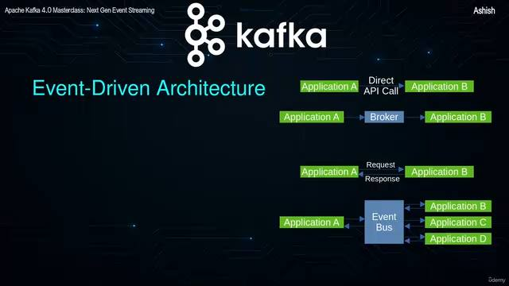
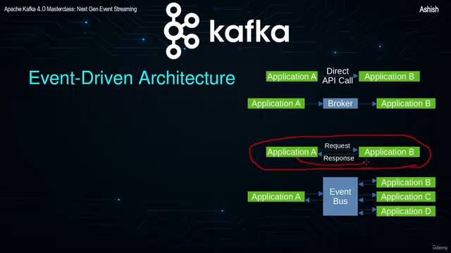
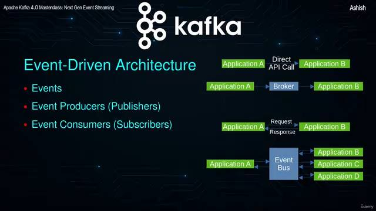
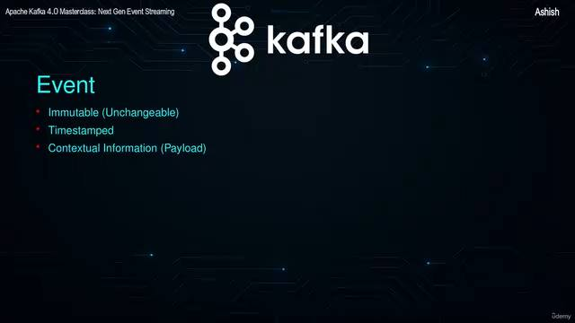
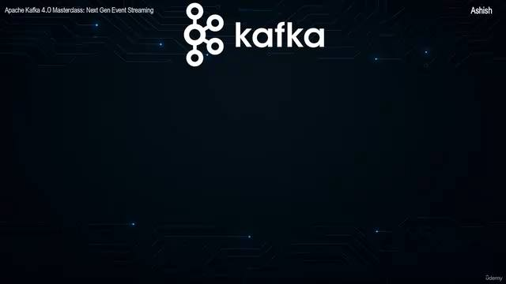
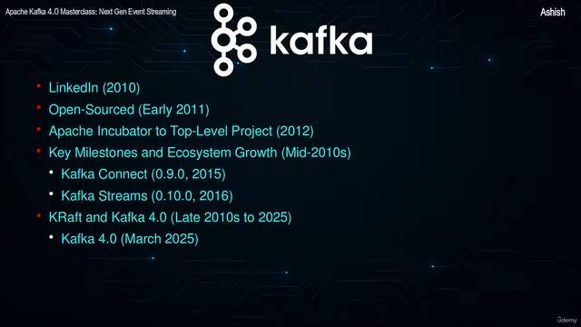
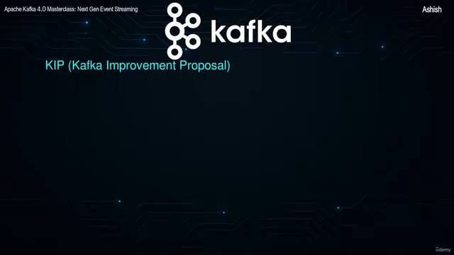

# Apache Kafka 4.0 学习文档（P6–P9）：事件驱动架构、事件流与 KIP

> **文档性质说明（先读这一段）**
> P6–P9 这四讲是**纯讲解课**：逐字稿里没有任何一行可执行代码、没有终端命令、没有配置文件、没有依赖版本。讲师在这四讲里做的是「把概念推导清楚」，真正的动手内容（topics、partitions）被他明确留到了下一讲。
> 因此本文严格按「纯讲解课」的写法组织：第 3 节复现的是**讲师的推导链条**（需求 → 约束 → 估算 → 方案 → 取舍），第 4 节把这条链条落成**可以直接拿去开会用的设计产物**（职责表、数据模型草案、决策表、容量估算表、KIP 追踪表）。
> 文中凡是出现代码块，都会在块首用注释标注「课里没有代码，以下为示意」。**不要**把示意代码当成 Kafka 官方 API 来记。

---

## 1. 这一节做什么

这四讲要解决的问题只有一个：**为什么现代系统要从「我命令你做事」改成「我宣布事情发生了」。**

拆开看是四层，一层压一层：

| 讲次 | 主题 | 这一讲要回答的问题 |
|---|---|---|
| P6 | 事件驱动架构（EDA） | 什么叫「事件」？它和「命令」有什么本质区别？EDA 由哪几个零件组成？ |
| P7 | 事件流（Event Streaming） | 单个事件怎么变成一条永不结束的流？这条流凭什么比传统队列强？ |
| P8 | Apache Kafka 是什么 | Kafka 的四根支柱是什么？它从 LinkedIn 内部工具走到 4.0 经历了什么？ |
| P9 | KIP 是什么 | Kafka 4.0 里那些「KIP-500 / 848 / 932」到底是什么东西，我该不该关心？ |

**学完你应该能拿出的东西**：一份能贴到团队 wiki 上的「我们为什么要引入事件流」的决策记录，外加一份「我们的事件长什么样」的数据模型草案。这两样东西，就是第 4 节的产物。

**这一节不做什么**：不装 Kafka、不建 topic、不写生产者消费者。讲师在 P6 结尾原话是「In our coming lecture, we are going to dive into the fundamental building blocks of Apache Kafka itself. We will explore some of its most crucial concepts like topics and partitions.」——**topics 和 partitions 是下一讲的内容，本文不越界展开**。

---

## 2. 讲师原话（带时间戳）

下面这些句子是这四讲的骨架，后面第 3、4、5 节全部是从这些句子里长出来的。建议先扫一遍，再往下读。

**关于「事件」的定义**

> "在软件中，事件不过是对已经发生的事情的一条记录。它是一个事实，具有不可变性，也就是说，一旦发生，就无法更改。"
> —— p006 [01:49]

> "因此，每当我说“用户已注册”“商品已加入购物车”“订单已下单”或“温度传感器已完成读数”时，这些都是过去时的事实陈述。它们不会直接要求任何人做任何事，只是在宣告某事确实已经发生。"
> —— p006 [02:45]



**关于「命令」与「事件」的分水岭**

> "关键转变是从“告诉”转向“宣告”，从“请求”转向“响应”。"
> —— p006 [05:05]

> "当用户点击“立即购买”时，电子商务网站不会要求支付服务处理支付。相反，它只是发布一个“订单已下单”的事件。"
> —— p006 [04:37]



**关于 EDA 的四个零件**

> "事件驱动架构是一种架构模式，其中软件系统不同部分之间的通信基于事件的产生、检测、消费和响应。"
> —— p006 [05:05]

> "注意生产者和消费者是完全独立的。它们在时间和空间上实现了解耦。"
> —— p006 [06:30]



**关于「事件流」**

> "如果事件是一次单独发生，那么事件流不过是由这些事件组成的连续、无界且有序的序列。"
> —— p007 [02:46]

> "在 Kafka 这类事件流中，事件会按可配置的时长存储。它们不会在消费后被删除，这是一个巨大的差异。"
> —— p007 [04:08]



**关于 Kafka 的定位**

> "本质上，Apache Kafka 是一个开源的分布式流式平台。"
> —— p008 [00:54]

> "它本质上是一个分布式的不可变提交日志。"
> —— p008 [04:32]



**关于 4.0 与 KRaft**

> "Kafka 4.0 将于 2025 年 3 月发布。这是一项重大变革。Kafka 4.0 标志着 KRAFT 被全面采用为默认且唯一的元数据管理系统。"
> —— p008 [09:40]



**关于 KIP**

> "KIP 是 Kafka Improvement Proposal 的缩写。它是 Apache Kafka 开源社区内一个正式流程，用于提出、讨论并最终实现针对 Kafka 的重大变更或新功能。"
> —— p009 [00:00]

> "KIP 500。它旨在用自管理的元数据仲裁组替代 ZooKeeper，也就是 KRAFT。"
> —— p009 [03:47]



---

## 3. 从零复现：讲师的推导链条

这一节不是「P006 讲了 A，P007 讲了 B」，而是把四讲的内容**压成一条从问题到方案的直线**。你按 Step 0 → Step 6 走一遍，就等于把讲师的思路重走了一遍。

### Step 0｜起点：同步直调为什么会烂

讲师在 P6 开头先做了个回顾：传统应用之间是**直接同步调用**——「like one person directly asking another for something and waiting for an immediate answer」。

这个模型的约束是三条，缺一不可：

1. **调用方必须知道被调方是谁**（地址、接口、协议）；
2. **调用方必须等**（同步阻塞）；
3. **被调方挂了，调用方跟着挂**（故障级联）。

讲师给的结论是：「This leads to tight coupling and scalability issues.」——紧耦合 + 扩展性差。

### Step 1｜第一层改进：引入消息中间件

第二步是把「直接问」换成「投递到中间人」：发送方把消息扔给 broker 就走，不等接收方。

讲师原话：「The sender doesn't wait for the receiver leading to better decoupling and resilience.」

这一步解决了**时间解耦**（发送方不用等），但没解决**语义耦合**——发送方仍然在说「你去给我付款」，它依然知道接收方该干什么。

### Step 2｜关键一跃：从「命令」改成「宣布」

这是 P6 最重要的一步，也是整门课的分水岭。

| | 命令驱动（request-response） | 事件驱动（EDA） |
|---|---|---|
| 用户点「立即购买」后，电商站做什么 | 直接给支付服务发 `process payment` 命令 | 只发布一个 `order placed` 事件 |
| 谁决定「要做什么」 | **发送方**决定 | **接收方**各自决定 |
| 发送方知道接收方吗 | 知道 | 不知道，也不关心 |
| 加一个新下游要改谁 | 改发送方 | 谁都不用改，新服务自己订阅 |
| 讲师原话 | "telling" / "requesting" | "announcing" / "reacting" |

讲师举的例子非常具体：同一个 `order placed` 事件，支付服务听了去发起支付，库存服务听了去扣库存，邮件服务听了去发确认邮件——**三件事并行发生，互相不知道对方存在**。

> 前端类比：这就是 `dispatchEvent(new CustomEvent('order:placed'))` 和「直接 `await paymentService.pay()`」的区别。前者你不需要 import 任何人，后者你得先知道 paymentService 在哪。

### Step 3｜把「事件」定义死：四要素

讲师在 P6 [01:49] 和 P7 [01:54]–[02:24] 两次定义事件，第二次给得更细。把两次合起来，一个事件必须满足：

| 要素 | 讲师原话依据 | 含义 |
|---|---|---|
| **不可变（immutable）** | "一旦发生，就无法更改" | 事件是既成事实，只能追加新事件表示「后续变化」，不能改旧事件 |
| **时间戳（timestamp）** | "事件总是带有一个时间戳，用来标明其发生时间" | 用于排序和分析 |
| **发生了什么（what happened）** | "一名用户完成注册" | 事件名，用**过去式** |
| **上下文载荷（payload）** | "用户 ID、用户名、电子邮件，以及可选的注册 IP 地址" | 业务数据 |

讲师给的三个类比值得记住：**照片**（拍下那一刻，改不了）、**收据**（某笔交易发生过的凭证）、**日志行**（带时间戳的一行记录）。

⚠️ 注意「过去式」这个细节。讲师特意强调 "这些都是过去时的事实陈述"。命名成 `createOrder` 是命令，命名成 `order.placed` 才是事件。这是团队落地时最容易写错的地方。

### Step 4｜从单个事件到事件流：五条性质

单个事件没意义，**连续的事件**才有。讲师在 P7 [02:46]–[04:08] 给了事件流的五条性质：

1. **连续（continuous）**——"事件一经发生便会持续流动，7×24 小时不间断"，不是定时批量到货；
2. **无界（unbounded）**——"它没有明确的起点，也没有终点"；
3. **有序（ordered）**——"在给定的事件流或事件流的某个分区内，事件会保持其出现顺序"；
4. **只追加（append-only）**——"新事件总是追加到该事件流的末尾；不能在中间插入，也不能修改已有事件"；
5. **消费不删除（retained）**——"它们在消费之后不会被删除"，保留「for a configurable period」。

第 5 条是**和传统消息队列最大的区别**，讲师用了两次强调（P7 [04:08]、P8 [04:32]）。传统队列是「读走即焚」，事件流是「录像带」——你可以直播看，也可以倒回去重看。

> ⚠️ 讲师只说了「configurable period」，**没有给出具体的配置项名字**（比如保留多少小时、配置写在哪个文件）。本文不编造这个字段名，见第 7 节。

### Step 5｜估算：讲师给的是量级，不是精确值

讲师在 P7、P8 里反复用了两个量级词，我把它们列出来，并做一次换算（**换算是我做的，不是讲师说的**）：

| 讲师口径 | 出处 | 我的换算 | 备注 |
|---|---|---|---|
| "millions of events per second" | p007 [06:49]、p008 [01:22] | 10⁶ ~ 10⁸ 条/秒 | "millions" 是量级词，讲师未给精确值 |
| "billions of events per day" | p007 [11:00] | 10⁹ ÷ 86400 ≈ **11,574 条/秒** | 纯算术换算 |
| "over 150,000 organizations worldwide" | p008 [11:05] | — | 讲师给的采用规模 |
| "80% of the Fortune 100 companies" | p008 [11:05] | — | 讲师给的采用规模 |

**这个估算的意义在哪？** 它决定了架构的取舍方向：

- 如果是 100 条/秒，一个 Postgres 表 + 定时轮询就够了，不需要 Kafka；
- 如果是 10⁶ 条/秒，**单机磁盘写入和网络带宽都会先成为瓶颈**，所以必须「distributed」——讲师在 P8 [01:22] 特意拆解了 "distributed" 这个词：「It's designed to run across multiple machines, forming a cluster.」
- 如果是 10⁹ 条/天且要保留数周，**存储成本会超过计算成本**，所以「durable + configurable retention」不是可选项，是设计前提。

> 前端视角：这就像你决定「用不用 Redux」。如果只是父子传个值，props 就够了；一旦你要跨 20 个组件共享状态、还要能时间旅行调试，才需要引入一整套状态管理。**Kafka 的复杂度只有在量级到了的时候才划算。**

### Step 6｜方案与取舍：为什么是 Kafka，以及 4.0 取舍了什么

讲师在 P8 把 Kafka 的能力归纳成**四根支柱**（"四个核心用途"）：

| 支柱 | 讲师原话 | 对应到 EDA 的哪个零件 |
|---|---|---|
| 发布事件流 | "应用程序或生产者可以将数据写入 Kafka 主题" | 事件生产者 |
| 订阅事件流 | "多个消费者可以按照各自的节奏独立读取同一事件流" | 事件消费者 |
| 持久化存储 | "以容错、持久且有序的方式，按可配置的时长存储事件" | 事件通道（可回放） |
| 实时处理 | "Kafka Streams 和 KSQLDB 这类工具" | 事件通道之上的加工层 |

**取舍 1：为什么不用传统消息队列？**
因为传统队列「读走即焚」，无法回放、无法多消费者各自按自己进度读。讲师在 P7 [07:19] 说得很直白：「once a message is processed in a traditional queue it's gone」。

**取舍 2：4.0 为什么干掉 ZooKeeper？**
讲师在 P8 [09:10]–[10:09] 讲了完整动机：ZooKeeper 是**外部依赖**，带来「operational complexity」。KIP-500 用 KRaft（Kafka Raft Metadata）把元数据管理收进 Kafka 自己。4.0 的结果是「simplified deployments」「enhanced scalability」「improved resilience」。

**取舍 3：KIP-932 为什么只是 early access？**
讲师在 P9 [04:43]–[05:11] 明确说：KIP-932 是给 Kafka 加「传统队列语义」（share groups），但「It's available in early access in Kafka 4.0... not available for use in production」。**这条很重要**——它意味着如果你现在要上生产，队列语义这块不能赌。

---

## 4. 完整代码 → 可交付的设计产物

> 再次强调：**P6–P9 课里没有任何代码。** 下面 4.1–4.5 是从讲师口述内容直接落成的设计文档，4.6 的代码块是**示意**，用来帮你把概念对齐到 TypeScript 类型上，不是 Kafka 官方 API。

### 4.1 组件职责表（EDA 四零件）

| 组件 | 讲师定义 | 它知道什么 | 它**不**知道什么 | 挂了会怎样 |
|---|---|---|---|---|
| 事件（Event） | "对已发生事情的记录"，不可变 | 自己发生的事实 | 谁会用 | —（它是数据，不是进程） |
| 生产者（Producer / Publisher） | "检测事件并将其发布到事件通道的应用程序" | 事件通道地址 | 谁消费、消费了干什么 | 该事件丢失（除非本地先落盘） |
| 消费者（Consumer / Subscriber） | "对某些类型事件感兴趣的应用程序会监听事件通道并做出响应" | 自己订阅哪类事件 | 谁生产的 | 重启后从上次位置继续（讲师 P6 [07:56]："它可以重新启动，并从上次中断的位置继续处理事件"） |
| 事件通道（Event Channel / Bus / Stream Platform） | "the central nervous system of an EDA"，"transports events from producers to consumers" | — | 业务语义 | 整个系统瘫痪 |

> 讲师在 P6 [06:03] 有一句关键定位：「This is where Apache Kafka fits in.」——**Kafka 扮演的是第四行那个「事件通道」**，不是生产者也不是消费者。这个定位决定了后面所有 API 的分层。

### 4.2 事件数据模型草案（TypeScript）

```ts
// ⚠️ 课里没有代码，以下为示意。
// 依据：P007 [01:54]–[02:24] 讲师口述的「事件四要素」+ P006 [02:18] 的示例事件名。
// 这不是 Kafka 官方 SDK 的类型，只是把口述内容落成可讨论的契约。

/** 事件名一律用「过去式」，对应讲师说的 past tense, factual statements */
type EventName =
  | "user.signed_up"        // p006 [02:18]
  | "cart.item_added"       // p006 [02:18]
  | "order.placed"          // p006 [02:18]
  | "sensor.temperature_read"; // p006 [02:18]

/** 所有事件的公共信封：不可变 + 时间戳 + 载荷 */
interface DomainEvent<TName extends EventName, TPayload> {
  /** 事件类型，过去式 */
  readonly eventName: TName;
  /** 发生时间，对应讲师说的 "events always have a timestamp" (p007 [01:54]) */
  readonly occurredAt: string; // ISO 8601
  /** 业务载荷，对应讲师说的 payload / contextual information */
  readonly payload: TPayload;
  /** ⚠️ eventId 课里没提，是本文为「去重」预留的，见第 7 节 */
  readonly eventId?: string;
}

/** 讲师在 p007 [02:24] 明确列出的字段：user ID, username, email, 可选 registration IP */
interface UserSignedUpPayload {
  userId: string;
  username: string;
  email: string;
  registrationIp?: string; // 讲师原话 "optionally registration IP address"
}

/** 组装后的具体事件 */
type UserSignedUpEvent = DomainEvent<"user.signed_up", UserSignedUpPayload>;

// 讲师在 p007 [02:24] 举的例子：2025 年 8 月 15 日发生了一次注册
const example: UserSignedUpEvent = {
  eventName: "user.signed_up",
  occurredAt: "2025-08-15T00:00:00.000Z",
  payload: {
    userId: "u_10086",
    username: "alice",
    email: "alice@example.com",
    registrationIp: "203.0.113.7",
  },
};
```

### 4.3 设计决策表（ADR 风格，可直接贴 wiki）

| # | 决策 | 备选方案 | 为什么选它（讲师依据） | 代价 |
|---|---|---|---|---|
| D1 | 服务间通信用「事件」而非「命令」 | 同步 REST 直调 | p006 [05:05] "从告知转向宣告"；p006 [06:30] 生产消费完全解耦 | 调用链变长，问题定位变难 |
| D2 | 事件一旦写入不可修改 | 允许 UPDATE | p006 [01:49] "it's immutable"；p007 [03:42] "You don't insert in the middle and you don't modify existing events" | 业务变更只能靠追加「补偿事件」 |
| D3 | 事件消费后**不删除** | 读走即焚（传统队列） | p007 [04:08] "它们在消费之后不会被删除"；p008 [04:32] 可回放 | 存储成本随保留期线性增长 |
| D4 | 事件通道选 Kafka | 其他 MQ | p006 [10:12] "Kafka 从最初设计起，就力求实现高度的可扩展性、容错性和高吞吐量" | 运维复杂度上升 |
| D5 | 上 Kafka 4.0，用 KRaft | 继续用 ZooKeeper | p008 [09:40] 4.0 是 "全面采用 KRAFT，将其作为默认且唯一的元数据管理系统" | 老版本运维脚本要改 |
| D6 | 队列语义（KIP-932）暂不上生产 | 用 share groups 替代 | p009 [05:11] "仍在开发中，尚不可用于生产环境" | 需要队列语义的场景得另想办法 |

### 4.4 容量估算表

| 指标 | 讲师口径 | 换算/说明 | 影响的设计点 |
|---|---|---|---|
| 吞吐 | millions of events/秒（p007 [06:49]） | 10⁶–10⁸ /s | 必须分布式，单机不够 |
| 日量 | billions of events/天（p007 [11:00]） | ≈ 11,574 /s（10⁹÷86400，**换算是我做的**） | 保留期直接决定磁盘 |
| 保留期 | "可配置的时长……可以是几天、几周、几个月，甚至几年"（p008 [04:32]） | 讲师未给默认值 | 见第 7 节，配置项名课里没讲 |
| 消费者数 | "多个消费者可以独立读取同一事件流"（p008 [03:39]） | 无上限（讲师未给数字） | 扇出（fan-out）是常态，不是例外 |
| 采用规模 | 150,000+ 组织、80% Fortune 100（p008 [11:05]） | — | 生态成熟度参考 |

### 4.5 KIP 追踪表

| KIP 编号 | 主题 | 状态（讲师口径） | 出处 |
|---|---|---|---|
| KIP-500 | 用自管理元数据仲裁（KRaft）替换 ZooKeeper | Kafka 4.0 起成为默认且唯一 | p009 [03:47] |
| KIP-848 | 新的消费者再平衡协议（consumer rebalance protocol） | "Now available"，4.x 已可用 | p009 [04:14] |
| KIP-932 | Queues for Kafka（share groups，传统队列语义） | **early access，不可用于生产** | p009 [04:43] |

> 讲师在 P9 [00:28] 给了个很好记的类比：KIP 之于 Kafka，等于 RFC 之于互联网、PEP 之于 Python。

### 4.6 「下单」事件的时序草案（示意）

```text
// ⚠️ 课里没有代码，以下为示意。
// 依据：P007 [08:45]–[09:36] 讲师口述的电商例子。

用户点击「立即购买」
        │
        ▼
[电商站] ──publish──▶ order.placed ──▶ ┌─────────────────┐
                                        │  事件通道(Kafka) │
                                        └────────┬────────┘
                        ┌────────────────┬───────┴────────┬────────────────┐
                        ▼                ▼                ▼                ▼
                   [支付服务]        [库存服务]        [物流服务]        [邮件服务]
                   发起支付           扣减库存          创建运单          发确认邮件
                        │                │                │                │
                        └────────────────┴────────────────┴────────────────┘
                                    四者并行，互不知晓

讲师补充的容错点（p007 [09:36]）：
  若 [邮件服务] 此刻宕机 → 订单照常处理；
  邮件服务恢复后，从流里「读过去的事件」把邮件补发出去。
```

---

## 5. 逐行解释：每个决策为什么这么定

**D1 为什么是「宣布」而不是「命令」？**
因为命令把「要做什么」的知识放在了发送方。发送方一旦要支持新下游，就得改代码、重新发布、重新联调。讲师在 P6 [07:00] 说得很清楚：「You can add new consumers or change existing ones without impacting producers.」——**新增消费者的边际成本趋近于零**，这才是 EDA 真正的卖点，不是「异步」两个字。

**D2 为什么事件必须不可变？**
因为可变的事件无法回放。如果一条 `order.placed` 能被改成 `order.cancelled`，那你重放历史时得到的就是一个错误的世界。讲师在 P6 [07:56] 说「If a consumer fails, it can restart and process events from where it left off, ensuring no data loss」——**这个「从断点续读」的能力，前提就是历史不可变**。业务上的「取消」应该是一条新的 `order.cancelled` 事件，而不是去改老的那条。

**D3 为什么消费后不删除？**
这是和传统队列最本质的分歧。讲师在 P7 [07:19] 说传统队列「once a message is processed... it's gone」，导致「If you need to reprocess historical data... it's very difficult」。不删除带来三个直接收益：①新服务上线可以「补课」；②出问题可以「倒带」复现；③审计有完整账本。代价是存储，所以才有 D4.4 里那个「保留期」的估算。

**D4 为什么是 Kafka 而不是别的？**
讲师在 P6 [10:12] 给的三个词是 **highly scalable / fault tolerant / high throughput**，在 P8 [11:34] 又补了 **low latency** 和 **flexibility**。注意他没有说「Kafka 最快」——他说的是「designed from the ground up to be」，是**设计目标**层面的匹配，不是跑分。

**D5 为什么 4.0 值得单独提？**
因为「去掉一个外部依赖」在运维上是**质变**。原来你要维护 Kafka 集群 + ZooKeeper 集群两套东西，两套的监控、备份、升级节奏都不一样。讲师在 P8 [10:09] 用的词是「simplified deployments」「improved resilience」。对前端转过来的同学，可以类比成「从 webpack + 独立 babel 配置」变成「vite 一体化」——不是功能变多，是**要操心的东西变少**。

**D6 为什么 KIP-932 不能上生产？**
讲师在 P9 [05:11] 的原话是「still in development, not available for use in production」。early access 意味着 API 可能变、行为可能有 bug、社区不承诺兼容。他还补了一句很有意思的观察：「RabbitMQ is venturing in event streaming. And here we have Kafka venturing in queues.」——**两个生态在互相靠拢**，但都还在路上。

**4.2 里每一行为什么这么写？**

- `eventName` 用联合类型而不是 `string`：让「过去式命名」这个约定在编译期就被强制，写 `createOrder` 会直接报错。
- `readonly` 修饰符：TypeScript 层面模拟「不可变」，对应 D2。注意这只是**编译期**约束，运行时仍可被改，真正的不可变要靠「只追加」的存储模型保证。
- `occurredAt` 用 `string`（ISO 8601）而不是 `Date`：跨进程传输时 `Date` 会退化成字符串，不如一开始就定死格式。**这是本文的工程建议，讲师没讲序列化格式**（见第 7 节）。
- `registrationIp?` 带问号：严格对应讲师说的 "可选的注册 IP 地址"。
- `eventId?` 带问号且加了警告注释：**讲师没提过这个字段**，它是为「消费端去重」预留的。如果你不需要去重，删掉它。

**4.6 时序图里那个「邮件服务恢复后补发」为什么成立？**
因为 D3——事件没被删。如果邮件服务挂的时候事件已经被其他消费者「消费掉并删除」，那它恢复后就读不到了。**容错能力是「不删除」这个决策的直接推论**，不是额外加的功能。

---

## 6. 复现检查清单

这一节没有「跑起来」的命令（课里没有），但有一份**理解验收清单**。每条都能自己讲出来，才算真的过了这四讲。

**概念层**
- [ ] 能用一个具体例子（比如「用户点立即购买」）说清「命令」和「事件」的区别
- [ ] 能说出事件的四要素：不可变、时间戳、发生了什么、载荷
- [ ] 能解释为什么事件名要用过去式
- [ ] 能说出事件流的五条性质：连续、无界、有序、只追加、消费不删除
- [ ] 能说清「事件通道」在 EDA 里扮演什么角色，以及 Kafka 对应的是哪一层

**架构层**
- [ ] 能画出 EDA 四零件（事件 / 生产者 / 消费者 / 通道）的关系图
- [ ] 能说出至少 3 个 EDA 带来的好处，并各配一个具体场景
- [ ] 能说出 EDA 的代价（至少 2 条，比如定位变难、存储成本）
- [ ] 能解释「生产者和消费者在时间和空间上解耦」具体指什么

**Kafka 层**
- [ ] 能拆解 "开源分布式流处理平台" 这三个词各自意味着什么
- [ ] 能说出 Kafka 的四根支柱
- [ ] 能讲清 Kafka 从 LinkedIn 2010 → 开源 2011 → 顶级项目 2012 → 4.0（2025.03）这条时间线
- [ ] 能解释 4.0 干掉 ZooKeeper 换 KRaft 的动机和收益

**KIP 层**
- [ ] 能解释 KIP 是什么，以及它和 RFC / PEP 的类比
- [ ] 能说出 KIP-500 / KIP-848 / KIP-932 各解决什么问题
- [ ] 能说出 KIP-932 当前**不能**用于生产

**产出层**
- [ ] 4.2 的事件类型能直接粘进你的项目并编译通过
- [ ] 4.3 的决策表里，每一条你都能补上「如果我们不这么做会怎样」

---

## 7. 课里没讲但你会撞上的

这一节是**免责 + 预警**。下面这些是真实落地时一定会遇到、但 P6–P9 逐字稿里**一个字都没提**的内容。我列出来，是为了让你知道「这里有个坑」，而**不是**替讲师补课。

### 7.1 课里明确说了「下一讲才讲」的

- **Topics 和 Partitions**：讲师在 P6 [11:37] 原话「In our coming lecture, we are going to dive into the fundamental building blocks of Apache Kafka itself. We will explore some of its most crucial concepts like topics and partitions.」——所以本文全程没有展开分区数、副本因子、分区键这些东西。**这是下一讲的内容，别在这里找。**

### 7.2 课里只给了概念、没给具体值/名字的

| 你会撞上的问题 | 课里怎么说的 | 你需要自己确认什么 |
|---|---|---|
| 事件保留多久？配置项叫什么？ | 只说 "可配置的时长……可以是几天、几周、几个月，甚至几年"（p008 [04:32]） | **具体配置项名称课里没讲**，请以你所用版本的官方文档为准 |
| 默认分区数是多少？ | 完全没提 | 同上 |
| 事件用什么格式序列化？JSON / Avro / Protobuf？ | 完全没提 | 本文 4.2 用 JSON 只是示意 |
| 消费端怎么去重？ | 完全没提 | 本文 4.2 的 `eventId` 是**我加的**，不是讲师提的 |
| 消费者组（consumer group）怎么配？ | 只在 KIP-848 处提了 "消费者再均衡协议"（p009 [04:14]），没展开 | 需要另找资料 |

### 7.3 前端转 AI 应用工程师会特别疼的两点

**① 「有序」到底保证到哪一级？**
讲师在 P7 [03:42] 说的是「Within a given stream **or a partition of a stream**, events maintain their order」——注意这个 "或……的某个分区" 的限定。**全局有序是不保证的**，只有分区内有序。
> 在 Node 里对应什么：Node 是单线程事件循环，同一个进程内你 `await` 的先后顺序是确定的；但一旦你起了多个 consumer 实例（`cluster` 或多 Pod），**跨实例的顺序就没了**。这跟 Kafka 的分区内有序是同一个道理——想要顺序，就得把相关事件路由到同一个「车道」上。

**② 幂等（idempotency）**
讲师在 P6 [07:56] 说消费者失败重启后「process events from where it left off, ensuring no data loss」——**注意他说的是 no data loss，不是 no duplicate**。at-least-once 语义下，重复消费是可能的。你的消费逻辑必须写成「同一条事件处理两次，结果一样」。
> 在 Node 里对应什么：就像 `useEffect` 在 React 18 StrictMode 下会跑两次，你的 effect 必须能扛住重复执行。写 Kafka 消费者是同一回事。

### 7.4 一个容易误读的点

讲师在 P8 [05:27] 提到 Kafka Streams 和 KSQLDB 是「processing event streams in real-time」的手段。**这不代表你上 Kafka 就必须用它们**。对大多数「前端转 AI 应用」的场景，你更可能是：用某个 Kafka 客户端库生产/消费事件，把流处理逻辑放在你自己的 Node 服务里。Kafka Streams 是 Java/Scala 库（讲师原话 "一个功能强大的 Java、Scala 客户端库"，p008 [08:42]），**知道即可，不必现在学**。

### 7.5 最后一句

这四讲的信息密度不高，但**概念密度很高**。它们不教你任何一行能跑的代码，但它们决定了你后面写代码时**每一个设计选择的方向**。如果你现在就想动手，那说明你该去看下一讲了——topics 和 partitions 在那里等你。

---

*本文所有引用均来自 BV1iKNi6kEwT 的 P6–P9 逐字稿。文中标注「示意」「换算是我做的」「课里没提」的内容，均为文档作者的补充说明，不代表讲师原意。*