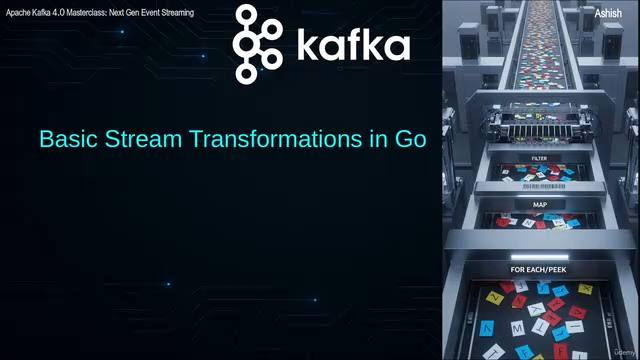
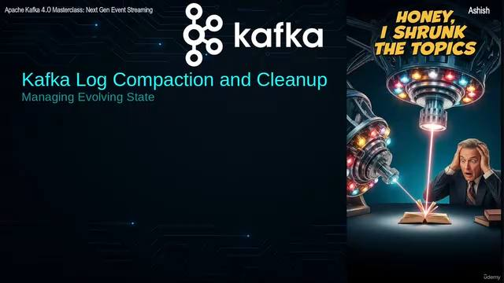
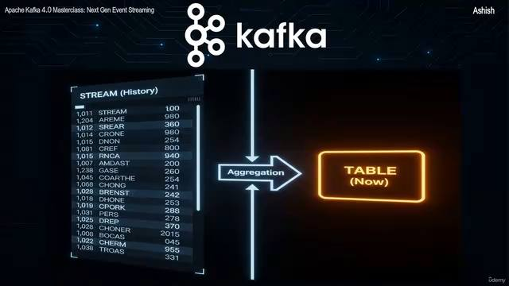
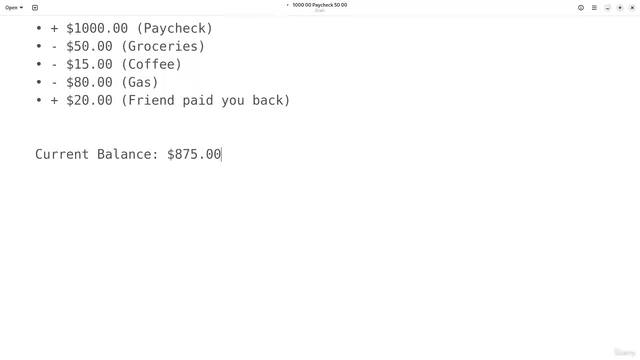
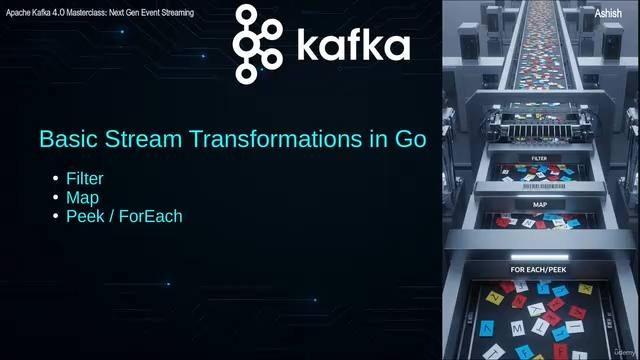
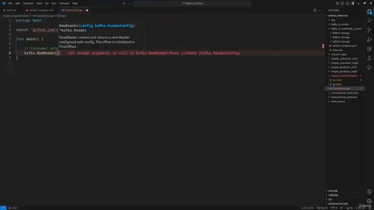
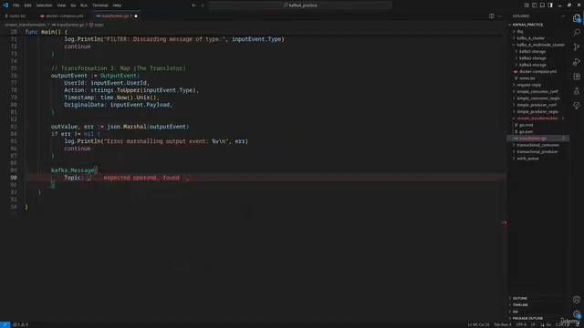
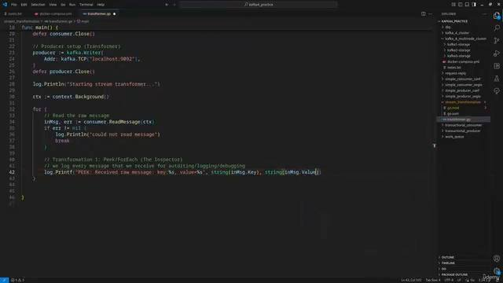
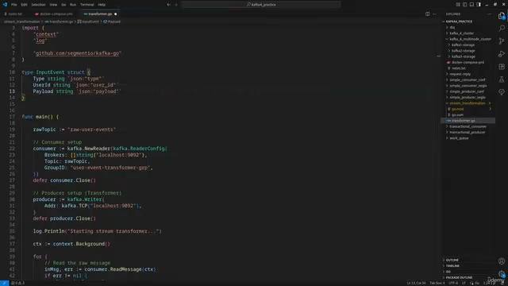
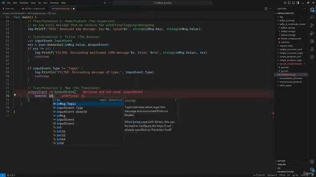

# Apache Kafka 4.0：日志压缩、Go 流处理与无状态转换器（P61–P64）

## 1. 这一节做什么

这四段课程最终要落成一个**能跑起来的 Go 流处理程序**：它从 Kafka 的 `raw-user-events` 主题消费 JSON 消息，先做 peek（观察/记录原始消息），再做 filter（只保留 `type=login` 的事件），最后做 map（把输入结构转换成输出结构），并把结果写到 `processed-user-events` 主题。

但在写代码之前，课程先补了三个背景：

1. **Kafka 怎么清理旧日志**：`cleanup.policy=delete` 按时间/大小删除整个旧 segment；`cleanup.policy=compact` 按 key 保留每个 key 的最新值，适合“演化状态”。  
2. **为什么用 Go 做流处理**：编译型、goroutine 轻量并发、channel 通信、单二进制部署。课程明确说，这节课用 Go 的基础 Kafka 客户端库，而不是 Kafka Streams。Kafka Streams 是 Java 生态的“预制工厂套件”，知道即可。  
3. **流与表的二元性**：stream 是历史事件日志，table 是当前状态快照；有状态流处理需要在应用里维护“表”。P64 的转换器是**无状态**的，所以暂时不需要处理状态持久化。

最终产物是一个单文件 Go 程序，目录结构如下：

```text
kafka-stream-course/
└── stream-transformation/
    ├── go.mod
    ├── go.sum
    └── transformer.go
```



课程里对 Go 与 Kafka Streams 的取舍可以整理成下面这张表：

| 方案 | 课程里的定位 | 适合场景 | 代价 |
|---|---|---|---|
| Kafka Streams | Java 生态的预制工厂套件，过滤器、聚合、join、窗口等组件齐全 | 团队已经在 JVM 生态，想要开箱即用的流处理算子 | 必须用 Java/Scala 等 JVM 语言；语法细节知道即可 |
| Go + 基础 Kafka 客户端 | 自定义车间：用 `segmentio/kafka-go` 这类库自己写消费、转换、生产 | 想理解流处理底层，想要灵活控制和部署简单 | 窗口、状态存储等要自己补 plumbing |

课程选择的是后者：用 `github.com/segmentio/kafka-go` 作为生产者/消费者引擎，用 Go 自己写 assembly line 逻辑。

---

## 2. 讲师原话

下面几句是这四段里最关键的“设计依据”，后面复现代码时可以直接对照：

> "对于通过 `cleanup.policy` 设置配置的主题，Kafka 提供两种主要策略来清理其中的旧数据。"
> —— p061 [01:51]

> "这项策略确保 Kafka 在主题日志中为每个消息键至少保留最后一条已知消息。"
> —— p061 [03:16]

> "Go 有几项关键特性，使其格外适合这项工作。首先是性能……接下来是并发，而并发正是 Go 的强项。"
> —— p062 [00:57] / [01:27]

> "流表示历史，表表示现在。"
> —— p063 [02:18]

> "最简单的方式是使用 Go map。这个 map 就是我们的便签本，是我们在内存中的状态。"
> —— p063 [04:08]

> "现在我们来构建一个 Go 应用，由它完成上述所有工作。这个应用会读取原始用户事件流，对其进行清理，并生成处理后的事件流。"
> —— p064 [03:47]

> "我们将再次使用 segment IO 库。"
> —— p064 [05:06]

这几句话对应到项目里就是：**topic 用 `cleanup.policy` 决定保留策略；消费者做转换；用 Go map 才能做有状态，但本节的 transformer 故意保持无状态；客户端库用 segmentio/kafka-go。**







---

## 3. 从零复现

### 3.1 前置条件

你需要一个已经在 `localhost:9092` 监听的 Kafka 或兼容 Kafka 协议的消息系统。课程里代码写的是 `localhost:9092`，并提到如果愿意可以写 `9094`、`9095` 等多个 broker 地址。课程没有讲 Kafka 本体如何安装，也没有给 Docker Compose；这一步需要你用自己的本地环境或课程环境。

Go 版本课程没有明确说。实际复现时用你机器上的 Go 即可，执行 `go version` 能正常输出就行。项目不需要环境变量，broker 地址硬编码在代码里。依赖版本课程也没有指定，`go get github.com/segmentio/kafka-go` 会拉取当时解析到的版本；不要手写一个假版本号。

### 3.2 创建两个 topic

课程在终端里创建了 `raw user events` 和 `processed user events`，并明确说本次只需要 1 个 partition。下面用 Kafka 发行版自带的脚本给出完整命令；如果你的环境是 Redpanda 或容器内工具，命令名可能不同，但参数含义一致。课程只念了 topic 名和“1 个分区”，没有展示完整脚本。

```bash
kafka-topics.sh --create \
  --bootstrap-server localhost:9092 \
  --topic raw-user-events \
  --partitions 1 \
  --replication-factor 1

kafka-topics.sh --create \
  --bootstrap-server localhost:9092 \
  --topic processed-user-events \
  --partitions 1 \
  --replication-factor 1
```

如果 topic 已存在，命令会报 already exists，可以忽略。代码里用的 topic 名要和这里一致；课程口述是 “raw user events”，Kafka topic 名通常写成连字符形式，本文统一用 `raw-user-events` 和 `processed-user-events`。



### 3.3 初始化 Go 模块

```bash
mkdir -p kafka-stream-course/stream-transformation
cd kafka-stream-course/stream-transformation
go mod init transformer
go get github.com/segmentio/kafka-go
```

`go mod init transformer` 里的模块名课程口述为 “Transformer”，实际写 `transformer` 即可。`go get` 之后 `go.mod` 会自动出现 `require github.com/segmentio/kafka-go` 以及实际版本，`go.sum` 也会生成。课程没有给出版本号，所以本文不虚构版本；你可以在终端执行 `go list -m github.com/segmentio/kafka-go` 记录实际版本。

### 3.4 写入 `transformer.go`

在 `stream-transformation` 目录下新建 `transformer.go`，把第 4 节的完整代码保存进去。课程里先写 consumer，再写 producer，然后写无限循环、peek、filter、map、写回。代码顺序不影响运行，但建议照第 4 节完整文件一次保存，避免漏 import。



### 3.5 启动转换器

开第一个终端：

```bash
cd kafka-stream-course/stream-transformation
go run transformer.go
```

正常会看到：

```text
starting stream transformer
```

这时程序阻塞在 `consumer.ReadMessage`，等待 `raw-user-events` 里的消息。

### 3.6 生产测试消息

开第二个终端，用控制台生产者往 `raw-user-events` 写消息。课程里说“为了简单，从命令行生产消息，在 consumer 里转换”。下面命令用 `|` 分隔 key 和 value：

```bash
kafka-console-producer.sh \
  --bootstrap-server localhost:9092 \
  --topic raw-user-events \
  --property parse.key=true \
  --property key.separator='|'
```

然后逐行输入下面四条：

```text
user-123|{"type":"login","user_id":"user-123","payload":"some details"}
user-123|{"type":"click","user_id":"user-123","payload":"some details"}
user-789|this is not valid json
user-456|{"type":"login","user_id":"user-456","payload":"another payload"}
```

第一条是合法 login，应该被转换并写回；第二条是合法 JSON 但 `type` 不是 `login`，会被 filter 丢弃；第三条不是合法 JSON，会被 `json.Unmarshal` 报错并丢弃；第四条又应该被转换。

### 3.7 观察处理结果

开第三个终端消费 `processed-user-events`：

```bash
kafka-console-consumer.sh \
  --bootstrap-server localhost:9092 \
  --topic processed-user-events \
  --from-beginning \
  --property print.key=true \
  --property key.separator='|'
```

你应该看到类似下面的输出（字段名来自我们自己定义的 `OutputEvent`，不是 Kafka 内部字段）：

```text
user-123|{"user_id":"user-123","action":"LOGIN","timestamp":1710000000,"original_data":"some details"}
user-456|{"user_id":"user-456","action":"LOGIN","timestamp":1710000001,"original_data":"another payload"}
```

同时第一个终端会打印 peek、filter、map 三类日志。课程里也是用两个终端互相验证：一个跑 transformer，一个生产消息，另一个消费 processed topic。



### 3.8 可选：验证日志压缩概念

课程 P61 讲了 `cleanup.policy=compact`，但没有给完整实验命令。如果你想把概念跑一遍，可以创建一个 compact topic：

```bash
kafka-topics.sh --create \
  --bootstrap-server localhost:9092 \
  --topic user-profiles \
  --partitions 1 \
  --replication-factor 1 \
  --config cleanup.policy=compact
```

然后对同一个 key 发多条消息，观察后台 cleaner 最终只保留每个 key 的最新值。注意：compaction 是后台异步过程，不是发一条就立刻删一条；课程没有讲触发频率和 cleaner 调优参数，所以不要期待秒级看到效果。

---

## 4. 完整代码

### 4.1 `transformer.go`

下面是一个完整文件，保存后可直接 `go run transformer.go`。代码按课程口述补全了 import、错误处理和结构体定义；课程里没有逐字念 import，但函数调用需要这些包。

```go
package main

import (
	"context"
	"encoding/json"
	"log"
	"strings"
	"time"

	"github.com/segmentio/kafka-go"
)

// InputEvent 表示原始输入消息的结构。
// 课程里说输入有 type、user_id、payload 三个字段。
type InputEvent struct {
	Type    string `json:"type"`
	UserID  string `json:"user_id"`
	Payload string `json:"payload"`
}

// OutputEvent 表示转换后输出消息的结构。
// 课程里说输出保留 user_id，把 type 变成 action，
// 增加 timestamp，并保留原始 payload 到 original_data。
type OutputEvent struct {
	UserID       string `json:"user_id"`
	Action       string `json:"action"`
	Timestamp    int64  `json:"timestamp"`
	OriginalData string `json:"original_data"`
}

func main() {
	brokers := []string{"localhost:9092"}
	rawTopic := "raw-user-events"
	processedTopic := "processed-user-events"
	groupID := "user-event-transformer-group"

	// 只需要 consumer：转换由 consumer 完成。
	consumer := kafka.NewReader(kafka.ReaderConfig{
		Brokers: brokers,
		Topic:   rawTopic,
		GroupID: groupID,
	})
	defer consumer.Close()

	// 需要 producer 把转换后的消息写回另一个 topic。
	// 这里不设置 Writer.Topic，而是在每条 kafka.Message 上指定 Topic。
	producer := &kafka.Writer{
		Addr: kafka.TCP("localhost:9092"),
	}
	defer producer.Close()

	log.Println("starting stream transformer")

	ctx := context.Background()

	for {
		// 读取原始消息。
		incomingMessage, err := consumer.ReadMessage(ctx)
		if err != nil {
			log.Printf("could not read message: %v", err)
			break
		}

		// Transformation 1: peek / for each。
		// 只观察和记录，不修改消息本身。
		log.Printf(
			"peek: received raw message key=%s value=%s",
			string(incomingMessage.Key),
			string(incomingMessage.Value),
		)

		// Transformation 2: filter。
		// 先反序列化 JSON；反序列化失败就丢弃。
		var inputEvent InputEvent
		if err := json.Unmarshal(incomingMessage.Value, &inputEvent); err != nil {
			log.Printf(
				"filter: discarding malformed json message: %v, message=%s",
				err,
				string(incomingMessage.Value),
			)
			continue
		}

		// 只保留 login 事件。
		if inputEvent.Type != "login" {
			log.Printf("filter: discarding message of type %s", inputEvent.Type)
			continue
		}

		// Transformation 3: map。
		// 把输入结构转换成输出结构。
		outputEvent := OutputEvent{
			UserID:       inputEvent.UserID,
			Action:       strings.ToUpper(inputEvent.Type),
			Timestamp:    time.Now().Unix(),
			OriginalData: inputEvent.Payload,
		}

		outValue, err := json.Marshal(outputEvent)
		if err != nil {
			log.Printf("error marshaling output: %v\n", err)
			continue
		}

		outMessage := kafka.Message{
			Topic: processedTopic,
			Key:   []byte(outputEvent.UserID),
			Value: outValue,
		}

		if err := producer.WriteMessages(ctx, outMessage); err != nil {
			log.Printf("failed to write transformed message: %v", err)
		} else {
			log.Printf(
				"map: successfully produced transformed message for key=%s",
				string(outMessage.Key),
			)
		}
	}
}
```

### 4.2 `go.mod` 与依赖

执行完 `go mod init transformer` 和 `go get github.com/segmentio/kafka-go` 后，`go.mod` 形如：

```text
module transformer

go 1.x

require github.com/segmentio/kafka-go vX.Y.Z
```

其中 `go 1.x` 和 `vX.Y.Z` 由你的 Go 版本与 `go get` 实际解析结果决定。课程没有指定版本，所以这里不写具体数字。`go.sum` 会自动生成，不需要手写。

### 4.3 topic 创建命令

```bash
kafka-topics.sh --create \
  --bootstrap-server localhost:9092 \
  --topic raw-user-events \
  --partitions 1 \
  --replication-factor 1

kafka-topics.sh --create \
  --bootstrap-server localhost:9092 \
  --topic processed-user-events \
  --partitions 1 \
  --replication-factor 1
```

---

## 5. 逐行解释

### 5.1 结构体与 JSON 标签

`InputEvent` 对应课程里说的输入字段：`type`、`user_id`、`payload`。`OutputEvent` 对应输出：`user_id`、`action`、`timestamp`、`original_data`。课程里明确说输入有多个字段，所以要先定义 struct 再 `json.Unmarshal`；如果直接拿字符串做 `strings.Contains`，无法可靠判断 `type`。

`json:"user_id"` 这种标签决定 JSON 里的字段名。Go 结构体字段名首字母大写才能被 `encoding/json` 导出。课程口述时说的是 `user ID`、`payload`，代码里落成下划线风格。

### 5.2 consumer 创建

```go
consumer := kafka.NewReader(kafka.ReaderConfig{
	Brokers: brokers,
	Topic:   rawTopic,
	GroupID: groupID,
})
```

课程说“我们只创建 consumer，因为转换由 consumer 完成”。`GroupID` 用于消费者组；同一个 group 下多个实例会分摊 partition。本次只有 1 个 partition，所以实际上只有一个消费者在工作。课程里 group ID 叫 “user event transformer group”，代码里用连字符。

在 Node/JS 里，消费者组偏移量类似你轮询接口时保存的游标；只不过 Kafka 帮你把游标存在 broker 侧。重启后从哪个位置继续，取决于 group 的已提交偏移，不是每次都从最早开始。

### 5.3 producer 创建

```go
producer := &kafka.Writer{
	Addr: kafka.TCP("localhost:9092"),
}
```

课程明确说“这里不给 topic，topic 在 message 里指定”。所以 `Writer` 只配地址，发送时在 `kafka.Message{Topic: processedTopic, ...}` 里带 topic。这样同一个 producer 可以往不同 topic 写。

`defer consumer.Close()` 和 `defer producer.Close()` 会在 `main` 返回时执行。正常运行时程序卡在无限循环里，只有 `ReadMessage` 返回错误并 `break` 后才会走到 defer。课程里也是这个结构。

### 5.4 无限循环与读取

```go
for {
	incomingMessage, err := consumer.ReadMessage(ctx)
	if err != nil {
		log.Printf("could not read message: %v", err)
		break
	}
```

`ReadMessage` 返回 `kafka.Message` 和 `error`。课程里说“如果出错，记录错误，然后 break 还是 continue 取决于你”，示例代码选择 `break`。这意味着 broker 一旦不可读，程序退出，不会无限重试。生产环境通常要加重试/退避，但课程没有展开。

### 5.5 peek：只观察不修改

```go
log.Printf(
	"peek: received raw message key=%s value=%s",
	string(incomingMessage.Key),
	string(incomingMessage.Value),
)
```

课程把 peek 类比成“检查员”：不拆信、不改信，只把信封上的地址记到日志里。这里打印 key 和 value，`incomingMessage.Key` 和 `Value` 都是 `[]byte`，所以用 `string()` 转成可读文本。peek 不改变后续 filter/map 的输入。

### 5.6 filter：先反序列化，再判断 type

```go
var inputEvent InputEvent
if err := json.Unmarshal(incomingMessage.Value, &inputEvent); err != nil {
	log.Printf("filter: discarding malformed json message: ...")
	continue
}

if inputEvent.Type != "login" {
	log.Printf("filter: discarding message of type %s", inputEvent.Type)
	continue
}
```

课程里说 filter 像“门卫”：只看条件，满足就放行，不满足就丢弃。这里有两个过滤条件：第一，value 必须是合法 JSON；第二，`type` 必须等于 `login`。`continue` 直接进入下一轮循环，不执行后面的 map 和写回。

注意：课程演示时发了一条“不是 JSON 的句子”，终端会打印 discarding malformed json message。这不是程序崩溃，而是预期过滤。

### 5.7 map：构造新结构并序列化

```go
outputEvent := OutputEvent{
	UserID:       inputEvent.UserID,
	Action:       strings.ToUpper(inputEvent.Type),
	Timestamp:    time.Now().Unix(),
	OriginalData: inputEvent.Payload,
}
```

课程把 map 类比成“翻译员”：不是决定放不放行，而是改变内容/结构。这里把 `type` 转成大写后放进 `action`，用 `time.Now().Unix()` 生成秒级时间戳，把原 `payload` 放进 `original_data`。

`json.Marshal(outputEvent)` 把结构体变成 `[]byte`。如果序列化失败，记录错误并 `continue`。课程里也是先 marshal 再发消息。

### 5.8 写回 processed topic

```go
outMessage := kafka.Message{
	Topic: processedTopic,
	Key:   []byte(outputEvent.UserID),
	Value: outValue,
}

if err := producer.WriteMessages(ctx, outMessage); err != nil {
	log.Printf("failed to write transformed message: %v", err)
} else {
	log.Printf("map: successfully produced transformed message for key=%s", string(outMessage.Key))
}
```

`Topic` 在这里指定，因为 `Writer` 没有配 topic。`Key` 用 `user_id`，这样同一个用户的消息会落到同一个 partition（本次只有 1 个 partition，所以体现不出来）。写失败只记录日志，不退出循环；写成功打印 map 确认。

### 5.9 为什么 P64 不需要状态

P63 讲了流表二元性：如果要算“某个视频的观看次数”，需要维护一个 Go map，把 `videoID -> count` 存起来。但 P64 的 filter/map 是**逐条独立处理**的：处理当前消息不需要知道上一条消息。因此它不需要状态，也不需要担心重启丢 map。课程把这种处理叫 stateless transformation。

如果你以后要扩展成“统计每个用户 login 次数”，才会遇到 P63 说的“内存 map 重启丢失”问题；课程说后续会用备份到另一个 Kafka topic 或外部数据库解决，但这一节没有展开。

---

## 6. 复现检查清单

| 检查项 | 怎么检查 | 预期 |
|---|---|---|
| Kafka 是否监听 9092 | `kafka-topics.sh --bootstrap-server localhost:9092 --list` | 能列出 topic，不报连接失败 |
| 两个 topic 是否存在 | 同上，确认 `raw-user-events`、`processed-user-events` | 两个都在 |
| Go 模块是否初始化 | `cat go.mod` | 有 `module transformer` 和 kafka-go 的 require |
| 依赖是否下载 | `go mod tidy` 或 `go run transformer.go` | 不报 cannot find package |
| transformer 是否启动 | 第一个终端 `go run transformer.go` | 打印 `starting stream transformer` |
| 合法 login 是否被转换 | 生产 `{"type":"login",...}` | 第一个终端打印 peek 和 map 成功；processed topic 收到消息 |
| 非 login 是否被过滤 | 生产 `{"type":"click",...}` | 第一个终端打印 filter discarding message of type click；processed topic 无新消息 |
| 非法 JSON 是否被过滤 | 生产 `user-789|this is not valid json` | 第一个终端打印 discarding malformed json message |
| processed 消息字段 | 控制台消费 processed topic | 能看到 `user_id`、`action`、`timestamp`、`original_data` |
| compact 实验是否可选 | 创建 `user-profiles` 时加 `--config cleanup.policy=compact` | 不要期待立即删除旧 key，后台异步 |







---

## 7. 课里没讲但你会撞上的

1. **Kafka 没启动或端口不是 9092**  
   课程代码硬编码 `localhost:9092`。如果你的 broker 在容器里、端口映射不同，或者课程环境用了 9094/9095，程序会卡在 `ReadMessage` 或连接失败。先把 `brokers` 改成实际地址。

2. **topic 名不一致**  
   课程口述 “raw user events”，代码里本文用 `raw-user-events`。如果你创建的是 `raw_user_events`，程序会一直等一个不存在的 topic。创建和代码必须完全一致。

3. **依赖版本没有锁定**  
   课程只说用 segment IO 库，没有给版本。`go get` 会拉取当时最新版；不同版本 API 可能有细微差异。复现时用 `go list -m github.com/segmentio/kafka-go` 记录实际版本，不要手写假版本。

4. **消费者组偏移导致“看不到旧消息”**  
   如果 `user-event-transformer-group` 之前跑过，重启后可能从已提交偏移继续，而不是从最早开始。测试时如果 processed topic 没反应，先确认你是不是在等新消息，或者换一个 group ID 重新跑。

5. **`defer producer.Close()` 在无限循环里不会立即执行**  
   只有 `ReadMessage` 出错并 `break` 后 main 返回，defer 才执行。正常 Ctrl+C 终止进程时，defer 也不一定按你预期执行。课程没有讲优雅关闭信号处理。

6. **`kafka.Writer` 的 Topic 字段**  
   课程说“这里不给 topic，topic 在 message 里指定”。如果你给 Writer 配了 Topic，又在 Message 里配了不同 Topic，实际行为要以库版本为准。本文统一在 Message 里指定，与课程口述一致。

7. **控制台生产者的 key 分隔符**  
   课程演示时没有展示完整生产者命令。用 `--property parse.key=true` 时必须同时设置 `key.separator`，否则 key/value 可能不符合预期。本文用 `|` 分隔，避免 JSON 里的冒号干扰。

8. **日志压缩不是即时删除**  
   `cleanup.policy=compact` 是后台 log cleaner 异步工作。课程没有讲 `log.cleaner` 线程数、触发比例等参数；不要发两条消息就期待旧值立刻消失。

9. **`log` 输出到 stderr**  
   Go 标准库 `log` 默认写 stderr，终端里可能和 stdout 交错。看到日志顺序和代码顺序不完全一致是正常的。

10. **UI 工具只是辅助**  
    课程提到可以用 Redpanda 或 Kafka UI 控制台确认消息，但没有讲安装配置。没有 UI 不影响复现，命令行消费者足够验证。

11. **P63 的“内存 map 状态”不是本节代码**  
    P64 的 transformer 没有维护 map，也不涉及锁/事务。如果你把它扩展成有状态计数，才会遇到并发写 map 的问题；在 Go 里需要 mutex 或单 goroutine 串行处理，在 Node/JS 里对应单线程事件循环下的进程内 Map，重启同样会丢。课程没有实现这部分，只给了概念。